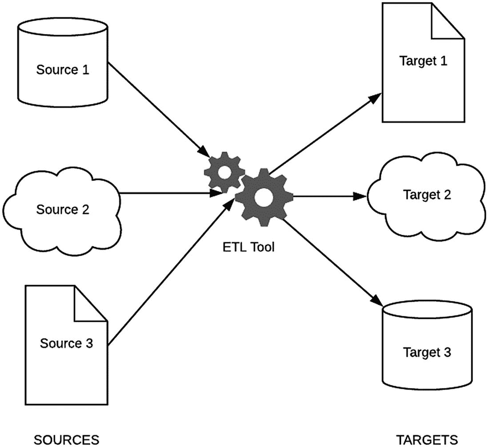
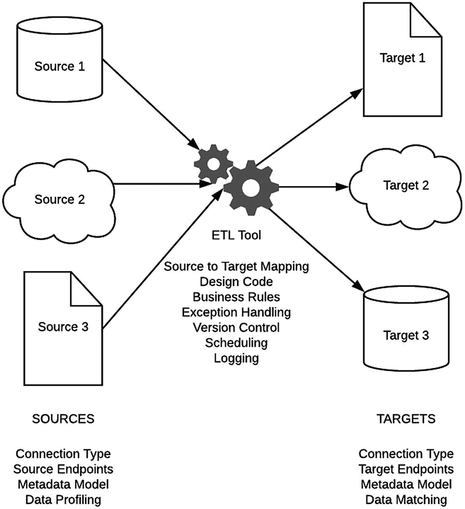
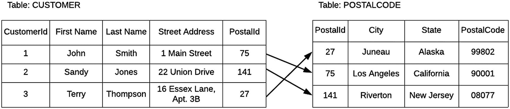
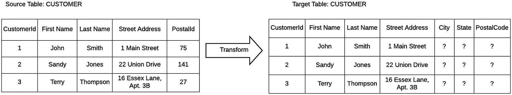

# 2. 关键术语

> *技术理解应成为任何公司的核心能力。*
>
> ——埃德温·卡特穆尔^(²⁰)

至此，我们毫无疑问地认识到，启动迁移和集成活动不仅仅是按下一个按钮，然后看着数据从源端流向目标端。这个过程是组织的一个反映，需要跨部门协作，每位代表都带着独特的看法、顾虑，以及可能不止一种直言不讳的观点。这些代表中有些人可能对他们需要什么样的数据知之甚少，而另一些人则可能宣称自己懂得比实际更多。在构建系统集成时，每个人都必须保持意见一致，这一点是不变的。本章的目的是介绍该流程中特有的几个关键术语。通过从一开始就确立这种共同的定义，团队将能够就集成流程的组成部分进行富有成效的对话，同时避免技术解决方案通常伴随的许多困惑。

## 迁移的简洁性

我们从一个基础示意图开始。数据集成组件看起来相当简单。

图 2-1

一个简单的 ETL 示意图

图 2-1 展示了一个典型的迁移/集成架构。我们有一个或多个源系统，它们将文档传递给中间件组件（ETL 工具），然后该工具再将数据推送至一个或多个目标系统。从高层次来看，这似乎相当容易实现。由于只涉及三个组件，不难理解为何“一键式”概念会流行起来。

但深入探究该模型，梳理出每个组件的常见组成部分，我们会发现这个设计要复杂得多（见图 2-2）。

图 2-2

一个不那么简单的 ETL 示意图

如果没有过往经验，我们面临的挑战在于理解这些组件各自将如何影响我们的整体解决方案。在规划集成框架时，每个组件都需要我们加以考虑并进行一定程度的讨论。

在本章的剩余部分，我们将讨论这些组件的定义和优先级、它们如何融入我们的设计，以及根据手头任务如何最佳地实现它们的一些示例。

## 源系统

源系统代表存放我们入站数据的位置。它涵盖了从逗号分隔值（CSV）文件、Excel 电子表格到复杂数据库和大型主机等各类存储库。简而言之，任何包含需迁移至他处的数据的系统都被视为源系统。

自然地，在最初的审查阶段，讨论源系统时会涌现出大量问题。它们位于何处？我们如何访问它们？哪些是关键数据，又存储在何处？至关重要的是，在最初的几次发现会议中（关于事件顺序的讨论见第 4 章），必须邀请熟悉这些系统并了解其设计、用途和特有流程的相关人员参加。这些人员应具备适当水平的技术知识或文档，以便能够提供我们在此讨论的信息。

### 连接类型

连接类型代表了数据所在的存储位置。它可以是任何提供数据的载体，例如 Excel 电子表格、数据库、文本文件等。与此相关的还有若干子类别，可能提供必要的详细信息。例如，如果数据以文本文件形式提供，它是逗号分隔、制表符分隔还是其他分隔方式？如果连接类型是数据库，有哪些插件支持它？了解这些细节尤为重要，特别是当这需要钻研晦涩的 SQL 代码或寻找支持小众数据库的兼容 ETL 连接器时。

### 源端点

端点简单地说是通信信道的一端。^(²¹) 它可以是一个容易理解的 URL，例如 “`https://example.com/this-is-an-endpoint/`”，或者更复杂的 WSDL 或 REST 调用，如 “`http://www.myserver.com/mycustomSite/_vti_bin/excelservice.asmx?WSDL`”，如果是从事各种在线云或本地数据库系统中检索，它可以是 JDBC 或 ODBC 连接字符串，例如 “`https://www.infocaptor.com/dashboard/jdbc-odbc-drivers-connections-and-strings-url`”。

没有正确的端点，访问数据就会变得困难。如果利益相关者或业务用户不直接知道端点，所提供的 API 用户手册中可能包含答案。此外，在大多数情况下，您需要一个用户名和密码，以便能够以适当的访问级别登录。有了这些信息，您就能够检索（`GET` 方法）或输入（`POST` 方法）数据。我们将在本章后面讨论这如何适用于目标端点。

### 元数据模型

元数据模型是描述其他数据的数据。它汇总了关于数据的基本信息，这可以使查找和处理其他数据变得更加容易。例如，在处理照片图像时，了解文件大小或拍摄照片的相机类型背后的详细信息会很有帮助。^(²²) 在集成数据时，至少有六个对象元数据字段非常有用：^(²³)

*   记录创建日期：告诉你一行数据的“年龄”
*   记录创建者：告诉你创建该记录的人（或服务账户！）
*   记录更新日期：告诉你该行数据的新鲜程度
*   记录更新者：告诉你该与谁联系以获取关于更新记录的更多状态信息
*   记录来源：告诉你最初是哪个系统提供了这条记录
*   行版本号：告诉你用户更新一行数据的次数

在数据领域，元数据模型也常被用来泛指数据模式。就我们的目的而言，这正是关键所在，尤其是在构建源字段与目标字段之间的映射时。如果您想巩固您的集成需求，那么为您的源系统和目标系统推导出元数据模型是强制性的。由于其重要性，我们将在本书中持续引用元数据映射过程（称为源到目标映射）。

#### 数据剖析

您数据库的有效性完全取决于所提供的信息质量，而数据剖析正是审查源数据内容和质量的一种实践。其主要目标是帮助我们发现源数据的结构、内容以及它们之间的关系。^(²⁴) 让我们仔细看看这些发现概念。

#### 结构发现

我们期望数据格式一致。例如，美国电话号码应有十位数字，美国邮政编码通常为五位。但有时结构可能不一致。我们数据集中的美国电话号码可能包含办公分机号，美国邮政编码也可能包含四位扩展码。在映射到我们类似的目标系统时，识别结构异常非常重要。例如，如果源系统中的 `POSTALCODE` 字段允许 “19122-2553” 格式，而我们假设目标系统中应为 “19122”，那么迁移后的数据将会丢失那些能加快邮件投递速度的结构信息。

#### 内容发现

这种类型的剖析涉及检查单个数据记录以及现系统错误。例如，我们之前例子中的邮政编码可能因输入错误而缺少数字（例如，四位字符而非五位），或者值可能是存储在源系统中的国际值（例如，代表伦敦市的 “SW1A 1AA”）。内容发现将帮助我们确定需要校正哪些具体的行和字段，使我们能够标记出在集成前可能需要在源系统中进行修正的记录。

#### 关系发现

随着系统复杂度的增加，系统中不同组件之间的互联性也随之增强。关系发现是一个评估一个字段如何与另一个字段连接的过程，它允许在不同对象之间进行查找。关系在许多数据库中都至关重要，以至于我们通常将数据库称为关系型数据库管理系统（`RDBMS`）。

举个简单的例子，假设我们有一个包含全美邮政编码的查找表。再假设我们有一个`CUSTOMER`表，包含名字、姓氏、产品以及该用户的地址。与其为每个用户重复输入城市、州和邮政编码，不如提供一个键，该键可以对邮政编码查找表执行查找（见图 2-3）。

图 2-3 – `CUSTOMER` 与 `PostalCode` 之间的关系

如果我们审视图 2-3，关系发现就变得有意义了。`CUSTOMER.Id #1`（John Smith）包含 `CUSTOMER.PostalId #75`。此值直接引用了 `POSTALCODE` 表中对应“加利福尼亚州洛杉矶市 90001”的记录。这样看来，我们就能理解为什么有必要识别 `CUSTOMER` 和 `POSTALCODE` 之间的关系，而不能简单地假设我们只需要一张表。

如果不理解这种关系，你很可能会在细节中迷失方向，尤其是当目标系统中的对照表与源系统差异很大时。为了说明这一点，让我们进一步扩展我们的例子。出于各种设计原因，目标`CUSTOMER`表现在包含了完整的城市、州和邮政编码字段（即，不再引用 `PostalId`）。如果你只是获取源数据并直接映射到目标，你将得到不完整且无法访问的数据（见图 2-4）。

图 2-4 – 未进行 `PostalCode` 关系发现的客户映射

图 2-4 说明，当等式中缺少 `POSTALCODE` 表时，目标中的 City、State 和 `PostalCode` 字段的值将无法填充。这个例子的寓意在于，确保你能够识别并记录构成完整数据视图的**所有**表，而不仅仅是采用想当然的一对一匹配方法。

## ETL 工具

我们模型中的提取、转换和加载（`ETL`）部分由中间件平台（即本地或基于云的服务器）和软件组成，这些软件编译用于将数据从源系统集成到目标系统的代码。任何能够从源系统拉取或接收（提取）数据，通过一系列处理步骤（转换）进行修改，然后将这些数据推送（加载）到目标指定位置的系统，都可以被视为一个`ETL`工具。架构的这一部分将发生集成团队的大部分提升和硬连接工作，因此选择合适的`ETL`平台和软件至关重要。

我们将在后续章节中详细介绍`ETL`软件和设计。现在，我们先介绍构成`ETL`模型的标准技术组件。

#### 源到目标映射

对于数据集成团队来说，源到目标映射（`STTM`）是一组指令，用于确定如何将源系统中的数据转换为目标系统所需的正确结构和内容。在最基本的形式中，`STTM`仅包含相关的源元数据、转换规则和目标元数据。你可以提供更多详细信息，而更复杂的解决方案可能也需要这些信息。我们将在第 4 章中详细讨论这些可选字段。

### 设计代码

这里没有什么令人困惑的。设计代码仅仅是用于从源系统提取、转换和加载数据到目标系统的代码。但作为整个集成过程的“大脑”，设计代码的配置完全取决于所选的`ETL`软件。有些用户界面是图形化的拖拽式界面，而另一些则需要针对仅适用于 `Java`、`JavaScript`、`.NET` 或当前可用的其他众多编程语言的专有库进行编程。正如我们讨论过的其他所有内容一样，深思熟虑对于找到适合特定工作的正确代码至关重要，然后还要确保团队成员拥有适当的编码技能。

### 业务规则

这些是提供将数据从源系统转换到目标系统的标准和条件的语句列表。业务规则与业务需求不同，因为*业务需求*是你为了启用规则而需要遵守的事项。尽管业务规则应该是固定且一致的，但很多时候，它们可能会在业务所有者之间引发一些激烈的争论，因为他们可能对哪些规则应应用于哪些数据存在分歧。幸运的是，这些讨论大多围绕目标系统展开，因为按定义，已填充的源系统已经包含了具有原始业务规则的数据。尽管如此，不要被误导，认为源系统中提供的业务规则会原封不动地直接转移到目标系统。在许多情况下，更新的业务决策将推动新的业务规则，而这反过来又可能要求将输出数据转换为与其输入格式截然不同的内容。

### 异常处理

数据迁移和集成过程可能因两个主要原因而失败——要么是由于网络或数据库连接问题导致的技术故障，要么是由于数据未能满足预期的业务规则而导致的业务相关问题。在这种情况下，需要让数据团队和业务所有者知晓故障。但这应该如何发生呢？是通过在线日志通知？通过电子邮件？还是通过第三方应用程序？对警报和类似错误的规范被称为异常处理，应基于内置的软件配置、设计代码或两者结合来设计。

### 版本控制

数据加载可能涉及大量反复试验，设计代码也会频繁更改。最初可能只是从源系统中检索几个字段，但很快可能级联到多个表，每个表都依赖于前一个表。每次你修改一个文件函数时，都无意中冒着破坏代码其他部分的风险。随着时间的推移，跟踪所有更改会变得很困难。正确的做法是偶尔暂停一下，备份现有的代码库，但这样做可能会用你永远不需要打开的增量更改文件来使你的计算机变得臃肿。保持文件安全且可恢复的一种解决方案是通过版本控制，这是一种随时间记录文件或文件集更改的系统，以便你以后可以调用特定版本。

版本控制系统（`VCSs`）已经使用了数十年，主要用于具有定期小版本发布和错误修复的软件应用程序。但现在，它的使用在需要编写脚本的任何组件（包括 `ETL` 软件）中已变得更加普遍。我个人可以证明这是值得的。有一次，我不小心输错了一个 `Unix` 命令，以为要删除一个无关紧要的文件，结果却删除了包含 25 个极其重要文件的整个目录。幸运的是，我能够通过神奇的 `VCS` 回滚功能撤销删除。我给你的建议是，对你的代码设计备份采用同样的策略。

### 调度

如果 ETL 过程是可重复的，即在特定时间点按指定间隔运行，则可以将该过程设置为自动执行。设置此执行方式是通过一个调度服务完成的，该服务可能内置于 ETL 工具中，或通过服务器调度应用程序进行配置。有关作为夜间集成方案一部分的作业调度的更多详情，请参阅第 1 章“调度服务”。

### 日志记录

集成作业可以并行运行，并在一天中的任何时间执行。由于有大量流量通过 ETL 工具，为每条记录的成功或失败创建逐刻状态报告可能有些过度。我们希望避免用过多信息加载服务器。但与此同时，我们可能仍然希望存储这些信息，*以防万一*，尤其是在处理可能对组织产生法律或财务影响的数据时。举个简单的例子，假设我们为一家杂志出版社设计并部署了一个 ETL 流程。该流程通过将记录从源会计系统复制到目标邮件列表，对客户订阅执行夜间集成。到目前为止，我们构建的所有系统似乎都运行顺畅。

但等等，先别急。部署两周后，我们的客服部门收到一位愤怒客户的投诉，她声称自己收到了一本从未订阅过的杂志。“不可能”，我们说道，因为知道我们的 ETL 系统至今一直运行良好。但查询订阅数据库后发现，这位客户确实被分配了错误的杂志。这怎么可能发生？又是什么时候发生的？

最有效的调查方式是通过查看日志文件，追溯到该记录和错误订阅进入 ETL 系统的那一刻。大多数 ETL 工具都能提供此日志记录功能，包括单独传入和传出的记录集，以及执行作业进程的时间、日期和名称。由于日志文件会随着时间推移变得非常大，系统应配置为仅保留足够长的时间以调查可能出现的任何问题——也许三周到一个月。保留时间过长可能会导致处理空间减少，系统运行不稳定。然而，如果没有这些日志文件，可能需要数天甚至数周才能找出根本原因，而在此期间，您还得应对那些越来越恼火的客户和企业主，他们只能推测这是*您*的集成逻辑错误，而非完全无关的事件。

## 目标系统

目标系统接收集成数据，通常代表集成项目的关键交付成果。大多数需要调整或微调的业务规则都是为了目标系统的利益，而这些特定的利益相关者需要认同集成团队的解决方案。目标系统中的连接类型和元数据模型组件与之前讨论的源系统相同，基本原理也大致类似。然而，目标端点和数据匹配的概念确实有所不同，我们将在本节中讨论。

### 目标端点

目标端点是数据流的接收通道，该数据流源于源系统，被提取到 ETL，然后加载以符合现有业务规则。目标端点与源端点之间的主要区别在于 ETL 连接器的视角。连接器使用 `GET` 方法从源系统检索数据，并使用 `POST` 方法将数据推送到目标系统。^(³¹) 在不深入探讨该主题的情况下，关于 Web 服务，我能说的就是这些。因此，现在只需了解 `GET` 和 `POST` 之间的区别。如果你想了解更多，我推荐阅读 Sanjay Patni 的著作 *Pro RESTful APIs*（Apress，2017 年）。^(³²)

### 数据匹配

目标系统包含来自多个数据集的记录。细想一下，所有这些系统拥有一个公共标识符的情况是很少见的。即使是像 `CONTACT` 这样的公共表，也可能从一个源使用社保号等国家身份标识值作为唯一标识符，而从另一个源则改用护照号作为唯一标识符。数据匹配的作用是查找指向同一实体的记录，通常是通过分析能提供部分标识的字段来实现，例如全名或出生日期。^(³³) 在跨多个源系统导入数据时，找到这些公共标识符可能颇具挑战性。为此，软件公司开发了专门的脚本、算法和软件来合并并减少重复记录。从这时起，数据匹配便进入了一个被称为主数据管理（MDM）的技术领域，之所以如此命名，是因为一条记录（即“主记录”）理论上可以追溯到源系统标识符，从而将企业数据库集中到单个中心枢纽。^(³⁴) 设计 MDM 需要一套不同于集成工作的技能，不在我们的讨论范围之内。但请记住，目标系统中的数据匹配方法是迈向 MDM（即协调整个企业数据的最终目标）更近一步。

本章涵盖了众多关键术语和概念，从集成架构的简单图示开始。在这座隐喻性数据冰山的表面之下，还有更多内容有待吸收。现在，既然我们已经理解了源系统、ETL 和目标系统的运作机制，就可以开始重点介绍所需的技能了。具体来说，我们的集成团队需要哪些角色和职责？下一章将深入探讨。

脚注 1 2 3 4 5 6 7 8 9 10 11 12 13 14 15