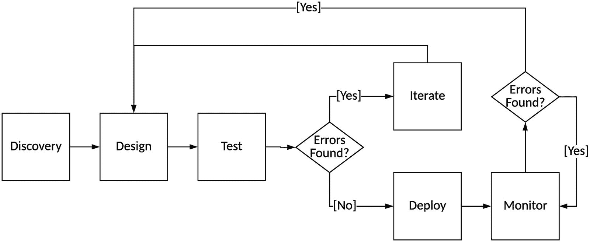
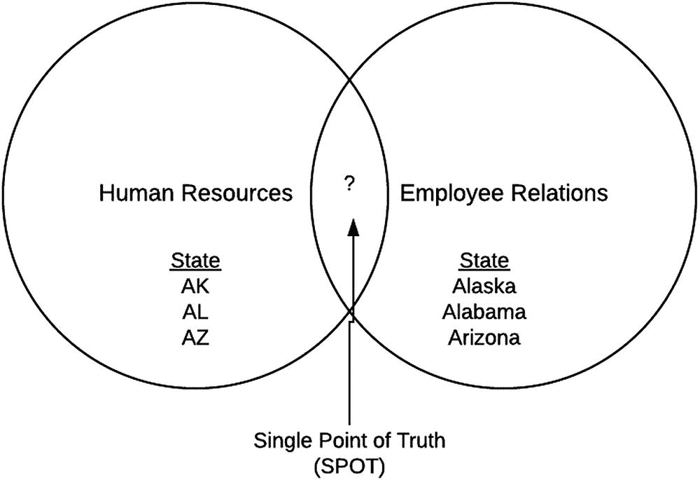
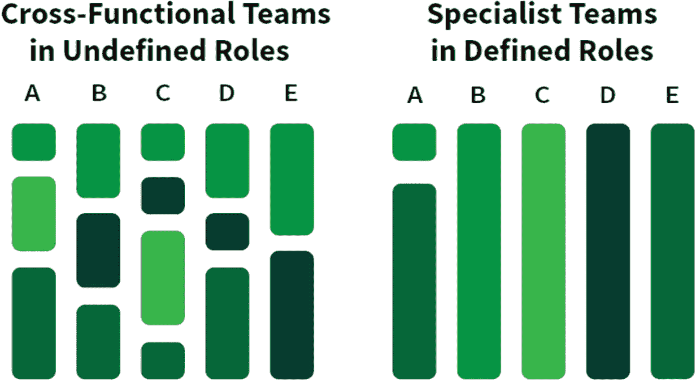

# 3. 团队资质

> *但我确实拥有一套非常独特的技能，是我在漫长的职业生涯中习得的。*
> 
> —连姆·尼森，《飓风营救》(2008)^(³⁵)

在前几章中，我们讨论了集成的基础知识、方法以及一些关键术语。有了这些理解，我们现在可以开始讨论成功推进集成项目所需的角色和职责。

许多项目负责人认为，一个人就可以负责整个集成工作，包括需求、设计以及不可避免的部署。在某些情况下，这确实成立。但在许多其他情况下，则需要额外的支持。不幸的是，与所有具有多层次复杂性的项目一样，所需技能类型和支持资源数量在项目启动很久之后仍可能是未知数。

在本章中，我们将讨论组成集成团队的微妙之处和不那么微妙的实践：
*   团队个性
*   团队类型
*   团队规模
*   瀑布式与敏捷式团队的期望
*   集成团队角色
*   招募你的团队

阅读本章后，你将更清晰地了解如何组建集成团队，何时转变“一人包办”的思维模式，以及或许最重要的是，如何最大限度地提升你的员工和技能，从而使你的项目取得成功。

## 团队性格

性格至关重要。对于你的团队而言，总有更倾向于与他人协作的人，也有更愿意独自完成任务的人，至少在大多数日常工作中是这样。我们通常将这类性格定义为外向性与内向性，^(³⁶) 但由于集成本身的协作特性，整合活动要求团队成员在这两方面都具备优势。你的集成架构师和`ETL`开发者必须与跨团队的利益相关者紧密合作，以收集需求，并按要求（有时是在最后一刻！）澄清这些需求。然而，这些同一个人也必须具备内向的偏好，以应对马拉松式的研究与设计，常常需要深入钻研那些要求关注细节的技术代码。

基于这种理解，拥有单一能力的人——即能独自完成整个集成过程的个体——是可能的，但至少可以说是令人生畏的。而且，为了理智起见，如果存在这样的人，分配给他们工作量最好仅限于短期任务；一个长期的固定角色不仅会打击士气，还可能导致职业倦怠。

我并非暗示那些自我识别为更外向的人会比内向者在特定集成角色中表现更好或更差。但为了团队的和谐，那些既能专注于技术层面又能适当外向的人，能带来更多的协作与沟通，这是此类项目所必需的。无论如何，人们往往会在某个领域（或另一个领域）表现更强，^(³⁷) 关键是要注意人们是更愿意在团队中工作、独自工作，还是两者皆可，然后分配给他们最适合其角色的集成活动。^(³⁸)

## 团队类型

说实在的，一个集成项目可以采用“一刀切”的方法：召集一组拥有共同目标或兴趣的技术与职能团队成员，给予他们空间来解决集成需求，针对这些需求构建代码，然后执行测试职责。迭代、部署与监控。图 3-1 展示了高层次上的流程。

**图 3-1** 集成流程图

### 基本团队流程

我们将在第 4 章更详细地讨论集成流程的各个要素，但眼下要理解的是，我们所建立的团队类型至关重要，因为它决定了这些活动之间流转的速度和效率。例如，如果集成涉及将数据从传统的财务应用程序迁移到基于云的新应用，那么如果团队仅由财务部门组成，某些活动的流转速度会比纯由`IT`部门组成的团队更快。或者，选出的代表可能是部门职能的组合，例如`HR`、`会计`、`客户关系管理`等。

你所选择的团队方法类型将取决于哪种方式最能满足预期的交付成果，并且在项目过程中可能需要进行调整，直到团队觉得达到了合适的节奏为止。我们将考虑四种团队类型^(³⁹)：
*   职能型
*   跨职能型
*   虚拟型
*   自我导向型

### 职能型

`职能型`团队与一个通用职能部门相关，例如财务团队将数据从旧的传统系统迁移到新系统。这类团队的优势在于，需求会非常详细且理论上基于现实：专家们了解日常流程以及“数据地雷”所在之处。这种业务知识可以在项目发现阶段加速进程，并允许团队在测试阶段提供出色的反馈，尤其是在这些数据地雷被系统性地排除时。^(⁴⁰)

职能团队最大的缺点与优点相同，即“厨师太多会坏汤”。项目中的专家越多，你引入的观点就越多，不幸的是，这会导致频繁的争论、群体极化^(⁴¹) 以及难以避免的“分析瘫痪”。^(⁴²) 缓解这种影响的一个较好方法是，在集成阶段将房间内的专家数量保持在最低限度，通常不超过两人。会有一些初始问题或未知项，一旦标准且争议较少的问题得到确认，这些内容可以与更广泛的团队分享。当然，你应该记录并分享所有会议记录，以避免出现“为什么我没被纳入这个决策？”这样熟悉的抱怨所带来的意外。^(⁴³)

由于其技术性质，集成在某个阶段需要开发团队的介入。`职能型`团队可能会也可能不会有具备执行这些阶段知识背景的员工。因此，我建议负责发现和测试阶段所有事务的职能团队，应在严密监督下开始将工作交接给开发者。这种级别的审查应确保开发者能够清晰理解需求并正确解读。

### 跨职能团队

当整合项目跨越多个具有不同用途的系统时，您可以考虑组建跨职能团队。举例来说，假设我们现在不是将某个旧版财务应用集成到新系统中，而是将整个会计系统从本地迁移到云端。这个新应用程序将涵盖工资单信息、员工数据和采购订单。换句话说，其范围跨越了多种功能。

与单一职能团队类似，跨职能团队需要从特定部门引入专家。然而，与职能团队不同的是，由于新系统存在业务重叠，跨职能团队成员必须*互相协作*。人力资源部和员工关系部可能都需要访问存储在同一个表中的数据，因此这些部门需要就数据的格式达成一致。举个简单的例子，如果`State`是`ADDRESS`表中的共享字段，而人力资源部使用缩写（如`AK`、`AL`、`AZ`），员工关系部却使用全称（如`Alaska`、`Alabama`、`Arizona`），那么最终的结果——通常被称为“黄金记录”或“单一事实来源”（`SPOT`），⁴⁴ 必须得到遵循（见图 3-2）。

**图 3-2** 跨职能团队协议

跨职能团队与职能团队拥有相似的优势，即业务成员熟悉自己的专业领域，在定义需求和执行测试时能提供极大帮助。但是，如前所述，若数据格式引发争议或存在重叠，则可能需要进行调解。到了这个阶段，团队应展现出卓越的沟通、权衡和妥协能力。我个人就曾见过因为某位意见不合的成员出人意料的激烈反应而导致会议偏离正轨的情况。

当跨职能团队共同工作一段时间后，会出现一个有趣的现象。这被称为团队形成的规范阶段，⁴⁵ 在此阶段，团队成员之间建立起一定程度的相互尊重和信任，成员们开始紧密合作。这正是跨职能团队真正优势得以发挥的阶段。如同置身于不同的文化环境，来自不同部门的团队成员开始理解并接纳同事的工作方式和流程。这很合理，毕竟他们从项目一开始就在共同关注、思考和探讨这些观点。这种接纳反过来又会加深对组织不同层面的理解。对我来说，这种知识与认同感只有在不同团队的成员为了共同目标而必须通力合作时才能产生。虽然这种情况不常发生，但跨职能整合团队内部形成的紧密联系，能带来最令人满足的收获：既让人走出舒适区学习新东西，又能与那些兴趣和技能可能与你大相径庭的人建立长期的友谊。

### 虚拟团队

如果说在跨职能团队工作像是融合不同的文化，那么虚拟整合团队可能就是真正意义上的文化融合。这类团队通常（尽管并非总是如此）由来自不同文化背景、使用不同语言的人组成，他们协同工作以实现同一目标。随着过去十年间虚拟团队变得越来越普遍，团队中也可能包含那些因某种原因在家中的办公室、咖啡馆或其他有网络的地方远程工作的人。关键在于，团队成员并不在同一个物理空间内，必须依靠技术手段进行沟通。

虚拟团队的优势体现在三个方面：生产力、团队协作和参与感。⁴⁶ 在科技领域，“朝九晚五”的工作模式已经过时，⁴⁷ 无需通勤意味着花在路上的时间更少，而在线的工作时间更多。随着对海外工程师需求的增长以及网络技术的进步，虚拟团队正逐渐成为未来的工作模式。

我和大家一样喜欢雨天里开着 Google Hangouts 的感觉，但遗憾的是，虚拟沟通的优势似乎在整合项目的早期阶段并不奏效。请允许我强调，这一发现基于我个人的经验（所以请不要发来愤怒的信件，无论是虚拟的还是其他形式的）。正如我们所讨论的，收集需求需要直接的协作和沟通，这意味着面对面的交谈、解读肢体语言、口头引导以及当面澄清问题。我发现，面对面会议 5 分钟就能讲清楚的问题，通过一连串电子邮件或视频对话可能需要花上好几个小时来解释。这种问题答复的延迟常常导致待办事项不断积压，并且因为一个被误解的表依赖关系可能如雪崩般造成需求缺口，从而迫使团队不得不优先处理某些任务。

坏消息就说到这儿。好消息是，从开发的角度来看，整合项目与虚拟团队能够很好地协同工作。借助云端安全机制以及通过远程登录和 VPN 实现的网络连接，虚拟工作的优势显而易见。举个例子，在一次飞往西海岸的六小时航班上，我完成了五项修复工作，还主持了两个电话会议（抱歉，23 排的乘客们，我下次会小声一点）。当然，当你遇到一个需求问题这样的“减速带”时，你的生产力可能会戛然而止。

那么，如何应对这种生产力时快时慢的状况呢？答案是，在可能的情况下，让你的团队既有线上工作日也有线下工作日。每周挑选一两天，在工作内容上安排较少的需求讨论会议，将其定为团队的“虚拟工作日”。一周的其他日子则安排线下现场工作，这样你就能完全专注于那些会影响生产力的优先事项。当然，根据待办事项的数量和工作的复杂程度，你可能需要在项目启动和调研阶段连续几周都现场办公，而在开发阶段则可能连续几周都进行虚拟工作。具体选择取决于你和你所在组织的政策。只需记住，有些事情当面沟通效果更好，如果你们的团队发现正深陷待办事项积压的困境，那么额外付出这些努力也许是值得的。

### 自我指导团队

自我指导团队由那些发现问题后自发组织起来解决问题的成员组成。在这类团队中，一开始并没有明确的层级，但角色和职责会基于成员个人想要完成的工作而逐步分配。例如，我们财务团队的成员已经迁移了他们的云系统。现在，他们希望从一个尚未建立的报表数据库中接收报告。尽管这不是管理层的强制要求，但团队决定自行开发这个数据库和相关代码。

自我指导团队未能完成项目的影响通常很小，因为该工作流的成功或失败并不会对组织产生直接影响。这只是一种“锦上添花”的事情，它既具备了前述三种团队类型的优点，又可能带来一些具有巨大潜力的发明。阿特·弗莱通过自我指导实验发明了便利贴，永远改变了 3M 公司的发展轨迹。⁴⁸ 一个自我指导的整合团队，如果时机和技能得当，理论上也能将一个创意转变为一款爆款应用。

## 团队规模

集成团队的合理规模是多少？虽然没有硬性规定，但软件开发文献指出了团队规模与生产力之间的显著相关性。^(⁴⁹) 经验法则表明，三到五人的小型团队软件开发生产力更高，七人以下也类似。一旦达到九人或更多，工作量和成本呈指数级增长。`Scrum` 框架认同这一评估，认为三到九人是最佳规模，团队规模不应超出此范围。^(⁵⁰) 相比之下，瀑布模型则持不同意见，其团队规模可能相当大，通常超过 15 人。^(⁵¹)

集成与软件开发的不同之处在于，其工作往往更一致且可重复（至少在 ETL 设计原则方面如此；参见第 4 章）。我们曾讨论过从发现到监控的集成流程中采用单人方法的情况，虽然短期内这种工作在技术上是可行的，但一旦测试问题和错误修复开始涌入队列，就会变得难以招架。我曾参与过仅有两人（一名项目经理和一名集成架构师）的集成团队，我发现这对于需要快速交付的小型项目来说效果相对不错。如果项目时间线可以延长，三人团队则会引入一名业务分析师（即项目经理、集成架构师和业务分析师），而四人团队对于针对简单的一站式设计培训初级 ETL 开发人员（即项目经理、集成架构师、业务分析师和 ETL 开发人员）来说是最优的。分配的集成团队超过四人意味着组织对数据工作十分重视。在这种情况下，招募和培训具备前向技能且具有技术头脑的人员便成为优先事项。

## 瀑布模型与敏捷团队的预期

我们已经讨论了团队规模及其如何适应瀑布模型与敏捷方法。但在进一步讨论角色本身之前，我们还必须提及对团队成员参与程度的期望。与团队规模一样，我们不能假设职责相同。瀑布模型和敏捷方法相对不同，这种差异将影响你的招聘和培训方法。^(⁵²) 让我们更深入地探讨一下。

### 瀑布模型

正如我们在前文所述，瀑布模型是最早的现代生命周期模型之一，从头到尾都具有严格的结构。这种对结构的执着同样适用于团队成员，每个人都负责完成（或“拥有”）某个特定的工作阶段。例如，业务分析师拥有并移交仅包含业务需求的部分，软件开发人员拥有并移交代码及其他相关交付物，而集成参与者则负责处理与该方面相关的所有事宜。随着项目规模扩大，责任层级也随之增加。这种任务归属制是瀑布模型项目团队规模可能突破两位数的主要原因之一。

### 敏捷

与瀑布模型项目相反，敏捷团队通常规模较小，且成员具有可互换性。可以将团队视为一个蜂群，当问题出现时，任何成员都可以介入解决。因此，团队更侧重于自我管理，通过沟通和共识而非角色定义来解决项目问题，而不是专注于拥有某个特定工作阶段。

### 最佳实践

图 3-3 展示了跨职能（敏捷）角色与专业化（瀑布）角色的团队构成。图中的每个字母代表不同的团队成员，每种颜色代表不同的技能。

**图 3-3** – 跨职能团队与专家团队对比^(⁵³)

两个团队都有五名成员，但左侧的敏捷团队要求成员掌握多种技能。如果赞助的是右侧所示的瀑布模型项目，你会希望集成团队成员在任意时刻专注于单一专长，即所谓的*明确定义的角色*。因此，敏捷集成团队的招聘和培训应侧重于知识广度，而瀑布模型集成团队的明确定义角色应侧重于知识深度。

### T 型人才

从长远来看，理想员工类型是所谓的“T 型”人才——既具备跨职能工作所需的基础知识和技能，又在一到两个额外专业领域拥有深入知识。一开始找到具备这些特质的人可能看起来比较复杂，但有一些技巧和窍门可以提升 T 型知识和技能。一篇不错的入门文章是 [*https://collegeinfogeek.com/become-t-shaped-person/*](https://collegeinfogeek.com/become-t-shaped-person/)。^(⁵⁴)

## 集成团队角色

集成团队角色与常见的软件开发团队角色并无太大区别。最大的不同在于对数据的关注：数据从源系统的移动、通过中间件的转换，以及最终加载到目标结构。正如我们在上一章所讨论的，这些中间步骤涉及大量的技术知识和文档编制。我们该如何最好地定义这些角色？

为确保覆盖所有基础，我们将介绍团队中的每个角色（[`www.atlascode.com/blog/software-development-project-roles-and-responsibilities/`](http://www.atlascode.com/blog/software-development-project-roles-and-responsibilities/)），并对那些不太熟悉的角色进行更详细的说明。我们将从最顶层的项目发起人开始。

### 项目发起人

项目发起人是为项目提供方向、资源，以及——坦率地说——资金的个人（或团体）。最终，项目发起人是为项目成功投入最多财务资源的人。

### 利益相关者

利益相关者是指从组织角度对项目有兴趣或关切的个人或团体。该角色深受组织行动、目标和政策的影响，并且与当前项目的成功或失败有直接利益关系。利益相关者不仅限于员工，还可能包括债权人、董事、所有者、供应商和工会。^(⁵⁵)

### 主题专家 (SME)

主题专家是了解业务、技术或组织层面基本细节的人员。在数据集成项目中，主题专家能够提供需求，并讨论其各自部门的日常运作。

需要指出的是，由于他们肩负着确保部门平稳运行的责任，SME 往往穿梭于各种会议之间，或忙于处理紧急事务。能够与主题专家进行一对一的交流并非易事，因此越早安排会面越好。务必准备好高质量的问题，因为通常只有 SME 才能给出准确的答案。

### 产品负责人

产品负责人的角色在敏捷项目中比在瀑布模型中更为突出，尽管现代软件所有权模糊了这一界线，我曾在两种方法中都看到过对这个角色的描述。此人负责确定特定应用程序的产品发布版本中将包含哪些功能，编写用户故事，并且是与项目相关的所有决策的主要联系人。

### 项目经理（PM）

如果瀑布式项目是一支管弦乐队，那么项目经理就是其指挥。此人了解软件项目的方方面面，管理预算和进度，监督软件测试，交付所有文档，并获取客户的正式验收。

在集成项目中，项目经理继续担任这个角色，在需要时大量依赖技术主管，但继续充当开发团队和客户之间的接口。

### 技术主管

在软件开发项目中，此角色将业务需求转化为技术解决方案，并将任务分配给软件开发人员。在项目的集成部分，数据集成架构师可能会取代技术主管的角色。

### 数据集成架构师

数据集成架构师属于 IT 团队，顾名思义，负责数据集成解决方案。数据集成架构师专精于其领域，管理数据架构中涉及数据从一个点移动到另一个点的所有方面。这些职位角色也往往需要面向客户，并以与技术主管相同的能力与 ETL 开发团队密切合作。主要区别当然集中在集成方面，这需要与软件开发不同的功能和技术技能。

### 软件开发人员

软件开发人员负责使用技术主管的技术要求，来制定成本和进度估算、构建可交付成果，并向技术主管和项目经理传达项目状态。在集成项目中，ETL 开发人员取代了软件开发人员的角色，尽管职责相对相同。

### 软件测试人员

软件测试人员确保软件解决方案满足业务需求，并且没有错误、故障和缺陷。与软件开发人员一样，我们可以将这个角色重命名为`ETL tester`，但这有点别扭。我们通常坚持使用听起来更通用的头衔`tester`来代表两者。

### 用户验收测试人员

这些人是公司的代表，执行最终检查，以确保软件在多个真实场景中都能为业务正常运作。在集成团队中，用户验收测试人员应该由处理日常数据活动的人员担任，因此他们对于集成是否按预期执行有最准确的理解。

### 业务分析师

业务分析师负责弥合 IT 与业务之间的差距。他们通过数据分析、需求收集、流程评估，以及向高级管理人员和利益相关者提供数据驱动的建议和报告来实现这一点。业务分析师制定能够改善导入并优化成本的举措和策略，其客户通常是财务团队和 IT 部门。业务分析师还专注于数据驱动的任务，例如预算和预测、规划和监控、定价、报告以及定义业务需求。

对于集成项目，业务分析师作为功能和业务方之间的联络人，确保业务需求准确无误，并被 ETL 开发人员正确解读。这个角色需要持续不断的反复沟通，因为业务分析师必须确认开发人员所理解的内容正是利益相关者所期望的。

### 发布经理

发布经理是一个相对较新的角色，已在开发运维（DevOps）领域获得广泛认可，值得从集成的角度进行探讨。^(⁵⁶) 此人负责发布管理生命周期，包括对多个应用程序的发布进行调度、协调和管理。这些发布可能包括应用程序更新、操作系统补丁、安全改进、硬件升级、项目、项目群等等。

发布经理在 ETL 应用程序中测试和部署集成方面起着至关重要的作用，并且必须与所有参与者（包括 ETL 开发人员和测试人员）协作，共同建立他们的构建、测试和生产环境。

与讨论的其他职位相比，该职位更需要 T 型技能组合。随着各行业的自动化水平不断提高，集成发布经理的角色可能会转变为通用测试员；但就目前而言，此人充当不同环境之间的看门人，并全力确保系统持续处理数据。

## 招聘你的团队

既然我们已经讨论了团队中的各种角色，现在是时候识别并招募那些将与您共事的人员了。当然，您的第一步是确定您需要什么类型的角色，然后创建职位描述。

### 确定角色

评估集成项目背景的方法有两种：
- 作为补充附加项，其中集成是一个更大项目的次要部分
- 作为一个主要项目，通常是大规模的企业级部署

您参与的许多初始项目都属于第一种类型，但如果组织正在转向存储库或数据仓库项目，则第二种类型会出现。无论如何，当您决定需要招聘的职位时，必须考虑全局。自然地，如果是运行补充性集成，您需要从标准的软件开发团队开始，并至少增加集成架构师、ETL 开发人员和业务分析师的职位。由于这类项目通常是短期的，您还需要考虑是聘请独立承包商，还是雇佣一个在项目结束或暂停后可以身兼多职的长期全职员工。

独立承包商也可以参与较长期的、大规模的项目，但您需要的技能和要求更符合我们之前讨论的 T 型资格，这需要聘请更有经验的专业人员，或许还需要随着实践的开展而增加培训。

有关合同工与全职员工的利弊的更多信息，请参阅 [`https://blog.toggl.com/contract-vs-full-time/`](https://blog.toggl.com/contract-vs-full-time/)。^(⁵⁷)

#### 职位描述

明确你想要的是短期还是长期雇佣，是撰写优秀职位描述的关键。你需要提供足够的信息，让候选人能够评估自身资质，同时又要设法保持描述的简洁性。根据经验，Indeed.com 建议将职位描述的长度控制在 700 到 2000 个字符之间。

就为你的人员配置整合项目而言，你需要为工作职责包含一些样板文本。我建议也加入以下主题：
- **工作经验**：整合需求越复杂，你期望候选人具备的、以年计的、特定于整合领域的经验就应该越多。
- **教育背景**：许多整合岗位要求有计算机科学或数学背景，但这并非绝对必要。我见过很多优秀的商科专业毕业生成为了出色的整合项目负责人，因为与利益相关者沟通的能力是该职位的关键要素。如果项目侧重于分析，那么至少应要求具备一些数据科学方面的培训经历。
- **编程语言**：如果招聘的是技术岗位，你会希望你的团队至少熟练掌握一到两门编程语言。由于对数据库的依赖，`SQL` 编程是必备技能。你的 ETL 工具可能还有其他编程要求，例如 `Java` 或 `JavaScript`，但这完全取决于所选用的软件。
- **软件**：你的项目由一个内部 ETL 工具驱动，该工具可能是现有的，也可能是尚待确定的。务必确保你雇用的人拥有特定应用程序或类似工具的经验。这不必是完全精确的对应，因为一个软件产品的功能可能与另一个产品相通。最重要的是候选人熟悉相关术语，并能够讨论构建/设计方案的方法。
- **操作系统**：一些招聘经理更关注软件和语言，而非操作系统，但这个技能是预测新团队成员能多快上手并高效工作的绝佳指标。如果你的公司倾向于 Windows 环境，就明确说明。如果依赖 Mac，就按此操作。关键是你面试的人应该已经对你使用的特定平台有过培训。我遇到过许多拥有出色整合技能却不理解简单 Unix shell 命令的人。在陌生的操作系统上同时学习新软件可能会面临陡峭的学习曲线，所以在撰写职位描述时请牢记这一点。
- **语言**：这里指的是母语和第二语言的流利程度。如前所述，团队内部的沟通至关重要，即使是更偏向技术后台的岗位，也可能在部署前有最后一刻的更新。如果你需要特定语言的流利听说读写能力，请明确指出。

构思你的职位描述，[`work.chron.com/job-description-etl-developer-26435.html`](https://work.chron.com/job-description-etl-developer-26435.html) 是一个很好的起点。网络上还有各种其他网站也提供选择。

### 寻找候选人

一旦你清楚了自己需要什么样的人，去哪里寻找最优秀的候选人才库呢？主要有两个途径可供探索：
- 组织内部
- 组织外部

#### 内部候选人

如果你所在的组织角色定义比较模糊、整合项目本身是短期的补充项目，或者你刚开始建立整合实践部门，你可能能够在现有的软件开发或 IT 团队中找到一些感兴趣的候选人。走这条路线的主要优点是，你能尽早建立起一条人才输送管道，因为那些有能力的、希望承担更多责任的人，会在你宣布项目后立即让你知道他们的意愿。内部招聘的第二个优点是，你可以根据同事的推荐来评估候选人——相比来源不明的候选人，你能更好地判断谁更适合这个角色。当然，如果你需要的技能水平在组织内部无法获得，你就必须向外寻找。

#### 外部候选人

##### 内部推荐

寻找合格外部候选人的最佳方法之一，与评估内部候选人的方法相同：内部推荐。在这种情况下，从你最优秀的员工那里获取线索的方式是询问他们以前最喜欢的同事。这种方法可能比任何其他方法都更有效，以至于一项研究发现，在表现最佳的公司中，46% 的招聘来自内部推荐渠道。内部推荐之所以在寻找候选人方面表现出色，可能并非出于金钱原因（员工推荐奖金是否有效尚存疑问），而更多是出于人们了解自己同事的性格、喜好和厌恶这一事实。

虽然内部推荐项目可能为你带来一些不错的线索，但这并非唯一方法。以下是另外几个你可能需要考虑的方法。

##### 外包

之前，我们讨论过为短期项目雇用独立承包商。如果你需要额外的人力、想要专业技能，或者希望为你的内部文化引入不同的视角，那么引入一个专门从事数据仓库、数据集成或任何包含“数据”和“迁移”字眼的咨询团队，可能就是可行之道。同样，这可能只是一项规模更宏大、需要全职投入的长期计划的一个权宜之计，但——如果你愿意将团队工作外包给第三方，并且不介意支付相关费用——它确实可以替代直接雇佣员工的支持。

##### 在招聘网站发布信息

在招聘网站发布信息，对于自行招聘的公司来说可能是最重要的方法，并且它确实有其优势。但这也需要你付出一些努力，以确保不同的申请者真正适合这个职位，并且没有在简历中夸大其词。我们建议你将职位发布到多个平台，并且选择那些在筛选候选人方面声誉良好的网站。你可以从许多免费的招聘网站开始。试试 [`www.betterteam.com/job-posting-sites`](http://www.betterteam.com/job-posting-sites) 获取热门网站列表，看看你最初的发布能带来什么结果。

##### 聘用招聘人员

寻找候选人可能是一个冗长、耗时的过程。与其自己亲力亲为，不如聘请一位招聘人员为你代劳，这可能是更有效利用时间的方式。他们会将职位描述发布到在线平台，浏览社交媒体渠道，并安排面试流程的后续步骤。如果你决定走这条路，请确保与招聘人员精确地沟通职位描述和所需技能。我经常听说，招聘人员在 LinkedIn 上大规模发送职位描述，然后带回一份半合格的候选人名单，接着跟进时，只对组织意图做了部分解释。这种情况十有八九是因为组织本身也不清楚自己想要什么。简单地说，在与招聘人员合作时，要对所需的整合技能和资质要求清晰明确，并经常查看进展更新和进行澄清。

### 建立人脉网络

参加招聘会和出席招募活动是寻找合格职位线索的其他方式。即使职位目前空缺，但未来可能会有，遵循这一做法也是明智之举。你今天遇到的人可能会成为未来的顶尖员工，与他们保持联系可以为你的组织带来许多潜在的机会。

### 进行面试

为团队招聘的最后重要步骤之一是面试流程。由于市面上已有大量关于此主题的书籍，我将不赘述基础内容。不过，我想补充一点：找到一个完美的集成专家——即外向与内向平衡、后端编码与前端沟通兼顾、同时具备文档编写、领导力与整体创新能力的人——在 45 分钟的面试中可能难以准确判断。与其按部就班地提问标准化的陈词滥调（比如我个人不太推崇的“你五年后的规划是什么？”），不如利用时间澄清应聘者使用过的`ETL`技术、他们解决过的集成特定问题，以及可能对团队和组织整体有用的独特才能或特质。

如果你对某位候选人犹豫不决——也就是说，你喜欢他们但不确定他们是否具备合适的技能——那么我有两条经验法则：
- 相信直觉。
- 寻找热情。通过合适的方法，任何技术都可以学会，但只有热情能让你坚持到底。这对于集成项目尤其如此，因为一个失误就可能带来数小时费力不讨好的修正。如果你在候选人眼中看到了那股兴奋的火花，那就果断选择吧。

## 总结

好了，到此为止。我们在本章中已经涵盖了许多关于组建集成团队的内容，可能还有更多可以探讨，但只能留待日后讨论了。让我们回顾一下学到的要点：
- **团队个性**：集成团队的每个成员都应愿意在平等的基础上进行沟通和编码。
- **团队类型**：我们讨论了四种团队类型——职能型、跨职能型、虚拟型和自我指导型。虽然每种类型在数据集成中都占有一席之地，但最常见的类型是跨职能型。
- **团队规模**：瀑布式团队规模较大，敏捷式团队规模较小。根据集成项目的不同，我们需要根据自身需求来衡量，但一开始两到五人通常就足够了。
- **敏捷与瀑布团队期望**：敏捷团队的技能期望较宽泛，瀑布团队的技能期望较深入。理想情况下，你需要的是 T 型人才。
- **集成团队角色**：集成团队类似于软件开发团队，但在主管（数据集成架构师）、开发人员（`ETL`）和业务分析师（专注于集成）这三个角色上存在根本差异。在此提醒一下，项目经理仍然负责计划，产品负责人仍然负责应用程序，而技术团队则拥有集成*流程*。
- **招募你的团队**：我们讨论了职位描述、如何在组织内外寻找合格候选人，以及面试技巧。

现在我们已经有了集成团队、项目计划，客户也已准备就绪，是时候开始实际操作了。在下一章中，我们将讨论文档及其在集成领域的重要性。

脚注 1 2 3 4 5 6 7 8 9 10 11 12 13 14 15 16 17 18 19 20 21 22 23 24 25 26 27 28 29 30 31