# 6. 一个示例 ETL 项目

> *没有比知道如何正确做事更好的保障了。没有比知道自己做对了更让人心安的了。*
> 
> ——杰里·G·韦斯特 ^(¹⁰¹)

## 引言

至此，你的团队已准备就绪，文档已准备好编写，并且你已经选定了一个 ETL 工具。我们还有一些细节需要敲定，但在深入探讨之前，我想利用本章构建一个原型。由于这不是一本关于如何组建团队的书，也不是一个特定的 ETL 解决方案，我们将逐步进行操作，更多地关注过程而非技术。

在这个设计中，我们将使用 Pentaho 数据集成（PDI）的社区版向你介绍整个流程，这是一款可以从 Hitachi Vantara 网站免费下载的本地应用程序。当然，你可以使用你喜欢的任何工具，但目标是保持内容的全面且直截了当。

## 重温项目管理阶段

首先，让我们回顾一下在第 4 章中涵盖的项目管理阶段：

*   启动
*   定义
*   设计
*   开发与实施
*   维护

### 启动

启动阶段是构思的诞生——我们想要一个项目，首先在此阶段审查我们的问题陈述并考虑其可行性。在此阶段，我们构建解决方案的提案、选择预算并建立团队。

假设我们为 InfoMotors 的 IT 部门工作，这是一家使用文本编辑器跟踪客户购买记录的汽车经销商。这些文件存储了客户数据（姓名、电子邮件）、他们购买的汽车（品牌、型号、颜色、年份）、支付的价格以及购买日期。由于 InfoMotors 是一家新经销商，他们所有的簿记和报告工作都在`Excel`中完成。

但情况正在发生变化，为了提高效率并减少数据问题，管理层希望将其文本文件迁移到一个新的本地数据库中。他们正在评估能够处理这项工作的不同团队，并希望确定定价结构和时间表。当然，你也被纳入此次讨论，以确保假设准确且计划切实可行。

这听起来像是我们能做的事情吗？如果是，那么让我们开始吧。

### 定义

你已清晰理解，计划的最低要求是什么。首先，你需要运用这些知识，迭代式地填充数据迁移计划。正如我们在第 4 章讨论的，该计划用于沟通项目的背景和目的、拟议的迁移与整合方法、任何假设、约束、风险，以及计划中的当前和未来状态架构。

此时，我们尚未确定技术方案，目前只知道：

1.  我们有存储在逗号分隔和制表符分隔文件中的客户数据。
2.  我们将把这些数据迁移到新的 `SQLite` 数据库。

> **注意**  
> 我认识很多人，他们会比较将多种方法的设计方案记录下来所需的时间，然后问：“为什么不直接把文件一次性导出到数据库中呢？毕竟，这肯定省时省力，少写文档，也能达到同样的目的。” 你说得对。在这个案例中，确实如此。这个练习场景很简单，你在现实中遇到的会复杂得多。即使考虑到这一点，除非你了解自己的数据，否则你不能假设所有文档都是一致的。无论如何，数据迁移计划就是你构建迁移方案依据的地方，你可以通过各种技术（如直接导入、ETL 脚本或从 Excel 电子表格复制/粘贴）来选择迁移类型。

我们现在应该有足够的信息，可以根据我们的一般理解开始填充数据迁移模板。例如：

**项目背景与目的**

-   `InfoMotors` 是一家存储客户数据的汽车经销商，一直将客户信息存储在文本文件中，并在年底归档数据集。
-   为了提高效率并最大程度地减少数据问题，管理层希望将其文本文件迁移到新的本地数据库中。本计划的目的是详细阐述设计方案，该方案将使数据能够从源系统移动到目标系统，并通过转换满足目标系统的格式规范。

**拟议的迁移与整合方法**

-   使用 ETL 工具，我们将从两个文本文件中提取数据，对内部数据进行转换以适配目标结构，并将其加载到目标数据库中。迁移完成后，未来的数据将直接在目标系统中录入。

算是个不错的开始，对吧？简短直接，并且传达了你目前所知的一切。

这种方法的优点在于，即使一行代码还没写，你就已经阐述了自己的期望，并将球踢回了管理层一方。想象一下，在数据迁移文档评审期间，他们卡在了“迁移完成后，未来的数据将直接在目标系统中录入”这一行。

他们说：“等等，我们讨论过了，希望至少在培训员工之前，继续使用我们的制表符分隔格式。你能每两周迁移一次最新数据吗？”

“啊哈，”你说，然后用强有力的一笔，你将需求从“迁移完成后，未来的数据将直接在目标系统中录入”改成了“将从制表符分隔文件进行整合，周期为**每两周**一次。”

数据迁移计划是你从始至终的路线图，并且具有高度可塑性。请记住，在建造房屋之前更改蓝图，远比在打好地基和安装好墙板之后更改要容易得多。

最终，根据第 5 章讨论的评估（回顾一下，评估我们的安全顾虑、映射复杂度级别和自定义编码量），大家会就你应该使用的迁移方法达成一致。当然，你需要让方法匹配开发人员的专长。你经常会发现，简单的方法有时更好，但过程中质量会受损。

根据我们的需求、员工培训和实施速度，我们评估了各种选择，考虑了长期目标，并且（不出所料，因为这个练习是预设好的）决定使用 Pentaho Data Integration 作为我们的 ETL 工具。

接着填写我们的数据迁移计划，我们可以绘制当前和未来状态模型图，使其类似于图 6-1 和图 6-2。

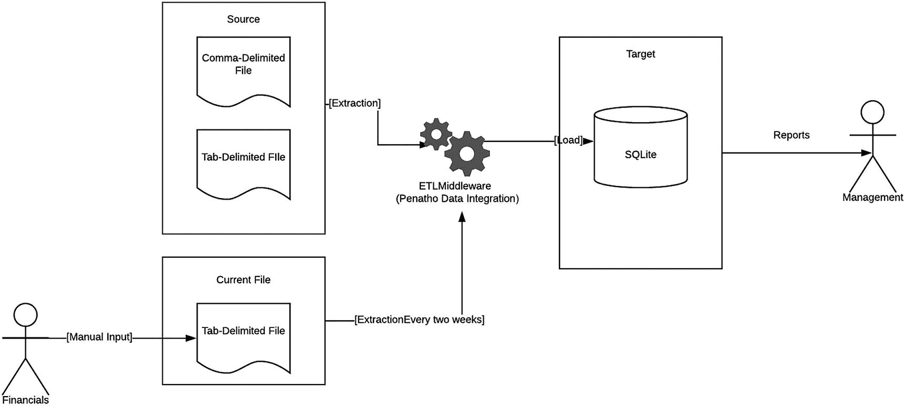

图 6-2 未来状态模型

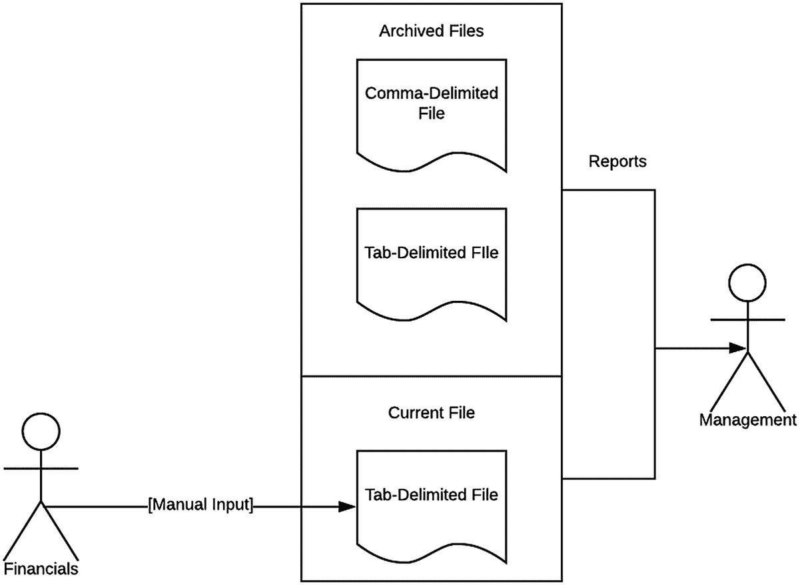

图 6-1 当前状态模型

图 6-1 展示了当前流程的执行方式，而图 6-2 展示了拟议的计划，包括刚刚讨论过的制表符分隔整合。

我听到过抱怨，说与第一张图相比，第二张图看起来设计过度，对于寻求简单解决方案的人来说，这通常不是好兆头。确实如此，特别是当我们的设计只是一个只有两个源文档的简单模型时。但系统会变化，我们想要的是可扩展性，因此复杂性是意料之中的。

我说可扩展性是什么意思？想象一下，在你确定了两个源文档之后，管理层又回来决定，他们还想包含一些在他们销售团队电脑上找到的更多 Excel 电子表格、来自总部有助于财务的额外数据库表，以及从云端提取的外部记录。这种修改可能会并且将会发生，因为源系统常常会凭空出现，而且是在最后一刻。

我们不需要从头开始，只需将更新的源添加到图表中，这就完成了（见图 6-3）。无论添加了什么需求，99% 的情况下都可以用一张图来表达，只需在每个迭代中进行少量修改即可。这就是我所说的*可扩展性*。

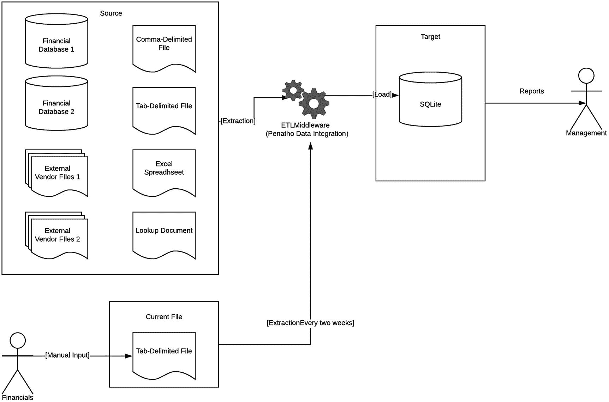

图 6-3 未来状态（更复杂）

### 设计

我们已经明确了计划，提出了方法，并与利益相关者共同敲定了细节。最后，我们终于可以开始探索数据和编写代码解决方案了。在此阶段，我们将生成若干文档，每个文档都建立在前一个文档的基础之上。首先，我们需要深入研究我们决定要处理的源数据，以了解其结构、模式和差异。这项活动将引导我们进入下一步：数据剖析。

#### 数据剖析

由于安全考虑或存储限制等各种原因，我们并不总能完整获取生产数据，只能利用手头已有的数据。即使只有一个小样本，例如 10%的数据，也足以让我们开始工作，但我们需要一些可操作的数据。

在我们的原型中，我们手头有两个存档文件，可以通过我们选择的数据分析工具进行处理（详见第 4 章）。为节省时间，我们先快速浏览每个文件中的前十条记录（见图 6-4）。

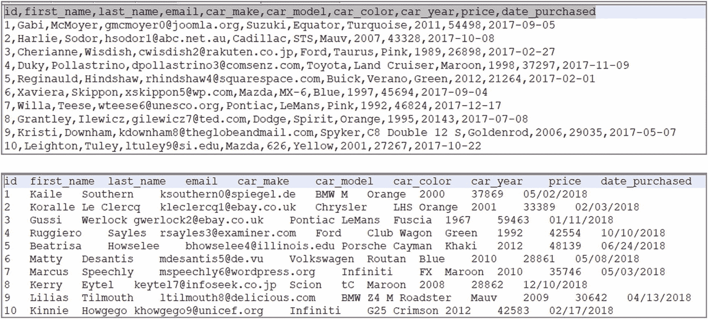

**图 6-4**  
2017 年 CSV 与 2018 年 TSV 样本记录

粗略检查后你会发现，文件不仅使用的分隔符不同（逗号与制表符），而且`date_purchased`字段的日期格式也不同：第一个文件中的格式是`YEAR-MONTH-DAY`，而第二个文件中的格式是`MONTH/DAY/YEAR`。

> **注意**  
> 回到我们之前的讨论，现在应该很清楚为什么直接将源文件导入目标`SQLite`数据库可能无法按预期工作。如果你没有注意不同的分隔符和不同的日期格式，也没有为每个文件相应地调整导入控制，那么你很可能会破坏数据库，最终导致后续需要做更多的工作。

即使只有有限的视图，我们也有一些选择。我们可以参考问题日志文档，将这些发现记录下来，然后联系数据团队，请求他们以统一的格式重新发送这些文件（例如，统一使用逗号分隔并采用标准日期格式）。此外，我们还可以在问题日志中提出其他问题，例如为什么有些电子邮件地址使用的是国际域名（答案：我是从[*https://mockaroo.com*](https://mockaroo.com)随机生成的这个列表），或者我们是否应该对诸如汽车型号和汽车颜色等穷举值强制执行约束。例如，如果源系统中存在笔误，我们是否允许将这些错误迁移到新系统中？

如果我们拥有合适的`ETL`工具和熟练的团队，我们应该计划一次性完成数据转换。在本示例中，我们将采用这种方法，并将其作为后续工作的前提假设。

#### 源到目标的映射

源到目标的映射表展示了每个入站源字段以及它们将如何映射到目标对象。正如第 4 章所讨论的，你至少需要填写以下几个相关的列：

- 源系统、源文件、源表及源字段的名称
- 目标系统、目标文件、目标表及目标字段的名称
- 源到目标转换的规则

到目前为止，我们还没有编写任何代码，仍处于探索数据的阶段。现在，我们需要引入源系统和目标系统的数据所有者，并与他们协商每个数据项的映射细节。数据所有者不一定需要理解转换的技术细节——那是集成方面的事情——但他们应该能够回答“旧数据将如何映射到新系统”这类简单直接的问题。

在这一步骤中，将识别并纠正重大的差异。我们知道初始加载至少涉及两个文件：一个`CSV`文件和一个`TSV`（制表符分隔值）文件，并且我们要将结果迁移到一个`SQLite`数据库中。我们现在需要了解哪些细节？例如，目标数据库的模式名称是什么？是一个表还是多个表？目标字段的名称是什么，它们是否与源字段名称对应？所有这些主题都将在讨论中得到解决，以便我们能够将映射关系正确地分解到一个连贯的文档中。

在许多情况下，目标数据所有者可能无法立即给你答案，或者在项目后期改变主意。就像数据迁移计划一样，只要你能通过文档进行沟通，并有能力在相对较短的时间内完成测试，那么在项目的任何阶段都欢迎变更。在第 7 章中，我们将讨论如何自动化测试以加快发布速度。

在向源和目标数据所有者（请记住，最多不要超过三个人！）提问之后，你就能整理出第一份源到目标映射电子表格。我们将最精简的版本发布在表 6-1 中，尽管还有更多元数据可以收集（建议请参见第 4 章）。

**表 6-1**  
源到目标的映射

| 源系统 | 源对象 | 源字段 | 目标系统 | 目标对象 | 目标字段 | 转换规则 |
| --- | --- | --- | --- | --- | --- | --- |
| `File` | `Contacts_year1.csv` | `id` | `SQLITE` | `BUYER` | `EXTERNALID` | `'Contacts_year1' + Id` |
| `File` | `Contacts_year1.csv` | `first_name` | `SQLITE` | `BUYER` | `FIRST_NAME` | 直接转换 |
| `File` | `Contacts_year1.csv` | `last_name` | `SQLITE` | `BUYER` | `LAST_NAME` | 直接转换 |
| `File` | `Contacts_year1.csv` | `email` | `SQLITE` | `BUYER` | `EMAIL` | 直接转换 |
| `File` | `Contacts_year1.csv` | `car_make` | `SQLITE` | `BUYER` | `CAR_MAKE` | 直接转换 |
| `File` | `Contacts_year1.csv` | `car_model` | `SQLITE` | `BUYER` | `CAR_MODEL` | 直接转换 |
| `File` | `Contacts_year1.csv` | `car_color` | `SQLITE` | `BUYER` | `CAR_COLOR` | 直接转换 |
| `File` | `Contacts_year1.csv` | `car_year` | `SQLITE` | `BUYER` | `CAR_YEAR` | 直接转换 |
| `File` | `Contacts_year1.csv` | `price` | `SQLITE` | `BUYER` | `PRICE` | 直接转换 |
| `File` | `Contacts_year1.csv` | `date_purchased` | `SQLITE` | `BUYER` | `DATE_PURCHASED` | 直接转换，格式为 `YYYY-MM-DD` |
| `File` | `Contacts_year2.tsv` | `id` | `SQLITE` | `BUYER` | `EXTERNALID` | `'Contacts_year2' + Id` |
| `File` | `Contacts_year2.tsv` | `first_name` | `SQLITE` | `BUYER` | `FIRST_NAME` | 直接转换 |
| `File` | `Contacts_year2.tsv` | `last_name` | `SQLITE` | `BUYER` | `LAST_NAME` | 直接转换 |
| `File` | `Contacts_year2.tsv` | `email` | `SQLITE` | `BUYER` | `EMAIL` | 直接转换 |
| `File` | `Contacts_year2.tsv` | `car_make` | `SQLITE` | `BUYER` | `CAR_MAKE` | 直接转换 |
| `File` | `Contacts_year2.tsv` | `car_model` | `SQLITE` | `BUYER` | `CAR_MODEL` | 直接转换 |
| `File` | `Contacts_year2.tsv` | `car_color` | `SQLITE` | `BUYER` | `CAR_COLOR` | 直接转换 |
| `File` | `Contacts_year2.tsv` | `car_year` | `SQLITE` | `BUYER` | `CAR_YEAR` | 直接转换 |
| `File` | `Contacts_year2.tsv` | `price` | `SQLITE` | `BUYER` | `PRICE` | 直接转换 |
| `File` | `Contacts_year2.tsv` | `date_purchased` | `SQLITE` | `BUYER` | `DATE_PURCHASED` | 转换格式为 `YYYY-MM-DD` |

表格 6-1 似乎包含大量信息，可能让人有些不知所措。但如果你仔细梳理一遍，就会发现，你看到的只是源字段映射到相同目标字段的名称，重复了两次，分别代表 CSV 文件和 TSV 文件。你还会注意到，我们没有将任何列称为“源表”或“目标表”。相反，我们引用了“源对象”和“目标对象”。这样，我们可以引用所需的任何表示形式，例如 Excel 电子表格、数据库和记录文件。最后，你会注意到，我们的“转换规则”指明了预期的流程，我们通过编写代码来将提取的数据映射到目标字段。例如，我们的 `date_purchased` 字段保留了第一个文件中的 `YYYY-MM-DD` 格式，但将第二个文件的 `MM/DD/YYYY` 格式修改为 `YYYY-MM-DD`。

如果你不热衷于逐行映射，并且认为每个列的可维护性会很困难——如果目标中的一行被添加或修改，你将不得不仔细检查整个 STTM——那么可以考虑使用逗号分隔符连接你的源值。这会在审查时增加理解单个字段的难度，但此连接方法确实将整体映射作为一个整体进行了澄清（参见我们的串联式 STTM 表格 6-2）。

**表 6-2  
源到目标映射（串联式源）**

| 源系统 | 源对象 | 源字段 | 目标系统 | 目标对象 | 目标字段 | 转换规则 |
| --- | --- | --- | --- | --- | --- | --- |
| `File`, `File` | `Contacts_year1.csv`, `Contacts_year2.tsv` | `id`, `id` | `SQLITE` | `BUYER` | `EXTERNALID` | `'Contacts_year1' + Id`, `'Contacts_year2' + Id` |
| `File`, `File` | `Contacts_year1.csv`, `Contacts_year2.tsv` | `first_name`, `first_name` | `SQLITE` | `BUYER` | `FIRST_NAME` | 直接转换, 直接转换 |
| `File`, `File` | `Contacts_year1.csv`, `Contacts_year2.tsv` | `last_name`, `last_name` | `SQLITE` | `BUYER` | `LAST_NAME` | 直接转换, 直接转换 |
| `File`, `File` | `Contacts_year1.csv`, `Contacts_year2.tsv` | `email`, `email` | `SQLITE` | `BUYER` | `EMAIL` | 直接转换, 直接转换 |
| `File`, `File` | `Contacts_year1.csv`, `Contacts_year2.tsv` | `car_make`, `car_make` | `SQLITE` | `BUYER` | `CAR_MAKE` | 直接转换, 直接转换 |
| `File`, `File` | `Contacts_year1.csv`, `Contacts_year2.tsv` | `car_model`, `car_model` | `SQLITE` | `BUYER` | `CAR_MODEL` | 直接转换, 直接转换 |
| `File`, `File` | `Contacts_year1.csv`, `Contacts_year2.tsv` | `car_color`, `car_color` | `SQLITE` | `BUYER` | `CAR_COLOR` | 直接转换, 直接转换 |
| `File`, `File` | `Contacts_year1.csv`, `Contacts_year2.tsv` | `car_year`, `car_year` | `SQLITE` | `BUYER` | `CAR_YEAR` | 直接转换, 直接转换 |
| `File`, `File` | `Contacts_year1.csv`, `Contacts_year2.tsv` | `price`, `price` | `SQLITE` | `BUYER` | `PRICE` | 直接转换, 直接转换 |
| `File`, `File` | `Contacts_year1.csv`, `Contacts_year2.tsv` | `date_purchased`, `date_purchased` | `SQLITE` | `BUYER` | `DATE_PURCHASED` | 直接转换，格式为 `YYYY-MM-DD`, 转换格式为 `YYYY-MM-DD` |

这个列表的结果是相同的，你可以将它们交给开发者，让他们构建到 ETL 流程的第一个迭代中。

#### 数据迁移流程设计

与设计相关的所有内容都汇聚在一起了。有了 STTM，你现在可以编写大部分 ETL 脚本，但你也需要合理安排开发顺序。例如，如果没有表格来接收数据，你就无法开始将数据加载到数据库中；这部分必须先完成。记录你将执行的操作顺序被称为“数据迁移流程设计”，它作为一个很好的检查清单，确保在需要时启动正确的部分。

对于我们的原型，数据迁移流程可以简单地进行图形化和描述（见图 6-5）。对于高级迁移，确实需要更多的思考，但原理是相同的。

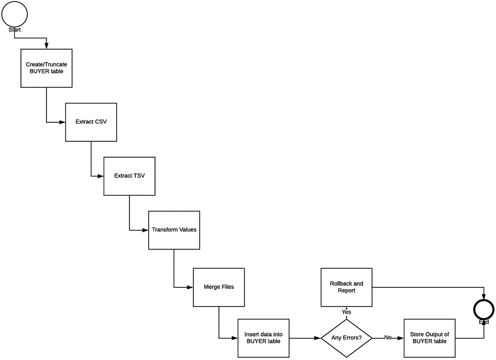

**图 6-5  
数据迁移流程图**

在这个步骤列表中，你会看到我们已经考虑了如何在源和目标之间处理我们的数据；知道先添加什么；知道提取、转换和加载什么；以及随后如何处理任何异常。与我们所有其他文档一样，任何最后一刻的添加或修改都可以追加到模型中，指导我们的开发人员在其相关代码中进行更新。

### 开发与实施

我们现在清楚地了解了流程将如何运作，而且到目前为止，我们还没有编写一行代码。最后，我们来到了开发人员将接手我们迄今为止所有文档的技术内容，并开始编写 ETL 脚本的阶段。当然，工作也可以在 STTM 完成后立即开始，任何耗时的转换都可以在更早的阶段进行研究。

**注意**

如果你好奇，构建这个特定 ETL 脚本从开始到结束究竟需要多长时间，这取决于几个因素：转换的复杂性、对 ETL 工具和默认脚本语言的熟悉程度、数据可访问性，以及我们在第 5 章中讨论的任何其他变化因素。

假设开发团队每日进行站会和代码同行评审，那么假设一个冲刺周期后（两周），他们就可以准备向你进行演示，该演示将：

1.  将两个文件提取到 PDI 中：逗号分隔文件和制表符分隔文件。
2.  根据 STTM 转换需要操作的字段。
3.  合并生成的数据集。
4.  将最终输出插入 SQLite 解决方案。

## 准备工作

脚本本身已经编写完成，你只需对其进行测试即可。虽有此便利，你仍需完成一些步骤来让系统做好测试准备：

-   将 GitHub 目录克隆到本地计算机。
-   下载并安装 Pentaho Data Integration (PDI) 社区版。

### 克隆 GitHub 目录

你需要在计算机上安装 GitHub。相关说明请参阅 [`https://gist.github.com/derhuerst/1b15ff4652a867391f03`](https://gist.github.com/derhuerst/1b15ff4652a867391f03)。

-   你需要克隆的仓库位于 [*https://github.com/Apress/building-a-data-integration-team.git*](https://github.com/Apress/building-a-data-integration-team.git)。
-   你将使用的文件存储在 `chapter6` 文件夹中。解压后，请确保创建了三个文件夹：`input`、`output` 和 `scripts`。

### 下载并安装 PDI（社区版）

要完成此步骤，请执行以下操作：

1.  访问网站 [*https://community.hitachivantara.com/s/article/data-integration-kettle*](https://community.hitachivantara.com/s/article/data-integration-kettle)。
2.  根据你的特定操作系统（Linux、Windows、macOS），阅读“如何让 PDI 启动并运行”部分。
3.  在“下载”部分下，选择最新的稳定版本。
4.  等待下载开始。
5.  将 `.zip` 文件保存到一个你记得的目录中。**注意：** Pentaho 下载文件体积高达 1 GB。请确保你的计算机可以容纳此文件。
6.  完成后，解压该压缩包。
7.  在新目录中的 `data-integration` 文件夹下，双击 `spoon.sh`（Linux）、`spoon.bat`（Windows）或“Data Integration”应用程序图标（macOS）。你应该会看到启动画面窗口打开。等待应用程序加载完成。

> **注意：** 如果文件在 Windows 上无法运行，请确保已安装 Java JDK 并将其添加到 `JAVA_HOME` 系统变量中。访问 [`https://www.oracle.com/technetwork/java/javase/downloads/index.html`](http://www.oracle.com/technetwork/java/javase/downloads/index.html) 下载最新版本，并通过单击 Windows“开始”图标并搜索“编辑系统环境变量”来确认 `JAVA_HOME` 环境变量已正确设置。

8.  由于你是首次使用该应用程序，会弹出“欢迎”窗口。点击 `File/New`（或 `CTRL+N`）打开一个新的转换窗口（见图 6-6）。

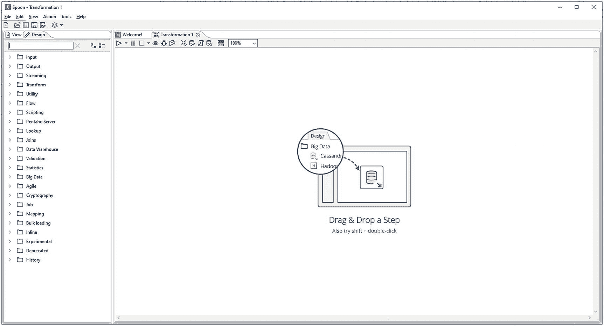

*图 6-6：新的 PDI 转换窗口*

> **注意：** 我们选择 SQLite 作为目标数据库，因为它是一个小型、自包含的 SQL Server 引擎，开源且已可在 PDI 平台上运行。它不同于大多数 SQL 数据库，因为 SQLite 没有单独的服务器进程，而是直接写入普通磁盘文件（[`www.sqlite.org/about.html`](http://www.sqlite.org/about.html)）。你不会有客户端应用程序来读取 `infomotors.db` 数据，但可以通过 Pentaho 脚本读取该文件，从而实现相同的目地。

### 打开 `create_target_table_buyer` 脚本

虽然我们不会讨论下载的脚本是如何开发的，但我们可以继续演练，就好像我们要对我们开发人员创建的代码进行同行评审一样。首先，在 PDI 中，点击 `File/Open` 菜单（Windows 上为 `CTRL+O`），然后导航到你从 GitHub 克隆的 `chapter6\scripts` 目录。双击 `create_target_table_buyer.ktr` 文件。

-   此时 `create_target_table_buyer` 脚本会打开。页面上有一个单一对象——Create Table BUYER——它执行 SQL 来创建我们的 BUYER 表。双击该对象以打开 “Execute SQL Script”对话框（见图 6-7）。

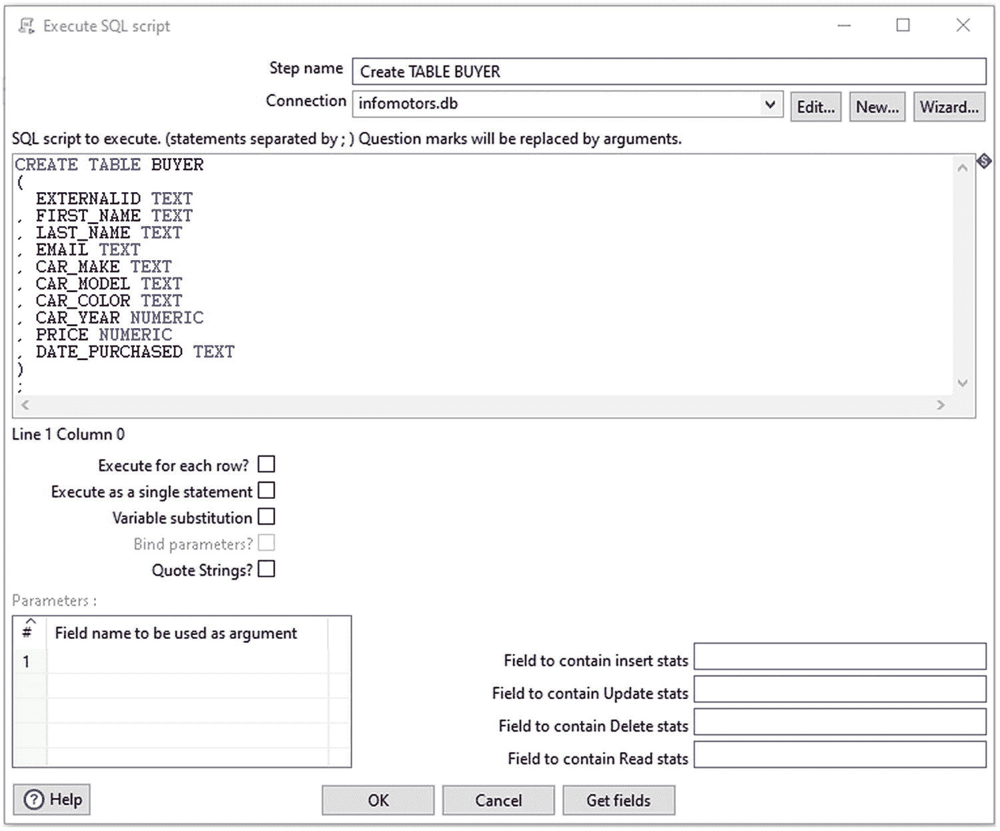

*图 6-7：执行 SQL 脚本*

-   在 “SQL script to execute” 窗口（屏幕中央）中，你将看到我们开发人员添加的 `CREATE TABLE STATEMENT`。上方是一个标有“Connection”的文本框。值 `infomotors.db` 代表了我们为原型构建的 SQLite 目标连接。如果你希望查看连接的详细信息以及 PDI 提供的其他内置连接器，请点击 `Edit`。查看完毕后，点击 `Cancel` 两次返回到“Create target BUYER table”主页。

-   屏幕顶部有一个播放按钮（见图 6-8）。点击它以打开“运行选项”对话框。然后点击该窗口中的 `Run` 按钮来创建 BUYER 表（你可以看到如图 6-9 所示的输出结果）。

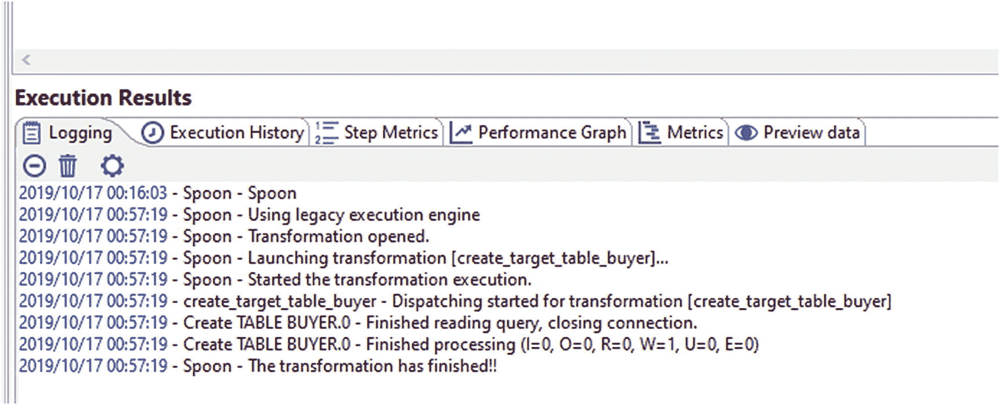

*图 6-9：确认步骤成功运行*

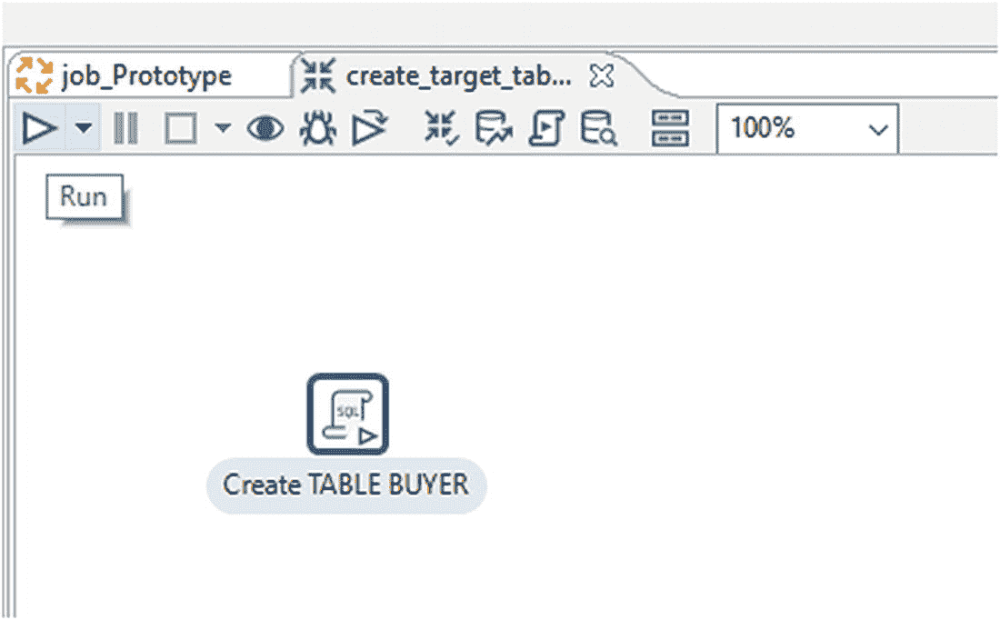

*图 6-8：运行按钮*

-   完成后，从菜单中选择 `File/Close`（Windows 上为 `CTRL+W`）以返回主窗口。

### 打开“原型”脚本

创建好`BUYER`表后，我们现在可以检查负责大部分工作的 ETL 脚本了。为了回顾一下思路，以下是我们在数据迁移流程中采取的方法：

1.  创建/清空`BUYER`表：使用 ETL 工具，如果`BUYER`表不存在则创建它。如果已存在，则清空所有数据，为下一次加载做准备。
2.  提取 CSV：使用 ETL 工具 CSV 连接器，检索所有逗号分隔的数据。
3.  提取 TSV：使用 ETL 工具文本连接器，检索所有制表符分隔的数据。
4.  转换值：以`STTM`为参考，更改识别出的转换值。
5.  合并文件：将新的（转换后的）临时文件合并成一个为目标格式准备好的文件。
6.  向`BUYER`表插入数据：使用 ETL 工具 SQLite 连接器，将所有值插入到`BUYER`表中。
7.  决策：加载过程中是否有任何错误？
    -   如果是，则回滚数据并发送报告。
    -   如果否，则结束事件。

我们在前面的部分只介绍了第 1 步的一部分。让我们打开脚本`prototype.ktr`来分析另一个步骤。

-   就像之前对`create_target_table_buyer`步骤所做的那样，点击“文件/打开”菜单（Windows 上为 CTRL+O），然后导航到你从 GitHub 克隆的`chapter6\scripts`目录。双击文件`prototype.ktr`。脚本将会打开（见图 6-10）。

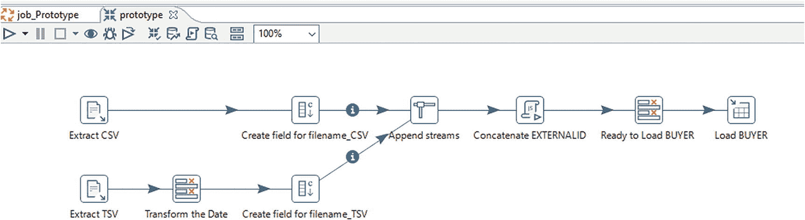

**图 6-10** 原型脚本

这个转换要处理的内容比前一个场景多得多，我们不会试图详细解释（如果你确实有兴趣，有几本关于 Pentaho 开发的推荐书籍，Hitachi Vantara 也有一些很棒的在线帮助文档）。如果你按照标签来看，流程应该看起来是对的：我们从提取 CSV 和 TSV 文件开始（数据迁移流程中的第 2 步和第 3 步），转换我们的 TSV 日期字段（第 4 步），添加一个将用作`EXTERNALID`的拼接字段（也是第 4 步），将最终的流追加在一起（第 5 步），然后将数据加载到`BUYER`表中（第 6 步）。如果你想在自己的 Pentaho 脚本中探索每个函数的功能，可以随意测试。只需确保在你打开的每个对话框上点击**取消**，以避免修改任何脚本组件。

我们快完成了，所以接下来需要做的就是测试我们的脚本。但我们该如何测试呢？之前，我们点击了左上角的图标（运行），让我们尝试通过点击同一个图标再次执行。

如果你查看**日志**窗口（见图 6-11），可以看到我们确实用 200 条已写入的记录填充了`BUYER`表（`W=200`意味着“写入”）。

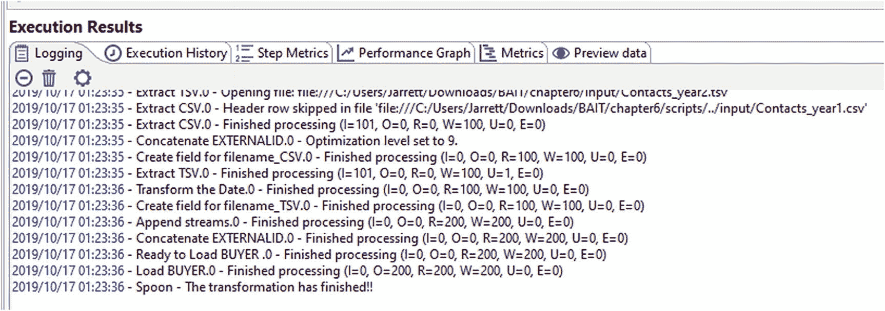

**图 6-11** 运行原型脚本的结果

看起来，是的，我们的记录数是对的，但是它们准确吗？我们是否修改了日期并执行了合并，以使我们的格式保持一致？

有几种方法可以检查这一点。我们可以使用另一个脚本从`BUYER`表中进行查询（我们在下一章会这样做），或者我们可以右键点击原型脚本上的任意步骤，然后选择**预览**，查看数据在该特定点的情况。另一种方法是选择**预览数据**选项卡，它在**日志**选项右侧几个选项卡的位置。我们现在点击这个选项卡（见图 6-12）。

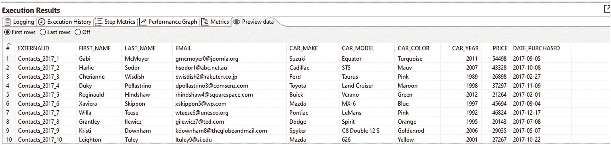

**图 6-12** 预览数据选项卡

在这个窗口中，您可以在一个类似电子表格的视图中看到所有记录。我们看到的正是加载到`BUYER`表中的数据。如果你滚动浏览整个记录集，你会注意到我们的`EXTERNALID`字段遵循了我们在`STTM`中指定的语法，`DATE_PURCHASED`格式也是如此。看起来原型是成功的。开始向那些为满足这些需求而努力工作的开发人员发放星巴克礼品卡吧。

至此，我们已经经历了一个半实现的流程。如果这是一个实际的交付物而不仅仅是原型，我们会向迁移结果报告中填入对象名称（`BUYER`）、运行测试的日期、执行的记录总数、遇到的任何错误以及其他适合迭代清理的项目。然后就是部署到下一个环境的时候了。当然，我们不要太心急。

## 总结

如果你一路跟随下来，你会看到我们的项目通过了所有测试。看起来我们已经准备好进行上线确认了。考虑到我们迁移的范围相当小，这并不令人惊讶。然而，对于更大的项目，监控 ETL 生命周期的所有方面可能更具挑战性，尤其是在涉及测试和部署时。例如，在最后一刻，数据库开发人员可能会做出一个更改，影响了集成团队的硬编码脚本；或者更糟的是，在测试数据上运行良好的代码在插入生产环境时现在出现奇怪的错误。虽然我们可能无法预测这些问题，但我们确实有能力尽可能多地控制它们，这既通过我们通过文档进行的沟通，也通过我们在发现新问题时发送警报来自动化脚本的能力。

在下一章中，我们将讨论如何更好地利用我们的 ETL 流程来帮助实现这种自动化，确保那些过去毫无预警地出现的问题现在都安全可控。

脚注  
1  
2  
3

