# 7. 平台自动化

> *软件测试人员总是上天堂；因为他们已经在人间受够了地狱般的折磨。*
> 
> ——匿名¹⁰⁴

## 引言

我在本书中多次重复提到，我们常常把数据迁移看作是一个一键操作——只需选择你的源字段，按下一个按钮，然后出发，数据就迁移完成了。到了这里，我希望你认识到事实远非如此。数据迁移需要仔细的计划、数天甚至数周的研究，以及通过文档、妥协和会议进行的大量协作，所有这些都与按下一个按钮相反。

澄清这一点之后，我现在想教你如何设计你的集成系统，以便你可以只需按下一个按钮，就能从头到尾运行完整的集成。

是的，你没听错——只需一次鼠标点击就能测试你的作业、检索结果，并将你的系统部署到不同的环境。

不要误会我的意思。我在本书中描述的所有步骤仍然有效。你仍然需要费力地处理需求、构建你的迁移计划和`STTM`，并努力让你的迭代式 ETL 代码工作起来。但在最后，当你最终有了一个可行的模型时，你可以组合你的脚本并建立一个系统，这个系统可以按需运行，也可以在你选择的计划时间运行。在本章中，我们将讨论你将使用的不同类型的环境、为自动化准备脚本、修改你的文档、展示成功与错误，以及设置计划任务的步骤。虽然我们讨论的内容并非全部都是一键式方法，但我们肯定会足够接近，以消除伴随人工交付而来的那些单调、耗时且有风险的活动。

如果我们准备好了，让我们从讨论平台环境开始。

## 关于环境的一切

### 为何重要

当我们面临截止日期，项目赞助方又在追问迭代部署何时完成时，我们最不愿考虑的就是那些会耗费更多时间的事情。我们只想把代码推送到生产服务器，然后继续下一项工作。我们已经尽己所能进行了测试，检查了行数，确保数据看起来没问题，那就继续推进吧。我们这样推理：就算发现错误，也不会是世界末日，我们总可以在部署后打补丁。就像那句著名的运动鞋广告所说：“尽管去做。”^(¹⁰⁵)

这在原则上听起来不错，而且通常是许多专业人士在压力下偏爱的默认策略（“要是我有更多时间，我会用正确的方式来做，但我没有，所以就这样吧”）。这种策略甚至可能奏效。但对于像集成这样依赖数据准确性的流程来说，将糟糕的代码推送到生产环境是撑不了多久的。这种阻碍源于一种名为`技术债务`的现象，我将其定义为“因优先追求快速交付而牺牲质量，导致后期重构/修复代码所需付出的努力”。^(¹⁰⁶) 例如，你可能会在系统中添加硬编码的逻辑，因为它通过了你的内部测试（比如使用这样的模式：“如果值等于`'IBM'`、`'I.B.M'`或`'International Business Machines'`，则转换为`'IBM Corp'`”）。你对此非常满意，便将代码从本地环境推送到生产环境，然后继续处理下一个任务。

几周后，你收到了目标数据所有者的邮件，说出现了一个新的缩写词`"I.B.M. Corporation"`，这让报表系统产生了混乱。好吧，你重新打开开发代码，修改硬编码部分，然后直接推送回生产环境。只花了大概 5 分钟，对吧？

哦，等等，实际上应该是`"IBM Corporation"`，I、B、M 之间没有句点。该死，我们本该注意到的。回到开发系统，再把这条例外加上去。又是 5 分钟，但不是什么大问题。

直到问题变得严重。几周后，随着所有额外的例外情况开始涌现，数据所有者坦言他们感到沮丧。你思考了一下，也许可以构建一个函数，将参数直接传入查找表，然后表就能立即为你返回所需的值。这样一来，每当用户报告错误时，你无需重新提交整个代码库到生产环境，他们只需要在表中添加一条物理的例外记录即可（见图 7-1）。

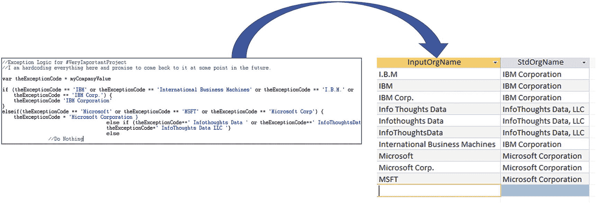

`图 7-1` 重构为查找表的代码

这是个好主意，对吧？不幸的是，你一直在用笔记本电脑开发其他功能，不确定是否还保留着原始代码。如果你使用的是`Git`或其他版本控制系统，你可能需要暂存现有代码，回滚到已部署到生产环境的版本，然后开始重构每个对象。这确实是一种进展，但你真有时间这么做吗？难道没有更好的处理方式吗？

你明白我的意思了。最初看似快速的变通方案，最终却让你在长远上付出了更多时间和精力（即技术债务）。尽管你想避免这种情况，但现在你不得不维护一个有缺陷的软件，还要安抚沮丧的数据所有者。

从逻辑上讲，我们知道完美是一种幻觉，说实话，你永远无法真正消除技术债务（至少不能永久消除）。但总有一些方法可以管理它。^(¹⁰⁷) 我们对技术债务的关注，更多是针对与夜间集成相伴的可重复流程，而非一次性迁移。缓解技术债务带来痛苦的一种方法，是利用版本控制系统在各环境中策略性地部署你的构建版本。

加速夜间集成周转涉及几个步骤。如果你遵循我在本章中推荐的技术，你在生产力上获得的益处将远超环境规划和设置所需的时间。

### 环境类型

我们将继续讨论大多数 DevOps 团队公认的三种环境。实际上，你可以拥有任意数量的环境，5 个、10 个甚至 100 个，并且可以随意命名。这看似有些过度，但目的是一样的：确保你能在隔离的系统中满足项目需求，这样即使出现问题，也不会造成长期损害。

#### 开发环境

开发环境（或“Dev”）是你电脑上的环境，也是你最初更新代码的地方。你在这里下载原型脚本、执行提交操作，它可能存在于远程服务器上，也可能不存在，你的同事可以在远程服务器上生成独立的数据版本。这个环境变化迅速，让人联想到孩子们课间在沙坑里玩耍的场景，因此有时也被称为“沙盒”。

开发环境允许团队进行各种实验，并且应该能够连接包含非生产数据的模拟代码或测试数据库。测试过程中对数据造成的任何重大干扰都会被最小化，只影响到执行预定操作的用户。

#### 预发布环境

预发布环境是我们团队进行代码审查和质量保证（QA）测试的主要场所。因此，我们希望预发布环境尽可能与生产环境保持一致，包括源系统和目标系统中的数据。出于安全或其他技术原因，你可能无法存储那种快照信息，但你越接近生产环境的镜像，对实际“上线”就会准备得越充分。

配置预发布平台可能看起来是一项艰巨的任务，尤其是当为了请求生产环境复制所需的各种服务而需要经历重重关卡时。但让这个环境保持就绪状态意味着，你可以隔离测试一个模拟系统，知道遇到的任何数据问题都能通过反复迭代和仔细审查来解决，而不是像在生产环境中那样进行快速更新。

你也可以在这里构建和测试自动化脚本。该环境允许你处理多个版本的代码，优化加载过程，使其与你为数据迁移流程所创建的图表同步。大多数 ETL 工具支持依次调用任务，最终你可以将工作流调整为连续运行一步完成，而不是手动逐个执行。虽然实现这种程度的自动化令人满意，但我必须承认，只有你在预发布环境中处理的测试数据与生产环境中的数据几乎一致时，才能获得这样的效果。

为了复制环境，我曾合作过的一些组织会先获取现有的生产环境，在部署后覆盖预发布环境，以便使用最新最好的版本。通过利用这一点，预发布环境也成为你加速偿还技术债务的平台；如果我们想重写代码以引用表而不是脚本，可以直接在预发布平台进行修改。如果使用像`Git`这样的版本控制系统（`VCS`），我们可以克隆主分支来创建一个新版本。无论采用哪种方式，当遇到错误时，我们都能灵活调整，在类似生产的环境中进行部署和测试，并且在收到不可避免的失败警报时，能够从容应对。

#### 生产环境

生产环境是每个创意项目的心血所在，从每一次代码更新到测试结果都汇聚于此。分布式构建在此运行，因此，只有在向用户发布新版本时才应触及它。否则，客户会发现因软件设计粗糙而产生的任何问题，而如果问题足够严重，企业将既损失金钱，也损害声誉。

由于生产环境对公众开放，对有缺陷软件的部署应严格控制，发布权限仅限少数人。任何计划中的部署都应提前（至少两周）向相关方公布，包括时间、日期以及对同时运行进程的影响。发布经理还应在部署当天发送邮件，告知部署开始时间，并在部署完成后通知部署已结束。

### 一次性迁移的环境

我们的 ETL 应用程序及相应脚本可视为一种构建工具，应遵循与其他软件相同的环境结构，即为开发、预发布和生产平台分别进行复制。然而，一次性迁移环境——即那些只运行一次、将源数据迁移至目标数据以完成初始化的应用程序和脚本——如果团队允许，可能只需创建较短时间即可。

典型的 ETL 架构包含一个源端、一个 ETL 中间件和一个目标端。该架构如图 7-2 所示。

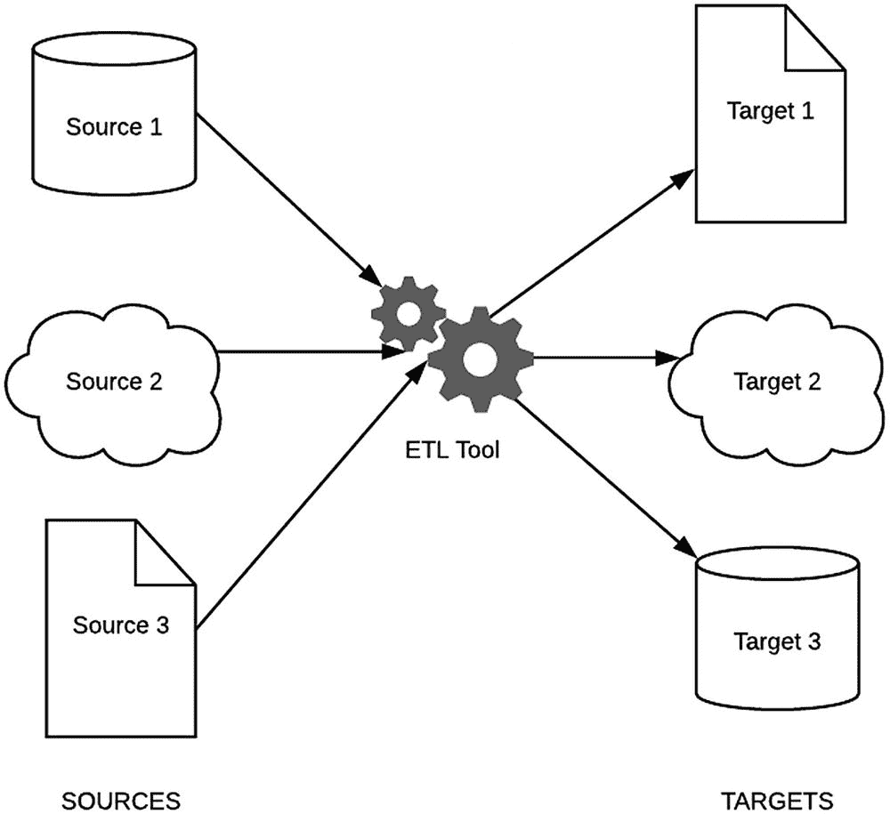

图 7-2
典型的 ETL 架构

在一次性迁移架构中，我们并非在所有平台上复制 ETL 工具，而是仅创建一个实例，称为 ETL 预发布环境。运行此实例的唯一要求是，在部署过程中更新指向各个独立环境的连接端点。通过使用此技术，ETL 预发布环境成为一个松散耦合的系统，具备该设计所带来的所有优势，例如可测试性提升、代码维护减少以及可扩展性增强（见图 7-3）。^((108))

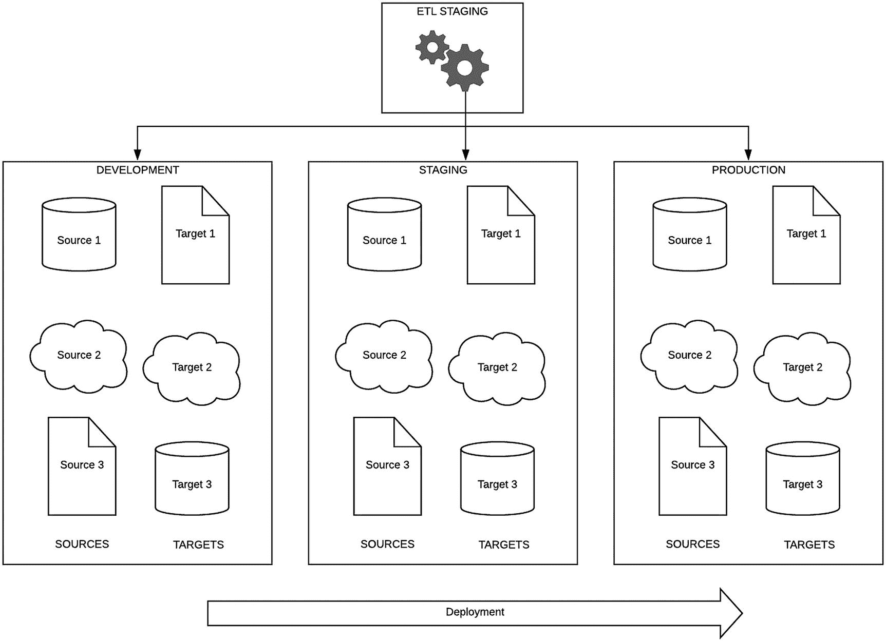

图 7-3
一次性迁移模型

再次强调，一次性模型的这种使用方式取决于组织和安全团队的决定。通常，承载 ETL 工具的平台可能是内部虚拟机（VM）。如果这些虚拟机未经授权接触生产数据，那么您确实需要将应用程序及相应脚本复制到更安全的环境中，如可重复集成的环境所示（见图 7-4）。

### 可重复集成的环境

可重复集成是一种特殊的存在，因为它既（a）指向特定的源端和目标端点，又（b）本身是需要不同版本的脚本。回忆一下，可重复集成是指那种基于 Web 服务触发器或预定时间（如每晚一次、每周一次或每月一次）持续更新数据的集成。它们的负载强度低于一次性迁移数据馈送，结构通常也较简单。然而，它们在组织中出现得更为频繁，一旦检测到任何问题，就需要监控和运维支持。

根据其结构，与可重复集成相关的 ETL 工具需要安装在专门的虚拟机（VM）上，并与其他准备部署的软件构建一同发布到相应的环境（开发、预发布和生产）中（见图 7-4）。

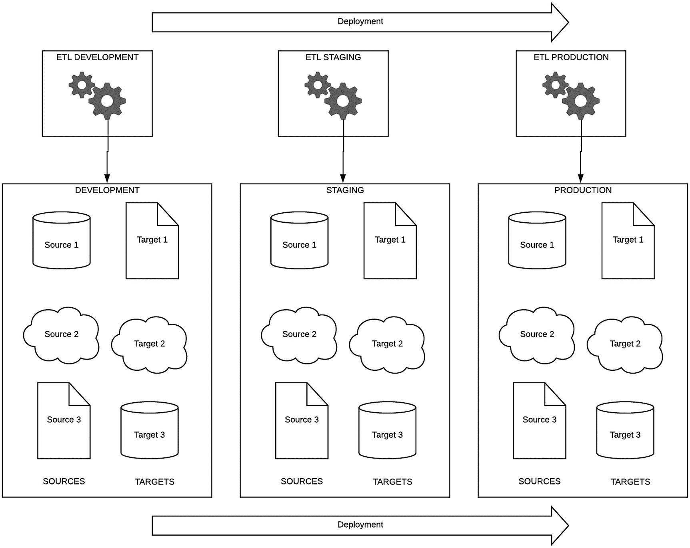

图 7-4
可重复集成架构

### DevOps 实践：一个部署示例

到目前为止，我们重点讨论了环境、架构和部署。您可能会问，这些与平台自动化（本章标题）有什么关系？好吧，为了开始讨论自动化，我们将简要提及 DevOps，而自动化正是其核心目标之一。

根据 《敏捷管理员》博客作者欧内斯特·米勒的定义，DevOps 是“运营工程师和开发工程师共同参与整个服务生命周期，从设计到开发过程再到生产支持”的实践。^((109)) 他承认这是一个相当宽泛的定义，并澄清了我们在 DevOps 上下文中通常讨论的以下三个实践：

*   **基础设施自动化**：通过自动化代码创建系统、配置和应用程序部署
*   **持续交付**：以快速、自动化的方式构建、测试和部署您的应用程序
*   **站点可靠性工程**：运维系统、监控和编排，并为可操作性进行设计

我们将重点讨论第一个实践——基础设施自动化，以测试如何通过顺序运行的工作流拉取数据，从而在几分钟内完成从源到目标的完整部署。这并不复杂，并且将展示自动化集成是多么高效。

#### 我们的架构

下图展示我们设想的示例架构，该架构安装在三个独立的环境中（见图 7-5）。

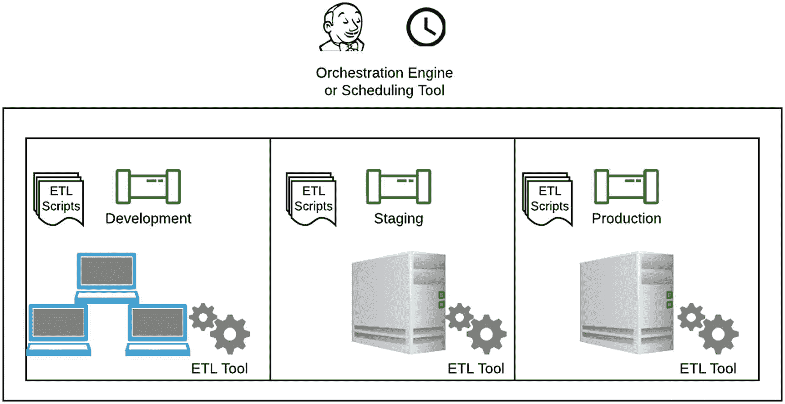

图 7-5
用于平台自动化的 ETL 设计

图 7-5 展示了一个示例设计，说明我们的 ETL 工具将如何在之前讨论过的每个不同环境中运行。此图新增了一个标签：`编排引擎/调度工具`，这是一个根据定义好的业务流程模型协调步骤和活动顺序的软件应用程序。^((110)) 编排引擎可以是软件包的一部分，也可以像 Jenkins 那样作为外部安装的开源自动化工具，持续构建和测试软件项目。^((111)) 如果没有 Jenkins 这类工具，我们可以使用调度工具替代，例如 `Microsoft Task Scheduler`、用于 Mac 的 `crontab` 或用于 Linux 的 `cron`。

然而，请将此架构视为一种逻辑表示。为了简化，我们只会在本地计算机上安装一个 ETL 工具实例（上一章中的 PDI）。此外，这三个环境是不同的路径名，而非独立的虚拟机。尽管如此，这种结构类型应该足以模拟我们试图实现的那种分区。

在我们的演示中，我将使用 Windows 系统，并放弃安装 Jenkins，转而使用内置的 `Task Scheduler`。macOS 和 Linux 用户可以按自己节奏跟进，或者，如果您熟悉 Jenkins，可以搭建一个实验性测试平台。

#### 准备自动化

在第 6 章中，我们克隆了一个 Git 文件夹，以便运行一个示例集成。如果尚未完成，请参考该章节并重复安装步骤。

初始场景如下：

- 我们供职于 InfoMotors 的 IT 部门，这是一家汽车经销商，他们使用文本编辑器跟踪客户购买记录。这些文件存储了客户数据（`name`、email）、客户购买的汽车（`make`、`model`、`color`、`year`）、客户支付的价格以及购车日期。由于 InfoMotors 是一家新经销商，他们所有的记账和报告工作都在 Excel 中完成。

- 但情况正在发生变化。为了提高效率并最大限度地减少数据问题，管理层希望将他们的文本文件迁移到新的本地数据库中。

在评估需求并构建出源到目标映射之后，我们设计了数据迁移流程流程图并撰写了摘要（见图 7-6）：

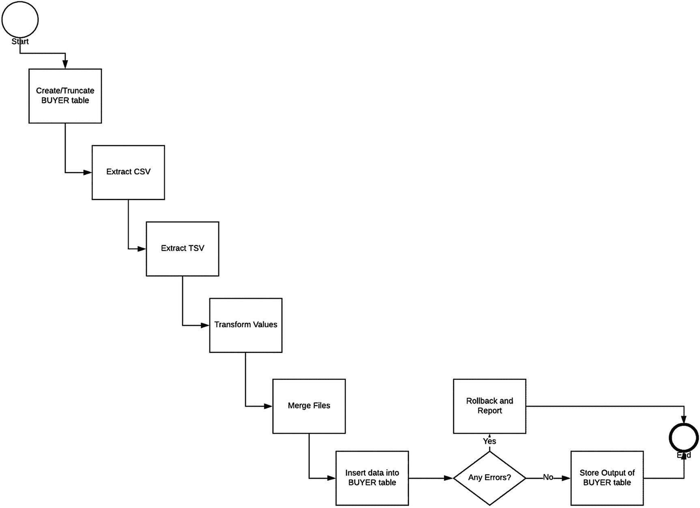

`图 7-6` — 数据迁移流程流程图

1. **创建/截断 BUYER 表**：使用 ETL 工具，如果 `BUYER` 表不存在则创建它。如果存在，则截断所有数据以备下次加载。
2. **提取 CSV**：使用 ETL 工具的 CSV 连接器，检索所有逗号分隔的数据。
3. **提取 TSV**：使用 ETL 工具的文本连接器，检索所有制表符分隔的数据。
4. **转换值**：以 `STTM` 为参考，更改已标识的转换值。
5. **合并文件**：将新的（转换后的）暂存文件合并为一个为目标格式准备好的文件。
6. **将数据插入 BUYER 表**：使用 ETL 工具的 SQLite 连接器，将所有值插入 `BUYER` 表。
7. **决策**：加载过程中是否有任何错误？
    1. 如果有，则回滚数据并发送一份报告。
    2. 如果没有，则将 `BUYER` 表的输出写入一个 `.csv` 文件。

我们将这些需求交给了开发人员，他们返回了完成的原型文件。

就在交付日期临近的一个晚上，我们接到了项目经理的电话，他告诉我们管理层最近又发现了四个源文件。其中，2014 年和 2015 年的文件是 Excel 格式，其余的文件使用 CSV 分隔符。他们想知道我们是否也能将这些数据纳入新数据库。我们现在的工作是回过头来将这些文件加到原型中，进行测试，然后确保 QA 团队对我们的结果感到满意。

好消息是，管理层已同意取消每两周迁移一次数据的要求。就目前而言，我们可以回到最初的结论：这次迁移将是一次性的。

他们还问，我们是否可以不合并数据，而是直接将数据原样加载到新数据库中。他们会根据需要执行去重和清理工作。

根据这些新信息，我们重新审视流程并重启启动阶段。你逐个部分地与你的集成团队沟通新需求。“能做到吗？”你问道。“需要多长时间？”

主开发人员说：“这会是项艰巨的工作。但我们会尽最大努力在下一个冲刺结束前完成。”

> **注意**  
> 我猜想所需时间可能会少于两个冲刺，但你的主开发人员不会这么告诉你，因为他想通过压低承诺、超额交付来展现团队的高超能力。集成团队最棒了。

你已经准备好了后续步骤。你重新打开之前已获批的文档，并标记出新的需求。例如，你将数据迁移计划中的早期方案修改如下。

#### 拟定的迁移与集成方案

我们将使用 ETL 工具从六个文件（三个逗号分隔文件、一个制表符分隔文件和两个 Excel 文件）中提取数据，对内部数据执行转换以匹配目标结构，并将数据提取到目标数据库。今后所有的数据录入都将在目标系统上完成。

你还可以修改未来状态图，以表示多个 CSV 和 XLS 文件，而不仅仅是首次迭代中的 CSV 和 TSV（见图 7-7）：

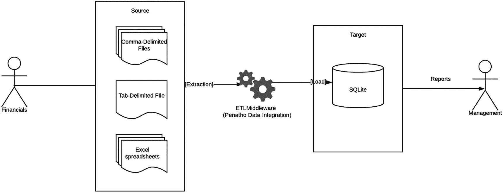

所有这些设计都是为了向更广泛的受众传达策略，并向任何审阅文档的人确认假设是正确的。

你将基本以相同的方式重新进入发现、设计和构建阶段。你将重新对新的数据集进行分析，使用更新的源到目标字段和转换规则来修改你的 `STTM`，并将最新步骤纳入你的数据迁移计划。这些操作就像在你的流程图中添加和删除相应的方框，然后调整你的摘要以匹配它一样简单（见图 7-8）：

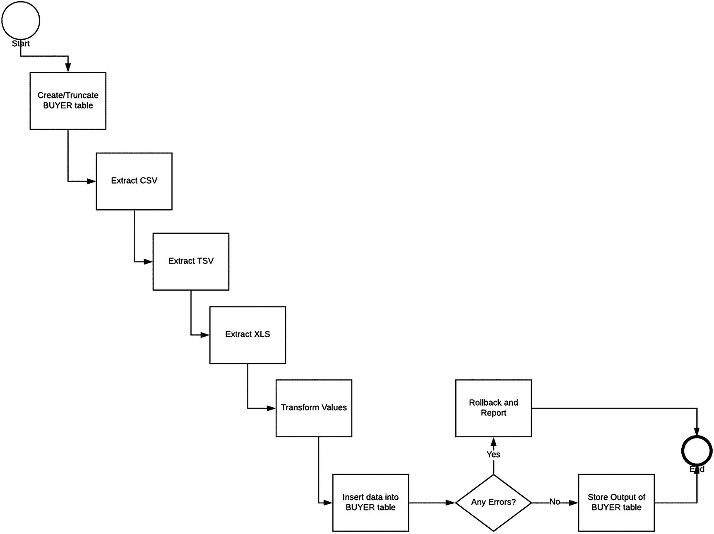

1.  **创建/截断 BUYER 表**：使用 ETL 工具，如果 `BUYER` 表不存在则创建它。如果存在，则截断所有数据以备下次加载。
2.  **提取 CSV**：使用 ETL 工具的 CSV 连接器，检索所有逗号分隔的数据。
3.  **提取 TSV**：使用 ETL 工具的文本连接器，检索所有制表符分隔的数据。
4.  **提取 Excel**：使用 ETL 工具的文本连接器，检索所有 Excel 电子表格数据。
5.  **转换值**：以 `STTM` 为参考，更改已标识的转换值。
6.  **将数据插入 BUYER 表**：使用 ETL 工具的 SQLite 连接器，将所有记录插入 `BUYER` 表。
7.  **决策**：加载过程中是否有任何错误？
    1.  如果有，则回滚数据并发送一份报告。
    2.  如果没有，则结束此事件。

你将这些修改后的文档交给你的开发团队，要求他们为你构建最新、最强大的 ETL 版本。纯粹为了好玩，并保持本章的主题，你希望他们能将这个过程自动化，以便只需单击一下鼠标就可以完成数据的提取、转换和加载。

##### 演示

`chapter7` 文件夹包含你数据系统的最新版本，该版本已复制到设计为开发、预发和生产环境的对应文件夹中。在克隆 GitHub 目录并根据第 6 章所述安装 Pentaho 之后，请执行以下操作：

*   根据你的操作系统，打开 `spoon.bat` 文件（Windows）、`spoon.sh` 文件（Linux）或 Data Integration 应用快捷方式（macOS）。
*   点击 `File/Open` 菜单（Windows 上使用 `CTRL+O`），然后导航到你从 GitHub 下载的 `chapter7\development\scripts` 目录。双击 `job_infomotors2.kjb` 文件。该脚本将打开（见图 7-9）。

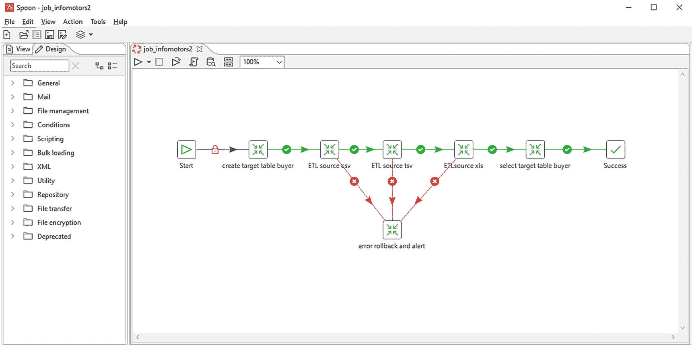

`job_infomotors2.kjb` 脚本

用 Pentaho 的行话来说，你看到的是一个“作业”。它就像一个编排引擎，负责协调 ETL 任务和活动的执行及依赖关系。^(112)

这个作业就是我们一直在讨论的自动化脚本，它包含对我们之前数据迁移流程中确定的其它 ETL 函数的调用。该窗口按顺序显示这些任务：

*   create target table buyer
*   ETL source csv
*   ETL source tsv
*   ETL source xls
*   select target table buyer

你会注意到，页面底部还有一个通过 ETL 任务连接的任务。这是一个失败“跳转”，它将在任何 ETL 流程失败时触发，执行回滚操作并报告错误的类型和性质。

*   如果你右键点击这些步骤中的任意一个，并选择“Open Referenced Object ➤ Transformation”，你将打开与该步骤关联的嵌入式脚本。就像我们在第 6 章中所做的那样，让我们对“create target table buyer”步骤执行此操作（见图 7-10）。

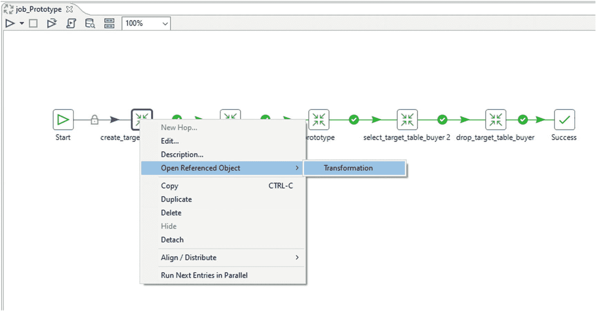

右键点击 create target table buyer

**注意**：正如我们在之前的演示中所讨论的，你也可以通过点击 `File/Open` 并从 `chapter6/scripts` 目录中选择相应的名称来打开脚本。我指定的通过右键点击的方式步骤更少，但你可以根据自己的偏好选择。

你将看到，这个步骤与我们之前使用的迭代版本编写方式相似，只是我们修改了 SQL，这样如果表不存在，就会实例化该表。换句话说，当你首次运行此应用程序时，开发数据库模式（`infomotors_dev.db`）会与 `BUYER` 表一同创建（见图 7-11）。

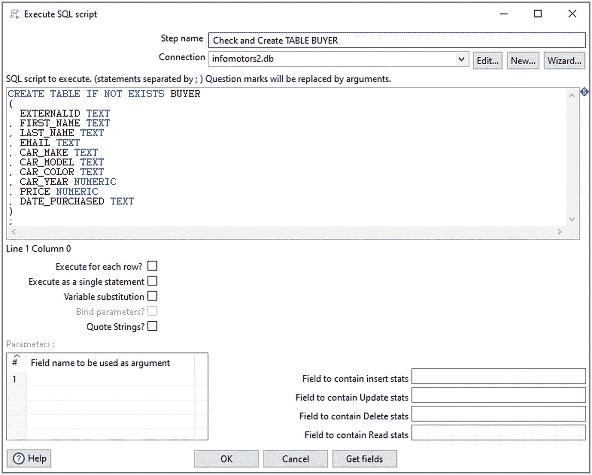

`CREATE TABLE BUYER` 的更新版本

*   因为该脚本将在我们执行作业时运行，所以你无需执行任何操作。在此窗口中点击“Cancel”，然后点击窗口左上角的 `job_infomotors` 标签页。
*   现在，右键点击“ETL source csv”步骤，并选择“Open Referenced Object” ➤ ”Transformation”。你看到的是提取（多个）CSV 文件、转换数据并加载到 `BUYER` 表中的模型。

你会注意到，此文件与“原型”脚本不同，我们将制表符分隔步骤以及新的 Excel 步骤分离出来，放到了各自独立的流程中。我们本可以将它们合并到一个文件中，但从架构角度来看，通过保持功能的模块化并使其专注于单一职责来分离它们是有意义的。

*   连接器中还有其它一些模式需要我们审阅。
*   首先，双击“Extract Multiple CSVs”将其打开（见图 7-12）。

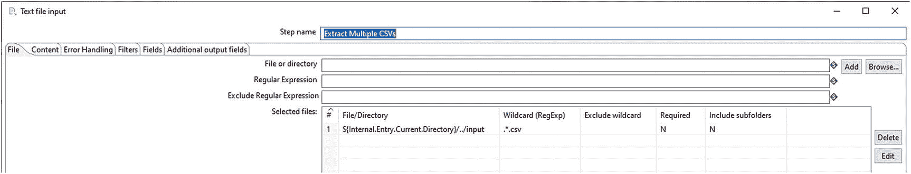

Extract Multiple CSVs

你会注意到，在“Selected Files”处，我们有一个如下所示的目录路径：

```
${Internal.Entry.Current.Directory}/../input
```

`${…}` 之间的值是一个 PDI 内部变量。它告诉我们，正在检查的变量是我们保存脚本的位置。在我的机器上，我将作业保存到了目录 `C:\Users\<<在此处输入你的用户名>>\Documents\BAIT\chapter7\development\scripts`。你的路径应该类似。变量后的 `/../` 表示上一级目录，而 file input 是最后一个目录值。因此，我正在对路径 `C:\Users\Jarrett\Documents\BAIT\chapter7\development\input` 执行查找，该目录包含 InfoMotors 的示例记录。

下一列是通配符 (RegEx)，它指示要查找的文件的筛选条件，对于此任务，是 `.*.csv`。也就是说，任何以后缀 `.csv` 标识并存储在 `development\input` 目录中的文件都会被读入系统。

这种结构特别有用的地方在于，我们存储在 `\input` 目录中的任何带有 `.csv` 前缀的文件都会被读取并自动追加。当然，格式需要与我们预期使用的输入（`id`、`first_name`、`last_name` 等）相匹配，一些快速的数据分析可以帮助我们确定是否确实如此。

因为我们使用变量作为输入路径，而不是硬编码，所以我们不再需要知道脚本存储的*位置*。我们只需确保有一个上一级目录（`/../`）和一个额外的输入路径即可。正是这种语法，使得我们可以快速地将同一个脚本放入一个完全不同的环境中，它也能照常工作，而无需感知其目录结构是不同的。例如，如果你在我们的预发目录中打开同一个“ETL source csv”文件，你会看到我们使用了同一个文件，只是这一次，我们的预发脚本是从*预发*文件夹中读取，而不是从*开发*文件夹中读取。在我看来，这种通用代码是部署的秘诀。无论我们将此脚本存储在何处，我们只需确保目录的后半部分遵循某种模式，就可以顺利运行。

**注意**：出于演示目的，SQLite 数据源的名称已被调整为映射到 `infomotors_dev.db`、`infomotors_staging.db` 和 `infomotors_prod.db`。这样做是因为我们在同一台机器上运行 ETL 脚本，并且不希望覆盖本应隔离的数据。在典型的基础设施中，你很可能使用相同的数据库模式、表和字段，而这个连接器可以保持硬编码，或者，如果你愿意，也可以作为一个变量。

我将把 `job_infomotors` 作业中的 ETL source `.tsv` 和 ETL source `.xls` 脚本留给你去审阅。你会看到它们遵循相同的格式，只是通配符值被调整为匹配它们的筛选条件 `.*.tsv` 和 `.*.xls`。与 CSV 文件一样，我们可以将任意数量的带后缀文件添加到该环境的 `/input` 文件夹中，每个文件都将包含在我们的作业运行中。

#### 输出步骤

在测试完整自动化之前，我们还有两个步骤需要检查。

- 在 `job_infomotors` 页面，右键点击“选择目标表 buyer”步骤，然后选择“打开引用对象 ➤ 转换”。该流程将会打开。

此步骤的目的是满足我们的数据迁移流程中指定的要求，这将在我们测试作业执行时作为一种完整性检查。此步骤完成了两项活动（参见图 7-13）。

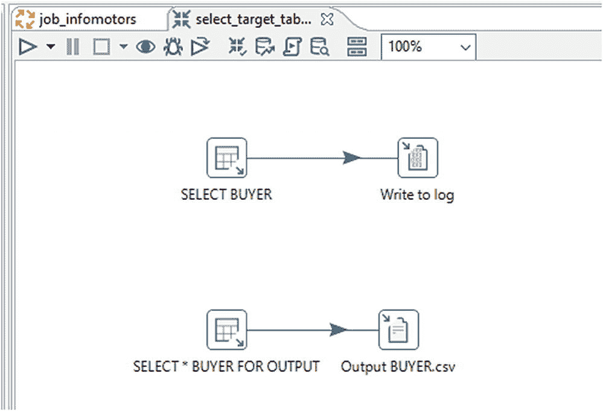

第一个活动对 `InfoMotors BUYERS` 表执行了一个 `SELECT COUNT` 操作。`PDI` 日志会显示这个计数以供您查看。第二个 `SELECT` 检索了 `BUYER` 数据集的所有字段，并将结果输出到一个名为 `BUYER.csv` 的 CSV 文件。与我们抽取步骤中的输入类似，此输出指向您相对环境中的 `/output` 目录（参见图 7-14）。


#### 回滚

我们的最后一步是错误步骤。ETL 工具允许您控制异常逻辑的工作方式。在 ETL 领域，可能会发生两大类错误。第一类是技术错误，您会因其出现网络、基础设施或安全方面的问题而看到此错误。例如，当您尝试从一个离线的数据库检索信息，或者尝试使用旧密码登录系统时，就会捕获到技术错误。在这些情况下，您的 ETL 将被编程为向网络、基础设施或数据库管理员报告错误原因、时间、日期以及任何其他可能有帮助的信息。

第二类称为业务错误。如果预期应发生的工作流规则或需求没有发生，则会发生此错误。例如，如果一个字段本应只提供数字，但却包含了字母，就会触发业务错误。IBM 的命名标准以及我们在本书前面讨论过的变通方法是另一个业务错误的例子，尽管这种错误不会触发警报。鉴于数据可能“出错”的主观程度，业务错误通常比技术故障更难解决，您的团队将花费大量时间寻找消除数据问题的新方法。幸运的是，您持续改进 ETL 逻辑、改进部署以及监控变更的策略（参见第 8 章）将会步入正轨，您的团队最终将在数据修复领域成为神枪手。

目前，我们将保持回滚策略的简单性。任何错误，无论是技术错误还是业务错误，都会触发我们的脚本运行。像往常一样打开“错误回滚和警报”步骤，您会看到只有两个任务：从 `BUYER` 表中删除所有记录，并向 `PDI` 发送一条包含以下消息的日志警报：`"An error occurred with the integration. Rolling back"`（参见图 7-15）。

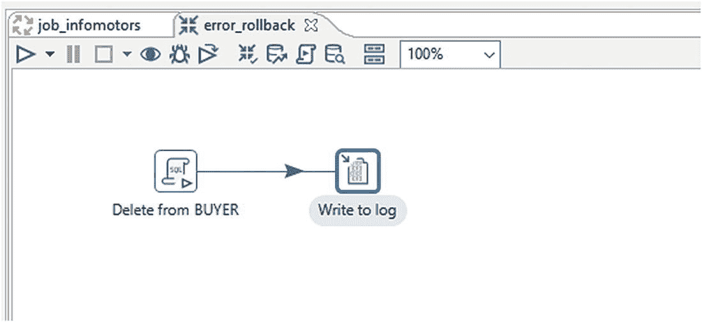

#### 测试自动化

了解了这些步骤之后，现在是时候从头到尾运行我们的作业了。还记得我承诺过的一键点击吗？

- 在 `job_infomotors` 主页面，点击运行按钮。将会打开一个“运行选项”页面。
- 在“运行选项”页面上点击运行。

（好吧，您可能会说这实际上是按了两次按钮。我们本章还没完全结束，所以请耐心等待。）

如果一切按预期运行，您的作业流应该会从头到尾贯穿整个流程。也就是说，我们满足了数据迁移流程和源到目标映射中所述的要求，并与我们数据迁移计划的目的和未来状态保持一致。只需按两次按钮就能完成这么多工作。

如果您查看执行结果日志窗格，您会看到触发的不同工作流，以及读写计数、警报和持续时间。这个日志窗格是您经常在 `PDI` 中使用的功能，但任何物有所值的 ETL 系统都会提供类似的报告标准（参见图 7-16）。

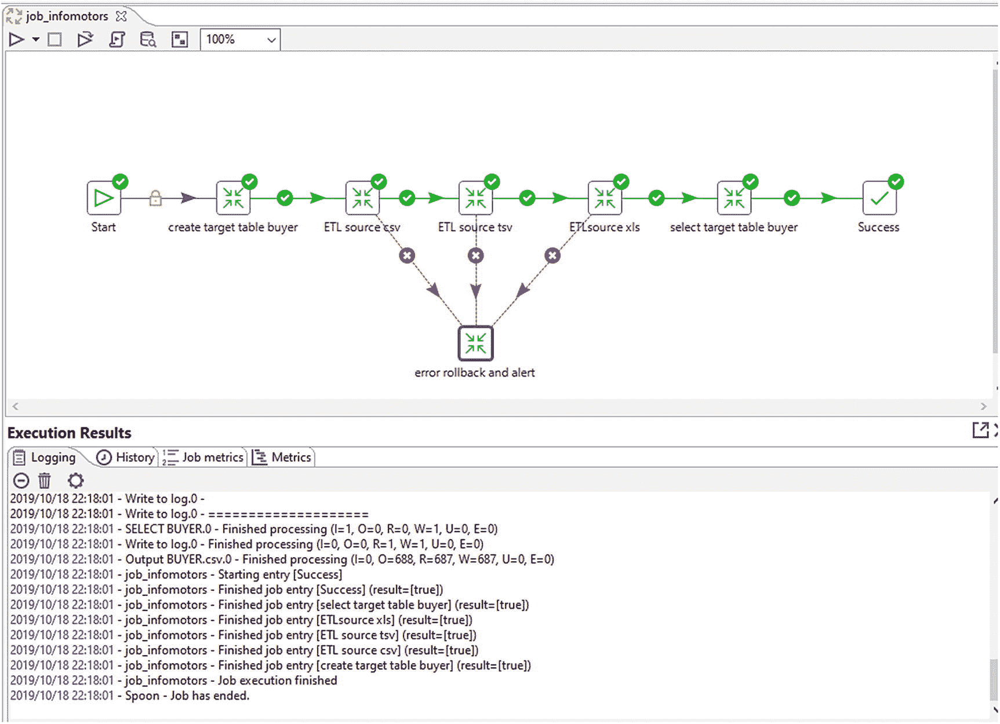

根据我的日志，我们在不到 2 秒的时间内加载了 687 条记录。即使我们仍然多按了一次按钮，这个时间也不错。

如果您想查看我们加载并随后从数据库表中提取的记录，请导航到 `chapter7/development/output` 目录并打开 `BUYER.csv` 文件。

##### 测试

在设置定期 ETL 之前，我们还有一个主题需要讨论：测试。在 DevOps 的世界里，我们应该实现测试自动化，而且说实话，这可能会涉及一些繁重的操作。开发人员和测试自动化工程师需要协同工作，共同开发测试脚本，最大化编码脚本的测试覆盖率，并通过使用各种 CI/CD 工具，在持续循环中生成、部署和运行测试脚本。^(113)

全面开展自动化测试超出了本书的讨论范围。只需说明，我们想要做的是找到一种快速运行测试的方法，并确保能从测试中优雅地恢复。为此，我们希望提取那些会导致技术错误和业务错误的数据，然后观察系统对问题的反应。理想情况下，所有这些都应在后台完成，使用为此目的构建的测试环境、脚本和数据。

我们不会执行这些复杂的操作，而是采用老派的测试方式：在输入目录中打开一个 CSV 文件，将数据脚本中的一个值改为无效值，然后重新运行我们的任务。就这么简单。如果你准备好了，请执行以下步骤：

1.  在你的 `chapter7\development\input` 目录中，使用记事本或你喜欢的文字处理器（如 Sublime、Notepad++、Vim 或 TextPad）打开 `Contacts_2016.csv` 文件。建议避免使用 Word、WordPad 或 Excel，因为我们要做的改动很小，而这些应用程序在保存 CSV 文件时可能会添加字符或删减数值。
2.  将第二行的最后一个值改为 `ABCDE`（见图 7-17)

    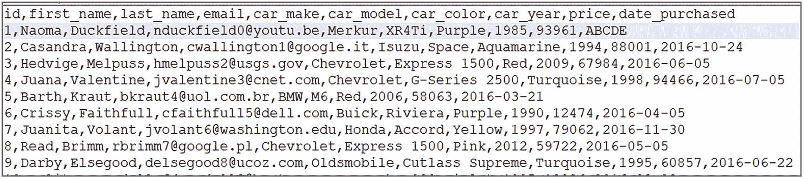

3.  在 PDI 中，点击“运行”按钮重新运行 `job_infomotors`。

如果一切按预期进行，流程将启动，但你会触发 `ETL source csv` 步骤上的错误。屏幕上显示的路径将指向 `error rollback and alert` 步骤（见图 7-18）。

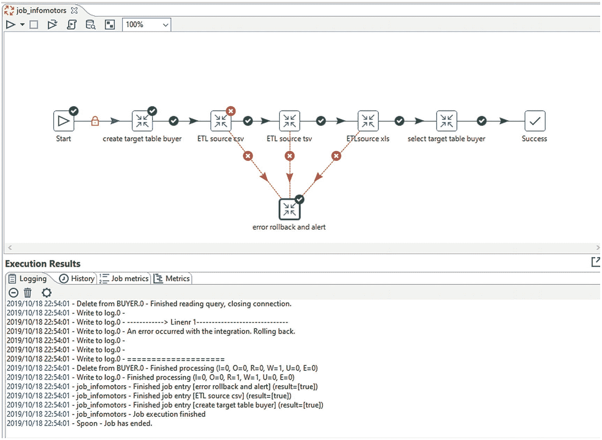

“执行结果日志”窗格将显示任务的输出。你应该能看到我们编程设置的警报消息（`集成过程中发生错误。正在回滚`），以及从 `BUYER` 表中执行删除操作的步骤。

如果在此时，你打开 `select target table buyer` 步骤并手动运行此过程，你会从日志中看到该表的计数为零，从而确认该表是空的（见图 7-19）。

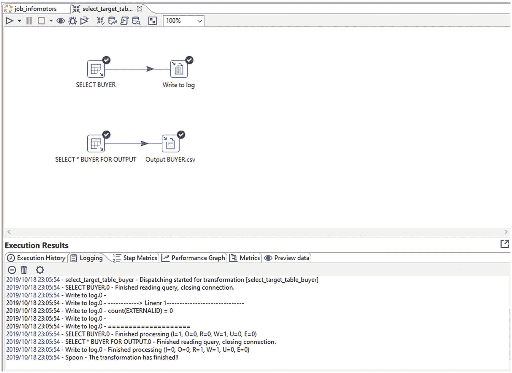

#### 任务调度

作为最后一步，我们将设置此任务按需运行和按计划运行。之前，我提到过使用像 Jenkins 这样的编排引擎或像 Microsoft 任务计划程序这样的调度工具来自动化我们的脚本。在这一步中，我们将配置任务计划程序，让我们的 PDI 任务每 5 分钟执行一次。如前所述，欢迎使用你偏好的编排引擎或调度工具来测试任务执行。

1.  点击 Windows“开始”图标，输入 `task scheduler` 并按回车键。
    任务计划程序将启动（见图 7-20）。
    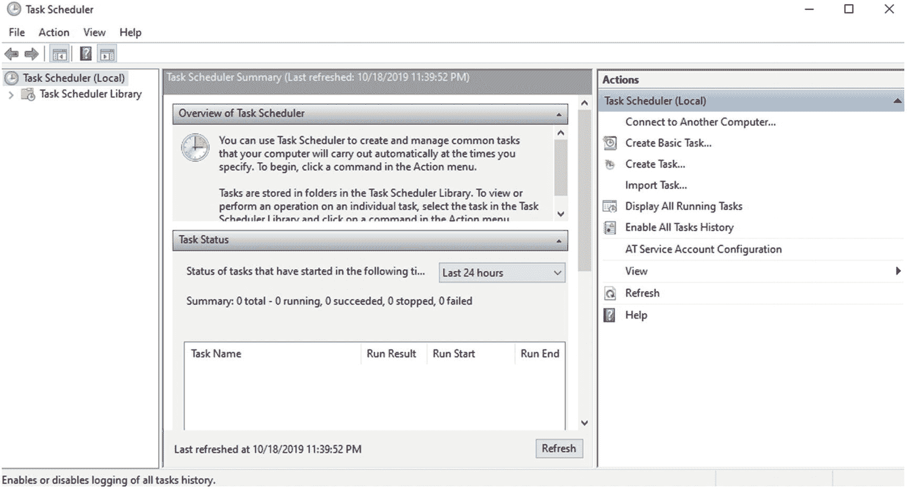
    图 7-20 Windows 任务计划程序

2.  选择名为 `创建任务` 的操作。

3.  “创建任务”窗口将打开（见图 7-21）。在“常规”选项卡上，在提供的字段中输入信息：
    * 名称：`Run Infomotors_ETL`
    * 描述：填写你喜欢的任何内容，但为了便于知识传递，我通常会明确填写，不会让此字段留空。
    * 勾选 `使用最高权限运行`
    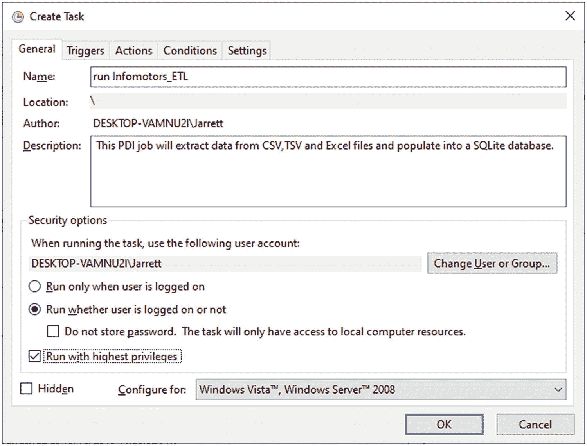
    图 7-21 “常规”选项卡

4.  在“触发器”下，点击“新建”按钮。“新建触发器”窗口将打开（见图 7-22）。在此输入你的详细信息。例如，我选择从午夜开始，每 5 分钟重复执行一次任务。你当然可以选择任何你喜欢的方式，但最好是距离你开始时间不超过一小时。
    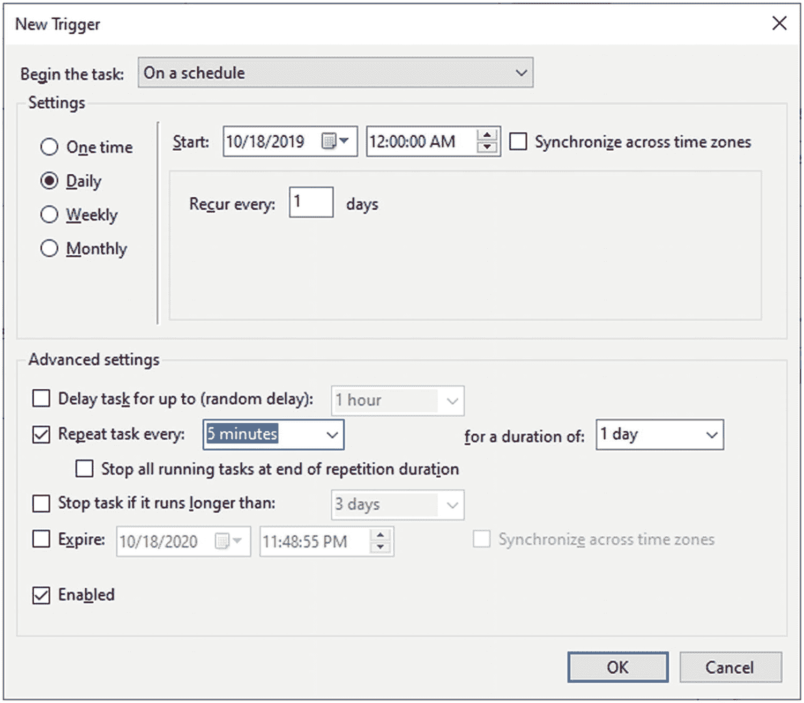
    图 7-22 新建触发器

5.  在“操作”下，点击“新建”按钮。“新建操作”窗口将打开（见图 7-23）。请严格按此处的样式输入你的详细信息：
    * 操作：`启动程序`
    * 程序/脚本：`<你解压 Pentaho 的路径>\data integration\kitchen.bat`
    * 添加参数：`/file:<你的脚本文件安装路径>\job_infomotors.kjb`
    大多数 ETL 工具都包含一个命令行可执行文件，允许你通过单个命令运行流程。`Kitchen` 是 PDI 用于执行任务的命令行工具。在“添加参数”字段中，你正在选择要执行的任务（见图 7-23）。使用你想要的任何环境。有关你可以与 PDI 一起使用的其他参数和命令行工具的更多详细信息，请参考 [`help.pentaho.com/Documentation/7.0/0L0/0Y0/070`](https://help.pentaho.com/Documentation/7.0/0L0/0Y0/070)。^(¹¹⁴)
    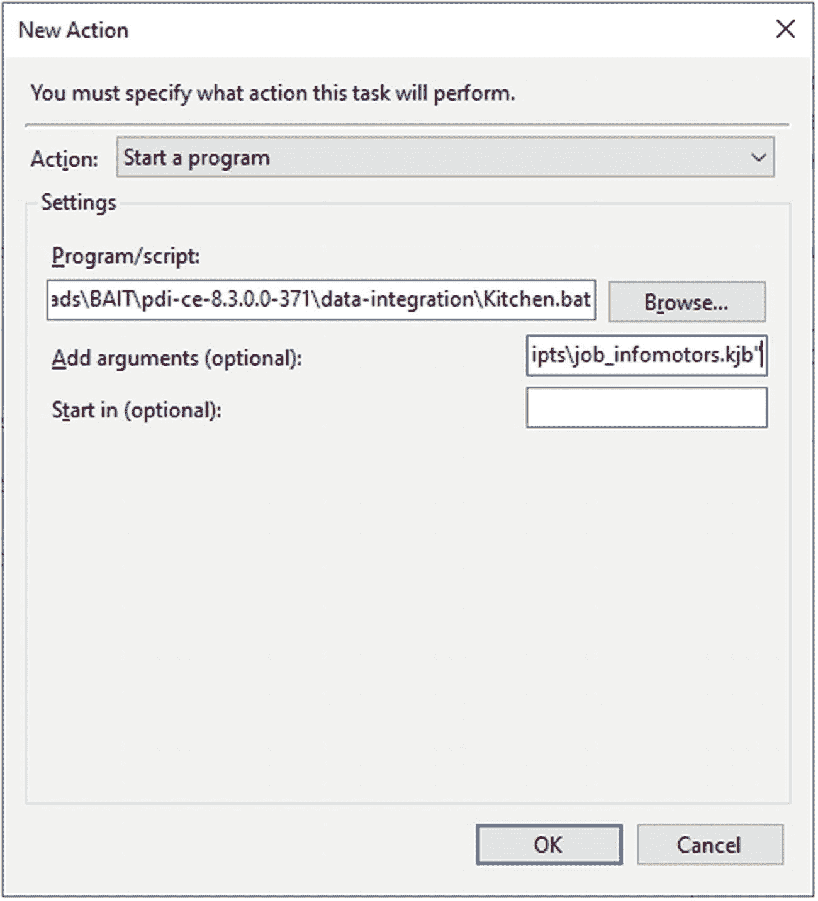
    图 7-23 新建操作

6.  点击“确定”，然后再次点击“确定”。

7.  系统可能会请求验证你的用户名和密码凭据。请在此处完成验证。

8.  你将返回到“任务计划程序”窗口（见图 7-24）。
    
    图 7-24 任务计划程序窗口

此时，你可以选择等待任务执行（就我而言是每 5 分钟执行一次），或者通过双击“活动任务”窗格中的 `run Infomotors_ETL job`（见图 7-25），然后点击一次“运行”按钮（见图 7-26），按需运行任务。顺便提一下，这就是我在本章开头承诺的“一键操作”。

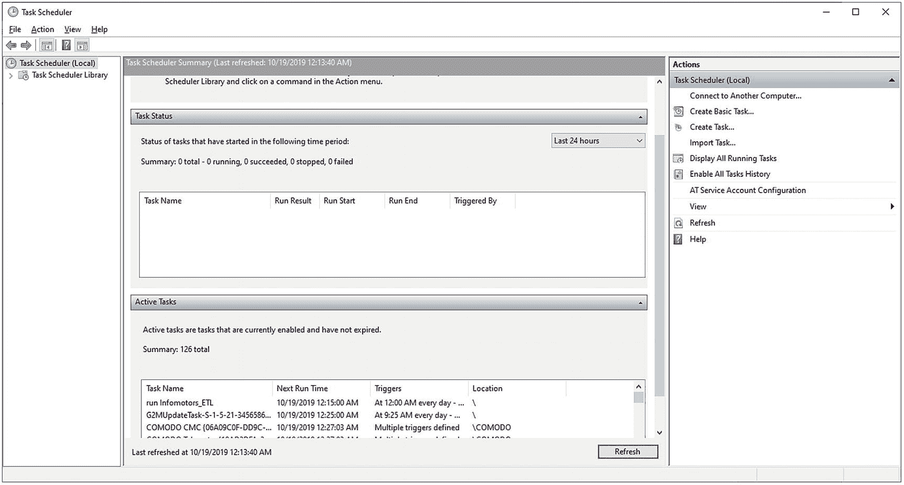
图 7-25 双击活动任务

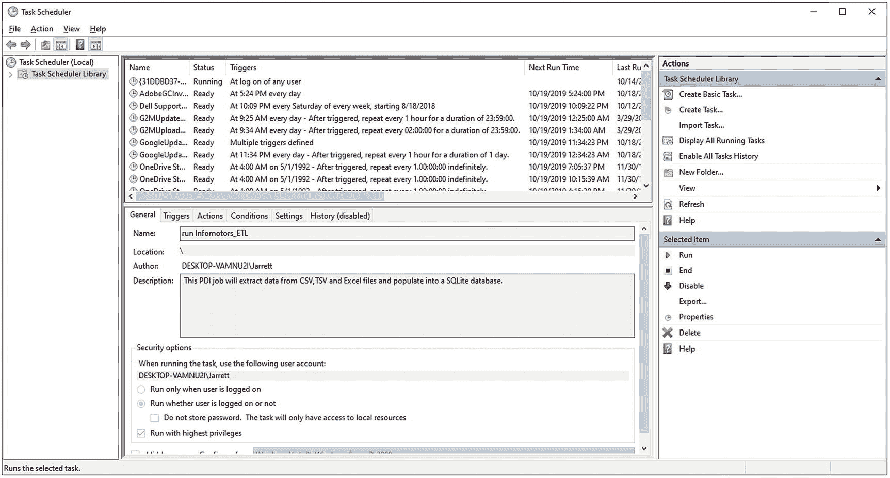
图 7-26 选择“运行”按钮

您可以通过查看任务计划程序的上方窗格，搜索您的活动，并滚动到 `上次运行结果`，来确认任务是否已成功执行。

这最终的确认可能还不够，您可能还想知道还有什么其他功能。其实可以做的事情很多，大多数都建立在客户对成功和错误处理的需求之上。例如，在我们交付的许多集成项目中，我们会配置在任务成功完成或失败时发送电子邮件。此外，我们的团队通常更倾向于调用一个能触发 ETL 命令行界面活动的包装脚本，而不是像示例中那样在 `新建操作` 窗口中直接输入 ETL CLI 工具，这样在我们更换工具或流程时，代码更容易修改。这些只是您可以通过计划任务实现的一部分功能，您的 ETL 工具应该能够支持更多。

## 总结

本章带您进入了部署、自动化和调度的世界。在了解了开发环境、预发布环境和测试环境之间的一些区别后，我们演示了如何将原型配置为可在任何环境中灵活工作、可根据需要适配尽可能多的文件类型，并可设置为每 5 分钟触发一次重复执行。当今市面上大多数 ETL 产品以及基于脚本构建的 ETL 工具，都应该能够处理这类偶发情况，因此我鼓励您的团队继续探索，找到最适合的方案。真正的价值不在于工具本身，而在于所选应用程序处理各种数据、并以更快的速度解决那些问题的能力。我希望您现在有足够的信心：当需求在最后一刻发生变化时，您将知道如何快速调整，更重要的是，能够期待这些修改的速度和准确性。

在下一章中，我们将讨论在将应用程序部署到生产环境后，如何开始监控结果。