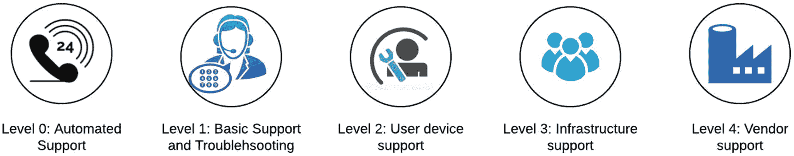
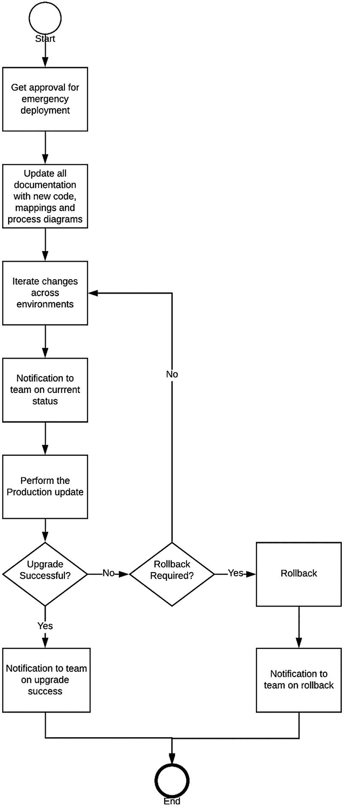
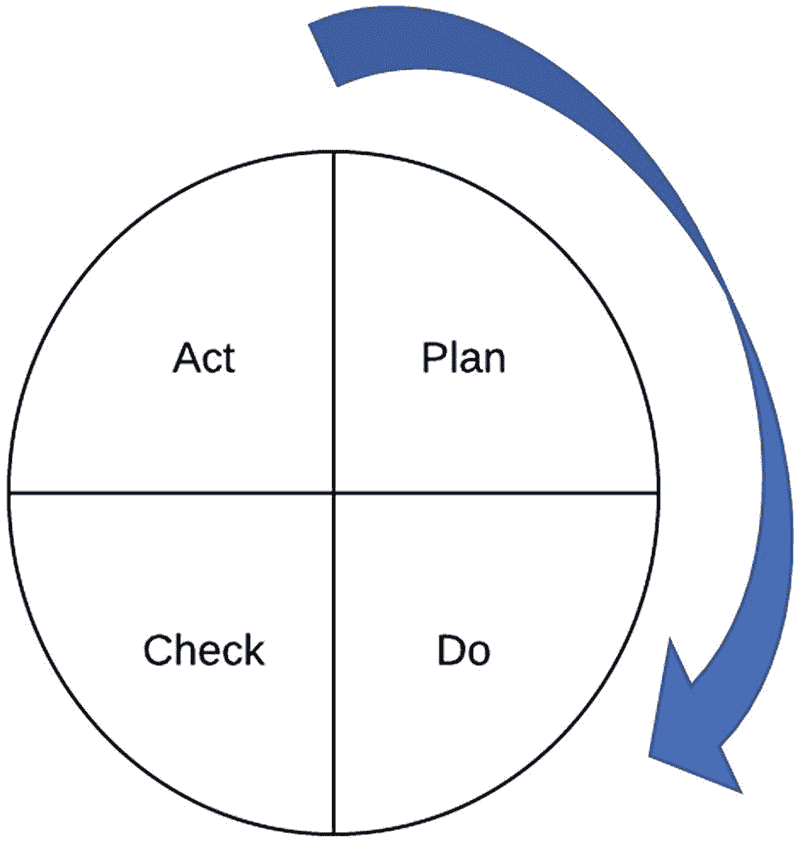
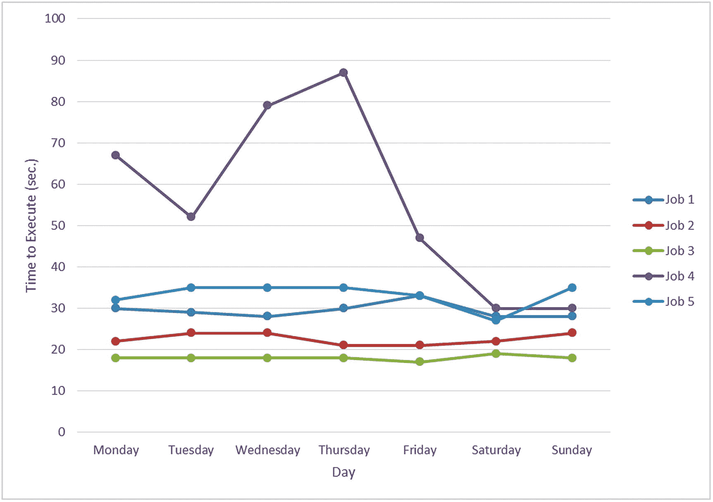
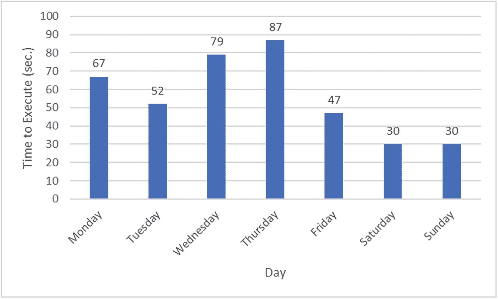
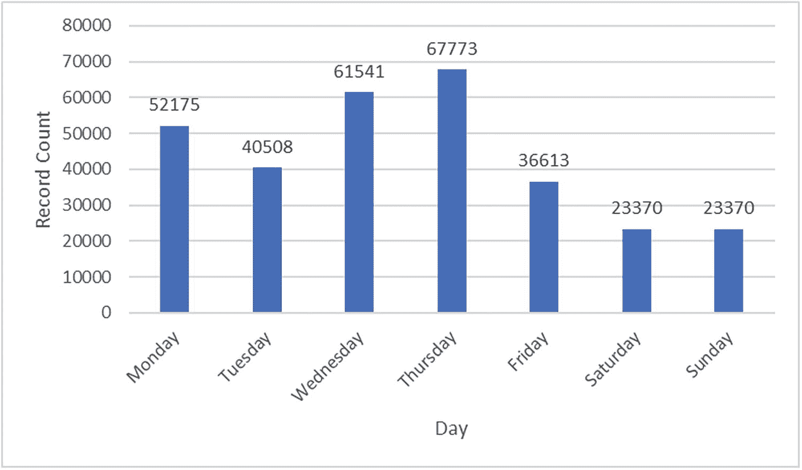
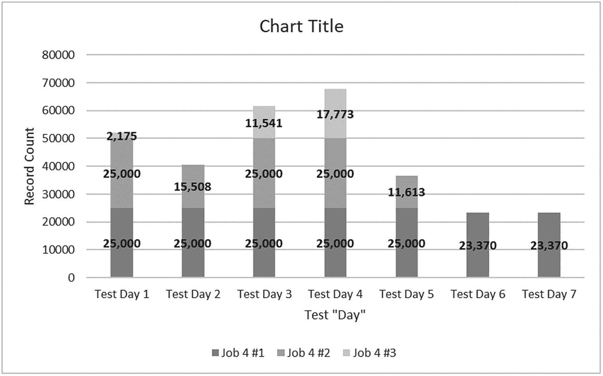
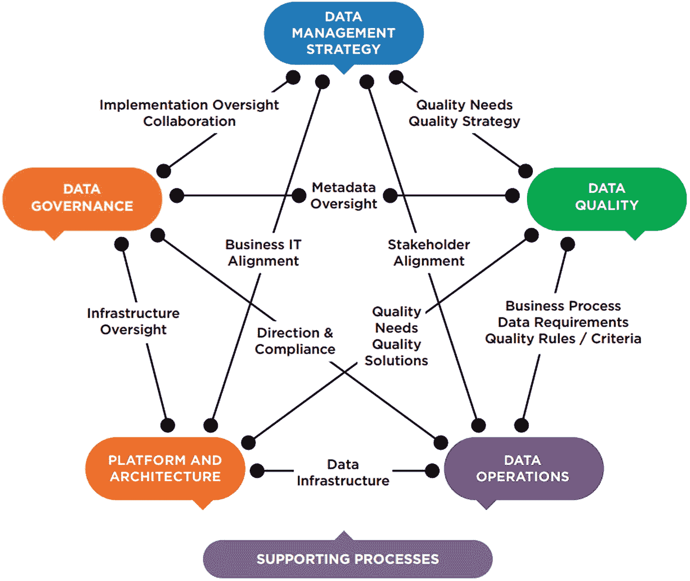
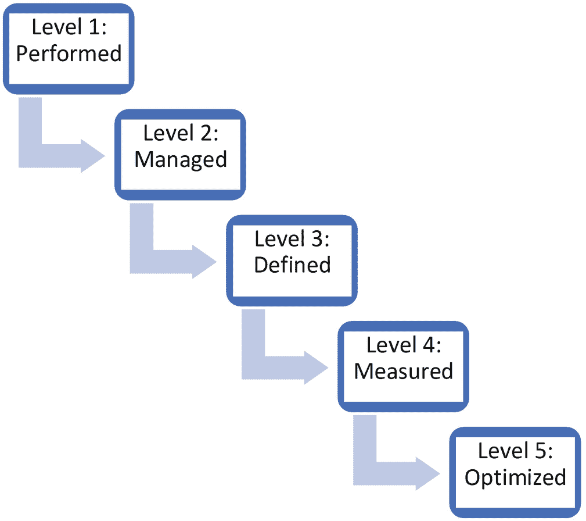
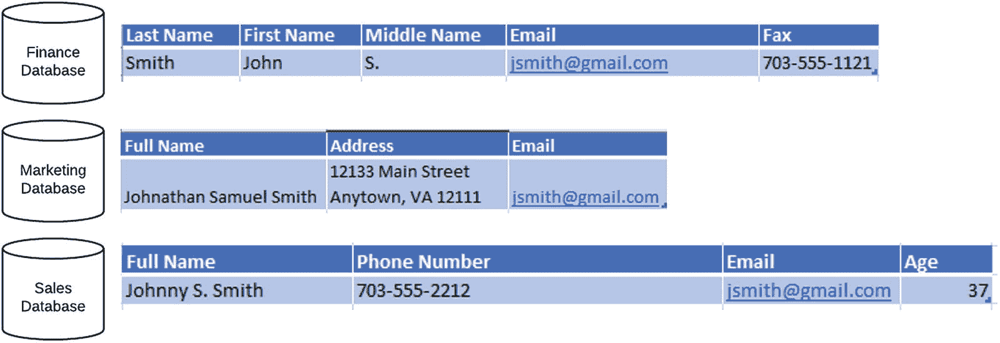

# 8. 监控结果

> *我们正迅速进入一个万物皆可被监控和度量的世界。但最大的问题在于，人类是否有能力使用、分析并理解这些数据。*
> 
> ——埃里克·布林约尔松^(¹¹⁵)

## 引言

终于，我们熬过了探索、设计、测试和部署的考验。我们现在对数据了如指掌，已经向团队预警了数据差异，并设法实现了一次性迁移和可重复集成（尽可能）的自动化。我们甚至建立了一个在遇到业务规则和错误时触发的报警系统。还有什么工作要做？

幸运的是（或者不幸的是，取决于你的视角），一个集成团队的工作永无止境。部署之后，我们现在进入了关键的监控阶段。在此阶段，我们需与目标数据团队合作解决他们的数据问题，确保我们重构了 ETL 流程中仍然遇到的独特错误，并审查每日和每周日志中的统计数据，以便企业能够改进其数据目标。这些活动是一个渐进的过程，从部署后的第二天起，时钟就开始滴答作响。让我们从第一天开始，记录可能出现的里程碑和问题。

## 第一天：部署后

迁移后的第一天可能会非常忙碌。一方面，你急切地想分享庆祝的喜悦；但另一方面，一个全新的、装满数据的应用程序正等着用户访问。如果你身处一线技术支持，你会接二连三地接到用户的电话，询问这条记录是否被发送、那个值是否被迁移过来？因为它要么不存在了，要么虽然存在但格式变了，要么它从未存在过却又奇迹般地出现了。面对如此多可能让这一天混乱不堪的潜在情况，你的团队将如何应对这股冲击？

嗯，好消息是，他们可能不用立即面对。至少最初不必。集成团队负责处理与迁移过程相关的数据问题，但这些请求首先需要经过几个检查点。您需要在组织内确定自己所能提供的支持级别，这是我们接下来要讨论的话题。

### 支持级别

除非你供职于一家资源匮乏的小公司，否则集成团队通常不会处于服务台支持的前端。对于中大型组织来说，处理错误和类似投诉的角色通常会进行分层，而集成团队将免受其中大部分问题的干扰（见图 8-1）。博主乔·赫特维克曾撰文介绍不同支持级别的入门知识：^(¹¹⁶)

**图 8-1** 服务台支持级别

*   **0 级支持**：用户无需额外帮助即可自行访问的在线、电话或类似的自助解决方案。对于你的集成项目，在此级别预期会遇到的电话类型包括需要重置密码的用户，或希望访问知识库以了解新版本如何影响其旧数据的用户。

*   **1 级支持**：此级别负责筛选入站的服务台电话，并提供基础支持与故障排除。1 级技术人员将收集并分析用户问题，确定后续步骤，例如判断这是否是与先前修复重复的问题、工单路由，以及升级至 2 级或 3 级支持。1 级支持通常是处理有关集成产品和流程的任何投诉的第一线，并且应获得一份针对常见问题（这些常见问题有即时回复）的指令清单，例如解释一项取代了“按 ID 搜索”功能的新“按姓名搜索”功能。1 级支持还应了解你的生产环境停机时间（见“生产环境问题”），并在呼叫者遇到网络相关问题时手头掌握详细信息。

*   **2 级支持**：在某些组织中，2 级支持负责用户设备支持，如笔记本电脑、台式机和平板电脑，但也可能与 3 级支持分担工作。2 级支持处理任何与设备相关的投诉，例如配置问题、故障排除、软件安装和硬件维修。他们接收来自 1 级支持的一线请求，并根据服务台自身技能或能力的运作方式，可能需要进一步升级到 3 级支持。集成项目如何影响 2 级支持的一些例子包括：用户需要安装特定产品以访问报表仓库，或者希望请求额外的驱动器空间以增加导出的数据量。

*   **3 级支持**：3 级是负责配置和修复服务器、网络、文件共享及基础设施问题的支持团队。3 级工单很可能是你的团队会面对的，因为任何集成和数据移动问题都属于基础设施范畴。当这些电话进来（通常通过 1 级或 2 级升级），你将需要掌握重要的故障排除信息，例如涉及的记录、用户出错时登录的是哪个系统或项目、收到的错误信息（如果有），以及预期的结果是什么。由于团队希望优先处理影响最大的问题，评估严重程度（低、中、高、严重故障）也会很有用。请记住，用户的紧迫感意味着你遇到的许多问题将被标记为“严重故障”，即使实际情况并非如此。

*   **4 级支持**：虽然不常用作内部服务台层级，但 4 级在数据集成领域有其用武之地。4 级指的是与你的团队直接合作或签订了特定服务合同的硬件和软件供应商。如果 3 级团队收到的服务工单是由于 ETL 软件或其他你无法控制的组件出现内部错误，你可能需要联系你的供应商（4 级），并通过其服务台处理该问题。问题解决时间应在合同的**服务级别协议（SLA）**中设定，并且保留你的客户代表的联系方式至关重要，以防你未能获得及时的响应。尽管问题可能正在由其他人调查，但最终责任归属集成团队。请不要忽视它。

### 常见的集成投诉与解决方案

在第一天，你会遇到一些投诉，其中一些你可以解决，另一些则超出你的控制范围。请阅读所有收到的请求，并指派合适的人进行相应的调查。你的职责范围专门针对中间件 ETL 工具，因此，如果问题纯粹出在数据上——源系统中看似正确的字段实际上充满了拼写错误，你则需要将工单升级回源/目标系统。只有在新的应用环境和光照下，这些问题才变得明显。

以下是你将收到的一些常见投诉及其解决方法。此列表并不完整，但应涵盖你将遇到的大部分项目：

*   **投诉**：“字段缺失。”
    *   **做法**：首先查看 ETL 代码，确认该字段确实缺失。打开最新版本的源到目标映射文档，查看该值是否在迁移/集成的列表中。

    > **注意**
    > 你总会遇到数据管理员，他们想知道为什么某个字段没有按预期方式进行转换，或者为什么本应包含的字段却被遗漏了。如果操作得当，你的源到目标映射文档（STTM）将包含关于字段为何偏离原始指定、提出该请求的数据所有者以及谁批准了该请求的注释。说实话，没有什么比当你向数据管理员复述，*他们* 才是最初要求修改该字段的人，并说明原因和确切日期时更令人满足的了。
    >
    > 并且，是的，集成团队遗漏字段的可能性始终存在。在这种情况下，你需要准备好在获得管理层批准后尽快进行紧急更新（参见本章后面的“更新生产环境”）。

*   **投诉**：“数据转换错误。”
    *   **做法**：同样，这需要审查和研究。源到目标映射文档（STTM）应在“转换规则”字段中包含你需要的所有细节。如果你发现实际数据确实与蓝图不匹配，那么请与你的 ETL 开发人员合作，找出原因并查明发生了什么。可能是错误的代码、遗漏的异常逻辑，或者是某些完全出乎意料的情况中断了迁移过程中的顺序。一旦找到根本原因，在你的 ETL 代码中进行修复，并经历文档-修复循环以及测试。一旦运行正常，重新部署你的 ETL 代码，并与团队合作更新转换错误的生产数据。

*   **投诉**：“ETL 损坏/未运行。”
    *   **做法**：ETL 未能正确运行是我们从目标数据所有者那里经常听到的问题，他们被工单淹没，试图弄清楚为什么前一晚运行的数据没有出现在他们期望的位置。幸运的是，你可以使用之前的执行日志来确认或否认这种可能性。如果 ETL 作业未能按计划执行，请查明原因。如果是一个小故障或由于临时失败所致，则提交一个响应工单，要求按需重新运行作业，或者如果愿意，可按计划运行。如果原因更严重，例如 ETL 触发错误并突然终止了作业，那么请返回代码，使用执行日志和测试环境重现该问题。一旦找到问题，按常规方式更新文档并在生产环境中执行补丁。

*   投诉：“我没有关于发生什么事的信息，但我知道数据有问题。”
    *   应对措施：“数据有问题”是一种常见的投诉，因为对于直属团队以外的大多数人来说，`ETL` 过程几乎是不透明的。他们不了解数据源、目标、`ETL` 或任何其他架构细节，只知道他们看到的记录不符合预期或记忆。因此，在没有确凿证据的情况下，这是一个难以调试的问题。尝试获取尽可能多的信息，调查所有可能性（检查之前的 `ETL` 执行日志，调查可能报告的任何其他重复错误，询问源和目标数据所有者是否有任何潜在影响可能导致数据问题）。你最初可能找不到原因，但如果这是一个真实存在的问题，它会再次出现。希望到那时，你会有更多信息可供处理。

### 每日数据日志

在客户之前识别数据问题的最佳缓解措施之一是创建每日数据日志，这是一份每日生成的文档，将从 `ETL` 执行中记录的日志行整合成一份简单的报告，提供关于整个可重复集成的汇总统计数据。每日数据日志包括流程名称、第一个作业运行的时间、作业结束的时间、传递的记录总数、错误总数（如果有），以及这些错误的类别（业务错误与技术错误等；定义见第 7 章）。通过 Wiki、每日电子邮件或报告应用程序与你的数据所有者共享此文档，将快速定位你团队和他们可能错过的焦点和问题，并为组织内的持续改进提供起点。我们将在下一节中进一步讨论持续改进。

**注意**

虽然我建议通过你手头的脚本构建每日数据日志，但如今市场上有更专业的解决方案。你可以查看来自不同供应商的应用监控系统，例如 `Datadog`、`SmartBear`、`New Relic` 和 `Atlassian` 等。这些工具值得研究，它们提供了出色的功能，可以显著提升你发现和修复问题的能力。

### 更新生产环境

你应该尽量避免直接在生产环境中更改 `ETL` 代码。在我们讨论技术债务（第 7 章）时，我建议你构建一种策略，允许你提供参数来更改值，而不是硬编码。但有时无法避免触及生产环境——可能需要进行紧急修复，某些导致数据库崩溃的关键代码段，^(¹¹⁷) 或者某个被链路上除 `CEO`（他现在已经掌握了生产环境）以外的所有人认为无关紧要的关键需求。在这种情况下，你将不得不直接介入。要有条不紊且始终如一地执行操作。我在图 8-2 中定义了我通常采用的策略。

**图 8-2** 生产更新流程图

步骤摘要：

1.  联系你的项目经理或业务相关方以获得批准；如有必要，开立变更管理工单。
2.  更新项目文档——重新调整源到目标的映射，对数据迁移流程图和细节进行更改，并与你的开发团队沟通所需的更改，确保获得一个切实可行的 `LOE`。
3.  迭代你的更改，从开发环境开始，进行测试，部署到预发布环境，重新测试，最后与相关人员共享任何修复的原型。
4.  根据公司政策，向受影响的团队发送通知，说明原因、解决方法、预期影响以及生产服务器的停机时间。让他们知道如果遇到新升级的问题，应该联系谁。
5.  执行更新。完成后，向受影响的团队发送另一份通知，提供最新状态以及如果问题持续存在应联系谁。最重要的是，感谢他们在处理停机期间的耐心和支持。
6.  如果由于某种原因你无法修复问题，并且这确实是产品的阻塞问题，那么你可能必须将生产环境回滚到中断前的副本。是的，这是最坏的情况，没人想要这个选项，但这比意外擦除数据并对系统造成无法估量的损害的噩梦场景要好。^(¹¹⁸)

## 第一周：部署后

在第一周内，你可能已经对 `ETL` 脚本做了一些调整，可能还有几次紧急部署（希望不要太多）。此时，用户越来越频繁地使用新系统，你会听到关于你团队工作的正面和负面评价。留意这些反馈并做好笔记。诚然，系统能工作，但总有改进空间。这是一个我们需要开始思考的目标。

### 规划下一步

如果你一直在记录每个作业的开始和结束时间，你将会开始看到一些常见的模式。也许有一个作业在凌晨 2:00 运行得太慢，或者有一个作业在定义的阈值内超时。你的用户可能不认为这些是主要问题，或者最多会略带抱怨地容忍它们。虽然你可能倾向于忽略这个问题——如果对他们来说没坏，为什么要修？——但我建议你坚持寻找解决方案。首先，仅仅因为现在没人认为这是个问题，并不意味着将来不会，尤其是当你的源和目标系统将要承受额外负载时。其次，你在每次加载中能实现的优化越多，你就越能持续且无间断地衡量你的集成效果。这种优化对于通过一个称为持续改进的生产力概念来识别更多机会至关重要。

### 持续改进

持续改进有多种名称：“快速改进”、Kaizen（改善）和渐进主义，^(¹¹⁹) 它是 W. 爱德华兹·戴明在 20 世纪 50 年代提出的总体改进过程的一个子集。^(¹²⁰) 在数据集成领域，我们可以将定义简化为“专注于线性改进、简化工作流，并通过自动化、可扩展的解决方案减少无关内容”。^(¹²¹) 这意味着，通过观察并持续迭代我们的 ETL 流以加速交付，我们将最终达到最大生产力水平。尽管实现完全自动化（即在没有任何用户干预的情况下达到最快速度）是最理想的，但我们承认，总会有进一步改进的空间。

达到下一级生产力是我们团队的重要驱动力，也应当是我们集成路线图的核心（更多内容见第 9 章）。目前，我们判断哪些方面需要改进的最简单方法，是通过戴明提出并由他人完善的“计划-执行-检查-处理”（PDCA）模型（见图 8-3）。^(¹²²) 我们可以将这一缩写分解如下：

- **计划：** 定义要解决的问题，收集数据，并确定根本原因。
- **执行：** 制定解决方案，并决定用于衡量有效性的指标。
- **检查：** 通过数据的前后对比来确认结果。
- **处理：** 记录结果，告知他人流程变更，并建议他们解决问题。

**图 8-3** PDCA 模型

请记住，我们对持续改进的关注主要集中在我们自己的领域内，即 ETL 过程。我们很容易想要改善源端和目标端，尤其是在发现这些领域需要改进的时候。尽管我们鼓励向这些团队提供反馈，但试图将这些系统纳入你团队的 ETL 项目可能会被视为多管闲事。更好的做法是让源端和目标端团队同意你的评估，而不是越权处理他人负责的系统。

有了这个介绍，我们可以看一个简单的 PDCA 示例。假设在运行第一周后，你分析了每晚运行的五项作业的日志文件。使用报告工具，你可以绘制出以秒为单位的执行时间图（见表 8-1 及图 8-4 中的对应折线图）。

**表 8-1** 每日作业执行时间（秒）

| 作业名称 | 星期一 | 星期二 | 星期三 | 星期四 | 星期五 | 星期六 | 星期日 |
| --- | --- | --- | --- | --- | --- | --- | --- |
| 作业 1 | 30 | 29 | 28 | 30 | 33 | 28 | 28 |
| 作业 2 | 22 | 24 | 24 | 21 | 21 | 22 | 24 |
| 作业 3 | 18 | 18 | 18 | 18 | 17 | 19 | 18 |
| 作业 4 | 67 | 52 | 79 | 87 | 47 | 30 | 30 |
| 作业 5 | 32 | 35 | 35 | 35 | 33 | 27 | 35 |

**图 8-4** 按日统计的作业执行时间（秒）

通过查看逐日变化，我们可以发现作业 4 有些不寻常。它从开始到结束的时间似乎比列表中的其他作业要长得多。当然，时间只是需要考虑的一个因素，可能还有其他需要探索的问题。但作为初步筛选，作业 4 及其高于平均的时间是一个合适的改进候选对象。

有了这个观察结果，你现在就可以开始你的 PDCA 分析了：

- **计划：** 找出导致作业 4 出现这种变化的原因。为此，在你的代码中设置额外的计时器，并在接下来的几天里进行追踪。这个问题是持续存在的，还是仅仅因为某些不相关的问题（如网络延迟）而出现的暂时波动？是否有特定的数据点导致系统卡顿，或者代码的某一部分看起来比其他部分耗时更长？

为了展示我们“计划”步骤的实际操作，让我们看看作业 4 在一周内的执行时间。我们将使用柱状图来观察模式（见图 8-5）。

**图 8-5** 作业 4 按日统计的执行时间（秒）

我们可以从图表中解读出，星期一、星期三和星期四的执行时间更长，而且这些数值似乎每天都有很大的变化。对于喜欢统计分析的人来说，我们这一周的平均时间是 56 秒，标准差为 22.58。换句话说，在最初那一周，我们有 95%的把握预期执行时间会在 10.8 秒到 101.1 秒之间。这个范围非常不可预测，使得我们很难预估执行时间。如果我们的数据连接因不活动而超时，这也可能是一个大问题。

在分析日志文件的过程中，你要尽可能多地查看指标。例如，你可以绘制检索到的记录数。果然，你发现星期一、星期三和星期四的记录数远高于其他四天（见表 8-2 及图 8-6 中的对应图表）。

**表 8-2** 作业 4 每日记录数

| 作业名称 | 星期一 | 星期二 | 星期三 | 星期四 | 星期五 | 星期六 | 星期日 |
| --- | --- | --- | --- | --- | --- | --- | --- |
| 作业 4 | 52,175 | 40,508 | 61,541 | 67,773 | 36,613 | 23,370 | 23,370 |

**图 8-6** 作业 4 每日记录数

这很有趣，不是吗？每日记录数似乎与每日的吞吐量（以秒计）几乎呈正相关。也就是说，记录数越高，作业执行时间就越长。也许这就是问题所在？

- **执行：** 在“执行”阶段，你需要思考你的问题陈述以及解决问题的方案。我们将从“较高的记录数导致较高的吞吐量”这一假设开始（这说得通，对吧？）。我们将使用什么值来衡量这一点？是想测试随时间变化的性能、较低的记录数，还是其他指标？实际上，这完全取决于你，因为这只是在测试你的假设。如果你没有得到想要的结果，你总可以尝试你想到的其他不同方法。

你需要列出一个候选解决方案的短名单，并选择你认为最佳的方案，它应满足（a）看起来最有可能和（b）最容易实现这两个条件。例如，你可以通过多种方式提高吞吐速度，例如启用并行处理（即从数据库中拉回更多记录）。或者，你可以使用一些 SQL 语句限制检索的记录数，然后多次执行该作业而不是仅执行一次（例如，如果你使用某些类型的数据库，可以使用 `SELECT LIMIT` 关键字和 `OFFSET`）。^(¹²³)

在权衡利弊并与你的开发人员讨论其可能性及实施难易程度后，团队决定第二个使用 `LIMIT`/`OFFSET` 的方案是最佳设计，因为启用并行处理功能需要更长时间，并且对整个作业的风险也更低——你不想为了修复一个问题而制造另一个问题。再次提醒，如果它不起作用，你总是可以选择你的 B、C 或 D 方案（随便哪个字母都行）。

> **注意**
> 
> （原始文本中的注释部分似乎不完整；以上内容按原文提供。）

在设计解决方案时，你需要心中有一个精确的度量标准。例如，如果我们试图限制返回的记录数，就不能设置得过高，以免导致系统运行停滞；但也不能过于保守，让 15 次独立的执行各自只携带 5000 条记录。可以这样想：就像金发姑娘那样，不过这里不是粥，而是数据；不是熊，而是你的 ETL 代码。选定一个目标值，然后坚持下去。

我们经过讨论，希望每次执行大约耗时 30 秒。当然，我们每天会多次启动任务，但我们要的是可预测性，而非可变性；这正是我们持续改进的方向。

- **检查**：完成代码更新后，你可以在**预发布环境**中进行测试。创建与你通常可能接收的数据相匹配的数据，然后执行并重新绘制图表。

我们有一个不错的数据生成器，可以创建与第一周接收到的数量相匹配的模拟数据。如果你没有好的数据生成器，可以看看两个在线工具：Mockaroo (<https://www.mockaroo.com/>) 和 Generate Data (<http://www.generatedata.com/>)。这些工具允许你以多种格式保存数据，如果你有技术能力，甚至可以自动化脚本。

回顾一下我们的策略：我们不再每天只运行一次任务，而是每天运行多次，每次处理 25000 条记录。表 8-3 展示了并行执行的测试记录数量的明细。

**表 8-3** 并行执行的测试记录数量

| 任务名称 | 测试日 1 | 测试日 2 | 测试日 3 | 测试日 4 | 测试日 5 | 测试日 6 | 测试日 7 |
| --- | --- | --- | --- | --- | --- | --- | --- |
| 任务 4 #1 | 25,000 | 25,000 | 25,000 | 25,000 | 25,000 | 23,370 | 23,370 |
| 任务 4 #2 | 25,000 | 15,508 | 25,000 | 25,000 | 11,613 | | |
| 任务 4 #3 | 2,175 | | 11,541 | 17,773 | | | |
| **总计** | **52,175** | **40,508** | **61,541** | **67,773** | **36,613** | **23,370** | **23,370** |

在这个模拟数据集中，你会注意到三个改动。首先，我们追踪的不是天数，而是测试执行次数。这种方法加快了我们交付的进度。其次，每个“天”运行任务的累计总数等于我们原来的记录数量。这种技术提供了同类对比。第三，如果在达到 25000 条记录限制之前就用完了测试记录，则无需继续执行。例如，测试日 2 只有 40508 条记录。第一次执行包含 25000 条，第二次执行等于剩余的`40508 – 25000 = 15508`条。不需要第三次执行。

我们选择 25000 条是因为这看起来是一个不错的起点——既不太多也不太少。此外，在我们原始执行中（图 8-5），周六和周日的任务大约耗时 30 秒，这符合我们的目标。

将这个数据集以堆叠柱状图的形式显示，会呈现出与之前图表相同的形状（见图 8-7）。

**图 8-7** 按测试日统计的累计记录数量

为了确认处理速度，我们从日志文件中收集每次执行的时间（见表 8-4）。

**表 8-4** 并行执行的测试记录时间（秒）

| 任务名称 | 测试日 1 | 测试日 2 | 测试日 3 | 测试日 4 | 测试日 5 | 测试日 6 | 测试日 7 |
| --- | --- | --- | --- | --- | --- | --- | --- |
| 任务 4 #1 | 30 | 29 | 28 | 30 | 33 | 28 | 28 |
| 任务 4 #2 | 31 | 20 | 29 | 28 | 18 | | |
| 任务 4 #3 | 7 | | 18 | 24 | | | |

现在，我们每次执行 25000 条记录的数据集看起来稳定得多。如果总结第一次任务运行，平均值为 29.43 条记录，标准差（变异性）为 1.81。也就是说，在这些测试日中，95%的情况下执行时间预计在 25.80 到 33.05 之间。这个度量值比原始数据集更受约束，使得我们对未来的性能有相当程度的可预测性。

- **行动**：请记住，这只是一次分析，尚未实施任何生产环境的变更。但你拥有大量数据和度量，可以与源端和目标端的团队成员分享，并为下一次流程升级提供指导。让他们了解实施这项改进所需的努力，就你所选择的方向是否正确达成共识（30 秒对于这个任务来说是否太短？还是太长？），一旦获批，就开始根据新的变更和部署计划修改你的文档。

## 第一个月：部署后

一周的时间可能不足以追踪你的改进计划。一个月后，系统运行顺畅，你通过 PDCA 循环识别出了一些可能简化流程的工作，并基于反馈和个人观察持续维护一个更新积压列表。利益相关者已经开始谈论“下一件大事”，管理层要求你组建团队讨论未来的迁移和集成工作。此时，你可能会问自己：“这是要去往何方？下一步是什么？”答案并不明确：“很多方向。”你已经到了这样一个节点：要么维持现状，通过提供运维支持并偶尔进行升级；要么是时候向前推进，扩展组织在数据与治理方面的水平。为此，我们需要讨论数据管理成熟度（DMM）模型。

### 数据管理成熟度（DMM）模型

`DMM`模型是一个面向组织数据资产及相关活动管理的流程改进与能力成熟度框架。^(¹²⁶) 它涵盖了五个功能能力与成熟度级别的最佳实践：数据管理战略、数据质量、数据运营、平台与架构，以及数据治理（`DG`）。测量与分析、风险管理和配置管理等支持流程也是该框架的一部分，共同构成一个完整的战略体系（见图 8-8）。

图 8-8：数据成熟度模型类别——摘自《数据管理成熟度（DMM）模型一览》^(¹²⁷)

通过实施这些实践，团队可以对其能力进行基准评估，识别数据优势与技术差距，并利用其数据资产来提升整体业务绩效。^(¹²⁸) 更重要的是，`DMM`模型的设计方式使其不仅可用于评估当前的管理能力，还可为未来的企业数据增强构建定制化的路线图。

尽管遵循`DMM`模型有多种路径可供选择，但问题在于我们如何利用它来帮助维持并扩展我们的集成团队。`DMM`（可从[*https://cmminstitute.com/dmm*](https://cmminstitute.com/dmm)付费获取）在每个类别下都包含一套完整的流程；而每个流程又可进一步分解为不同的成熟度级别。也就是说，级别越高，组织在其数据实践方面的“能力”就越强。

图 8-9：成熟度级别

在图 8-9 中，我展示了从最不熟练到最熟练的成熟度级别。其理念是让你审视自己的每一项实践，看看自己处于这个量表中的哪个位置。以下是各级别及其对应定义的简要列表：

- **第 1 级：已执行级** – 在此级别，正规流程极少，修复优先于预防。如果你曾参与过技术“救火”团队，那就是这个状态。解决方案是临时拼凑而非标准化的，问题解决方面缺乏一致的最佳实践。
- **第 2 级：已管理级** – 流程已建立并按照策略进行规划，组织认同将数据管理视为关键的基础设施资产。系统受到监控以确保团队遵守流程，但并非全球标准化。此成熟度级别主要适用于单个或多个部门，但不涵盖整个企业。
- **第 3 级：已定义级** – 在已定义级别，组织已采纳一套标准流程及配套指南，所有团队必须一致遵循。数据在组织层面被视为绩效成功的关键。
- **第 4 级：已量化管理级** – 在此级别，流程度量指标得到凸显，数据通过使用预测、预报和分析等统计技术，被视为竞争优势的来源。
- **第 5 级：优化级** – 在此级别，利用第 4 级的流程度量指标来识别新的改进机会。数据团队被视为其数据领域的领导者，并通过会议、聚会和类似活动（参见第 9 章）在整个行业分享最佳实践。数据不仅被视为绩效成功的关键，更被视为在竞争激烈的市场中生存的绝对必需品。

有了`DMM`类别的基础知识，以及评估团队和企业能力成熟度级别的主观能力，当你初步尝试了第一次集成后，就可以开始思考你想要前进的方向。利用本章描述的监控指标，你已经在向第 4 级努力（前提是你使用了诸如日志报告之类的指标），但通常还有更多“孤岛”可以审视。你是否有一些属于第 1 级的集成领域，需要定义更多的数据流程？这些最佳实践能否扩展到整个组织？你能将许多流程自动化到数据分析可以帮助指导下一步的程度吗？组织的各数据层如同一块拼布，每一层都能激发下一步的思考。这就是你部署后第一个月内进行监控的主要目的——确定你当前的数据成熟度级别，决定你想要达到的级别，并利用你手头已有的分析数据——还有什么需要改进？然后思考你将如何实现它。

**注意：** 尽管大多数组织领导者对其成熟度模型持现实态度，但时不时地，你也会遇到一个怀有宏大而艰巨的目标（`BHAG`）的人。你可能会听到诸如“我们希望迁移数据、制定政策和流程、运用统计学，并尽快成为市场领导者。你什么时候能完成？”这样的要求。虽然雄心勃勃有其好处，^(¹²⁹) 但我建议从一开始就设定恰当的期望；仅仅一个集成项目就可能需要时间、精力和足够多的专业资源。在组织其他部门尚未准备好的情况下将这一模型扩展到企业范围，将会导致失望、财务挫折和一系列其他困扰。我们将在下一章更多讨论如何让高层管理支持你的团队。

## 第一年：部署后

一年之后，你已经选择全力投入数据集成系统，并成功完成了几个较重大的项目，制定了文档化的最佳实践和策略，建立了按需监控系统，并有了一个接近（或达到）`DMM`第 4 级和第 5 级的总体路线图。

随着你的项目扩展到其他部门，你会注意到它们提供的源数据集之间存在共性。例如，这些部门的员工各自收集了不同版本的账户、客户、产品和供应商信息。他们不知道的是，其他团队也存储着类似的信息，可能只是格式或拼写不同。你经常会发现三个部门各有三张表，每张表都包含同一个客户的变体。一张表包含姓氏、名字、中间名、电子邮件和传真；第二张包含全名、地址和电子邮件；第三张包含全名、电话号码、电子邮件和年龄（见图 8-10）。

图 8-10：三个独立数据库中共有的`CUSTOMER`信息

只有通过探索、剖析和分析，这些共性才会变得清晰。而一旦明确，你可能就会思考如何将这些各自独立但内容相等的记录整合到一个单一的参考点。这将引领我们进入集成之旅的下一步：将关键数据链接到一个被称为主数据管理（`MDM`）的系统中。

### MDM

作为最终目标，一个 MDM 系统应能将来自多个系统源的数据整合到一个单一视图中，供数据团队进一步检索和优化。例如，如果我们选择将图 8-10 中不同的客户数据库整合到一个 MDM 存储库表中，我们就可以追踪完整的字段集（`FirstName`、`LastName`、`MiddleName`、`Nicknames`、`Address`、`Email`、`PhoneNumber`、`Fax` 和 `Age`）（见图 8-11）。

图 8-11 常见的 CUSTOMER MDM 视图

> **注意：** 架构师有时在提及数据仓库时，却口称其为 MDM 系统。两者容易混淆，但它们之间存在细微差别，此处不再赘述。数据仓库往往是独立的，而 MDM 则是集成生命周期的延伸。请阅读 Jim Harris 在 [*https://blogs.sas.com/content/datamanagement/2017/04/27/mdm-different-data-warehousing/*](https://blogs.sas.com/content/datamanagement/2017/04/27/mdm-different-data-warehousing/)^(¹³⁰) 上发表的文章以进一步了解。

构建 MDM 可能颇具挑战性，并会在团队间引发争论，^(¹³¹) 但复用和标准化带来的好处可以显著提高响应速度、提供更灵活的报告并改善数据质量。来自 IBM^(¹³²) 和 Dell Boomi^(¹³³) 等供应商的可定制 MDM 工具提供了企业级数据的单一视图，如果您希望在相对较短的时间内以最少的编码工作快速搭建一个解决方案，这些工具值得研究。

## 总结

在本章中，我们讨论了部署后的监控操作以及如何利用日志结果来确保顺利过渡到下一阶段的活动。无论您是在接下来的几天或几周内解决现有问题，还是在数月乃至数年间持续改进流程，您的团队都应始终寻求减少数据错误、缩短停机时间，并加深对团队下一步发展方向的理解。

在下一章中，我们将讨论如何推广您的工作成果，并让企业中的其他部门参与到您的努力中来。

脚注 1   2   3   4   5   6   7   8   9   10   11   12   13   14   15   16   17   18   19

