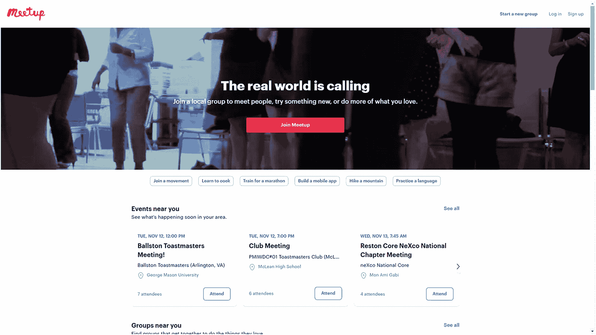
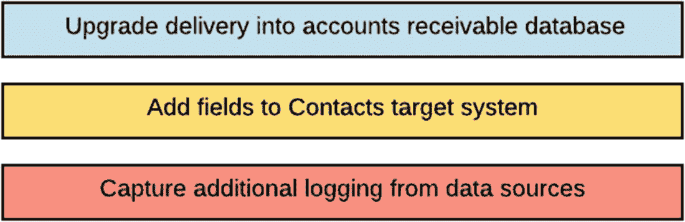
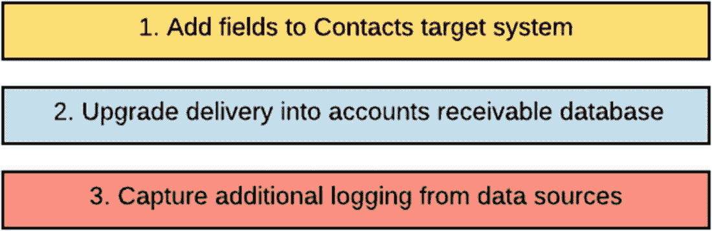
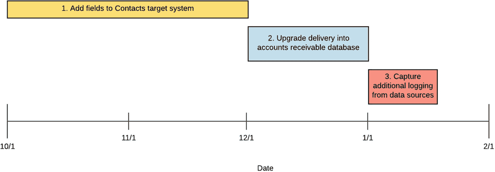
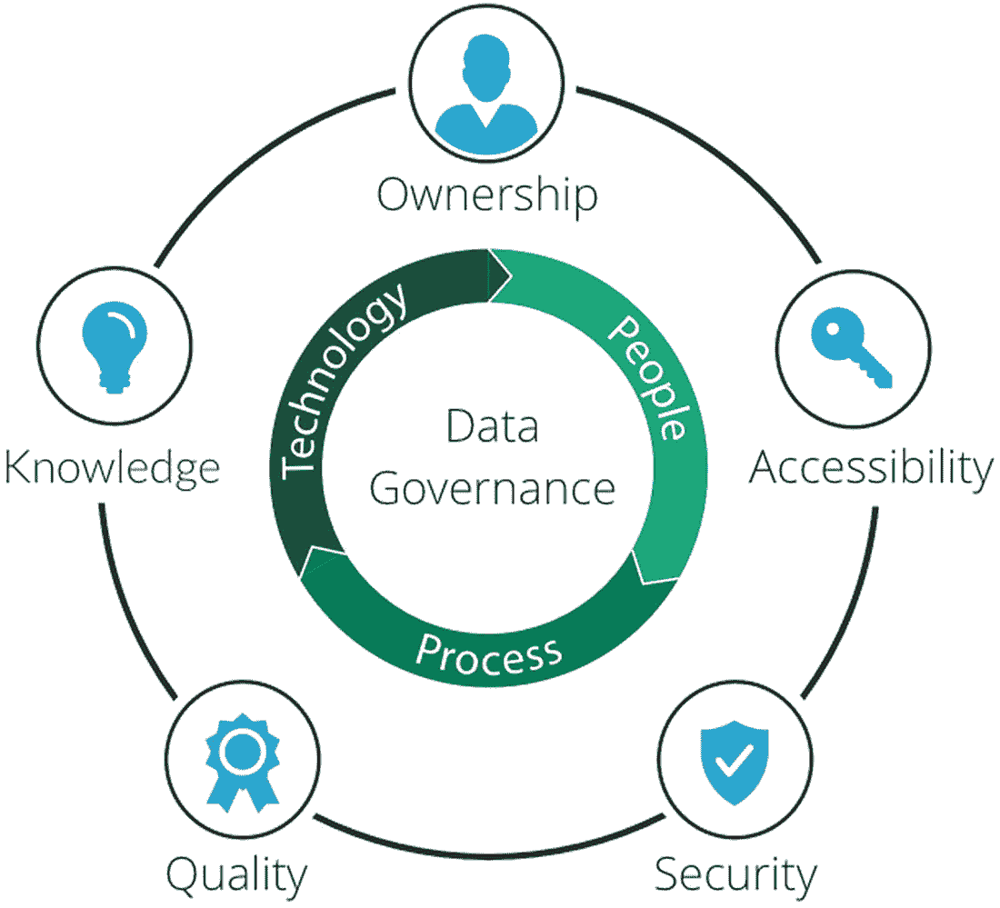

# 9. 推广您的团队

> *聚在一起是开始，保持团结是进步，携手合作是成功。*
> 
> —亨利·福特^(¹³⁴)

## 引言

截至目前，我们的集成团队已经建立了最佳实践和指导方针，部署了多个项目，建立了监控和分析系统，并为创建和改进未来的集成项目找到了方向。我们已经走到了一个需要拓展实践的十字路口，最后还有一件事需要考虑：企业参与。

我在本书前面提到过，即使软件应用程序拥有最出色的附加功能，但如果其中的数据不正确，那么所有这些功能都毫无意义。输入错误就会导致输出错误。延续这一思路，即使拥有全世界最好的集成系统，如果没有人使用它，那它也毫无用处。数据并非为数据本身而存在。数据被用来回答分析性问题、做出更好的预测以及发现以前未曾预见的模式。如果提出这些问题的受众不存在，那么无论流程或数据多么优化，您都将缺乏前进的动力。

缺乏用户支持并不完全是您的责任。流程本身的设计可能初衷良好，但您的推广策略可能没有奏效，或者它缺乏必要的声誉，或者用户可能误解了其目的。另一方面，流程本身可能确实存在问题，这种情况下，我建议您回到前面的章节，重新阅读关于迭代现有设计使其重新符合企业愿景的步骤。无论如何，不要妄自菲薄。拥有发展集成平台的能力对于迈向发展的下一阶段至关重要。

在本章中，我将介绍推广已完成工作的一些关键方面，以及如何为团队的顺利成长定位。我们将讨论如何与领导层沟通、如何教育用户、如何通过外部活动进行推广、如何构建未来路线图以及如何通过数据治理办公室来定义规则。通过本章的学习，您将处于一个极佳的位置来开始接触最终用户，并且至少能够为渴望成长的团队带来一些新思路。

## 面向领导层

你可能会好奇，为什么在经历了打造团队和产品的每一步之后，却失去了最初推动你前进的支持。毕竟，有一个问题亟待解决，你建立了一个记录完善、获得了利益相关者支持的系统，并且声势浩大地推出了产品。那么，为什么在部署后的阶段，所有这些善意都消失殆尽了呢？他们难道看不到集成工作所创造的价值吗？继续开发这些流程将为整个组织带来好处，这不是明摆着的吗？

嗯，不，并非如此。项目无法获得更多支持的原因有很多。我们要讨论的最重要的原因之一是缺乏高管的认可——即那些推动愿景向前发展并掌握预算大权的人。根据我的个人经验，我观察到，如果 C 级管理层（`CIO`、`CEO`、`CFO`）不相信你的集成和自动化方法能为公司创造价值，那么要从向他们汇报的人员那里获得支持将会非常困难，甚至不可能。这根本不在他们的关注范围内。

那么，让你的团队成长的第一要诀，就是让领导层支持你的工作，不仅仅是为了某个偶发的“做这个不错”项目，而是达到“我们必须这样做，否则后果严重”的承诺规模。因此，现在不是强调你过去为某个部门带来的速度和准确性，而是要阐明整个企业所能获得的益处。集成如何影响最终盈亏？你的领导者关心什么？根据博主迈克·赖亚的说法，推销工作流程自动化可能涉及以下主题：^(¹³⁵)

*   **提供更多数据分析，减少无价值工作**：领导层将不再需要费力寻找电子邮件和表单，而是可以专注于数据分析，从而减少行政工作。记录只需点击一下数据即可获取，部门内部沟通也将更加一致和有效。
*   **从应用构建转向价值创造**：各部门将无需花费时间构建和支持孤立的应用程序，而是拥有一个可以随后与客户共享的通用平台。因此，如果以此方式设计，中国客户看到的数据将与德国、美国、法国等地的数据相同。一个产品名称的更改可以近乎实时地级联到不同的企业系统，使组织能够以统一的结构传递信息。
*   **补救安全威胁**：由于集成系统在一个统一的管理下进行监控，你的流程可以对已识别的安全威胁采取一致的响应和可预测的防御。你将拥有集成备份、日志报告和审计功能，以进一步保护关键数据。
*   **改进数据合规性**：政策和程序是你数据转换中内置业务规则的一部分。集成系统可以作为合规工作流模型的一部分，在出现违反内部或外部法规的异常情况时发出警报。如果操作得当，数据合规性将变得标准化、可执行且可审计，保护公司免受重大法律问题的影响。
*   **标准化收入**：集成系统的主要目标之一是处理与客户收入和留存相关的各种支付系统。通过正确的架构，盈利能力数据可以导出到集中采集区域。因此，与其花费时间和资源跨越各种平台，确定公司的最终盈亏可能只需汇总来自少数几个目标位置的数字即可。
*   **提高员工满意度，提升公司文化**：如果上述好处得以实现，那么每个人的生活都将变得更美好：员工可以专注于日常活动，而不是操作的细枝末节；组织在合规性和错误方面变得更加透明；对数据的改进分析将激发公司成功所需的创造力。简而言之，拥有一流的集成流程可能意味着巨大的增长，进而带来改善的最终盈亏、卓越的声誉和灵活的特质，所有这些都是客户在当今竞争激烈的商业文化中高度赞赏的。

当然，获得管理层的支持只是一个团队成功而另一个团队可能中途夭折的众多因素之一。^(¹³⁶) 尽管如此，如果你做对了所有事情，却发现自己总是无法通过更多项目获得更广泛的受众，那么可能是时候专注于与管理层接触了。冒这个险，你将收获一切。

## 教育他人

要获得与首席执行官、首席信息官或首席财务官沟通的机会可能并不容易。没关系：假以时日，他们会回心转意，到时候，你手上要有准备好的营销要点清单。然而，执行 B 计划，并向整个组织宣传你和你的团队所提供的服务和益处，也至关重要。这一策略要求你以专业的方式接触任何感兴趣的人，而无需诉诸“走廊伏击”或销售说辞。你需要建立的方法就是培训其他人，让他们了解团队做什么、怎么做以及为什么这么做。虽然这类讨论通常可以在正式的课堂上进行，但也有其他有效的方式可以传达要点，而无需面对面的正式场合。我们来讨论其中的一些技巧。

### 内部教育

大多数时候，你可能只想在组织内部向其他人传播信息。在这种情况下，你的受众将是你的同事。除非你进行的知识分享会影响整个行业，否则你提供的细节将通过正式的研讨会、工作坊、在线培训或午餐学习会等方式在内部保留。

#### 正式研讨会

当我们讨论“教学”时，这可能是首先想到的沟通方式。研讨会是“一种商业项目，参加者可以就某个特定主题获得信息或培训。”^(¹³⁷) 通常，我们想到的是一种师生配置，一个人在一定时间内向教室或会议室里的一群人讲话（见图 9-1）。

传统上，研讨会是提供信息的最佳媒介，但沟通是从演示者到听众的单向传递；除了偶尔的问答环节，参与者的反馈很少。在培训他人集成知识时，如果你只是希望介绍已完成的工作、未来的方向以及项目产生的影响，那么研讨会很有帮助。因为集成知识会很快变得技术性很强，尤其是在介绍技术细节时，缺乏积极参与可能会让受众感到厌烦，所以要注意现场的精力水平。我们可能都参加过安排在周五下午或重大节假日前夕的讨论会。尽管最初我们可能对主题感兴趣，但研讨会本身可能毫无价值，我们或许本可以通过其他方式获得同样的信息。

图 9-1 正式研讨会

#### 工作坊

工作坊与研讨会类似，同样包含信息传授环节，但更注重体验式学习，它通过利用大小组讨论、活动和练习，以及实践应用所讲概念的方式，让参与者融入学习过程（见图 9-2）。^(¹³⁸) 工作坊的领导者（称为引导员）会确保活动按计划进行，并期望所有参与者都能做出贡献。

由于迁移和集成工作高度依赖设计模型和转换对比，工作坊是学习基础知识的绝佳方式。通过引导学生逐步经历软件开发的流程（类似于我们在本书中所经历的过程），你可以激发他们对现有工作的热情，并为你的事业赢得新客户。但工作坊并非适合所有人。有些人可能因为经理的推荐而觉得必须参加。另一些人可能不如同行精通技术，或者难以置信的是，他们可能对集成领域毫无兴趣。这些人最好避免参加工作坊，因为这只会造成更多困惑，或不利于建立团队凝聚力。我相信没人希望看到这种情况。

图 9-2

工作坊^(¹³⁹)

#### 在线培训

在线培训是一种以软件形式提供的教学项目，它通过非正式的问卷测试、填空题、选择题、是非题以及演示来教导学员。在线培训将线下实体课堂转移到了虚拟空间，可以是实时进行的（如网络研讨会），也可以是录制好供按需观看的（见图 9-3）。在线授课的形式多种多样，通常结构化为视频、音频、动画或这些方法的组合。^(¹⁴⁰)

与正式的研讨会相比，在线培训有几个优势：这类课程可以在任何有电脑或移动设备的时间和地点进行，通常成本更低，所需总时间投入更少，并且已显示出更高的长期学员保留率。^(¹⁴¹) 从讲师——即你的团队将扮演的角色——的角度来看，你创建的学习材料在在线培训课程中可以更加详尽，提供涵盖许多技术细节的数小时指导；或者，如果只需要一个概述，可以针对项目的基本轮廓制作一份标准的幻灯片演示文稿。

图 9-3

在线培训^(¹⁴²)

#### 午餐学习会

以一种更非正式的方式传达你观点的一个较好方法是通过午餐学习会，这通常是一个团队向其他人分享其技能和专长的会议（见图 9-4）。因其通常在午餐时间举行而得名，这类会议时长在 30 到 45 分钟之间，可以是单次会议，也可以作为一系列课程的一部分。^(¹⁴³)

与前面描述的方法相比，午餐学习会有几个优势。由于它在社交氛围中进行，这些小组会议鼓励团队合作与协作，打破了团队间的壁垒——而这些团队在更正式的演示中可能通常会有所防备。我记得有一次，一位以拒绝在本团队之外投入资源而闻名的经理，被迁移团队的“我们身在何处”午餐学习会深深吸引，以至于他在接下来的一周就与他的首席开发人员安排了一次更正式的后续会议。从第一次会议开始就建立起一个极好的伙伴关系，此后，在他的同事中定期举办午餐学习会便成了惯例。

午餐学习会也有其缺点，尤其是当你的团队成员身处异地，无法亲临现场时。通过使用诸如 Webex ([*https://www.webex.com/*](http://www.webex.com/))、Join.me ([*https://www.join.me/*](http://www.join.me/)) 或 Google Hangouts ([*https://hangouts.google.com/*](https://hangouts.google.com/)) 等会议工具，你可以尽量减少这些弊端，但我总觉得与面对面交流的体验和专注度相比，可能会错过一些东西。邀请听众时，请顾及他人感受：午餐学习会应当是自愿且轻松的，是感兴趣方之间的知识分享，而非强制性会议。最后，确保食物选择是众所周知的——这不仅包括参与者的饮食限制（这点至关重要），还包括午餐的费用（如果不由公司预算承担）。别忘了在日历邀请中提及这一要点：我曾参加过一些会议，领导者期望我们自带餐食，却忘记告知参与者。没有什么比饿着肚子却发现自己要参加一个 45 分钟且没有食物的会议更令人沮丧的了。在这种情况下，“天下没有免费的午餐”这句谚语就变得异常准确。^(¹⁴⁴)

图 9-4

午餐学习会^(¹⁴⁵)

无论你选择哪种内部培训方法，你都希望你的听众能获得具体的收获和对下一步行动的想法。在宏观层面上，你应该让他们理解集成团队已完成的工作、这些工作随时间推移所带来的好处，以及未来工作将对企业和特定部门产生的影响。最重要的是，你需要强调为了推进下一步工作你需要什么。这些支持可以是资金支持（例如资助某项工作）、资源或系统方面的实际参与，甚至仅仅是帮助团队串联起各个环节，看清全局，并了解你的团队在更大的架构中处于什么位置。

### 外部教育

在你于内部推广你的团队、产品和流程的同时，你也需要将触角伸向组织外部。这样做的一个最佳理由是推广：你的团队正在做很棒的工作，让行业内的其他人知道这一点，是促使他人购买你组织的产品或与之合作的最佳理由。这也能提升团队士气——当员工看到他们的工作如何对各自工作组内部和外部的其他人产生影响时，工作满意度和生产力都会显著提高。^(¹⁴⁶) 因此，参加像线下聚会、社交活动和会议这样的非工作活动，对于促进团队成长具有长期影响。

然而，外部教育并非适合所有人。有时，这类推广活动应尽量减少甚至避免。例如，你可能没有足够的内部支持来确保外部的成功。或者，你担心竞争对手会模仿你所提出的专有想法。^(¹⁴⁷) 对于任何这些情况，在让你的团队成员承诺就任何话题发表演讲之前，请先咨询你的法律部门和政策制定者。

现在，我们假设你的团队已经取得了显著成就，在企业内部声名鹊起，并已决定与整个行业分享。那么，你应该如何开始呢？

#### 聚会

或许最好的起步方式是找到与你有共同兴趣的人。韦氏词典将“meetup”定义为“非正式的会面或聚会”。^(¹⁴⁸) 在 21 世纪初，这个词成为了免费社交网络网站 `Meetup.com` 的代名词，该网站使用户能够在本地组织聚会。^(¹⁴⁹) `Meetup.com` 是结识新朋友、练习语言、授课或推广品牌的绝佳资源。你所选择的群组几乎涵盖所有话题。不过，如果你找不到心仪的话题，只需点击几下即可创建新群组。

#### 加入 `Meetup.com`

-   就我们当前的讨论而言，你需要使用数据相关的搜索词，例如“迁移”、“集成”、“分析”或“报告”。如果搜索结果中没有出现这些词，那么你可以考虑点击“Start a new group”链接，并按照后续步骤来组织活动。
-   访问“Meetup.com”，点击“Log in”链接（见图 9-5）。有通过 `Facebook`、`Google` 或电子邮件注册的多种方式。验证通过后，你就可以开始探索你所在地区的群组和活动了。

*图 9-5*  
*`Meetup.com` 首页*

> **注意**  
> 聚会非常有趣，是结识志同道合者的好方法。但请务必小心。最初，我申请了十几个关于数据集成、数据仓库和报告的专题，期望能够参与所有的社交活动。结果证明，涉猎过广与选择不足一样糟糕。我建议你确定好优先事项以及聚会方式的目标，然后全力以赴去实现它。

#### 社交活动

尽管聚会既有趣又有教育意义，但它们往往比专业社交活动更偏重社交性。专业社交活动的目标更侧重于建立商业关系和信任，而不一定是为了提升你的社会地位、交换名片或寻找镇上下一场大型活动。^(¹⁵⁰) 在这种情况下，专业社交可能涉及终生的关系。根据作者 Anders Ostlund 的一篇文章，^(¹⁵¹) 社交有许多好处：

-   获取关于你通常可能无法接触到的产品或服务的知识和信息
-   被视为某个商业领域的主题专家
-   建立新的专业关系并加强现有关系
-   增加商业伙伴间的信任
-   确保人们知道你是谁、你做什么、你怎么做以及你希望达成什么目标
-   将你和你的团队树立为权威

专业社交是自我强化的。你可能向你的社交团体做了一次精彩的演示，而其中一位成员可能会反过来邀请你就该主题向另一个团体发言。这种多米诺骨牌效应可以带来更多关注者、更多活动的参与机会，并可能将你的团队提升为构建和维护迁移任务时的“首选”团队。从这项活动中培养出的众多技能——掌握闲聊技巧、分享内容、建立关系——将伴随你的整个职业生涯，并有助于提升你团队在市场中的品牌形象。

活动形式多样、规模各异，从贸易展销会到下班后的欢乐时光，再到会议（我们接下来将讨论）。开始的最佳方式是使用你喜欢的搜索引擎，输入“我所在地区的专业社交活动”这样的短语。你很可能会得到足够多的结果，让你忙上一阵子。

虽然专业社交可能更有利于性格外向的人，但如果你性格害羞或与陌生人见面感到不适，也请尽量出席。在某个时刻，谈话很可能会转向你擅长的领域，在那里你将有机会大放异彩，或者至少能分享一些关于你团队及其工作的知识。

#### 会议

会议可能是某个行业中最重要的社交活动，它具备专业社交的大部分好处。然而，这类聚会通常比本地活动规模更大、更复杂，举办频率较低，并且涉及演讲者、赞助商和其他代表，他们销售产品、提供教育和技术洞察。会议可能持续几天甚至一周。与所有优秀的社交活动一样，其目的是创造热情和灵感，让与会者在会议结束时感到受益匪浅。

尽管会议充满魅力、美食与格调，但人们参会的主要原因与其他社交活动相同，只是覆盖面更广。^(¹⁵²) 北美最重要的活动之一是 Salesforce 的年度 Dreamforce 会议，参与者超过 17 万人。^(¹⁵³) 面对如此庞大的数字，你有可能结识来自世界各地、各行各业的专业人士。会议激动人心，是让你融入行业的好方法。如果规划得当，参会收获将对指导你的集成团队、为下一步行动积蓄动力产生奇效。

当然，许多人参加会议时并没有明确的策略或意图。没错，可以社交，也可以借此从工作中抽身休息一下。如果那是你的目标，那也没问题。但为了真正的成长，你应该做的是推广你的团队、你的公司以及你提供的服务。带着这个职业目标去参会，收集大量名片，并为所代表的人与事感到自豪。

## 数据集成路线图

如果你已经读到这里，那么恭喜你，你的集成团队正在蓬勃发展。培训课程和在线视频接踵而至，利益相关者满怀期待地带着项目计划，而`ETL`作业的运行从未如此顺畅且优化。那么，下一步是什么？

在上一章中，我们讨论了持续改进的概念，以及通过`计划-执行-检查-处理`（`PDCA`）模型来改进现有系统的方法。在同事的支持和鼓励下，我们应该能够看到集成系统在哪些方面存在不足，并将这些不足与组织对未来发展的最高优先级结合起来。举个简单的例子，假设我们收到一个请求：升级应收账款数据库的交付功能、为联系人目标系统添加字段，并从两个新的数据源中捕获额外的日志。我在图 9-6 中重点列出了这些任务。

**图 9-6** 任务清单

一开始，我们可能会倾向于选择这些任务中最简单的一个，并优先处理它。但哪个才是最简单的呢？当然，我们需要业务分析师深入调研，与相关人员沟通，并与开发者商定工作量。即便如此，我们的估算也可能出现偏差，于是我们开始处理一个任务，结果另一个任务却突然出现重大问题，迫使我们中途放弃当前任务，转而扑向新的“火情”。从长远来看，这样处理问题毫无益处，因为第一个问题可能仍在等待我们解决，于是我们不得不再次转移精力，而第三个任务则一直被忽略，项目负责人也因我们的缺乏关注而越来越沮丧。

你可以看到问题所在。并不是我们缺乏工作——我们有很多工作——而是我们缺乏工作的优先级排序。我们主观地选择了一个最容易先完成的任务，然后一直处理它，直到出现一个阻碍性的中断事件。接着我们放下手头的工作，将优先级转向这个新问题，直到其他利益相关者介入，我们又重新聚焦回最初的问题。当然，利益相关者应该能够分配我们的优先级，但如果我们的注意力和（有限的）资源总是供不应求，我们就无法满足所有人的需求。

为了从混乱中恢复秩序，我们必须制定策略，并从组织的角度确定最高优先级。也就是说，无论工作量大小，无论应收账款团队最关心什么，或者系统故障是否会导致联系人数据库崩溃，我们都必须遵循一个集成路线图，这是一份传达集成系统短期和长期举措的战略计划。

一旦我们了解了组织最关心什么，确定下一步工作的优先级就会变得更加自然。沿用前面的例子，假设 CEO 在公司全体会议上宣布，下一财年最重要的目标是确保服务代表改善与客户的关系。另一个同样重要、但程度稍低的目标是让财务团队按时收款。

如果我们回到图 9-6 中的任务，你可以看出如何对它们进行优先级排序。问问自己，根据新的组织输入，我们应该优先关注什么，其次是第二、第三、第四等等。例如，我们可以将公司最高优先级“改善与客户的关系”作为依据，并确定与之最相关的集成任务是“为联系人目标系统添加字段”。第二优先级“财务团队按时收款”则与“升级应收账款数据库的交付功能”非常吻合。剩下的最后一个任务“从数据源捕获额外的日志”就成了清单中优先级最低的任务。图 9-7 展示了重新排序后的任务清单。

**图 9-7** 重新排序后的任务清单

我们还没有完成。现在我们知道应该按什么顺序处理工作，并会照此执行。但我们仍然需要联系各团队并询问一个关键问题：需要多长时间？第一个任务需要多久？第二个呢？第三个呢？以此类推。

需要强调的是，我们寻求的是整体估算，而不是之前尝试的深入理解。虽然我们希望尽可能准确，但事情总会发生，时间会因此延后。此外，确实可能有一两个关键性“火情”需要我们关注，从而暂时将我们从任务中转移，但不足以使我们完全偏离轨道。在路线图的初步规划中，重要的不是*何时*完成，而是*做什么*的顺序。

假设我们估算完成联系人目标系统需要两个月，升级应收账款数据库需要一个月，而捕获额外日志的任务需要 15 天。假设我们从 10 月 1 日（财年开始）开始，那么我们可以为模型添加一个时间线，我们的集成路线图现在如图 9-8 所示。

**图 9-8** 优先级任务与时间线（我们的集成路线图）

> **注意：** 在许多采用敏捷模型的路线图中，我们以冲刺（sprint）来衡量时间线。通过这个简单的例子，我们可以轻松地传达团队的前进方向以及我们制定的计划。最棒的是，我们可以根据企业的优先级列表来证明我们的决策是合理的，并与拥有源系统和目标系统的同事协作，让他们知道我们将在队列的哪个位置处理他们的任务。虽然我们不会将这些交付日期视为一成不变，但它们将进入我们的候选清单，正如我们之前提到的，制定计划本身就是成功的一半。

你现在可能明白了为什么我们要把路线图放在本章关于市场推广的末尾来讨论。你必须先建立好集成团队和流程，你必须拥有利益相关者提供的优先级步骤清单，并且你必须获得 C 级管理层对你方法对整个公司重要性的认可。否则，一个可持续的路线图将永远无法实现，而团队也只能局限于维护、修补和偶尔的升级工作。只有向外拓展并争取企业的全力支持，才能真正实现扩展。

## 数据治理与数据治理办公室

作为最后一个主题，我们来讨论数据治理（DG）和数据治理办公室（DGO）。我不会深入太多细节，因为这两个主题都足以写满一整本书，但我认为值得提及，因为组织通常将数据集成和团队协作与它们紧密联系在一起。^(¹⁵⁵)

数据治理有多种含义，但我喜欢的一种定义是“一套确保数据在整个生命周期中保持高质量的原则和实践”。^(¹⁵⁶) 简而言之，组织的数据治理框架规定了员工应如何在该组织内管理数据的规则（法则）。例如，可能规定了服务账户只能在特定时间操作生产环境中的数据。在此时间之外的任何操作都是被禁止的。或者，查看个人身份信息（PII），如信用卡号码，是被禁止的。当然，任何违反这些规则的行为都会受到惩罚，包括停职和解雇。

正确数据治理的好处很多，但在集成领域，它意味着更清洁的数据、更好的分析、更好的报告和更好的决策。一个组织没有数据治理，就像一个旧西部小镇没有治安官：如果每个人都循规蹈矩，还能维持。一旦枪手出现，所有的赌注就都失效了。^(¹⁵⁷)

虽然创建数据治理框架可能容易理解，但将其付诸实践则困难得多。首先，许多公司没有相应的技术，或者缺乏数据“成熟度”来达到数据能被适当治理的状态（参见第 8 章的 DMM）。其次，数据治理可能听起来像是一个 IT 计划，因为毕竟通常是 IT 团队在操作数据，但它需要许多部门同意其原则。管理、财务、销售、采购和法律只是其中需要保护内部数据的一些部门，因此它们必须对与所有权、可访问性、安全性、质量和知识相关的流程拥有发言权（参见图 9-9）。取得他们的日常共识，然后确保团队保持合规，只是挑战正确数据治理的众多问题中的两个。

**图 9-9** 数据治理全局视图^(¹⁵⁸)

为了避免数据规则失控，组织设立了数据治理办公室（DGO），这是一个定义如何有效使用数据资源的内部小组。DGO 成员解释治理框架和数据管理的使用方式、对违反者的处罚措施，以及在出现有关数据的问题或疑虑时需要咨询的本部门同事。

DGO 是组织中最前沿的部门之一，但对于帮助集成团队协作并明确自身角色也至关重要。许多关于源系统使用或转换业务规则的潜在违规问题，通常需要数周才能解决，但通过 DGO 的行动可以迅速处理。因此，他们在促进良好集成数据治理方面做出了最终贡献，并且在确定你的路线图优先级以及决定如何最好地处理数据时，应该是首批咨询的团队之一。

## 总结

我们到达了本章的终点，而且——惊喜，惊喜——也到达了本书的终点。你现在身处何方？你在组织内外拥有了同盟和支持者，拥有了一张面向未来的路线图，以及一项在 DGO 代表参与下协调一致的数据治理政策。走到今天这一步很艰难，但最困难的部分现在应该已经过去了。你可能有一长串想要进一步扩展的后续步骤，但实现这一切所需的工具已经掌握在你手中。你拥有一个团队、一个流程、一个计划，而且，也许最重要的是，你有足够的时间来建立切合实际的时间表，其中少有意外，更少失望。

你接下来遇到的一切，都将与你最初开始的地方有显著不同。你拥有在集成项目中取得成功所需的大部分（如果不是全部）秘诀和步骤，而接下来要去哪里，由你决定。下次当项目经理找到你，声称你的团队迁移所需做的全部工作就是在周末“按几个按钮”时，你就知道如何制定计划，让数据集成这片混沌变得有序。现在是时候走出去，建立那个团队了。祝你一切顺利。

脚注¹²³⁴⁵⁶⁷⁸⁹¹⁰¹¹¹²¹³¹⁴¹⁵¹⁶¹⁷¹⁸¹⁹²⁰²¹²²²³²⁴²⁵

**索引**

**A**  
敏捷模型，自动化，执行结果日志记录窗格，测试，CSV 文件，ETL 源 CSV，错误测试脚本

**B**  
业务错误

**C**  
命令行界面工具，跨职能团队

**D**  
数据治理，数据治理办公室，数据管理成熟度模型，模型定义，成熟度级别，数据迁移流程设计，模板，部署，账户记录，联系人记录，示例，前提条件，最终签核，日志文件，交付物，映射逻辑，迁移结果，操作，数据迁移策略计划，架构，当前状态，未来状态，假设条件，约束条件，开发工具，环境，使用方式，迁移方法，迁移过程，测试/验证，风险，数据概要分析模板，数据转换服务，Dell Boomi，部署，DevOps，架构定义，演示，CSV 文件，提取，开发数据库架构，GitHub 目录，模块化函数，Pentaho，安装，迁移与集成方法，数据迁移过程，未来状态，准备自动化输出，准备自动化，数据迁移过程安装

**E, F, G**  
环境，一次性迁移架构，可重复集成类型，开发环境，生产环境，预发布环境，ETL，项目管理阶段定义，数据迁移计划，数据迁移模板，可扩展性设计，数据迁移流程设计，数据概要分析，源到目标映射，开发与实施，`create_target_table_buyer`脚本，GitHub 目录，PDI 转换，原型脚本，开放测试启动，提取、加载与转换，提取、转换与加载工具，组件，连接器，建立，提取，入站数据，验证，临时数据，存储，Dell Boomi *与* ELT 对比，Informatica，Jitterbit，加载，连接器，建立，回滚错误，类型，确定，中间件，作为，MuleSoft，PDI，脚本语言，SSIS，Talend 生态系统，转换，数据完整性，分析，数据修改，结果数据，提取、转换和加载工具，业务规则，设计，代码，异常处理，日志记录，服务器，调度，源到目标映射，版本控制系统

**H**  
混合方法

**I**  
Informatica，集成，方法，混合方法，夜间集成，定义，定时服务，Web 服务，一次性迁移过程 *与* 产品所有权对比，问题日志模板

**J, K, L**  
Jitterbit

**M**  
市场推广，针对，领导层，数据治理，数据治理办公室，外部教育，会议，数据集成路线图，聚会，社交活动，活动，内部教育，午餐学习会，在线培训，研讨会，工作坊，主数据管理，元数据模型，Microsoft SQL Server 集成服务，迁移结果报告模板，MuleSoft，`MYCONTACTDB`源系统

**N**  
夜间集成

**O**  
一次性迁移模型

**P, Q**  
Pentaho 数据集成，个人身份信息，PDCA 循环，部署后，运营投诉，每日数据日志，支持级别，主数据管理系统，第一个月，一年内，按需监控系统，生产环境，更新，第一周，持续改进，执行时间，PDCA，记录计数，测试记录，第一周，规划，项目交付物，项目管理阶段，数据迁移流程设计，部署周期，ETL 脚本，上线/部署计划，映射逻辑，操作顺序，结果定义，数据迁移方法，数据迁移计划，发现过程，测试/验证，部署，设计，数据分析，问题日志，源到目标映射，电子表格，开发，实施，启动，维护，项目阶段与迁移文档

**R**  
关系型数据库管理系统，回滚错误

**S**  
调度，作业，活动作业窗格，Kitchen 工具，编排引擎，结果，触发器，源系统，连接类型，数据概要分析，内容发现，关系发现，结构发现，端点，元数据模型，源到目标映射

**T, U**  
Talend 生态系统，目标系统，数据匹配，端点，团队资质，敏捷方法论，敏捷 *与* 瀑布对比，候选人，寻找，外部，内部，面试，进行，社交网络，外部候选人，招聘网站，发布，外部招聘机构，招聘，推荐，内部候选人，招募，职位描述，角色，确定，角色，业务分析师，数据集成架构师，产品负责人，项目经理，项目发起人，发布经理，软件开发人员，软件测试人员，利益相关者，主题专家，技术解决方案，用户验收测试人员，团队规模，T 型人才，团队类型，跨职能团队，职能团队，自组织团队，虚拟团队，瀑布模型，典型迁移/集成架构，ETL 工具，源系统，目标系统

**V**  
版本控制系统

**W, X, Y, Z**  
瀑布/线性顺序生命周期模型
