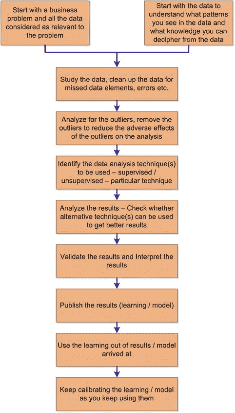
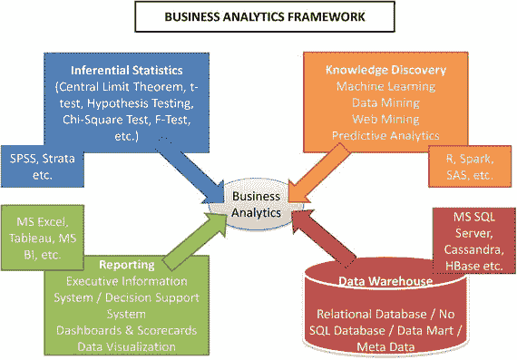

# 1. 商业分析概述

当今世界以知识为基础。在最早时期，知识通过观察来收集。后来，知识不仅通过观察获取，还通过实际执行得到确认，并通过进一步实验加以扩展。这样收集到的知识被应用于实践领域，并类推到其他领域。如今，知识通过分析或深挖各类计算机应用、网站等积累的数据来收集和应用。计算机的出现补充了统计学、数学和编程知识。尤其是云计算的巨大存储和扩展计算能力，确保知识能够从海量数据中快速提取，并用于预防性或生产性目的。本章为你提供关于商业分析在何处以及如何应用的基础知识。

想象以下场景：
* 你访问瑞士的一家酒店，受到了你最喜欢的饮料和菜肴的欢迎；你会多么高兴！
* 当你前往心仪目的地旅行时，你最喜欢的那家酒店以大幅折扣价为你提供住宿。
* 你提前收到警告，患糖尿病的可能性很高。你相信了该警告背后的推理，并采取正确措施加以避免。
* 你提前收到警告，计划前往的旅行目的地可能发生骚乱。根据这一警告，你取消了行程；后来你从新闻报道中得知，该地确实发生了骚乱！
* 你提前收到警告，根据你和你考虑作为人生伴侣的人的个人特质，你们之间存在不兼容性；你避免了可能的离婚！
* 你走进一家杂货店，发现你每月定期购买的物品已经为你挑选好并放在一边。你唯一需要做的决定是全部需要还是从列表中移除一些。你多开心！
* 你偏好的航空公司在你的假期旅行前早早地为你预留了机票，并且价格低于市场价。
* 你正计划旅行，却提前收到该地可能发生飓风的警告。基于这一警告，你推迟了行程。后来，你发现飓风造成了严重破坏，而你则避免了一场可怕的境遇。

我们可以想象许多类似的场景，这些场景通过分析通过各种方式收集到的关于你和你的活动的数据而成为可能——包括你的谷歌搜索、对各类网站的访问、在社交媒体网站上的评论、使用各种计算机应用的活动等等。在这些场景中，数据分析的应用聚焦于你个人的视角。

现在，让我们从商业视角来看看场景。想象这些情况：
* 你从事酒店行业，能够为潜在客户提供既有竞争力又能盈利的价格。同时，你可以通过提供额外福利，包括与当地其他供应商捆绑的本地旅行折扣和观光优惠，确保你的酒店始终客满。
* 你从事出租车行业，能够根据顾客以往的出行历史以及对出租车类型和司机的偏好，反复吸引同一批顾客。
* 你从事快餐行业，在生意清淡的日子提供折扣价来吸引顾客。这些折扣让你也能确保这些日子座无虚席。
* 你在组织的人力资源部门工作，正被高离职率所困扰。但现在，你能够根据那些表现优异、对组织更忠诚、更投入的员工的特征，理解你应该重点招聘哪种类型的人。
* 你从事航空业，根据发动机系统收集的数据，你提前三个月收到潜在发动机故障的警告。你主动采取措施进行必要的纠正。
* 你从事医院使用的医疗设备的设计、制造和销售。通过分析设备日志中捕获的错误或警告，你能够在设备实际发生故障之前就了解到故障的可能性。

所有这些场景都通过分析企业和其他来源从各种渠道收集的数据而成为可能。还有许多诸如此类的可能场景。数据分析在商业领域的应用被称为商业分析。

你可能已经观察到以下场景：
* 过去几天你一直在谷歌上搜索适合冒险旅行的地点。你还试图寻找各种可能的旅游套餐。你突然发现，你访问的其他网站或进行的搜索都显示了你正在寻找的特定广告，而且还是折扣价。
* 你一直在亚马逊（或其他网站）上搜索要购买的特定商品。突然，在其他你访问的网站上，你发现了与你搜索内容相关的广告，或者发现定制的邮件落入你的邮箱，提供折扣以及你可能感兴趣的其他商品。
* 你也看到了亚马逊根据你之前的商品搜索、心愿单或之前的购买记录提出的推荐。很多时候，你可能还注意到亚马逊根据其可用数据为你提供折扣或推广产品。

所有这些可能性如今已成为现实，这要归功于企业专门使用的数据分析。本书将带你进入令人兴奋的商业分析领域，并帮助你踏入这一领域。

## 1.1 本书目标

许多专业人士开始对学习分析学产生兴趣。但并非所有人都具备丰富的统计学或数学背景。对于技术人员以及非技术人员来说，本书是开始学习商业分析的绝佳选择。你将首先通过动手实践来了解`R`语言入门知识。你还将学习构成商业分析关键部分的预测建模和大数据。这是一本关于使用`R`语言进行商业分析领域的入门书籍。

本书具有以下一些优点：
* 本书通过大量真实案例，涵盖了`R`语言编程和分析两个方面。
* 它提供了理论与实践练习的恰当结合。在必要之处，通过商业场景或案例研究来解释概念。
* 本书由目前正在分析领域为付费客户解决实际问题的行业专业人士撰写。

本书提供以下内容：
* 关于使用通过各种方式收集、整理、购买或从政府来源等免费获取的数据的实际见解。这些见解通过计算机编程、统计和数学知识以及相关领域的专业知识获得，使你能够理解数据并形成预测能力。
* 关于有效使用与商业分析相关的各种技术的信息。
* 关于如何有效使用`R`语言编程平台进行商业分析的说明。
* 让你能够应用所学知识的实际案例与示例。
* 商业分析中的“应为”与“不应为”。
* 本书不会进行以下操作：
  * 详细讨论分析学相关的各种术语定义（这可能会令人困惑）
  * 超出一定范围，详细阐述任何统计或数学技术或特定算法的基础原理
  * 提供商业分析领域所有技术或算法的详细资料库（但会探讨其中的许多内容）

## 1.2 容易混淆的术语

在讨论这一主题时，会用到许多术语——例如，数据分析、商业分析、大数据分析和数据科学。从某种意义上说，它们大多相同。然而，分析的目的、可供分析的数据范围以及数据分析的难度可能各不相同。最后，无论术语有何差异，我们都需要知道如何有效地将数据用于业务。这些术语上的差异不应妨碍我们将技术应用于数据（尤其是在分析数据并将其用于各种目的时，包括理解数据、从中推导模型，然后利用这些模型进行预测）。

通俗地说，让我们来看看其中一些术语：
*   **数据分析** 是对数据（无论大小）进行分析，以便理解数据并了解如何利用其中隐藏的知识。一个例子是与各类旅行者相关的数据分析（如前所述）。
*   **商业分析** 是将数据分析应用于商业。一个例子是根据不同类别旅行者提供的或潜在的业务量，向他们提供特定的折扣。
*   **数据科学** 是一个跨学科领域（包含统计学、数学和计算机编程等学科），它从数据中获取知识，并将其用于预测或其他目的。它需要使用关于底层过程、系统和算法的专业知识。一个例子是应用统计学中的`t 值`和`p 值`来识别回归方程中的重要模型参数。
*   **大数据分析** 是对海量数据（例如数万亿条记录）的分析，或对难以攻克的问题的分析。通常，这需要庞大的存储和/或计算能力。这种分析需要巨大的内存来容纳数据、大量的处理器以及高速处理能力来运算数据并提取其精华。一个例子是分析卫星捕获的地理空间数据，以识别天气模式并进行相关预测。

## 1.3 商业分析的驱动因素

以下是商业分析的发展驱动因素：
*   相关计算机软件包和应用程序的数量不断增加。一个例子是`R`编程环境，它拥有各种数据集、关于其软件包的文档以及现成的算法。
*   能够整合来自不同来源、不同类型的相关数据（来自平面文件的数据、来自关系数据库的数据、来自日志文件的数据、来自 Twitter 消息的数据，等等）。一个例子是将`Microsoft SQL Server`数据库中的数据文件信息与 Twitter 消息流中的数据整合在一起。
*   通过集群化多台计算机并借助云扩展这些能力，实现了看似无限的存储和计算能力。一个例子是使用`Apache Hadoop`集群来分布和分析海量数据。
*   有许多易于使用的编程工具、平台和框架（例如`R`和`Hadoop`）可供使用。
*   涌现出许多算法和工具，可以有效地将统计和数学概念用于商业分析。一个例子是用于分区聚类分析的`k-means`算法。
*   在我们这个高度竞争的世界中，企业需要生存和发展的技术。商业的高度竞争性要求每家公司深入挖掘数据，以了解客户行为模式并加以利用。
*   全球化带来的商业复杂性。例如，某个国家的经济或政治状况可能会影响该国的销售。

这里有一个注意事项：并非所有这些问题都需要复杂的分析。有些问题可能通过使用数据可视化等技术就能轻松理解和解决。

现在，让我们更详细地讨论商业分析的每个驱动因素。

### 1.3.1 计算机软件包和应用程序的增长

计算机软件包和应用程序已经完全渗透到现代生活中。这在个人和商业层面都是如此。随着我们对智能手机的广泛使用，这一点尤其明显，智能手机能够实现以下功能：
*   通过电子邮件软件包与他人沟通
*   在社交媒体和博客上的活动
*   通过电子邮件、即时消息和其他工具进行商务沟通
*   通过搜索引擎进行日常信息和新闻搜索
*   通过会计软件包记录个人和企业的财务交易
*   通过在线订票网站或应用程序记录我们的旅行详情
*   在电子商务网站上记录我们的各种购物情况
*   通过各种应用程序记录我们的日常锻炼、消耗的卡路里和饮食

我们被许多收集我们大量数据的计算机软件包和应用程序所包围。企业利用这些数据让自己更具竞争力，吸引更多业务，并保留和扩大客户群。随着`Android`、`iOS`和`Windows`等平台上有成千上万的应用程序，数据的采集几乎涵盖了全球个人（他们是大多数产品和服务的消费者）进行的所有活动。而计算机、笔记本电脑、手机和智能手机等硬件设备甚至覆盖到偏远地区，这进一步推动了数据采集。

### 1.3.2 整合来自不同来源的数据的可行性

在过去几年里，技术取得了飞跃式发展。现在，我们很容易将数据从一种格式转换为另一种格式，并将其整合成所需的格式。技术的进步加上近乎无限的存储能力，使我们能够整合来自各种来源的相关数据——从平面文件，到数据库数据，再到各种格式的数据。这种整合来自不同来源数据的能力，为有效的商业分析提供了巨大动力。

### 1.3.3 无限存储和计算能力的增长

单个计算机的内存和存储容量已大幅增加，而外部存储设备也提供了存储容量的显著提升。基于云的存储服务进一步增强了这一点，它们可以提供几乎无限量的存储空间。云平台的发展也促进了几乎无限的计算能力。现在，您可以租用多个 CPU 的处理能力，配合巨大的内存和存储空间，来执行任何分析——无论数据有多大。这减少了对数据抽样进行分析的依赖。相反，您可以获取手头的全部数据，并利用云存储和计算能力对其进行分析。

### 1.3.4 易于使用的编程工具和平台

除了商用数据分析工具之外，还有许多开源工具或平台，例如`R`和`Hadoop`。这些强大的工具易于使用且有完善的文档。它们不需要高级编程经验，但通常需要理解基本的编程概念。`Hadoop`在有效且高效地分析大数据方面尤其有用。

### 1.3.5 在高度竞争的世界中生存与成长

商业竞争已变得异常激烈。由于每家企业都能轻松接入互联网，每位消费者都成为了所有企业的目标。每家企业都在争夺同一个客户及其消费能力。同时，企业也能同样轻松地接触到其他依赖型企业或消费者。通过互联网和网络，企业之间展开了激烈竞争；它们常常提供大幅折扣并急剧降价。为了生存，企业必须找到最佳方式，来针对那些需要其产品和服务的企业，以及需要其产品和服务的终端消费者。数据或业务分析已有效实现了这一目标。

### 1.3.6 全球化带来的商业复杂性日益增长

跨越国界的经济全球化（企业在此范围内生产商品或提供服务）极大地增加了商业的复杂性。如今，企业面临着如何迎合自身此前可能并不了解的文化之挑战。凭借如今可以获取（或已经拥有）的大量数据，企业能够轻松衡量本地与区域文化、需求、实践（包括消费趋势和偏好）之间的差异。

## 1.4 业务分析的应用

业务分析已被有效应用于众多领域，包括零售、电子商务、旅行（含航空业）、酒店业、物流业和制造业。此外，业务分析还应用于其他一系列行业，例如机器设备的预测性故障分析。

业务分析已成功应用于市场营销与销售、人力资源、财务、制造、产品设计、服务设计以及客户服务与支持等领域。在本节中，我们将讨论数据/业务分析有效应用并惠及组织的一些领域。这些示例仅用于说明，并非详尽无遗。

### 1.4.1 市场营销与销售

市场营销和销售团队是大量使用业务分析的群体，旨在确定合适的营销方法，从而以最优化或更少的努力触达最多的潜在客户。这些团队利用业务分析来识别最有效的营销渠道（例如，电子邮件、网站或直接电话联系）。他们还利用业务分析来确定哪些优惠对哪类客户（例如，按地理区域划分）有意义，并据此精准调整其报价。

例如，营销和销售团队可能会判断人们喜欢冒险型假期、精神修养型假期还是历史探索型假期。这些数据进而可以提供必要的输入信息，以便根据人们的具体兴趣来集中营销和销售工作的方向——从而优化营销和销售团队的时间投入。在零售业，这可以使零售门店（实体或线上）根据消费者的购买模式，将产品与其他产品捆绑销售。在物流业，哪家物流公司以何种模式提供服务、并坚持履行交货承诺，始终是企业选择服务合作方的重要考量因素。航空公司可以根据客户的旅行历史提供激动人心的优惠，从而鼓励该客户一次又一次地选择该航空公司，并随着时间的推移培养出忠诚客户。

### 1.4.2 人力资源

留住人才是任何行业（尤其是支持性行业）人力资源部门面临的最大难题。人力资源部门可以通过处理员工数据，识别出哪些员工具有较高的留任潜力。同样，人力资源部门也可以分析哪些能力（资质、知识、技能或培训）对组织或团队在承诺期限内交付高质量成果的能力影响最大。

### 1.4.3 产品设计

产品设计并非易事，通常涉及复杂的过程。产品设计过程中考虑的风险因素、后续制造中遇到的问题，以及客户或现场人员遇到的任何问题，都可以成为丰富的数据来源，帮助您了解未来设计中可能存在的问题。这种分析可能揭示材料问题、所采用工艺的问题、设计流程本身的问题、制造问题，或者设备安装或后续维护处理中的问题。此类分析的结果可以显著提升任何公司未来设计的质量。另一个有趣的方面是，数据有助于表明客户喜欢哪些设计元素（颜色、流畅度、表面处理、重量、尺寸或材料），以及不喜欢哪些。

### 1.4.4 服务设计

与产品类似，服务也是由组织精心设计和定价的。识别服务的组成部分（以及非组成部分）同样取决于产品设计、成本因素与定价的比较。保修期限、保修范围以及各种服务的定价，也可以根据以往经验数据和目标市场特征来确定。某些客户区域可能更容易接受“一次性使用”产品，而其他区域则可能更偏好“修修补补继续用”的产品。因此，需要根据各区域的偏好来设计服务类型。此外，不同的服务水平（响应速度）可能对应不同的价格标签，并针对特定的客户群体（例如，大型企业、小型企业或个人）。

### 1.4.5 客户服务与支持领域

售后服务与客户服务是任何企业都不能忽视的重要方面。缺乏有效的客户服务可能导致负面口碑，影响公司同一产品新版或新产品的未来销售。因此，客户服务是数据分析应用广泛的一个重要领域。客户在网络上或社交媒体（例如 Twitter）上的评论，为了解客户情绪以及客户所遇问题背后的原因提供了重要来源。根据行业可用数据的分析，可以相应制定服务策略，或对支持结构进行必要的调整。

## 1.5 业务分析师所需技能

在讨论了业务分析的驱动因素和应用之后，现在我们来探讨业务分析师所需的技能。通常，业务分析师需要对以下方面有深入的了解：
* 业务本身及业务问题
* 可应用于业务数据的分析技术和算法
* 计算机编程
* 数据结构及数据存储或数据仓库技术，包括如何有效查询数据
* 数据分析中使用的统计和数学概念（例如，`回归`、`朴素贝叶斯分析`、`矩阵代数`，以及成本优化算法如`梯度下降`或`上升算法`）

现在，我们来更详细地讨论这些知识领域。

### 1.5.1 理解业务与业务问题

清晰理解业务及业务问题是业务分析师最重要的要求之一。如果分析数据的人不了解底层业务、该业务的特定特征以及该业务面临的具体问题，就可能被引向错误的结论或方向。仅具备编程技能以及统计或数学知识，有时会导致为企业提出不切实际（甚至危险）的建议。这些建议也会浪费核心业务人员的时间。

### 1.5.2 理解数据分析技术与算法

数据分析技术与算法必须应用于合适的情境或分析中。例如，如果你（基于业务特性）知道响应变量与多个预测变量之间存在强关联，那么线性回归或多元线性回归（监督方法）可能适用。你知道，例如，地理位置、与市中心的距离或地块面积等因素都会影响待购土地的价格。聚类（无监督方法）可以让你将数据划分为不同的群组。如果不理解这些技术与算法，就很难有效应用业务分析。

### 1.5.3 具备良好的计算机编程知识

一位称职的业务分析师需要良好的计算机知识，这样分析师就不必依赖那些不了解业务、可能也不懂技术或算法背后的统计或数学原理的其他程序员。具备良好的计算机编程知识对业务分析师来说总是一项额外的优势，尽管这不是强制要求，因为分析师总可以雇佣计算机程序员。计算机编程对于整合不同来源的数据、编程以及使用算法可能是必要的。例如`R`和`Hadoop`这样的平台已降低了学习编程的难度，尽管有时我们可能还需要使用其他互补的编程语言（例如`Python`）来提高效率和效果。

### 1.5.4 理解数据结构与数据存储/仓储技术

对数据结构及数据存储/仓储技术的了解，通过消除对数据库管理员和数据库程序员的依赖，能减轻业务分析师的工作负担。这使得业务分析师能够整合来自不同来源（包括数据库和平面文件）的数据，将其放入合适的结构中，并适当地存储在数据仓库中。能够查询此类数据仓库，对任何业务分析师来说都是一项有价值的额外能力。不过，这类知识并非必需，因为业务分析师总可以聘请其他人来提供这项技能。

### 1.5.5 掌握相关的统计与数学概念

数据分析运用了许多统计和数学概念，各种算法、度量和计算都基于这些概念。业务分析师应具备良好的统计和数学概念知识，以便正确使用这些概念来描述、分析和呈现数据及分析结果。否则，业务分析师可能会因错误应用技术或错误解读结果而导致他人误入歧途。

## 1.6 业务分析项目的生命周期

图 1-1 展示了业务分析项目的典型步骤。这些步骤如下：

```

```

图 1-1. 业务分析项目的生命周期

1. 从业务问题以及所有被认为与问题相关的数据开始。或者从数据入手，了解你在数据中观察到哪些模式，以及能从数据中解读出哪些知识。
2. 研究数据，然后清理数据中缺失的数据元素或错误。
3. 检查数据中的异常值，并将其从数据集中移除，以减少它们对分析的不利影响。
4. 确定要使用的数据分析技术（例如，监督式或无监督式）。
5. 分析结果，并检查是否可以使用其他技术来获得更好的结果。
6. 验证结果，然后解释结果。
7. 发布结果（学习成果/模型）。
8. 运用从结果/模型中得出的学习成果。
9. 在使用过程中持续校准学习成果/模型。

## 1.7 业务分析框架

如本章前面所述，统计学对有效业务分析的重要方面贡献显著。同样，机器学习等知识发现工具也极大地推动了业务分析的应用。另一个推动业务分析发展的领域是数据库系统的演进，从面向`SQL`的数据库发展到`NoSQL`数据库。所有这些因素，加上便捷的数据可视化和报告能力，共同使我们能够清晰理解数据告诉我们什么以及我们能从数据中理解什么。这促使业务分析被广泛应用于解决组织面临的问题，并通过应用这种理解在商业中获得竞争优势。

有无数工具可用于支持业务分析框架的各个环节。图 1-2 展示了其中一些工具，以及框架的详细内容。

```

```

图 1-2. 业务分析框架

## 1.8 总结

首先，你了解了知识是如何演变的。你还了解了数据分析如何帮助个人的许多场景。书中向你展示了大量业务分析帮助企业成长和有效竞争的实例。你还了解了企业如何有效利用业务分析的结果。

接着，你了解了本书的目标。本书主要旨在成为一本实践指南，帮助你掌握必要的技能。这是一本入门书籍。你不需要在这里关注术语，而是要关注实践方面。本书还将展示如何使用`R`进行业务分析。

之后，你学习了数据分析、业务分析、数据科学和大数据分析的定义。书中用通俗易懂的语言提供了这些定义，以消除对术语可能产生的混淆。

然后，你探索了业务分析的重要驱动力，包括计算机软件包和应用程序的增长、整合多源数据的可行性、无限存储和计算能力的增长、日益增多的易用编程工具和平台、企业在竞争中生存和成长的需求，以及全球化时代下的业务复杂性。接着，你通过某些领域的示例了解了业务分析的应用。

你简要了解了业务分析师所需的技能。特别是，你理解了以下方面的重要性：理解业务与业务问题、数据分析技术与算法、计算机编程、数据结构与数据存储/仓储技术，以及数据分析所需的统计和数学概念。

最后，你还简要了解了业务分析项目的生命周期。