# 2\. R 语言简介

本章介绍 R 工具、环境、工作空间、变量、数据类型以及与工具相关的基本概念。本章还涵盖如何安装 R 和 RStudio。阅读完本章后，你将掌握足够的基础知识，从而开始使用 R 语言进行数据分析编程。


## 2.1 数据分析工具

市面上有许多商业或免费的*数据分析工具*。在本书中，我们将重点介绍 **R**，这是一个非常流行的统计/分析软件包。这款免费工具被学术界和研究界广泛使用。

在开始讨论数据分析之前，了解 **R** 的基本概念至关重要。本章将介绍如何使用 **R** 进行数据分析。不过，为了便于您参考，我们在表 2-1 中列出了一些最流行的统计/数据分析工具。

**表 2-1.** 商业分析与统计工具

| 序号 | 软件包 | 支持的功能 | 网址 |
| --- | --- | --- | --- |
| 1 | Microsoft Excel | 描述性统计。假设检验、F 检验、卡方检验、t 检验。方差分析（ANOVA）。条形图、饼图、线性回归。 | [`https://products.office.com/en-us/excel`](https://products.office.com/en-us/excel) |
| 2 | gretl (开源) | 回归与时间序列分析。最小二乘法、最大似然法、GMM；单方程与系统方法。时间序列方法：ARIMA，以及多种单变量模型。 | [`http://gretl.sourceforge.net/`](http://gretl.sourceforge.net/) |
| 3 | Octave (开源) | 概率分布、描述性统计、假设检验、t 检验、方差分析、绘图、直方图、聚类分析。 | [`http://octave.sourceforge.net/statistics/`](http://octave.sourceforge.net/statistics/) |
| 4 | MathWorks MATLAB | 完整的统计与机器学习功能。非线性优化、系统辨识和财务建模。支持 Hadoop 的 MapReduce 功能，并通过接口连接 ODBC/JDBC 数据库。 | [`http://uk.mathworks.com/products/matlab/`](http://uk.mathworks.com/products/matlab/) [`http://uk.mathworks.com/solutions/data-analytics/index-b.html`](http://uk.mathworks.com/solutions/data-analytics/index-b.html) |
| 5 | PSPP (IBM SPSS Statistics 的开源替代品) | 均值比较（t 检验和单因素方差分析）；线性回归、逻辑回归、信度分析（Cronbach's alpha，非失效或威布尔分布）、数据重排、非参数检验、因子分析、聚类分析、主成分分析、卡方分析等。 | [`www.gnu.org/software/pspp/`](http://www.gnu.org/software/pspp/) |
| 6 | OpenStat (开源) | OpenStat 包含大量参数检验、非参数检验、多元分析、测量、统计过程控制、财务及其他程序。 | [`http://statpages.info/miller/OpenStatMain.htm`](http://statpages.info/miller/OpenStatMain.htm) |
| 7 | Salstat (开源) | 描述性统计、推断性统计、参数与非参数分析、条形图、箱线图、直方图等。 | [`www.salstat.com`](http://www.salstat.com/) |
| 8 | IBM SPSS | 完整的统计分析功能：参数检验、非参数分析、分类、回归、聚类分析。条形图、直方图、箱线图。社交媒体分析、文本分析等。 | `www-01.ibm.com/software/analytics/spss/` |
| 9 | Stata by StataCorp | 描述性统计、ARIMA、方差分析和多元方差分析、线性回归、时间序列平滑、广义线性模型、聚类分析。更多详情请参见：[`http://www.stata.com/features/`](http://www.stata.com/features/) | [`www.stata.com`](http://www.stata.com/) |
| 10 | Statistica | 统计分析、图表、绘图、数据挖掘、数据可视化等。更多详情请参见：[`http://www.statsoft.com/Products/STATISTICA-Featuresdata`](http://www.statsoft.com/Products/STATISTICA-Featuresdata) | [`www.statsoft.com`](http://www.statsoft.com/) |
| 11 | SciPy (发音为 Sigh Pie) (开源) | 科学家和分析师用于科学计算和技术计算的 Python 库。SciPy 包含优化、线性代数、插值、数字信号与图像处理、机器学习技术等模块。 | [`www.scipy.org`](http://www.scipy.org/) |
| 12 | Weka (怀卡托知识分析环境) (开源) | 包含一系列用于数据分析和预测建模的可视化工具和算法，并提供图形用户界面以便轻松访问这些功能。 | [`www.cs.waikato.ac.nz/ml/weka/`](http://www.cs.waikato.ac.nz/ml/weka/) |
| 13 | RapidMiner (开源) | 用于机器学习、数据挖掘、文本挖掘、预测分析和商业分析的集成环境。 | [`https://rapidminer.com/`](https://rapidminer.com/) |
| 14 | R (开源) | 支持统计分析、直方图、箱线图、假设检验、推断性统计、t 检验、方差分析、机器学习、聚类等的完整功能集。 | [`www.r-project.org`](http://www.r-project.org/) |
| 15 | Minitab by Minitab Statistical Software | 描述性统计分析、假设检验、数据可视化、t 检验、方差分析、回归分析、可靠性和生存分析。[`https://www.minitab.com/en-us/products/minitab/`](https://www.minitab.com/en-us/products/minitab/) | [`www.minitab.com`](http://www.minitab.com/) |
| 16 | Tableau Desktop by Tableau Software | 数据的统计摘要、趋势分析、回归分析、相关性分析实验。直接连接数据源，进行实时、最新的数据分析，充分发挥数据仓库的强大功能。 | [`www.tableau.com/products/desktop`](http://www.tableau.com/products/desktop) |
| 17 | TIBCO Spotfire | 统计与全面预测分析。将 **R**、**S+**、**SAS** 和 **MATLAB** 集成到 Spotfire 及自定义应用程序中。[`http://spotfire.tibco.com/discover-spotfire/what-does-spotfire-do/predictive-analytics/tibco-spotfire-statistics-services-tsss`](http://spotfire.tibco.com/discover-spotfire/what-does-spotfire-do/predictive-analytics/tibco-spotfire-statistics-services-tsss) | [`http://spotfire.tibco.com/`](http://spotfire.tibco.com/) |
| 18 | SAS by SAS | 高级统计与机器学习功能等。 | [`www.sas.com`](http://www.sas.com/) |

数据分析工具有助于分析数据，并支持数据处理与操作、统计分析、图形分析、构建各类模型以及生成报告。**R** 是一个集成的软件包套件，用于数据处理、数据操作、统计分析、图形分析以及开发学习模型。该软件是贝尔实验室最初开发的 **S** 软件的扩展。它是开源、免费的软件，遵循 GNU 通用公共许可证（[`www.gnu.org/licenses/gpl-2.0.html`](http://www.gnu.org/licenses/gpl-2.0.html)），并得到全球庞大研究社区的支持。2000 年，**R** 1.0.0 版本向公众发布。

**R** 具有以下优点，因此成为当今数据科学家最推荐的工具：

*   灵活、易用且友好的图形功能，可在计算机显示器上显示或以不同文件格式存储。
*   数据存储功能，可有效地在内存中存储大量数据以进行分析。
*   提供大量用于数据分析的免费软件包。
*   具备编程语言的全部功能。
*   支持从多种来源获取数据，包括文本文件、数据库管理系统、网络 XML 文件及其他存储库。
*   可在多种平台上运行，包括 Windows、Unix 和 macOS。
*   大多数商业统计软件平台的价格高达数千甚至数万美元。而 **R** 是免费的！如果您是教师或学生，其优势显而易见。

然而，**R** 中的大多数程序都是为单次数据分析而编写的。


## 2.2 R 语言安装

R 语言适用于所有主流计算平台，包括 macOS、Windows 和 Linux。截至 2016 年 11 月 1 日，最新的 R 语言版本是 3.3.2。

### 2.2.1 安装 R

请按照以下步骤下载二进制文件：

1.  访问 R 语言官方网站：[`www.r-project.org`](http://www.r-project.org/)。
2.  点击“下载（Download）”选项卡。
3.  选择您的操作系统。
4.  阅读安装说明来安装软件。例如，在 Linux/Unix 上安装需要 root/管理员权限，且命令行选项与其他平台不同。在 Windows 上，您只需点击安装程序并按照提示操作即可。
5.  选择您的地理区域和镜像站点进行下载。
6.  下载安装程序并运行。
7.  按照安装程序的指示成功安装软件。

安装完成后，点击 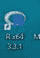 图标启动 R。将出现一个窗口，显示 R 控制台（如图 2-1 所示）。

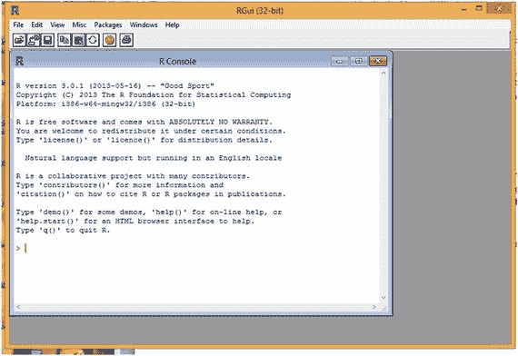

图 2-1. R 控制台

### 2.2.2 安装 RStudio

RStudio 为 R 提供了一个集成开发环境（IDE）。RStudio 有两种版本：桌面版和服务器版。RStudio 桌面版允许在本地桌面上运行 RStudio。RStudio 服务器版运行在 Web 服务器上，可以通过 Web 浏览器远程访问。RStudio 桌面版适用于 Microsoft Windows、macOS 和 Linux。有关 RStudio 及其支持的更多信息，请参阅 RStudio 网站：[`www.rstudio.com/products/RStudio/#Desktop`](http://www.rstudio.com/products/RStudio/#Desktop)。

本节详细介绍在 Windows 上安装 RStudio 桌面版或 RStudio 服务器版的步骤。其他操作系统的安装过程类似。关于安装的更多详细信息和步骤，请下载 RStudio 桌面版并按照网站上的指示操作：[`https://www.rstudio.com/products/RStudio/#Desktop`](https://www.rstudio.com/products/RStudio/#Desktop)。要安装 RStudio，请执行以下步骤：

1.  访问 RStudio 官方网站：[`www.rstudio.com`](https://www.rstudio.com/products/RStudio/#Desktop)。
2.  点击“产品（Products）”选项。
3.  根据需要选择服务器版或桌面版。
4.  点击“下载（Downloads）”选项并选择相应的操作系统。对于 Windows，请选择安装程序。
5.  下载安装程序后，运行它并按照指示操作。

请注意，必须先安装 R。如果尚未安装 R，则在 RStudio 安装结束时，将出现一条错误消息，要求您安装 R（图 2-2）。

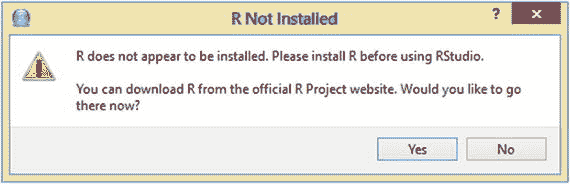

图 2-2. RStudio 安装错误

### 2.2.3 探索 RStudio 界面

安装完成后，桌面上会出现一个快捷方式 。点击此图标启动 RStudio。将出现如图 2-3 所示的界面。

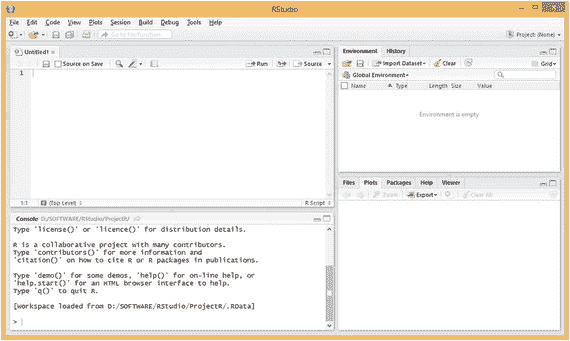

图 2-3. RStudio 窗口

RStudio 有四个窗口，允许您编写脚本、查看输出、查看环境和变量，以及查看图形和图表。左上角的窗口允许您输入 R 命令或脚本。窗口中提供的 R 脚本可以逐条执行或作为文件执行。代码也可以保存为 R 脚本以备将来参考。每个 R 命令都可以通过点击此窗口右上角的“运行（Run）”来执行。

左下角的窗口是 R 控制台，显示 R 的输出结果。此外，您也可以在此窗口中输入任何 R 命令来检查结果。由于它是一个控制台窗口，您的 R 命令无法被存储。

右上角的窗口列出了环境变量类型和全局变量。右下角的窗口显示生成的图形和图表，并提供帮助信息。它还有一个导出或保存图表到文件的选项。

图 2-4 显示了一个窗口，其中包含一个示例 R 脚本、其在控制台中的输出、图形窗口中的图表以及环境变量类型。

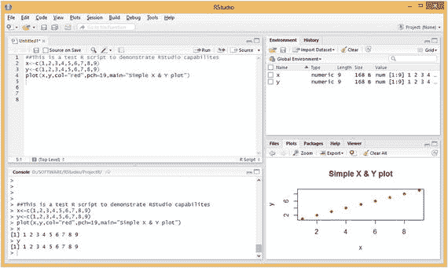

图 2-4. RStudio 输出示例

## 2.3 R 编程基础

R 是一种专门用于统计分析的编程语言，无需编译代码。输入命令后，只要您按下回车键，R 脚本就会执行，输出结果会显示在控制台中。输出结果也可以重定向到文件或打印机，我们将在本节后面讨论。

进入 R 控制台窗口后，您会看到一个大宇号（`>`）提示符，表示 R 已准备好接受您的命令。例如，如果您输入 `4 + 3` 并按下回车键，R 会在控制台中显示结果，如图 2-5 所示。

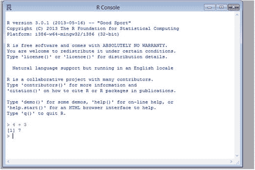

图 2-5. R 控制台输出

注意，结果有两个参数：第一部分 `[1]` 表示向量第 1 行中显示的第一个数字的索引，元素 `7` 是结果。在 R 中，您在控制台输入的任何数字都会被解释为一个向量。

如果您输入 `"Hello World!"`，R 会打印出 `"Hello World!"`：

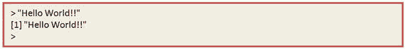

### 2.3.1 赋值

下一步是为变量赋值。在 R 中，您可以使用赋值函数或直接使用 `<-` 快捷键：

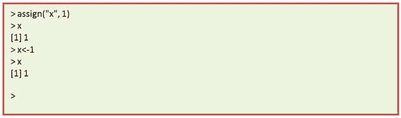

箭头的方向并不重要。您也可以使用等号（`=`）：

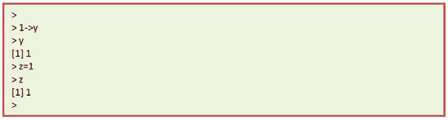

### 2.3.2 创建向量

在 R 中，一切都被表示为向量。向量是一维数组，可以保存数值数据、字符数据或逻辑数据。要创建向量，您可以使用函数 `c()`。以下是创建向量的示例：

```
a <- c(1, 2, 5, 3, 6, -2, 4)
b <- c(TRUE, FALSE, TRUE, FALSE)
c <- c("one", "two", "three")
```

这里，`a` 是数值向量，`b` 是逻辑向量，`c` 是字符向量。请注意，向量中存储的数据只能是同一种类型。

## 2.4 R 对象类型

R 中有五种对象类型：

- 数值型（Numeric）
- 字符型（Character）
- 整数型（Integer）
- 复数型（Complex）
- 逻辑型（Logical）

在 R 中，数字通常被视为数值对象。例如，数字 1 表示为 `1.00`，数字 2 表示为 `2.00`，以此类推。`class()` 命令可以为您提供关于对象类别的信息：

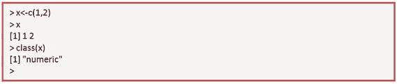

要在 R 中创建一个向量，您使用 `c()` 函数。或者，您也可以使用 `vector()` 函数创建一个 `numeric` 类型的向量：

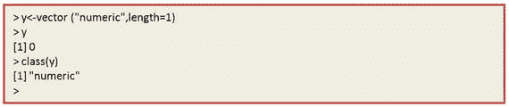

字符对象的使用方式与数值向量相同：

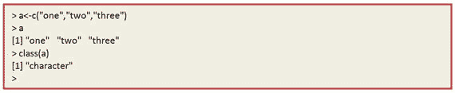

要在 R 中创建整数变量，调用 `as.integer()` 函数：

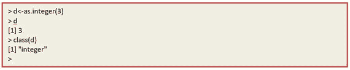

复数和逻辑向量的创建方式如下：

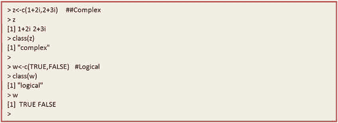


## 2.5 R 语言中的数据结构

R 语言中的数据结构被称为对象。每个对象可以包含向量、标量、矩阵、数组、数据框和列表。列表是一种特殊的对象类型，可以包含任意一种或所有对象类型。图 2-6 展示了 R 语言中的数据结构表示。现在让我们逐一了解每种数据结构类型。

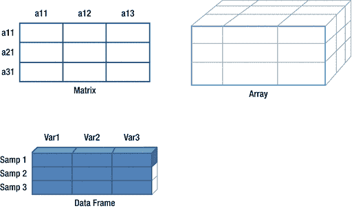

图 2-6. R 语言中的数据结构

### 2.5.1 矩阵

R 语言使用两个术语来指代二维数据集：矩阵和数组。从事应用开发和图像处理的软件工程师将二维数据集称为数组，而数学家和统计学家则将同样的二维数据集称为矩阵。二维数组的功能与矩阵完全相同。矩阵和数组这两个术语可以互换，但不同人群习惯使用不同的术语，有时可能会造成混淆。

在 R 语言中，使用`matrix()`函数创建矩阵。其一般格式如下：

```
mymatrix <- matrix(vector, nrow=number_of_rows, ncol=number_of_columns,
byrow=logical_value, dimnames=list(char_vector_rownames, char_vector_colnames))
```

其中，`vector`包含矩阵的元素，使用`nrow`和`ncol`分别指定矩阵的行数和列数；`dimnames`包含以字符向量形式存储的行标签和列标签，此为可选参数。`byrow`参数指示矩阵是按行填充（`byrow=TRUE`）还是按列填充（`byrow=FALSE`），默认是按列填充。

以下 R 语言示例展示了如何使用`matrix()`函数创建矩阵：

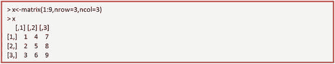

你可以像以下示例所示的那样访问矩阵的每一行、每一列或某个元素：

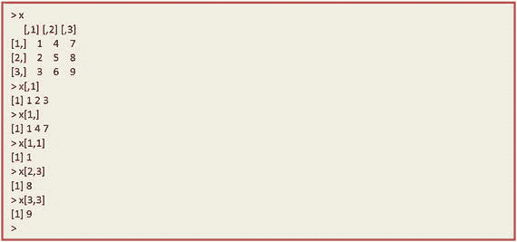

要标识矩阵的行、列或元素，请使用下标和方括号——例如，`X[i,]`指矩阵 X 的第 i 行，`X[,j]`指第 j 列，`X[i,j]`则分别指第 i 行、第 j 列的元素。

### 2.5.2 数组

数组可以有两个以上的维度。在 R 语言中，使用`array()`函数创建数组：

```
myarray <- array(vector, dimensions, dimnames)
```

其中，`vector`包含数组的数据，`dimensions`是一个数值向量，给出每个维度的最大索引，`dimnames`是维度标签的列表。

以下示例展示了如何创建一个三维（2 × 3 × 2）数组：

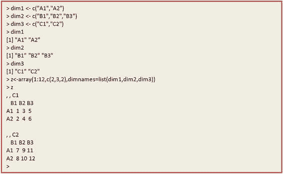

数组是矩阵的扩展。在编写某些统计方法的程序时，它们可能非常有用。标识数组的元素与你之前看到的矩阵类似。对于前面的示例，元素`z[2,3,2]`的值为`12`：

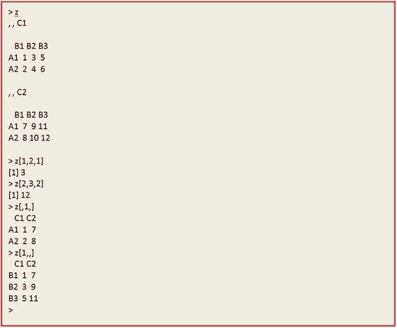

### 2.5.3 数据框

数据框是重要的对象类型，也是你在 R 语言中最常用的数据结构。它们类似于 Microsoft Excel、Stata、SAS 或 SPSS 中的数据存储。

你可以拥有多个不同类型的列；列可以是整数型、字符型或逻辑型。虽然数据框类似于矩阵或数组，但与矩阵或数组不同，你可以在数据框中存储多种数据类型。数据框是一种特殊类型的列表，列表中的每个元素必须具有相同的长度。每一列都可以命名，以指示变量或预测变量的名称。数据框还有一个名为`row.names()`的属性，用于指示每一行的信息。

当你使用`read.csv()`读取文件时，会自动创建数据框。

使用`data.frame()`函数创建数据框：

```
mydframe <- data.frame(col1, col2, col3,...)
```

其中，`col1`、`col2`和`col3`是任意类型（如字符型、数值型或逻辑型）的列向量。可以通过`names`函数为每一列提供名称。以下示例对此进行了说明：

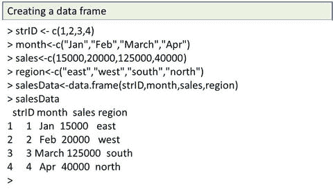

你可以通过多种方式访问数据集中的元素。你可以使用之前在矩阵中使用的下标表示法，也可以指定列名。以下示例演示了这些方法：

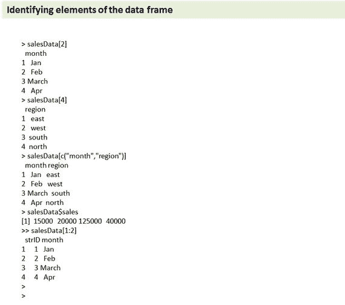

### 2.5.4 列表

列表是 R 语言数据类型中最复杂的一种。列表允许你指定和存储任何数据类型对象。一个列表可以在单个对象名称下包含向量、矩阵甚至数据框的组合。你可以使用`list()`函数创建列表：

```
mylist <- list(object1, object2, ...)
```

其中，`object1`和`object2`可以是迄今为止看到的任何结构。你也可以选择为列表中的对象命名：

```
mylist <- list(name1=object1, name2=object2, ...)
```

以下示例展示了如何创建列表。在这个示例中，你使用`list()`函数创建一个包含四个组件的列表：一个字符串、一个数值向量、一个字符和一个矩阵。你可以组合任意数量的对象并将它们保存为一个列表。要访问列表，请指定你想要访问的列表类型——例如，访问第二个元素，`myFirstList[[2]]`和`myFirstList[["ID"]]`都引用你试图访问的数值向量。

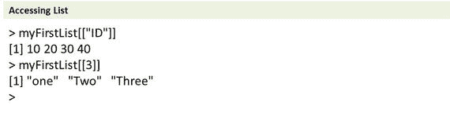

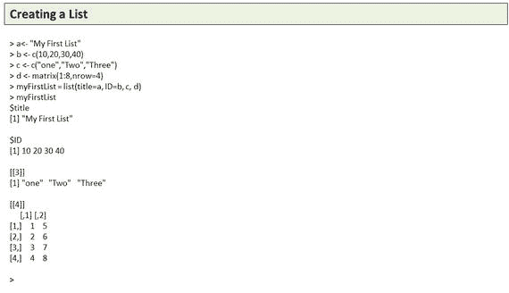

### 2.5.5 因子

因子是用于表示分类数据的特殊数据类型，在统计分析中很重要。因子是一个整数向量；每个整数类型都有一个标签。例如，如果你的数据中有一个名为“性别”的变量，其值为“男”或“女”，那么因子会自动将“男”分配为值 1，“女”分配为值 2。通过这些赋值，可以方便地识别值并进行统计分析。在前面的示例中，如果我们有另一个名为“绩效”的变量，其定义为“优秀”、“一般”、“差”。这是有序类型的示例。你知道，如果某个特定区域的销售额表现优异，那么其绩效就是“优秀”。在 R 语言中，分类（有序）变量被称为因子，它们在 R 语言确定如何分析数据以及如何进行可视化呈现方面起着至关重要的作用。

可以使用`factor()`函数创建因子对象，该函数将分类值存储为范围在`[1...j]`的整数向量，并自动分配一个内部字符字符串向量（原始值）映射到这些整数。

例如，假设你有一个向量`performance <- c("Excellent", "Average", "Poor", "Average")`：

语句`performance <- factor(performance)`将此向量存储为`(1, 2, 3, 2)`，并在内部将其关联为 1=Excellent，2=Average，3=Poor（赋值是按字母顺序的）。

对`performance`向量执行的任何分析都会将该变量视为名义变量，并选择适用于此测量尺度的统计方法。

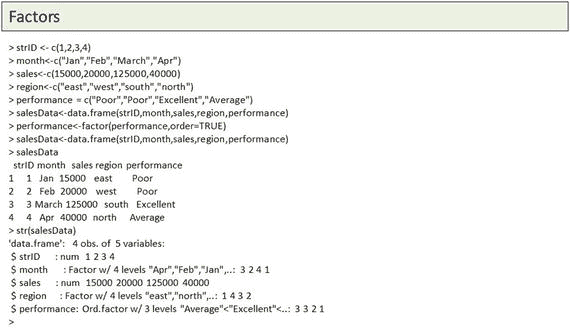

首先，你将数据输入为向量，即`strID`、`month`、`sales`、`region`和`performance`。然后，你指定`performance`是一个有序因子。最后，你将数据组合成一个数据框。函数`str(object)`提供了关于 R 语言中对象（此处为数据框）的信息。它清楚地显示`performance`是一个有序因子，并且`region`也是一个因子，同时显示了其在内部是如何编码的。


## 2.6 本章小结

在本章中，你了解了市场上各种可用的统计和数据分析工具，以及 R 的优势，这些优势使其成为学生、研究人员、统计学家和数据科学家的理想选择。你逐步完成了安装 R 和 RStudio 的步骤。你还学习了 R 的基础知识，包括向量、数组、矩阵和列表等各类数据类型，以及最重要的数据结构之一——数据框。

现在，既然你已经成功安装并运行了 R，是时候获取数据进行分析了。在下一章中，你将学习如何执行文件操作、读取各种类型的文件，以及使用函数、循环、图表和图形；你还将了解执行有效数据分析所需的 R 的其他方面。我们不想让你等待更久了。在下一章中，你将直接跳入使用 R 进行分析的基础知识。

