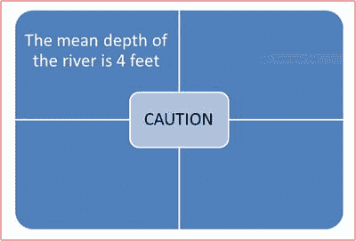
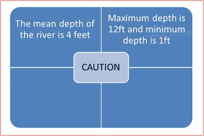
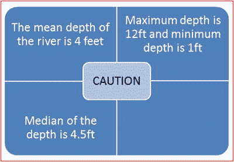
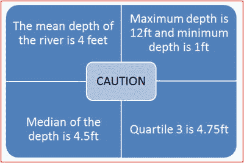
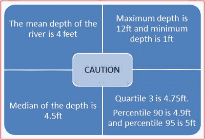
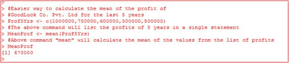
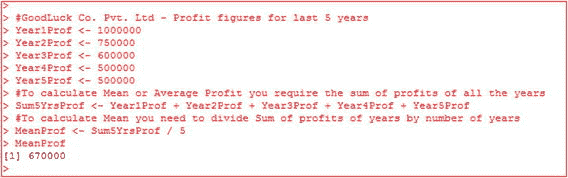
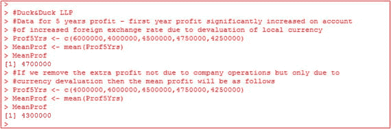

# 描述性分析入门

假设你正在旅途中，来到了一条浑浊的河边，但既没有桥梁也没有船只，更无人助你渡河。糟糕的是，你并不会游泳。当你环顾四周，在这孤立无援的困境中，你注意到了一块指示牌，如图 4-1 所示：

图 4-1. 河边的指示牌

牌子上写着："河流的平均深度为 4 英尺。" 这里的平均值是通过测量河流每一平方英尺区域的深度，再取平均数计算得出的。这引出了一个问题："什么是平均值或平均数？" 平均值或平均数，就是将每一平方英尺的深度相加，再除以测量次数（即测量的平方英尺数）所得的值。

你身高 6 英尺。图 4-1 提供的信息是否足以让你尝试徒步过河？如果你说"足够"，那我绝对佩服你的胆量。我本人是不敢过河的，因为我不知道是否有任何地方的深度超过我的身高。如果存在 7 英尺、8 英尺、10 英尺或 12 英尺的深度点，我就不敢过河，因为不知道这些点在哪里，在这些地方我很可能会溺水。

假设，指示牌上还写着："最大深度为 12 英尺，最小深度为 1 英尺"（见图 4-2）。我相信这条额外信息会让你害怕，因为你现在知道有些地方可能会让你溺水。最大深度，就是在所有测量值中，一个或多个最大的数值。同样，有了这个信息，你仍然不确定 12 英尺的深度是在一个点还是多个点。最小深度（即观测到的最低值）听起来令人鼓舞，但你仍然不知道它是在一个点还是多个点。

图 4-2. 显示平均值、最大值和最小深度的指示牌

假设，除了上述信息，指示牌（如图 4-3 所示）还写着："深度中位数为 4.5 英尺。" 中位数，就是将所有测量深度按升序排列后的中间值。这意味着 50%的测量深度小于这个值，同时 50%的测量深度大于这个值。你可能仍然不敢过河，因为 50%的值都高于 4.5 英尺，且最大深度为 12 英尺。

图 4-3. 显示平均值、最大值、最小值和深度中位数的指示牌

假设，除了上述信息，指示牌（如图 4-4 所示）还写着："第三四分位数为 4.75 英尺。" 第三四分位数，是指当测量值按升序排列时，75%的测量值都低于该点。这也意味着有 25%的测量值深度大于此值。你可能仍然不放心过河，因为你知道最大深度是 12 英尺，而且有 25%的点深度超过 4.75 英尺。

图 4-4. 指示牌新增了四分位数测量

假设，除了上述信息，指示牌（如图 4-5 所示）还写着："第 90 百分位数为 4.9 英尺，第 95 百分位数为 5 英尺。" 假设这就是能获得的全部信息。你现在知道，只有 5%的测量点深度超过 5 英尺。如果你除了徒步或涉水过河别无他法，现在你可能愿意冒一次险，因为你知道只有 5%的点深度超过 5 英尺。你身高 6 英尺。你或许会希望第 98 或第 99 百分位数仍然是 5.5 英尺。你现在可能相信，那些最深点可能很少见，你可以凭借对上帝的信仰安全过河。

图 4-5. 指示牌完成了其百分位数测量

尽管经过上述谨慎计算，如果你碰到极少数深度超过 6 英尺的点（比如最大深度点），你仍然可能溺水。但是，有了上述信息，你知道你的风险已经比最初只有有限信息（即河流平均深度为 4 英尺）时大大降低了。

这正是我想通过河流类比说明的一点：仅凭单一参数往往无法清晰描述情况，可能需要更多参数来详细阐述。每计算一个额外参数，都可能提升做出决策或理解现象所需的清晰度。这里再次提醒：除了讨论过的这些参数，在做决策或理解任何情况时，还有许多其他参数也同样重要。

本章稍后将讨论如何使用 `R` 计算所有这些参数。在此之前，我们需要理解一个重要的概念——"总体"和"样本"的含义。

## 描述性分析

简单来说，描述性分析就是对数据进行各种方式的描述，以便用户能够清晰地理解情况、背景或数据本身。

诸如平均值或平均数、中位数、四分位数、最大值、最小值、极差、方差和标准差等统计参数，能非常清晰地描述数据。正如前面例子所示，数据的某个单一维度可能无法提供所有必要的清晰度，但多个相关参数能更好地揭示数据或情况的全貌。

## 4.2 总体与样本

简单来说，“总体”指的是完整的数据集。以河流为例，意味着测量覆盖了河中每一平方英尺的区域，没有任何遗漏。这也意味着所有可能的值都被纳入了考虑范围。当我们考虑所有可能的值时，我们就是在考虑“总体”。以下是一些总体的例子：整个 IT（信息技术）行业所有员工的总体、一家公司所有员工的总体、一个应用程序所有交易数据的总体、一个国家所有人口的总体、一个州所有人口的总体、所有互联网用户的总体，以及所有电商网站用户的总体。这样的例子不胜枚举。

然而，当我们必须分析数据时，分析整个总体是很困难的，尤其是当数据量非常庞大时。这是因为：

- 处理数据需要耗费大量时间，就数据的应用需求而言，分析所花费的时间可能高得令人望而却步。例如，如果在向用户推荐特定产品之前，必须分析所有用户所有购买行为的完整交易数据，那么所需的处理时间可能极其漫长，以至于会错失向用户推荐产品的时机——用户正在互联网上访问，需要快速获得推荐。
- 保存和处理数据需要耗费大量的计算能力（即内存或 CPU 能力）；并非每个人都具备部署如此巨大计算能力的能力。

简单来说，“样本”是指为进行分析而从总体中选出的一个部分或子集。样本的例子如下：从整个 IT 行业中随机选择的 10 万名员工，或从一家公司随机选择的 1000 名员工，或从一个应用程序中随机选择的 100 万笔交易，或随机选择的 1000 万名互联网用户，或从每个电商网站随机选择的 5000 名用户，等等。样本也可以使用分层抽样（即基于某些感兴趣的规则）来选择。例如，IT 行业中收入超过 10 万美元的所有员工，或一家公司中薪水超过 5 万美元的所有员工，或按单笔交易金额排序的前 10 万笔交易（例如，单笔交易最低 1000 美元），或所有每天上网时间超过两小时的互联网用户等。

抽样的好处是：

- 数据量更小，且更聚焦于应用。因此，数据可以快速处理，分析得出的信息也能快速应用。
- 数据处理起来更容易，对计算能力的要求也更低。

然而，近年来，由于云技术的发展以及将计算机集群以获取更强计算能力的可能性，我们手中拥有了更强大的计算能力。尽管在某些情况下，如此强大的计算能力允许我们使用整个总体进行分析，但在许多情况下，抽样无疑有助于相对更轻松、更快速地进行分析。然而，抽样也有一个缺点：如果样本选择不当，分析结果就可能出错。例如，为了分析全年数据，却只选取了本月的数据。这种样本选择可能无法提供关于几个月来数据如何变化的必要信息。

## 4.3 感兴趣的统计参数

现在，让我们深入统计参数的世界，获取更深入的理解。同时，我们将使用`R`来计算这些统计参数。

### 4.3.1 均值

“均值”通常也被称为“平均数”。这是一个非常有用的参数。如果我们需要快速汇总任何数据集，通常使用的指标就是“均值”。以下是一些使用均值的例子：

- 对于一家企业，过去五年的平均盈利能力可能是代表该组织盈利能力以判断其成功与否的一个好方法。
- 对于一个组织，过去五年的平均员工留存率可能是代表员工留存率以判断人力资源（HR）政策成功与否的一个好方法。
- 对于一个国家，过去五年的平均 GDP（国内生产总值）可能是代表经济健康状况的一个好方法。
- 对于一家企业，过去五年期间的平均销售或收入增长可能是代表增长的一个好方法。
- 对于一家企业，过去五年期间的平均运营成本降低可能是理解运营效率改进的一个好方法。

通常，均值或平均数会基于过去几年的表现，给出下一年的数值可能是什么样子的概念。然而，仅使用或依赖这个参数是有局限性的。

让我们看几个例子，以更深入地理解均值或平均数的使用：

- Good Luck Co. Pvt. Ltd 在过去五年中获得的利润分别为 1,000,000 美元、750,000 美元、600,000 美元、500,000 美元和 500,000 美元。过去五年的平均利润计算方式为：过去五年所有利润之和 / 年数，即 (1,000,000 美元 + 750,000 美元 + 600,000 美元 + 500,000 美元 + 500,000 美元) / 5 = 670,000 美元。该计算过程如图 4-6 和图 4-7 所示。

图 4-7. 在 `R` 中计算均值的另一种简单方法

图 4-6. 如何在 `R` 中计算均值

上述例子的均值是使用 `R` 按照图 4-6 所示计算的：

在`R`中捕获数据和计算均值的另一种简单方式如图 4-7 所示：

类似地，对于其他例子，如果我们知道各年的具体数字，就可以计算出均值或平均值。

将均值或平均数作为单一参数存在的问题如下：

- 一年或多年中的任何极端高值或低值都可能扭曲均值，从而使得均值可能无法恰当地代表下一年的可能数值。例如，考虑由于国际经济波动导致当地货币大幅贬值，某一年利润非常高。一家公司五年的利润分别为 6,000,000 欧元、4,000,000 欧元、4,500,000 欧元、4,750,000 欧元和 4,250,000 欧元。第一年 5,000,000 欧元的利润是由于欧元在国际市场大幅贬值造成的。如果不考虑第一年因贬值因素，有效利润为 4,000,000 欧元，那么由于利润增加而计算出的平均利润将为 400,000 欧元，如图 4-8 所示。

图 4-8.