# 实际均值与有效均值示例

- 仅使用均值或平均数无法有效展示历年数据的波动性。此外，均值或平均数也无法描述数据是呈下降趋势还是上升趋势。我们来看一个例子。假设某公司过去五年的收入分别为 22,000,000 美元、15,000,000 美元、32,000,000 美元、18,000,000 美元和 10,000,000 美元。过去五年的平均收入为 19,400,000 美元。如果你留意这些数字，会发现收入波动剧烈：与第一年相比，第二年大幅下降，第三年大幅上升，第四年又显著下滑，并在第五年继续大幅减少。均值或平均数既无法体现这种收入波动性，也无法反映收入的下降趋势。图 4-9 展示了均值作为衡量指标的局限性。

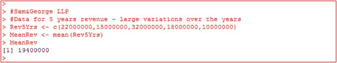

图 4-9. 均值作为统计参数的局限性

## 4.3.2 中位数

中位数通过将数值按升序或降序排列来找出中间值。在许多情况下，中位数可能比均值更具代表性。它能够清晰地将数据集从中分成两个相等的部分，即 50%的数值低于中位数，50%的数值高于中位数。示例如下：

- 某组织内工人的年龄，用于了解该组织的活力。
- 某组织内员工的生产力。
- 某组织内具备特定技能员工的薪资水平。

我们以某组织 20 名工人的年龄为例：18、20、50、55、56、57、58、47、36、57、56、55、54、37、58、49、51、54、22 和 57。仅仅通过审视这些数字，你就能发现该组织中年长工人多于年轻工人，如果组织退休年龄是 60 岁，那么几年后可能会出现知识流失的问题。接下来，我们比较该数据集的中位数和均值。下图显示 50%的工人年龄在 54 岁以上，即将面临退休（即如果以 60 岁为退休年龄，他们距退休仅有 6 年），这预示着可能出现严重的知识流失。然而，如果使用均值 47.35，则情况显得更为乐观（即距退休约有 12.65 年）。但如果我们查看原始数据，情况并非如此：20 名员工中有 13 人年龄已达 50 岁或更高，这对组织而言值得关注。图 4-10 展示了一个使用 R 语言计算中位数的实例。

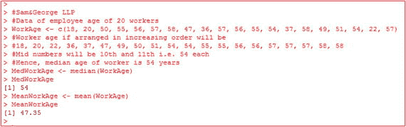

图 4-10. 如何使用 R 语言计算中位数

然而，如果第 10 个值为 54，第 11 个值为 55，那么中位数将是 `(54+55)/2`，即 54.5。

我们再举一个公司生产力的例子。假设每位工人每日生产的产品数量分别如下：20、50、55、60、21、22、65、55、23、21、20、35、56、59、22、23、25、30、35、41、22、24、25、24 和 25。中位数生产力为每日 25 件产品，这意味着组织中 50%的工人每日产量低于 25 件，50%的工人每日产量高于 25 件。均值生产力为每日 34.32 件产品，因为部分工人的生产力显著高于中位数工人，从一些工人的生产力数据中可见一斑：例如每日 65 件、60 件、59 件、56 件、56 件、55 件等。图 4-11 中来自 R 语言的分析清晰地显示了均值与中位数之间的差异。

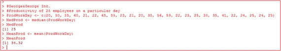

图 4-11. 突出显示均值与中位数的差异

如果你需要手动计算中位数，必须先将数据点按升序或降序排列，然后如果数值个数为奇数，则选择中间项的值；如果数值个数为偶数，则需要将中间两项相加，再除以 2，如前文所述。

从上述讨论中你可以注意到，与其仅看均值或中位数中的某一个，同时参考均值和中位数能更好地理解数据。

## 4.3.3 众数

众数是数据集中出现次数最多的数据点。例如，在我们关于工人年龄的数据集中，57 出现的次数最多（即三次）。因此，57 是工人年龄数据集的众数。这揭示了数据中的重复模式。

R 语言中没有内置函数可以直接计算众数。因此，我们编写了一个函数并计算了众数，如图 4-12 所示。我们使用了之前相同的数据集（即 `WorkAge`）。

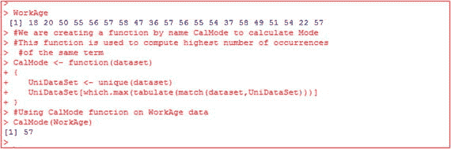

图 4-12. 使用 R 语言创建的函数计算众数

在上述函数中，`unique()` 从数据集中创建一组唯一值。在 `WorkAge` 示例中，唯一值分别为：18、20、50、55、56、57、58、47、36、54、37、49、51 和 22。`match()` 函数将数据集中的值与得到的唯一值集合进行匹配，并提供每个唯一值在原始数据集中的位置。`tabulate()` 函数返回每个唯一值在数据集中出现的次数。`which.max()` 函数返回唯一值集合中重复次数最多的数值的位置。

## 4.3.4 极差

极差是一个简单但重要的统计参数。它描述了按升序或降序排列的数据集端点之间的距离（即数据集中最大值与最小值之间的差值）。这提供了衡量数据集整体离散程度的指标。

R 语言命令 `range(dataset)` 可返回最小值和最大值（见图 4-13），示例仍沿用之前的数据集（即 `WorkAge`）。

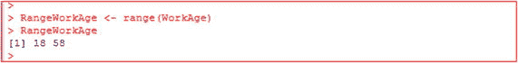

图 4-13. 如何使用 R 语言计算极差

最大值与最小值之间的差值即为极差。

## 4.3.5 分位数

“分位数”也称为“百分位数”。分位数将按升序或降序排列的数据集划分为相等的部分。“中位数” 本质上就是将按升序或降序排列的数据划分为两个元素数量相等的集合的那个数据点。因此，它也被称为第 50 个百分位数。另一方面，“四分位数” 将按升序排列的数据集划分为四个数据元素数量相等的集合。第一个四分位数（也称为 `Q1` 或第 25 个百分位数）将拥有其下方的 25% 的数据元素和其上方的 75% 的数据元素。第二个四分位数（也称为 `Q2` 或第 50 个百分位数或中位数）将拥有其下方的 50% 的数据元素和其上方的 50% 的数据元素。第三个四分位数（也称为 `Q3` 或第 75 个百分位数）拥有其下方的 75% 的数据元素和其上方的 25% 的数据元素。“分位数” 是一个通用词，而 “四分位数” 特指某个特定的百分位数。例如，`Q1` 就是第 25 个百分位数。第四个四分位数本质上就是第 100 个百分位数。

分位数、四分位数或百分位数提供了均值无法提供给我们的信息。换句话说，分位数、四分位数或百分位数除了均值之外，还为我们提供了关于数据集的额外信息。

让我们以“中位数”部分中给出的相同两个数据集为例，来计算四分位数。图 4-14A 和 4-14B 展示了四分位数的计算过程。

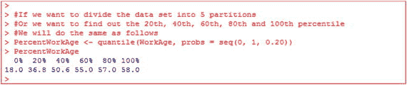

图 4-14B. 使用 R 计算分位数或百分位数

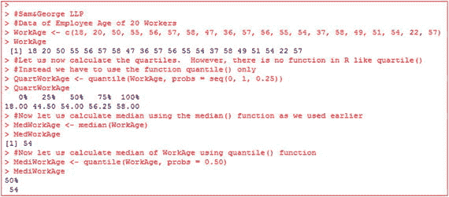

图 4-14A. 使用 R 计算分位数或百分位数

类似地，您可以使用带有 `probs = seq(0, 1, 0.05)` 参数的分位数函数将数据集划分为 20 个数据元素数量相等的集合，如图 4-15 所示。

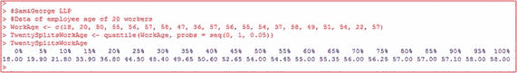

图 4-15. 将数据划分为 20 个数据元素数量相等的集合

正如您从图 4-15 中所观察到的，数据集的最小值出现在第 0 个百分位数，最大值出现在第 100 个百分位数。您可以观察到，通常每两个相邻的 5 个百分位数之间可以看到一个数据元素。

从本讨论中可以看出，四分位数和各种分位数除了提供均值或中位数（尽管中位数本质上就是第二个四分位数）所提供的信息之外，还提供了关于数据分布的额外信息。

## 4.3.6 标准差

度量的平均值和中位数描绘了数据集或分布的中心。另一方面，标准差则说明了数据集或数据值的分散程度。

标准差的手动计算如下：

1. 首先计算数据集或分布的平均值
2. 然后计算每个值与平均值的距离（这被称为偏差）
3. 然后将上述计算出的距离进行平方
4. 然后将平方后的距离求和
5. 然后将上述得到的平方距离之和除以数值个数减 1，以调整自由度

第 3 步中的平方运算是必要的，因为数据集中的负数和正数在我们计算或得出平均值时会相互补偿或抵消彼此的影响，而平方可以帮助我们理解数据的真实分散程度。

让我们以图 4-16 中显示的工人年龄示例来计算标准差。

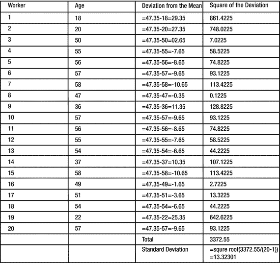

图 4-16. 使用 `WorkAge` 数据集手动计算标准差

在 R 语言中，可以通过一个简单的命令轻松完成此计算：`sd(dataset)`。图 4-17A 展示了使用 R 查找标准差的示例。

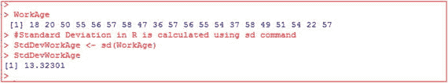

图 4-17A. 使用 R 计算标准差

通常，根据正态曲线（一个包含大量项目的数据集通常被认为具有正态分布或正态曲线）的规则：

*   +/- 1 个标准差表示 68% 的数据落在此范围内
*   +/- 2 个标准差表示 95% 的数据落在此范围内
*   +/- 3 个标准差表示 99.7% 的数据落在此范围内。

总的来说，大约 99.7% 的数据将落在 +/- 3 个标准差的范围内。

正如图 4-17B 所示，在正态分布数据的情况下（数据点数量通常大于 30，越多越好），观察到大约 68% 的数据落在距离分布中心（即均值）正负一个标准差的范围内。类似地，大约 95%（或如图 4-17B 所示的约 95.2%）的数据值落在距离中心正负两个标准差的范围内。大约 99.7% 的数据值落在距离中心正负三个标准差的范围内。这里显示的曲线通常被称为 “钟形曲线” 或 “正态分布曲线”。例如，一个国家所有公司的利润或亏损围绕中心值（即利润或亏损的均值）呈正态分布。

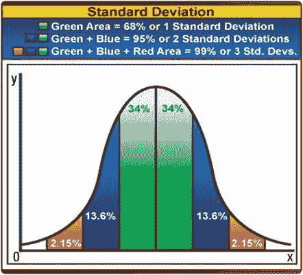

图 4-17B. 显示不同标准差范围内数据覆盖率的钟形曲线

标准差越高，与均值的离散程度越高——也就是说，它表明数据点之间差异显著，并显示了数据的异质性。标准差越低，与均值的离散程度越低——也就是说，它表明数据点之间差异较小，并显示了数据的同质性。

然而，标准差与均值、中位数、四分位数和百分位数等其他因素一起，为我们提供了关于数据的大量信息，或者更有效地解释了数据。

## 4.3.7 方差

方差是描述离散程度的另一种方式。简单来说，它是标准差的平方，如图 4-18 所示。方差提供了与均值偏离的平方的离散程度。与标准差相比，它是表示离散程度的另一种方式。如前所述，从数学上讲，方差是标准差的平方。我们继续使用本章前面用过的 `WorkAge` 数据集。

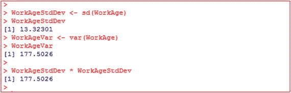

图 4-18. 使用 R 计算方差

## 4.3.8 R 中的 `summary` 命令

命令：`summary(dataset)` 提供了关于数据集的以下信息，其中涵盖了讨论过的大多数统计参数。此命令为我们提供输出，即：最小值、第一个四分位数、中位数（即第二个四分位数）、平均值、第三个四分位数、最大值。这是通过单个命令获取摘要信息的简便方法（参见图 4-19，该图是来自 R 的截图）。

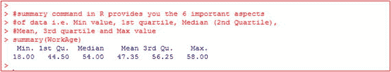

图 4-19. 使用 R 中的 `summary()` 命令查找主要统计参数

如果您使用了 `summary(dataset)` 命令，那么如果需要，您可以随后使用其他命令，如 `sd(dataset)`、`var(dataset)` 等，来获取与数据相关的其他感兴趣的参数。

## 4.4 数据的图形化描述

统计参数，例如均值、中位数、分位数（四分位数、百分位数）、标准差和方差，为我们提供了关于数据的补充重要信息，使我们能够更好地理解数据集。另一方面，图形化描述则以不同的方式呈现相同的信息。根据大脑理论，与使用量化数据相比，超过 50%的人对图形化表示更为直观。

### 4.4.1 R 中的绘图

在 R 中进行绘图非常简单。命令 `plot(dataset)` 可以为你提供数据集的简单图表。以之前的工人年龄为例，在 R 中执行简单命令 `plot(WorkAge)` 将会生成一张良好的图形图表（见图 4-20 和图 4-21）。

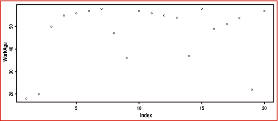

图 4-21. 使用 R 创建简单图表

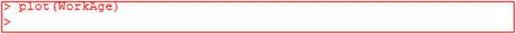

图 4-20. 使用 R 创建简单图表的代码

由于我们除了通过名为 `WorkAge` 的数据集提供了工人的年龄外，没有给出任何关于员工的信息，因此 y 轴以它所代表的数据集命名。由于数据集没有提供关于员工的额外信息，因此数据集的索引显示在 x 轴上。

通过对命令进行细微调整（如图 4-22 所示），我们将为 `WorkAge` 数据集中的工人年龄创建一个更好的图形表示。

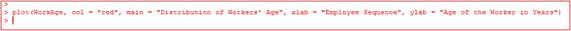

图 4-22. 在 `plot()` 命令中使用附加参数获得更好的图表

在上述命令中，`col = “red”` 定义了数据点的颜色，`xlab = “ “` 指定了我们想要提供给 x 轴的标签，`ylab = “ “` 指定了我们想要提供给 y 轴的标签，`main = “ “`（在 “ ” 内提供标签/标题）指定了我们想要提供给整个图表的标题。如果需要在绘图命令中使用 `sub = “ “`，我们还可以包含副标题。在 R 中绘制图表就是这么简单（见图 4-23）。

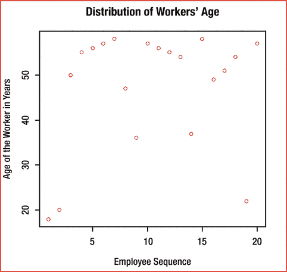

图 4-23. 在 `plot()` 命令中添加附加参数后从 R 获得的图表

简单地添加 `type = “l”` 将会提供图 4-24A 和图 4-24B 中所示图表的变体。

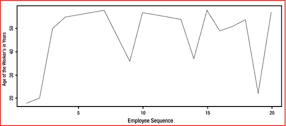

图 4-24B. 如何在 R 中获得图表的变体

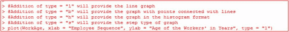

图 4-24A. 如何在 R 中获得图表的变体

另一个小的变体 `type = “h”` 将会以直方图类型的形式提供图表的如下变体。图 4-25 是一个条形图，其中的条由线条表示。

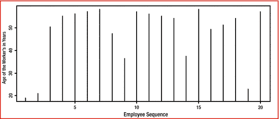

图 4-25. R 中的直方图类型图表

### 4.4.2 直方图

直方图将以数值范围分组的形式来呈现数据。这对于可视化和理解数据非常有帮助。R 中的简单命令：`hist(dataset)` 生成一个简单的直方图，如图 4-26A 和图 4-26B 所示。

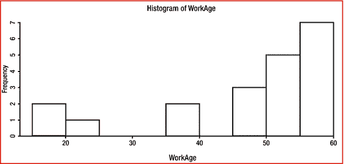

图 4-26B. 使用 R 创建的简单直方图

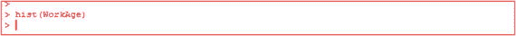

图 4-26A. 使用 R 创建直方图的代码

在图 4-26B 所示的图表中，x 轴显示了年龄范围，从 15+ 到 20，20+ 到 25，25+ 到 30……直到 55+ 到 60。如你所见，我们没有指定要描绘的各种数值范围（在本例中为年龄组）。然而，R 遍历了数据，并考虑了最小年龄和最大年龄，从而决定了要描绘数据的年龄组。

如前所述，你可以分别使用 `main = “ “`、`xlab = “ “`、`ylab = “ “`、`sub = “ “` 来指定主标题、x 轴标签、y 轴标签和副标题。

### 4.4.3 条形图

条形图是描述数据分布的一种简单方式。在图 4-27A 中，我们提供了 `WorkAge` 数据集的条形图。每个员工的工龄显示在 x 轴上。条形长度的差异表示工人年龄之间的差异。条形图的使用及生成的相应条形图如图 4-27A 和图 4-27B 所示。

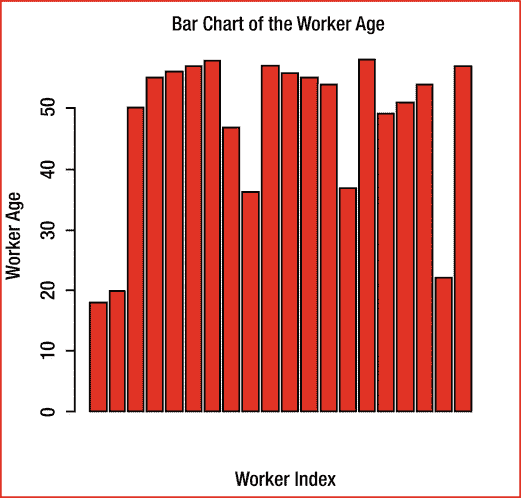
图 4-27B. 在 R 中创建的条形图

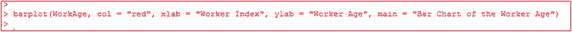
图 4-27A. 在 R 中创建简单的条形图

### 4.4.4 箱线图

箱线图是一种展示数据分布的流行方式。图 4-28B 展示了在 R 中使用 `WorkAge` 数据集创建的箱线图。使用的命令是 `boxplot(dataset)`，并附带了轴标签和标题，如图 4-28A 所示。

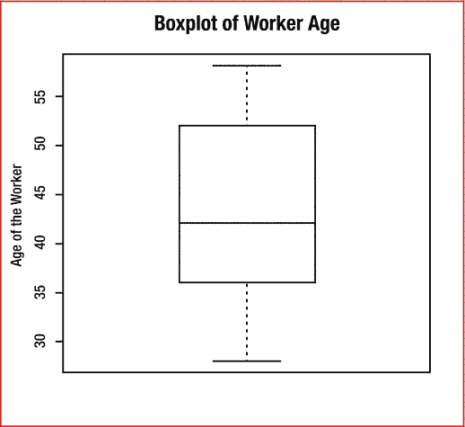
图 4-28B. 在 R 中创建的箱线图

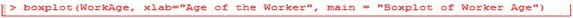
图 4-28A. 在 R 中用于创建箱线图的命令

## 4.5 数据框上的计算

我们前面段落中的所有讨论都集中在单维数据上——例如，一个包含工人单一特征（如工人年龄）的向量。

但我们所需分析的大部分数据都是多维的，并且需要透彻了解如何进行分析。你经常会遇到二维数据，其数据行对应于通过列表示的各种特征。

图 4-29 中描绘的数据集是一个数据框。数据框本质上是 R 中的一种表格结构，其中每一列代表一个变量的值，每一行代表一个案例或实例的数据。在这个数据框中，我们有关于十名员工的姓名、年龄和薪资的数据。每名员工的数据通过一行来描绘，员工的特征或方面则通过列的标签来描绘，并且这类数据被捕获在相应的列中。

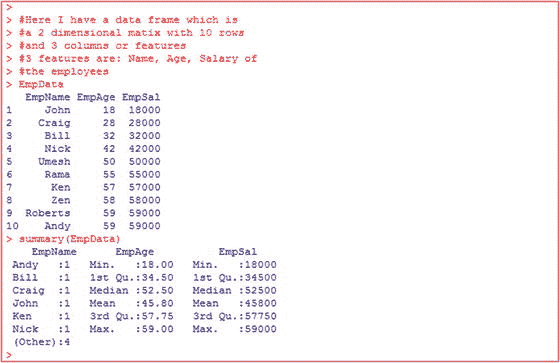
图 4-29. R 中的数据框

如图所示，这里的命令 `summary(dataset)` 也可以用于获取与每个特征（即每列中的数据）相关的摘要信息。

现在，你可以计算所需的任何附加信息（如图 4-30 所示）。

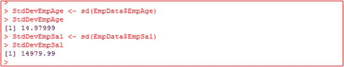
图 4-30. 在 R 中对 `EmpData` 数据框特征进行标准差计算

如上所示，可以使用 `datasetname` 后跟 `$column_name` 来访问数据集中的任何列。

### 4.5.1 散点图

散点图是数据分析中重要的图表类型之一。这些图表描绘了两个变量之间的关系。散点图通常用于展示“因果关系”，但在散点图中看到的任何关系并不总是因果关系。图 4-31A 展示了如何在 R 中创建散点图，图 4-31B 显示了生成的散点图。相关性的基本概念已在第 8 章中详细解释。

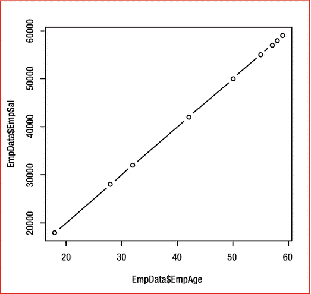
图 4-31B. 在 R 中创建的散点图（使用图 4-31A 中指定的方法）

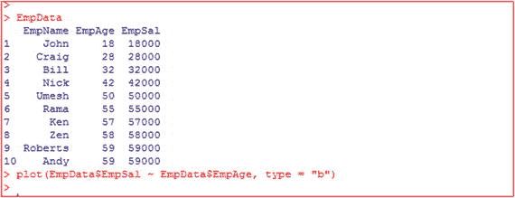
图 4-31A. 在 R 中创建散点图的代码

从这个例子中可以看出，员工年龄和员工薪资之间存在直接关系。员工的薪资与年龄成正比增长。这在现实场景中可能并非如此。图 4-31A 显示员工的薪资随年龄增长而成比例增加，并且是线性增长。这种关系被称为“线性关系”。请注意，`type = "b"` 与 `plot(dataset)` 命令一起使用，同时创建了点图和线图。

现在，让我获取另一个名为 `EmpData1` 的数据框，它包含一个额外的特征（也称为列或字段）和不同的数据。在图 4-32 中，你可以看到该数据框中的数据及其摘要。如图 4-32 所示，我添加了一个名为 `EmpPerGrade` 的特征，并更改了之前数据框 `EmpData` 中的薪资值。`EmpData1` 现在包含以下数据。

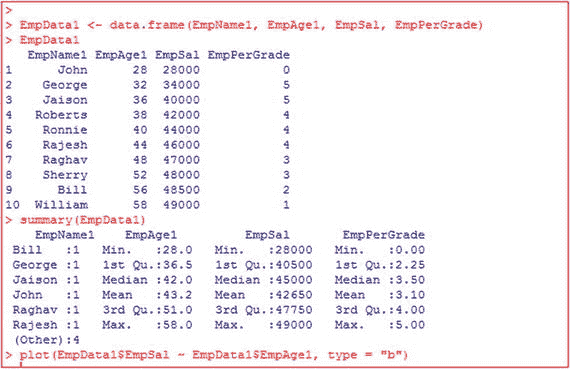
图 4-32. 来自数据框 `EmpData1` 的数据

现在，如图 4-33 所示，员工年龄与员工薪资之间的关系发生了变化；你可以观察到，随着年龄增长，员工薪资的增长不再成比例，而是逐渐放缓。这通常被称为“二次关系”。

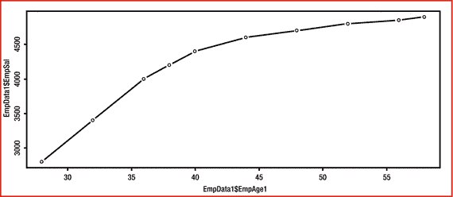
图 4-33. 来自 R 的散点图，展示了数据框 `EmpData1` 中两个特征之间关系的变化

在图 4-34 中，你可以看到员工年龄与员工业绩评级之间的关系图。请忽略第一个数据点，因为它属于一位刚入职的新员工，尚未被评级。因此，其业绩评级相关数据为 0。否则，你可以观察到，随着年龄增长（根据上述数据），业绩有所下降。在这种情况下，员工年龄和员工业绩之间存在反向关系（即随着年龄增长，业绩在下降）。这再次说明了这不是真实数据，仅用于说明目的。

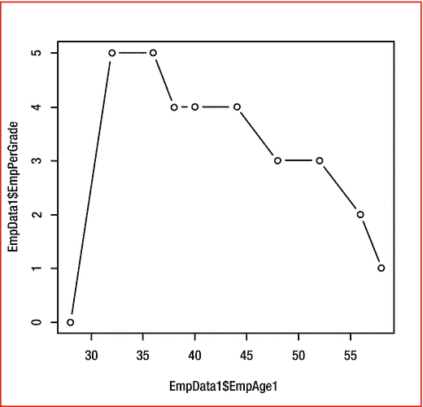
图 4-34. 来自 R 的散点图，展示了数据框 `EmpData1` 中两个特征之间关系的变化

## 4.6 概率

概率及相关分布的概念对于商业分析的重要性不亚于纯统计学领域。商业分析中使用的一些重要概念，如贝叶斯理论和决策树等，都基于概率的概念。

如你所知，简单来说，概率就是事件发生的可能性。在某些情况下，我们可能掌握与事件相关的一些先验信息；在其他情况下，事件可能是随机的——也就是说，我们可能事先不知道结果。描述概率的一种流行方式是抛硬币或掷骰子的例子。硬币有两面，当抛出时，出现正面或反面的概率是 1/2，因为在任何一次抛掷中，要么出现正面，要么出现反面。你可以通过多次抛掷硬币来验证这一点，并观察到出现正面或反面的概率大约为 50%（即 1/2）。类似地，掷骰子掷出任何特定数字的概率是 1/6，这也可以通过多次掷骰子来验证。

如果一个事件不可能发生，其概率为 0。然而，如果一个事件必然发生，其概率为 1。但事件的概率总是在 0 和 1 之间，并且取决于其发生的可能性或与其发生相关的不确定性。

任意两个或多个事件可以彼此独立地发生。同样，任意两个或多个事件也可以互斥地发生。

**示例 1：** 你能同时前往两个方向相反的目的地吗？如果你向西旅行，就不能同时向东旅行。

**示例 2：** 如果我们在一个客户账户中盈利，就不能在同一账户中亏损。

示例 1 和 2 属于当另一个事件发生时，会排除特定事件发生的事件类型；它们被称为互斥事件。

**示例 3：** 一个人“抛硬币”和“下雨”可以同时发生，但两者互不影响对方的结果。

**示例 4：** 一家公司可能盈利，同时面临法律问题。一个事件（盈利）不会对另一个事件（有法律问题）产生影响。

示例 3 和 4 属于不相互影响结果的事件类型；它们被称为相互独立事件。这些也是互不排斥事件的例子，因为两个结果可以同时发生。

### 4.6.1 互斥事件的概率

两个互斥事件（例如 `X` 和 `Y`）同时发生的概率为 0，因为根据定义，它们不会同时发生：`P(X and Y) = P(X ∩ Y) = 0`。

`n` 个互斥事件（例如 `A1`、`A2`……`AN`）同时发生的概率为 0，因为根据定义，所有这些事件不会同时发生：`P(A1 and A2 and……AN) = P(A1 ∩ A2 ∩…. ∩ AN) = 0`。

然而，两个互斥事件中的一个（例如 `X` 或 `Y`）发生的概率等于每个事件发生概率之和：`P(X or Y) = P(X U Y) = P(X) + P(Y)`。

### 4.6.2 相互独立事件的概率

两个相互独立事件同时发生的概率为 `P(X and Y) = P(X) * P(Y)`。

### 4.6.3 互不排斥事件的概率

互不排斥事件是指那些并非互斥的事件。

两个互不排斥事件（即每个事件发生概率之和减去这两个事件同时（或换句话说，一起）发生的概率）的概率为 `P(X or Y) = P(X U Y) = P(X) + P(Y) – P(X ∩ Y)`。

`n` 个互不排斥事件的概率为 `P(A1 or A2 or …….. or AN) = P(A1 U A2 U………U AN) = P(A1) + P(A2) +……+ P(AN) – P(A1 ∩ A2 ∩ A3 ∩ …….. ∩ AN)`。

### 4.6.4 概率分布

随机变量在分析中十分重要。概率分布描述了随机变量取值的分布情况。一些重要的概率分布包括：

- 正态分布
- 二项分布
- 泊松分布
- 均匀分布
- 卡方分布
- 指数分布

我们不会逐一讨论上述所有分布。可能存在的分布类型还有很多，包括 F 分布、超几何分布、联合分布与边缘概率分布以及条件分布等。本章我们将只讨论正态分布、二项分布和泊松分布。关于这些分布以及其他相关分布的更多内容，我们将在后续章节中进行探讨。

#### 4.6.4.1 正态分布

大量数据被认为服从正态分布，因为该分布通常以均值为中心。在现实生活中，许多情况下都能观察到正态分布。由于其形状呈钟形，正态分布也被称为“钟形曲线”。正态分布的性质中，通常约有 68%的值落在均值±1 个标准差内，95%的值落在均值±2 个标准差内，99.7%的值落在均值±3 个标准差内，这些性质在大多数分析技术中被广泛使用，因此也是标准正态曲线的性质。标准正态曲线的均值为 0，标准差为 1。`Z-score`（Z 分数）用于对回归分析中的特征值进行归一化，其基础正是标准正态分布的概念。正态分布也可用于其他分布的情况，因为在大样本量下，随机样本均值的分布通常为正态分布。

正态分布应用的一个重要例子是统计过程控制，该技术被大多数行业用于理解并控制过程绩效。另一个重要例子是员工绩效的分布，通过它可以识别出少数高绩效和低绩效员工，而大多数员工的绩效则围绕平均值水平。

假设某组织有 150 名员工，员工的平均绩效评分为 3 分，最低分为 1 分，最高分为 5 分，标准差为 1.5。使用 R 计算获得 4 分及以上分数的员工百分比，如图 4-35 所示。

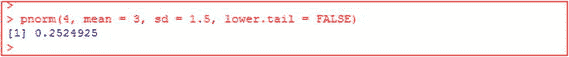
图 4-35. 在 R 中解决的正态分布问题示例

请注意，我们关注的是上尾部分，因为我们想知道获得 4 分或 5 分成绩的员工百分比。此处的答案是 25.25%。

#### 4.6.4.2 二项分布

二项分布通常用于衡量成功或失败的场景。在板球比赛中，比赛开始时抛硬币是决定哪一方先击球（或防守）的重要环节。抛硬币并猜“正面”，如果结果是“正面”，你就赢得了掷币；反之，如果结果是“反面”，你就输掉了掷币。

作为某组织的销售主管，你提交了十五份标书的应答文件。每份标书都有五个竞标者。你可能会成功赢得其中一部分或全部，也可能一无所获。由于每份标书有五个竞标者，且每份标书只能由一家公司赢得，因此赢得标书的概率是 0.2（即 1/5）。你想赢得的标书数超过十五份中的四份。你可以使用 R 语言通过二项分布来求出赢得四份或更少标书的概率（见图 4-36）。

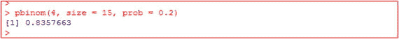
图 4-36. 在 R 中解决的二项分布问题示例

请注意，`pbinom()` 函数使用了二项分布的累积概率分布函数，因为我们想知道赢得四份或更多标书的概率。如您所见，赢得四份或更少标书的概率是 83.58%。赢得超过四份标书的概率为（100 – 83.58）= 16.42%。

#### 4.6.4.3 泊松分布

泊松分布描述了在时间区间内发生的独立事件。呼叫中心的来电到达、银行大厅顾客的到达，或者机场/公交总站乘客的到达，均服从泊松分布。

我们以某银行特定分行顾客到达数量为例。假设平均每小时有 20 名顾客到达。我们可以使用 R 语言，借助泊松分布求出每小时到达该分行的顾客数达到 26 人或以上的概率（见图 4-37）。

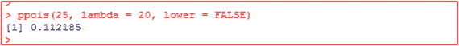
图 4-37. 在 R 中解决的泊松分布问题示例

请注意，我们使用了 `lower = FALSE`，因为我们关注的是上尾部分，并且想知道每小时到达该银行的顾客数达到 26 人或以上的概率。此处的答案是 11.22%。

## 4.7 本章小结

- 您已经了解到，仅仅依赖单一的描述性统计量可能会很危险。事实上，要对任何事物获得全面的了解，可能需要使用多种统计函数来理解上下文或情况。
- 您还理解了描述性分析中各种感兴趣的统计参数（均值、中位数、分位数、四分位数、百分位数、标准差、方差和众数）。您了解了如何使用 R 语言计算这些参数。您也知道通过一个简单的命令如`summary(dataset)`，就可以使用 R 语言获得其中大部分参数。
- 您探索了如何使用 R 语言以图形方式绘制数据。您也理解了图形表示如何向用户提供比描述性统计更多的信息。您了解了如何使用 R 语言创建直方图、条形图和箱线图。
- 您学习了 R 语言中一种重要的数据结构（即数据框）。您了解了如何从这些数据框包含的数据中获取汇总信息。
- 您探索了散点图如何展示数据框中各个特征之间的关系，从而帮助我们以图形方式轻松地更好地理解这些关系。
- 您探索了商业分析的另一个重要方面——概率，它影响着商业分析中使用的许多技术（贝叶斯技术、决策树等）。
- 您学习了重要的概率分布及其含义。您还看了一些概率分布的例子，以及如何使用 R 语言通过一些流行的分布（如正态分布、二项分布和泊松分布）来解决商业问题。