# 5. 商业分析流程与数据探索

本章涵盖了数据分析所需的数据探索、验证和清理。您将了解数据清洗的目的、为什么需要数据准备、如何处理缺失值，以及行业中使用的一些数据清洗技术。

## 5.1 商业分析生命周期

商业分析的目的是从数据中提取信息，以便做出适当的商业决策。数据可以是实时的，也可以是历史的。通常，你会根据历史数据构建一个业务模型，一旦对模型的准确性感到满意，就可以将其部署到生产环境中用于实时数据分析。尽管各行业专家和工具制造商参考了许多标准，但流程大体是相同的。在本节中，我们将借助流程图介绍基本的商业分析过程。本书讨论的所有案例研究都遵循这一相同的过程。

一个商业分析项目的生命周期由八个阶段组成。阶段的顺序如图 5-1 所示。这个顺序有时可能会根据业务问题和数据的变化而改变。每个阶段的结果决定了下一个阶段以及该阶段需要执行的任务。整个流程在模型部署后并未结束。部署之后，一组之前未见过的全新数据可能会引发一系列新问题，这些问题将作为一个新模型来处理，并且会再次遵循相同的流程，同时融入先前模型部署过程中积累的额外输入。后续的流程将从之前的经验中受益。以下各节将描述每个阶段的功能。

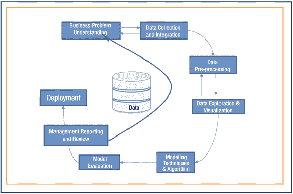

图 5-1. 商业分析流程

### 5.1.1 阶段 1：理解业务问题

在项目的这个初始阶段，重点是站在业务的角度理解问题、目标和需求。然后将这种理解转化为一个数据分析问题，旨在通过使用适当的方法来实现目标并解决该问题。详细内容将在下一节讨论。

### 5.1.2 阶段 2：收集和集成数据

在这个重要阶段，需要从各种来源收集数据。一旦理解了业务问题，就可以定义数据收集的过程，包括解决业务问题所需的参数。如果当前数据库或数据仓库中没有可用数据，则可能需要进行调查。此调查需要设计成一份合适的问卷，并通过适当的研究方法来进行。在某些情况下，数据可能存在于内部数据库中，可以设计适当的方法从数据库中提取数据。

### 5.1.3 阶段 3：预处理数据

大多数情况下，接收或收集到的原始数据可能无法直接应用于构建模型。原始数据可能包含错误，例如格式冲突、错误的数据类型和缺失值。在此步骤中，需要对数据进行清洗和规范化。你需要修复数据中的任何缺失值，然后准备好数据以进行进一步分析。此过程可能会重复多次，具体取决于所获数据的质量以及所得到模型的准确性。

### 5.1.4 阶段 4：探索和可视化数据

下一步是理解数据的特征，例如其分布、趋势以及变量之间的关系。这种探索能让你更好地理解数据。你可以熟悉所收集数据的类型，识别异常值和各种数据类型，并发现对数据的初步见解。你在此阶段发现的信息有助于为后续关于样本中隐藏信息的假设奠定基础。

### 5.1.5 阶段 5：选择建模技术和算法

在此阶段，你需要决定是使用无监督还是监督式机器学习技术。这是一个分类问题还是回归问题？你将使用描述性技术还是预测性技术？你将使用线性回归方法还是逻辑回归方法？这些选择既取决于业务需求，也取决于你所拥有的数据。在此阶段需要创建一个适当的训练集，并校准各种参数以获得最优值和模型。工具也在这一阶段选定。这可能需要编程技能或特定的工具技能。一旦选择了模型，下一步就是构建模型并评估其性能。

### 5.1.6 阶段 6：评估模型

此时，你已经有了一个模型，但如何知道它是否适合你呢？模型的性能如何？在这个阶段，你通过使用标准方法来评估模型，这些方法测量模型的准确性及其在实际应用中的性能。评估模型并确保其达到了业务领导者指定的业务目标至关重要。这需要具备统计学、机器学习、算法以及结果解读方面的深入知识。通常情况下，拥有博士学位等高等学历可能会有所帮助。

### 5.1.7 阶段 7：向管理层汇报并审查

在这个阶段，你需要将你的数学模型呈现给业务领导者。将模型的数学输出与业务目标保持一致，并且能够向管理层和业务领导者传达这种一致性，这一点非常重要。一旦管理层对结果和模型满意，该模型就准备部署。如果需要进行任何更改，则重复上述循环。

### 5.1.8 阶段 8：部署模型

这是项目中的一个具有挑战性的阶段。模型现在已部署给最终用户，处于生产环境中，对实时数据进行分析。根据部署场景和业务目标，模型可以执行预测性分析或简单的描述性分析和报告。模型在生产环境中的表现也可能不同，因为它可能看到与实际模型完全不同的数据集。在这种情况下，需要重新审视模型以进行改进。在许多情况下，分析由最终客户执行，因此需要对他们进行适当的培训。

本书中定义的商业分析流程，与行业中遵循的其他数据挖掘流程相似。例如，跨行业数据挖掘标准流程（`CRISP-DM`）包含六个阶段：业务理解、数据理解、数据准备、建模、评估和部署。该模型由戴姆勒克莱斯勒、`SPSS` 和 `NCR` 于 1996 年推出。同样，由 `SAS` 开发的 `SEMAA` 包含五个阶段：抽样（获取一个代表性子集的数据，该子集既要具有代表性，又不能太大以至于难以处理）、探索（探索数据中的模式）、修改（必要时转换变量）、建模（应用最适合数据的模型）和评估（确定模型是否满足要求）。

接下来的部分将更详细地研究每个阶段。尽管每个阶段本身都可以独立成章，但我们仅涵盖实现目标所需的重要步骤和解决方案。

## 5.2 理解业务问题

分析工作的核心目的是解决业务问题。在解决问题之前，你需要从业务角度彻底理解问题，从而明确客户真正希望你解决的是什么。例如，客户是想从数据中找到某种模式、预测即将上市的产品的价格、确定目标客户群体、找出贷款违约者、优化软件开发周期，还是提升运营质量？这些内容应在项目启动之初就明确并记录在案。同样重要的是，需要确定数据的可用性：你是否能访问数据源或内部数据仓库、数据格式、数据质量、可用数据量，以及最终模型部署所需的数据流。

文档记录同样是一项重要任务，因为我们的大脑并不擅长记住每一个细节。作为此项工作的一部分，你需要记录业务目标、数据源、项目风险及局限性。同时，还要定义时间线、支持模型所需的基础设施，以及项目所需的专业能力。

## 5.3 收集与整合数据

获取高质量的数据是决定结果准确性的最重要因素。数据可以来自一手来源或二手来源。一手来源是你自己的数据源——来自内部数据库或你自己开展的研究数据。你能完全控制所收集的数据。二手来源则来自其他渠道，例如出售数据的第三方平台，或业务数据库之外的现有数据。二手数据的例子包括政府官方报告、报纸文章和人口普查数据。根据所要解决的业务问题类型，你可能会使用一手数据、二手数据，或者两者兼用。使用一手数据的优势在于，你可以自行设计解决问题所需的信息类型，因此数据质量高，且准备数据以进行后续分析所需的时间也更少。

组织内部的多个数据库中可能存在海量数据。例如：

*   **运营数据库**：与日常业务交易相关的数据，如供应商管理、供应链、客户投诉和客户反馈。
*   **制造与生产数据库**：与制造流程、生产细节、供应链管理、生产计划以及机器维修保养相关的数据。
*   **人力资源与财务数据库**：与人力资源和财务职能相关的数据，如员工请假、人事信息、工作技能、员工流失率和薪资。
*   **IT 数据库**：与信息系统相关的数据，如 IT 资产清单、许可详情、软件以及各类日志。
*   **数据仓库**：数据仓库是由组织内部多个数据库整合而成的集成数据库。数据仓库技术通常在存储数据之前对数据进行清洗、标准化和预处理。这有助于分析、报告和决策过程。数据仓库技术还支持在线分析处理（`OLAP`）以及其他功能，如数据汇总和多维分析（上钻下卷）。
*   **元数据**：这是关于数据的数据。它是关于特定数据集、对象或资源的描述性信息，包括其格式、收集时间及收集者（例如，网页元数据、`XML`和`JSON`格式）。
*   **`NoSQL`数据库**：`NoSQL`数据库是为了克服关系型数据库的限制，并应对网络上生成的海量数据挑战而开发的。`NoSQL`数据库可以存储结构化和非结构化数据。此外，`NoSQL`数据库在存储数据前不需要预先定义模式。

大多数组织的数据分布在各种数据库中。从多个来源抽取数据是解决业务分析任务的必要环节。有时，数据库中存储的数据可能服务于与你当前目标不同的目的。因此，在开始任何分析流程之前，必须对数据进行准备，以确保其能够针对业务问题。这个过程有时被称为数据整理或数据清洗，将在下一节中介绍。

### 5.3.1 抽样

很多时候，除非你拥有大数据基础设施，否则只会使用总体的一个样本来构建分析模型。样本是“从总体中选取的、用于确定该总体真实情况的较小单位集合”（Field, 2005）。样本应能代表总体。选择抽样技术取决于业务问题的类型。

例如，你可能想研究多个国家在一段时间内的人均年度国内生产总值（`GDP`），以及这些序列与商业周期相关的周期性行为。6 至 10 年期间的月度住房销售数据显示出周期性行为，但 6 至 12 个月的数据可能显示出季节性行为。10 至 15 年期间的股票市场数据可能呈现出与 100 天期间不同的趋势。同样，基于历史数据预测未来一段时间的销售额，或分析一段时间内的 Twitter 情感和趋势，都属于周期性数据。如果波动没有固定周期，则为周期性的；如果变化发生在日历上的特定时期，则该模式是季节性的。时间序列数据是通过在特定时间段内进行重复测量而获得的数据。

对于时间序列数据，样本应包含时间周期（日期或时间，或两者兼有），并且只包含该特定日期或时间的测量记录样本，而非完整收集的数据。例如，道琼斯指数在 18 个月内的交易量。数据以毫秒为单位收集，因此一天内的数据量巨大。在 10 个月的时间内，这些数据可能达到 TB 级别。

另一种类型的数据与时间无关。它可以是连续数据或离散数据，但时间在这类数据集中没有意义。例如，你可能正在查看公司内个人的收入或工作技能、零售店的信用卡交易数量，或者年龄和性别信息。两个数据记录之间没有关系。

除非你拥有大数据基础设施，否则对于任何分析，你都可以只选取一个记录样本。使用随机化技术，并采取措施确保总体中的所有成员都有平等的机会被选中。这种方法称为概率抽样。这种抽样方法有多种变体：

*   **随机抽样**：随机抽取样本，每个成员都有平等的机会被选中。
*   **分层抽样**：将总体分成若干组，然后从每个组（或层）中随机选取数据。
*   **系统抽样**：你按系统的方式选取成员——例如，在特定时间或事件中，每隔第十个成员选取一次。

关于样本量计算的细节超出了本书的范围，统计学和其他研究方法书籍对此有广泛的论述。然而，为了增进你的理解，这里提供一个计算样本量的简单公式：

如果总体标准差已知，则

`n = (z × sigma/E)²`

如果标准差未知，

`n = (p)(1 – p)* (z/E)²`

### 5.3.2 变量选择

数据集中包含更多变量并不总能带来理想的结果。然而，如果你有更多的预测变量，就需要更多的记录。例如，如果你想找出一个 `Y` 与单个预测因子 `X` 之间的关系，那么 15 个数据点或许就能给出结果。但如果有 10 个预测变量，15 个数据点就远远不够了。那么，多少才算足够呢？统计学家和许多研究人员对此进行了研究，并给出了粗略的估算。例如，Delmater 和 Hancock（2001）提出的一种方法指出，对于任何预测模型，你应该拥有 `6 × m × p` 条记录，其中 `p` 是变量数量，`m` 是结果类别的数量。你拥有的记录越多，预测结果就越好。因此，在大数据处理中，你可以省去抽样的步骤，尝试处理所有可用数据以获得更好的结果。

## 5.4 数据预处理

如上一阶段所述，数据可以从各种来源收集，包括内部数据库或数据仓库。数据库中的数据可能容易受到噪声和不一致性的影响，因为其数据来自不同的最终用户应用程序，这些应用程序由不同人员在一段时间内开发和维护。有时，可能需要查询多个数据库以获取用于业务分析过程的数据。在此查询过程中，数据可能会被合并，可能包含缺失值或垃圾字符，可能具有不同的数据类型，并且可能代表不同类型的观测值或对同一观测值进行多次记录。因此，在执行任何数据分析之前，必须从数据类型、变量及其特征以及数据表的角度来理解数据。

### 5.4.1 数据类型

数据可以是定性数据，也可以是定量数据。定性数据是非数值型的——例如，汽车类型、最喜欢的颜色或最喜欢的食物。定量数据是数值型的。此外，定量数据可以进一步分为离散数据或连续数据（本节后续部分将更详细地描述）。

定量数据通常被称为可测量数据。这类数据允许统计学家执行各种算术运算，如加法和乘法，以找到总体参数，如均值或方差。观测值代表计数或测量值，因此所有值都是数值型的。每个观测值代表了总体或样本中各个数据点的一个特征。

-   **离散**：一个变量可以取某个独立且不同的值。每个值与其他任何值都没有关联。离散数据类型的一些示例包括：每个家庭的汽车数量、一个人一天喝水的次数，或生产线上缺陷产品的数量。
-   **连续**：一个变量可以在特定范围或区间内取数值。连续数据可以取集合中观测值可能取的任何值。例如，在温度读数中，每个读数可以取温度计上的任何实数。
-   **名义数据**：数据的顺序是任意的，或者数据本身没有关联顺序。例如，种族或民族有黑人、棕色人种、白人、印度人、美国人等取值；这些取值之间没有关联顺序。
-   **有序数据**：这类数据有特定的定义顺序。例子包括奥运会奖牌——金牌、银牌和铜牌，以及李克特量表调查——不同意、同意、非常同意。对于有序数据，你无法确定值之间的间隔是否相等。
-   **间隔数据**：这类数据在测量值之间有意义的间隔，但没有真正的起始零点。一个很好的例子是开尔文温度测量或海啸的高度。间隔数据类似于有序数据，但值之间的间隔是等分的。最常见的例子是华氏温度。29 度和 30 度之间的差异与 58 度和 59 度之间的差异幅度相同。
-   **比率数据**：两个值之间的差异具有相同的测量意义。例如，两个城市的海拔高度可以用比率表示。两个水库水位的差异可以用比率表示，例如是 X 水库水位的两倍。

尺度类型的概念后来获得了数学心理学家 Theodore Alper（1985, 1987）、Louis Narens（1981a, b）和 R. Duncan Luce（1986, 1987, 2001）的研究成果，从而弥补了其创立之初所缺乏的数学严谨性。

在分析之前，请了解你正在使用的变量，并为所有变量准备好正确的数据类型。许多工具支持变量类型的转换。

### 5.4.2 数据准备

在初步的数据类型转换之后，下一步是研究数据。你需要检查数值及其与数据的关联。你还需要查找缺失值、空值、空白以及未知字符，以便在分析前将其从数据中移除。否则，这可能会影响模型的准确性。本节描述了可以对数据执行的一些标准和分析。

#### 5.4.2.1 处理缺失值

有时，数据库可能不包含某些变量的值，因为这些值没有被记录。数据库中可能有多条记录没有记录任何值。当你对包含缺失值的数据进行分析时，得到的结果可能无法反映真实情况。缺失值必须在分析前得到妥善处理。以下是解决此问题的一些常用方法：

-   **忽略这些值**：这不是一个非常有效的方法。通常只在标签缺失且你无法解释该值的含义时才推荐使用。此外，如果只有一两条记录中同一行的许多变量缺失了值，那么你可以删除这一行记录并忽略这些值。如果样本量很大，删除一两个样本值不会产生太大影响，那么可以删除该记录。
-   **用平均值或众数填充**：这是最简单的方法。确定某个属性的所有记录的平均值或众数，然后使用这个值填充所有缺失值。此方法取决于你试图解决的问题类型。例如，如果你有**时间序列数据**，则不推荐使用此方法。
-   **使用属于同一分箱的属性均值填充**：如果你的数据集有一个属性被分类为不同类别——例如，收入组别分为高、低和平均——而另一个属性，比如人口，有多个缺失值，你可以使用该特定类别的平均值来填充缺失值。在这个例子中，如果高收入组的人口数据缺失，就使用高收入组的人口的平均值。

以下是另一个如何使用分箱来填充缺失值的示例：

1.  收入数据集：100, 210, 300, 400, 900, 1000, 1100, 2000, 2100, 2500
2.  根据两个观测值之间的距离将数据划分为不同的分箱：分箱 1：100, 210, 300, 400 分箱 2：900, 1000, 1100 分箱 3：2000, 2100, 2500
3.  计算每个分箱中条目的平均值。分箱 1 平均值：252.5 分箱 2 平均值：1,000 分箱 3 平均值：2,200
4.  使用分箱平均值来填充特定分箱的缺失值。**基于最可能的值进行预测**：根据数据集中的其他属性，你可以根据该值最可能取的值来填充。你可以使用一些统计技术，如贝叶斯定理或决策树，来找到最可能的值。

#### 5.4.2.2 处理重复值、垃圾值和空值

在分析过程开始之前，应从数据库中清除重复值、垃圾值和空值。可以采用与处理空值相同的流程。唯一的挑战在于识别垃圾字符，这有时很困难，且可能在分析期间引发大量问题。

### 5.4.3 使用 R 进行数据预处理

通常，工具会在分析前提供一个用于执行数据清洗和数据预处理的界面。本节将介绍如何使用 R 实现这一目标。有多种解决方案可完成相同任务，因此本示例只是其中一种方案。所讨论的数据预处理方法如下：

*   理解变量类型
*   更改变量类型
*   查找缺失值和空值
*   使用适当方法清理缺失值

R 中的所有变量都表示为向量。以下是 R 中的基本数据类型：

*   Numeric（数值型）：实数。
*   Integer（整数型）：整数。
*   Factor（因子型）：用于定义各类别的分类数据。例如，1 代表男性，2 代表女性。同样，1 代表排名第一，2 代表排名第二。
*   Character（字符型）：定义数据字符串的字符，例如，一个人、动物或地方的名字。

R 中的基本运算是向量运算（逐元素运算），包括基本算术运算（如加法和减法）、逻辑运算（如 `&` 和 `!`）、比较运算（如 `==`、`<`、`>`）以及一些基本数学函数（如 `sin`、`cos` 和 `exp`）。下面的 R 示例演示了以下内容：

1.  读取数据集。
2.  检查变量类型。
3.  将变量转换为不同类型。
4.  更改变量名称。
5.  查找缺失值。我们通常在 R 中看到 `NA` 和 `NaN`。`NA` 通常被解释为缺失值。`NaN` 表示数学错误（例如，除以 0）。然而，`is.na()` 对 `NA` 和 `NaN` 都会返回 `TRUE`。
6.  替换缺失值和 NAs。

让我们通过查看数据集来开始这个示例：

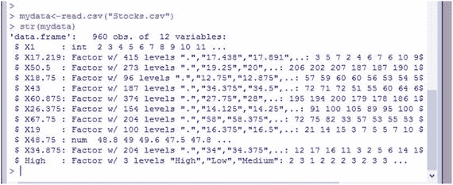

从这些 `str()` 的详细信息来看，该数据集没有变量名称。R 在列的第一个值后面附加了一个 `X` 后缀。而且几乎所有变量类型都默认定义为因子（`factor`）。此外，要查看数据的前几行，可以使用 `head()` 命令：

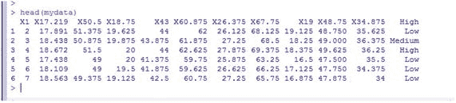

> **注意**  
> `str()` 提供活动内存中对象的摘要，`head()` 使您可以查看数据的前几行（六行）。

下一步是为每一列提供一个合适的变量名称。本示例中使用的数据集是股票价格数据集。第一列是日期，第二列到第十列是各种股票的股票价格。最后一列是当天交易量的评级（高、低或中）。

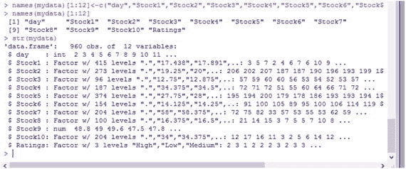

查看 `str(mydata)` 的输出，所有变量（除了 `day` 和 `Stock9`）都是 `factor()` 类型。然而，除了 `Ratings` 变量外，它们都是整数。让我们将这些变量转换为适当的数据类型：

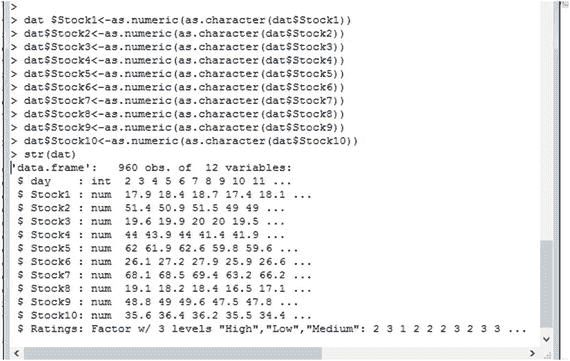

使用 `as.numeric()` 函数，变量 `Stock1`、`Stock2`、`Stock3` 等已转换为数值型数据类型。在这里，我们将 `as.numeric()` 嵌套在 `as.character()` 中。如果你将因子直接转换为数值，R 可能不会给出实际值。因此，首先将值转换为字符，然后再转换为数值。类似地，还有其他函数可用于识别和执行将一种数据类型转换为另一种类型的任务：

```r
is.numeric(), is.character(), is.vector(), is.matrix(), is.data.frame()
```

用于识别数据类型，而

```r
as.numeric(), as.character(), as.vector(), as.matrix(), as.data.frame()
```

用于将一种数据类型转换为另一种数据类型。

最后，让我们识别缺失值、垃圾字符和空值，然后清理数据集。使用 `is.na()` 函数，该表显示数据集中有 95 个缺失值（`NA`）。`table()` 函数通过交叉分类因子提供表格输出，构建因子各级别组合下计数的列联表：

```r
> table(is.na(dat))
FALSE  TRUE
11425    95
```

`complete.cases()` 函数返回一个逻辑向量，指示哪些观测是完整的（`TRUE` 或 `FALSE`）。以下示例展示了如何使用 `complete.cases()` 函数识别数据集中的缺失值（`NA`）：

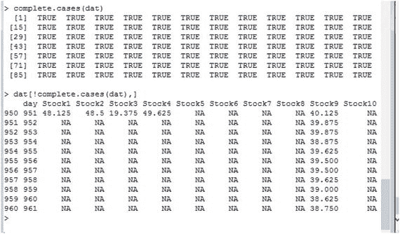

以下示例展示了如何用特定列的均值填充缺失值（`NA`）。您可以采用前几节讨论的任何其他方法。根据数据集类型，您可以使用其他方法并编写函数来执行相同操作。

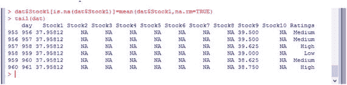

您可以使用相同的方法对其他变量重复此操作，或使用前几节讨论的任何 `apply()` 方法。

## 5.5 探索和可视化数据

拥有干净的数据集后，下一步是探索性数据分析。这是探索数据、理解数据类型、检查数据集结构和组成的过程。此外，您还需要了解单个变量的分布以及两个或多个变量之间的关系。这种探索性分析严重依赖于图表和表格的表示。通过可视化分析传达的信息易于理解且能快速吸收。因此，使用数据可视化探索数据是整体业务分析过程中最重要的部分。

图 5-2 总结了前几节描述的数据收集和数据预处理步骤，这些步骤位于数据探索和数据可视化阶段之前。

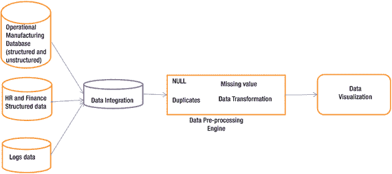

**图 5-2.** 数据可视化之前的工作流

探索性分析的目标如下：

* 确定数据集的分布和其他统计量
* 确定数据集是否需要归一化
* 确定数据集是否能回答您试图解决的业务问题
* 提出解决业务问题的蓝图

以下各节描述了进行良好数据分析所需的表格和图形。

### 5.5.1 表格

查看数据最简单、最常用的工具是表格。表格包含行和列。原始数据显示为观测行和变量列。表格适用于较小的样本集，因此如果记录很多，可能难以显示整个数据集。通过以表格形式呈现数据，您可以深入了解数据，包括数据类型、变量名称以及数据的结构方式。然而，仅通过查看表格无法识别变量之间的关系。在 R 中，我们可以使用 `View()` 命令以表格格式查看数据，如图 5-3 所示。

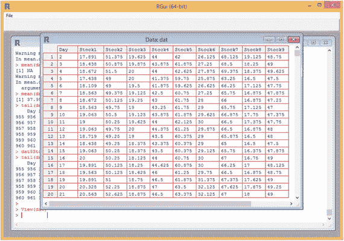

**图 5-3.** `View()` 的输出

### 5.5.2 汇总表

我们已经在第 4 章中讨论了统计量及其重要性。描述性统计提供了理解数据的常用方法。这些统计量可以表示为汇总表。汇总表显示每列的观测数以及每列的描述性统计量。常用统计量如下：

* **最小值：** 最小值
* **最大值：** 最大值
* **均值：** 平均值
* **中位数：** 中点的值
* **总和：** 组中所有观测的总和
* **标准差：** 变量相对于均值偏离的标准化度量
* **第一四分位数：** 数据集最小值与中位数之间的数
* **第三四分位数：** 数据集中位数与最大值之间的数

以下输出是我们的股票价格数据集的描述性统计量。

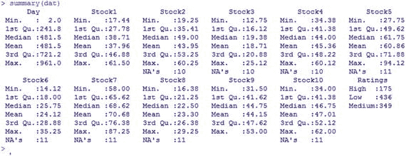

一些工具，如 Microsoft Excel 数据透视表和 Tableau，支持三维数据分析。这超出了本书的范围。

### 5.5.3 图形

图形以视觉方式表示数据，提供更多关于数据的细节，使您能够识别数据中的异常值、每个列变量的数据分布、提供数据的统计描述，并呈现两个或多个变量之间的关系。第 4 章讨论了几种用于探索数据的可视化图形。图形类型包括条形图、直方图、箱线图和散点图。此外，同时查看多个变量的图形可以提供更多数据洞察。

**单变量分析**一次分析一个变量。这是分析数据的最简单形式。您分析单个变量，汇总数据，并找出数据中的模式。您可以使用多种可视化图形进行单变量数据分析，包括条形图、饼图、箱线图和直方图。所有这些图都已在上一章中讨论过。

**直方图**表示数据的频率分布。直方图类似于条形图，但将数字分组为范围。此外，直方图允许您显示连续数据的频率分布。这有助于分析分布（例如，正态或高斯分布）、数据中的任何异常值以及偏度。图 5-4 以直方图形式描述了股票价格数据集的第一个变量。

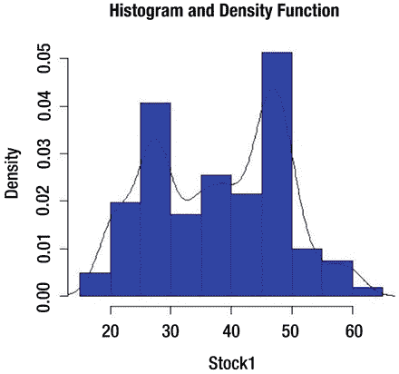

**图 5-4.** 直方图和密度函数

#### 5.5.3.1 箱线图

箱线图（或须状图）也是对数据的图形化描述。箱线图由 John W. Tukey 创建，基于五数概括显示数据集的分布：最小值、最大值、中位数、第一四分位数和第三四分位数。图 5-5 解释了如何解读箱线图及其组成部分。

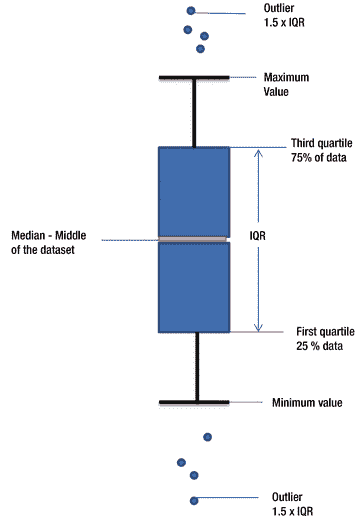

**图 5-5.** 箱线图

中央矩形跨越第一四分位数和第三四分位数（四分位距，即 IQR）。矩形内部的线表示中位数。矩形上方和下方的线（也称为须）表示数据集的最大值和最小值。

正常数据集没有异常高的最大值或异常低的最小值。异常值通常位于两条须线之外。Tukey 为异常值提供了以下定义：

* **异常值：** 高于第三四分位数 2/3 IQR 或低于第一四分位数 2/3 IQR
* **疑似异常值：** 高于第三四分位数 1.5 IQR 或低于第一四分位数 1.5 IQR

如果数据服从正态分布，则 IQR = 1.35σ，其中σ是总体标准差。

您可以在箱线图中绘制多个变量，并并排比较每个变量的数据。图 5-6 展示了一个示例。

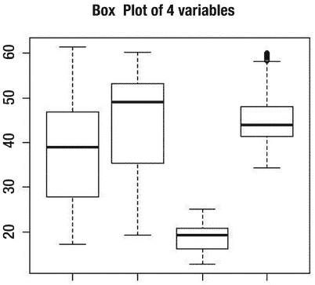

**图 5-6.** 并排箱线图

**带凹口的箱线图**看起来像带有凹口的箱线图，如图 5-7 所示。如果两个箱子的凹口不重叠，则表明“强有力的证据”表明它们的中位数不同（Chambers 等人，1983，第 62 页）。

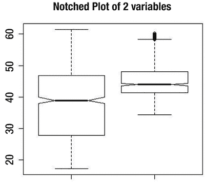

**图 5-7.** 带凹口的箱线图

双变量数据分析用于比较数据中两个变量之间的关系。双变量分析的主要目的是解释两个变量的相关性，进行比较，并根据其他变量的值推测可能存在的因果关系，以及自变量与因变量之间的关系。如果对每个观测值涉及多个变量，则应用多变量分析。

#### 5.5.3.2 散点图

双变量分析中最常用的数据可视化工具是散点图。散点图可用于识别两个连续变量之间的关系。散点图上的每个数据点都是一个单独的观测值。所有观测值都可以绘制在一张图表上。

图 5-8 展示了各公司员工数量与收入（以百万美元计）的散点图。如图所示，这两个变量之间存在着近乎线性的强相关性。然而，没有进一步的统计分析，就无法得出任何因果推论。

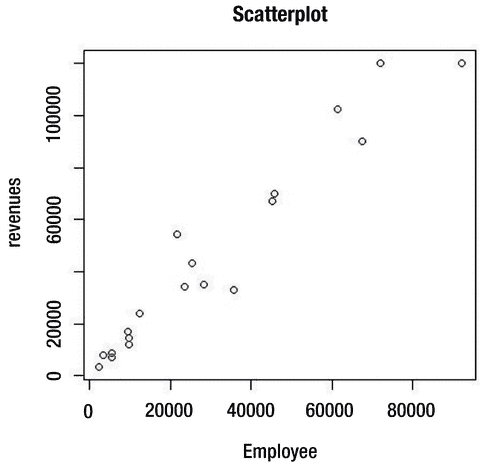

图 5-8. 员工数量与收入（以百万美元计）的散点图

不幸的是，散点图并不总是有助于发现模式或关系。如果数据点过多，散点图提供的信息就会非常有限。例如，图 5-9 没有表明随机自行车用户与注册自行车用户之间是否存在任何相关性。

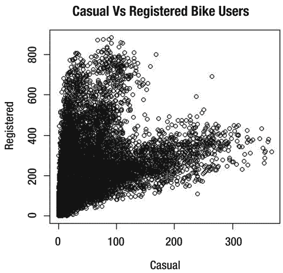

图 5-9. 注册用户 vs. 随机用户

### 5.5.4 散点图矩阵

散点图矩阵图将成对的散点图绘制在一起，以寻找数据集中的模式和关系。散点图矩阵图两两选取变量，并将数据集中所有选定变量绘制成单一图形，以便您全面了解数据集，并理解变量对之间的模式和关系。R 语言中的 `pairs()` 命令应绘制一个散点矩阵图。

您可以先使用 `read.table()` 函数从文件中读取数据，然后使用 `pairs()` 函数绘制图形：

```r
> hou<-read.table(header=TRUE,sep="\t","housing.data")
```

在此示例中，变量位于对角线上，从左上到右下（见图 5-10）。每个变量都与其他变量进行相互绘图。例如，位于 `CRM` 右侧且 `ZN` 上方的图表示以 `ZN` 为 x 轴、`CRM` 为 y 轴的图。类似地，`Age` 与 `CRM` 的图（以 `Age` 为 x 轴、`CRM` 为 y 轴）将是 `CRM` 向下第六个图，也是 `AGE` 向左第六个图。在此特定示例中，我们未看到任何变量对之间存在强相关性。

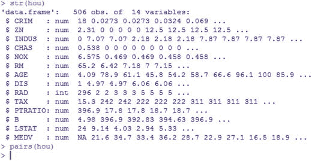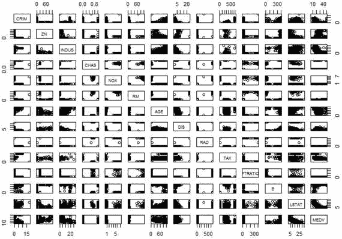

图 5-10. 散点图矩阵图

#### 5.5.4.1 格子图

格子图是一种数据可视化框架，允许您检查多个变量之间的关系。以下示例展示了波士顿住房数据集中各变量的关系。格子图可以由任何类型的图形组件（如直方图或条形图）生成。格子图基于对一个或多个变量进行分区，并与其他变量一起进行分析。对于分类变量，图形基于该变量的不同水平；而对于数值变量，数据子集则基于该变量的区间。

在波士顿住房数据集中，房屋价值是基于其房龄作为税收的一个子集来分析的。可以对其他变量执行类似的分析。简单散点图的问题在于过度绘制，这使得难以解释数据中的结构。格子图创建不同的深度和区间以使解释更清晰。在此示例中，格子图在不同区间内创建 `MEDV` 税收：`MEDV` 值从左到右增加，如图 5-11 所示，较高的税收集中在较低的房龄组中，反之亦然。

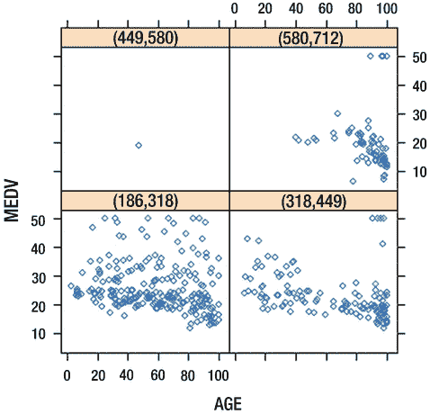

图 5-11. 格子图

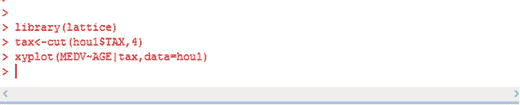

#### 5.5.4.2 相关性图

两个变量之间的相关性可以通过相关性图进行计算和绘制，如图 5-12 所示。成对的相关性可以绘制在相关性矩阵图中，以描述两个变量的相关性：

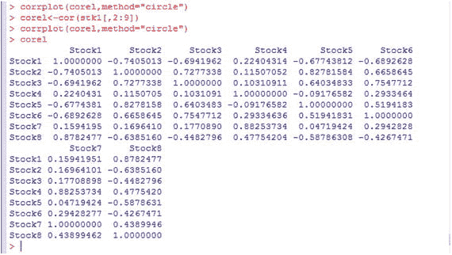

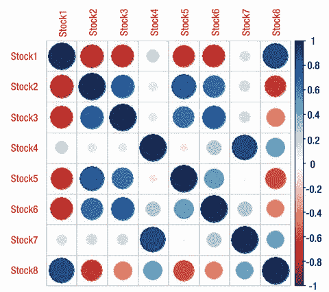

图 5-12. 相关性图

在此示例中，蓝点代表正相关，红点代表负相关。点越大，相关性越强。对角线上的点（从左上到右下）是完全正相关的，因为每个点代表每个属性与其自身的相关性。

#### 5.5.4.3 按类别划分的密度图

每个变量的密度函数可以绘制为类别的函数。与散点图矩阵类似，密度图有助于说明按类别的分离情况，并显示它们彼此重叠的紧密程度。

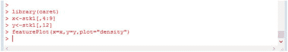

在图 5-13 所示的股票价格数据集示例中，一些股票价格重叠非常紧密，难以分离。

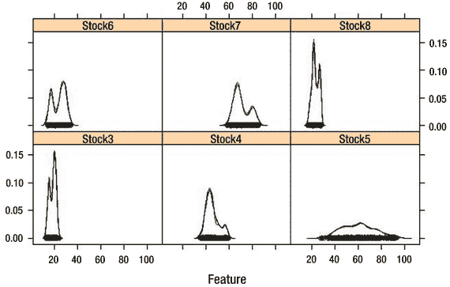

图 5-13. 密度图

上述数据可视化方法是一些最常用的方法。您可以根据业务问题和正在分析的数据来选择方法。没有一种技术被认为是标准。

### 5.5.5 数据转换

在对数据进行初步分析后，有时您可能会意识到拥有的原始数据可能无法提供良好的结果，或者看起来毫无意义。例如，数据可能存在偏斜，数据可能不符合正态分布，或者不同变量的测量尺度可能不同。在这种情况下，数据可能需要进行转换。常见的转换技术包括归一化、数据聚合和平滑。在进行转换后，在呈现分析结果之前，应应用逆转换。

#### 5.5.5.1 归一化

某些技术（如回归）假设数据呈正态分布，并且所有变量应被同等对待。有时我们为各种预测变量收集的数据可能具有不同的测量单位，这可能会影响整体方程。这可能导致一个变量对另一个变量的影响更大。在这种情况下，所有预测变量数据都被归一化到单一尺度。一些常见的归一化技术包括：

*   **Z-score 归一化（零均值归一化）**：新值基于均值和标准差创建。记录值 `A` 的新值 `A'` 通过计算以下公式进行归一化：
0>
</>
>

>
>
>
>


>
>
>
>
>

>
>
>
>

>
。>
>
>
>
>
>
>
>
>
>


>
>
>
>
>

>
>
>

>
</：
>
>
>
>
>
>
>
>
>
</</`
>
>
>
>
>
我们>
>
>
>
：
>
>
>
>


###>
>
>

：
`>
>
>
##

，

，


：

，的核心

的
。中
。
 `的


 **>


：