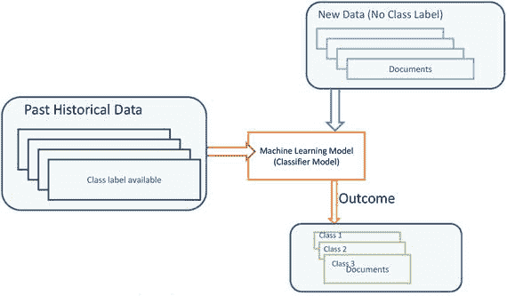
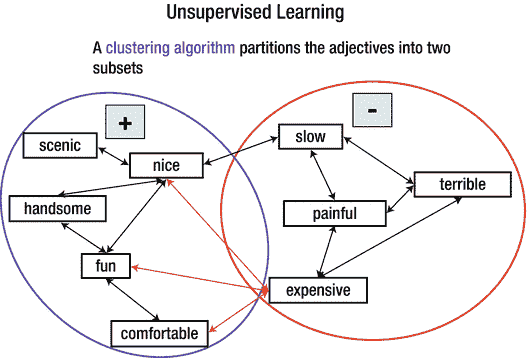
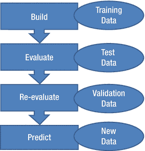
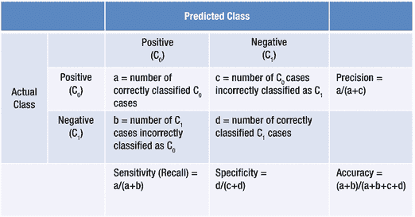
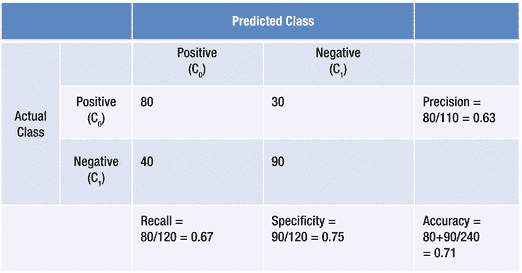

# 数据变换与分析方法

## 最小-最大归一化

在这种变换中，值被转换到指定值的范围内。最小-最大归一化对原始数据集执行线性变换。公式如下：
- 新值`A' = ((A – Min[A]) / (Max[A] – Min[A])) * (Range of A') + Min[A']`
- `Range of A' = Max[A'] – Min[A']`

最小-最大变换将值映射到由范围`[MaxA' – MinA']`定义的新值范围。例如，对于新值集在 0 和 1 之间的范围，新`Max = 1`且新`Min = 0`；旧值为 50，最小值为 12，最大值为 58，则：
`A' = ((50 – 12) / (58 – 12)) * 1 + 0 = 0.82`

## 数据聚合

有时可能需要一个新变量来更好地理解数据。你可以对其中一个或多个变量应用数学函数（如`sum()`或`average()`）来创建一组新变量。

有时，为了符合正态分布，可能需要使用`log()`函数或指数函数，或者使用 Box-Cox 变换。Box-Cox 变换的公式如下：
`A' = (A' – 1) / λ`

其中`λ`是一个大于 1 的值。

## 使用建模技术与算法

此时，你已有准备就绪的数据可进行进一步分析。根据要解决的业务问题，选择合适的方法。分析是关于解释过去和预测未来的，它结合了统计学、机器学习、数据库和人工智能的知识。

### 描述性分析

描述性分析解释数据中隐藏的模式。这些模式可以是市场细分的数量、基于区域的销售数字、基于评论的产品分组、缺陷数据库中的软件错误模式、在线游戏用户数据库中的行为模式等。这些模式完全基于历史数据。你还可以将观察结果分组到同一聚类中，这种分析称为聚类分析。

类似地，关联规则或亲和力分析可用于事务数据库，以发现百货商店中购买的商品之间的关联。此分析基于数据库中可用的过去数据进行，以查找客户购买的各种商品之间的关联。这有助于企业提供折扣、推出新产品并有效管理库存。

### 预测性分析

预测包含两种方法：分类和回归分析。

**分类**是数据分析的基本形式，其中数据被分类到多个类别。例如，信用卡可以被批准或拒绝、特定机场的航班准点或延误、潜在员工是否被录用。类别的预测基于数据中发现的先前行为或模式。分类模型的任务是从一组未见过的数据中确定数据的类别。

**回归**是预测数值变量的值，例如公司收入数字或销售数字。大多数书籍将预测称为对连续变量值的预测。然而，分类也可以被视为预测，因为分类模型预测未知类别标签的新数据的类别。用于此的技术之一是逻辑回归。

### 机器学习

机器学习是关于让计算机基于过去的历史数据学习和更好地执行任务。学习始终基于可用数据中的观察结果。重点在于让计算机基于该学习构建数学模型，并在无需人工干预的情况下自动执行任务。系统不能总是以 100%的准确率进行预测，因为学习基于可用的过去数据，并且总有可能出现机器先前从未学习过的新数据。

机器基于迭代学习来构建模型，以发现隐藏的见解。由于总可能出现新数据，因此这种迭代很重要，因为机器可以独立适应新变化。机器学习已经存在很长时间，但计算、存储和编程的最新发展、新的复杂算法以及诸如`Hadoop`这样的大数据架构，帮助其获得了发展动力。机器学习有两种类型：监督式机器学习和非监督式机器学习。

#### 监督式机器学习

顾名思义，在监督式机器学习中，机器在监督下（即借助训练数据集）构建预测模型。训练数据集是在类似于老师指导学生这样的监督下准备的。该模型基于迭代过程，当算法达到可接受的性能水平时，学习停止。分类和回归可归入监督式机器学习。

在分类问题中，输出变量通常是类别，例如“是”或“否”，或“欺诈”或“非欺诈”。在回归问题中，输出变量是一个实数值，例如“收入”或“数量”。

图 5-14 展示了监督式机器学习的工作原理。

**图 5-14.** 监督式机器学习

在此示例中，分类器模型基于训练数据集开发。该数据集有一组文档（数据），这些文档已在人工和专家监督下被手动分类并标记到不同类别中。这被称为训练数据集。分类算法（模型）基于已经具有类别标签的训练数据集进行学习。一旦学习完成，该模型即可用于对标签未知的文档（新数据）进行分类。常见的分类监督式学习算法包括支持向量机、朴素贝叶斯、k-最近邻和决策树。

#### 非监督式机器学习

在非监督式机器学习中，没有用于学习的训练数据。因此，没有要预测的目标变量。关联规则和聚类是非监督式学习的例子。在非监督式学习中，所有数据集观察结果都投入学习，结果可能是不同聚类或两个变量之间的关联。由于没有要自行识别的结果类别，因此需要进一步分析来正确理解模型的结果。

图 5-15 展示了非监督式机器学习算法的输出。基于数据集中相似的单词形成了两个聚类。这些相似性可能基于含义或其他度量。因此，进一步分析可能导致对聚类的标签化，例如标记为“+ve 词”和“-ve 词”。

**图 5-15.** 非监督式机器学习

您可以通过使用已有的数据来解决业务问题，方法包括简单的数据分析（如数据可视化）或高级技术（如预测分析）。业务问题可以通过监督式机器学习或无监督式机器学习来解决。它可以是分类问题或回归问题。根据您试图解决的业务问题，会选择不同的方法并使用不同的算法。接下来的章节将详细讨论各种分类、回归、聚类和关联技术。

所使用的技术和算法基于可用数据的性质。表 5-1 总结了变量类型以及可用于解决业务问题的重要算法。

**表 5-1.** 基于数据类型的业务分析方法

|                   | 响应变量：连续型 | 响应变量：分类型 | 无响应变量 |
| :---------------- | :--------------- | :--------------- | :--------- |
| **预测变量—连续型** | 线性回归 神经网络 `K`-近邻 (`KNN`) | 逻辑回归 `KNN` 神经网络 | 聚类分析 主成分分析 |
| **预测变量—分类型** | 线性回归 神经网络 | 决策/分类树 逻辑回归 朴素贝叶斯 | 关联规则 |

## 5.7 评估模型

评估模型性能是理解当应用新数据时预测效果好坏的关键方面。由于许多算法可用于构建模型，您可以比较每种算法的性能，并据此决定应部署哪个模型。然而，当您使用同一组数据来开发模型并评估其性能时，可能会引入偏差。为了解决这个问题，数据被划分为多个分区。一个分区用于构建模型，另一个分区用于评估模型。通常，数据集被划分为三个分区：训练集、测试集，有时还有一个额外的验证集。

### 5.7.1 训练数据分区

训练数据分区用于训练模型。结果变量的细节是已知的。对于分类问题，结果变量的类别是预先确定的，有时是通过人工干预手动创建的。例如，假设我们试图根据推特数据库来预测一部电影的情感。初始训练数据集是通过手动将每条推文标记为积极情感或消极情感类别来创建的。训练集中的数据越多，模型的性能就越好。

### 5.7.2 测试数据分区

测试数据分区是数据集中不属于训练集的一个子集。它用于评估模型对新数据的性能。这个分区有时被称为**留存分区**。模型在训练集数据和测试数据上都应表现良好。

### 5.7.3 验证数据分区

验证数据分区用于微调模型性能并减少过拟合问题。该分区可用于评估多个模型并选择最佳模型。该数据集不用于构建模型。因此，模型之前从未见过这个数据集。这有助于微调模型性能并减少过拟合。

例如，假设您总共有 1000 条记录，其中您可以使用 800 条用于训练模型，其余 200 条用于测试。

模型的性能取决于训练集（除了其他参数，如预测变量、隐藏参数和所用算法）。训练数据越多，学习和性能就越好。当模型应用于新的未见数据时，由于某些数据不在训练集中，模型性能会很差。因此，在将模型部署到实际环境之前，需要在多个测试分区中测量性能，这为改进模型性能并避免过拟合问题提供了机会。我们测试得越多，就越有可能消除数据集中的噪声并提高性能。

### 5.7.4 交叉验证

为了避免任何偏差，数据集被随机划分。当数据量有限时，为了获得无偏的性能估计，您可以使用**`k`-折交叉验证**。在`k`-折交叉验证中，您将数据分成`k`折，并使用`k – 1`折数据构建模型，最后一折用于测试。您可以重复此过程`k`次；每次测试样本都不同，每次从训练中“留出”一个子集并将其用作测试集。如果`k`等于样本大小，则称为**留一交叉验证**。

**图 5-16.** 数据分区表示模型

分类和回归是两种预测模型类型，每种都有不同的评估标准集。让我们简要看一下每种模型的各种标准。详细信息将在后续章节中讨论。

### 5.7.5 分类模型评估

#### 5.7.5.1 混淆矩阵

衡量分类器性能的最简单方法是判断错误的次数。我们称之为**误分类错误**：观测值属于一个类别，但模型将其分类为不同的类别。完美的分类器是能够毫无错误地预测类别的分类器。在现实世界中，由于“噪声”以及缺乏精确分类观测值所需的所有信息，无法构建这样的分类器。

分类矩阵，也称为**混淆矩阵**，提供了真实分类率和误分类率的估计。混淆矩阵显示了模型做出的正确分类和错误分类的数量。表 5-2 展示了一个简单的 2×2 混淆矩阵，用于两个类别（正类和负类）。一些常见的衡量指标包括：
*   **准确率**：这是一个比率，表示预测正确的数量。
*   **精确率**：正确识别的正类案例的比率。
*   **召回率（灵敏度）**：实际正类案例中被正确识别的比率。
*   **特异度**：实际负类案例中被正确识别的比率。

**表 5-2.** 混淆矩阵

表 5-3 展示了一个混淆矩阵的示例。

**表 5-3.** 分类准确率测量示例

#### 5.7.5.2 提升图

提升图通常用于营销问题。例如，假设您想确定互联网上的一个有效营销活动。您有一组案例，每个案例都被分配了一个“响应在线广告点击的概率”。提升曲线通过选择相对较小的群体并获取最多的响应者，帮助确定在线广告活动可以如何有效进行。**提升值**是一种衡量模型有效性的指标，通过计算使用模型和不使用模型情况下的比率得出。混淆矩阵是在整个人群层面上评估模型的有效性，而提升图则是评估人群的一个子集。