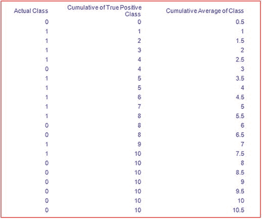
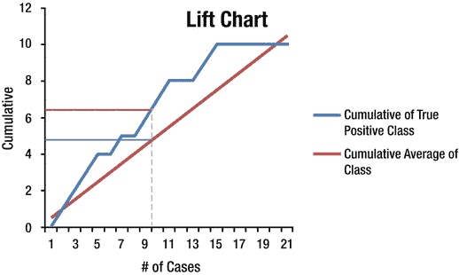
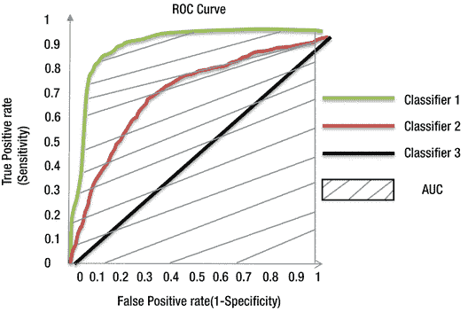

该图以案例数量为 `x` 轴，累积真正例数量为 `y` 轴构建。真正例是指被正确分类的观测值。表 5-4 展示了第一列中实际被正确预测的真正例，第二列代表真正例类别的累积平均值，第三列代表该类别的累积平均预测值。

## 表 5-4. 提升图的样本数据

提升图通过对比无模型情况下的真正例来衡量分类模型的有效性。同时，它也能表明，如果你从总体中随机选择样本，模型的表现如何。例如，在图 5-17 中，如果我们随机选择 10 个案例，我们的模型达到了 65%的准确率，而没有模型时，准确率仅为 45%。通过提升图，你可以比较不同模型在一组随机案例中的表现。

**图 5-17. 提升图**

提升值会随着我们选择的案例数量而变化。红线是一条参考线。如果我们在没有模型的情况下需要预测正类案例，那么这条线提供了一个基准。

#### 5.7.5.3 ROC 图

接收者操作特征（ROC）图类似于提升图。它是以 `y` 轴为真正例率，`x` 轴为假正例率绘制而成的图。

ROC 曲线是表示分类器性能的另一种方式。近年来，由于简单的分类准确率并不是衡量分类器性能的良好指标，ROC 已成为机器学习社区中的一种常用方法（Provost 和 Fawcett，1997；Provost 等人，1998）。ROC 曲线绘制的是真正例率（敏感度）与假正例率（特异度）的函数关系，如图 5-18 所示。

**图 5-18. ROC 图**

对于一个良好的分类器模型，敏感度率应该较高，而假正例率应该较低，如图 5-18 所示。除了仅查看混淆矩阵外，ROC 曲线的曲线下面积（AUC）为分类器性能提供了一个简单的图形表示。在示例中，我们为三个不同的模型绘制了 ROC 曲线，其中第一条线（绿色）的 AUC 最高。对于每个分类器，拟合 ROC 曲线，并在其整个操作范围内将结果与每个分类器模型进行比较。AUC 值小于 0.5 可能表明模型表现不佳，需要关注。通常，AUC 应介于 0.5 和 1.0 之间。当两个类别的分离非常完美且分布没有重叠时，ROC 曲线下的面积达到 1，理想情况下这是任何机器学习模型的目标。

研究表明，具有两个类别的算法最适合 ROC 方法。神经网络是合适分类器的一个例子，而决策树分类器则不太适合。

### 5.7.6 回归模型评估

回归模型有许多衡量其性能的标准。以下是回归模型的一些评估方法。

#### 5.7.6.1 均方根误差

回归线预测给定 `x` 值对应的 `y` 值。请注意，这些值围绕平均值分布。预测误差（称为均方根误差，或 `RSME`）由以下公式给出：

![ $$ \sqrt[\mathrm{RMSE}=]{\frac{{\displaystyle {\sum}_{k=0}^n{\left({\overset{\frown }{y}}_k-{y}_k\right)}²}}{n}} $$ ](A978-1-4842-2514-1_5_Chapter_TeX2GIF_Equa.gif)

## 5.8 提交管理报告与评审

在此阶段，需要用业务语言向业务领导者展示你的数学模型。将模型的数学输出与业务目标对齐，并能够与管理层和业务领导者沟通，这一点至关重要。一旦管理层对结果和模型感到满意，模型就可准备部署。如果需要任何更改，则重复整个周期。

通常，在展示模型及其在解决业务问题中的应用时，会涉及以下几点。

### 5.8.1 问题描述

首先，你需明确业务定义并由模型解决的问题。这很重要，因为它将组织管理与数据分析的目标重新联系起来。在此步骤中，你将重新验证要解决的精确问题。

### 5.8.2 所使用的数据集

在此，你需说明所使用的数据——包括数据的时间段、数据来源以及所使用的数据特征/字段。这一重要步骤向管理层再次确认使用了正确的数据。同时，你还需要强调所做的假设。

### 5.8.3 执行的数据清洗

在此，你需说明数据中遇到的问题。你需指出哪些不可靠的数据必须被移除，哪些必须被替换。需要提供做出这些决策的理由，以及可能存在的负面影响（如果有的话）。

### 5.8.4 创建模型所使用的方法

在此，你需介绍用于创建模型的方法、技术或算法，并阐述选择该方法的理由。你的目标是说服管理层，该方法正朝着正确的方向解决问题。同时，你还需说明模型是如何解决问题的，这包括模型是如何被评估和优化的。

### 5.8.5 模型部署先决条件

在此，你需说明模型部署的先决条件，包括数据要求和预处理要求。同时，你还需要提出模型部署的硬件和软件要求。

### 5.8.6 模型部署与使用

在此，你需说明模型将如何部署以供使用，以及最终用户将如何使用它。你可以提供报告及其解读，以说明模型使用的相关注意事项。同时，你需强调在使用模型时，不能偏离你原本应该解决的问题。

### 5.8.7 问题处理

在此，你需介绍记录所观察问题的理想流程，以及这些问题将如何被报告、分析和处理。你还需要强调，随着时间的推移，此步骤可能如何促进模型的优化，因为这些观察可能表明基本假设和结构正在发生变化。

## 5.9 部署模型

这是项目中具有挑战性的阶段。模型现在部署给最终用户，并处于生产环境中分析实时数据。根据部署场景和业务目标，模型可以执行预测分析或简单的报告生成。模型在生产环境中的表现也可能不同，因为它可能遇到与实际模型完全不同的一组数据。在这种情况下，需要重新审视模型以进行改进。

部署的成功取决于以下几点：

*   合适的硬件配置，确保所需性能
*   适当的编程以发挥硬件性能
*   适当的数据集成和清洗
*   供最终用户或最终用户系统使用的有效报告、仪表板、视图、决策和干预措施
*   对模型使用者的有效培训

以下是部署过程中观察到的典型问题：