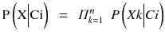
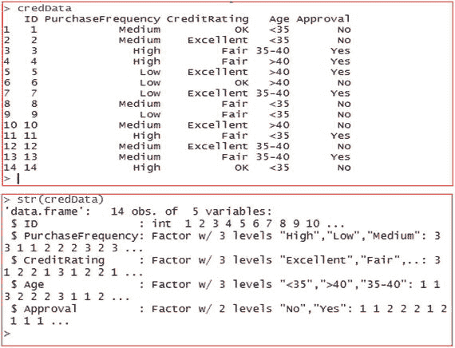
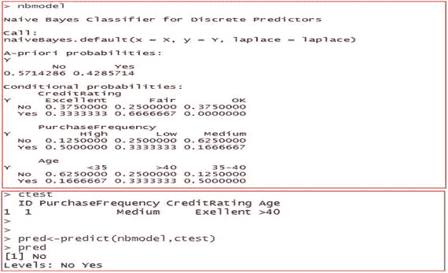

# 朴素贝叶斯分类器

在分类问题中，贝叶斯定理提供了一个公式，用于计算在给定记录属性集的情况下，该记录属于某个类别的概率。假设有 `m` 个类别 `C[1]`、`C2`、`C3`、……、`Cm`，并且已知各类别的概率 `P(C1)`、`P(C2)`、……、`P(Cm)`。如果知道每个类别中属性 `x1`、`x2`、`x3`、…… 出现的概率，那么通过使用贝叶斯定理，可以计算出该记录属于类别 `Ci` 的概率：

![$$ \mathrm{P}\left(\mathrm{Ci}\Big|{\mathrm{X}}_1,{\mathrm{X}}_2,{\mathrm{X}}_3,\dots {\mathrm{X}}_{\mathrm{p}}\right)=\frac{\mathrm{P}\left({\mathrm{X}}_1,{\mathrm{X}}_2,{\mathrm{X}}_3,\dots {\mathrm{X}}_{\mathrm{p}}\Big|{\mathrm{C}}_{\mathrm{i}}\right)\mathrm{P}\left({\mathrm{C}}_{\mathrm{i}}\right)}{\mathrm{P}\left({\mathrm{X}}_1,{\mathrm{X}}_2,\dots {\mathrm{X}}_{\mathrm{p}}\Big|{\mathrm{C}}_1\right)+\mathrm{P}\left({\mathrm{X}}_1,{\mathrm{X}}_2,\dots {\mathrm{X}}_{\mathrm{p}}\Big|{\mathrm{C}}_2\right)\dots \dots \mathrm{P}\left({\mathrm{X}}_1,{\mathrm{X}}_2,..{\mathrm{X}}_{\mathrm{p}}\Big|{\mathrm{C}}_{\mathrm{m}}\right)} $$](img/A978-1-4842-2514-1_6_Chapter_TeX2GIF_Equa.gif)

`P(Ci)` 是在没有任何其他属性的情况下，属于类别 `Ci` 的先验概率。`P(C[i]|X[i])` 是 `X[i]` 属于类别 `C[i]` 的后验概率。为了使用贝叶斯定理对一条记录进行分类，你需要计算它属于每个类别 `Ci` 的可能性。然后，根据使用上述公式计算出的最高概率得分进行分类。

对于具有多个属性的数据集，计算 `P(X|Ci)` 的计算成本极高。因此，我们做了一个朴素假设，即假定给定样本的类别标签后，每条记录相互独立。假设每个类别内的预测属性相互独立是合理的，因此我们可以简化方程：

假设每个数据样本由一个 n 维向量表示，`X = {x[1], x[2], … xn}`，样本来自 `n` 个类别值属性 `A[1], A[2], … A[n]`，具有 `m` 个类别 `C1, C2, … Cm`，则 `P(X[k]|C[i]) = n/N`，其中 `n` 是类别 `C[i]` 中属性 `A[k]` 取值为 `Xk` 的训练样本数，`N` 是属于类别 `C[i]` 的训练样本总数。

### 6.2.1 示例

我们来看一个例子，了解如何使用贝叶斯分类器预测类别标签。表 6-1 给出了银行信用卡审批过程的训练数据元组集。

**表 6-1. 样本训练集**

| ID | 购买频率 | 信用评级 | 年龄 | 类别标签：是 = 批准，否 = 拒绝 |
| --- | --- | --- | --- | --- |
|  | 中等 | 良好 | < 35 | 否 |
|  | 中等 | 优秀 | < 35 | 否 |
|  | 高 | 一般 | 35–40 | 是 |
|  | 高 | 一般 | > 40 | 是 |
|  | 低 | 优秀 | > 40 | 是 |
|  | 低 | 良好 | > 40 | 否 |
|  | 低 | 优秀 | 35–40 | 是 |
|  | 中等 | 一般 | < 35 | 否 |
|  | 低 | 一般 | < 35 | 否 |
|  | 中等 | 优秀 | > 40 | 否 |
|  | 高 | 一般 | < 35 | 是 |
|  | 中等 | 优秀 | 35–40 | 否 |
|  | 中等 | 一般 | 35–40 | 是 |
|  | 高 | 良好 | < 35 | 否 |

该训练集中的数据样本包含属性：年龄、购买频率和信用评级。类别标签属性有两个不同的类别：批准或拒绝。设 `C1` 对应批准类别，`C2` 对应拒绝类别。使用朴素贝叶斯分类器，我们要对一个未知标签的样本 `X` 进行分类：

`X = (年龄 > 40, 购买频率 = 中等, 信用评级 = 优秀)`

要对一条记录进行分类，首先通过计算训练记录中 `P(Ci|X1, X2, … Xp)` 来计算该记录属于每个类别的概率。然后根据概率最高的类别进行分类。

在这个例子中，有两个类别。我们需要计算 `P(Xi|Ci)P(Ci)`。`P(Ci)` 是每个类别的先验概率：

- `P(申请审批 = 是) = 6/14 = 0.428`
- `P(申请审批 = 否) = 8/14 = 0.571`

让我们计算 `P(X|C[i])`，其中 `i = 1, 2, …` 条件概率：

- `P(年龄 > 40 | 审批 = 是) = 2/6 = 0.333`
- `P(年龄 > 40 | 审批 = 否) = 2/8 = 0.25`
- `P(购买频率 = 中等 | 审批 = 是) = 1/6 = 0.167`
- `P(购买频率 = 中等 | 审批 = 否) = 5/8 = 0.625`
- `P(信用评级 = 优秀 | 审批 = 是) = 2/6 = 0.333`
- `P(信用评级 = 优秀 | 审批 = 否) = 3/8 = 0.375`

使用这些概率，可以得到以下结果：

- `P(X | 审批 = 是) = 0.333 × 0.167 × 0.333 = 0.0185`
- `P(X | 审批 = 否) = 0.25 × 0.625 × 0.375 = 0.0586`
- `P(X | 审批 = 是) × P(审批 = 是) = 0.29 × 0.428 = 0.0079`
- `P(X | 审批 = 否) × P(审批 = 否) = 0.586 × 0.571 = 0.03346`

朴素贝叶斯分类器预测给定的样本集 `X` 的审批结果为“否”。

### 6.2.2 使用 R 语言实现朴素贝叶斯分类器

我们尝试使用 R 语言构建模型。我们将使用相同的示例。数据样本集包含属性：年龄、购买频率和信用评级。类别标签属性有两个不同的类别：批准或拒绝。目标是预测新样本的类别标签，其中年龄 > 40，购买频率 = 中等，信用评级 = 优秀。

第一步是从文件中读取数据：

下一步是使用 `mlbench` 和 `e1071` 包构建分类器（朴素贝叶斯）模型：

对于新样本数据 `X = (年龄 > 40, 购买频率 = 中等, 信用评级 = 优秀)`，朴素贝叶斯模型预测审批结果为“否”。

### 6.2.3 朴素贝叶斯分类器的优点与局限性

朴素贝叶斯分类器是所有分类器中最简单的一种。它计算效率高，并且在独立性假设成立时能提供最佳性能。拥有的记录越多，朴素贝叶斯的性能就越好。

朴素贝叶斯分类器的主要问题在于分类模型依赖于后验概率，当某个预测类别在训练数据中不存在时，模型会假设其概率为零。如果这个属性值很重要，这可能会成为大问题。零值会导致计算出的条件概率值可能产生错误的预测。当使用计算机进行上述计算时，有时可能导致浮点错误。因此，最好通过添加概率算法来进行计算。具有最高对数概率的类别仍然是最重要的类别。如果某个特定类别在某个特定类别中没有出现，其条件概率等于 0。那么乘积就会变成 0。如果我们使用第二个方程，log(0) 是无穷大。为了避免这个问题，我们使用加一平滑或拉普拉斯平滑，即对每个计数加 1。对于数值属性，假设其服从正态分布。然而，如果我们知道该属性不是正态分布，而可能遵循其他分布，则可以使用不同的程序来计算估计值——例如，核密度估计不假设任何特定的分布。另一种可能的方法是对数据进行离散化。

尽管在现实世界中条件独立性并不成立，但朴素贝叶斯往往表现良好。

## 6.3 决策树

