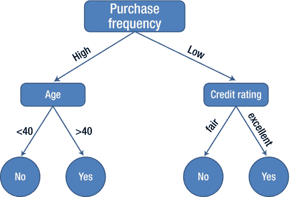
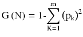
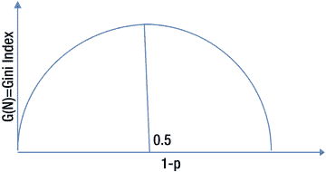
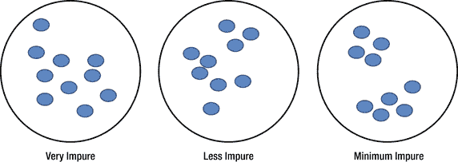

# 决策树

决策树通过树形结构构建分类模型。决策树结构由根节点、分支和叶节点组成。叶节点保存类别标签，每个分支表示决策树测试的结果，内部节点表示决策点。

图 6-1 展示了贷款审批模型的决策树。每个内部节点代表对一个属性的测试。在此示例中，决策节点是`Purchase Frequency`（购买频率），它有两个分支：`High`（高）和`Low`（低）。如果`Purchase Frequency`为`High`，则下一个决策节点是`Age`（年龄）；如果`Purchase Frequency`为`Low`，则下一个决策节点是`Credit Rating`（信用评级）。叶节点代表分类决策：`Yes`（是）或`No`（否）。这种结构称为树形结构，树中最顶层的决策节点称为根节点。使用决策树的优点在于它既能处理数值型数据，也能处理分类型数据。

图 6-1. 决策树示例

决策树具有多项优点。它不需要任何领域知识，学习和分类所涉及的步骤简单快速，并且模型易于理解。这种机器学习算法基于分治规则生成决策树。设 `x1`、`x2` 和 `x3` 为自变量；`Y` 表示因变量，属于分类变量。`X` 变量可以是连续型、二值型或序数型。决策树使用递归分割算法来构建树。第一步是选择其中一个变量 `xi` 作为根节点进行分割。根据变量的类型和取值，分割可以分为两部分或三部分。然后，通过选择下一个变量对每个部分再次进行分割。分割过程持续进行，直到达到决策类别。选定根节点变量后，创建顶层树，算法通过对每个子节点进行分割来递归执行。我们将最终的叶子称为同质的，或尽可能纯净。纯净意味着最终节点只包含一个类别；然而，这并非总能实现。此处的挑战在于选择要分割的节点，以及当存在大量待分割变量时，知道何时停止树的分割或对树进行剪枝。

### 6.3.1 递归分区决策树算法

构建决策树的基本策略是一种递归的分治方法。包含以下步骤：

1.  树从训练集的一个单一节点开始。
2.  基于信息增益或熵度量来选择节点属性或决策属性。
3.  为测试属性的每个已知值创建一个分支。
4.  此过程持续进行，直到所有属性都被考虑用于决策。

当出现以下情况时，树停止生长：

-   所有样本都属于同一类别。
-   样本中没有更多属性可供进一步分区。
-   属性分支没有对应的样本。

### 6.3.2 信息增益

为了选择决策树节点和属性来分割树，我们度量该属性提供的信息。这种度量被称为分割优劣的度量。具有最高信息增益的属性被选为要进行分割的节点的测试属性。该属性最小化了在递归分区节点中对样本进行分类所需的信息。这种分割方法最小化了分类一个对象所需的测试次数，并保证了生成一棵简单的树。许多算法使用熵来计算样本的同质性。

设 `N` 是一个由 `n` 个数据样本组成的集合。设 `k` 是类别属性，具有 `m` 个不同的类别标签 `C[i]`（其中 `i = 1, 2, 3, … m`）。

基尼不纯度指数定义如下：

其中 `p[k]` 是集合 `N` 中属于类别 `k` 的观测值的比例。当所有观测值都属于同一类别时，`G(N) = 0`；当所有类别均匀分布时，`G(N) = (m – 1) / m`。图 6-2 显示，当 `p[k] = 0.5` 时，不纯度度量达到最高。

图 6-2. 基尼指数

第二个不纯度度量是熵度量。对于包含 `n` 个样本且具有 `m` 个不同类别 `C[i]`（其中 `i = 1, … m`）的类别，在样本空间 `N` 和类别 `C[i]` 中，对样本进行分类所需的期望信息表示如下：

其中 `p[k]` 是任意一个样本属于类别 `C[i]` 的概率。

该度量的取值范围在 `0`（最纯净——所有观测值属于同一类别）和 `log2`（所有类别均匀分布）之间。对于两类情况，当 `p[k] = 0.5` 时，熵度量达到最大值。

图 6-3. 不纯度

设 `X` 为具有 `n` 个不同记录 `A = {a[1], a[2], a[3], … a[n]}` 的属性。`X` 属性可以被划分成子集 `{S[1], S[2], … S[v]}`，其中 `S[k]` 包含 `A` 的 `a[j]` 值。树是从基于每个属性提供的信息增益而选出的一个属性作为根节点开始生长的。子集对应于从这个节点生长出的分支，而该节点是 `S` 的一个子集。属性 `A` 的熵或期望信息由下式给出：

子集分区的纯度取决于熵值的大小。熵值越小，纯度越高。每个分支的信息增益基于 `X` 属性计算如下：

`Gain (A)` 是 `X` 的每个属性熵之间的差值。它是由各个属性引起的熵的期望减少量。具有最高信息增益的属性被选为给定集合 `S` 的根节点，并根据样本分区为每个属性创建分支。

### 6.3.3 决策树示例

让我们通过一个示例来说明决策树算法。表 6-2 展示了一个零售商店信用卡贷款审批过程的数据元组训练集。

表 6-2. 样本训练集

| ID | 购买频率 | 信用评级 | 年龄 | 类别标签：是 = 批准，否 = 拒绝 |
| --- | --- | --- | --- | --- |
| 1 | 中等 | 良好 | < 35 | 否 |
| 2 | 中等 | 优秀 | < 35 | 否 |
| 3 | 高 | 一般 | 35–40 | 是 |
| 4 | 高 | 一般 | > 40 | 是 |
| 5 | 低 | 优秀 | > 40 | 是 |
| 6 | 低 | 良好 | > 40 | 否 |

| 低         | 优秀 | 35–40 | 是 |
| 中         | 一般 | < 35  | 否 |
| 低         | 一般 | < 35  | 否 |
| 中         | 优秀 | > 40  | 否 |
| 高         | 一般 | < 35  | 是 |
| 中         | 优秀 | 35–40 | 否 |
| 中         | 一般 | 35–40 | 是 |
| 高         | 尚可 | < 35  | 否 |

该训练集中的数据样本包含属性 `年龄`、`购买频率` 和 `信用评级`。`类别标签` 属性有两个不同的类别： `批准` 或 `拒绝`。设 `C1` 对应类别 `批准`，`C2` 对应类别 `拒绝`。使用决策树，我们希望分类未知标签样本 `X`：

`X = (年龄 > 40, 收入 = 中等, 信用评级 = 优秀)`

## 6.3.4 决策树的归纳

在此示例中，我们有三个变量：`年龄`、`购买频率` 和 `信用评级`。为了构建树的开端，我们必须选择其中一个变量进行分裂。如何选择？基于每个属性的熵和信息增益：

贷款批准

| 是 | 否 |
|-----|----|
|     |    |

在此示例中，代表`贷款批准`的`类别标签`属性有两个值（即 `批准` 或 `拒绝`）；因此，有两个不同的类别 (`m = 2`)。`C1` 代表类别 `是`，类别 `C2` 对应 `否`。有八个 `是` 类样本和六个 `否` 类样本。为计算每个属性的信息增益，我们使用方程 [1] 来确定对给定样本进行分类所需的期望信息：

- `I (贷款批准) = I(C1, C2) = I(6,8) = – 6/14 log2 – 8/14 log2`
- `= –(0.4285 × –1.2226) – (0.5714 × –0.8074)`
- `= 0.5239 + 0.4613 = 0.9852`

接下来，计算每个属性 — `年龄`、`购买频率` 和 `信用评级` 的熵。

对于每个属性，我们需要查看 `是` 和 `否` 的分布，并计算每个分布的信息。我们从 `购买频率` 属性开始。第一步是计算每个收入类别的熵，如下所示：

- 对于 `购买频率 = 高`，`C11 = 3`，`C21 = 1`。这里，第一个下标 1 代表 `是`，第二个下标 1 代表 `购买频率 = 高`，第一个下标 2 代表 `否`。
- `I(C[11], C[21]) = I(3,1)`；`I(3,1) = – 3/4 log2 – 1/4 log2 = –(0.75 × –0.41) + (0.25 × –2)`
- `I(C[11], C[21]) = 0.3075 + 0.5 = 0.8075`
- 对于 `购买频率 = 中`
- `I(C[12], C[22]) = I (1,5) = –1/6 log(1/6) – 5/6 log(5/6) = –(0.1666 × –2.58) – (0.8333 × –0.2631) = 0.4298 + 0.2192`
- `I(C[12], C[22]) = 0.6490`
- 对于 `购买频率 = 低`
- `I (C[13], C[23]) = I (2,2) = –(0.5 × –1) – (0.5 × -1) = 1`
- 使用方程 [2]：
- `E (购买频率) = 4/14 × I(C[11], C[12]) + 6/14 × I(C[12], C[22]) + 4/14 × I(C[13], C[23])`
- `= 0.2857 × 0.8075 + 0.4286 × 0.6490 + 0.2857 × 1`
- `E(购买频率) = 0.2307 + 0.2781 + 0.2857 = 0.7945`
- 属性 `购买频率` 的信息增益计算如下：
- `增益 (购买频率) = I (C1, C2) – E(购买频率)`
- `增益 (购买频率) = 0.9852 – 0.7945 = 0.1907`
- 类似地，计算其他属性的 `增益`，`增益 (年龄)` 和 `增益 (信用评级)`。在属性中，哪个具有最高的信息增益，它就被选为该划分的根节点。同样地，为该划分中每个属性的值生成分支。决策树持续增长，直到该划分中的所有属性都被覆盖。
- 对于 `年龄 < 35`，`I (C11, C12) = I(1,5) = 0.6498`
- 对于 `年龄 > 40`，`I(C12, C22) = I (2,2) = 1`
- 对于 `年龄 35 – 40`，`I(C13, C23) = I(3,1) = 0.8113`
- `E (年龄) = 6/14 × 0.6498 + 4/14 × 1 + 4/14 × 0.8113 = 0.2785 + 0.2857 + 0.2318 = 0.7960`
- `增益 (年龄) = I (C1,C2) – E(年龄) = 0.9852 – 0.7960 = 0.1892`
- 对于 `信用评级 一般`，`I(C11, C12) = I(4,2) = -4/6 log(4/6) – 2/6 log(2/6)`
- `= -(0.6666 × -0.5851) - (0.3333 × -1.5851) = 0.3900 + 0.5283 = 0.9183`

