# 决策树与机器学习模型

## 信息增益计算

- 对于信用评级为“OK”，`I(C2, C2) = I(0, 3) = 0`
- 对于信用评级为“Excellent”，`I(C1, C3) = I(2, 3) = -2/5 log(2/5) - 3/5 log(3/5)`
- `= -(0.4 × -1.3219) - (0.6 × -0.7370) = 0.5288 + 0.4422 = 0.9710`
- `E(信用评级) = 6/14 × 0.9183 + 3/14 × 0 + 5/14 × 0.9710 = 0.3935 + 0.3467`
- `E(信用评级) = 0.7402`
- `Gain(信用评级) = I(C1, C2) - E(信用评级) = 0.9852 - 0.7402 = 0.245`

在本例中，信用评级具有最高的信息增益，因此被用作根节点，并为每个属性值生成分支。下一个树分支节点基于剩余的两个属性：年龄和购买频率。年龄和购买频率几乎具有相同的信息增益。其中任何一个都可以用作该分支的拆分节点。我们选择年龄作为该分支的拆分节点。其余分支使用剩余样本进行划分，如图 6-4 所示。对于年龄<35 的情况，决策是明确的。而对于其他年龄段，在做出贷款批准决策之前，需要查看购买频率参数。这涉及计算剩余样本的信息增益并确定下一个拆分点。

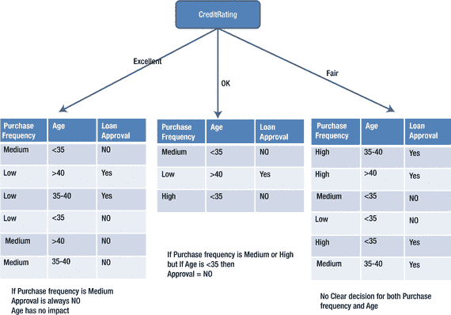
**图 6-4.** 贷款批准决策树

最终决策树如图 6-5 所示。

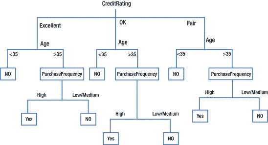
**图 6-5.** 完全生长的决策树

## 从树中提取分类规则

决策树提供了易于理解的分类规则。遍历每个树叶节点即可获得一条分类规则。对于前面的示例，最佳剪枝后的树给出了以下规则：

- **规则 1：** 如果信用评级为 Excellent，年龄>35，购买频率为 High，则贷款批准 = Yes
- **规则 2：** 如果年龄<35，信用评级 = OK，购买频率为 Low，则贷款批准 = No
- **规则 3：** 如果信用评级为 OK 或 Fair，购买频率为 High，则贷款批准 = Yes
- **规则 4：** 如果信用评级为 Excellent、OK 或 Fair，购买频率为 Low 或 Medium，且年龄>35，则贷款批准 = No

使用决策树，我们希望对一个未知标签的样本`X`进行分类：`X = (年龄 > 40, 购买频率 = Medium, 信用评级 = Excellent)`。根据上述规则，贷款批准 = No。

## 过拟合与欠拟合

在机器学习中，模型被定义为一个函数，我们将从训练数据中学习函数的过程称为归纳学习。泛化指的是模型通过将概念应用于未见过的数据来学习概念的程度。一个好的机器学习模型的目标是减少泛化误差，从而对模型从未见过的数据做出良好的预测。

过拟合和欠拟合是可能影响机器学习模型性能的两个重要因素。当模型在训练数据上表现良好但在测试数据上表现不佳时，就会发生过拟合。当模型过于简单，以至于在训练数据和测试数据上表现都不佳时，就会发生欠拟合。

如果我们拥有过多的特征，模型可能会过度拟合训练数据，因为它捕获了数据中的噪声，进而在测试数据上表现不佳。这种机器学习模型与数据拟合得过于紧密，往往会产生较大的方差。因此，泛化误差的数量更高，我们说数据发生了过拟合。

当模型未能捕获和拟合数据时，会导致性能不佳。我们将此称为欠拟合。欠拟合是模型不佳的结果，通常对任何数据都不能表现良好。

分类性能的衡量指标之一列联表。举例来说，假设你的新模型正在预测投资者是否会资助你的项目。训练数据给出的结果如表 6-3 所示。

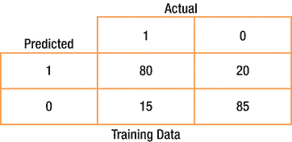
**表 6-3.** 训练样本的列联表

该模型的准确率相当高。因此我们看到该模型是一个好模型。然而，当我们用测试数据测试该模型时，结果如表 6-4 所示，错误数量更高。

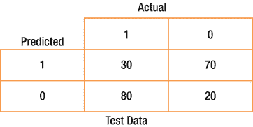
**表 6-4.** 测试样本的列联表

在这种情况下，模型在训练数据上表现良好，但在测试数据上却不然。这种虚假的自信（因为模型是从训练数据中生成的）可能会导致你承担比原本大得多的风险，并使你处于脆弱的境地。

避免过拟合的最佳方法是在完全超出训练数据范围的数据或未见过的数据上测试模型。这让你有信心你拥有一个具有代表性的样本，该样本是生产环境真实数据的一部分。除此之外，定期重新验证模型以确定模型是否在退化或需要改进，并确保其正在实现你的业务目标，也是一个好的实践。

## 偏差与方差

在监督式机器学习中，模型的目标是从训练数据中学习并进行预测。然而，学习方程本身具有影响模型的隐藏因素。因此，预测模型总是存在一个不可约的误差因子。除此之外，如果模型没有从训练集中学习，则可能导致其他预测误差。我们称这些为偏差-方差误差。

偏差通常发生在模型欠拟合且未能从训练数据中充分学习时。它是概率分布均值与实际正确值之间的差异。因此，模型的准确性对于不同的数据集（测试集和训练集）是不同的。为了减少偏差误差，数据科学家通过重新采样数据来重复模型构建过程，以获得更好的预测值。

方差是由于不同的训练样本集而导致的预测误差。理想情况下，误差不应因训练样本的不同而变化，模型应足够稳定以处理输入和输出变量之间的隐藏变化。这通常发生在过拟合的模型中。

如果偏差或方差过高，模型可能与现实相去甚远。一般来说，偏差和方差之间存在权衡。任何机器学习算法的目标都是实现低偏差和低方差，从而提供良好的预测性能。

实际上，由于模型中存在许多其他隐藏参数，很难计算真实的偏差和方差误差。尽管如此，偏差和方差提供了一种衡量标准，用于理解机器学习算法的行为，以便可以调整模型以提供良好的预测性能。

图 6-6 展示了一个示例。蓝色的大圆圈是实际值，红色的小圆圈是预测值。该图展示了方差情况下的偏差-方差示意图。

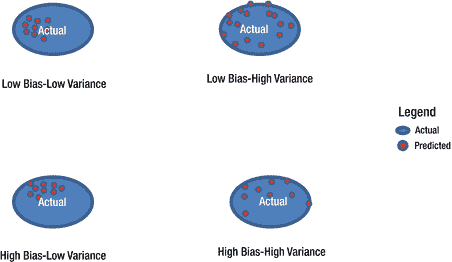
**图 6-6.** 偏差-方差

## 避免过拟合错误与设置树的大小

使用完整数据集构建一棵完全生长的树会导致数据的完全过拟合，因为每条记录和每个变量都参与了树的拟合。过拟合会导致分类器在未见过的、新的数据集上表现不佳。训练集的错误数量预计会随着树层级数的增加而减少，而对于新数据，错误会一直减少到考虑所有预测变量的某个点，此后模型会开始学习数据集中的噪声，从而整体错误开始增加，如图 6-7 所示。

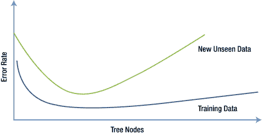
**图 6-7.** 过拟合误差

有两种限制过拟合误差的方法。一种方法是在开始时设置规则来停止树的生长。另一种方法是允许树完全生长，然后对其进行剪枝，使其达到不过拟合的程度。接下来将讨论这两种解决方案。

### 限制树的生长

停止树生长的一种方法是在模型开始过拟合数据之前，在开始时设置一些规则。虽然你可以使用多种方法（例如，识别节点中的最小记录数或最小不纯度，或减少分裂次数），但要确定一个合适的停止树生长的点并不容易。

一种流行的方法是卡方自动交互检测（CHAID），它基于一种递归分割方法，该方法又基于著名的分类与回归树（CART）算法，该算法已被市场营销应用程序等广泛使用多年。CHAID 使用著名的统计检验（卡方独立性检验）来评估分裂一个节点是否能提高节点的纯度，以及这种提高是否具有统计显著性。在每个节点分裂时，会选择与响应变量关联最强的变量，衡量指标是卡方独立性检验的`p 值`。当该检验未显示出显著关联时，树的分裂就会停止，此过程也随之终止。这种方法更适用于分类变量，但也可以通过将连续变量转换为分类区间来采用。

大多数工具都提供了选择分裂大小和剪枝方法的选项。如果你不记得卡方检验，那也没关系。然而，了解选择哪种方法、何时选择以及为什么选择它，这很重要。

### 剪枝

另一种解决方案是让树完全生长，然后进行剪枝。剪枝的目的是识别那些几乎不降低错误率的分支并将其移除。剪枝过程包括连续选择一个决策节点并将其重新指定为叶节点，从而通过减少误分类错误来缩小树的规模。剪枝过程减少了误分类错误和噪声，但同时保留了树的模式。正是在这一点上，未见数据（新数据）的错误曲线开始上升，而这也正是我们必须对树进行剪枝的点。

该方法已在多种软件包中实现，例如基于 CART（由 Leo Breiman 等人开发）的 SAS 和基于 C4.5（由 Ross Quinlan 开发）的 SPSS。在 C4.5 中，训练数据既用于生长树，也用于剪枝。

CART 方法中的回归树也可用于预测连续变量。输出变量`Y`是一个连续变量。树的构建和分裂点的识别与分类树类似，在每一层测量不纯度。其目标是创建一个用于预测连续变量值的模型。

## 其他分类器类型

决策树是一种简单的分类器，它将重要的预测变量显示为树的根节点。从用户的角度来看，决策树不需要转换变量或选择变量来分裂树的分支（这是决策树算法的一部分），甚至剪枝也可以在无需用户干预的情况下自动处理。树的构建依赖于观测值，而不是实际的数值大小；因此，决策树本质上对异常值和缺失值具有鲁棒性。此外，由于决策树生成的规则简单，因此易于理解。

然而，从计算的角度来看，构建决策树可能相对昂贵，因为需要为多个变量识别分裂点。此外，剪枝也会增加计算时间。

另一个缺点是，决策树需要大量的数据集才能构建出性能良好的分类器。它也不像判别分类器等线性分类器那样依赖预测变量之间的任何关系，因此可能导致性能较低。最近，Leo Breiman 和 Adele Cutler 引入了随机森林，这是对分类树的一种扩展，用于解决这些问题。该算法从数据集中创建多个决策树（即树森林），并优化输出以获得性能更好的分类器。

在本节中，我们将简要介绍其他流行的分类方法，包括 k-近邻（K-NN）、随机森林和神经网络。我们还将探讨何时以及在何种条件下可以使用这些分类器。

### K-近邻

k-近邻（K-NN）分类器基于在`n`维空间中学习数值属性。所有训练样本都存储在一个具有特定模式的`n`维空间中。当给出一个新样本时，K-NN 分类器会搜索最接近该样本的模式空间，并相应地标记`k`模式空间（称为 k-近邻）中的类别。“接近度”用欧几里得距离来定义，其中两点`X = (x1, x2, x3, … xn)`和`Y = (y1, y2, y3, … yn)`之间的欧几里得距离定义如下：

```
d(X, Y) = Σ (Xi - Yi)²   (对于 i=1 到 n)
```

未知样本会被分配到 k-近邻模式中最近的类别。其思想是在训练记录中查找与待分类记录相似或“接近”的记录，这些训练记录的值接近`X = (x1, x2, x3, …)`。这些记录根据“接近度”被分组到不同的类别中，未知样本将寻找由`k`定义的类别，并将自身识别为在`k`空间中最近的类别。

图 6-8 显示了一个简单的 K-NN 工作原理示例。如果要对一条新记录进行分类，它会找到与该记录最接近的匹配项，并将其标记到该类别。例如，如果它走路像鸭子，叫声像鸭子，那么它很可能就是一只鸭子。

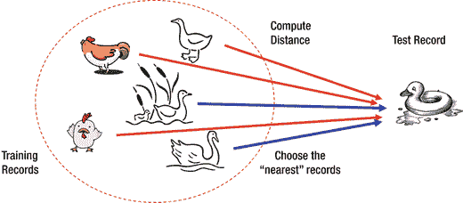
**图 6-8.** K-NN 示例

K-近邻不假设预测变量（`X`）和类别（`Y`）之间存在任何关系。相反，它基于数据集中预测变量和记录之间的相似性度量来得出类别的结论。尽管有许多可能的度量方法，但 K-NN 使用记录之间的欧几里得距离来寻找相似性，以便标记类别。请注意，在计算欧几里得距离和进行分类之前，应将预测变量标准化到共同的尺度上。

在计算出记录间的距离后，我们需要一个规则来将这些记录归入不同的类别（`k`）。较高的 `k` 值可以降低因训练集中噪声导致的过拟合风险。理想情况下，我们平衡 `k` 的值，使得误分类误差最小化。理想情况下，`k` 的值可以在 2 到 10 之间；每次我们都尝试找出误分类误差，并找到能给出最小误差的 `k` 值。

## 随机森林

决策树基于一组真/假决策规则，其预测则依赖于每个终端节点的树规则。这类似于一棵具有多个节点（对应真/假问题）的树，每个节点根据问题的答案分出两个分支。对于小规模样本训练数据，决策树会遇到过拟合问题。相比之下，随机森林模型非常适合处理小样本问题。

随机森林会创建多个深度决策树，并对其进行平均处理，这些深度决策树是在同一训练集的不同部分上训练的。随机森林的目标是克服单个树的过拟合问题。换句话说，随机森林是一种在训练时学习和构建决策树的集成方法。

随机森林由多个决策树组成（树的数量越多越好）。随机性体现在从训练集中随机选择训练子集。这种方法被称为自助聚合或装袋（bagging），这样做是为了通过稳定预测来减少过拟合。此方法也用于许多其他机器学习算法，而不仅仅局限于随机森林。

另一种随机性是从变量集合中随机选择变量。这意味着不同的树基于不同的变量集。例如，在我们之前的例子中，一棵树可能只使用收入和信用评分，而另一棵树可能使用全部三个变量。但在一个森林中，所有的树仍然会共同影响随机森林的总体预测。

随机森林具有低偏差。通过增加更多的树，我们降低了方差，从而减少了过拟合。这是随机森林的优势之一，因此它正变得越来越流行。随机森林模型对输入变量集相对稳健，并且通常无需关心数据的预处理。研究表明，它们比支持向量机（SVM）等其他模型更容易构建。

表 6-5 列出了各种类型的分类器及其优缺点。

**表 6-5. 分类算法——优缺点**

| 序号 | 分类方法 | 优点 | 缺点 |
| --- | --- | --- | --- |
| | 朴素贝叶斯 | 当独立性假设成立时，计算效率高。 | 模型依赖于后验概率。当训练数据中不存在某个预测变量类别时，模型会假定该概率，可能导致错误的预测。 |
| | 决策树 | 规则简单易懂，易于理解。不需要任何领域知识。学习和分类所涉及的步骤简单且快速。决策树无需转换变量或选择变量来分割树的分支。 | 构建决策树可能相对昂贵，并且进一步的剪枝会增加计算时间。需要大型数据集才能构建性能良好的分类器。 |
| | 最近邻 | 简单且无需参数假设。在大型训练集上表现良好。 | 查找最近邻需要时间。当预测变量数量较多时，性能会下降。 |
| | 随机森林 | 在小型和大型数据集上均表现良好。能够平衡偏差和方差，提供更好的性能。比其他高级模型（如非线性支持向量机）更容易构建。 | 如果某个变量是包含多个类别的分类变量，随机森林会偏向于具有多个类别的该变量。 |

## 使用 R 的分类示例

本示例使用学生录取数据。学生根据各种测试结果标准被划分到不同的级别，然后学校据此录取学生。数据集已经标记了不同的级别。目标是构建一个模型来预测类别。我们将使用 R 来演示这个示例。

一旦理解了业务问题，第一步就是读取数据集。数据以 CSV 格式存储。你将读取数据。下一步是了解数据的特征，看是否需要转换变量类型、处理缺失值等。之后，将数据集划分为训练集和测试集。训练集用于构建模型，测试集用于测试模型性能。你将使用决策树来构建分类模型。模型成功开发后，下一步是了解模型的性能。如果模型满足客户需求，你就可以部署该模型。否则，你可以返回并微调模型。最后，报告结果并将模型部署到实际环境中。

数据集为 CSV 格式，存储在 `grades.csv` 文件中。加载 `tree` 库并按如下方式读取文件：


探索数据以了解其特征。这里展示了 R 函数：
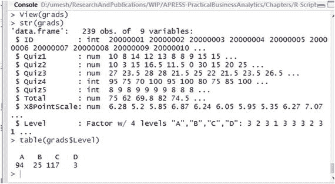

下一步是将数据集划分为训练集和测试集。共有 240 条记录。我们使用 70% 作为训练数据集，30% 作为测试数据集：
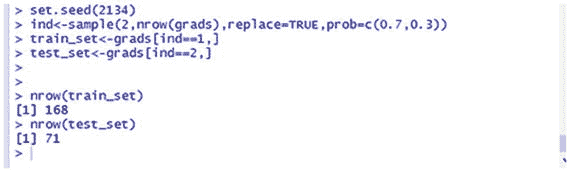

使用 `tree()` 函数构建决策树模型。各个社区为 R 贡献了大量的函数。在本示例中，我们使用流行的 `tree` 包。你也可以通过查阅相应的文档，尝试使用其他函数。
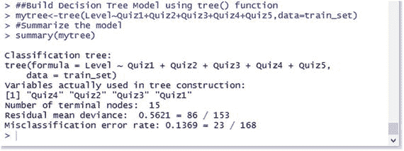

模型摘要显示，残差偏差为 0.5621，误分类误差为 13.69%。现在，绘制树结构，如图 6-9 所示。
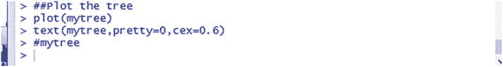
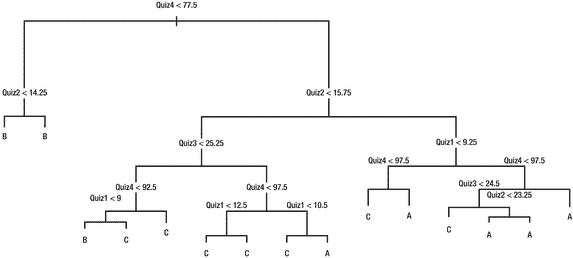
**图 6-9. 决策树结构示例图**

模型准备好后，使用测试数据集对模型进行测试。我们已经划分了测试数据集。该测试数据集不是训练集的一部分。这将帮助你了解模型的性能如何，以及是否存在过拟合或欠拟合。
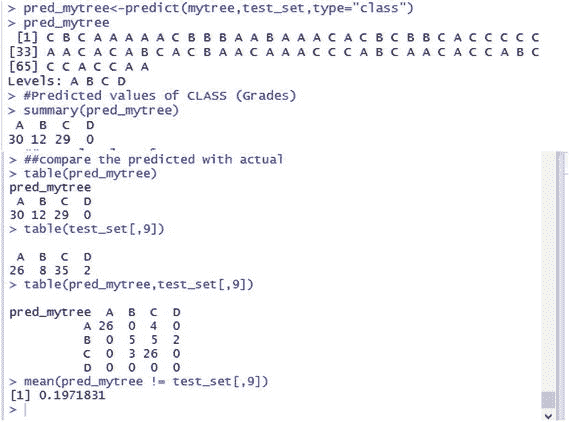

如您所见，误分类平均误差为 19.71%。尽管如此，即使面对模型从未见过的测试数据，该模型似乎仍然表现良好。让我们尝试通过剪枝树来提升模型性能，然后你将使用训练集进行操作。
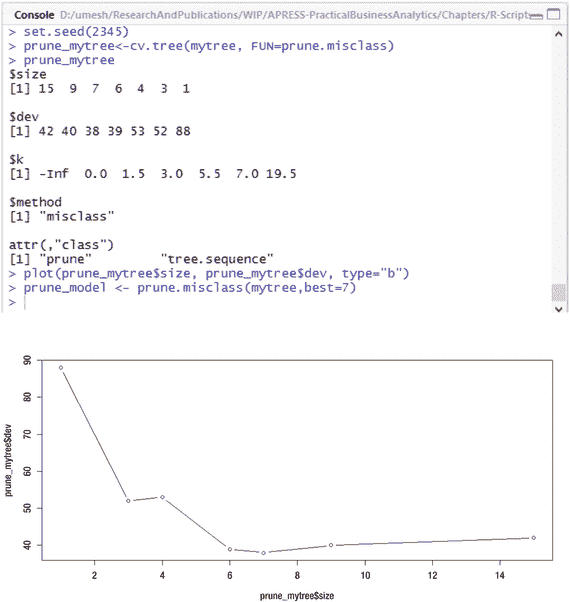
**图 6-10. 绘制偏差与规模的关系图**

通过绘制偏差与树规模的关系图，最小误差出现在规模为 7 时。让我们将树剪枝到规模 7，并重新计算预测性能（见图 6-11）。你需要重复之前的所有步骤。
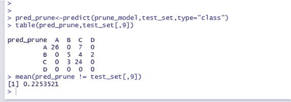
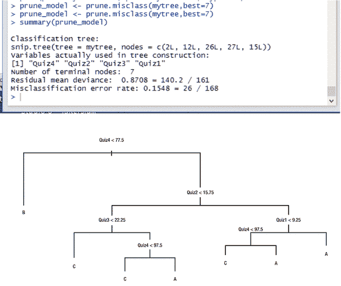
**图 6-11.**