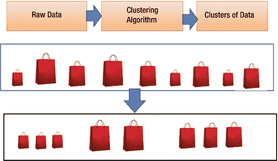
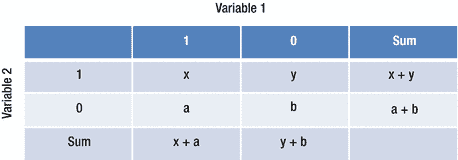
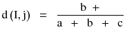
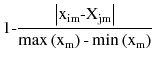
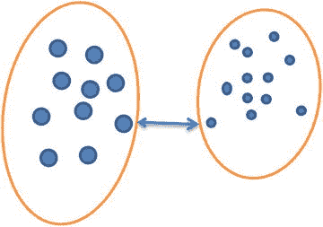
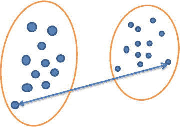
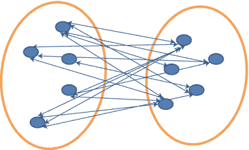
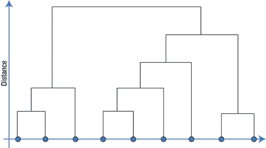

# 7. 无监督机器学习

本章探讨无监督机器学习的两个重要概念：聚类和关联规则。聚类也是探索性分析的一部分，用于理解数据及其属性，并识别存在的异常值。但其主要用途是识别数据集中隐藏的群体。关联规则则是在数据库中的大型事务数据集中寻找项目间有趣的关联或相关性。该技术广泛应用于零售行业，从事务数据库中挖掘有趣的购买模式，并有助于交叉营销、商品目录设计、产品促销及其他营销商业决策。在本章中，您将学习如何执行聚类分析、执行聚类所采用的技术以及关联规则挖掘的概念。

## 7.1 聚类概述

对数据执行聚类分析是为了识别隐藏的群体或形成不同的分类。聚类的目标是促成有意义的分析，以助力业务。聚类可以揭示数据集中先前未被发现的关联。例如，营销聚类分析可用于市场细分：基于人口统计学信息和交易历史对客户进行细分，以便制定营销策略。另一个例子是识别购买相似产品的群体。同样，您可以根据生活方式和消费支出将人们划分为不同的聚类，这样聚类分析可用于估算产品和服务的潜在需求，从而帮助制定业务和营销策略。

图 7-1. 聚类示例

尼尔森（以及早期的 Claritas）是聚类分析领域的先驱。通过其细分解决方案，尼尔森帮助定制人口统计数据，以基于区域、州、邮政编码、社区和街区来理解地理分布。这帮助该公司对群体进行了有效的命名和区分，例如“风云人物”、“快节奏家庭”、“边看足球边喝啤酒的爱好者”以及“喜欢轻松、甜口味饮品的人”。（[`www.nielsen.com/us/en/solutions/segmentation.html`](http://www.nielsen.com/us/en/solutions/segmentation.html)）。

在人力资源部门中，聚类分析可用于识别员工技能、绩效和人员流失情况。此外，您还可以根据兴趣、人口统计学信息、性别和薪资进行聚类，以帮助企业处理与人力资源相关的问题，例如员工调动、提升绩效，或为即将开展的项目招聘拥有合适技能的劳动力。

在金融领域，聚类分析有助于根据收益、波动性和市盈率等各种特征创建基于风险的组合。从不同聚类中选择股票可以构建基于风险的平衡投资组合。同样，可以根据收入与增长、市值、产品和解决方案以及全球布局来创建聚类。这些聚类可以帮助企业理解如何在市场中定位。

同样，在软件生命周期管理中，您可以根据缺陷和流程对软件开发过程的有效性进行分组。同样，您可以根据主题（如体育、科学或政治）对网络上的新闻文章进行分组。

聚类分析的目的是将数据划分为不同的组，以帮助您更好地理解全局。这一思想已被广泛应用于许多领域，包括考古学、天文学、科学、教育、医学、心理学和社会学。在生物学中，科学家们广泛使用类与子类来组织不同的物种。

接下来，你将了解聚类分析所涉及的方法和技术，以及其所面临的挑战。你还将学习如何对给定的数据集执行聚类分析。

## 7.2 什么是聚类？

在统计学中，对数据执行聚类分析是为了获得有助于理解数据特征及分布的见解。与分类不同，聚类不依赖于预定义的类别标签或训练样本。传统的聚类基于几何距离的相似性度量。对于一个包含 `n` 条记录的数据集，有两种通用的聚类方法：

- **层次方法**：包含两种算法。凝聚算法从一个包含 `n` 个聚类的状态开始，然后顺序合并相似的聚类，直到形成一个单一的聚类。分裂算法则相反：算法首先从一个单一的聚类开始，然后基于不相似性分裂成多个聚类。

- **非层次方法**：这种方法首先根据指定的数量形成聚类。该方法将记录分配到每个聚类中。由于这种方法简单且计算成本较低，它是处理非常大数据集时的首选方法。

如何衡量聚类之间的接近度或相似度？可以使用多种度量方法。以下部分描述了一些对两种聚类算法都通用的度量方法。

### 7.2.1 两个记录之间的度量

有多种方法可以衡量数据集中两个记录之间的距离或相似度。本节介绍一些常用方法。

#### 7.2.1.1 欧氏距离与曼哈顿距离

欧氏距离是最常用的度量方法。记录 `i` 和 `j` 之间的欧氏距离 `E[ij]` 定义如下：

(1)

如果为每个变量分配权重，则加权欧氏距离可以计算如下：

(2)

另一个众所周知的度量是曼哈顿（或称城市街区）距离，其定义如下：

(3)

欧氏距离和曼哈顿距离都应满足距离函数的以下数学要求：

*   `E[ij] >= 0` 且 `M[ij] >= 0`：距离是一个非负数。
*   `E[ii] = 0` 且 `M[ii] = 0`：对象到自身的距离为 0。
*   `E[ij] = E[ji]` 且 `M[ij] = M[ji]`：距离是一个对称函数。

### 7.2.1.2 皮尔逊积矩相关系数（统计度量）

有时距离是根据变量差异的程度来衡量的，而不是物理距离。这种不相似性通过两个变量 `a` 和 `b` 之间的皮尔逊系数计算如下，其中 `a` 和 `b` 是描述对象的变量，`m[a]` 和 `m[b]` 分别是 `a` 和 `b` 的均值：

![$$ \mathrm{R}\left(\mathrm{a},\mathrm{b}\right)=\frac{{\displaystyle \sum_{\mathrm{I}=1}^{\mathrm{n}}\left({\mathrm{x}}_{\mathrm{ia}}\hbox{-} {\mathrm{m}}_{\mathrm{a}}\right)\left({\mathrm{x}}_{\mathrm{ib}}\hbox{-} {\mathrm{m}}_{\mathrm{b}}\right)}}{\begin{array}{cc}\hfill \sqrt{{\displaystyle \sum_{\mathrm{I}=1}^{\mathrm{n}}{\left({\mathrm{x}}_{\mathrm{ia}}\hbox{-} {\mathrm{m}}_{\mathrm{a}}\right)}²}}\hfill & \hfill \sqrt{{\displaystyle \sum_{\mathrm{I}=1}^{\mathrm{n}}{\left({\mathrm{x}}_{\mathrm{ib}}\hbox{-} {\mathrm{m}}_{\mathrm{b}}\right)}²}}\hfill \end{array}} $$](img/A978-1-4842-2514-1_7_Chapter_TeX2GIF_Equa.gif)

此外，`x[ia]` 是第 i^(th) 个对象中 `a` 的值，`x[ib]` 是第 i^(th) 个对象中 `b` 的值。

具有高度正相关的变量意味着它们的不相似性系数接近 0，并且变量非常相似。类似地，强负相关被赋予接近 1 的不相似性系数，并且变量非常不相似。

闵可夫斯基距离代表了欧氏距离和曼哈顿距离的泛化。其定义如下：

`Min(i, j) = – ( |x[i1] – x[j1]|^q) + |x[i2] – x[j2]|^q + |x[i3] – x[j3]|^q … |x[ip] – x[jp]|^q ) ^(1/q)`

如果 `q = 1`，它代表曼哈顿距离；如果 `q = 2`，它代表欧氏距离。

### 7.2.2 分类变量的距离度量

分类变量具有两个或更多状态。用于计算简单 0 和 1 类型分类变量之间距离的度量与数值变量的度量不同。一种方法是使用简单的列联表来计算距离，如表 7-1 所示。在此示例中，我们将计算具有 0 和 1 类别（对称）的两个变量之间的距离。

**表 7-1.** 列联表

此处，`x` 是变量 1 和 2 均为类别 1 的记录总数。类似地，`b` 是变量 1 和 2 均为类别 0 的记录总数，反之亦然。所有类别的记录总数为 `a`、`b`、`x` 和 `y` 之和，表示为 `p = a + b + x + y`。

用于计算两个变量之间距离的著名度量是简单匹配系数，其定义如下：

### 7.2.3 混合数据类型的距离度量

通常，数据集包含分类变量和连续变量的组合。为了衡量这些变量之间的相似性，我们可以使用由 Ducker 等人（1965）提出，并由 Kaufman 和 Rousseeus（1990）扩展的相似性度量。该度量将变量组合成一个不相似性矩阵，将它们纳入一个共同的尺度。其定义如下：

变量 `f` 对 `i` 和 `j` 之间不相似性的贡献根据其类型计算：

1.  如果 `m` 是二元或名义变量，

    

    如果 `x[im] = x[jm]`；否则，

    

2.  如果 `m` 是基于区间的：

    

    其中 `h` 遍历变量 `m` 的所有非缺失对象。

3.  对于连续测量值，`d(ijm) =`

    

### 7.2.4 两个簇之间的距离

可以使用多种度量来找到两个簇之间的距离。最常用的度量是单链接、全链接、质心和平均链接。假设簇 `C` 包含 `m` 条记录 `C[1]`, `C[2]`, `C[3]` … `C[m]`，簇 `B` 包含 `n` 条记录 `B[1]`, `B[2]`, `B[3]` … `B[m]`。以下指标被广泛用于找到 `C` 和 `B` 簇之间的距离。

#### 7.2.4.1 单链接（最小距离）

`C[i]` 和 `B[j]` 中两对记录之间的最短距离数学表示如下：

`Min(distance(C[i], B[j]))`，其中 `i = 1, 2, 3, 4 … m`；`j = 1, 2, 3 … n`

图 7-2 展示了单链接方法。

图 7-2. 单连接

#### 7.2.4.2 全连接（最大距离）

两个簇之间的距离定义为从一个簇中各取一个点后，它们之间的最远距离（见图 7-3）。两个簇 `Ci` 和 `B[j]` 中，各自记录之间的最远距离在数学上表示为：

`Max (distance (Ci, B[j]))`，其中 `I = 1, 2, … m`；`j = 1, 2, 3 … n`

图 7-3. 全连接

#### 7.2.4.3 平均连接（平均距离）

该度量指标表示一个簇中每个点与另一个簇中每个点之间距离的平均值（见图 7-4）。一个簇中的记录与另一个簇中的记录之间的平均距离按如下公式计算：

`Average (distance(Ci, Bj))`，其中 `I =1, 2, 3 … m`；`j = 1, 2, 3 … n`

图 7-4. 平均连接

### 7.2.4.4 质心距离

质心是对该簇中所有记录求平均后得到的度量值。例如，在簇`C`中，质心`` = ``

两个簇`C`和`B`之间的质心距离为``

## 7.3 层次聚类

层次聚类具有从顶层到底层预定的顺序。例如，组织结构图或计算机硬盘上的所有文件和文件夹，都是以层级结构组织的。

层次聚类的起始阶段，将单个数据集中的每个对象视为一个独立的簇。然后，在每次迭代中，基于距离和相似性准则，一个簇会与距离最近的簇合并（凝聚），直到所有数据形成一个簇。层次凝聚聚类算法如下：

1.  从`n`个簇开始。数据集中的每条记录自身可以是一个簇。
2.  将两个最接近的案例观测值合并为一个簇。接近程度由相似性度量决定。
3.  重复步骤2，直到形成一个单一的簇。每一步中，将具有最小距离度量的两个簇合并，直到所有记录和簇被组合成一个单独的簇。这样就创建了一个簇的层次结构。

### 7.3.1 树状图

树状图展示了簇是如何在层级结构中合并的。树状图是一种树状结构，它总结了聚类过程并以图形方式展示了层级关系。相似的记录由连线连接，其垂直线的长度反映了两个记录之间的距离度量。图7-5展示了一个树状图的示例。

图7-5. 树状图展示了簇如何在层级结构中合并

### 7.3.2 层次聚类的局限性

层次聚类易于理解和解释。它不需要用户指定要形成的簇的数量。然而，它存在以下局限性：

*   对于非常大的数据集，计算和存储`n × n`矩阵可能成本高昂且速度缓慢。
*   它对异常值和缺失数据敏感。
*   稳定性较低。对数据重新排序或删除少量记录可能导致不同的聚类结果。
*   当度量指标从一个度量值更改为另一个时，结果可能会发生变化。

## 7.4 非层次聚类