# 非层次聚类

在非层次聚类中，需要预先指定聚类数量 `k[i]`，然后将每个案例分配到其中一个簇中，以使簇内的离散度最小化。其目标是将样本划分为若干预先确定的 `k` 个簇，使得这些簇在所用指标上尽可能同质。该算法旨在将 `n` 个对象划分到 `k` 个最近的均值簇中。最终结果是产生 `k` 个具有明显区别的不同簇。这同样是一种无监督的机器学习、数值型和迭代方法。每个簇中至少包含一个项目。此 K 均值聚类的目标是最小化总簇内方差，即误差平方函数：

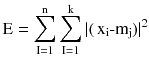

其中，`x` 是表示给定对象 `[i]` 的空间点，`m[i]` 是簇 `C` 的均值。当记录之间彼此分离良好时，该算法效果显著。

## 7.4.1 K 均值算法

用于聚类的 K 均值算法步骤如下：

1.  选择 `k`。可以是 1、2、3 或任意值。
2.  随机选择 `k` 个点作为簇质心。
3.  基于欧几里得度量，开始将对象分配到其最近的簇。
4.  计算每个簇中所有对象的质心。
5.  检查数据点与其所属簇质心的距离。如果最近，则保持不变。如果不是，则将其移动到下一个最近的簇。
6.  重复上述步骤，直到覆盖所有数据点，且没有数据点从一个簇移动到另一个簇（簇稳定）。

以下示例演示了 K 均值算法。

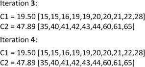

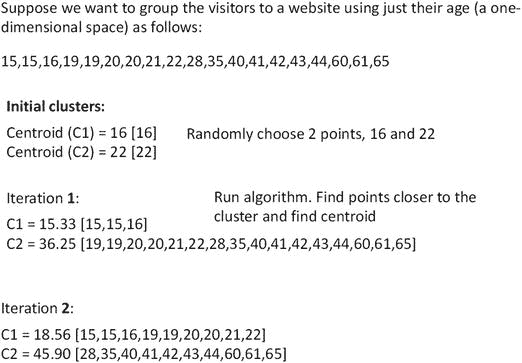

第 3 次和第 4 次迭代之间没有变化，因此算法在此阶段停止。通过使用聚类，识别出了两个群体：15–28 和 35–65。初始随机选择的簇质心会影响输出簇，因此算法会以不同的初始条件多次运行，以便公平地了解簇应有的形态。

## 7.4.2 K 均值聚类的局限性

K 均值是一种简单、相对容易且高效的方法。但是，您需要在开始时指定 `k`。不同的 `k` 值会改变结果和簇的形成。一种实用方法是比较具有不同 `k` 值的多次运行的结果，并根据预定义标准选择最佳的一个。较大的 `k` 值可能会减少误差，但可能导致过拟合。

选择初始 `k` 值受外部因素驱动，例如先验知识、实际约束或需求。如果我们不受这些因素影响，则随机选择；您可以尝试几个不同的值并比较生成的簇。在许多情况下，没有此类先验信息或知识可用，您可以使用不同的 `k` 值运行算法，然后比较结果以减少生成不良簇。在比较不同 `k` 值的簇时，目标是确保距离总和随着 `k` 值的增加而减小。

## 7.5 聚类案例研究

在本节中，我们提供了一个使用包含公寓详细信息的数据集进行聚类的示例。数据包括公寓的租金以及其它相应的变量数据，例如 `Distance_from_Airport`（距离机场距离）、`Distance_to_Downtown`（距离市中心距离）和 `Distance_to_University`（距离大学距离）。

以下是测试数据集：

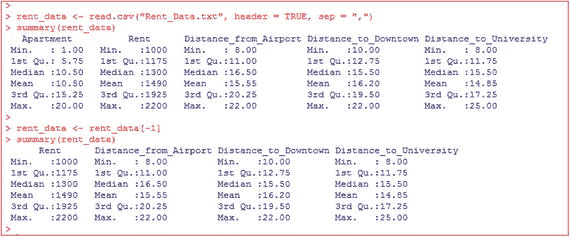

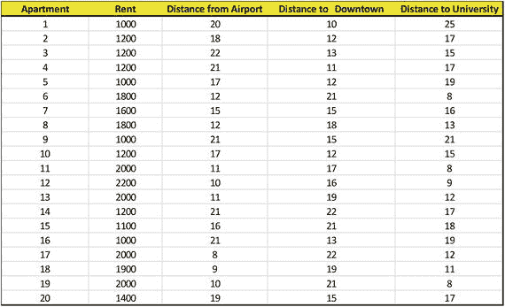

### 7.5.1 在数据集中仅保留相关变量

如前代码所示，我们移除了公寓编号，该编号对我们的分组/聚类活动没有价值。现在数据集中只剩下与租金相关的参数或变量。否则，您的起点应该是从数据集中移除无关的数据变量。在此示例中，我们希望了解基于距离机场、市中心和大学等重要地点的距离，租金有何不同或相似之处。

### 7.5.2 移除数据集中的所有离群值

由于离群值对某些算法有显著影响，我们建议在继续进行聚类过程之前移除离群值。为此，您可以安装 `outliers` 包然后使用它。您可用于进行各种离群值检验的函数之一是此包中的 `scores()` 函数。在以下代码中，我们使用 `scores()` 函数和四分位距（IQR）方法来查找离群值。我们使用 `lim = "iqr"` 来获得一个逻辑输出，该输出指示数据点是否为离群值。对于离群值，返回 `TRUE`。

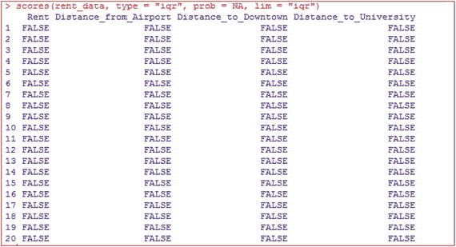

如您所见，根据 IQR 方法，我们的数据中没有离群值。

### 7.5.3 标准化数据

由于不同变量的量纲可能不同，变量的取值范围也可能彼此显著不同。如果所有变量的数据范围相似，则没有问题，我们可以按原样继续。但是，如果某个变量的范围比其他变量显著大，那么我们必须对数据进行缩放。为此，我们可以使用 `scale()` 将数据转换为标准化值。如果不缩放数据，范围最大的变量对聚类的影响会大于其他变量。从寻找正确模式的角度来看，这并不好。

现在让我们标准化我们的数据，如下所示：

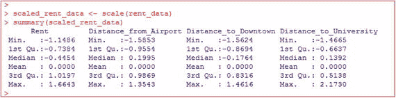

### 7.5.4 计算数据点之间的距离

聚类的工作基于计算数据点（观测值）之间的距离。数学和统计学提供了多种计算这些距离的方法，包括堪培拉、曼哈顿、欧几里得和汉明度量。欧几里得距离以著名数学家欧几里得命名，是数学中建议的方法之一。我们使用 `dist()` 函数来计算距离。

让我们对我们的数据集进行同样的操作。在 R 中执行此操作的方法如下所示，其后是数据集中的前五个观测值：

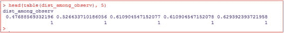

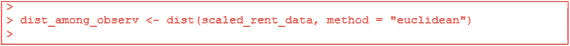

请注意，`dist()` 函数将数据集（对于缩放后的数据，使用缩放后的数据集）和 `method = "euclidean"` 作为参数。但是，`euclidean` 是默认方法，因此我们可以在前面的代码中省略 `method = "euclidean"`。对于曼哈顿距离计算，我们将使用 `method = "manhattan"` 选项；对于汉明距离，使用 `method = "binary"` 选项。

#### 7.5.4.1 使用所选方法执行聚类

正如我们提到的，当数据量小时，我们使用层次聚类方法；而当数据集非常大时，我们肯定使用划分聚类。当我们无法估计可能的聚类数量时，层次聚类方法也很有用。但对于划分聚类方法，我们需要提供所需的聚类数量作为输入。层次聚类也用于嵌套聚类。

现在让我们在数据上同时使用这两种方法。

#### 7.5.4.2 层次聚类方法

让我们从层次划分方法开始。这里我们可以选择使用不同的方法，这些方法基于簇间距离计算的方式。通常有五种方法可用：单链接法、平均链接法、全链接法、质心法和沃德法。平均法和质心法最常用，因为与其他方法相比，它们的缺点较少。

我们使用 `hclust()` 函数进行层次聚类。该函数接受从数据集中计算得到的 `distance_among_observ` 以及所选的方法。该函数的典型格式是 `cluster_fit <- hclust(distance_matrix, method = "xxx")`，其中 `cluster_fit` 是用于保存拟合后簇的输出变量名称，`xxx` 可以是 `average`、`centroid`、`complete`、`single` 或 `ward`。

现在让我们尝试使用 `average` 和 `centroid` 两种方法：

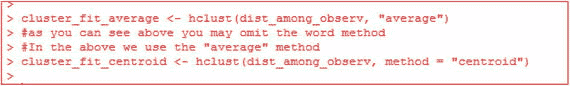

我们必须评估通过上述方法得到的 `cluster_fit`。为此，我们需要评估指标。`NbClust` 包内置了这些指标。如果你尚未安装此包，需要使用 `install.packages(NbClust)` 进行安装，然后在 R 中使用 `library(NbClust)` 命令加载它：

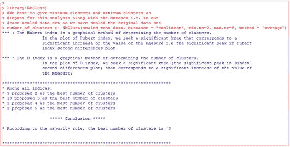

这段 R 代码显示，来自 `NbClust` 包的十个准则建议最佳簇数为三。我们假设最大簇数为五，因为我们不希望每个簇中只有一个或两个数据点。

前面的 `NbClust()` 命令也会生成相应的图表，如图 7-6 所示。

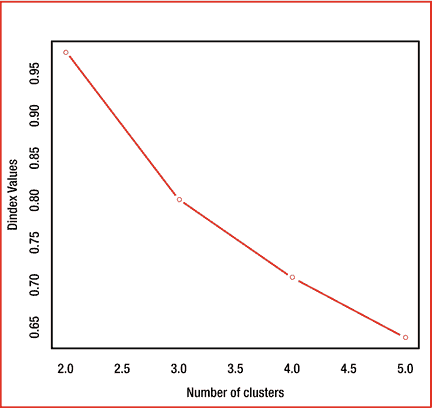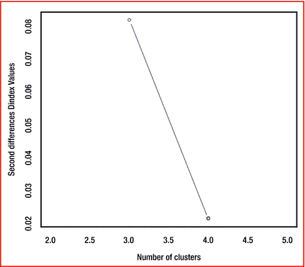

**图 7-6.** 由 `NbClust` 包中的 `NbClust()` 命令生成的图表，描绘了最佳簇数

如你所见，第一个图表显示 Dindex 值从两个簇到三个簇急剧下降；此后，随着簇数增加，Dindex 值缓慢下降。这表明三个簇是最佳选择。第二个图表清楚地显示三个簇是最佳选择，因为在这种情况下，Dindex 值的二阶差分最高。

我们现在可以使用 `plot()` 函数生成树状图，如下所示：

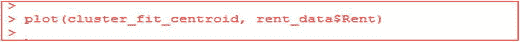

图 7-7 显示了生成的树状图。

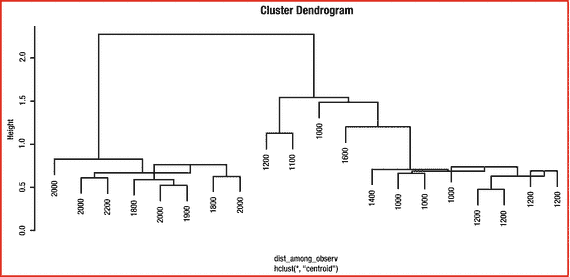

**图 7-7.** 使用 `plot` 命令生成的簇树状图

此树状图也显示了三个簇。现在让我们在使用 `rect.hclust()` 函数生成的图表上叠加矩形：

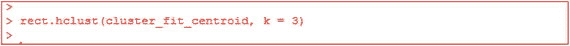

图 7-8 显示了生成的树状图。

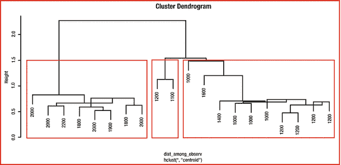

**图 7-8.** 在三个簇上叠加矩形，以便于区分它们

现在，基于前面代码确定的最佳簇数，我们得到以下带有相应数据的这些簇：

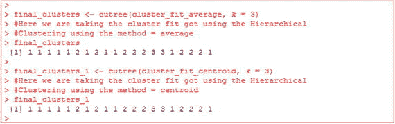

`cutree()` 函数根据我们之前得到的 `cluster_fit`，将观测值切割成指定数量的簇。数字是簇编号。如前面的代码所示，当使用平均法和质心法时，相同的观测值被划分到同一个簇中。但情况并非总是如此。我们还可以看到，簇编号 1 中有十个数据观测值，簇编号 2 中有八个数据观测值，簇编号 3 中有两个数据观测值。第 1、2、3、4、5、7、9、10、16 和 20 个数据观测值属于簇 1。第 6、8、11、12、13、17、18 和 19 个数据观测值属于簇 2。第 14 和 15 个数据观测值属于簇 3。

现在，让我们通过手动查看我们的基础数据来解读和验证这些簇：

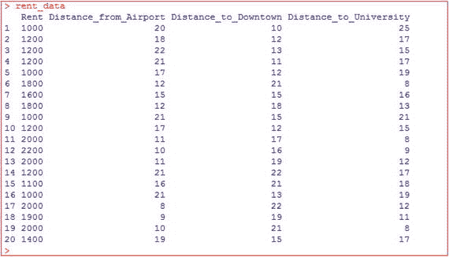

如你所见，该数据表明，当距离机场和距离大学非常短（距机场小于 12 公里，距大学小于 13 公里）且距离市中心较远（16 公里及以上）时，预计租金会很高（簇 2——1800 美元及以上）。相反，非常低的租金（簇 1）表现出距机场和大学都较远，但距市中心 <= 15 公里。第三个簇显示，当距机场和大学都较远且距市中心也更远时，租金较低。由此，我们可以发现数据得到了恰当的聚类：

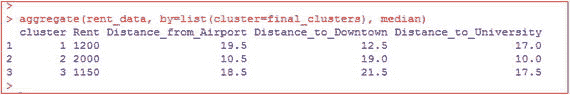

我们使用 `aggregate()` 函数来确定每个簇的中位数。前面的代码清晰地支持了我们之前的分析。我们使用中位数而非均值，因为考虑到租金是四舍五入后的值，中位数更有意义。

现在让我们使用划分聚类方法对我们的数据进行分组（或聚类）。

#### 7.5.4.3 划分聚类方法

K-means 聚类是划分聚类方法之一。在这里，我们需要提供簇数作为输入，然后数据会不断重新排列，直到得到将相似数据分组在一起的簇。K-means 聚类的一个局限性是它只能处理连续数据，不能处理因子数据。

为了找出最佳簇或最优簇数，我们可以使用相同的 `NbClust()` 函数，但将方法设置为 `kmeans`。下面展示了如何在 R 中使用此函数及其输出结果：

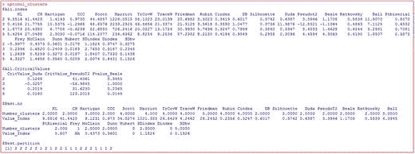

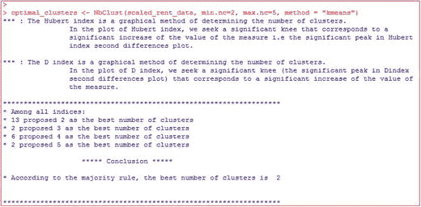

此输出显示有 13 个指标支持两个簇。

让我们看看这些簇是如何组织的。如果将其与我们之前的层次聚类进行比较，划分聚类下的第一个簇与层次聚类下的第二个簇相同。然而，层次聚类下的第一个和第三个簇被分组到划分聚类下的第二个簇中。如果我们再次查看基础数据，我们发现这是有道理的，因为第二个簇现在完全由低租金组组成，无论距离市中心多远，其距机场和距大学的距离都相对较远，而高租金组距机场和大学则较近。在这里，距市中心的距离似乎对租金没有显著影响。

另外，除了使用 `NbClust` 包中的 `NbClust()` 函数，我们还可以使用 `fpc` 包中的 `kmeansruns()` 函数来确定最佳簇。

现在，让我们使用为簇确定的最佳选项来重新分组观测值：

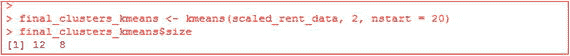

正如我们在实践中看到的，`nstart`值在 20 到 30 之间在大多数情况下效果良好。这实际上是算法在推荐最佳配置之前会尝试的初始配置。

我们现在将使用`aggregate()`函数结合中位数来确定每个簇的中位数。R 输出的结果如下所示：

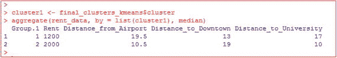

正如我们之前提到的，在讨论层次聚类时，由于数据特征的缘故（尽管从技术上讲，R 允许我们使用均值代替中位数），这里也使用中位数而非均值是更有意义的。

## 7.6 关联规则

另一种重要的无监督机器学习概念是关联规则分析，也称为亲和性分析或购物篮分析（MBA）。这种分析通常用于发现“什么商品与什么商品搭配”，并且主要用于研究客户交易数据库。关联规则提供了一种简单的分析方式，表明当某个事件发生时，另一个事件会以一定的概率发生。发现海量交易数据库记录之间的关系，有助于更好地进行营销、库存管理、产品促销、推出新产品以及其他业务决策过程。关联规则通过使用简单的 if-then 规则结构来表明关系，这些规则是根据数据计算得出的，本质上是概率性的。

典型的例子是零售营销。如果零售部门想找出哪些商品经常被一起购买，可以使用关联规则分析。这有助于商店管理库存、提供促销活动和推出新产品。这种购物篮分析还有助于零售商提前规划销售，并知道哪些商品应该降价促销。例如，这种分析可以表明购买手机的客户是否也会购买屏幕保护膜或手机壳，或者客户是否会一起购买牛奶和面包（见图 7-9）。然后这些商店可以推广手机壳，或者为购买牛奶的顾客提供促销价格的新鲜面包。这些优惠可能会鼓励顾客以优惠价格购买新产品。

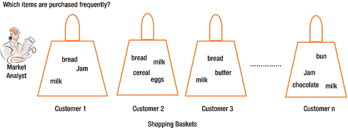

**图 7-9.** 购物篮分析

有几种算法可以生成 if-then 关联规则，但经典的算法是 Agrawal 和 Srikant（1993 年）提出的 Apriori 算法。该算法很简单。它首先从仅包含一个商品的频繁项集（一个商品项集）开始生成，然后生成包含两个经常一起购买的商品的项集（两个商品项集），接着继续生成包含三个经常一起购买的商品的项集（三个商品项集），以此类推，直到生成所有频繁项集。一旦生成了所有频繁项集的列表，就可以找出数据库中有多少个这样的频繁项集。例如，有多少个两个商品项集，有多少个三个商品项集，等等。通常，生成`n`个商品项集会用到频繁的`n-1`个商品项集，并且需要对数据库进行一次完整的扫描。因此，即使对于包含许多不同商品的大型数据库，Apriori 算法也更快。关键思想是从仅包含一个商品的频繁项集（一个商品项集）开始生成，然后递归地生成两个商品项集，接着是三个商品项集，以此类推，直到我们生成了所有尺寸的频繁项集。

## 7.6 关联规则

### 7.6.1 选择规则

一旦生成了规则，目标是找到那些表明商品之间强关联的规则，并表明集合中前项（前一个商品）和后项（下一个商品）之间的依赖关系。使用三种度量指标：支持度、置信度和提升度。

#### 7.6.1.1 支持度和置信度

项集`I`定义为商店中所有商品的集合，`I = { i[1], i[2], i[3],….i[m] }`，来自所有交易数据库`T`。每个`t[i]`是一个商品集合`t`，使得`t ε I`。为每个交易`t[i]`分配一个交易 ID。

支持度简单来说就是同时包含前项和后项项集的交易数量。它表示为数据库中总记录数的百分比。

`B --> A`，（B 跟随 A），其中`A`和`B`是项集。例如：

`{牛奶, 果酱} ➤ {巧克力}`

支持度（`S`）是同时包含`A`和`B`（前项和后项）的交易比例。

例如，数据集中两个商品项集`{面包, 果酱}`的支持度是 5 条记录，总共 10 条记录，即`(5/10) = 50%`。你可以定义一个支持度数值，并在分析中忽略其他项集。如果支持度非常低，则不值得进一步检查。

置信度（`A --> B`）是`A & B`（即前项和后项一起）的支持度与`A`的支持度之比。它表示为同时包含`A`和`B`的交易数量与包含`A`的交易数量之比：

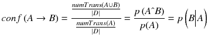

置信度值高表明存在强关联规则。但是，当`B`独立于`A`——即`p(B) = p(B | A)`——并且`p(B)`很高时，我们就会得到一个具有高置信度的规则。例如，如果`p(“买果酱”) = 85%`并且独立于“买面包”，那么规则`“买面包” ⇒ “买果酱”`的置信度将为 85%。如果几乎所有顾客都买面包，并且几乎所有顾客都买果酱，那么无论这两个商品之间是否存在关联，置信度水平都会很高。

#### 7.6.1.2 提升度

尽管支持度和置信度是显示关联规则强度的良好度量指标，但有时它们可能具有欺骗性。例如，如果前项或后项具有高支持度，即使两者独立，我们也可能得到高置信度。一个更好的度量指标是将关联规则的强度与假设后项商品在交易中发生与前项商品出现无关的情况下的置信度进行比较。

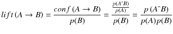

换句话说，

`提升度(A --> B) = 支持度(A & B) / [支持度(A) x 支持度(B)]`

下面的示例（`图 7-10`）展示了三种值，即支持度、置信度和提升度。对于以下的项集，我们计算支持度、置信度和提升度比率：

- 交易 1: 衬衫, 裤子, 领带, 腰带
- 交易 2: 衬衫, 腰带, 领带, 鞋子
- 交易 3: 袜子, 领带, 衬衫, 夹克
- 交易 4: 裤子, 领带, 腰带, 西装外套
- 交易 5: 裤子, 领带, 帽子, 毛衣

让我们使用定义计算上述示例的支持度、置信度和提升度。对于 `A --> B`：

- `支持度(A & B) = 频次(A & B) / N`（其中`N`是数据库中的总交易数）
- `置信度(A --> B) = 支持度(A & B) / 支持度(A) = 频次(A & B) / 频次(A)`
- `提升度(A --> B) = 支持度(A & B) / [支持度(A) x 支持度(B)]`

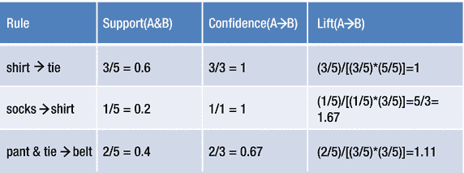

`图 7-10.` 关联规则示例

请注意，关联规则并不一定表示两个商品之间的因果关系或相关性。`A --> B`并不意味着`B`导致`A`，或者说没有因果关系，并且`A --> B`可以不同于`B --> A`，这与相关性不同。

### 7.6.2 生成关联规则的示例

`图 7-11` 中的示例演示了如何生成频繁项集。算法如下：

对于 `k` 种产品，

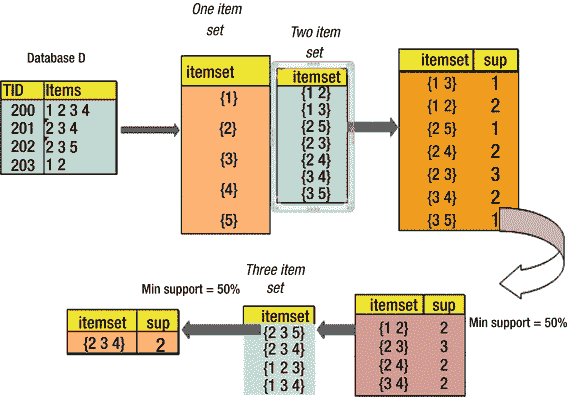

图 7-11.

生成频繁项集的示例

1.  用户设定一个最小支持度标准。
2.  生成满足支持度标准的单一项集列表。
3.  利用单一项集列表生成满足支持度标准的二项集列表。
4.  利用二项集列表生成三项集列表，依此类推。
5.  重复此过程直至生成 k 项集。
6.  根据支持度、置信度和提升度确定最终规则。

### 7.6.3 解读结果

一旦生成了频繁项集，查看支持度、置信度和提升度等不同指标是十分有用的。支持度能反映总交易情况以及它们对项集的影响。如果仅有少数交易达到最小支持度，则该规则可能被忽略。提升度衡量的是在随机选择中后项出现的强度。而置信度则提供了在数据库中找到后项的概率。低置信度意味着后项出现概率低，此时需要判断推广后项是否值得。记录越多，结论越可靠。最后，所考虑的规则越独特，解读结果就越有效。我们建议采用自上而下的方式审视规则，这种方法可以由人工进行审查，而不是通过搜索数千条规则来自动化决策。

## 7.7 本章小结

在本章中，你了解到聚类是一种用于执行数据分析的无监督技术。它也是探索性分析的一部分，用于理解数据及其属性。它可以用来识别数据中的任何离群点。然而，其主要用途是识别数据集中隐藏的群体。

关联规则则用于发现数据库中大型事务项集之间的有趣关联。你学习了如何执行聚类分析、用于执行聚类的技术，以及关联规则挖掘的概念。