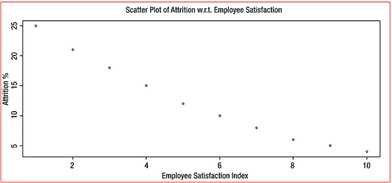
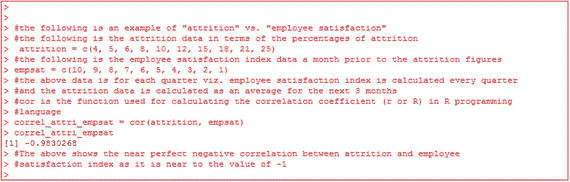
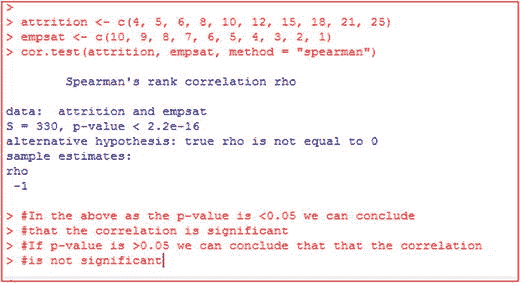

# 相关与回归

通常情况下，我们可能会发现房价与房屋面积之间存在线性关系。我们也可能看到薪资与工作经验之间存在线性关系。然而，如果我们考察降雨量与粮食产量之间的关系，粮食产量可能会随着适度或良好的降雨而增加，但如果降雨量超过良好水平并变成极端降雨，产量反而会下降。在这种情况下，降雨量与粮食产量之间的关系通常是非线性的：粮食产量最初增加，之后减少。

`回归` 是一种监督式方法，因为我们同时知道响应变量（即因变量）的确切值和自变量的相应值。这是建立模型的基础。这个基础或模型随后被用于预测响应变量的值，此时我们知道自变量的值，并想要了解响应变量的可能值。

## 8.2 相关

如先前章节所述，相关解释了两个变量之间的关系。这可能是一种因果关系，也可能不是，但它并不总是因果关系。然而，当我们知道两个变量在一系列值上的关系（即知道它们之间的相关性）时，就可以借助另一个参数来解释其中一个变量的变化。通常，两个变量之间的关系通过散点图来描绘，如先前章节所述。

`员工流失` 与员工满意度指数相关。这意味着“员工流失”与“员工满意度指数”是“相关的”。通常，员工满意度越低，员工流失率越高。这意味着员工流失与员工满意度呈负相关。换句话说，员工流失与员工满意度存在负相关，或与员工满意度呈负向关联。

通常情况下，组织的盈利能力很可能随着销售额的增长而增长。这意味着销售额越高，利润越高；销售额越低，利润越低。这里是一种正相关关系，因为盈利能力随销售额的增加而增加，随销售额的减少而减少。可以说，盈利能力与销售额呈正相关。

通常，产品缺陷越少，或问题响应速度越快，任何公司的客户满意度就会越高。在这里，客户满意度与产品缺陷呈负相关，或与产品缺陷负相关。然而，同样的客户满意度与响应速度呈直接相关或正相关。

相关解释了在另一个变量值发生单位变化时，其中一个变量的变化程度。相关在统计学中扮演着非常重要的角色，因此在商业分析领域也是如此，因为任何企业如果不了解各种对其有利或不利的因素之间的关系，就无法做出决策。

两个变量之间的强关联或强相关性使我们能够更好地根据自变量的值预测响应变量的值。然而，两个变量之间的弱关联或低相关性则无助于我们根据自变量的值预测响应变量的值。

### 8.2.1 相关系数

相关系数是一个重要的、令人关注的统计参数，它以数值形式指示两个变量之间的关系。这仅在变量之间存在线性关联时才有用。在变量之间存在非线性关联的情况下，它就不那么有用了。

计算相关系数非常简单。要计算它，我们需要以下数据：

*   自变量的所有值的平均值
*   因变量的所有值的平均值
*   自变量的所有值的标准差
*   因变量的所有值的标准差

一旦我们有了上述数据，就需要将每个变量的每个值转换为标准单位。具体操作如下：

*   `（每个值减去该变量的平均值）/（该变量的标准差）`（即 `[变量值 – 平均值(变量)] / 标准差(变量)`）。例如，如果自变量的某个特定值为 18，该自变量的平均值为 15，标准差为 3，那么该自变量的值转换为标准单位后将为 `(18 – 15)/3 = 1`。这也被称为该变量的 `z-score`。

一旦我们将每个变量的每个值都转换为标准单位，相关系数（通常表示为 `r` 或 `R`）的计算方式如下：

*   `[（以标准单位表示的自变量）x（以标准单位表示的因变量）]` 的平均值（即 `平均值[Σ(z-score of x) * (z-score of y)]`）

相关系数也可以使用以下公式求得：

`R = [协方差(自变量, 因变量) / [(自变量的标准差) x (因变量的标准差)]`

在上面的公式中，协方差 = `[每个自变量的值减去自变量平均值的总和)*(每个因变量的值减去因变量平均值的总和)] 除以 [n 减 1]`

在 R 编程语言中，相关系数的计算非常简单。在 R 中计算相关系数如图 8-1A 所示，对应的散点图如图 8-1B 所示：

**图 8-1B.** 员工满意度指数与员工流失之间的散点图

**图 8-1A.** 在 R 中计算相关系数

从图 8-1B 的散点图可以看出，尽管关系不是线性的，但它接近线性。相关系数 -0.983 也表明了这一点。如您所见，负号表示员工流失百分比与员工满意度指数之间存在反向关联或负关联。上图显示，员工满意度的恶化导致了员工流失率的上升。

此外，图 8-2 显示的检验证实，员工流失与员工满意度指数之间存在极好的统计显著相关性：

**图 8-2.** 在 R 中找出相关性显著性的检验

请注意，前述数据仅用于说明目的，可能不代表真实场景。它仅用于说明相关性。此外，在存在极端值（异常值）和像非线性关联这样的关联时，相关系数可能会非常低，并可能显示无关系或无关联。然而，变量之间可能存在真实且良好的关联。

## 8.3 假设检验

