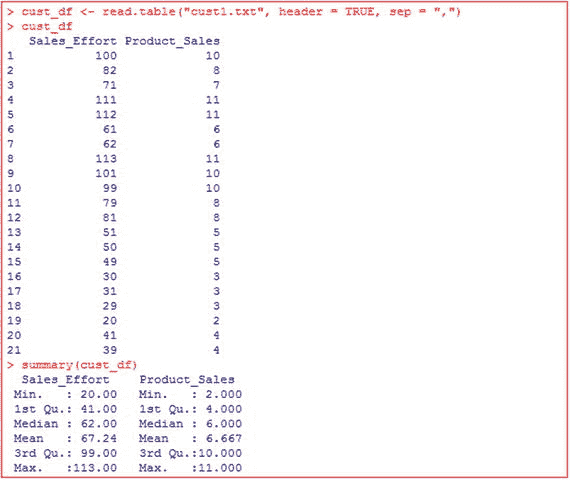

# 假设检验简介

在目前这个时间点，我们适合简要地讨论一下假设检验。这是统计学中重要的方面之一。在假设检验中，我们从一个关于一个或多个总体特定参数的断言、主张或现状开始。这个断言、主张或现状被称为“零假设”或`H[0]`。零假设的一个例子可以是如下陈述：总体 1 的总体均值等于总体 2 的总体均值。还有一个被称为备择假设或`H[1]`的陈述，它与零假设相反。在我们的例子中，备择假设指明总体 1 的总体均值与总体 2 的总体均值之间存在显著差异。通常会指定显著性水平或 I 类错误，通常为 0.05。这无非是当零假设实际为真时却被拒绝的可能性。这由符号`α`表示。`α`值越小，I 类错误的风险就越小。

然后，我们决定所需的样本量以减少错误。

我们使用检验统计量来拒绝或不拒绝零假设。当我们拒绝零假设时，意味着备择假设为真。然而，我们不能拒绝零假设并不意味着备择假设为真。它仅表明我们没有足够的证据来拒绝零假设。通常`t`值是所使用的检验统计量。

然后，我们使用数据并得出检验统计量的样本值。接着，我们根据检验统计量计算`p`值。`p`值无非是当零假设为真时，检验统计量等于或大于检验统计量样本值的概率。然后，我们将`p`值与显著性水平（即`α`）进行比较。如果`p`值小于显著性水平，则拒绝零假设。这也意味着备择假设被接受。如果`p`值大于或等于显著性水平，则我们不能拒绝零假设。

`p`值（在统计学的许多其他用途中）用于在回归分析中验证参数对模型的显著性。如果回归模型中任何参数的`p`值小于显著性水平（通常为 0.05），则我们拒绝该参数对模型无显著贡献的零假设，并接受该参数对模型有显著贡献的备择假设。如果某个参数的`p`值大于或等于显著性水平，则我们不能拒绝该参数对模型无显著贡献的零假设。我们只将在最终模型中包含那些对模型具有显著性的参数。

## 8.4 简单线性回归

正如我们在本章引言中提到的，简单线性回归描述了两个相关变量——一个响应（即因变量）变量和一个自变量——之间的线性关系，这可以通过一个回归方程来描述。当我们知道自变量的值时，这个回归方程可用于预测未知的响应变量。这是因为回归描述了其中一个变量（即响应变量）如何依赖于另一个变量（即自变量）。

需要注意的是，当需要预测响应变量的自变量位于用于创建回归方程的自变量数据范围内时，回归方程能保证正确地预测响应变量的值。在其他情况下，回归方程预测的值可能不可靠。这是因为我们不知道回归方程在我们手头并用于创建回归方程的自变量值范围之外是否仍然成立。然而，每个预测值都可能存在一些残差。并且，回归方程本身也可能有少量残差。

### 8.4.1 回归的假设

回归有四个假设。如果我们需要依赖任何回归方程，这些假设必须得到满足。它们是：

*   因变量与自变量之间存在线性关系
*   响应变量实际值与预测值之间的回归直线周围的误差具有独立性
*   误差分布的正态性
*   对于自变量的每个水平，响应变量分布的方差相等。这也被称为同方差性。

### 8.4.2 简单线性回归方程

回归线是平均值的平滑图。它本质上是针对每个自变量值的响应变量平均值的平滑处理。回归线的绘制方式使得拟合值相对于实际值的误差最小化。这种方法被称为最小二乘法，它最小化了响应变量实际值与响应变量预测值之间的平方差之和。套索回归法和岭回归法是最小二乘法的几种变体。作为最小二乘法的替代方法，我们可以使用分位数回归或最小绝对偏差等方法。简单线性回归方程采取以下形式：

```
Y1 = β0 + β1 x1
```

在上述方程中，`β[0]`被称为截距，`β[1]`被称为回归线的斜率。截距是当自变量（即`x`）值为零时响应变量的值。它描述了当`x`为零时回归线与`y`轴相交的点。斜率可以使用以下公式轻松计算：(R x 响应变量的标准差) / (自变量的标准差)。

从上述内容可以看出，当自变量的值增加一个标准差时，响应变量的值增加 R x 一个响应变量的标准差，其中`R`是相关系数。

### 8.4.3 在 R 中创建简单回归方程

在 R 中创建回归方程非常简单。我们需要使用以下函数：

*   `lm(response variable ∼ independent variable, data = dataframe name)`

让我们举一个简单的例子来理解上述命令的用法。假设销售人员的胜任能力或能力相等，并且销售仅限于单一产品，我们有一组数据，包含每个销售人员投入的努力小时数以及相应的销售额。

在图 8-3 中，我们从名为`cust1.txt`的文件中导入了一个包含 21 条记录的数据表，数据表包含`Sales_Effort`和`Product_Sales`，并将其放入名为`cust_df`的数据框中。`Sales_Effort`是销售人员在一个月的前两周投入的努力小时数，而`Product_Sales`是销售人员在同一时期完成的销售额。数据的摘要也显示在上图中。



图 8-3.


