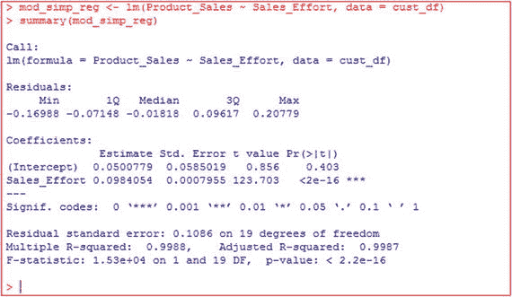
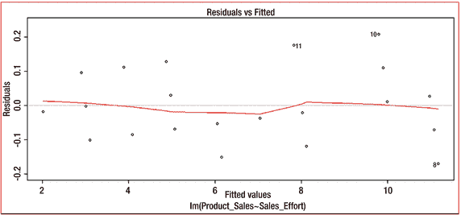
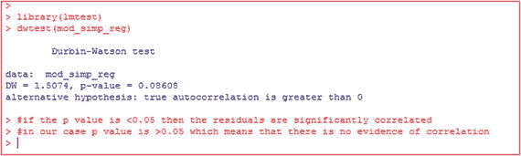
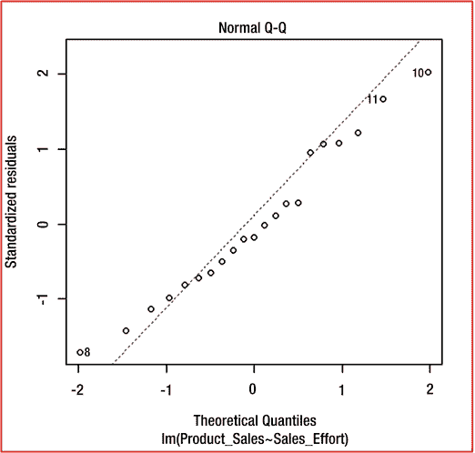
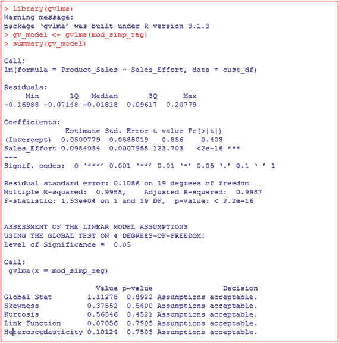
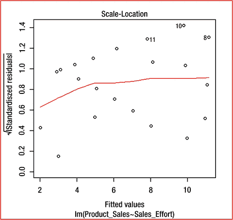
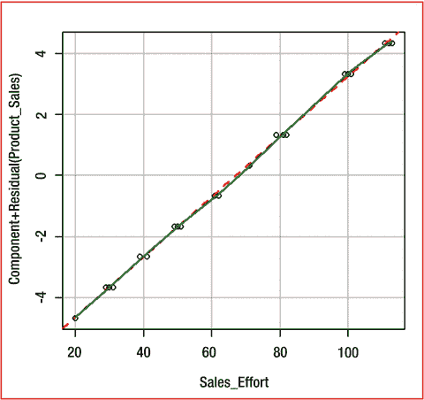
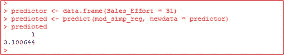
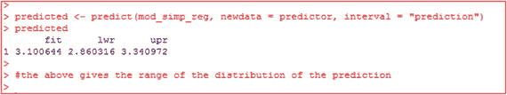
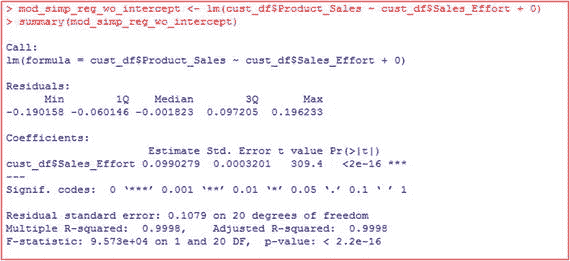

# 从文本文件创建数据框（示例数据）

在此数据中，我们可以将 `Product_Sales` 视为响应变量，将 `Sales_Effort` 视为自变量，因为产品销售额取决于销售人员付出的销售努力。

现在，我们将使用 R 语言的 `lm(响应变量 ~ 自变量, data = 数据框名称)` 命令，运行简单线性回归来对 `Product_Sales` 和 `Sales_Effort` 之间的关系进行建模。

图 8-4 展示了在 R 中运行以生成简单线性回归模型的命令以及该模型的摘要信息。生成的模型被命名为 `mod_simp_reg`，而摘要命令输出了该简单线性回归模型的详细信息。

**图 8-4.** 在 R 中生成简单线性回归模型

初始部分展示了数据框中的哪个元素与哪个其他元素进行回归，以及包含数据的数据框的名称，从而得出该模型。

残差描述了响应变量的实际值与使用回归方程预测的响应变量值之间的差异。最大残差显示为 0.20779。此处通过指定残差的最小值、最大值、中位数、第一四分位数和第三四分位数来提供残差的分布范围。在本例中，范围为 -0.16988 到 +0.20779。由于回归线和回归方程背后的原则是减少误差或这种差异，因此期望中位数值应非常接近 0。如您所见，此处中位数值为 -0.01818，几乎等于 0。预测误差可能会达到残差的最大值。由于这个值（即 0.20779）非常小，我们可以接受这个残差。

下一部分详细说明了系数信息。此处，β[0] 由截距估计值（即 0.0500779）给出，β[1] 由 `Sales_Effort` 的估计值（0.0984054）给出。因此，简单线性回归方程如下：

`Product_Sales = 0.0500779 + 0.0984054 * Sales_Effort`

系数估计值旁边的值是估计值的标准误差。这指明了估计值的不确定性。然后是标准误差的 "t" 值。它指明了系数估计值相对于不确定性的大小。下一个值是绝对 t 值大于指定值的概率，该概率由随机误差引起。理想情况下，"Pr" 或概率值（通常称为 "p 值"）应非常小（例如 0.001、0.005、0.01 或 0.05），以使响应变量与自变量之间的关系具有显著性。p 值也称为显著性值。由于此处 `Sales_Effort` 系数的误差概率非常小（即几乎接近 0）（即 <2e-16），我们拒绝该参数对模型无显著影响的原假设，并接受该参数对模型有显著影响的对立假设。因此，我们得出结论，响应变量 `Product_Sales` 与自变量 `Sales_Effort` 之间存在显著关系。每个参数 p 值旁边的星号 (*) 数量指明了显著性水平。请参考图 8-4 中模型摘要给出的"显著性代码"。

下一部分展示了与整体模型质量相关的统计量。其中包括：

- 此处指定的自由度就是数据行数减去系数个数。在我们的例子中，是 21 - 2 = 19。这是残差自由度。理想情况下，自由度数量应远大于系数数量，以避免数据对模型的过拟合。我们在其中一章中讨论过数据对模型的过拟合和欠拟合问题。我们暂时记住，过拟合是不好的。通常，根据经验法则，每个变量有 30 行数据对于训练样本来说是好的。此外，如果数据行数少于自变量个数，我们无法使用普通最小二乘法。

- 残差标准误差显示的是残差的平方和除以摘要中指定的自由度（在我们的例子中是 19）。该值是 0.1086，非常低，符合我们的要求。

- 此处显示的多元 R 方值就是相关系数的平方（即 R）。多元 R 方也称为决定系数。然而，调整后的 R 方值是 R 方经过调整以避免过拟合后的值。在此，我们再次更依赖调整后的 R 方值而非多元 R 方。调整后的 R 方值为 0.9987，非常高，表明响应变量 `Product_Sales` 与自变量 `Sales_Effort` 之间存在极好的关系。

- 最后，F 统计量基于 F 检验。与系数的情况一样，我们也希望 p 值非常小（例如 0.001、0.005、0.01、0.05），以使模型具有显著性。正如您在例子中看到的，它小于 0.001（即 <2.2e-16）。因此，该模型是显著的。在当前示例中，只有一个自变量，因此此 p 值与该自变量的 p 值相同。

如上所述，响应变量 `Product_Sales` 与自变量 `Sales_Effort` 之间似乎存在极好的关联。

### 8.4.4 检验回归假设

在接受该模型可用之前，必须验证回归假设对于拟合模型是否成立。

#### 8.4.4.1 线性检验

为了检验线性，我们将残差与自变量的相应值进行绘图。图 8-5 展示了这一点。

**图 8-5.** 用于检验线性的残差与拟合值图

为了使模型通过线性检验，残差的分布不应有任何模式，并且它们应随机分布在 0.0 残差线周围。也就是说，残差将围绕响应变量值的平均值随机变化。在我们的例子中，正如我们所见，残差的分布没有模式。因此，它通过了线性条件。

#### 8.4.4.2 回归线周围误差独立性的检验

当数据在同一时间段内收集时，不需要进行此检验。在我们的例子中，数据是在相同的两周时间段内收集的，因此不需要进行此检验。此检验主要用于检查自相关性，自相关性是在不同时间段收集数据时引入的。此外，如前面的图（在线性检验中使用的图）所示，残差是随机分布在响应变量平均值周围的。如果我们需要检验自相关性，可以使用德宾-沃森检验，如图 8-6 所示。

**图 8-6.** R 中用于检验自相关性的德宾-沃森检验

在 Durbin-Watson 检验中，零假设（即`H[0]`）为不存在自相关，备择假设（即`H[1]`）为存在自相关。若`p-value` < 0.05，则拒绝零假设，即认为存在自相关。在上述情况下，`p-value`大于 0.05，这意味着没有证据拒绝“不存在自相关”的零假设。因此，关于回归线误差独立性的检验通过。或者，你可以使用`library(car)`中的`durbinWatsonTest()`函数进行此检验。

#### 8.4.4.3 正态性检验

根据该检验，残差应服从正态分布。为了验证这一点，我们将查看正态 Q-Q 图（使用`plot(model name)`命令创建）：

图 8-7 显示，在上述正态 Q-Q 图中，残差点几乎落在直线上。这表明残差服从正态分布。因此，残差的正态性检验通过。

图 8-7。使用正态 Q-Q 图检验“正态性”假设

#### 8.4.4.4 响应变量分布的方差齐性

我们可以使用与检验线性关系时相同的残差图。从该图（如上文线性关系检验部分所示）可以看出，对于自变量的不同取值水平，残差的变异没有显著差异。因此，我们认为该检验通过。

#### 8.4.4.5 验证回归模型需满足假设的其他方法

除了前面提到的方法之外，还有许多其他方法可以验证回归模型是否满足回归假设。

##### 8.4.4.5.1 使用 `gvlma` 库

另一个验证回归模型是否满足回归假设的简便方法是使用`library(gvlma)`，它可以验证回归模型的相关假设，并评估其他相关方面，如偏度、峰度、链接函数和异方差性。

图 8-8 展示了如何使用该库以及 R 的输出结果。

图 8-8。使用 `gvlma()` 函数验证模型假设

在图 8-8 中，我们给出了 R 中`gvlma()`函数对模型的输出结果。`Global Stat`行清楚地表明，与该回归模型相关的假设是可接受的。这里，我们需要检查`p-value`是否大于 0.05。如果`p-value`大于 0.05，我们可以安全地得出结论，如上所示，假设已得到验证。如果`p-value`小于 0.05，则需要重新审视回归模型。

##### 8.4.4.5.2 使用尺度-位置图

尺度-位置图是使用`plot(regression model name)`命令生成的图形之一。在我们的例子中，该命令是`plot(mod_simp_reg)`。图 8-9 展示了该图形。

图 8-9。在 R 中生成的用于验证方差齐性的尺度-位置图

在图 8-9 中，由于点以随机方式分布在近乎水平的直线周围，这向我们保证了常数方差（或方差齐性）的假设成立。

##### 8.4.4.5.3 使用 `library(car)` 中的 `crPlots(model name)` 函数

我们可以使用`crPlots(mod_simp_reg)`命令来理解模型所代表关系的线性关系。非线性关系要求我们重新探索模型。图 8-10 中的图表显示，我们如上创建的模型（即`mod_simp_reg`）是线性的。

图 8-10。使用 `crPlots()` 函数验证线性假设的图形

### 8.4.5 结论

如上所述，使用 R 函数`lm(response variable ∼ independent variable, data = dataframe name)`拟合的简单线性回归模型，该模型代表了简单线性回归方程，即`Product_Sales [i] = 0.0500779 + 0.0984054 Sales_Effort [i]`，是一个良好的模型，因为它也通过了验证回归假设的检验。这里需要提醒的是，有多种方式可以创建和验证回归方程。

### 8.4.6 预测响应变量

拟合的模型不仅解释了两个变量（即响应变量和自变量）之间的关系，还提供了一种机制，可以根据新的自变量的值来预测响应变量的值。这如图 8-11 所示。

图 8-11。在新数据集上使用模型进行预测

这是通过使用函数`predict(model name, newdata)`完成的，其中`model name`是从输入数据获得的模型名称，`newdata`包含需要预测响应变量的自变量数据。

可以得出一个预测区间，该区间指定了预测值的分布范围，如图 8-12 所示，通过在`predict()`函数中添加参数`interval = "prediction"`来实现。默认情况下，它使用 0.95 作为置信区间。

图 8-12。使用 `predict()` 函数计算预测区间

### 8.4.7 补充说明

从上面拟合的模型中可以看出，截距不为零，而是 0.0500779，而实际上当没有销售努力时，理想情况下应该没有销售额。但是，情况可能并非如此；可能因为其他途径（如广告、网站等）存在一些随机进店销售。同样，不可能有像 3.1 这样的部分产品销售。然而，所投入的销售努力可能会使销售人员部分地走向下一次潜在销售。如果我们有兴趣得出一个无截距的模型（即当没有销售努力时产品销售额为零），那么我们可以通过将截距强制设为零值来实现，如图 8-13 所示。

图 8-13。生成无截距的简单线性回归模型

然而，如果我们必须相信并使用这个模型，我们必须验证回归其他假设的满足情况。

## 8.5 章节总结

*   你通过一些例子了解了各个方面/因素之间的关系如何影响、决定或影响其他方面/因素。理解这些关系不仅有助于我们理解相关因素可能发生的变化，也有助于预测其他因素的值。你了解了回归模型或回归方程如何解释响应变量与自变量之间的关系。你还了解了线性或非线性关系，以及简单回归和多元回归。

*   你通过示例探索了相关性的概念。你探索了相关性、强相关性、正相关性、负相关性等的用途。你还了解了如何计算相关系数（`R`）。

