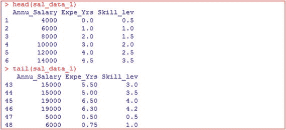
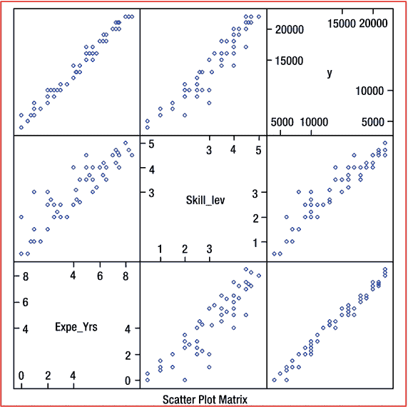
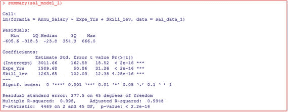
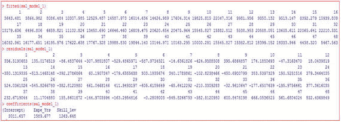
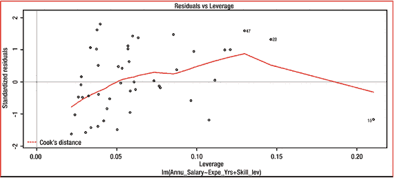
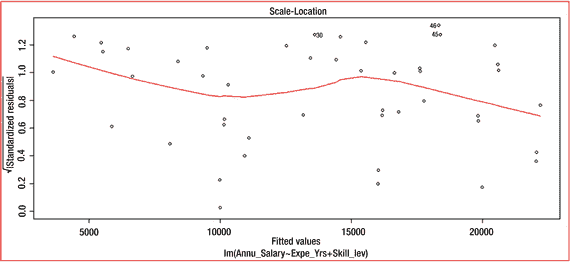
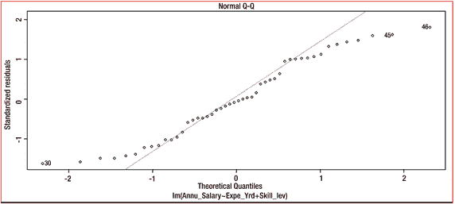
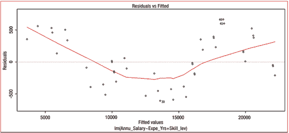
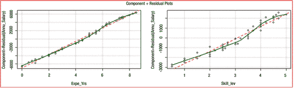
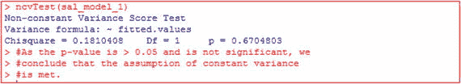

# 多元线性回归示例

为了演示多元线性回归，我们使用包含三个变量的数据：年薪、工作年限（年）和技能水平。这些是印度的薪资数据，但为了简便，我们已将其转换为美元并四舍五入为千美元。此外，我们未限制用户以小数形式评估和分配技能水平。因此，在此数据背景下，即使技能水平也以连续数据表示。这是合理的，因为在一个拥有数百名员工的组织中，将所有员工划分为例如五个等级并不公平，但通过诸如 4.5、3.5、2.5、0.5 和 1.5 等技能水平来区分他们则更好。在此数据集中，所有变量均为连续变量。

此处，我们从 CSV 文件`sal1.txt`中将数据导入到数据框`sal_data_1`中：

如果对数据使用`head()`和`tail()`函数，你将了解数据的概貌，如下所示：

请注意，我们未展示所有数据，因为该数据集包含 48 条记录。此外，此数据仅供说明之用，可能不代表真实场景。数据是在某个时间点收集的。

### 9.1.2 相关性

我们在第 8 章中解释了相关性。相关性指明了一个变量与另一个变量的关联方式。在 R 中使用`cor()`函数可以轻松完成此操作。

这三个变量（年薪、工作年限、技能水平）之间的相关性如下所示：

如你所见，年薪与工作年限之间存在约 0.9888 的非常高的相关性。类似地，年薪与技能水平之间存在约 0.9414 的非常高的相关性。此外，工作年限与技能水平之间存在约 0.8923 的非常高的相关性。每个变量与其他变量高度相关。

通过使用 R 命令可视地生成两对变量之间的关系，如下所示：

此处，我们使用了`caret`包和`featurePlot()`函数。响应变量绘制为 y，预测变量绘制为 x。

通过此命令生成的变量之间关系的可视化结果如图 9-1 所示。

**图 9-1.** 生成的散点图矩阵

### 9.1.3 得出模型

现在，让我们使用 R 的`lm()`函数创建多元线性回归模型。首先，我们使用所有参数生成模型，因为它们与作为响应（或因）变量的年薪高度相关，而我们希望稍后使用此模型根据该模型预测或设定薪资。其他变量——工作年限和技能水平——将作为预测（或自）变量。在 R 中生成多元线性回归模型的命令如下所示：

使用`lm()`函数创建的模型及其摘要（使用`summary(model name)`生成）如下所示：

在此多元回归模型的摘要中，你可以看到两个自变量对模型都是显著的，因为两者的 p 值均小于 0.05。此外，整体模型的 p 值也小于 0.05。而且，如你所见，调整后的 R 平方值为 99.48%，表明该模型解释了响应变量中 99.48%的方差。此外，残差围绕中位数值-23.8 分布，非常接近 0。

你可以使用特定的`R`命令来探索该模型的各个层面。你可以使用`fitted(模型名称)`来理解模型拟合的值。你可以使用`residuals(模型名称)`来理解每年实际薪资与拟合薪资之间每个值的残差。你可以使用`coefficients(模型名称)`来获取系数的详细信息（这也是前面展示的模型摘要数据的一部分）。以下展示了在`R`中使用这些命令的方法：

### 9.1.4 回归假设的验证

你可以使用`plot(模型名称)`来进一步探索模型。该命令会生成诊断图以评估模型的拟合度。生成的图形如图 9-2 至 9-5 所示。

图 9-5. 残差与杠杆图

图 9-4. 尺度-位置图

图 9-3. 正态 Q-Q 图

图 9-2. 残差与拟合值图

这里的残差与拟合值图似乎显示残差随机分布在 0 处的虚线周围。如果响应变量与预测变量呈线性关系，那么拟合值和残差之间应该没有关系。残差应该是随机分布的。尽管看起来存在某种模式，但在这种情况下，我们根据数据清楚地知道响应变量与预测变量之间存在线性关系。这也通过响应变量与每个预测变量之间的高度相关性得以体现。因此，我们不能断定线性假设被违反。响应变量与预测变量之间的线性关系可以通过`crPlots(模型名称)`函数进行检验，如图 9-6 所示。

图 9-6. 显示线性关系的`crPlots(模型名称)`图

由于这两个图都显示出近似线性关系，我们可以认为模型`sal_model_1`满足线性检验。

此外，尺度-位置图显示点随机分布在一条近似水平的线周围。因此，误差方差恒定的假设得到了满足。我们通过`car`库中的`ncvTest(模型名称)`来验证这一理解。这里，零假设是误差方差恒定，备择假设是误差方差随响应变量拟合值水平或预测变量的线性组合而变化。由于 p 值 > 0.05，我们不能拒绝误差方差恒定的零假设。

正态 Q-Q 图似乎显示残差并非正态分布。然而，视觉检验可能并不总是合适的。只有当正态性对我们的分析至关重要时，我们才需要确保它，因为在现实中，数据可能并不总是正态的。因此，在这种情况下，我们需要运用自己的判断。此外，根据中心极限定理和经验法则，对于大量数据，我们通常不需要验证其正态性，因为它理应是正态的。而且，如果数据非常少，大多数统计检验可能无法得出正确结果。不过，我们可以通过使用`shapiro.test(residuals(模型名称))`命令进行 Shapiro-Wilk 正态性检验来验证模型（即残差）的正态性。结果输出如下：

