# 假设检验与模型诊断

## 正态性检验

此处，原假设是正态性假设成立。如果 `p-value` < 0.05，我们拒绝原假设。由于 `p-value` > 0.05，我们不能拒绝正态性假设成立的假设。

另一种直观确认正态性假设的方法是使用 `qqPlot(model name, simulate = TRUE, envelope = 0.95)`。使用的 R 命令如下：


图 9-7 展示了结果图。

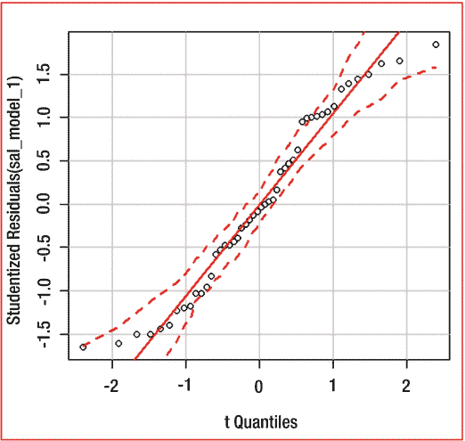

图 9-7. 通过 `qqPlot(model name, simulate = TRUE, envelope = 0.95)` 生成的正态性图

如您所见，极少数的点（仅两个）位于置信区间之外。因此，我们可以假设残差呈正态分布，且模型满足正态性假设。

标准化残差 vs. 杠杆图显示，大多数标准化残差分布在零线附近。

## 独立性检验

现在，我们需要验证残差的独立性（即误差的独立性，或不存在自相关）。然而，在本例中，由于我们已知每条数据记录属于不同的员工，且是在特定时间点采集的，并且不同员工数据之间不存在依赖关系，因此我们可以安全地假设残差和误差是独立的。不过，从学术兴趣的角度，您可以运行 `Durbin-Watson` 检验来判断是否存在自相关（即误差不独立）。在 R 中执行此操作的命令及相应输出如下：

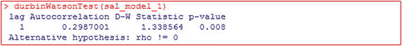

由于 `p-value` < 0.05，`Durbin-Watson` 检验拒绝了不存在自相关的原假设。因此，`Durbin-Watson` 检验支持存在自相关（即误差不独立）的备择假设。然而，如前所述，我们知道所使用的数据并不缺乏独立性。因此，我们可以忽略 `Durbin-Watson` 检验的结果。

如您所见，回归模型假设的所有检验均通过。

## 多重共线性

### 多重共线性

多重共线性是多元线性回归方法中可能遇到的另一个问题。假设您同时将“出生日期”和“年龄”作为预测变量。您知道两者在某种程度上是等价的，换句话说，其中一个与另一个高度相关。如果两个预测变量彼此高度相关，那么在多元线性回归方程中同时考虑这两个预测变量是没有意义的。我们通常会从多元线性回归模型或方程中消除其中一个预测变量，因为多重共线性会对模型产生不良影响。

在 R 中，可以轻松地使用 `vif(model name)` 函数检测多重共线性。`VIF` 代表方差膨胀因子（variance inflation factor）。通常，要使多重共线性检验通过，`VIF` 值应大于 5。以下是计算 `VIF` 的检验结果：

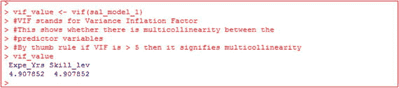

因此，我们可以假设不存在显著的多重共线性。然而，我们无法排除中等程度的多重共线性。

多重共线性通常会影响其中一个系数的显著性，使其变得不显著。但在本例中，我们并未看到这种影响。相反，我们发现两个预测变量的系数都是显著的。此外，存在多重共线性并不会使模型无法用于预测。因此，即使根据某些统计学派的观点（认为 `VIF` 值大于 4 时存在多重共线性），我们仍可以使用上述模型进行预测。

以下展示了如何使用该模型根据“工作年限”和“技能等级”的新数据来预测“年薪”。

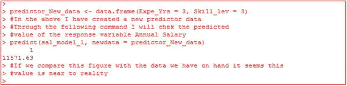

现在，让我们为预测变量取另一组值，看看模型返回的年薪是多少。`sal_model_1` 在本例中的预测结果如下所示：

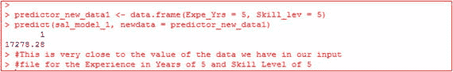

如果我们在预测变量之间发现显著的多重共线性，那么构建模型的一种方法是舍弃其中一个预测变量，然后使用另一个变量继续建模。类似地，你也可以尝试放弃另一个预测变量，用第一个预测变量来构建模型。在两个模型都构建完成后，检查哪个模型在统计上更显著。比较模型的一种方法是计算 `AIC`（Akaike information criterion）值。`AIC` 值较小的模型是更显著的模型。

在本例中，如果我们剔除其中一个变量（比如技能水平），我们往往会得到一个仅包含一个预测变量（工作年限）与响应变量（年薪）的回归方程，这实际上就是简单线性回归的情况，如下所示：

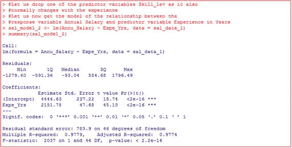

这也是一个显著的模型，其响应变量为年薪，预测变量为工作年限（正如我们所知），因为模型和预测变量的 `p-value` 均小于 0.05。此外，该模型可以解释响应变量中约 97.74% 的方差。

或者，如果我们移除“工作年限”这个预测变量，得到的模型如下所示：

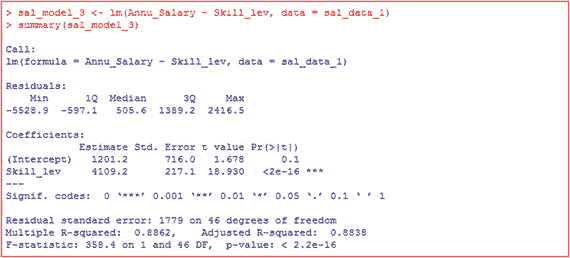

这同样是一个显著的模型，其响应变量为年薪，预测变量为技能水平（正如我们所知），因为模型和预测变量的 `p-value` 均小于 0.05。此外，该模型可以解释响应变量中约 88% 的方差，如 `R` 平方值所示。

然而，当我们在同一响应变量上拥有多个模型，且这些模型包含相同或不同的预测变量时，选择最有用模型的最佳方法之一是挑选 `AIC` 值最低的模型。这里我们比较了三个模型的 `AIC` 值：`sal_model_1`（以工作年限和技能水平作为预测变量）、`sal_model_2`（仅以工作年限作为预测变量）以及 `sal_model_3`（仅以技能水平作为预测变量）：

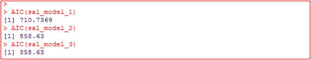

如果比较如上所示的 `AIC` 值，你会发现，同时将工作年限和技能水平作为预测变量的模型是最佳的。

### 逐步多元线性回归

构建模型和选择最佳模型的其他方法包括执行前向逐步回归或后向逐步回归。在前向逐步回归中，我们从单个预测变量开始，每次运行都增加一个预测变量，直到穷尽所有预测变量。在后向逐步回归中，我们从所有预测变量开始，然后逐一移除参数。两种方法会得到相同的结果。现在我们来进行后向逐步回归。我们将像前面那样使用 `AIC` 来选择最佳模型。我们将选择 `AIC` 值最低的模型。

我们需要拥有 `MASS` 包，然后使用该库中的 `stepAIC(model name)` 函数。以下是生成逐步多元线性回归模型的过程：

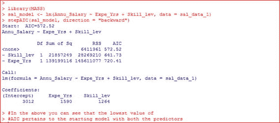

这证实了我们在本章前一节讨论中的理解。有效使用这种逐步方法的一个缺点在于，当它逐一剔除预测变量时，它不会检查预测变量的不同组合。

### 多元线性回归的全子集法

另一种替代方法是使用全子集回归法，该方法会评估预测变量的所有可能子集。

我们需要 `leaps` 包，并使用 `regsubsets(model name)` 函数。我们可以像下面这样在绘图函数中使用调整后的 `R` 平方选项，来了解需要在模型中包含哪些预测变量。我们应当选择具有最高调整后 `R` 平方值的模型。在 R 中如何执行此操作如下所示：

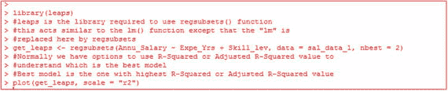

如果我们使用 `R` 平方值，得到的图表如图 9-8 所示。我们选择具有最高 `R` 平方值的预测变量组合。

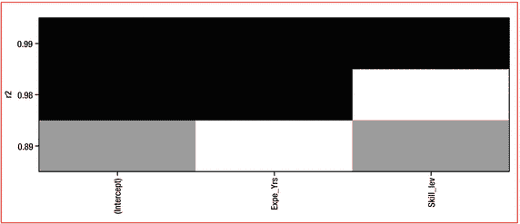

图 9-8. 在 R 中使用按 `R` 平方值缩放的全子集法生成的多元回归模型图

如您所见，我们同时选择了工作年限和技能水平两个预测变量，因为该模型具有最高的 `R` 平方值（0.99）。然而，我们已经看到，调整后的 `R` 平方值比 `R` 平方值能提供更深刻的见解，因为它调整了自由度。如果我们使用调整后的 `R` 平方值而不是 `R` 平方值，得到的图表如图 9-9 所示。

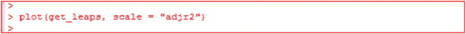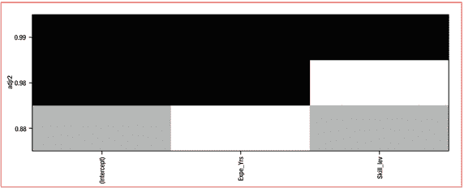

图 9-9. 在 R 中使用按调整后 `R` 平方值缩放的全子集法生成的多元回归模型图

在这个例子中，被选为最佳模型的预测变量也是同时包含两个预测变量的那个。

### 多元线性回归方程

回归线是平均值的平滑曲线。它本质上是针对自变量每一组取值，对响应变量平均值进行的平滑处理。绘制回归线的方式是使拟合值与实际值之间的误差最小化。这种方法被称为最小二乘法，它通过最小化响应变量的实际值与预测值之间的平方差之和来实现。多元线性回归方程的形式如下：

```
Y[i] = β[0] + β[1] x[1] + β[2] x[2] + β[3] x[3] + …
```

在这个方程中，`β[0]` 被称为截距，`β[1]` 被称为回归线的斜率。截距是当每个自变量的值都为 0 时，响应变量的值。它描述了当 `x[1]`、`x[2]` 等为 0 时，回归线与 y 轴的交点。可以使用以下公式轻松计算斜率：

`(R × 响应变量的标准差) / 自变量的标准差`

从该公式可以看出，当自变量的值增加一个标准差时，响应变量的值会增加 `R × 响应变量的一个标准差`，其中 `R` 是相关系数。

在我们的例子中，多元线性回归方程如下：

```
Annu_Salary = 3011.66 + 1589.68 × Expe_Yrs + 1263.65 × Skill_lev
```

其中 `β[0] = 截距 = 3011.66`
`β[1] = 工作年限的系数 = 1589.68`
`β[3] = 技能水平的系数 = 1263.65`

### 总结

根据我们的数据，我们得到了一个良好的多元线性回归模型，并验证了其满足各项假设前提。我们还利用该模型进行了预测。

## 在 R 中使用另一种方法