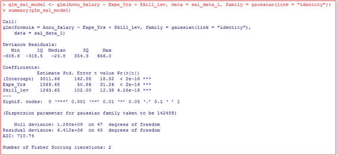
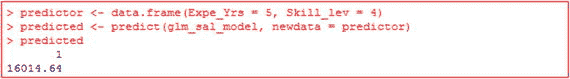
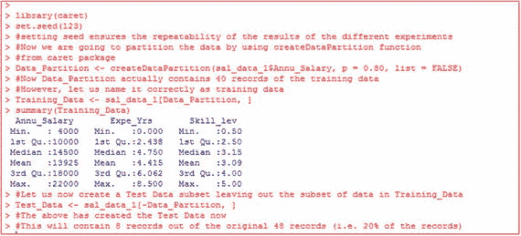
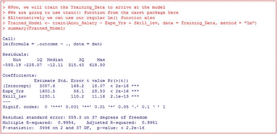
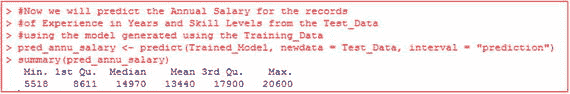
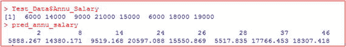
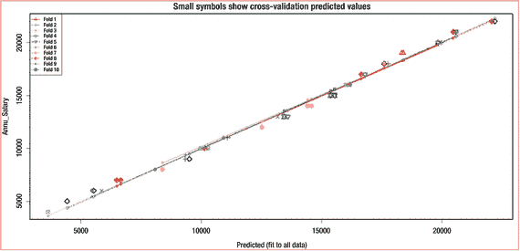
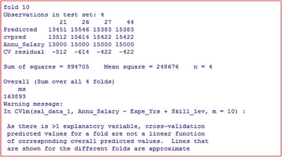
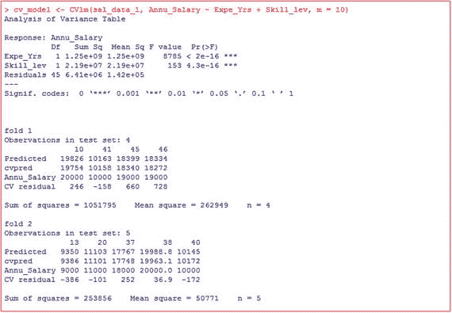
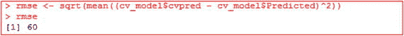

# 正如我们在本章引言中所述

正如我们在本章引言中所述，使用`lm()`函数的预期是响应变量服从正态分布。根据我们的样本数据可知，年薪呈正态分布，或遵循高斯分布。因此，我们也可以使用 R 函数`glm()`来采用广义线性模型，其频数分布属于`gaussian`族，并带有参数`link = "identity"`，如下所示：

正如预期，你会发现其结果与通过`lm()`函数获得的结果相同。

## 9.3 预测响应变量

拟合后的模型不仅能解释响应变量与自变量之间的关系，还提供了一种机制，可根据新自变量的值来预测响应变量的值。操作如下所示：

从用于构建模型的数据中可以看出，预测值与我们数据集中的相关实际值几乎吻合。

请注意：我们使用了`glm_sal_model`，而不是使用`lm()`函数生成的`sal_model_1`，因为两者之间没有区别。

这是通过使用函数`predict(model name, newdata)`完成的，其中`model name`是根据输入数据得出的模型名称，`newdata`包含需要预测其响应变量的自变量的数据。

该模型或许能够预测数据集中年限和经验等级之外的年薪值。但是，我们必须在将模型应用于此类扩展数据集时保持高度谨慎，因为生成的模型无法知晓，也无法判断该模型是否适用于扩展数据集。我们也不知道外推的数据是否遵循线性关系。有可能在若干年后，虽然经验在增加，但经验等级和相应的年薪可能不会线性增长，而是薪资增长率趋于平缓，导致关系斜率逐渐下降。

## 9.4 训练与测试模型

我们也可以使用数据集的独立子集来训练模型（即得出模型）和测试模型。理想情况下，这些数据集应是随机生成的。通常，数据集的 75%至 80%用于训练模型，另外 25%至 20%用于测试模型。

让我们使用之前相同的数据集来执行此操作。为此，我们需要使用`install.packages("caret")`和`library(caret)`。使用 R 将数据集拆分为两个子集——训练数据集和测试数据集——的方法如下所示：

将整个数据集拆分为`Training_Data`和`Test_Data`这两个子集的操作是随机进行的。现在，`Training_Data`中有 40 条记录，`Test_Data`中有 8 条记录。

现在，我们将使用机器学习概念训练我们的`Training_Data`来生成模型。其过程如下所示：

如您所见，生成的模型`Trained_Model`拟合效果良好，预测变量的系数 p 值< 0.05，且整个模型的 p 值也< 0.05。

现在，我们将使用之前得出的`Trained_Model`，根据`Test_Data`中的工作年限和经验等级来预测`Annual_Salary`的值。以下是来自 R 的快照：

现在，让我们看看使用`Training_Data`生成的模型预测出的年薪值，与`Test_Data`中的实际年薪值是否吻合。实际值和预测值如下所示：

您可以看到，`Test_Data`中的实际年薪与`Training_Data`生成的模型得出的年薪（`pred_annu_salary`）非常接近。因此，使用`Training_Data`生成的模型（`Trained_Model`）可以有效地使用。

## 9.5 交叉验证

像`k`折交叉验证这样的交叉验证方法用于验证生成的模型。当数据有限，并且需要将数据拆分为较小的测试集（例如 20%的数据）和相对较大的训练集（例如 80%的数据）时，这将非常有用，因为训练集和测试集中的数据可能划分得使两者都无法很好地代表整个数据集，从而使模型验证相对困难或不可行。

像`k`折交叉验证这样的交叉验证方法可以消除这个问题。在这里，我们实际上将数据集划分为`k`折，并使用`k-1`个集作为训练数据，剩下的 1 个集作为测试数据，并重复此过程`k`次。每个`k`折都包含从整个数据集中随机抽取的几乎相同数量的数据点（具体取决于`k`值）。在我们的案例中，由于总共有 48 条记录，每折包含 4 或 5 条记录。一折中的元素不会在另一折中重复出现。针对每一折，模型都会进行验证，模型预测的值（Predicted）和交叉验证预测的值会作为输出列出，同时还会显示实际值与交叉验证预测值（cvpred）之间的差异，即 CV 残差。利用预测值与 cvpred 之间的差异，我们可以计算出线性回归模型拟合的均方根误差。在处理海量数据时，这种交叉验证方法也很有用，因为通过轮换，每个数据点既用于训练也用于测试，并且在任何一折中都不会再次考虑同一个数据点。

让我们以我们之前使用的多元线性回归为例。让我们使用`k`折验证来验证这个模型。在我们的示例中，我们将使用`K = 10`。这样做是为了方便，这样每次训练集中有 90%的数据，测试集中有另外 10%的数据。这样一来，曾经在训练集中的数据，会在另一次轮换中移动到测试集中。因此，实际上通过轮换，我们可以确保所有数据点都用于模型生成和测试。对于此交叉验证，我们将使用`library(DAAG)`，并使用`cv.lm(dataset, formula for the model, m=number of folds)`或`CVlm(dataset, formula for the model, m=number of folds)`函数。这里的`m`就是我们决定的折数（即`K`）。我们的示例运行此操作的结果如下各图所示。

*图 9-12.* k 折交叉验证的图形输出，显示了全部十折

*图 9-11.* k 折交叉验证输出的部分快照（最后一折）

*图 9-10.* k 折交叉验证输出的部分快照

多元线性回归模型（`lm`函数）预测的值与交叉验证预测的值非常接近。从上图可以看出，使用交叉验证拟合的各个点几乎映射到了我们得出的回归模型上。

*图 9-13.*

线性回归模型与交叉验证模型之间计算的均方根误差

如果我们检查多元线性回归模型预测值与交叉验证模型预测值之间的均方根误差，如上图所示，该值非常小，即 60。因此，`k`折交叉验证验证了我们之前得出的多元线性回归模型。

除了`k`折交叉验证，我们还可以使用其他方法，例如重复`k`折交叉验证、自助采样法、留一交叉验证。

## 9.6 总结

在本章中，您看到了多元线性关系的示例。当您的响应变量是连续的且呈正态分布，并具有多个预测变量时，您可以使用多元线性回归。如果响应变量可以取离散值，则使用逻辑回归。

您还简要了解了**显著交互作用**，即当结果因某个预测变量基于另一个预测变量的值而受到影响时发生。您学习了**多重共线性**，即两个或多个预测变量可能高度相关，或以不同方式表示同一方面。您看到了多重共线性的影响以及如何在多元线性回归模型或方程的背景下处理它们。

然后，您探索了我们从某个实体获取的数据以及各个变量之间的相关性。您可以看到所涉及的所有三个变量（响应变量以及预测变量）之间存在高度相关性。通过在 R 中使用这些数据，您可以得出多元线性回归模型，然后验证它是一个具有显著预测变量的良好模型。

您学习了各种技术来验证回归的假设是否得到满足。不同的方法可能导致不同的解释，因此您在这方面必须谨慎行事。

在进一步探索多重共线性时，您看到诸如`vif()`之类的函数使您能够了解多重共线性的存在。您简要了解了在多元线性回归背景下处理多重共线性。多重共线性不会降低模型用于预测的价值。通过**阿卡伊克信息准则（AIC）**的示例，您学会了比较各种模型，并且最佳模型通常具有最低的 AIC 值。

接着，您探索了两种得出最佳拟合多元线性回归模型的替代方法：**逐步多元线性回归**和**多元线性回归的全子集法**。您通过使用多元线性回归方程对模型进行了描述。

此外，您探索了如何使用频率分布为`gaussian`且`link = "identity"`的`glm()`函数生成与通过`lm()`函数生成的相同模型，因为我们在连续响应变量的情况下需要正态性。

接着，您了解了如何使用预测变量的值来预测响应变量的值。

最后，您探索了如何将数据集拆分为两个子集：训练数据和测试数据。您可以使用训练数据生成模型，通过使用基于训练数据生成的模型上的`predict()`函数来验证测试数据的响应变量。