# 逻辑回归模型

## 数学基础

逻辑回归模型的基本公式如下：

```
1 / (1 + e^((β0 + β1 × Independent Variable1 + β2 × Independent Variable2 + … + βN × Independent VariableN)))
```

根据`P(Response = Yes)`和`P(Response = No)`这两个方程，可以得到几率（odds）：

```
P(Response = Yes) / P(Response = No) = e^((β0 + β1 × Independent Variable1 + β2 × Independent Variable2 + … + βN × Independent VariableN))
```

因此，logit（即对数几率）为：

```
logit(P) = ln[P(Response = Yes) / P(Response = No)] = β0 + β1 × Independent Variable1 + β2 × Independent Variable2 + … + βN × Independent VariableN
```

我们使用最大似然法生成逻辑回归方程，该方程用于预测几率比（odds ratio）的自然对数。基于这个逻辑回归方程，我们可以确定预测的几率比和预测的成功概率：

```
预测的成功概率 = 预测的几率比 / (1 + 预测的几率比)
```

此处我们不直接使用因变量的值，而是使用几率比（odds ratio）的自然对数。

---

## 10.1 逻辑回归

在本节中，我们将使用一个数据集来演示逻辑回归。

### 10.1.1 数据

首先，我们创建了一个包含六个变量的数据：

*   `Attrition`：表示员工是否已经离职或仍留在组织中（`Yes`表示离职，`No`表示目前在组织中工作）。
*   `Yrs_Exp`：表示员工当前的工作经验（以年为单位）。
*   `Work_Challenging`：表示分配给员工的工作是否具有挑战性。
*   `Work_Envir`：表示工作环境是`Excellent`（优秀）还是`Low`（差）。
*   `Compensation`：表示薪酬是`Excellent`（优秀）还是`Low`（差）。
*   `Tech_Exper`：表示员工的技术专长水平（`Excellent`优秀或`Low`差）。

数据覆盖最近六个月，且仅针对具有两到五年工作经验的员工。数据通过`read.csv()`命令从 CSV 文本文件`Attri_Data_10.txt`中提取：

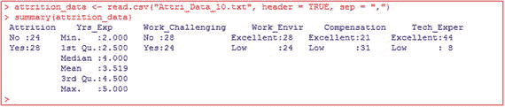

该代码还展示了数据的摘要。如您所见，`Attrition`字段有 28 个`Yes`值，表示这些员工已离职。24 个`No`值代表仍在组织中工作的员工。从上方的摘要中还可以观察到，28 名员工未被分配有挑战性的工作（`Work_Challenging`），24 名员工被分配了有挑战性的工作。此外，28 名员工在团队中工作环境（`Work_Envir`）被认为是优秀的，而 24 名员工的工作环境较差（标记为`Low`）。最后，21 名员工拥有优秀的薪酬，达到或高于市场水平（显示为`Excellent`）；但 31 名员工的薪酬低于市场水平（显示为`Low`）。在所有员工中，44 人拥有优秀的技术专长，其余 8 人的技术专长较低。该数据集包含 52 条记录。

理想情况下，当组织为员工提供有挑战性的工作、团队工作环境优秀、薪酬优厚且员工技术专长较低时，员工离职的可能性应该较低。

以下是数据的一瞥：

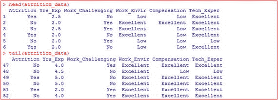

### 10.1.2 创建模型

现在，让我们使用 R 语言的`glm()`函数来构建一个逻辑回归模型。我们需要在`glm()`函数中使用`family = binomial(link="logit")`，因为我们的响应变量是二元的。首先，让我们使用所有参数生成模型，因为它们将`Attrition`作为二元响应（或依赖）变量；此外，我们想要使用该模型来预测任何员工日后辞职的可能性（与该模型及其他变量如`Yrs_Exp`、`Work_Challenging`、`Work_Envir`、`Compensation`和`Tech_Exper`保持一致）。在 R 中生成逻辑回归模型的命令如下所示：

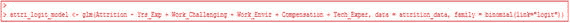

通过`glm()`函数创建的模型及其摘要（通过`summary(model name)`生成）如下所示：

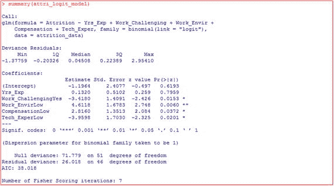

分类变量中只显示了一个值。这是因为每个变量都有两个层级，其中一个层级被模型作为参考层级。例如，分类变量`Work_Challenging`有两个层级：`Work_ChallengingYes`和`Work_ChallengingNo`。模型中只显示了`Work_ChallengingYes`，因为`Work_ChallengingNo`被当作参考层级。

> **注意**：如果每个因子变量有多个层级，可以使用证据权重（Weights of Evidence）变换技术。这可以确保只有一个组合变量代表每个变量的多个层级，从而减少模型的系数数量。这非常有用，因为具有大量层级的分类变量可能会在逻辑回归中引发问题。

您可以在上述逻辑回归模型摘要中看到，除了`Yrs_Exp`之外，所有其他变量对模型都是显著的（因为每个 p 值均小于 0.05）。`Work_ChallengingYes`、`Work_EnvirLow`、`Compensation_Low`和`Tech_ExperLow`是显著的变量。`Yrs_Exp`不是模型的显著变量，因为它具有较高的 p 值。即使通过视觉检查数据也很明显，`Yrs_Exp`对模型不会显著，因为无论工作年限多少，都有员工离职。此外，您可以看到模型在七次 Fisher 评分迭代后收敛，这是很好的，因为理想情况下我们希望模型在少于八次迭代内收敛。

我们现在可以从逻辑回归模型中移除`Yrs_Exp`并重新拟合模型。用于重新拟合逻辑回归模型的公式以及模型摘要如下所示：

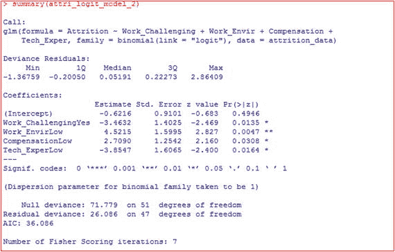


如您所见，模型参数是显著的，因为 p 值小于 0.05。

数据的自由度计算为 n 减 1（数据点数减 1，即 52 – 1 = 51）。模型的自由度计算为 n 减 1 再减系数个数（52 – 1 – 4 = 47）。这些值显示在上述模型摘要中。偏差（Deviance）是拟合不足的度量。零偏差（Null deviance）是仅包含截距的模型的偏差。残差偏差（Residual deviance）是当前模型的偏差。两者都是上述模型摘要的一部分。下图显示了随着每个系数的加入，残差偏差如何减小：

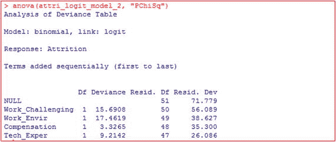

让我们比较两个模型——`attri_logit_model`（包含所有预测变量）和`attri_logit_model_2`（仅包含显著预测变量），并检查第二个模型相对于第一个模型的表现如何：

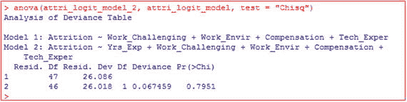


此检验通过使用 `anova()` 函数并检查卡方 p 值来完成。在此表中，卡方 p 值为 0.7951。该值不显著，表明与包含所有变量的模型 `attri_logit_model` 相比，不含 `Yrs_Exp` 的模型 `attri_logit_model_2` 表现良好。两个模型之间没有显著差异。因此，我们可以安全地使用不含 `Yrs_Exp` 的模型（即 `attri_logit_model_2`）。

从该模型（`attri_logit_model_2`）中，我们可以看到 `Work_ChallengingYes` 的系数为 –3.4632，`Work_EnvirLow` 的系数为 4.5215，`CompensationLow` 的系数为 2.7090，`Tech_ExperLow` 的系数为 –3.8547。这些系数值是优势比的自然对数。系数为负号表示其降低了 `Attrition` 的可能性。同理，系数为正号表示其增加了 `Attrition` 的可能性。因此，与其他所有变量保持不变（其他条件不变）的情况下，与 `Work_Envir = Excellent` 相比，当 `Work_Envir = Low` 时，发生 `Attrition = Yes` 的优势是不发生任何 `Attrition` 的 `exp(4.5215) = 91.97` 倍。这意味着，如果 `Work_Envir = Excellent`，`Attrition = Yes` 的概率为 5%（即 0.05），那么在相同条件下 `Attrition = No` 的优势为 `(0.05 / (1 – 0.05)) × 91.97 = 4.8376`。这对应于 `Attrition = No` 的概率为 `4.8376 / (1 + 4.8376) = 0.8286`，即约 82.86%。在其他所有变量保持不变的情况下，与 `Compensation = High` 相比，当 `Compensation = Low` 时，发生 `Attrition = Yes` 的优势是不发生任何 `Attrition` 的 `exp(2.7090) = 15.02` 倍。`Work_Envir = Low` 和 `Compensation = Low` 都会增加 `Attrition = Yes` 的可能性。

然而，另外两个变量 `Work_Challenging = Yes` 和 `Tech_Exper = Low` 的系数带负号，意味着它们降低了 `Attrition = Yes` 的可能性。在其他所有变量保持不变的情况下，与 `Work_Challenging = No` 相比，系数值为 –3.4632 的 `Work_Challenging = Yes` 将 `Attrition = Yes` 的可能性降低了 `exp(–3.4632) = 0.0313`。同理，在其他所有变量保持不变的情况下，与 `Tech_Exper = High` 相比，系数值为 –3.8547 的 `Tech_Exper = Low` 将 `Attrition = Yes` 的可能性降低了 `exp(–3.8547) = 0.0211`。

由此可见，对 `Attrition` 的主要影响主要来自 `Work_Envir` 和 `Compensation`。

### 10.1.3 模型拟合验证

验证模型拟合对我们来说很重要。这可以通过计算伪 R 平方值来实现。该值使用公式 `1 – (model$deviance / model$null.dev)` 计算，告诉我们模型解释偏差的程度。以下代码展示了如何使用 R 计算该值：

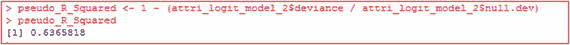

该计算结果表明模型解释了 63.65% 的偏差。你也可以使用 `library(pscl)` 和 `pR2(model_name)` 来计算伪 R 平方值。

另一种验证模型拟合的方法是使用卡方方法计算 p 值，如下所示：

```
p-value <- pchisq[(model_deviance_diff),(df_data – df_model),lower.tail=F]
```

此处，`df_data` 可通过 `nrow(data_set) – 1` 计算，在我们的案例中为 `nrow(attrition_data) – 1`；`df_model` 可通过 `model$df.residual` 计算；`model_deviance_diff` 可计算为 `model$null.dev – model$deviance`。相关计算如下所示：

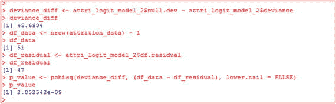

由于 p 值非常小，偏差的减少不能被认为是偶然发生的。由于 p 值显著，该模型拟合良好。

### 10.1.4 一般注意事项

在生成逻辑模型时，可能会抛出以下警告信息：


这可能是由于数据或部分数据完美预测了响应变量。这被称为分离或准分离问题。

以下是关于逻辑回归模型的一些一般注意事项：

-   当零偏差小于残差偏差时，我们会遇到问题。
-   当收敛需要大量费雪评分迭代时，我们会遇到问题。
-   当系数数值较大且标准误差显著较大时，我们会遇到问题。

在这些情况下，我们可能需要重新审视模型，再次检查每个系数。

### 10.1.5 多重共线性

我们在第 9 章中讨论了多重共线性。在 R 中，使用 `vif(model name)` 函数可以轻松发现多重共线性。VIF 代表方差膨胀因子。通常，通过多重共线性检验的经验法则是 VIF 值应大于 5。以下检验展示了 VIF 的计算：


如您所见，我们的模型不存在多重共线性问题。

### 10.1.6 离散度

对于某些回归模型（包括逻辑回归模型），离散度（因变量的方差）高于值 1（如二项族逻辑回归离散度参数摘要中所述取值为 1）是一个潜在问题。这被称为过度离散。当因变量的观测方差大于使用二项分布（即 1）所预期的方差时，就会发生过度离散。这会导致显著性检验的可靠性问题，因为其可能会对标准误差产生不利影响。

可以使用 R 轻松判断模型是否存在过度离散问题，如下所示：

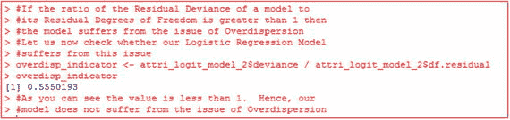

我们生成的模型 `attri_logit_model_2` 不存在过度离散问题。如果逻辑回归模型确实存在过度离散问题，则需要在 `glm()` 函数中使用准二项分布（quasibinomial distribution）来代替二项分布（binomial distribution）。

### 10.1.7 逻辑回归结论

针对我们的数据，我们创建了一个良好的逻辑回归模型，并已验证了其显著性和拟合优度。该模型不存在多重共线性或过度离散问题。

> **注意**  
> 在大多数情况下，在 `glm()` 函数中使用 `family=binomial(link="probit")` 与使用 `family=binomial(link="logit")` 效果相似。对于 `logit`，你可以直接在 `glm()` 中使用 `family=binomial()` 而无需指定 `link="logit"`，因为两者产生的结果相同。

## 10.2 训练和测试模型

我们也可以使用数据集的单独子集来训练模型（即创建模型）和测试模型。理想情况下，这些数据集应是随机生成的。通常，将数据集的 75% 到 80% 用于训练模型，另外的 25% 到 20% 用于测试模型。

让我们使用之前使用的相同数据集来执行此操作。我们需要运行 `install.packages("caret")` 并使用 `library(caret)`。以下是使用 R 将数据集分为两个子集（训练数据集和测试数据集）的方法：

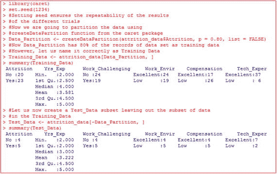

整个数据集被随机拆分为两个子集（`Training_Data` 和 `Test_Data`）。现在，`Training_Data` 中有 43 条记录，`Test_Data` 中有 9 条记录。

我们现在使用机器学习概念训练我们的 `Training_Data` 以生成一个模型：

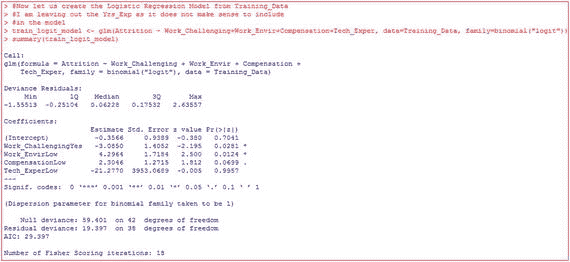


如你所见，生成的模型（`train_logit_model`）经过 18 次费希尔评分迭代后收敛，其中`Tech_ExperLow`的系数和标准误极大。因此，该模型可能用处不大。出于这个原因，我们无法继续使用训练模型基于`Test_Data`中的记录来预测`Attrition`。但是，如果我们能成功构建一个训练模型，就可以按以下步骤进行进一步分析：

1. 使用训练数据生成的模型预测测试数据的响应变量，并将预测数据存储在测试数据集中。
2. 将响应变量的预测值与测试数据集中响应变量的实际值进行比较。
3. 生成混淆矩阵，以理解真正例（`TP`）、真反例（`TN`）、假正例（`FP`）和假反例（`FN`）。
   - 真正例是实际为正类（1）且被预测为正类（1）的样本。
   - 真反例是实际为负类（0）且被预测为负类（0）的样本。
   - 假正例是被预测为正类（1）但实际为负类（0）的样本。
   - 假反例是被预测为负类（0）但实际为正类（1）的样本。
4. 检查准确率、特异性和敏感度：
   - 准确率 = （`TP` + `TN`） / 总观测数
   - 特异性 = 真负类率 = `TN` / （`FP` + `TN`）
   - 敏感度 = 召回率 = 真正类率 = `TP` / （`FN` + `TP`）
   - 此外，还可以考虑精确率 = `TP` / （`FP` + `TP`）和 F1 分数 = `2TP` / （`2TP` + `FP` + `FN`）。

通常期望获得较高的准确率、较高的敏感度和较高的特异性。检查这些数值是否符合预测的目标。如果预测结果会影响人员的安全或健康，我们必须确保最高的准确率。在这种情况下，每个预测值都应谨慎确定，并在必要时通过其他方法进一步验证。

## 预测响应变量

最初拟合的模型（`attri_logit_model_2`）不仅解释了响应变量与自变量之间的关系，还提供了一种根据新自变量的值预测响应变量值的机制。具体操作如下所示：

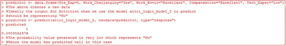

如果预测返回的概率 > 0.5，我们将`Attrition`的值取为`Yes`；如果预测返回的概率不大于 0.5，则取为`No`。如上述代码所示，该值远低于 0.5，因此我们可以安全地假设`Attrition = No`。

上述预测是通过使用函数 `predict(model name, newdata=dataframe_name, type="response")` 来确定的，其中 `model name` 是根据输入数据得到的模型名称，`newdata` 包含需要预测响应变量的自变量数据，`type="response"` 是为了确保输出结果不是 `logit(y)`。

## 验证逻辑回归模型的替代方法

正如我们所说，我们无法使用训练数据生成一个有效的模型，因此也无法使用测试数据对其进行验证。但是，我们使用完整的数据集（`attrition_data`）生成了一个模型（`attri_logit_model_2`）并对其进行了验证。另一种验证此类模型的方法如下：

1. 我们使用生成的模型，通过在生成模型所用的完整数据集上执行 `predicted_value <- predict(model, type="response")` 来预测因变量值（logit）：


2. 然后生成一个混淆矩阵：

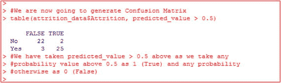

从混淆矩阵中可以清晰地看到，该模型生成了非常高的真正例和真反例。

3. 现在我们使用`ROCR`包及其中的`prediction()`函数，如下所示：`prediction_object <-prediction(predicted_value, dataset$dependent_variable)`。这样，我们就创建了一个`prediction_object`：

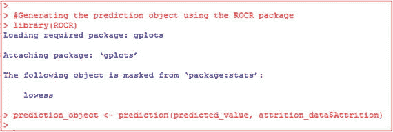

4. 使用`ROCR`包中的`performance()`函数对`prediction_object`进行操作，我们得到 TPR = `TP` / (`FN` + `TP`) = `TP` / (所有正类) 和 FPR = `FP` / (`FP` + `TN`) = `FP` / (所有负类)，然后将 TPR 对 FPR 作图，得到接收者操作特性 (ROC) 曲线。这通过 `plot(performance(prediction_object, measure = "tpr", x.measure = "fpr")` 实现。或者，我们可以使用 `plot(performance(prediction_object, measure = "sens", x.measure = "spec")` 生成敏感度/特异性图，或使用 `plot(performance(prediction_object, measure = "prec", x.measure = "rec")` 生成精确率/召回率图。此处展示了用于生成 ROC 曲线的第一个 R 命令，以及生成的曲线（见图 10-1）：

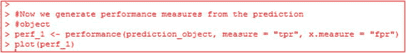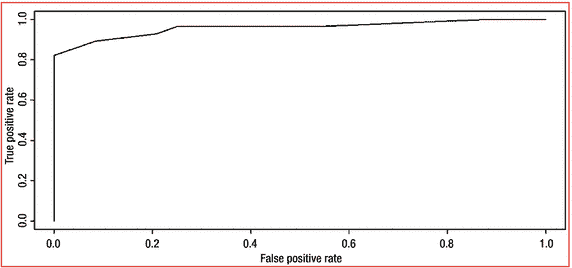

图 10-1. 生成的 ROC 曲线

该 ROC 曲线清晰地表明，该模型几乎没有产生假正例，并产生了很高的真正例。因此，我们可以得出结论，生成的模型是一个好模型。

## 多项逻辑回归

多项逻辑回归用于水平数超过两个的分类或离散因变量。自变量可以是分类变量或连续变量。然而，生成和评估这些模型的方法并不直接且较为繁琐。这些需要对底层数学和统计学有深入的理解。因此，我们不在本书中介绍这部分内容。

但是，对于水平数超过两个且无序的因变量，可以使用 `mlogit` 包中的 `mlogit()` 函数或 `nnet` 包中的 `multinom()` 函数来生成多项逻辑回归。

对于水平数超过两个且有序的因变量，可以使用 `rms` 包中的 `lrm()` 函数来生成多项逻辑回归。

## 正则化

正则化是一个复杂的主题，我们在此不作详细讨论。然而，我们会对这个概念进行介绍，因为它是统计学中一个重要的方面，你需要结合统计模型来理解它。

正则化是通常用于避免过拟合的方法。当我们不断向模型添加参数以提高其准确性和拟合度时，在某些时候，使用该模型的预测能力反而会下降。由于引入了过多参数，我们是在对数据进行过拟合，从而失去了泛化的价值，而泛化本可使模型在预测中更有用。

通过使用向前选择、向后剔除和子集选择法等模型拟合方法，我们试图避免过拟合，从而使模型更具普遍性，在预测未来值时更有用。这将确保在关联测试数据时，偏差和方差都较小。

当数据集中的参数数量多于数据观测数量，且最小二乘法无法发挥作用（因为它会导致拟合同一数据的模型众多，而非单一的唯一模型）时，正则化也非常有用。在这种情况下，正则化使我们能够找到一个合理的解决方案。


