# 3. 使用 R 进行数据分析

在上一章中，我们介绍了 R 以及如何开始使用 R 编程来分析数据。在本章中，我们将进一步解释数据分析所需的一些重要概念，包括读取各种类型的数据文件、存储数据和操作数据。我们还将讨论如何创建你自己的函数和 R 包。读完本章后，你将对 R 有一个良好的入门了解，并可以开始进行数据分析。

## 3.1 读写数据

数据来自多种来源，格式也多种多样。作为一名数据科学家，你的任务是从不同的来源和不同的格式读取数据，对其进行分析，并报告发现结果。数据源可以是 Oracle 数据库、SAP 管理系统、网络，或者是这些的组合。数据格式可以是简单的逗号分隔的平面文件、Excel 格式或可扩展标记语言（XML）格式。R 提供了广泛的导入数据工具。图 3-1 显示了 R 的各种接口。有关导入和导出 R 数据的更多信息，请参阅 [R 手册](https://cran.r-project.org/doc/manuals/R-data.pdf)。

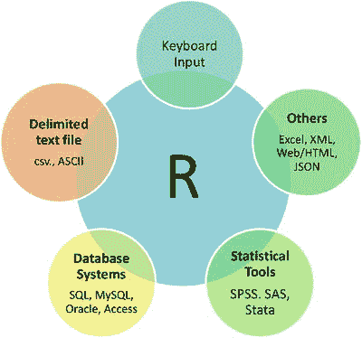

图 3-1. R 的各种接口

如你所见，R 支持来自以下来源的数据：

*   各种数据库，包括 MS SQL Server、MySQL、Oracle 和 Access
*   简单的平面文件，例如 TXT 文件
*   微软 Excel
*   其他统计软件包，例如 SPSS 和 SAS
*   XML 和 HTML 文件
*   其他文件，例如 JavaScript 对象表示法（JSON）文件

我们将在本章后续部分及后续章节中介绍其中一些重要的数据格式。

### 3.1.1 从文本文件读取数据

`read.table()` 和 `read.csv()` 函数是 R 支持的用于从文本文件导入数据的两个函数。`read.csv()` 函数专门用于读取逗号分隔的文件，而 `read.table()` 可用于读取任何分隔符文件，但必须将分隔符作为参数提及。

R 最流行的输入格式之一是逗号分隔值（CSV）。要在 R 中读取 CSV 文件，你可以使用 `read.csv()` ，它可以从 CSV 文件导入数据并创建一个数据框。`read.csv()` 的语法如下（来自 R 帮助文件）：

*   `file`: 文件名。应指定文件的完整路径（使用 `getwd()` 检查路径）。文件中的每一行都会被转换为数据框的每一行。`file` 也可以是一个完整的 URL。
*   `header`: 一个逻辑变量（`TRUE` 或 `FALSE`），指示文件的第一行是否包含变量名。如果第一行包含变量名，则此标志设置为 `TRUE`。默认情况下，它设置为 `FALSE`。
*   `sep`: 分隔符，默认为逗号。无需设置此标志。
*   `fill`: 如果文件的行长不相等，你可以将此参数设置为 `TRUE`，以便隐式添加空白字段。
*   `dec`: 文件中用于小数点的字符。

```
myCSV <- read.csv(file, header = TRUE, sep = ",", quote = "\"", dec = ".", fill = TRUE, comment.char = "", ...)
```

你唯一需要担心的参数是带有正确 `PATH` 的 `file`。文件分隔符默认设置为逗号。根据文件的第一行是否包含变量名，适当地设置 `header` 参数。

图 3-2 显示了一个示例文本文件，其中每一行的元素由逗号分隔。

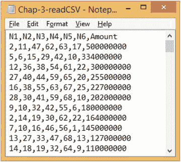

图 3-2. 示例 CSV 文件

你可以将此 CSV 文件读入 R，如下例所示：

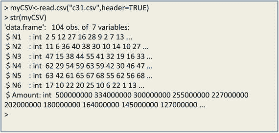

在此 CSV 文件中，第一行包含标题，实际值从第二行开始。当你使用 `read.csv()` 读取文件时，必须将 `header` 选项设置为 `TRUE`，以便 R 能够理解第一行包含变量名，并能够以正确的数据框格式读取文件。

此示例演示了 `read.csv()` 如何自动将 CSV 格式的文件读入数据框。R 还会根据每列中的记录来决定变量的类型。此文件中存在七个变量，每个参数都是整数类型。要查看数据集表格，你可以直接在 R 中使用 `View()` 命令：

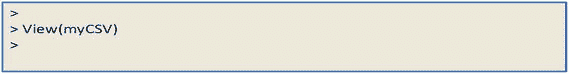

使用 `View()` 将在另一个窗口中打开数据表，如图 3-3 所示。

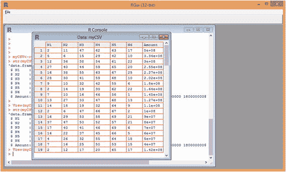

图 3-3. 查看 CSV 文件

`read.table()` 命令与 `read.csv()` 类似，但用于读取任何文本文件。文本文件的内容可以由空格、逗号、分号或冒号分隔，并且你必须指定一个分隔符。该命令还有其他可选参数。更多详细信息，请键入 `help(read.table)`。图 3-4 显示了一个包含制表符分隔值的示例文件。

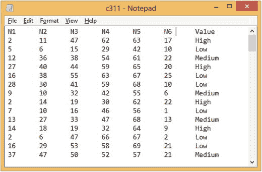

图 3-4. 示例文件

以下是 `read.table()` 命令及其输出：

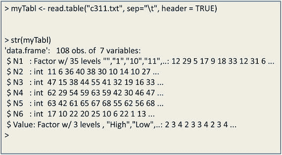

在此示例中，文本文件是制表符分隔的格式。第一行包含变量名。同时，请注意 `read.table()` 将文本文件读取为一个数据框，并且 `Value` 会被自动识别为一个因子。

### 3.1.2 从 Microsoft Excel 文件读取数据

有多个软件包可用于读取 Excel 文件。对于 Windows 系统，可使用 `RODBC` 包通过开放数据库连接（ODBC）进行连接。`XLConnect` 是另一个基于 Java 的解决方案。`gdata` 包适用于 Windows、macOS 和 Linux 平台。`xlsx` 包也经常被使用。

以下示例演示了如何安装 `RODBC` 包（适用于 Windows）。Excel 文件的第一行应包含变量名。第一步是使用 `install.packages("RODBC")` 下载该包。具体过程如下所示：

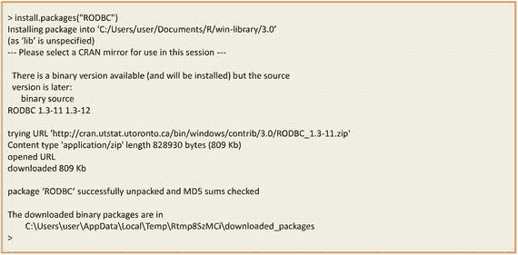

一旦安装成功，即可通过执行以下命令集将 Excel 文件导入 R：

```
> library(RODBC)
> myodbc <- odbcConnectExcel("c311Lot1.xls")
> mydataframe <- sqlFetch(myodbc, "LOT")
```

首先，通过指定文件名建立与 XLS 数据库的 ODBC 连接。然后调用该表。其中，`c311Lot1.xls` 是一个 XLS 格式的 Excel 文件，`LOT` 是该 Excel 文件内的工作表名称。`myodbc` 是用于打开 ODBC 连接的 ODBC 对象，`mydataframe` 是数据框。整个过程如图 3-5 所示。类似的过程也可用于从 Microsoft Access 数据库导入数据。

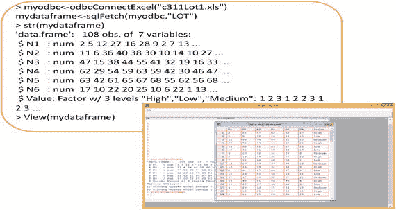

图 3-5. 处理导入的数据

要读取 Excel 2007 的 XLSX 格式，你可以使用 `install.packages("xlsx")` 安装 `xlsx` 包，并如下所示使用 `read.xlsx()` 命令：

```
> library(xlsx)
> myxlsx <- "c311Lot1.xlsx"
> myxlsxdata <- read.xlsx(myxlsx, 1)
```

`read.xlsx()` 的第一个参数是 Excel 文件；`1` 指的是 Excel 中的第一个工作表，它被保存为一个数据框。有众多软件包可用于读取 Excel 文件，包括 `gdata`、`xlsReadWrite` 和 `XLConnect`，但 `xlsx` 包是最流行的。然而，建议将 Excel 文件转换为 CSV 文件，并使用 `read.table()` 或 `read.csv()` 而不是其他方法。以下代码提供了使用其他包以及读取文件的示例：

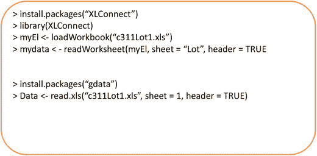

### 3.1.3 从 Web 读取数据

如今，我们经常需要从 Web 读取数据。你可以使用 `readLines()` 命令下载一个网页，并将其保存为 R 结构以供进一步分析。请记住，Web 数据可能是非结构化数据，在进行分析前需要进一步预处理。你可以使用 `grep()` 和其他正则表达式来操作 Web 数据。更多信息，请参考 ProgrammingR 网站：[`www.programmingr.com`](http://www.programmingr.com/)。

这里展示了一个网页抓取的示例：

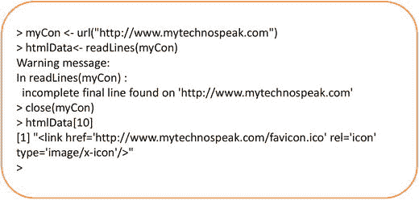

## 3.2 在 R 中使用控制结构

与其他编程语言类似，R 支持控制结构，允许你控制执行的流程。控制结构使程序能够按照某种“逻辑”执行。然而，很多时候这些控制结构会拖慢系统速度。相反，在数据处理时（我们将在本章后面讨论）会使用其他内置函数。一些常用的控制结构如下：

*   `if` 和 `else`：测试一个条件
*   `while`：当条件为真时执行循环
*   `for`：循环固定次数
*   `repeat`：无限循环执行（必须跳出循环才能退出）
*   `next`：跳过循环迭代的选项
*   `break`：中断循环的执行

### 3.2.1 if-else

`if-else` 结构是任何编程语言（包括 R）中最常用的函数。此结构允许你测试一个为真或假的条件。例如，假设你正在分析一个数据集，并且需要根据一个条件（比如，一个人的年龄是否大于 65）绘制 x 对 y 的图形。在这种情况下，你可以使用 `if-else` 语句。`if-else` 的常见结构如下：

```
if (condition) {
    ## 执行某些操作
} else {
    ## 不执行操作
}
```

你可以拥有多个 `if-else` 语句。更多信息，请查阅 R 帮助页面。以下是 R 中 `if-else` 函数的演示：

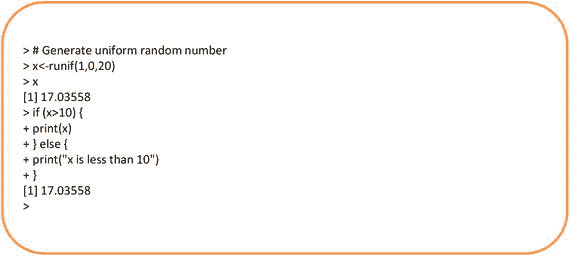

### 3.2.2 for 循环

`for` 循环与其他编程结构类似。在数据分析过程中，`for` 循环主要用于访问数组或列表。例如，如果你要访问数组中的特定元素并执行数据操作，可以使用 `for` 循环。以下是 `for` 循环使用的一个示例：

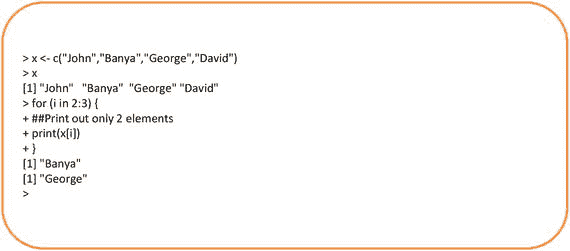

有时，`seq_along()` 函数会与 `for` 循环结合使用。`seq_along()` 函数会根据对象的长度生成一个整数。以下示例使用 `seq_along()` 打印 `x` 的每个元素：

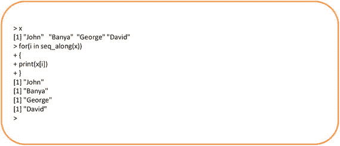

### 3.2.3 while 循环

R 的 `while` 循环包含一个条件和一个循环体。如果条件为真，控制权进入循环体。循环会持续执行直到条件为假；条件失败后循环退出。示例如下：

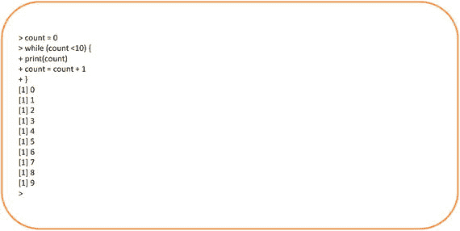

`repeat()` 和 `next()` 在统计或数据分析中不常用，但它们有其自身的应用场景。如果你有兴趣了解更多，可以查阅 R 帮助页面。

### 3.2.4 循环函数

尽管 `for` 和 `while` 循环是很有用的编程工具，但使用花括号和结构化函数有时会显得繁琐，尤其是在处理大型数据集时。因此，R 提供了某些以紧凑形式实现循环的函数，使数据分析更简单有效。R 支持以下函数，我们将从数据分析的角度来看待它们：

*   `apply()`：对一个数组的一部分评估一个函数，并将结果返回到一个数组中
*   `lapply()`：在列表上循环，并对每个元素进行评估，或对每个元素应用该函数
*   `sapply()`：`lapply()` 的一个用户友好型应用，返回一个向量、矩阵或数组
*   `tapply()`：通常用于数据集的一个子集

这些函数用于操作和切片矩阵、数组、列表或数据框中的数据。这些函数按行或按列遍历整个数据集，并避免了循环结构。例如，可以调用这些函数执行以下操作：

*   计算某行或某列的均值、总和或执行任何其他操作
*   转换或执行子集操作

`apply()` 函数形式更简单，其代码可以非常少（实际上，可以是一行），同时有助于执行高效的操作。其他更复杂的形式包括 `lapply()`、`sapply()`、`vapply()`、`mapply()`、`rapply()` 和 `tapply()`。使用这些函数取决于数据的结构以及你需要帮助分析的结果格式。

为了理解循环函数的工作原理，你将查看 Cars 数据集，它是 R 库的一部分。该数据集包含汽车的速度和停止所需的距离。这些数据记录于 20 世纪 20 年代。这个数据框有两个变量：`speed` 和 `dist`。两者都是数值型，总共包含 50 个观测值。

#### 3.2.4.1 `apply()`

使用`apply()`函数，可以对矩阵、数据框或列表的每一行或每一列执行操作，而无需编写循环。以下示例展示了如何使用`apply()`查找汽车数据的平均速度和平均距离：

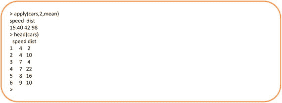

`apply()`函数用于对`array[]`评估函数，通常用于对行或列的操作：

```
> str(apply)
function (X, MARGIN, FUN, ...)
>
```

`apply()`函数接受以下参数：

*   `X`：数组
*   `MARGIN`：指示行或列的整数向量
*   `FUN`：要应用的函数名称

在前面的示例中，我们计算了每行和每列的平均值。但函数可以是任何东西；它可以是`SUM`、平均值或您自己的函数。其概念是它循环遍历整个数组并以相同格式提供结果。此函数消除了所有繁琐的循环，并在一行中得出结果。

以下示例计算每行和每列的`quantile`度量：

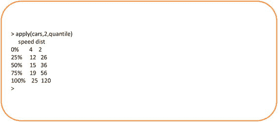

#### 3.2.4.2 `lapply()`

`lapply()`函数将结果输出为列表。`lapply()`可以应用于列表、数据框或向量。输出始终是一个列表，其元素数量与传递给`lapply()`的对象相同：

```
> str(lapply)
function (X, FUN, ...)
>
```

它接受以下参数：

*   `X`：数据集
*   `FUN`：函数

以下示例演示了针对相同 Cars 数据集的`lapply()`函数。Cars 数据集是一个包含两个变量`dist`和`speed`的数据框；两者都是数值型。要查找`speed`和`dist`的平均值，您可以使用`lapply()`，输出是一个`list`：

```
> str(cars)
'data.frame':   50 obs. of  2 variables:
$ speed: num  4 4 7 7 8 9 10 10 10 11 ...
$ dist : num  2 10 4 22 16 10 18 26 34 17 ...
> lap <- lapply(cars, mean)
> lap
$speed
[1] 15.4
$dist
[1] 42.98
> str(lap)
List of 2
$ speed: num 15.4
$ dist : num 43
>
```

#### 3.2.4.3 `sapply()`

`sapply()`和`lapply()`之间的主要区别在于输出结果。`sapply()`的结果可以是向量或矩阵，而`lapply()`的结果是列表。根据您正在进行的数据分析类型以及您需要的结果格式，您可以使用适当的函数。随着我们在后续章节中解决许多分析问题，您将看到在不同时间使用不同函数。以下示例演示了针对相同 Cars 数据集示例使用`sapply()`：

```
> sap <- sapply(cars, mean)
> sap
speed  dist
15.40 42.98
> str(sap)
Named num [1:2] 15.4 43
- attr(*, "names")= chr [1:2] "speed" "dist"
```

### 3.2.4.4 `tapply()`

`tapply()` 用于向量的子集。函数 `tapply()` 与其他 `apply()` 函数类似，不同之处在于它应用于数据集的子集：
- `...` 包含要传递给 `FUN` 的其他参数。
- `simplify`：`TRUE` 或 `FALSE`，用于简化结果。
- `X`：向量。
- `INDEX`：因子或因子列表（或强制转换为因子）。
- `FUN`：要应用的函数。

```r
> str(tapply)
function (X, INDEX, FUN = NULL, ..., simplify = TRUE)
```

为了演示 `tapply()` 的功能，让我们考虑 Mtcars 数据集。该数据集提取自 1974 年的《Motor Trend》杂志。数据包括 32 辆汽车（1973–1974 年车型）的燃油消耗细节以及 10 个汽车设计和性能方面。表 3-1 显示了数据集参数。

**表 3-1.** Mtcars 数据集

| [, 1] | `mpg` | 每加仑英里数 |
| --- | --- | --- |
| [, 2] | `cyl` | 气缸数 |
| [, 3] | `disp` | 排量（立方英寸） |
| [, 4] | `hp` | 毛马力 |
| [, 5] | `drat` | 后桥速比 |
| [, 6] | `wt` | 重量（磅/1000） |
| [, 7] | `qsec` | 四分之一英里时间 |
| [, 8] | `vs` | V/S |
| [, 9] | `am` | 变速箱（0 = 自动，1 = 手动） |
| [,10] | `gear` | 前进档位数 |
| [,11] | `carb` | 化油器数量 |

数据来源：Henderson 和 Velleman，“Building Multiple Regression Models Interactively”，《Biometrics》，37（1981 年），第 391–411 页。

图 3-6 显示了 Mtcars 数据集的部分数据。

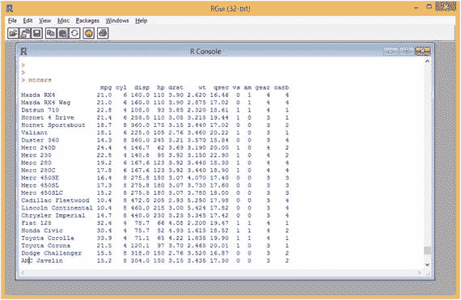

**图 3-6.** Mtcars 数据集的一些样本数据

假设您需要找出每个气缸的平均汽油消耗量（`mpg`）。使用 `tapply()` 函数，任务可以在一行中完成，如下所示：

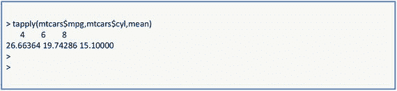

类似地，如果您想找出自动和手动变速箱的平均马力（`hp`），只需使用 `tapply()`，如下所示：

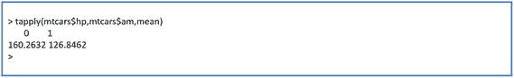

从该示例可以看出，`apply()` 函数系列功能强大，使您能够避免传统的 `for` 和 `while` 循环。根据您想要实现的数据分析类型，您可以使用相应的函数。

### 3.2.4.5 `cut()`

在数据分析中，有时您可能需要将连续变量分解为不同的区间。您可以通过在 R 中使用 `cut()` 函数轻松完成此操作。让我们以 Orange 数据集为例；我们的任务是根据树龄对树木进行分组。这可以通过使用 `cut()` 来实现，如下所示：

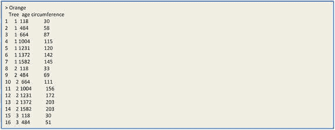

接下来，您根据树龄创建四个组。第一个参数是数据集和树龄，第二个参数是您要创建的组数。在此示例中，Orange 树根据树龄分为四类，树龄在 117 到 483 之间的树有五棵：

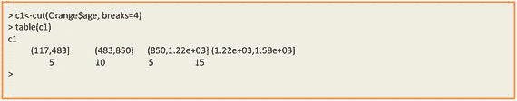

区间由 `cut()` 自动定义，可能不是您预期的区间。但是，使用 `seq()` 命令，您可以指定区间：

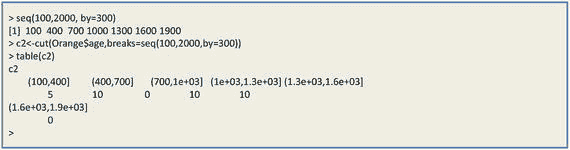

### 3.2.4.6 `split()`

在数据分析中，有时您可能需要将数据集拆分为组。这可以通过使用 `split()` 函数方便地完成。此函数将数据集划分为由参数定义的组。`unsplit()` 函数反转 `split()` 的结果。

`split()` 的一般语法如下；`x` 是向量，`f` 是 `split` 参数：

```r
> str(split)
function (x, f, drop = FALSE, ...)
```

在以下示例中，Orange 数据集根据树龄进行拆分。区别在于数据集根据树龄进行分组。共有七个树龄组，数据集被拆分为七个组：

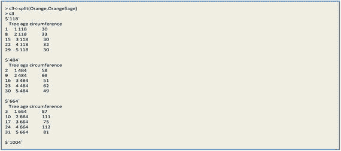

### 3.2.5 在 R 语言中编写自定义函数

与其他编程语言一样，你也可以在 R 中编写自己的函数。在程序需要重复执行一系列任务时，会编写函数；在代码需要与他人或公众共享时，也会编写函数；当编程语言命令中尚未定义相关函数时，同样需要编写函数。函数通过创建代码的抽象层来降低编程复杂性，使用时只需指定一组参数。在 R 中，函数可以被视为对象。函数可以作为参数传递给其他函数，例如 `apply()` 或 `sapply()`。

与数据类型一样，R 中的函数也以对象形式存储，并使用 `function()` 进行定义。函数对象是一种数据类型，其类对象被定义为函数。以下示例展示了如何定义一个简单函数：

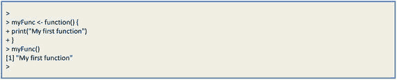

该函数不接受任何参数。为了使其更有趣，你可以添加一个函数参数。在此函数体中，让我们添加一个 `for` 循环，以便按照用户指定的次数进行打印。用户通过在函数中指定参数来确定循环次数。以下两个示例对此进行了说明：

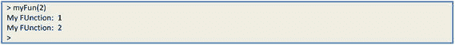

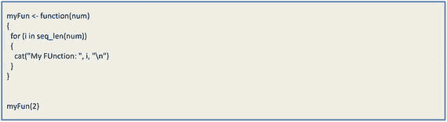

在此示例中，`myFun()` 是一个接受一个参数的函数。你可以在调用函数时传递该参数。在此情况下，从输出中可以看到，该函数会根据作为参数传递给它的数字来打印其循环次数。

## 3.3 使用 R 包与库

R 是开源的。超过 2500 名用户为 R 贡献了各种函数，这些函数被称为包。有些函数是默认安装的一部分，而其他函数则需要从 `http://cran.r-project.org/web/packages` 显式下载并安装。这些包包含了用 R 开发并面向公众提供的各种特性或函数。它们是已经编译好的 R 函数，以二进制格式（或 R 格式）提供。存放这些代码的目录被称为库。安装包之后，你可以通过加载 `library()` 函数来调用这些函数，以便在当前工作会话中使用它们。

要查看 R 环境中安装了哪些库，你可以在命令行中执行 `library()`。要查看这些库的安装路径，你可以执行 `libPaths()` 命令。以下是已执行的命令：

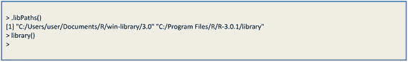

图 3-7 显示了输出结果，并列出了已安装的库。

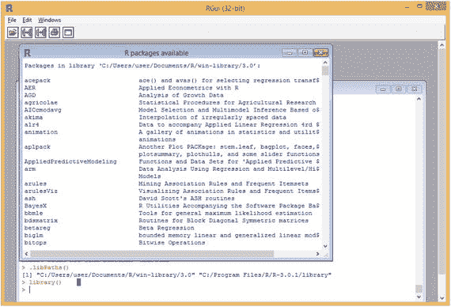

**图 3-7.** 已安装的库列表

你可以通过执行 `install.packages()` 命令来安装包。以下示例安装 `rattle` 包：

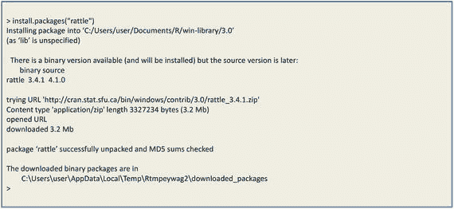

> **注：** Google 的 R 语言风格指南可在 `https://google.github.io/styleguide/Rguide.xml` 查阅。

## 3.4 总结

在开始任何分析之前，必须先将数据有效地读入 R。在本章中，你从示例入手，了解了如何将来自不同来源的各种文件格式读入 R（包括数据库文件、文本文件、XML 文件以及来自其他统计和分析工具的文件）。

你进一步探索了如何通过使用诸如 `read.csv()` 和 `read.table()` 之类的简单命令，将各种数据文件格式读入 R。你还了解了从 MS Excel 文件和网页导入数据的示例。

你通过详细的示例，深入学习了循环结构（如 `if-else`、`while` 和 `for`）的使用。你还了解了 R 中一些简单的递归函数，例如 `apply()`、`lapply()`、`sapply()` 和 `tapply()`。这些函数可以显著降低代码的复杂性，并减少使用传统循环结构（如 `if-else`、`while` 和 `for`）时可能出现的错误。此外，你还了解了 `cut()` 和 `split()` 函数的使用。

当需要共享代码或反复重用函数时，用户自定义函数非常有用。你学习了在 R 中构建用户自定义函数的简单方法。

最后，你了解了包。你学习了如何使用 `library()` 函数来确定 R 中已安装了哪些包，以及如何使用 `install.packages()` 函数向 R 中安装额外的包。

