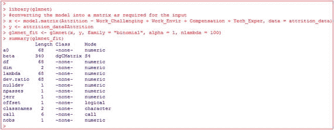
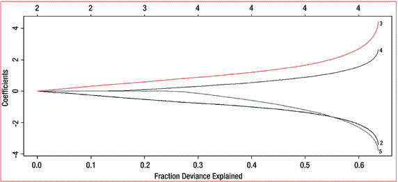
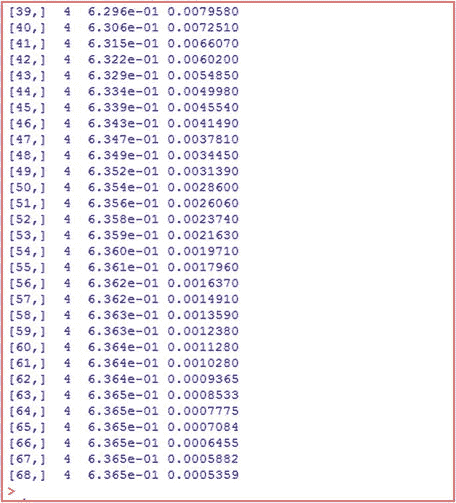
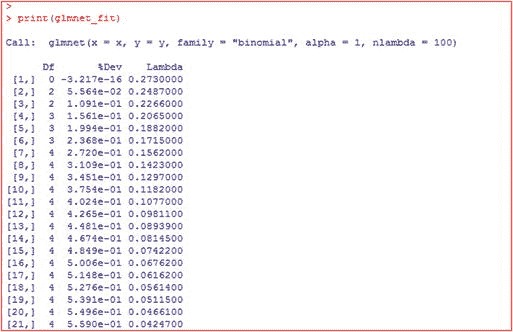

# 对人员流失数据应用正则化

让我们在剔除 `Yrs_Exp` 的数据集 `attrition_data` 上探讨正则化的概念。我们不将 `Yrs_Exp` 纳入考虑，因为我们知道它并不显著。

我们使用 `glmnet` 包中的 `glmnet()` 函数来确定正则化模型。我们使用 `glmnet` 包中的 `cv.glmnet()` 函数来确定最佳的 `lambda` 值。对 Lasso 使用 `alpha=1`，对 Ridge 使用 `alpha=0`。我们使用 `family="binomial"` 和 `type="class"`，因为我们的响应变量是二元的，并且根据要求，我们是在逻辑回归的背景下使用正则化。

`glmnet()` 函数要求输入为矩阵形式，响应变量为数值型向量。它通过惩罚最大似然法来拟合广义线性模型。正则化路径是在正则化参数 `lambda` 的一系列网格值上为 Lasso 或弹性网络惩罚计算得出的。

## 函数格式

该函数在 `glmnet` R 包中定义的通用格式如下：

```
glmnet(x, y, family=c("gaussian",
"binomial", "poisson", "multinomial", "cox", "mgaussian"),

weights, offset=NULL, alpha = 1,
nlambda = 100,

lambda.min.ratio =
ifelse(nobs<nvars,0.01,0.0001), lambda=NULL,

standardize = TRUE, intercept=TRUE,
thresh = 1e–07, dfmax = nvars + 1,

pmax = min(dfmax × 2+20, nvars),
exclude, penalty.factor = rep(1, nvars),

lower.limits=–Inf, upper.limits=Inf,
maxit=100000,

type.gaussian=ifelse(nvars<500,
"covariance", "naive"),

type.logistic=c("Newton",
"modified.Newton"),

standardize.response=FALSE,
type.multinomial=c("ungrouped", "grouped"))
```

像往常一样，我们不会使用所有参数。为简单起见，我们将只使用绝对必要的参数。每个参数的详细信息，请查阅 `glmnet` 包指南。

## 准备输入

我们将首先准备所需的输入。我们需要模型以矩阵格式作为 `glmnet()` 函数的输入。我们还需要将响应变量作为一个向量：



解释摘要的内容超出了本书的范围，但我们将展示如何主要使用图形来进行正则化。为此，我们使用 `plot()` 函数。由于我们使用的是二元数据和逻辑回归，我们使用 `xvar="dev"`（其中 `dev` 代表偏差）和 `label = TRUE` 来在图中识别作为 `plot()` 函数输入的参数：



图 10-2. 显示每个变量的偏差：两个有 + 系数，两个有 – 系数

使用 `print()` 函数输出的 `glmnet_fit` 结果如下所示：





这主要显示了自由度（非零系数的数量）、模型解释的零偏差百分比以及 `lambda` 值。如您所见，`lambda` 值持续减小。随着 `lambda` 值减小，模型解释的偏差百分比增加，显著的非零系数数量也随之增加。尽管我们为函数提供了 `nlambda = 100`（这是默认值），但仅显示了 68 个 `lambda` 值。这是因为算法确保在发现模型解释的偏差百分比没有进一步显著变化时，在最佳时机停止。