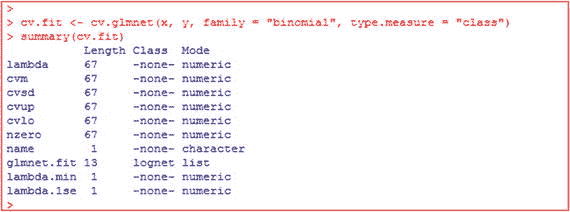
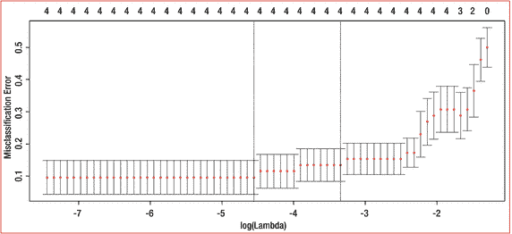
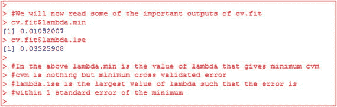
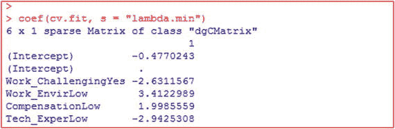

# 正则化模型的交叉验证

现在，我们将通过使用 `glmnet` 包中的 `cv.glmnet()` 函数对正则化模型进行交叉验证。该函数对 `glmnet` 执行 k 折交叉验证，生成一个图，并返回 lambda 的最小值。它还返回一个标准误范围内的 lambda 值。该函数默认执行 10 折交叉验证。如果需要，我们可以更改 k 折数。这里我们使用 `type.measure = "class"`，因为我们使用二元数据和逻辑回归。这里，`class` 给出的是误分类错误：

我们现在使用 `plot()` 函数绘制 `cv.glmnet()` 的输出，即 `cv.fit`：

**图 10-3** 显示了交叉验证曲线以及误分类错误相对于 log(lambda) 值的上限和下限值。这里的交叉验证曲线由红点描绘。

**图 10-3.** `plot(cv.fit)` 的输出

以下显示了 `cv.fit` 模型的一些重要输出参数，包括 `lambda.min` 或 `lambda.1se`：

我们可以使用 R 中的 `coef(cv.fit, s = "lambda.min")` 命令查看 `lambda.min` 值处的系数值。输出是一个稀疏矩阵，其中显示了每个独立因子的第二层级：

