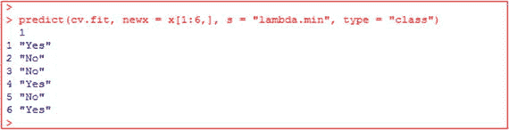

# 使用正则化模型进行预测

现在让我们看看这个正则化模型如何使用 `predict()` 函数和 `s = "lambda.min"` 选项来预测值。我们将针对数据集的前六个值进行检查。结果如下所示：

所有六个值都被 `predict()` 函数正确预测。但是，请注意，我们尚未对整个数据集验证结果。模型的准确率可能不是 100%，因为正则化的目标是为未来的预测提供一个通用模型，而无需担心对训练数据的精确拟合（过拟合）。

