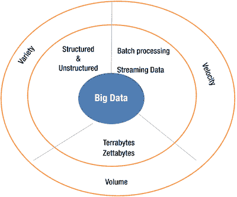
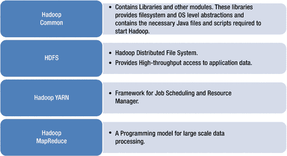
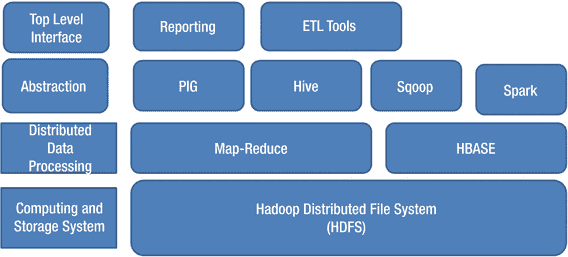

# 11. 大数据分析——介绍与未来趋势

数据就是力量。数据将成为任何企业中另一维度的价值。数据是未来决策的驱动力。所有组织机构都已意识到数据的价值，并正在尝试从各种来源整理数据并挖掘其价值。企业正试图理解消费者/市场行为，以便以最小的努力从每个消费者身上获取最大收益。幸运的是，这些组织机构得到了技术演进的支持，包括不断增长的存储能力和计算能力，以及云的能力，这些提供了基础设施和工具。这推动了数据分析领域的发展，包括描述性分析、预测性分析、机器学习、深度学习、人工智能和物联网。组织机构正在收集数据，而不必事先思考其价值，然后让数据本身来揭示其对组织的价值。数据被用来从自身中学习，从而揭示许多迄今未知、或者甚至一个逻辑思考者可能无法想到或表面上无法接受的事情。

本章不会深入探讨大数据的各种定义。许多权威人士给出了众多分歧的定义，这反而让人们更加困惑，而非厘清问题。然而，通俗地说，大数据意味着海量数据，这些数据难以通过手动方式或在有限的计算能力或计算机资源下轻松理解或分析；分析大数据需要具备处理多种性质数据（从结构化数据到非结构化数据）的能力，这些数据来自不同来源（例如社交媒体、结构化数据库、非结构化数据库和物联网）。

通常，当人们提到大数据时，他们指的是具有三个特征的数据：多样性、体量和速度，如图 11-1 所示。

**图 11-1.** 大数据的特征

多样性指的是在 Web、互联网和各种数据库等上可用的不同类型的数据。这些数据可以是结构化的或非结构化的，并可能来自各种社交媒体。体量是指可供处理的数据规模。其规模巨大——达到太字节和拍字节级别。速度是指处理和分析数据、确定其含义、构建模型并使用能够帮助商业的模型的速度。

以下因素促进了大数据的高效利用：

- 计算机集群的庞大计算能力，通过将负载分布到多台机器上，扩展了处理能力和内存能力。
- 巨大的存储能力，将数据分布到各种存储资源上。
- 机器学习算法和包的重大发展。
- 人工智能、自然语言处理等领域的发展。
- 数据可视化、数据集成和数据分析工具的发展。

## 11.1 大数据生态系统

在过去十年左右的时间里，谷歌、雅虎、IBM、SAS、SAP 和 Cloudera 等组织付出了巨大努力，设计并开发了一套庞大的工具系统，以促进从不同来源整理和集成海量数据、挖掘数据以揭示隐藏在数据中的模式或真相、可视化数据、呈现从数据中学习到的知识，并提出主动应对措施。

毫无疑问，R 语言已成为一种强大的开源语言，并被非常庞大的用户群体所采用，这尤其得益于其易用性、可用的打包且经过验证的算法以及已有的相关文档。然而，Apache Hadoop 生态系统——包括其 Hadoop 分布式文件系统以及 MapReduce、YARN、Pig、Mahout、Hive、HBase、Storm 和 Oozie 等各种工具/机制——以及 SAP 和 SAS 等商业工具，共同加强了大数据分析的驱动力。Hadoop 框架如图 11-2 所示。

**图 11-2.** Hadoop 生态系统

Hadoop 分布式文件系统（HDFS）允许数据分布在多台计算机上进行存储。此外，它还允许利用多个集群系统增强的处理能力和内存。这克服了因缺乏所需处理能力和内存而无法在单个系统中存储海量数据以及无法分析这些数据的障碍。Hadoop 生态系统由多个模块组成，使我们能够处理数据并执行分析。

用户应用程序可以向 Hadoop 提交一个作业。数据加载到系统后，会被分成多个块，通常为 64 MB 或 128 MB。然后，Hadoop 作业客户端将作业提交给 JobTracker。JobTracker 将各个任务分配并调度到分布式系统中的不同机器上；许多机器被集群在一起形成一个整体。任务分为两个阶段：Map 任务在存储数据的小数据块上执行，Reduce 任务则合并数据以产生最终输出。不同节点上的 TaskTracker 根据 MapReduce 的实现来执行任务，而 reduce 函数的结果则存储在文件系统的输出文件中。整个过程由各种较小的任务和功能控制。完整的 Hadoop 生态系统和框架如图 11-3 所示。

**图 11-3.**