# 6. 监督机器学习——分类

分类和预测是用于发现数据模式的两项重要数据分析方法。分类预测的是分类类别（或离散值），而回归和其他模型预测的是连续值函数。然而，逻辑回归（`Logistic Regression`）也能处理分类类别。例如，可以构建一个分类模型来预测信用卡申请审批流程的结果（批准或拒绝），或确定保险索赔的结果。研究人员和机器学习专家已经开发了许多分类算法。大多数分类算法都是内存密集型的。最近的研究开发了并行和分布式处理架构，例如 `Hadoop`，它能够处理大量数据。

本章重点介绍基本的分类技术。它解释了一些分类方法，包括朴素贝叶斯（`naïve Bayes`）、决策树和其他算法。它还提供了使用可用的 `R` 包来执行分类任务的示例。

## 6.1 什么是分类？什么是预测？

想象你正在申请抵押贷款。你填写了一份冗长的申请表，包含所有个人详细信息，包括收入、年龄、学历、房产位置、房产估值等等。你焦急地等待银行关于你的贷款申请是否获批的决定。结果要么是“是”，要么是“否”。银行如何决定？银行会审查你申请表上提供的各种参数，然后——根据以往收到的类似申请以及银行与这些客户打交道的经验——银行决定是批准还是拒绝贷款。

现在想象你必须决定是否在市场上推出一个新产品。你必须做出“推出”或“不推出”的决定。这取决于各种参数。你的决定将基于你过去推出产品的类似经验，以及众多市场参数。

接下来，想象你想预测客户对你企业提供的产品和服务的观点。这些观点可以是正面的也可以是负面的，并且可以根据众多参数以及你的客户对类似产品和服务的过往经验进行预测。

最后，想象机场当局必须根据一系列参数，决定某个航空公司在某个登机口的特定航班是否准时或延误。这个决定基于之前的航班详情和许多其他参数。

分类是一个两步过程。在第一步中，通过分析数据库和定义类变量（`class variable`）的属性集来构建模型。分类问题是一个监督机器学习问题。训练数据是数据库的一个样本，并且类属性（`class attribute`）是已知的。在分类问题中，类别变量 `Y` 的值由一组输入变量 `{x1, x2, x3, …}` 决定。在分类中，我们想要预测的变量通常被称为类变量（`class variable`）`C`，它可以在集合 `{c1, c2, c3, …}` 中取不同的值。观察到的或测量到的变量 `X1, X2, … Xn` 是属性（`attributes`）或输入变量（`input variables`），也称为解释变量（`explanatory variables`）。在分类中，我们想要确定类变量与输入或解释变量之间的关系。通常，模型表示分类规则或数学公式。一旦这些规则由学习模型创建，该模型就可以用于预测未来数据中未知的类。

存在多种类型的分类器模型：基于决策边界的、基于概率论的以及基于判别分析的。我们从基于概率方法的分类器开始讨论。然后，我们将研究决策树和判别分类器。

### 6.2 概率模型用于分类

概率分类器（`Probabilistic classifiers`），特别是朴素贝叶斯分类器（`naïve Bayes classifier`），是机器学习社区中最流行的分类器。朴素贝叶斯分类器是一个基于贝叶斯定理的简单概率分类器，贝叶斯定理是自然语言处理和视觉处理中最流行的定理。它是最基本的分类技术之一，具有例如电子邮件垃圾邮件检测、电子邮件分类和情感分析等应用。尽管朴素贝叶斯（`naïve Bayes`）是一种简单的技术，但它在许多复杂的现实世界问题中表现出色。

概率分类的研究基于在独立性假设下近似联合分布，然后将该概率分解为条件概率的乘积。事件 `A` 在给定事件 `B` 下的条件概率——记为 `P(A|B)`——表示在事件 `B` 也发生的情况下，事件 `A` 发生的可能性。

# 决策树

## 朴素贝叶斯分类器

在分类问题中，贝叶斯定理提供了一个公式，用于计算在给定记录属性集的情况下，该记录属于某个类别的概率。假设有 `m` 个类别 `C[1]`、`C2`、`C3`、……、`Cm`，并且已知各类别的概率 `P(C1)`、`P(C2)`、……、`P(Cm)`。如果知道每个类别中属性 `x1`、`x2`、`x3`、…… 出现的概率，那么通过使用贝叶斯定理，可以计算出该记录属于类别 `Ci` 的概率：

![$$ \mathrm{P}\left(\mathrm{Ci}\Big|{\mathrm{X}}_1,{\mathrm{X}}_2,{\mathrm{X}}_3,\dots {\mathrm{X}}_{\mathrm{p}}\right)=\frac{\mathrm{P}\left({\mathrm{X}}_1,{\mathrm{X}}_2,{\mathrm{X}}_3,\dots {\mathrm{X}}_{\mathrm{p}}\Big|{\mathrm{C}}_{\mathrm{i}}\right)\mathrm{P}\left({\mathrm{C}}_{\mathrm{i}}\right)}{\mathrm{P}\left({\mathrm{X}}_1,{\mathrm{X}}_2,\dots {\mathrm{X}}_{\mathrm{p}}\Big|{\mathrm{C}}_1\right)+\mathrm{P}\left({\mathrm{X}}_1,{\mathrm{X}}_2,\dots {\mathrm{X}}_{\mathrm{p}}\Big|{\mathrm{C}}_2\right)\dots \dots \mathrm{P}\left({\mathrm{X}}_1,{\mathrm{X}}_2,..{\mathrm{X}}_{\mathrm{p}}\Big|{\mathrm{C}}_{\mathrm{m}}\right)} $$](img/A978-1-4842-2514-1_6_Chapter_TeX2GIF_Equa.gif)

`P(Ci)` 是在没有任何其他属性的情况下，属于类别 `Ci` 的先验概率。`P(C[i]|X[i])` 是 `X[i]` 属于类别 `C[i]` 的后验概率。为了使用贝叶斯定理对一条记录进行分类，你需要计算它属于每个类别 `Ci` 的可能性。然后，根据使用上述公式计算出的最高概率得分进行分类。

对于具有多个属性的数据集，计算 `P(X|Ci)` 的计算成本极高。因此，我们做了一个朴素假设，即假定给定样本的类别标签后，每条记录相互独立。假设每个类别内的预测属性相互独立是合理的，因此我们可以简化方程：

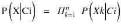

假设每个数据样本由一个 `n` 维向量表示，`X = {x[1], x[2], … xn}`，样本来自 `n` 个类别值属性 `A[1], A[2], … A[n]`，具有 `m` 个类别 `C1, C2, … Cm`，则 `P(X[k]|C[i]) = n/N`，其中 `n` 是类别 `C[i]` 中属性 `A[k]` 取值为 `Xk` 的训练样本数，`N` 是属于类别 `C[i]` 的训练样本总数。

### 6.2.1 示例

我们来看一个例子，了解如何使用贝叶斯分类器预测类别标签。表 6-1 给出了银行信用卡审批过程的训练数据元组集。

**表 6-1. 样本训练集**

| ID | 购买频率 | 信用评级 | 年龄 | 类别标签：是 = 批准，否 = 拒绝 |
| --- | --- | --- | --- | --- |
|  | 中等 | 良好 | < 35 | 否 |
|  | 中等 | 优秀 | < 35 | 否 |
|  | 高 | 一般 | 35–40 | 是 |
|  | 高 | 一般 | > 40 | 是 |
|  | 低 | 优秀 | > 40 | 是 |
|  | 低 | 良好 | > 40 | 否 |
|  | 低 | 优秀 | 35–40 | 是 |
|  | 中等 | 一般 | < 35 | 否 |
|  | 低 | 一般 | < 35 | 否 |
|  | 中等 | 优秀 | > 40 | 否 |
|  | 高 | 一般 | < 35 | 是 |
|  | 中等 | 优秀 | 35–40 | 否 |
|  | 中等 | 一般 | 35–40 | 是 |
|  | 高 | 良好 | < 35 | 否 |

该训练集中的数据样本包含属性：年龄、购买频率和信用评级。类别标签属性有两个不同的类别：批准或拒绝。设 `C1` 对应批准类别，`C2` 对应拒绝类别。使用朴素贝叶斯分类器，我们要对一个未知标签的样本 `X` 进行分类：

`X = (年龄 > 40, 购买频率 = 中等, 信用评级 = 优秀)`

要对一条记录进行分类，首先通过计算训练记录中 `P(Ci|X1, X2, … Xp)` 来计算该记录属于每个类别的概率。然后根据概率最高的类别进行分类。

在这个例子中，有两个类别。我们需要计算 `P(Xi|Ci)P(Ci)`。`P(Ci)` 是每个类别的先验概率：

- `P(申请审批 = 是) = 6/14 = 0.428`
- `P(申请审批 = 否) = 8/14 = 0.571`

让我们计算 `P(X|C[i])`，其中 `i = 1, 2, …` 条件概率：

- `P(年龄 > 40 | 审批 = 是) = 2/6 = 0.333`
- `P(年龄 > 40 | 审批 = 否) = 2/8 = 0.25`
- `P(购买频率 = 中等 | 审批 = 是) = 1/6 = 0.167`
- `P(购买频率 = 中等 | 审批 = 否) = 5/8 = 0.625`
- `P(信用评级 = 优秀 | 审批 = 是) = 2/6 = 0.333`
- `P(信用评级 = 优秀 | 审批 = 否) = 3/8 = 0.375`

使用这些概率，可以得到以下结果：

- `P(X | 审批 = 是) = 0.333 × 0.167 × 0.333 = 0.0185`
- `P(X | 审批 = 否) = 0.25 × 0.625 × 0.375 = 0.0586`
- `P(X | 审批 = 是) × P(审批 = 是) = 0.29 × 0.428 = 0.0079`
- `P(X | 审批 = 否) × P(审批 = 否) = 0.586 × 0.571 = 0.03346`

朴素贝叶斯分类器预测给定的样本集 `X` 的审批结果为“否”。

### 6.2.2 使用 R 语言实现朴素贝叶斯分类器

我们尝试使用 R 语言构建模型。我们将使用相同的示例。数据样本集包含属性：年龄、购买频率和信用评级。类别标签属性有两个不同的类别：批准或拒绝。目标是预测新样本的类别标签，其中年龄 > 40，购买频率 = 中等，信用评级 = 优秀。

第一步是从文件中读取数据：

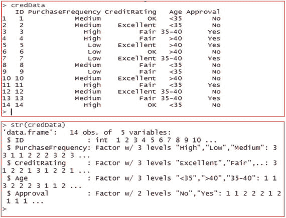

下一步是使用 `mlbench` 和 `e1071` 包构建分类器（朴素贝叶斯）模型：

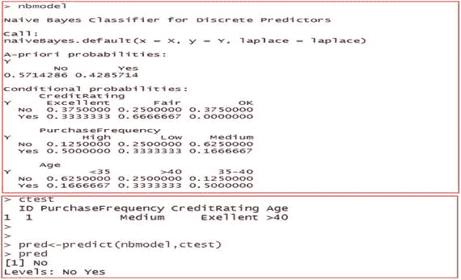

对于新样本数据 `X = (年龄 > 40, 购买频率 = 中等, 信用评级 = 优秀)`，朴素贝叶斯模型预测审批结果为“否”。

### 6.2.3 朴素贝叶斯分类器的优点与局限性

朴素贝叶斯分类器是所有分类器中最简单的一种。它计算效率高，并且在独立性假设成立时能提供最佳性能。拥有的记录越多，朴素贝叶斯的性能就越好。

朴素贝叶斯分类器的主要问题在于分类模型依赖于后验概率，当某个预测类别在训练数据中不存在时，模型会假设其概率为零。如果这个属性值很重要，这可能会成为大问题。零值会导致计算出的条件概率值可能产生错误的预测。当使用计算机进行上述计算时，有时可能导致浮点错误。因此，最好通过添加概率算法来进行计算。具有最高对数概率的类别仍然是最重要的类别。如果某个特定类别在某个特定类别中没有出现，其条件概率等于 `0`。那么乘积就会变成 `0`。如果我们使用第二个方程，`log(0)` 是无穷大。为了避免这个问题，我们使用加一平滑或拉普拉斯平滑，即对每个计数加 `1`。对于数值属性，假设其服从正态分布。然而，如果我们知道该属性不是正态分布，而可能遵循其他分布，则可以使用不同的程序来计算估计值——例如，核密度估计不假设任何特定的分布。另一种可能的方法是对数据进行离散化。

尽管在现实世界中条件独立性并不成立，但朴素贝叶斯往往表现良好。

# 决策树

决策树通过树形结构构建分类模型。决策树结构由根节点、分支和叶节点组成。叶节点保存类别标签，每个分支表示决策树测试的结果，内部节点表示决策点。

图 6-1 展示了贷款审批模型的决策树。每个内部节点代表对一个属性的测试。在此示例中，决策节点是`Purchase Frequency`（购买频率），它有两个分支：`High`（高）和`Low`（低）。如果`Purchase Frequency`为`High`，则下一个决策节点是`Age`（年龄）；如果`Purchase Frequency`为`Low`，则下一个决策节点是`Credit Rating`（信用评级）。叶节点代表分类决策：`Yes`（是）或`No`（否）。这种结构称为树形结构，树中最顶层的决策节点称为根节点。使用决策树的优点在于它既能处理数值型数据，也能处理分类型数据。

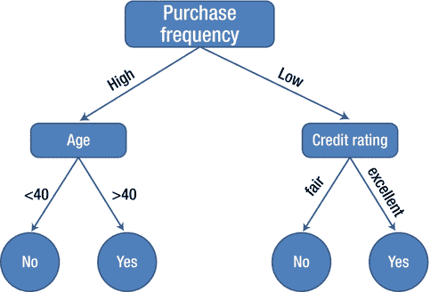

图 6-1. 决策树示例

决策树具有多项优点。它不需要任何领域知识，学习和分类所涉及的步骤简单快速，并且模型易于理解。这种机器学习算法基于分治规则生成决策树。设`x1`、`x2`和`x3`为自变量；`Y`表示因变量，属于分类变量。`X`变量可以是连续型、二值型或序数型。决策树使用递归分割算法来构建树。第一步是选择其中一个变量`xi`作为根节点进行分割。根据变量的类型和取值，分割可以分为两部分或三部分。然后，通过选择下一个变量对每个部分再次进行分割。分割过程持续进行，直到达到决策类别。选定根节点变量后，创建顶层树，算法通过对每个子节点进行分割来递归执行。我们将最终的叶子称为同质的，或尽可能纯净。纯净意味着最终节点只包含一个类别；然而，这并非总能实现。此处的挑战在于选择要分割的节点，以及当存在大量待分割变量时，知道何时停止树的分割或对树进行剪枝。

### 6.3.1 递归分区决策树算法

构建决策树的基本策略是一种递归的分治方法。包含以下步骤：

1.  树从训练集的一个单一节点开始。
2.  基于信息增益或熵度量来选择节点属性或决策属性。
3.  为测试属性的每个已知值创建一个分支。
4.  此过程持续进行，直到所有属性都被考虑用于决策。

当出现以下情况时，树停止生长：

-   所有样本都属于同一类别。
-   样本中没有更多属性可供进一步分区。
-   属性分支没有对应的样本。

### 6.3.2 信息增益

为了选择决策树节点和属性来分割树，我们度量该属性提供的信息。这种度量被称为分割优劣的度量。具有最高信息增益的属性被选为要进行分割的节点的测试属性。该属性最小化了在递归分区节点中对样本进行分类所需的信息。这种分割方法最小化了分类一个对象所需的测试次数，并保证了生成一棵简单的树。许多算法使用熵来计算样本的同质性。

设`N`是一个由`n`个数据样本组成的集合。设`k`是类别属性，具有`m`个不同的类别标签`C[i]`（其中`i = 1, 2, 3, … m`）。

基尼不纯度指数定义如下：

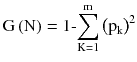

其中`p[k]`是集合`N`中属于类别`k`的观测值的比例。当所有观测值都属于同一类别时，`G(N) = 0`；当所有类别均匀分布时，`G(N) = (m – 1) / m`。图 6-2 显示，当`p[k] = 0.5`时，不纯度度量达到最高。

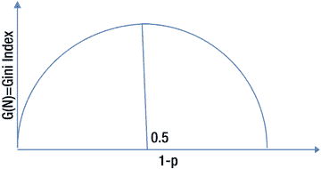

图 6-2. 基尼指数

第二个不纯度度量是熵度量。对于包含`n`个样本且具有`m`个不同类别`C[i]`（其中`i = 1, … m`）的类别，在样本空间`N`和类别`C[i]`中，对样本进行分类所需的期望信息表示如下：


其中`p[k]`是任意一个样本属于类别`C[i]`的概率。

该度量的取值范围在`0`（最纯净——所有观测值属于同一类别）和`log2`（所有类别均匀分布）之间。对于两类情况，当`p[k] = 0.5`时，熵度量达到最大值。

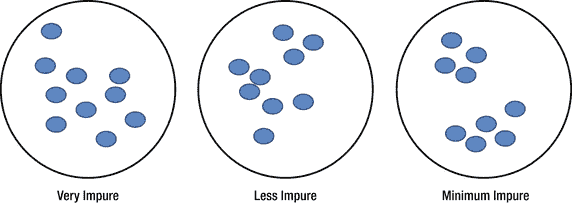

图 6-3. 不纯度

设`X`为具有`n`个不同记录`A = {a[1], a[2], a[3], … a[n]}`的属性。`X`属性可以被划分成子集`{S[1], S[2], … S[v]}`，其中`S[k]`包含`A`的`a[j]`值。树是从基于每个属性提供的信息增益而选出的一个属性作为根节点开始生长的。子集对应于从这个节点生长出的分支，而该节点是`S`的一个子集。属性`A`的熵或期望信息由下式给出：


子集分区的纯度取决于熵值的大小。熵值越小，纯度越高。每个分支的信息增益基于`X`属性计算如下：


`Gain (A)`是`X`的每个属性熵之间的差值。它是由各个属性引起的熵的期望减少量。具有最高信息增益的属性被选为给定集合`S`的根节点，并根据样本分区为每个属性创建分支。

### 6.3.3 决策树示例

让我们通过一个示例来说明决策树算法。表 6-2 展示了一个零售商店信用卡贷款审批过程的数据元组训练集。

表 6-2. 样本训练集

| ID | 购买频率 | 信用评级 | 年龄 | 类别标签：是 = 批准，否 = 拒绝 |
| --- | --- | --- | --- | --- |
| 1 | 中等 | 良好 | < 35 | 否 |
| 2 | 中等 | 优秀 | < 35 | 否 |
| 3 | 高 | 一般 | 35–40 | 是 |
| 4 | 高 | 一般 | > 40 | 是 |
| 5 | 低 | 优秀 | > 40 | 是 |
| 6 | 低 | 良好 | > 40 | 否 |
| 7 | 低 | 优秀 | 35–40 | 是 |
| 8 | 中 | 一般 | < 35 | 否 |
| 9 | 低 | 一般 | < 35 | 否 |
| 10 | 中 | 优秀 | > 40 | 否 |
| 11 | 高 | 一般 | < 35 | 是 |
| 12 | 中 | 优秀 | 35–40 | 否 |
| 13 | 中 | 一般 | 35–40 | 是 |
| 14 | 高 | 尚可 | < 35 | 否 |

该训练集中的数据样本包含属性`年龄`、`购买频率`和`信用评级`。`类别标签`属性有两个不同的类别：`批准`或`拒绝`。设`C1`对应类别`批准`，`C2`对应类别`拒绝`。使用决策树，我们希望分类未知标签样本`X`：

```
X = (年龄 > 40, 收入 = 中等, 信用评级 = 优秀)
```

### 6.3.4 决策树的归纳

在此示例中，我们有三个变量：`年龄`、`购买频率`和`信用评级`。为了构建树的开端，我们必须选择其中一个变量进行分裂。如何选择？基于每个属性的熵和信息增益：

在此示例中，代表`贷款批准`的`类别标签`属性有两个值（即`批准`或`拒绝`）；因此，有两个不同的类别 (`m = 2`)。`C1`代表类别`是`，类别`C2`对应`否`。有八个`是`类样本和六个`否`类样本。为计算每个属性的信息增益，我们使用方程 [1] 来确定对给定样本进行分类所需的期望信息：

```
I (贷款批准) = I(C1, C2) = I(6,8) = – 6/14 log2 – 8/14 log2
= –(0.4285 × –1.2226) – (0.5714 × –0.8074)
= 0.5239 + 0.4613 = 0.9852
```

接下来，计算每个属性 — `年龄`、`购买频率`和`信用评级`的熵。

对于每个属性，我们需要查看`是`和`否`的分布，并计算每个分布的信息。我们从`购买频率`属性开始。第一步是计算每个收入类别的熵，如下所示：

对于`购买频率 = 高`，`C11 = 3`，`C21 = 1`。这里，第一个下标 1 代表`是`，第二个下标 1 代表`购买频率 = 高`，第一个下标 2 代表`否`。

```
I(C[11], C[21]) = I(3,1) = – 3/4 log2 – 1/4 log2 = –(0.75 × –0.41) + (0.25 × –2)
I(C[11], C[21]) = 0.3075 + 0.5 = 0.8075
```

对于`购买频率 = 中`

```
I(C[12], C[22]) = I (1,5) = –1/6 log(1/6) – 5/6 log(5/6) = –(0.1666 × –2.58) – (0.8333 × –0.2631) = 0.4298 + 0.2192
I(C[12], C[22]) = 0.6490
```

对于`购买频率 = 低`

```
I (C[13], C[23]) = I (2,2) = –(0.5 × –1) – (0.5 × -1) = 1
```

使用方程 [2]：

```
E (购买频率) = 4/14 × I(C[11], C[12]) + 6/14 × I(C[12], C[22]) + 4/14 × I(C[13], C[23])
= 0.2857 × 0.8075 + 0.4286 × 0.6490 + 0.2857 × 1
E(购买频率) = 0.2307 + 0.2781 + 0.2857 = 0.7945
```

属性`购买频率`的信息增益计算如下：

```
增益 (购买频率) = I (C1, C2) – E(购买频率)
增益 (购买频率) = 0.9852 – 0.7945 = 0.1907
```

类似地，计算其他属性的`增益`，`增益 (年龄)`和`增益 (信用评级)`。在属性中，哪个具有最高的信息增益，它就被选为该划分的根节点。同样地，为该划分中每个属性的值生成分支。决策树持续增长，直到该划分中的所有属性都被覆盖。

对于`年龄 < 35`，`I (C11, C12) = I(1,5) = 0.6498`
对于`年龄 > 40`，`I(C12, C22) = I (2,2) = 1`
对于`年龄 35 – 40`，`I(C13, C23) = I(3,1) = 0.8113`

```
E (年龄) = 6/14 × 0.6498 + 4/14 × 1 + 4/14 × 0.8113 = 0.2785 + 0.2857 + 0.2318 = 0.7960
增益 (年龄) = I (C1,C2) – E(年龄) = 0.9852 – 0.7960 = 0.1892
```

对于`信用评级 一般`，`I(C11, C12) = I(4,2) = -4/6 log(4/6) – 2/6 log(2/6)`

```
= -(0.6666 × -0.5851) - (0.3333 × -1.5851) = 0.3900 + 0.5283 = 0.9183
```

# 决策树与机器学习模型

## 信息增益计算

- 对于信用评级为“OK”，`I(C2, C2) = I(0, 3) = 0`
- 对于信用评级为“Excellent”，`I(C1, C3) = I(2, 3) = -2/5 log(2/5) - 3/5 log(3/5)`
- `= -(0.4 × -1.3219) - (0.6 × -0.7370) = 0.5288 + 0.4422 = 0.9710`
- `E(信用评级) = 6/14 × 0.9183 + 3/14 × 0 + 5/14 × 0.9710 = 0.3935 + 0.3467`
- `E(信用评级) = 0.7402`
- `Gain(信用评级) = I(C1, C2) - E(信用评级) = 0.9852 - 0.7402 = 0.245`

在本例中，信用评级具有最高的信息增益，因此被用作根节点，并为每个属性值生成分支。下一个树分支节点基于剩余的两个属性：年龄和购买频率。年龄和购买频率几乎具有相同的信息增益。其中任何一个都可以用作该分支的拆分节点。我们选择年龄作为该分支的拆分节点。其余分支使用剩余样本进行划分，如图 6-4 所示。对于年龄<35 的情况，决策是明确的。而对于其他年龄段，在做出贷款批准决策之前，需要查看购买频率参数。这涉及计算剩余样本的信息增益并确定下一个拆分点。

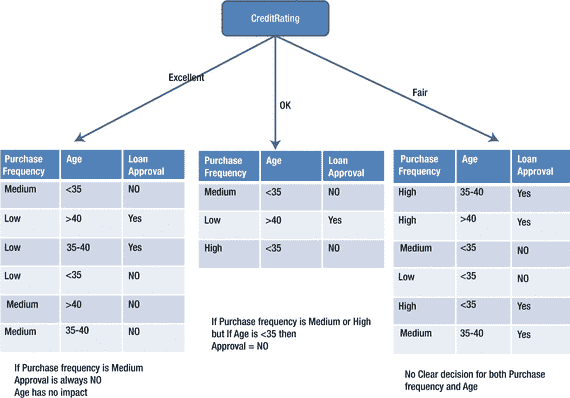
**图 6-4.** 贷款批准决策树

最终决策树如图 6-5 所示。

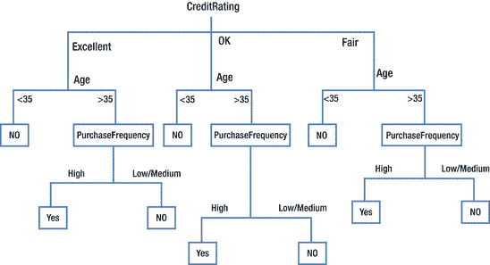
**图 6-5.** 完全生长的决策树

## 从树中提取分类规则

决策树提供了易于理解的分类规则。遍历每个树叶节点即可获得一条分类规则。对于前面的示例，最佳剪枝后的树给出了以下规则：

- **规则 1：** 如果信用评级为 Excellent，年龄>35，购买频率为 High，则贷款批准 = Yes
- **规则 2：** 如果年龄<35，信用评级 = OK，购买频率为 Low，则贷款批准 = No
- **规则 3：** 如果信用评级为 OK 或 Fair，购买频率为 High，则贷款批准 = Yes
- **规则 4：** 如果信用评级为 Excellent、OK 或 Fair，购买频率为 Low 或 Medium，且年龄>35，则贷款批准 = No

使用决策树，我们希望对一个未知标签的样本`X`进行分类：`X = (年龄 > 40, 购买频率 = Medium, 信用评级 = Excellent)`。根据上述规则，贷款批准 = No。

## 过拟合与欠拟合

在机器学习中，模型被定义为一个函数，我们将从训练数据中学习函数的过程称为归纳学习。泛化指的是模型通过将概念应用于未见过的数据来学习概念的程度。一个好的机器学习模型的目标是减少泛化误差，从而对模型从未见过的数据做出良好的预测。

过拟合和欠拟合是可能影响机器学习模型性能的两个重要因素。当模型在训练数据上表现良好但在测试数据上表现不佳时，就会发生过拟合。当模型过于简单，以至于在训练数据和测试数据上表现都不佳时，就会发生欠拟合。

如果我们拥有过多的特征，模型可能会过度拟合训练数据，因为它捕获了数据中的噪声，进而在测试数据上表现不佳。这种机器学习模型与数据拟合得过于紧密，往往会产生较大的方差。因此，泛化误差的数量更高，我们说数据发生了过拟合。

当模型未能捕获和拟合数据时，会导致性能不佳。我们将此称为欠拟合。欠拟合是模型不佳的结果，通常对任何数据都不能表现良好。

分类性能的衡量指标之一列联表。举例来说，假设你的新模型正在预测投资者是否会资助你的项目。训练数据给出的结果如表 6-3 所示。

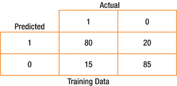
**表 6-3.** 训练样本的列联表

该模型的准确率相当高。因此我们看到该模型是一个好模型。然而，当我们用测试数据测试该模型时，结果如表 6-4 所示，错误数量更高。

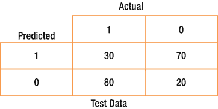
**表 6-4.** 测试样本的列联表

在这种情况下，模型在训练数据上表现良好，但在测试数据上却不然。这种虚假的自信（因为模型是从训练数据中生成的）可能会导致你承担比原本大得多的风险，并使你处于脆弱的境地。

避免过拟合的最佳方法是在完全超出训练数据范围的数据或未见过的数据上测试模型。这让你有信心你拥有一个具有代表性的样本，该样本是生产环境真实数据的一部分。除此之外，定期重新验证模型以确定模型是否在退化或需要改进，并确保其正在实现你的业务目标，也是一个好的实践。

## 偏差与方差

在监督式机器学习中，模型的目标是从训练数据中学习并进行预测。然而，学习方程本身具有影响模型的隐藏因素。因此，预测模型总是存在一个不可约的误差因子。除此之外，如果模型没有从训练集中学习，则可能导致其他预测误差。我们称这些为偏差-方差误差。

偏差通常发生在模型欠拟合且未能从训练数据中充分学习时。它是概率分布均值与实际正确值之间的差异。因此，模型的准确性对于不同的数据集（测试集和训练集）是不同的。为了减少偏差误差，数据科学家通过重新采样数据来重复模型构建过程，以获得更好的预测值。

方差是由于不同的训练样本集而导致的预测误差。理想情况下，误差不应因训练样本的不同而变化，模型应足够稳定以处理输入和输出变量之间的隐藏变化。这通常发生在过拟合的模型中。

如果偏差或方差过高，模型可能与现实相去甚远。一般来说，偏差和方差之间存在权衡。任何机器学习算法的目标都是实现低偏差和低方差，从而提供良好的预测性能。

实际上，由于模型中存在许多其他隐藏参数，很难计算真实的偏差和方差误差。尽管如此，偏差和方差提供了一种衡量标准，用于理解机器学习算法的行为，以便可以调整模型以提供良好的预测性能。

图 6-6 展示了一个示例。蓝色的大圆圈是实际值，红色的小圆圈是预测值。该图展示了方差情况下的偏差-方差示意图。

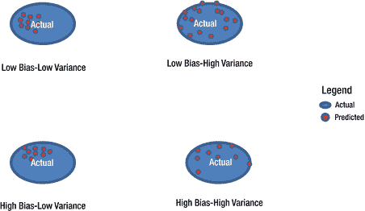
**图 6-6.** 偏差-方差

## 避免过拟合错误与设置树的大小

使用完整数据集构建一棵完全生长的树会导致数据的完全过拟合，因为每条记录和每个变量都参与了树的拟合。过拟合会导致分类器在未见过的、新的数据集上表现不佳。训练集的错误数量预计会随着树层级数的增加而减少，而对于新数据，错误会一直减少到考虑所有预测变量的某个点，此后模型会开始学习数据集中的噪声，从而整体错误开始增加，如图 6-7 所示。

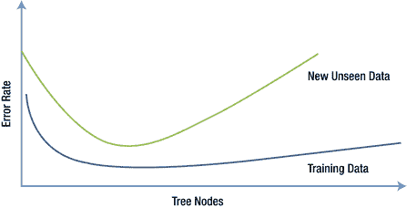
**图 6-7.** 过拟合误差

有两种限制过拟合误差的方法。一种方法是在开始时设置规则来停止树的生长。另一种方法是允许树完全生长，然后对其进行剪枝，使其达到不过拟合的程度。接下来将讨论这两种解决方案。

### 限制树的生长

停止树生长的一种方法是在模型开始过拟合数据之前，在开始时设置一些规则。虽然你可以使用多种方法（例如，识别节点中的最小记录数或最小不纯度，或减少分裂次数），但要确定一个合适的停止树生长的点并不容易。

一种流行的方法是卡方自动交互检测（CHAID），它基于一种递归分割方法，该方法又基于著名的分类与回归树（CART）算法，该算法已被市场营销应用程序等广泛使用多年。CHAID 使用著名的统计检验（卡方独立性检验）来评估分裂一个节点是否能提高节点的纯度，以及这种提高是否具有统计显著性。在每个节点分裂时，会选择与响应变量关联最强的变量，衡量指标是卡方独立性检验的`p 值`。当该检验未显示出显著关联时，树的分裂就会停止，此过程也随之终止。这种方法更适用于分类变量，但也可以通过将连续变量转换为分类区间来采用。

大多数工具都提供了选择分裂大小和剪枝方法的选项。如果你不记得卡方检验，那也没关系。然而，了解选择哪种方法、何时选择以及为什么选择它，这很重要。

### 剪枝

另一种解决方案是让树完全生长，然后进行剪枝。剪枝的目的是识别那些几乎不降低错误率的分支并将其移除。剪枝过程包括连续选择一个决策节点并将其重新指定为叶节点，从而通过减少误分类错误来缩小树的规模。剪枝过程减少了误分类错误和噪声，但同时保留了树的模式。正是在这一点上，未见数据（新数据）的错误曲线开始上升，而这也正是我们必须对树进行剪枝的点。

该方法已在多种软件包中实现，例如基于 CART（由 Leo Breiman 等人开发）的 SAS 和基于 C4.5（由 Ross Quinlan 开发）的 SPSS。在 C4.5 中，训练数据既用于生长树，也用于剪枝。

CART 方法中的回归树也可用于预测连续变量。输出变量`Y`是一个连续变量。树的构建和分裂点的识别与分类树类似，在每一层测量不纯度。其目标是创建一个用于预测连续变量值的模型。

## 其他分类器类型

决策树是一种简单的分类器，它将重要的预测变量显示为树的根节点。从用户的角度来看，决策树不需要转换变量或选择变量来分裂树的分支（这是决策树算法的一部分），甚至剪枝也可以在无需用户干预的情况下自动处理。树的构建依赖于观测值，而不是实际的数值大小；因此，决策树本质上对异常值和缺失值具有鲁棒性。此外，由于决策树生成的规则简单，因此易于理解。

然而，从计算的角度来看，构建决策树可能相对昂贵，因为需要为多个变量识别分裂点。此外，剪枝也会增加计算时间。

另一个缺点是，决策树需要大量的数据集才能构建出性能良好的分类器。它也不像判别分类器等线性分类器那样依赖预测变量之间的任何关系，因此可能导致性能较低。最近，Leo Breiman 和 Adele Cutler 引入了随机森林，这是对分类树的一种扩展，用于解决这些问题。该算法从数据集中创建多个决策树（即树森林），并优化输出以获得性能更好的分类器。

在本节中，我们将简要介绍其他流行的分类方法，包括 k-近邻（K-NN）、随机森林和神经网络。我们还将探讨何时以及在何种条件下可以使用这些分类器。

### K-近邻

k-近邻（K-NN）分类器基于在`n`维空间中学习数值属性。所有训练样本都存储在一个具有特定模式的`n`维空间中。当给出一个新样本时，K-NN 分类器会搜索最接近该样本的模式空间，并相应地标记`k`模式空间（称为 k-近邻）中的类别。“接近度”用欧几里得距离来定义，其中两点`X = (x1, x2, x3, … xn)`和`Y = (y1, y2, y3, … yn)`之间的欧几里得距离定义如下：

```
d(X, Y) = Σ (Xi - Yi)²   (对于 i=1 到 n)
```

未知样本会被分配到 k-近邻模式中最近的类别。其思想是在训练记录中查找与待分类记录相似或“接近”的记录，这些训练记录的值接近`X = (x1, x2, x3, …)`。这些记录根据“接近度”被分组到不同的类别中，未知样本将寻找由`k`定义的类别，并将自身识别为在`k`空间中最近的类别。

图 6-8 显示了一个简单的 K-NN 工作原理示例。如果要对一条新记录进行分类，它会找到与该记录最接近的匹配项，并将其标记到该类别。例如，如果它走路像鸭子，叫声像鸭子，那么它很可能就是一只鸭子。

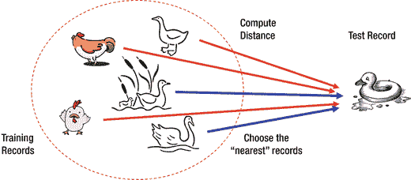
**图 6-8.** K-NN 示例

K-近邻不假设预测变量（`X`）和类别（`Y`）之间存在任何关系。相反，它基于数据集中预测变量和记录之间的相似性度量来得出类别的结论。尽管有许多可能的度量方法，但 K-NN 使用记录之间的欧几里得距离来寻找相似性，以便标记类别。请注意，在计算欧几里得距离和进行分类之前，应将预测变量标准化到共同的尺度上。

在计算出记录间的距离后，我们需要一个规则来将这些记录归入不同的类别（`k`）。较高的 `k` 值可以降低因训练集中噪声导致的过拟合风险。理想情况下，我们平衡 `k` 的值，使得误分类误差最小化。理想情况下，`k` 的值可以在 2 到 10 之间；每次我们都尝试找出误分类误差，并找到能给出最小误差的 `k` 值。

## 随机森林

决策树基于一组真/假决策规则，其预测则依赖于每个终端节点的树规则。这类似于一棵具有多个节点（对应真/假问题）的树，每个节点根据问题的答案分出两个分支。对于小规模样本训练数据，决策树会遇到过拟合问题。相比之下，随机森林模型非常适合处理小样本问题。

随机森林会创建多个深度决策树，并对其进行平均处理，这些深度决策树是在同一训练集的不同部分上训练的。随机森林的目标是克服单个树的过拟合问题。换句话说，随机森林是一种在训练时学习和构建决策树的集成方法。

随机森林由多个决策树组成（树的数量越多越好）。随机性体现在从训练集中随机选择训练子集。这种方法被称为自助聚合或装袋（bagging），这样做是为了通过稳定预测来减少过拟合。此方法也用于许多其他机器学习算法，而不仅仅局限于随机森林。

另一种随机性是从变量集合中随机选择变量。这意味着不同的树基于不同的变量集。例如，在我们之前的例子中，一棵树可能只使用收入和信用评分，而另一棵树可能使用全部三个变量。但在一个森林中，所有的树仍然会共同影响随机森林的总体预测。

随机森林具有低偏差。通过增加更多的树，我们降低了方差，从而减少了过拟合。这是随机森林的优势之一，因此它正变得越来越流行。随机森林模型对输入变量集相对稳健，并且通常无需关心数据的预处理。研究表明，它们比支持向量机（SVM）等其他模型更容易构建。

表 6-5 列出了各种类型的分类器及其优缺点。

**表 6-5. 分类算法——优缺点**

| 序号 | 分类方法 | 优点 | 缺点 |
| --- | --- | --- | --- |
| | 朴素贝叶斯 | 当独立性假设成立时，计算效率高。 | 模型依赖于后验概率。当训练数据中不存在某个预测变量类别时，模型会假定该概率，可能导致错误的预测。 |
| | 决策树 | 规则简单易懂，易于理解。不需要任何领域知识。学习和分类所涉及的步骤简单且快速。决策树无需转换变量或选择变量来分割树的分支。 | 构建决策树可能相对昂贵，并且进一步的剪枝会增加计算时间。需要大型数据集才能构建性能良好的分类器。 |
| | 最近邻 | 简单且无需参数假设。在大型训练集上表现良好。 | 查找最近邻需要时间。当预测变量数量较多时，性能会下降。 |
| | 随机森林 | 在小型和大型数据集上均表现良好。能够平衡偏差和方差，提供更好的性能。比其他高级模型（如非线性支持向量机）更容易构建。 | 如果某个变量是包含多个类别的分类变量，随机森林会偏向于具有多个类别的该变量。 |

## 使用 R 的分类示例

本示例使用学生录取数据。学生根据各种测试结果标准被划分到不同的级别，然后学校据此录取学生。数据集已经标记了不同的级别。目标是构建一个模型来预测类别。我们将使用 R 来演示这个示例。

一旦理解了业务问题，第一步就是读取数据集。数据以 CSV 格式存储。你将读取数据。下一步是了解数据的特征，看是否需要转换变量类型、处理缺失值等。之后，将数据集划分为训练集和测试集。训练集用于构建模型，测试集用于测试模型性能。你将使用决策树来构建分类模型。模型成功开发后，下一步是了解模型的性能。如果模型满足客户需求，你就可以部署该模型。否则，你可以返回并微调模型。最后，报告结果并将模型部署到实际环境中。

数据集为 CSV 格式，存储在 `grades.csv` 文件中。加载 `tree` 库并按如下方式读取文件：


探索数据以了解其特征。这里展示了 R 函数：
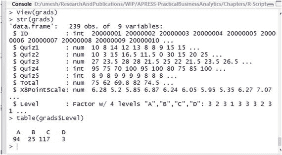

下一步是将数据集划分为训练集和测试集。共有 240 条记录。我们使用 70% 作为训练数据集，30% 作为测试数据集：
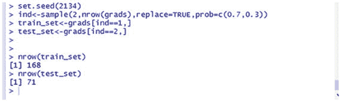

使用 `tree()` 函数构建决策树模型。各个社区为 R 贡献了大量的函数。在本示例中，我们使用流行的 `tree` 包。你也可以通过查阅相应的文档，尝试使用其他函数。
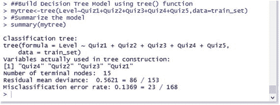

模型摘要显示，残差偏差为 0.5621，误分类误差为 13.69%。现在，绘制树结构，如图 6-9 所示。
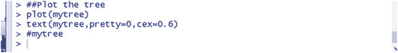
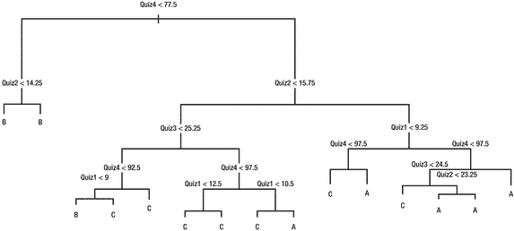
**图 6-9. 决策树结构示例图**

模型准备好后，使用测试数据集对模型进行测试。我们已经划分了测试数据集。该测试数据集不是训练集的一部分。这将帮助你了解模型的性能如何，以及是否存在过拟合或欠拟合。
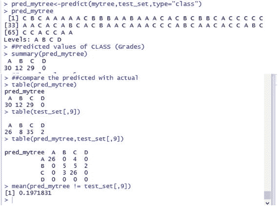

如您所见，误分类平均误差为 19.71%。尽管如此，即使面对模型从未见过的测试数据，该模型似乎仍然表现良好。让我们尝试通过剪枝树来提升模型性能，然后你将使用训练集进行操作。
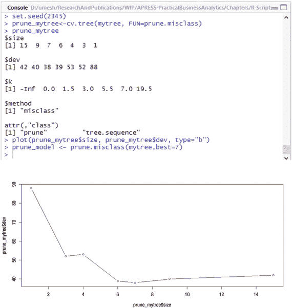
**图 6-10. 绘制偏差与规模的关系图**

通过绘制偏差与树规模的关系图，最小误差出现在规模为 7 时。让我们将树剪枝到规模 7，并重新计算预测性能（见图 6-11）。你需要重复之前的所有步骤。
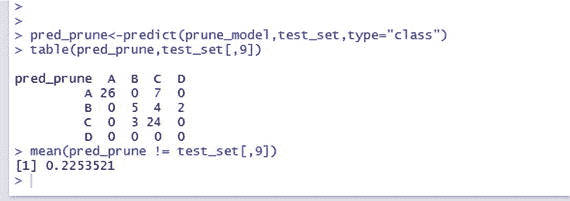
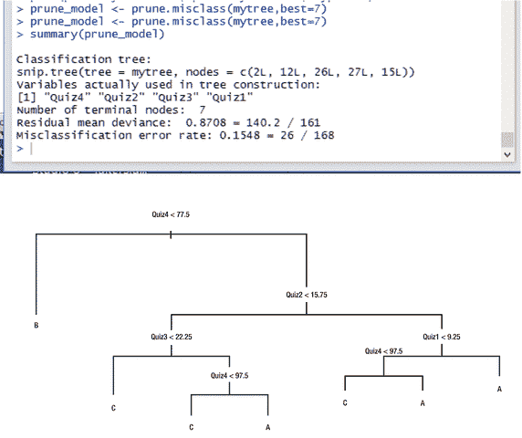
**图 6-11.**

# 剪枝后的树

对于剪枝后的树，误分类误差率为 15.48%，残差平均偏差为 0.8708。模型拟合效果更佳，但误分类误差率略高于完整树模型。因此，剪枝后的树模型并未提升模型性能。下一步是执行 K 折交叉验证过程。具体流程如下：

1. 将数据集划分为 k 折。建议取值为 k = 10。
2. 对于数据集中的每一折，使用 k-1 折构建模型，并用模型检验被剔除的那一折的有效性。
3. 记录预测误差。
4. 重复上述步骤 k 次，使每一折都成为测试集的一部分。
5. 在 k 次迭代中每次记录误差的平均值即为交叉验证误差，此误差将成为模型的性能度量指标。

## 6.6 小结

本章解释了监督式机器学习的基本概念，以及分类模型与预测模型之间的区别。您了解到为什么分类模型也属于预测范畴。

您学习了使用朴素贝叶斯的概率分类模型的基础知识。您还通过 R 语言的示例了解了贝叶斯定理在分类和类别预测中的应用。

本章介绍了决策树模型、如何构建决策树、如何选择决策树根节点以及如何对树进行分裂。您看到了构建决策树、剪枝树以及衡量分类模型性能的示例。

您还学习了与过拟合和欠拟合相关的偏差-方差概念。

最后，您探索了如何使用 R 语言创建分类模型、理解模型性能度量方法以及提升模型性能。

