# 8. 简单线性回归

## 8.1 引言

假设你是一位商业投资者，想要投资于那些很可能获得高利润的初创企业。你会在意被投资公司的哪些因素呢？也许是初创企业产品的创新性，也许是发起人过往的成功记录。在这种情况下，我们认为企业的盈利能力依赖于或与产品的创新性以及发起人过往的成功记录相关。产品创新性本身可能与多个方面或因素有关，例如产品的实用性、市场竞争状况等等。这些因素可能有些难以衡量，但发起人过往的成功记录可以很容易地从现有市场数据中找到。如果发起人创办了十家企业，其中八家成功，那么我们可以说发起人的成功率为 80%。

假设你想提高所在组织的产品销量。你可能需要招聘更多的销售人员，你可能需要开拓更多区域或市场，或具备服务更多区域市场的能力，你也可能需要在这些市场上投入更多的营销努力，等等。所有这些方面或因素都与销售量相关，或影响销售量。再设想一下任何公司或行业的员工流失情况。影响员工流失的因素有很多，比如组织的工作环境、组织的薪酬福利结构、公司在行业或市场中的知名度等。工作环境可能包括内部环境是否有利于员工发挥思考能力、组织中的资深人士提供了多少指导或帮助，以及组织当前的技术或产品格局（例如，你是否在从事最新技术的研究）。它甚至可能包括员工的总满意度。薪酬福利结构可能包括薪资结构——即与其他类似组织或行业内其他组织相比，薪资水平如何，是否有针对高绩效的奖金或额外激励，是否有额外的补贴等。为了说明这一点，可能有多个因素影响、决定或关联着某个特定结果。同样，这些因素中的每一个本身也可能与其他因素相关联或受其影响。例如，薪资结构可能会影响工作环境或员工的满意度。

想象你是一位地产开发商兼建筑商。你正计划建造一个大型购物中心。所需的各种原材料，如水泥、钢材、沙子、管道等的价格每天都在大幅波动。如果你要决定购物中心的售价或需要对每个店铺收取的租金，你就需要了解可能的建筑成本。为此，你可能需要考虑一段时间内这些投入成本（水泥、钢材、沙子等）是如何变化的，以及哪些因素影响了它们在市场上的价格。

你可能想要估算公司的盈利能力，得出产品的最佳制造成本，估算销售额的增长量，预估公司的员工流失率以便更好地规划招聘，决定你正在建造的购物中心的可能成本，或者决定每平方英尺或每平方米需要收取的租金。在所有这些情况下，你都需要理解这些目标对象与那些影响、决定或左右它们的事物之间的关联或关系。两个因素之间的关系在统计学中通常通过相关性来描述，更准确地说，是通过相关系数（即 `R`）或决定系数（即 `R²`）来描述。

回归方程描述了响应变量或因变量与相应自变量之间的关系。这意味着可以根据自变量的值来预测因变量的值。当只有一个自变量时，这种回归称为简单回归。当有多个自变量时，这种回归称为多元回归。同样，根据响应变量与自变量之间的关系类型，回归可以分为两种：线性回归或非线性回归。在线性回归中，响应变量与自变量之间的关系通过一条直线来解释；而在非线性关系中，响应变量与自变量之间的关系是非线性的（如多项式关系，包括二次、三次等）。

# 相关与回归

通常情况下，我们可能会发现房价与房屋面积之间存在线性关系。我们也可能看到薪资与工作经验之间存在线性关系。然而，如果我们考察降雨量与粮食产量之间的关系，粮食产量可能会随着适度或良好的降雨而增加，但如果降雨量超过良好水平并变成极端降雨，产量反而会下降。在这种情况下，降雨量与粮食产量之间的关系通常是非线性的：粮食产量最初增加，之后减少。

`回归` 是一种监督式方法，因为我们同时知道响应变量（即因变量）的确切值和自变量的相应值。这是建立模型的基础。这个基础或模型随后被用于预测响应变量的值，此时我们知道自变量的值，并想要了解响应变量的可能值。

## 8.2 相关

如先前章节所述，相关解释了两个变量之间的关系。这可能是一种因果关系，也可能不是，但它并不总是因果关系。然而，当我们知道两个变量在一系列值上的关系（即知道它们之间的相关性）时，就可以借助另一个参数来解释其中一个变量的变化。通常，两个变量之间的关系通过散点图来描绘，如先前章节所述。

`员工流失` 与员工满意度指数相关。这意味着“员工流失”与“员工满意度指数”是“相关的”。通常，员工满意度越低，员工流失率越高。这意味着员工流失与员工满意度呈负相关。换句话说，员工流失与员工满意度存在负相关，或与员工满意度呈负向关联。

通常情况下，组织的盈利能力很可能随着销售额的增长而增长。这意味着销售额越高，利润越高；销售额越低，利润越低。这里是一种正相关关系，因为盈利能力随销售额的增加而增加，随销售额的减少而减少。可以说，盈利能力与销售额呈正相关。

通常，产品缺陷越少，或问题响应速度越快，任何公司的客户满意度就会越高。在这里，客户满意度与产品缺陷呈负相关，或与产品缺陷负相关。然而，同样的客户满意度与响应速度呈直接相关或正相关。

相关解释了在另一个变量值发生单位变化时，其中一个变量的变化程度。相关在统计学中扮演着非常重要的角色，因此在商业分析领域也是如此，因为任何企业如果不了解各种对其有利或不利的因素之间的关系，就无法做出决策。

两个变量之间的强关联或强相关性使我们能够更好地根据自变量的值预测响应变量的值。然而，两个变量之间的弱关联或低相关性则无助于我们根据自变量的值预测响应变量的值。

### 8.2.1 相关系数

相关系数是一个重要的、令人关注的统计参数，它以数值形式指示两个变量之间的关系。这仅在变量之间存在线性关联时才有用。在变量之间存在非线性关联的情况下，它就不那么有用了。

计算相关系数非常简单。要计算它，我们需要以下数据：
*   自变量的所有值的平均值
*   因变量的所有值的平均值
*   自变量的所有值的标准差
*   因变量的所有值的标准差

一旦我们有了上述数据，就需要将每个变量的每个值转换为标准单位。具体操作如下：
*   `（每个值减去该变量的平均值）/（该变量的标准差）`（即 `[变量值 – 平均值(变量)] / 标准差(变量)`）。例如，如果自变量的某个特定值为 18，该自变量的平均值为 15，标准差为 3，那么该自变量的值转换为标准单位后将为 `(18 – 15)/3 = 1`。这也被称为该变量的 `z-score`。

一旦我们将每个变量的每个值都转换为标准单位，相关系数（通常表示为 `r` 或 `R`）的计算方式如下：
*   `[（以标准单位表示的自变量）x（以标准单位表示的因变量）]` 的平均值（即 `平均值[Σ(z-score of x) * (z-score of y)]`）

相关系数也可以使用以下公式求得：
`R = [协方差(自变量, 因变量) / [(自变量的标准差) x (因变量的标准差)]`

在上面的公式中，协方差 = `[每个自变量的值减去自变量平均值的总和)*(每个因变量的值减去因变量平均值的总和)] 除以 [n 减 1]`

在 R 编程语言中，相关系数的计算非常简单。在 R 中计算相关系数如图 8-1A 所示，对应的散点图如图 8-1B 所示：

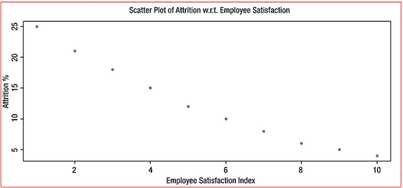

**图 8-1B.** 员工满意度指数与员工流失之间的散点图

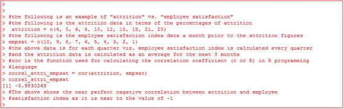

**图 8-1A.** 在 R 中计算相关系数

从图 8-1B 的散点图可以看出，尽管关系不是线性的，但它接近线性。相关系数 -0.983 也表明了这一点。如您所见，负号表示员工流失百分比与员工满意度指数之间存在反向关联或负关联。上图显示，员工满意度的恶化导致了员工流失率的上升。

此外，图 8-2 显示的检验证实，员工流失与员工满意度指数之间存在极好的统计显著相关性：

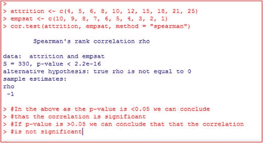

**图 8-2.** 在 R 中找出相关性显著性的检验

请注意，前述数据仅用于说明目的，可能不代表真实场景。它仅用于说明相关性。此外，在存在极端值（异常值）和像非线性关联这样的关联时，相关系数可能会非常低，并可能显示无关系或无关联。然而，变量之间可能存在真实且良好的关联。

## 8.3 假设检验

# 假设检验简介

在目前这个时间点，我们适合简要地讨论一下假设检验。这是统计学中重要的方面之一。在假设检验中，我们从一个关于一个或多个总体特定参数的断言、主张或现状开始。这个断言、主张或现状被称为“零假设”或`H[0]`。零假设的一个例子可以是如下陈述：总体 1 的总体均值等于总体 2 的总体均值。还有一个被称为备择假设或`H[1]`的陈述，它与零假设相反。在我们的例子中，备择假设指明总体 1 的总体均值与总体 2 的总体均值之间存在显著差异。通常会指定显著性水平或 I 类错误，通常为 0.05。这无非是当零假设实际为真时却被拒绝的可能性。这由符号`α`表示。`α`值越小，I 类错误的风险就越小。

然后，我们决定所需的样本量以减少错误。

我们使用检验统计量来拒绝或不拒绝零假设。当我们拒绝零假设时，意味着备择假设为真。然而，我们不能拒绝零假设并不意味着备择假设为真。它仅表明我们没有足够的证据来拒绝零假设。通常`t`值是所使用的检验统计量。

然后，我们使用数据并得出检验统计量的样本值。接着，我们根据检验统计量计算`p`值。`p`值无非是当零假设为真时，检验统计量等于或大于检验统计量样本值的概率。然后，我们将`p`值与显著性水平（即`α`）进行比较。如果`p`值小于显著性水平，则拒绝零假设。这也意味着备择假设被接受。如果`p`值大于或等于显著性水平，则我们不能拒绝零假设。

`p`值（在统计学的许多其他用途中）用于在回归分析中验证参数对模型的显著性。如果回归模型中任何参数的`p`值小于显著性水平（通常为 0.05），则我们拒绝该参数对模型无显著贡献的零假设，并接受该参数对模型有显著贡献的备择假设。如果某个参数的`p`值大于或等于显著性水平，则我们不能拒绝该参数对模型无显著贡献的零假设。我们只将在最终模型中包含那些对模型具有显著性的参数。

## 8.4 简单线性回归

正如我们在本章引言中提到的，简单线性回归描述了两个相关变量——一个响应（即因变量）变量和一个自变量——之间的线性关系，这可以通过一个回归方程来描述。当我们知道自变量的值时，这个回归方程可用于预测未知的响应变量。这是因为回归描述了其中一个变量（即响应变量）如何依赖于另一个变量（即自变量）。

需要注意的是，当需要预测响应变量的自变量位于用于创建回归方程的自变量数据范围内时，回归方程能保证正确地预测响应变量的值。在其他情况下，回归方程预测的值可能不可靠。这是因为我们不知道回归方程在我们手头并用于创建回归方程的自变量值范围之外是否仍然成立。然而，每个预测值都可能存在一些残差。并且，回归方程本身也可能有少量残差。

### 8.4.1 回归的假设

回归有四个假设。如果我们需要依赖任何回归方程，这些假设必须得到满足。它们是：

*   因变量与自变量之间存在线性关系
*   响应变量实际值与预测值之间的回归直线周围的误差具有独立性
*   误差分布的正态性
*   对于自变量的每个水平，响应变量分布的方差相等。这也被称为同方差性。

### 8.4.2 简单线性回归方程

回归线是平均值的平滑图。它本质上是针对每个自变量值的响应变量平均值的平滑处理。回归线的绘制方式使得拟合值相对于实际值的误差最小化。这种方法被称为最小二乘法，它最小化了响应变量实际值与响应变量预测值之间的平方差之和。套索回归法和岭回归法是最小二乘法的几种变体。作为最小二乘法的替代方法，我们可以使用分位数回归或最小绝对偏差等方法。简单线性回归方程采取以下形式：

```
Y1 = β0 + β1 x1
```

在上述方程中，`β[0]`被称为截距，`β[1]`被称为回归线的斜率。截距是当自变量（即`x`）值为零时响应变量的值。它描述了当`x`为零时回归线与`y`轴相交的点。斜率可以使用以下公式轻松计算：(R x 响应变量的标准差) / (自变量的标准差)。

从上述内容可以看出，当自变量的值增加一个标准差时，响应变量的值增加 R x 一个响应变量的标准差，其中`R`是相关系数。

### 8.4.3 在 R 中创建简单回归方程

在 R 中创建回归方程非常简单。我们需要使用以下函数：

*   `lm(response variable ∼ independent variable, data = dataframe name)`

让我们举一个简单的例子来理解上述命令的用法。假设销售人员的胜任能力或能力相等，并且销售仅限于单一产品，我们有一组数据，包含每个销售人员投入的努力小时数以及相应的销售额。

在图 8-3 中，我们从名为`cust1.txt`的文件中导入了一个包含 21 条记录的数据表，数据表包含`Sales_Effort`和`Product_Sales`，并将其放入名为`cust_df`的数据框中。`Sales_Effort`是销售人员在一个月的前两周投入的努力小时数，而`Product_Sales`是销售人员在同一时期完成的销售额。数据的摘要也显示在上图中。

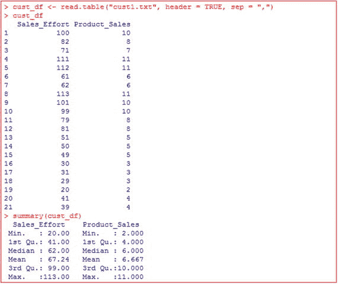

图 8-3.

# 从文本文件创建数据框（示例数据）

在此数据中，我们可以将`Product_Sales`视为响应变量，将`Sales_Effort`视为自变量，因为产品销售额取决于销售人员付出的销售努力。

现在，我们将使用 R 语言的`lm(响应变量 ~ 自变量, data = 数据框名称)`命令，运行简单线性回归来对`Product_Sales`和`Sales_Effort`之间的关系进行建模。

图 8-4 展示了在 R 中运行以生成简单线性回归模型的命令以及该模型的摘要信息。生成的模型被命名为`mod_simp_reg`，而摘要命令输出了该简单线性回归模型的详细信息。

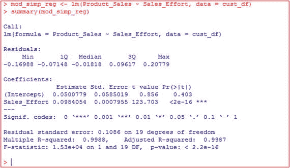

图 8-4. 在 R 中生成简单线性回归模型

初始部分展示了数据框中的哪个元素与哪个其他元素进行回归，以及包含数据的数据框的名称，从而得出该模型。

残差描述了响应变量的实际值与使用回归方程预测的响应变量值之间的差异。最大残差显示为 0.20779。此处通过指定残差的最小值、最大值、中位数、第一四分位数和第三四分位数来提供残差的分布范围。在本例中，范围为 -0.16988 到 +0.20779。由于回归线和回归方程背后的原则是减少误差或这种差异，因此期望中位数值应非常接近 0。如您所见，此处中位数值为 -0.01818，几乎等于 0。预测误差可能会达到残差的最大值。由于这个值（即 0.20779）非常小，我们可以接受这个残差。

下一部分详细说明了系数信息。此处，β[0] 由截距估计值（即 0.0500779）给出，β[1] 由`Sales_Effort`的估计值（0.0984054）给出。因此，简单线性回归方程如下：

```
Product_Sales = 0.0500779 + 0.0984054 * Sales_Effort
```

系数估计值旁边的值是估计值的标准误差。这指明了估计值的不确定性。然后是标准误差的 "t" 值。它指明了系数估计值相对于不确定性的大小。下一个值是绝对 t 值大于指定值的概率，该概率由随机误差引起。理想情况下，"Pr" 或概率值（通常称为 "p 值"）应非常小（例如 0.001、0.005、0.01 或 0.05），以使响应变量与自变量之间的关系具有显著性。p 值也称为显著性值。由于此处`Sales_Effort`系数的误差概率非常小（即几乎接近 0）（即 <2e-16），我们拒绝该参数对模型无显著影响的原假设，并接受该参数对模型有显著影响的对立假设。因此，我们得出结论，响应变量`Product_Sales`与自变量`Sales_Effort`之间存在显著关系。每个参数 p 值旁边的星号 (*) 数量指明了显著性水平。请参考图 8-4 中模型摘要给出的"显著性代码"。

下一部分展示了与整体模型质量相关的统计量。其中包括：

- 此处指定的自由度就是数据行数减去系数个数。在我们的例子中，是 21 - 2 = 19。这是残差自由度。理想情况下，自由度数量应远大于系数数量，以避免数据对模型的过拟合。我们在其中一章中讨论过数据对模型的过拟合和欠拟合问题。我们暂时记住，过拟合是不好的。通常，根据经验法则，每个变量有 30 行数据对于训练样本来说是好的。此外，如果数据行数少于自变量个数，我们无法使用普通最小二乘法。
- 残差标准误差显示的是残差的平方和除以摘要中指定的自由度（在我们的例子中是 19）。该值是 0.1086，非常低，符合我们的要求。
- 此处显示的多元 R 方值就是相关系数的平方（即 R）。多元 R 方也称为决定系数。然而，调整后的 R 方值是 R 方经过调整以避免过拟合后的值。在此，我们再次更依赖调整后的 R 方值而非多元 R 方。调整后的 R 方值为 0.9987，非常高，表明响应变量`Product_Sales`与自变量`Sales_Effort`之间存在极好的关系。
- 最后，F 统计量基于 F 检验。与系数的情况一样，我们也希望 p 值非常小（例如 0.001、0.005、0.01、0.05），以使模型具有显著性。正如您在例子中看到的，它小于 0.001（即 <2.2e-16）。因此，该模型是显著的。在当前示例中，只有一个自变量，因此此 p 值与该自变量的 p 值相同。

如上所述，响应变量`Product_Sales`与自变量`Sales_Effort`之间似乎存在极好的关联。

## 8.4.4 检验回归假设

在接受该模型可用之前，必须验证回归假设对于拟合模型是否成立。

### 8.4.4.1 线性检验

为了检验线性，我们将残差与自变量的相应值进行绘图。图 8-5 展示了这一点。

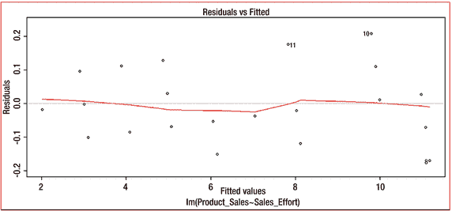

图 8-5. 用于检验线性的残差与拟合值图

为了使模型通过线性检验，残差的分布不应有任何模式，并且它们应随机分布在 0.0 残差线周围。也就是说，残差将围绕响应变量值的平均值随机变化。在我们的例子中，正如我们所见，残差的分布没有模式。因此，它通过了线性条件。

### 8.4.4.2 回归线周围误差独立性的检验

当数据在同一时间段内收集时，不需要进行此检验。在我们的例子中，数据是在相同的两周时间段内收集的，因此不需要进行此检验。此检验主要用于检查自相关性，自相关性是在不同时间段收集数据时引入的。此外，如前面的图（在线性检验中使用的图）所示，残差是随机分布在响应变量平均值周围的。如果我们需要检验自相关性，可以使用德宾-沃森检验，如图 8-6 所示。

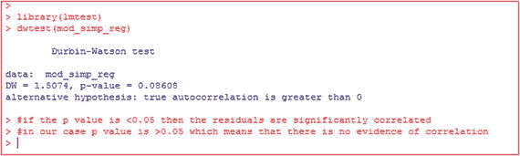

图 8-6. R 中用于检验自相关性的德宾-沃森检验

在 Durbin-Watson 检验中，零假设（即`H[0]`）为不存在自相关，备择假设（即`H[1]`）为存在自相关。若`p-value` < 0.05，则拒绝零假设，即认为存在自相关。在上述情况下，`p-value`大于 0.05，这意味着没有证据拒绝“不存在自相关”的零假设。因此，关于回归线误差独立性的检验通过。或者，你可以使用`library(car)`中的`durbinWatsonTest()`函数进行此检验。

### 8.4.4.3 正态性检验

根据该检验，残差应服从正态分布。为了验证这一点，我们将查看正态 Q-Q 图（使用`plot(model name)`命令创建）：

图 8-7 显示，在上述正态 Q-Q 图中，残差点几乎落在直线上。这表明残差服从正态分布。因此，残差的正态性检验通过。

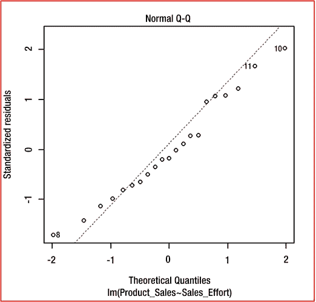

图 8-7. 使用正态 Q-Q 图检验“正态性”假设

### 8.4.4.4 响应变量分布的方差齐性

我们可以使用与检验线性关系时相同的残差图。从该图（如上文线性关系检验部分所示）可以看出，对于自变量的不同取值水平，残差的变异没有显著差异。因此，我们认为该检验通过。

### 8.4.4.5 验证回归模型需满足假设的其他方法

除了前面提到的方法之外，还有许多其他方法可以验证回归模型是否满足回归假设。

#### 8.4.4.5.1 使用 `gvlma` 库

另一个验证回归模型是否满足回归假设的简便方法是使用`library(gvlma)`，它可以验证回归模型的相关假设，并评估其他相关方面，如偏度、峰度、链接函数和异方差性。

图 8-8 展示了如何使用该库以及 R 的输出结果。

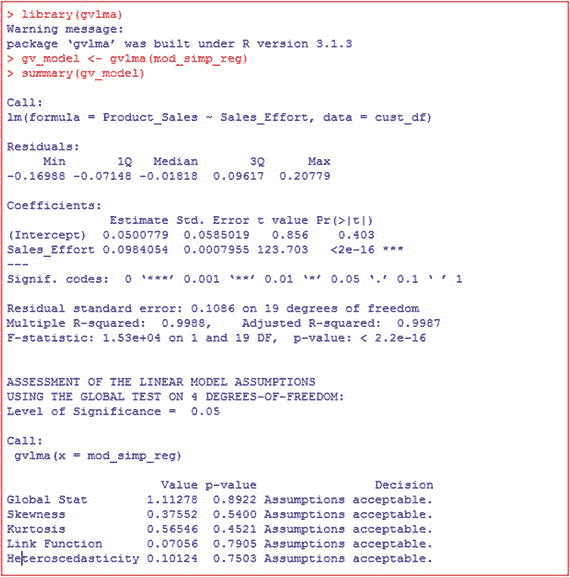

图 8-8. 使用 `gvlma()` 函数验证模型假设

在图 8-8 中，我们给出了 R 中`gvlma()`函数对模型的输出结果。`Global Stat`行清楚地表明，与该回归模型相关的假设是可接受的。这里，我们需要检查`p-value`是否大于 0.05。如果`p-value`大于 0.05，我们可以安全地得出结论，如上所示，假设已得到验证。如果`p-value`小于 0.05，则需要重新审视回归模型。

#### 8.4.4.5.2 使用尺度-位置图

尺度-位置图是使用`plot(regression model name)`命令生成的图形之一。在我们的例子中，该命令是`plot(mod_simp_reg)`。图 8-9 展示了该图形。

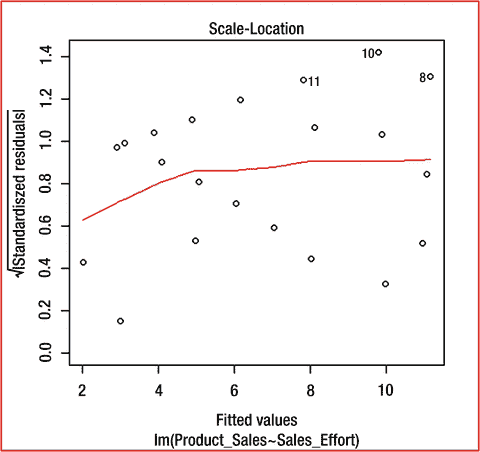

图 8-9. 在 R 中生成的用于验证方差齐性的尺度-位置图

在图 8-9 中，由于点以随机方式分布在近乎水平的直线周围，这向我们保证了常数方差（或方差齐性）的假设成立。

#### 8.4.4.5.3 使用 `library(car)` 中的 `crPlots(model name)` 函数

我们可以使用`crPlots(mod_simp_reg)`命令来理解模型所代表关系的线性关系。非线性关系要求我们重新探索模型。图 8-10 中的图表显示，我们如上创建的模型（即`mod_simp_reg`）是线性的。

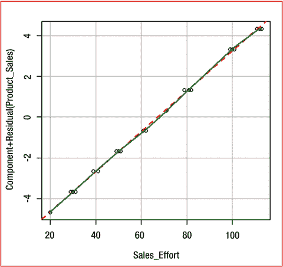

图 8-10. 使用 `crPlots()` 函数验证线性假设的图形

## 8.4.5 结论

如上所述，使用 R 函数`lm(response variable ∼ independent variable, data = dataframe name)`拟合的简单线性回归模型，该模型代表了简单线性回归方程，即`Product_Sales [i] = 0.0500779 + 0.0984054 Sales_Effort [i]`，是一个良好的模型，因为它也通过了验证回归假设的检验。这里需要提醒的是，有多种方式可以创建和验证回归方程。

## 8.4.6 预测响应变量

拟合的模型不仅解释了两个变量（即响应变量和自变量）之间的关系，还提供了一种机制，可以根据新的自变量的值来预测响应变量的值。这如图 8-11 所示。

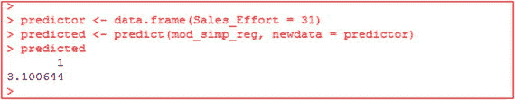

图 8-11. 在新数据集上使用模型进行预测

这是通过使用函数`predict(model name, newdata)`完成的，其中`model name`是从输入数据获得的模型名称，`newdata`包含需要预测响应变量的自变量数据。

可以得出一个预测区间，该区间指定了预测值的分布范围，如图 8-12 所示，通过在`predict()`函数中添加参数`interval = "prediction"`来实现。默认情况下，它使用 0.95 作为置信区间。

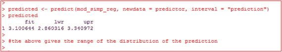

图 8-12. 使用 `predict()` 函数计算预测区间

## 8.4.7 补充说明

从上面拟合的模型中可以看出，截距不为零，而是 0.0500779，而实际上当没有销售努力时，理想情况下应该没有销售额。但是，情况可能并非如此；可能因为其他途径（如广告、网站等）存在一些随机进店销售。同样，不可能有像 3.1 这样的部分产品销售。然而，所投入的销售努力可能会使销售人员部分地走向下一次潜在销售。如果我们有兴趣得出一个无截距的模型（即当没有销售努力时产品销售额为零），那么我们可以通过将截距强制设为零值来实现，如图 8-13 所示。

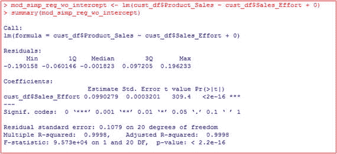

图 8-13. 生成无截距的简单线性回归模型

然而，如果我们必须相信并使用这个模型，我们必须验证回归其他假设的满足情况。

# 8.5 章节总结

- 你通过一些例子了解了各个方面/因素之间的关系如何影响、决定或影响其他方面/因素。理解这些关系不仅有助于我们理解相关因素可能发生的变化，也有助于预测其他因素的值。你了解了回归模型或回归方程如何解释响应变量与自变量之间的关系。你还了解了线性或非线性关系，以及简单回归和多元回归。
- 你通过示例探索了相关性的概念。你探索了相关性、强相关性、正相关性、负相关性等的用途。你还了解了如何计算相关系数（`R`）。

# 机器学习中的回归分析

- 你通过强调简单线性回归是一条平滑的平均线来理解它。你还探讨了回归的四个重要假设：线性、误差等价性、正态性和同方差性。你理解了什么是简单线性回归、截距和斜率，以及如何计算它们。

- 你通过示例探讨了如何使用`R`得到最佳拟合的简单线性回归模型和简单线性回归方程。你通过各种方法通过示例理解了如何验证所得到的最佳拟合模型和方程是否满足回归假设。

- 你探讨了如何将得到的简单线性回归模型用于预测响应变量的值——当该值未知但相关的自变量值已知时。

- 你了解了如何使用`R`得到无截距的简单线性回归模型及其用途。

