# 9. 多元线性回归

在第 8 章中，你探讨了简单线性回归，它描述了响应变量与一个预测变量之间的关系。你了解到期望响应变量是一个呈正态分布的连续变量。如果响应变量是离散变量，则需要使用不同的回归方法。如果响应变量可以取值如“是/否”或多个离散变量（例如，观点如“强烈同意”、“同意”、“部分同意”和“不同意”），则应使用逻辑回归。你将在下一章探讨逻辑回归。当你有不止一个预测变量——例如两个、三个或`n`个预测变量（其中`n`不等于 1）时，响应变量与预测变量之间的回归称为多元回归，它们之间的线性关系表示为多元线性回归或多元线性回归方程。在本章中，你将看到许多因素影响一个响应、结果或因变量的情境示例。

想象一下你想建造一栋建筑。你的主要成本构成是劳动力成本和材料成本（包括水泥和钢材）。如果水泥、钢材和其他材料的成本下降而劳动力成本保持不变，你的盈利能力将受到正面影响。相反，如果材料成本上升而劳动力成本保持不变，你的盈利能力将受到负面影响。如果劳动力成本也上升，你的盈利能力将进一步下降。

尽管市场上可能一种价格上涨或下跌，或者所有价格朝同一方向变动。假设房地产行业非常火爆，房屋、公寓或商业建筑有很多买家。那么，如果材料需求增加而供应减少，这些材料的价格很可能上涨。如果房屋、公寓或商业建筑的需求下降，这些材料的价格也很可能下跌（因为需求小于供应）。

现在假设由于竞争，销售价格相当固定，因此盈利能力主要由成本或成本控制决定。我们可以收集与水泥、钢材和其他材料成本以及劳动力成本相关的数据作为预测变量或自变量，并将盈利能力（百分比）作为响应变量。这种关系可以通过多元线性回归模型或多元线性回归方程来表达。

在这个例子中，假设我们发现其他材料成本（一个预测变量）与响应变量的关系依赖于水泥成本。那么我们就说其他材料成本与水泥成本之间存在显著的交互作用。在生成多元线性回归模型的公式中，我们在包含所有预测变量的同时，也包含了交互项`其他材料成本:水泥成本`。因此，我们的多元线性回归模型是使用预测变量（水泥成本、钢材成本、其他材料成本）以及交互项（`其他材料成本:水泥成本`）相对于响应变量（盈利能力）构建的。

现在想象你是一位人力资源（HR）经理或主管。你知道支付给员工的薪酬取决于她的资历、经验、技能水平，以及拥有该特定技能的其他人员的可用性与需求情况。在这种情况下，薪酬是响应变量，其他参数是自变量或预测变量。通常，经验越丰富、技能水平越高，可用人员相较于需求越少，薪酬就越高。技能水平和这些特定技能在市场上的可用性可能对薪酬有显著影响，而资历对薪酬的影响可能不如技能水平和特定技能的市场可用性那么大。

在这种情况下，经验与技能水平之间可能存在关系；理想情况下，经验越多意味着技能水平越高。然而，一个候选人在某项特定技能上可能技能水平较低，但整体经验水平很高——在这种情况下，经验可能与技能水平没有强相关性。这种两个或多个预测变量之间具有高度相关性的特征称为多重共线性，在得出多元线性回归模型和多元线性回归方程时需要考虑这一点。

理解预测变量之间的交互作用以及多重共线性对于确保我们得到正确且有用的多元回归模型非常重要。当我们生成模型后，有必要根据回归的所有四个假设对其进行验证：

- 响应变量与预测变量（也称为自变量）之间的线性关系
- 残差的独立性
- 残差分布的正态性
- 同方差性，即误差方差相等的假设

构建任何多元线性回归模型的起点是让我们的数据采用数据框格式，因为这是`lm()`函数的要求。使用`lm()`函数时的期望是响应变量数据呈正态分布。然而，自变量不需要呈正态分布。预测变量可以包含因子。

多元回归建模可用于建模一个响应变量与两个或更多个预测变量之间的关系，甚至可以扩展到`n`个预测变量（例如，100 个或更多变量）。与响应变量有关系的特征越多，建模就越复杂。例如，一个人的健康（如果通过健康指数量化）可能受到该人环境质量（污染、压力、人际关系和水质）、生活方式质量（吸烟、饮酒、饮食和睡眠习惯）以及遗传因素（父母健康史）的影响。要理解该人的健康指数，可能需要考虑这些因素。

## 9.1 使用多元线性回归

现在，我们开始讨论如何得到多元线性回归。

### 9.1.1 数据

# 多元线性回归示例

为了演示多元线性回归，我们使用包含三个变量的数据：年薪、工作年限（年）和技能水平。这些是印度的薪资数据，但为了简便，我们已将其转换为美元并四舍五入为千美元。此外，我们未限制用户以小数形式评估和分配技能水平。因此，在此数据背景下，即使技能水平也以连续数据表示。这是合理的，因为在一个拥有数百名员工的组织中，将所有员工划分为例如五个等级并不公平，但通过诸如 4.5、3.5、2.5、0.5 和 1.5 等技能水平来区分他们则更好。在此数据集中，所有变量均为连续变量。

此处，我们从 CSV 文件`sal1.txt`中将数据导入到数据框`sal_data_1`中：


如果对数据使用`head()`和`tail()`函数，你将了解数据的概貌，如下所示：

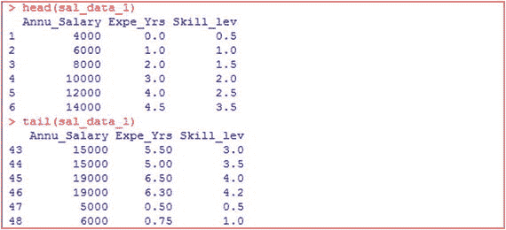

请注意，我们未展示所有数据，因为该数据集包含 48 条记录。此外，此数据仅供说明之用，可能不代表真实场景。数据是在某个时间点收集的。

### 9.1.2 相关性

我们在第 8 章中解释了相关性。相关性指明了一个变量与另一个变量的关联方式。在 R 中使用`cor()`函数可以轻松完成此操作。

这三个变量（年薪、工作年限、技能水平）之间的相关性如下所示：


如你所见，年薪与工作年限之间存在约 0.9888 的非常高的相关性。类似地，年薪与技能水平之间存在约 0.9414 的非常高的相关性。此外，工作年限与技能水平之间存在约 0.8923 的非常高的相关性。每个变量与其他变量高度相关。

通过使用 R 命令可视地生成两对变量之间的关系，如下所示：


此处，我们使用了`caret`包和`featurePlot()`函数。响应变量绘制为 y，预测变量绘制为 x。

通过此命令生成的变量之间关系的可视化结果如图 9-1 所示。

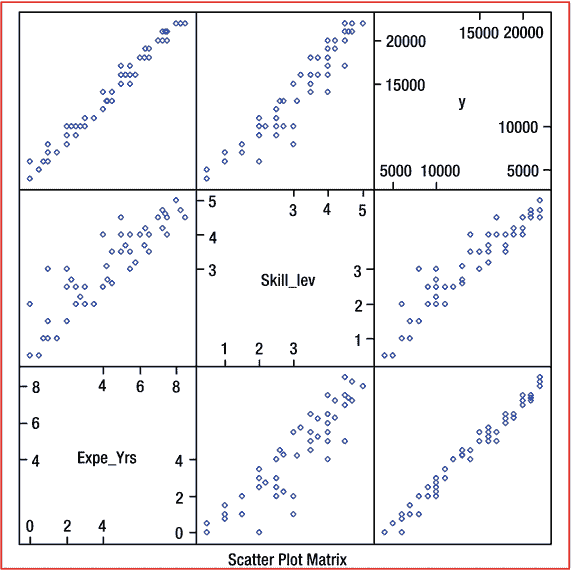

**图 9-1.** 生成的散点图矩阵

### 9.1.3 得出模型

现在，让我们使用 R 的`lm()`函数创建多元线性回归模型。首先，我们使用所有参数生成模型，因为它们与作为响应（或因）变量的年薪高度相关，而我们希望稍后使用此模型根据该模型预测或设定薪资。其他变量——工作年限和技能水平——将作为预测（或自）变量。在 R 中生成多元线性回归模型的命令如下所示：


使用`lm()`函数创建的模型及其摘要（使用`summary(model name)`生成）如下所示：

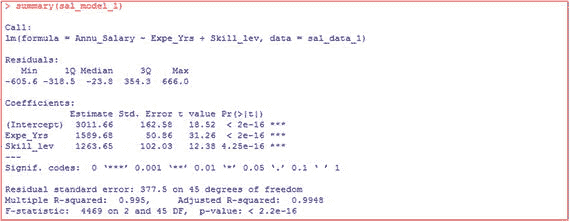

在此多元回归模型的摘要中，你可以看到两个自变量对模型都是显著的，因为两者的 p 值均小于 0.05。此外，整体模型的 p 值也小于 0.05。而且，如你所见，调整后的 R 平方值为 99.48%，表明该模型解释了响应变量中 99.48%的方差。此外，残差围绕中位数值-23.8 分布，非常接近 0。

你可以使用特定的`R`命令来探索该模型的各个层面。你可以使用`fitted(模型名称)`来理解模型拟合的值。你可以使用`residuals(模型名称)`来理解每年实际薪资与拟合薪资之间每个值的残差。你可以使用`coefficients(模型名称)`来获取系数的详细信息（这也是前面展示的模型摘要数据的一部分）。以下展示了在`R`中使用这些命令的方法：

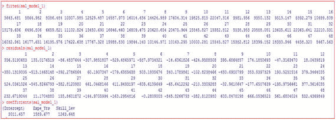

### 9.1.4 回归假设的验证

你可以使用`plot(模型名称)`来进一步探索模型。该命令会生成诊断图以评估模型的拟合度。生成的图形如图 9-2 至 9-5 所示。

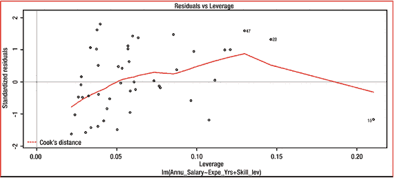

图 9-5. 残差与杠杆图

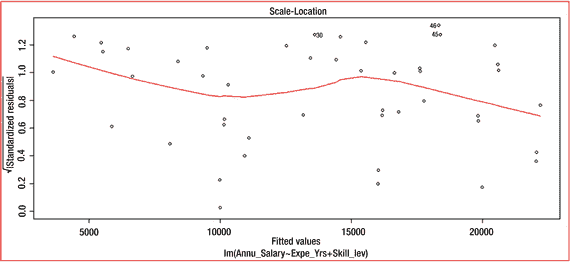

图 9-4. 尺度-位置图

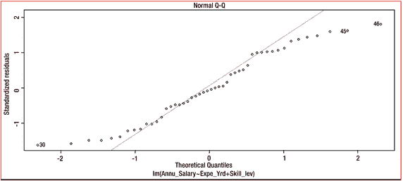

图 9-3. 正态 Q-Q 图

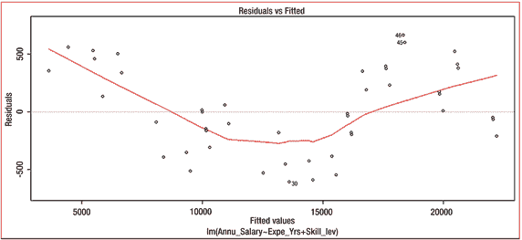

图 9-2. 残差与拟合值图

这里的残差与拟合值图似乎显示残差随机分布在 0 处的虚线周围。如果响应变量与预测变量呈线性关系，那么拟合值和残差之间应该没有关系。残差应该是随机分布的。尽管看起来存在某种模式，但在这种情况下，我们根据数据清楚地知道响应变量与预测变量之间存在线性关系。这也通过响应变量与每个预测变量之间的高度相关性得以体现。因此，我们不能断定线性假设被违反。响应变量与预测变量之间的线性关系可以通过`crPlots(模型名称)`函数进行检验，如图 9-6 所示。

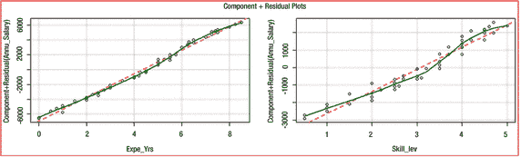

图 9-6. 显示线性关系的`crPlots(模型名称)`图

由于这两个图都显示出近似线性关系，我们可以认为模型`sal_model_1`满足线性检验。

此外，尺度-位置图显示点随机分布在一条近似水平的线周围。因此，误差方差恒定的假设得到了满足。我们通过`car`库中的`ncvTest(模型名称)`来验证这一理解。这里，零假设是误差方差恒定，备择假设是误差方差随响应变量拟合值水平或预测变量的线性组合而变化。由于 p 值 > 0.05，我们不能拒绝误差方差恒定的零假设。

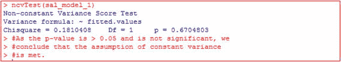

正态 Q-Q 图似乎显示残差并非正态分布。然而，视觉检验可能并不总是合适的。只有当正态性对我们的分析至关重要时，我们才需要确保它，因为在现实中，数据可能并不总是正态的。因此，在这种情况下，我们需要运用自己的判断。此外，根据中心极限定理和经验法则，对于大量数据，我们通常不需要验证其正态性，因为它理应是正态的。而且，如果数据非常少，大多数统计检验可能无法得出正确结果。不过，我们可以通过使用`shapiro.test(residuals(模型名称))`命令进行 Shapiro-Wilk 正态性检验来验证模型（即残差）的正态性。结果输出如下：

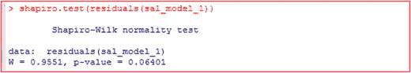

# 假设检验与模型诊断

## 正态性检验

此处，原假设是正态性假设成立。如果 `p-value` < 0.05，我们拒绝原假设。由于 `p-value` > 0.05，我们不能拒绝正态性假设成立的假设。

另一种直观确认正态性假设的方法是使用 `qqPlot(model name, simulate = TRUE, envelope = 0.95)`。使用的 R 命令如下：


图 9-7 展示了结果图。

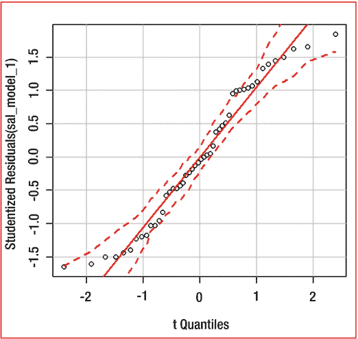

图 9-7. 通过 `qqPlot(model name, simulate = TRUE, envelope = 0.95)` 生成的正态性图

如您所见，极少数的点（仅两个）位于置信区间之外。因此，我们可以假设残差呈正态分布，且模型满足正态性假设。

标准化残差 vs. 杠杆图显示，大多数标准化残差分布在零线附近。

## 独立性检验

现在，我们需要验证残差的独立性（即误差的独立性，或不存在自相关）。然而，在本例中，由于我们已知每条数据记录属于不同的员工，且是在特定时间点采集的，并且不同员工数据之间不存在依赖关系，因此我们可以安全地假设残差和误差是独立的。不过，从学术兴趣的角度，您可以运行 `Durbin-Watson` 检验来判断是否存在自相关（即误差不独立）。在 R 中执行此操作的命令及相应输出如下：

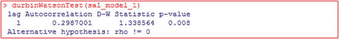

由于 `p-value` < 0.05，`Durbin-Watson` 检验拒绝了不存在自相关的原假设。因此，`Durbin-Watson` 检验支持存在自相关（即误差不独立）的备择假设。然而，如前所述，我们知道所使用的数据并不缺乏独立性。因此，我们可以忽略 `Durbin-Watson` 检验的结果。

如您所见，回归模型假设的所有检验均通过。

## 多重共线性

### 多重共线性

多重共线性是多元线性回归方法中可能遇到的另一个问题。假设您同时将“出生日期”和“年龄”作为预测变量。您知道两者在某种程度上是等价的，换句话说，其中一个与另一个高度相关。如果两个预测变量彼此高度相关，那么在多元线性回归方程中同时考虑这两个预测变量是没有意义的。我们通常会从多元线性回归模型或方程中消除其中一个预测变量，因为多重共线性会对模型产生不良影响。

在 R 中，可以轻松地使用 `vif(model name)` 函数检测多重共线性。`VIF` 代表方差膨胀因子（variance inflation factor）。通常，要使多重共线性检验通过，`VIF` 值应大于 5。以下是计算 `VIF` 的检验结果：

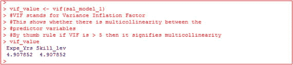

因此，我们可以假设不存在显著的多重共线性。然而，我们无法排除中等程度的多重共线性。

多重共线性通常会影响其中一个系数的显著性，使其变得不显著。但在本例中，我们并未看到这种影响。相反，我们发现两个预测变量的系数都是显著的。此外，存在多重共线性并不会使模型无法用于预测。因此，即使根据某些统计学派的观点（认为 `VIF` 值大于 4 时存在多重共线性），我们仍可以使用上述模型进行预测。

以下展示了如何使用该模型根据“工作年限”和“技能等级”的新数据来预测“年薪”。

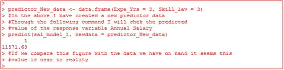

现在，让我们为预测变量取另一组值，看看模型返回的年薪是多少。`sal_model_1` 在本例中的预测结果如下所示：

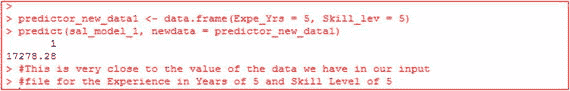

如果我们在预测变量之间发现显著的多重共线性，那么构建模型的一种方法是舍弃其中一个预测变量，然后使用另一个变量继续建模。类似地，你也可以尝试放弃另一个预测变量，用第一个预测变量来构建模型。在两个模型都构建完成后，检查哪个模型在统计上更显著。比较模型的一种方法是计算 `AIC`（Akaike information criterion）值。`AIC` 值较小的模型是更显著的模型。

在本例中，如果我们剔除其中一个变量（比如技能水平），我们往往会得到一个仅包含一个预测变量（工作年限）与响应变量（年薪）的回归方程，这实际上就是简单线性回归的情况，如下所示：

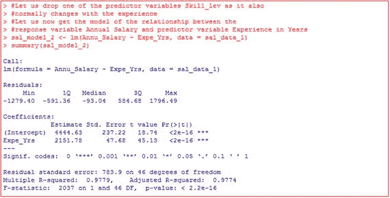

这也是一个显著的模型，其响应变量为年薪，预测变量为工作年限（正如我们所知），因为模型和预测变量的 `p-value` 均小于 0.05。此外，该模型可以解释响应变量中约 97.74% 的方差。

或者，如果我们移除“工作年限”这个预测变量，得到的模型如下所示：

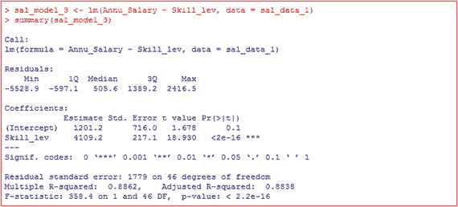

这同样是一个显著的模型，其响应变量为年薪，预测变量为技能水平（正如我们所知），因为模型和预测变量的 `p-value` 均小于 0.05。此外，该模型可以解释响应变量中约 88% 的方差，如 `R` 平方值所示。

然而，当我们在同一响应变量上拥有多个模型，且这些模型包含相同或不同的预测变量时，选择最有用模型的最佳方法之一是挑选 `AIC` 值最低的模型。这里我们比较了三个模型的 `AIC` 值：`sal_model_1`（以工作年限和技能水平作为预测变量）、`sal_model_2`（仅以工作年限作为预测变量）以及 `sal_model_3`（仅以技能水平作为预测变量）：

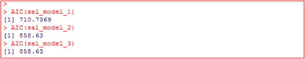

如果比较如上所示的 `AIC` 值，你会发现，同时将工作年限和技能水平作为预测变量的模型是最佳的。

### 逐步多元线性回归

构建模型和选择最佳模型的其他方法包括执行前向逐步回归或后向逐步回归。在前向逐步回归中，我们从单个预测变量开始，每次运行都增加一个预测变量，直到穷尽所有预测变量。在后向逐步回归中，我们从所有预测变量开始，然后逐一移除参数。两种方法会得到相同的结果。现在我们来进行后向逐步回归。我们将像前面那样使用 `AIC` 来选择最佳模型。我们将选择 `AIC` 值最低的模型。

我们需要拥有 `MASS` 包，然后使用该库中的 `stepAIC(model name)` 函数。以下是生成逐步多元线性回归模型的过程：

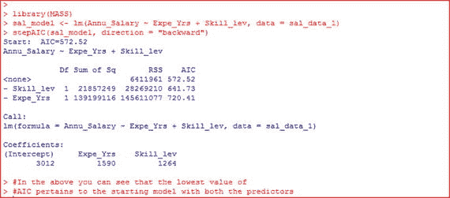

这证实了我们在本章前一节讨论中的理解。有效使用这种逐步方法的一个缺点在于，当它逐一剔除预测变量时，它不会检查预测变量的不同组合。

### 多元线性回归的全子集法

另一种替代方法是使用全子集回归法，该方法会评估预测变量的所有可能子集。

我们需要 `leaps` 包，并使用 `regsubsets(model name)` 函数。我们可以像下面这样在绘图函数中使用调整后的 `R` 平方选项，来了解需要在模型中包含哪些预测变量。我们应当选择具有最高调整后 `R` 平方值的模型。在 R 中如何执行此操作如下所示：

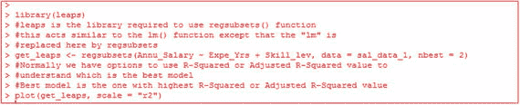

如果我们使用 `R` 平方值，得到的图表如图 9-8 所示。我们选择具有最高 `R` 平方值的预测变量组合。

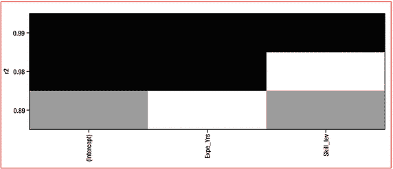

图 9-8. 在 R 中使用按 `R` 平方值缩放的全子集法生成的多元回归模型图

如您所见，我们同时选择了工作年限和技能水平两个预测变量，因为该模型具有最高的 `R` 平方值（0.99）。然而，我们已经看到，调整后的 `R` 平方值比 `R` 平方值能提供更深刻的见解，因为它调整了自由度。如果我们使用调整后的 `R` 平方值而不是 `R` 平方值，得到的图表如图 9-9 所示。

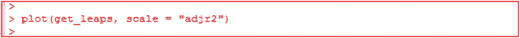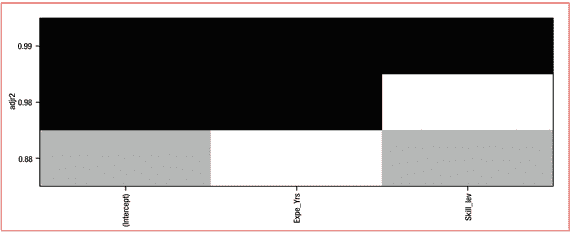

图 9-9. 在 R 中使用按调整后 `R` 平方值缩放的全子集法生成的多元回归模型图

在这个例子中，被选为最佳模型的预测变量也是同时包含两个预测变量的那个。

### 多元线性回归方程

回归线是平均值的平滑曲线。它本质上是针对自变量每一组取值，对响应变量平均值进行的平滑处理。绘制回归线的方式是使拟合值与实际值之间的误差最小化。这种方法被称为最小二乘法，它通过最小化响应变量的实际值与预测值之间的平方差之和来实现。多元线性回归方程的形式如下：

```
Y[i] = β[0] + β[1] x[1] + β[2] x[2] + β[3] x[3] + …
```

在这个方程中，`β[0]` 被称为截距，`β[1]` 被称为回归线的斜率。截距是当每个自变量的值都为 0 时，响应变量的值。它描述了当 `x[1]`、`x[2]` 等为 0 时，回归线与 y 轴的交点。可以使用以下公式轻松计算斜率：

`(R × 响应变量的标准差) / 自变量的标准差`

从该公式可以看出，当自变量的值增加一个标准差时，响应变量的值会增加 `R × 响应变量的一个标准差`，其中 `R` 是相关系数。

在我们的例子中，多元线性回归方程如下：

```
Annu_Salary = 3011.66 + 1589.68 × Expe_Yrs + 1263.65 × Skill_lev
```

其中 `β[0] = 截距 = 3011.66`
`β[1] = 工作年限的系数 = 1589.68`
`β[3] = 技能水平的系数 = 1263.65`

### 总结

根据我们的数据，我们得到了一个良好的多元线性回归模型，并验证了其满足各项假设前提。我们还利用该模型进行了预测。

## 在 R 中使用另一种方法

# 正如我们在本章引言中所述

正如我们在本章引言中所述，使用`lm()`函数的预期是响应变量服从正态分布。根据我们的样本数据可知，年薪呈正态分布，或遵循高斯分布。因此，我们也可以使用 R 函数`glm()`来采用广义线性模型，其频数分布属于`gaussian`族，并带有参数`link = "identity"`，如下所示：

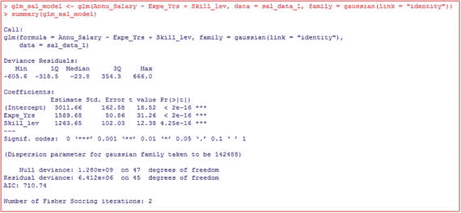

正如预期，你会发现其结果与通过`lm()`函数获得的结果相同。

## 9.3 预测响应变量

拟合后的模型不仅能解释响应变量与自变量之间的关系，还提供了一种机制，可根据新自变量的值来预测响应变量的值。操作如下所示：

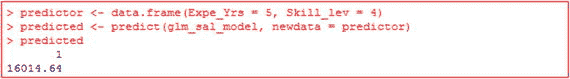

从用于构建模型的数据中可以看出，预测值与我们数据集中的相关实际值几乎吻合。

请注意：我们使用了`glm_sal_model`，而不是使用`lm()`函数生成的`sal_model_1`，因为两者之间没有区别。

这是通过使用函数`predict(model name, newdata)`完成的，其中`model name`是根据输入数据得出的模型名称，`newdata`包含需要预测其响应变量的自变量的数据。

该模型或许能够预测数据集中年限和经验等级之外的年薪值。但是，我们必须在将模型应用于此类扩展数据集时保持高度谨慎，因为生成的模型无法知晓，也无法判断该模型是否适用于扩展数据集。我们也不知道外推的数据是否遵循线性关系。有可能在若干年后，虽然经验在增加，但经验等级和相应的年薪可能不会线性增长，而是薪资增长率趋于平缓，导致关系斜率逐渐下降。

## 9.4 训练与测试模型

我们也可以使用数据集的独立子集来训练模型（即得出模型）和测试模型。理想情况下，这些数据集应是随机生成的。通常，数据集的 75%至 80%用于训练模型，另外 25%至 20%用于测试模型。

让我们使用之前相同的数据集来执行此操作。为此，我们需要使用`install.packages("caret")`和`library(caret)`。使用 R 将数据集拆分为两个子集——训练数据集和测试数据集——的方法如下所示：

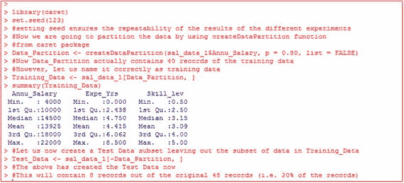

将整个数据集拆分为`Training_Data`和`Test_Data`这两个子集的操作是随机进行的。现在，`Training_Data`中有 40 条记录，`Test_Data`中有 8 条记录。

现在，我们将使用机器学习概念训练我们的`Training_Data`来生成模型。其过程如下所示：

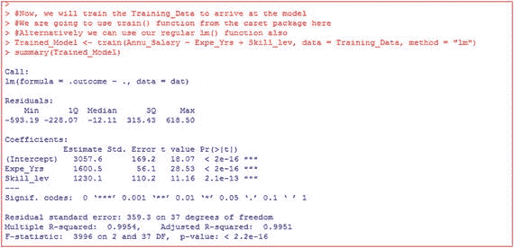

如您所见，生成的模型`Trained_Model`拟合效果良好，预测变量的系数 p 值< 0.05，且整个模型的 p 值也< 0.05。

现在，我们将使用之前得出的`Trained_Model`，根据`Test_Data`中的工作年限和经验等级来预测`Annual_Salary`的值。以下是来自 R 的快照：

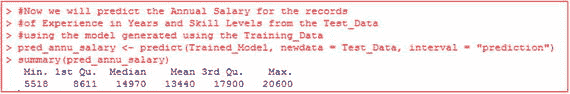

现在，让我们看看使用`Training_Data`生成的模型预测出的年薪值，与`Test_Data`中的实际年薪值是否吻合。实际值和预测值如下所示：

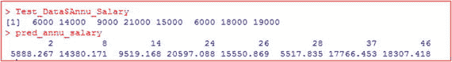

您可以看到，`Test_Data`中的实际年薪与`Training_Data`生成的模型得出的年薪（`pred_annu_salary`）非常接近。因此，使用`Training_Data`生成的模型（`Trained_Model`）可以有效地使用。

## 9.5 交叉验证

像`k`折交叉验证这样的交叉验证方法用于验证生成的模型。当数据有限，并且需要将数据拆分为较小的测试集（例如 20%的数据）和相对较大的训练集（例如 80%的数据）时，这将非常有用，因为训练集和测试集中的数据可能划分得使两者都无法很好地代表整个数据集，从而使模型验证相对困难或不可行。

像`k`折交叉验证这样的交叉验证方法可以消除这个问题。在这里，我们实际上将数据集划分为`k`折，并使用`k-1`个集作为训练数据，剩下的 1 个集作为测试数据，并重复此过程`k`次。每个`k`折都包含从整个数据集中随机抽取的几乎相同数量的数据点（具体取决于`k`值）。在我们的案例中，由于总共有 48 条记录，每折包含 4 或 5 条记录。一折中的元素不会在另一折中重复出现。针对每一折，模型都会进行验证，模型预测的值（Predicted）和交叉验证预测的值会作为输出列出，同时还会显示实际值与交叉验证预测值（cvpred）之间的差异，即 CV 残差。利用预测值与 cvpred 之间的差异，我们可以计算出线性回归模型拟合的均方根误差。在处理海量数据时，这种交叉验证方法也很有用，因为通过轮换，每个数据点既用于训练也用于测试，并且在任何一折中都不会再次考虑同一个数据点。

让我们以我们之前使用的多元线性回归为例。让我们使用`k`折验证来验证这个模型。在我们的示例中，我们将使用`K = 10`。这样做是为了方便，这样每次训练集中有 90%的数据，测试集中有另外 10%的数据。这样一来，曾经在训练集中的数据，会在另一次轮换中移动到测试集中。因此，实际上通过轮换，我们可以确保所有数据点都用于模型生成和测试。对于此交叉验证，我们将使用`library(DAAG)`，并使用`cv.lm(dataset, formula for the model, m=number of folds)`或`CVlm(dataset, formula for the model, m=number of folds)`函数。这里的`m`就是我们决定的折数（即`K`）。我们的示例运行此操作的结果如下各图所示。

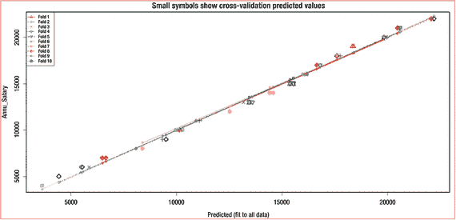

*图 9-12.* k 折交叉验证的图形输出，显示了全部十折

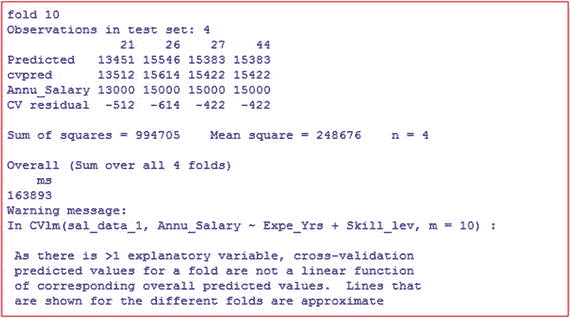

*图 9-11.* k 折交叉验证输出的部分快照（最后一折）

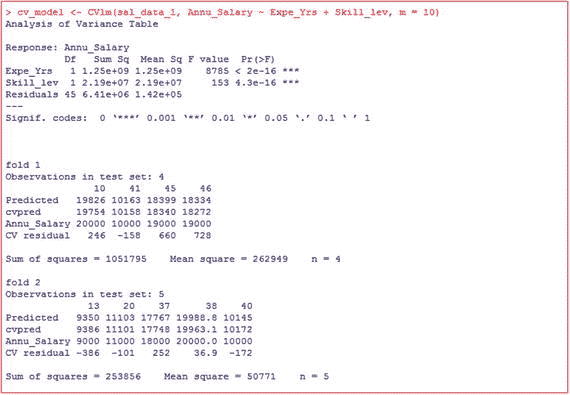

*图 9-10.* k 折交叉验证输出的部分快照

多元线性回归模型（`lm`函数）预测的值与交叉验证预测的值非常接近。从上图可以看出，使用交叉验证拟合的各个点几乎映射到了我们得出的回归模型上。


*图 9-13.*

线性回归模型与交叉验证模型之间计算的均方根误差

如果我们检查多元线性回归模型预测值与交叉验证模型预测值之间的均方根误差，如上图所示，该值非常小，即 60。因此，`k`折交叉验证验证了我们之前得出的多元线性回归模型。

除了`k`折交叉验证，我们还可以使用其他方法，例如重复`k`折交叉验证、自助采样法、留一交叉验证。

## 9.6 总结

在本章中，您看到了多元线性关系的示例。当您的响应变量是连续的且呈正态分布，并具有多个预测变量时，您可以使用多元线性回归。如果响应变量可以取离散值，则使用逻辑回归。

您还简要了解了**显著交互作用**，即当结果因某个预测变量基于另一个预测变量的值而受到影响时发生。您学习了**多重共线性**，即两个或多个预测变量可能高度相关，或以不同方式表示同一方面。您看到了多重共线性的影响以及如何在多元线性回归模型或方程的背景下处理它们。

然后，您探索了我们从某个实体获取的数据以及各个变量之间的相关性。您可以看到所涉及的所有三个变量（响应变量以及预测变量）之间存在高度相关性。通过在 R 中使用这些数据，您可以得出多元线性回归模型，然后验证它是一个具有显著预测变量的良好模型。

您学习了各种技术来验证回归的假设是否得到满足。不同的方法可能导致不同的解释，因此您在这方面必须谨慎行事。

在进一步探索多重共线性时，您看到诸如`vif()`之类的函数使您能够了解多重共线性的存在。您简要了解了在多元线性回归背景下处理多重共线性。多重共线性不会降低模型用于预测的价值。通过**阿卡伊克信息准则（AIC）**的示例，您学会了比较各种模型，并且最佳模型通常具有最低的 AIC 值。

接着，您探索了两种得出最佳拟合多元线性回归模型的替代方法：**逐步多元线性回归**和**多元线性回归的全子集法**。您通过使用多元线性回归方程对模型进行了描述。

此外，您探索了如何使用频率分布为`gaussian`且`link = "identity"`的`glm()`函数生成与通过`lm()`函数生成的相同模型，因为我们在连续响应变量的情况下需要正态性。

接着，您了解了如何使用预测变量的值来预测响应变量的值。

最后，您探索了如何将数据集拆分为两个子集：训练数据和测试数据。您可以使用训练数据生成模型，通过使用基于训练数据生成的模型上的`predict()`函数来验证测试数据的响应变量。

