# 10. 逻辑回归

在第 8 章和第 9 章中，我们分别讨论了简单线性回归和多元线性回归。在这两类回归中，我们的因变量或响应变量是一个呈正态分布的连续变量。然而，情况并非总是如此。通常，响应变量并不呈正态分布。它可能是一个遵循二项分布、取值为 0/1 或“否/是”的二元变量。它也可能是一个取多个值的分类或离散变量，这些值可能遵循正态分布以外的其他分布。

如果响应变量是一个离散变量（可以是名义变量、有序变量或二元变量），您会使用一种不同的回归方法，称为`逻辑回归`。如果响应变量取二元值（例如“是/否”或“患病/健康”）或多个离散值（例如“非常同意”、“同意”、“部分同意”和“不同意”），我们可以使用逻辑回归。逻辑回归本质上仍然是一种线性回归。响应变量仅取两个值（例如“是/否”或“患病/健康”）的逻辑回归称为`二元逻辑回归`。响应变量可取多个离散值的逻辑回归称为`多项逻辑回归`。请注意，非线性回归不在本书讨论范围之内。

考虑以下示例：
-   您想要决定是否向客户提供信贷。您的选择可能取决于多种因素，包括客户此前与其他公司付款的准时记录、客户在银行和金融领域的信誉、客户组织的盈利能力，以及发起人和管理层的诚信度。
-   您正在决定是否投资一个项目。同样，您的选择取决于多种因素，包括所涉及的风险、可能的盈利能力、项目的寿命长短，以及组织在该特定项目领域的能力。
-   您正在决定是否招聘某个特定候选人担任高级管理职位。这一选择可能取决于多种因素，包括候选人的经验、过往记录、态度，以及是否符合您组织的文化。
-   您正在决定某个特定员工是否可能留在组织中。这一选择可能取决于多种因素，包括组织的内部工作环境、该员工是否被部署在具有挑战性的项目上、给该员工的薪酬是否与行业标准相称，以及该员工的技术水平是否足以被其他组织挖走。

预测变量之间的交互作用以及多重共线性可能仍然是逻辑回归中的问题，需要妥善处理。然而，通常适用于回归的`线性`、`正态性`和`同方差性`假设并不适用于逻辑回归。

构建任何逻辑回归模型的起点是将数据整理成数据框格式，因为这是 R 中`glm()`函数的要求。正如您在之前的章节中看到的，`family = gaussian(link = "identity")`的`glm()`函数等同于`lm()`函数；其要求是响应变量或因变量呈正态分布。但是，当您使用`glm()`进行逻辑回归时，响应变量取二元值 `family = binomial(link = "logit")`。为什么？因为我们希望值在 0 和 1 之间，这可以解释为概率。我们使用比值的自然对数（ln）：

```
ln(比值比) = ln[成功概率 / (1 – 成功概率)]
```

因此，我们使用以下边界函数，该函数使我们能够确定成功概率，并通过将线性回归与该边界函数结合来推导逻辑回归模型：

```
f(a) = 1 / (1 + e^(–a))
```

以下是得到的逻辑回归模型：

```
P(响应 = 是 | 自变量 1， 自变量 2， … 自变量 N) = 1 / (1 + e^(–(β0 + β1 × 自变量 1 + β2 × 自变量 2 + … + βN × 自变量 N)))
```

并且

```
P(响应 = 否 | 自变量 1， 自变量 2， … 自变量 N) = 1 – [1 / (1 + e^(-(β0 + β1 × 自变量 1 + β2 × 自变量 2 + … + βN × 自变量 N)))]
```

这实质上就是

# 逻辑回归模型

## 数学基础

逻辑回归模型的基本公式如下：

```
1 / (1 + e^((β0 + β1 × Independent Variable1 + β2 × Independent Variable2 + … + βN × Independent VariableN)))
```

根据`P(Response = Yes)`和`P(Response = No)`这两个方程，可以得到几率（odds）：

```
P(Response = Yes) / P(Response = No) = e^((β0 + β1 × Independent Variable1 + β2 × Independent Variable2 + … + βN × Independent VariableN))
```

因此，logit（即对数几率）为：

```
logit(P) = ln[P(Response = Yes) / P(Response = No)] = β0 + β1 × Independent Variable1 + β2 × Independent Variable2 + … + βN × Independent VariableN
```

我们使用最大似然法生成逻辑回归方程，该方程用于预测几率比（odds ratio）的自然对数。基于这个逻辑回归方程，我们可以确定预测的几率比和预测的成功概率：

```
预测的成功概率 = 预测的几率比 / (1 + 预测的几率比)
```

此处我们不直接使用因变量的值，而是使用几率比（odds ratio）的自然对数。

## 逻辑回归

在本节中，我们将使用一个数据集来演示逻辑回归。

### 数据

首先，我们创建了一个包含六个变量的数据：

*   `Attrition`：表示员工是否已经离职或仍留在组织中（`Yes`表示离职，`No`表示目前在组织中工作）。
*   `Yrs_Exp`：表示员工当前的工作经验（以年为单位）。
*   `Work_Challenging`：表示分配给员工的工作是否具有挑战性。
*   `Work_Envir`：表示工作环境是`Excellent`（优秀）还是`Low`（差）。
*   `Compensation`：表示薪酬是`Excellent`（优秀）还是`Low`（差）。
*   `Tech_Exper`：表示员工的技术专长水平（`Excellent`优秀或`Low`差）。

数据覆盖最近六个月，且仅针对具有两到五年工作经验的员工。数据通过`read.csv()`命令从 CSV 文本文件`Attri_Data_10.txt`中提取：

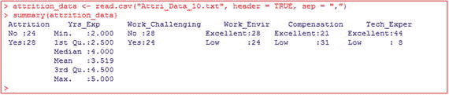

该代码还展示了数据的摘要。如您所见，`Attrition`字段有 28 个`Yes`值，表示这些员工已离职。24 个`No`值代表仍在组织中工作的员工。从上方的摘要中还可以观察到，28 名员工未被分配有挑战性的工作（`Work_Challenging`），24 名员工被分配了有挑战性的工作。此外，28 名员工在团队中工作环境（`Work_Envir`）被认为是优秀的，而 24 名员工的工作环境较差（标记为`Low`）。最后，21 名员工拥有优秀的薪酬，达到或高于市场水平（显示为`Excellent`）；但 31 名员工的薪酬低于市场水平（显示为`Low`）。在所有员工中，44 人拥有优秀的技术专长，其余 8 人的技术专长较低。该数据集包含 52 条记录。

理想情况下，当组织为员工提供有挑战性的工作、团队工作环境优秀、薪酬优厚且员工技术专长较低时，员工离职的可能性应该较低。

以下是数据的一瞥：

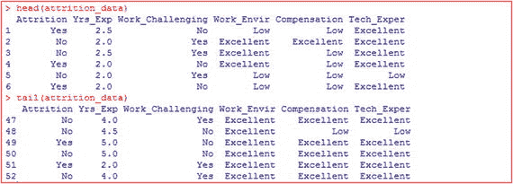

### 创建模型

现在，让我们使用 R 语言的`glm()`函数来构建一个逻辑回归模型。我们需要在`glm()`函数中使用`family = binomial(link="logit")`，因为我们的响应变量是二元的。首先，让我们使用所有参数生成模型，因为它们将`Attrition`作为二元响应（或依赖）变量；此外，我们想要使用该模型来预测任何员工日后辞职的可能性（与该模型及其他变量如`Yrs_Exp`、`Work_Challenging`、`Work_Envir`、`Compensation`和`Tech_Exper`保持一致）。在 R 中生成逻辑回归模型的命令如下所示：

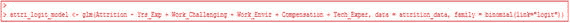

通过`glm()`函数创建的模型及其摘要（通过`summary(model name)`生成）如下所示：

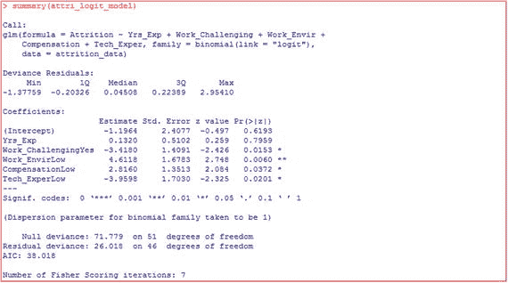

分类变量中只显示了一个值。这是因为每个变量都有两个层级，其中一个层级被模型作为参考层级。例如，分类变量`Work_Challenging`有两个层级：`Work_ChallengingYes`和`Work_ChallengingNo`。模型中只显示了`Work_ChallengingYes`，因为`Work_ChallengingNo`被当作参考层级。

> **注意**：如果每个因子变量有多个层级，可以使用证据权重（Weights of Evidence）变换技术。这可以确保只有一个组合变量代表每个变量的多个层级，从而减少模型的系数数量。这非常有用，因为具有大量层级的分类变量可能会在逻辑回归中引发问题。

您可以在上述逻辑回归模型摘要中看到，除了`Yrs_Exp`之外，所有其他变量对模型都是显著的（因为每个 p 值均小于 0.05）。`Work_ChallengingYes`、`Work_EnvirLow`、`Compensation_Low`和`Tech_ExperLow`是显著的变量。`Yrs_Exp`不是模型的显著变量，因为它具有较高的 p 值。即使通过视觉检查数据也很明显，`Yrs_Exp`对模型不会显著，因为无论工作年限多少，都有员工离职。此外，您可以看到模型在七次 Fisher 评分迭代后收敛，这是很好的，因为理想情况下我们希望模型在少于八次迭代内收敛。

我们现在可以从逻辑回归模型中移除`Yrs_Exp`并重新拟合模型。用于重新拟合逻辑回归模型的公式以及模型摘要如下所示：

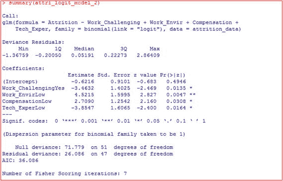


如您所见，模型参数是显著的，因为 p 值小于 0.05。

数据的自由度计算为 n 减 1（数据点数减 1，即 52 – 1 = 51）。模型的自由度计算为 n 减 1 再减系数个数（52 – 1 – 4 = 47）。这些值显示在上述模型摘要中。偏差（Deviance）是拟合不足的度量。零偏差（Null deviance）是仅包含截距的模型的偏差。残差偏差（Residual deviance）是当前模型的偏差。两者都是上述模型摘要的一部分。下图显示了随着每个系数的加入，残差偏差如何减小：

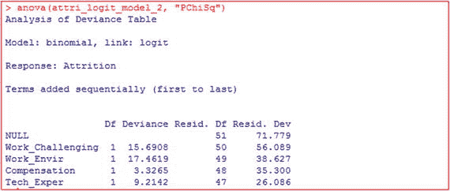

让我们比较两个模型——`attri_logit_model`（包含所有预测变量）和`attri_logit_model_2`（仅包含显著预测变量），并检查第二个模型相对于第一个模型的表现如何：

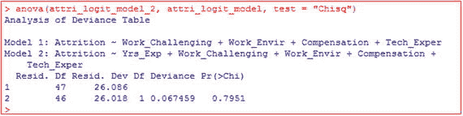

此检验通过使用 `anova()` 函数并检查卡方 p 值来完成。在此表中，卡方 p 值为 0.7951。该值不显著，表明与包含所有变量的模型 `attri_logit_model` 相比，不含 `Yrs_Exp` 的模型 `attri_logit_model_2` 表现良好。两个模型之间没有显著差异。因此，我们可以安全地使用不含 `Yrs_Exp` 的模型（即 `attri_logit_model_2`）。

从该模型（`attri_logit_model_2`）中，我们可以看到 `Work_ChallengingYes` 的系数为 –3.4632，`Work_EnvirLow` 的系数为 4.5215，`CompensationLow` 的系数为 2.7090，`Tech_ExperLow` 的系数为 –3.8547。这些系数值是优势比的自然对数。系数为负号表示其降低了 `Attrition` 的可能性。同理，系数为正号表示其增加了 `Attrition` 的可能性。因此，与其他所有变量保持不变（其他条件不变）的情况下，与 `Work_Envir = Excellent` 相比，当 `Work_Envir = Low` 时，发生 `Attrition = Yes` 的优势是不发生任何 `Attrition` 的 `exp(4.5215) = 91.97` 倍。这意味着，如果 `Work_Envir = Excellent`，`Attrition = Yes` 的概率为 5%（即 0.05），那么在相同条件下 `Attrition = No` 的优势为 `(0.05 / (1 – 0.05)) × 91.97 = 4.8376`。这对应于 `Attrition = No` 的概率为 `4.8376 / (1 + 4.8376) = 0.8286`，即约 82.86%。在其他所有变量保持不变的情况下，与 `Compensation = High` 相比，当 `Compensation = Low` 时，发生 `Attrition = Yes` 的优势是不发生任何 `Attrition` 的 `exp(2.7090) = 15.02` 倍。`Work_Envir = Low` 和 `Compensation = Low` 都会增加 `Attrition = Yes` 的可能性。

然而，另外两个变量 `Work_Challenging = Yes` 和 `Tech_Exper = Low` 的系数带负号，意味着它们降低了 `Attrition = Yes` 的可能性。在其他所有变量保持不变的情况下，与 `Work_Challenging = No` 相比，系数值为 –3.4632 的 `Work_Challenging = Yes` 将 `Attrition = Yes` 的可能性降低了 `exp(–3.4632) = 0.0313`。同理，在其他所有变量保持不变的情况下，与 `Tech_Exper = High` 相比，系数值为 –3.8547 的 `Tech_Exper = Low` 将 `Attrition = Yes` 的可能性降低了 `exp(–3.8547) = 0.0211`。

由此可见，对 `Attrition` 的主要影响主要来自 `Work_Envir` 和 `Compensation`。

### 模型拟合验证

验证模型拟合对我们来说很重要。这可以通过计算伪 R 平方值来实现。该值使用公式 `1 – (model$deviance / model$null.dev)` 计算，告诉我们模型解释偏差的程度。以下代码展示了如何使用 R 计算该值：

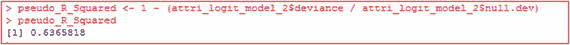

该计算结果表明模型解释了 63.65% 的偏差。你也可以使用 `library(pscl)` 和 `pR2(model_name)` 来计算伪 R 平方值。

另一种验证模型拟合的方法是使用卡方方法计算 p 值，如下所示：

```
p-value <- pchisq[(model_deviance_diff),(df_data – df_model),lower.tail=F]
```

此处，`df_data` 可通过 `nrow(data_set) – 1` 计算，在我们的案例中为 `nrow(attrition_data) – 1`；`df_model` 可通过 `model$df.residual` 计算；`model_deviance_diff` 可计算为 `model$null.dev – model$deviance`。相关计算如下所示：

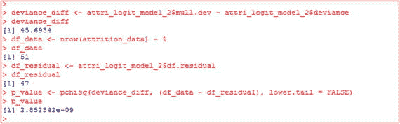

由于 p 值非常小，偏差的减少不能被认为是偶然发生的。由于 p 值显著，该模型拟合良好。

### 一般注意事项

在生成逻辑模型时，可能会抛出以下警告信息：


这可能是由于数据或部分数据完美预测了响应变量。这被称为分离或准分离问题。

以下是关于逻辑回归模型的一些一般注意事项：

-   当零偏差小于残差偏差时，我们会遇到问题。
-   当收敛需要大量费雪评分迭代时，我们会遇到问题。
-   当系数数值较大且标准误差显著较大时，我们会遇到问题。

在这些情况下，我们可能需要重新审视模型，再次检查每个系数。

### 多重共线性

我们在第 9 章中讨论了多重共线性。在 R 中，使用 `vif(model name)` 函数可以轻松发现多重共线性。VIF 代表方差膨胀因子。通常，通过多重共线性检验的经验法则是 VIF 值应大于 5。以下检验展示了 VIF 的计算：


如您所见，我们的模型不存在多重共线性问题。

### 离散度

对于某些回归模型（包括逻辑回归模型），离散度（因变量的方差）高于值 1（如二项族逻辑回归离散度参数摘要中所述取值为 1）是一个潜在问题。这被称为过度离散。当因变量的观测方差大于使用二项分布（即 1）所预期的方差时，就会发生过度离散。这会导致显著性检验的可靠性问题，因为其可能会对标准误差产生不利影响。

可以使用 R 轻松判断模型是否存在过度离散问题，如下所示：

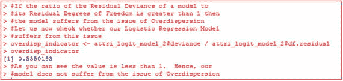

我们生成的模型 `attri_logit_model_2` 不存在过度离散问题。如果逻辑回归模型确实存在过度离散问题，则需要在 `glm()` 函数中使用准二项分布（quasibinomial distribution）来代替二项分布（binomial distribution）。

### 逻辑回归结论

针对我们的数据，我们创建了一个良好的逻辑回归模型，并已验证了其显著性和拟合优度。该模型不存在多重共线性或过度离散问题。

> **注意**
> 在大多数情况下，在 `glm()` 函数中使用 `family=binomial(link="probit")` 与使用 `family=binomial(link="logit")` 效果相似。对于 `logit`，你可以直接在 `glm()` 中使用 `family=binomial()` 而无需指定 `link="logit"`，因为两者产生的结果相同。

## 10.2 训练和测试模型

我们也可以使用数据集的单独子集来训练模型（即创建模型）和测试模型。理想情况下，这些数据集应是随机生成的。通常，将数据集的 75% 到 80% 用于训练模型，另外的 25% 到 20% 用于测试模型。

让我们使用之前使用的相同数据集来执行此操作。我们需要运行 `install.packages("caret")` 并使用 `library(caret)`。以下是使用 R 将数据集分为两个子集（训练数据集和测试数据集）的方法：

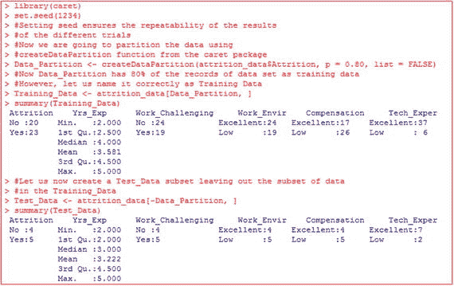

整个数据集被随机拆分为两个子集（`Training_Data` 和 `Test_Data`）。现在，`Training_Data` 中有 43 条记录，`Test_Data` 中有 9 条记录。

我们现在使用机器学习概念训练我们的 `Training_Data` 以生成一个模型：

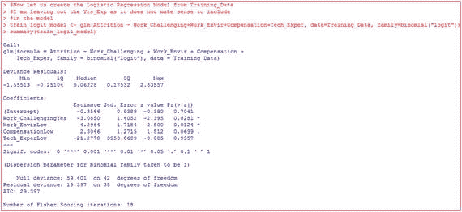

如你所见，生成的模型（`train_logit_model`）经过 18 次费希尔评分迭代后收敛，其中 `Tech_ExperLow` 的系数和标准误极大。因此，该模型可能用处不大。出于这个原因，我们无法继续使用训练模型基于 `Test_Data` 中的记录来预测 `Attrition`。但是，如果我们能成功构建一个训练模型，就可以按以下步骤进行进一步分析：

1.  使用训练数据生成的模型预测测试数据的响应变量，并将预测数据存储在测试数据集中。
2.  将响应变量的预测值与测试数据集中响应变量的实际值进行比较。
3.  生成混淆矩阵，以理解真正例（`TP`）、真反例（`TN`）、假正例（`FP`）和假反例（`FN`）。
    *   真正例是实际为正类（1）且被预测为正类（1）的样本。
    *   真反例是实际为负类（0）且被预测为负类（0）的样本。
    *   假正例是被预测为正类（1）但实际为负类（0）的样本。
    *   假反例是被预测为负类（0）但实际为正类（1）的样本。
4.  检查准确率、特异性和敏感度：
    *   准确率 = （`TP` + `TN`） / 总观测数
    *   特异性 = 真负类率 = `TN` / （`FP` + `TN`）
    *   敏感度 = 召回率 = 真正类率 = `TP` / （`FN` + `TP`）
    *   此外，还可以考虑精确率 = `TP` / （`FP` + `TP`）和 F1 分数 = `2TP` / （`2TP` + `FP` + `FN`）。

通常期望获得较高的准确率、较高的敏感度和较高的特异性。检查这些数值是否符合预测的目标。如果预测结果会影响人员的安全或健康，我们必须确保最高的准确率。在这种情况下，每个预测值都应谨慎确定，并在必要时通过其他方法进一步验证。

## 预测响应变量

最初拟合的模型（`attri_logit_model_2`）不仅解释了响应变量与自变量之间的关系，还提供了一种根据新自变量的值预测响应变量值的机制。具体操作如下所示：

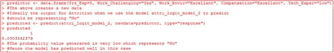

如果预测返回的概率 > 0.5，我们将 `Attrition` 的值取为 `Yes`；如果预测返回的概率不大于 0.5，则取为 `No`。如上述代码所示，该值远低于 0.5，因此我们可以安全地假设 `Attrition = No`。

上述预测是通过使用函数 `predict(model name, newdata=dataframe_name, type="response")` 来确定的，其中 `model name` 是根据输入数据得到的模型名称，`newdata` 包含需要预测响应变量的自变量数据，`type="response"` 是为了确保输出结果不是 `logit(y)`。

## 验证逻辑回归模型的替代方法

正如我们所说，我们无法使用训练数据生成一个有效的模型，因此也无法使用测试数据对其进行验证。但是，我们使用完整的数据集（`attrition_data`）生成了一个模型（`attri_logit_model_2`）并对其进行了验证。另一种验证此类模型的方法如下：

1.  我们使用生成的模型，通过在生成模型所用的完整数据集上执行以下命令来预测因变量值（logit）：

    ```R
    predicted_value <- predict(model, type="response")
    ```

    

2.  然后生成一个混淆矩阵：

    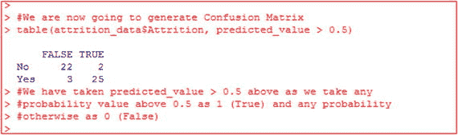

    从混淆矩阵中可以清晰地看到，该模型生成了非常高的真正例和真反例。

3.  现在我们使用 `ROCR` 包及其中的 `prediction()` 函数，如下所示：`prediction_object <- predict(model, type="response")`。这样，我们就创建了一个 `prediction_object`：

    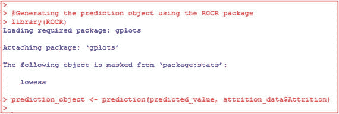

4.  使用 `ROCR` 包中的 `performance()` 函数对 `prediction_object` 进行操作，我们得到 TPR = `TP` / (`FN` + `TP`) = `TP` / (所有正类) 和 FPR = `FP` / (`FP` + `TN`) = `FP` / (所有负类)，然后将 TPR 对 FPR 作图，得到接收者操作特性 (ROC) 曲线。这通过 `plot(performance(prediction_object, measure = "tpr", x.measure = "fpr"))` 实现。或者，我们可以使用 `plot(performance(prediction_object, measure = "sens", x.measure = "spec"))` 生成敏感度/特异性图，或使用 `plot(performance(prediction_object, measure = "prec", x.measure = "rec"))` 生成精确率/召回率图。此处展示了用于生成 ROC 曲线的第一个 R 命令，以及生成的曲线（见图 10-1）：

    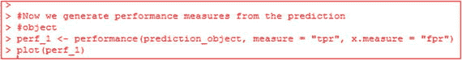
    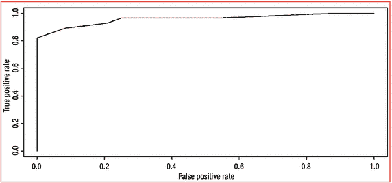

    图 10-1. 生成的 ROC 曲线

    该 ROC 曲线清晰地表明，该模型几乎没有产生假正例，并产生了很高的真正例。因此，我们可以得出结论，生成的模型是一个好模型。

## 多项逻辑回归

多项逻辑回归用于水平数超过两个的分类或离散因变量。自变量可以是分类变量或连续变量。然而，生成和评估这些模型的方法并不直接且较为繁琐。这些需要对底层数学和统计学有深入的理解。因此，我们不在本书中介绍这部分内容。

但是，对于水平数超过两个且无序的因变量，可以使用 `mlogit` 包中的 `mlogit()` 函数或 `nnet` 包中的 `multinom()` 函数来生成多项逻辑回归。

对于水平数超过两个且有序的因变量，可以使用 `rms` 包中的 `lrm()` 函数来生成多项逻辑回归。

## 正则化

正则化是一个复杂的主题，我们在此不作详细讨论。然而，我们会对这个概念进行介绍，因为它是统计学中一个重要的方面，你需要结合统计模型来理解它。

正则化是通常用于避免过拟合的方法。当我们不断向模型添加参数以提高其准确性和拟合度时，在某些时候，使用该模型的预测能力反而会下降。由于引入了过多参数，我们是在对数据进行过拟合，从而失去了泛化的价值，而泛化本可使模型在预测中更有用。

通过使用向前选择、向后剔除和子集选择法等模型拟合方法，我们试图避免过拟合，从而使模型更具普遍性，在预测未来值时更有用。这将确保在关联测试数据时，偏差和方差都较小。

当数据集中的参数数量多于数据观测数量，且最小二乘法无法发挥作用（因为它会导致拟合同一数据的模型众多，而非单一的唯一模型）时，正则化也非常有用。在这种情况下，正则化使我们能够找到一个合理的解决方案。

# 收缩方法

收缩方法是最常用的正则化方法。它们通过在回归模型中添加一个惩罚项来实现正则化。我们通过向损失函数中添加一个正则化范数的倍数（`λ`，也称为收缩参数）来对其进行惩罚，例如线性回归权重向量的 `Lasso` 或 `Ridge`（也称为收缩惩罚）。我们可以使用交叉验证来获得最佳的倍数（`λ` 值）。模型越复杂，惩罚力度越大。我们使用 `L[1]` 正则化器（`Lasso`）或 `L[2]` 正则化器（`Ridge`）。正则化会缩小系数估计值以降低方差。

`Ridge` 回归会缩小参数估计值，但不会将其缩减至 0，而 `Lasso` 回归会将某些参数的估计值缩小至 0。对于 `Ridge`，拟合度会随着 `λ` 值的增加而增加，同时方差值也会增加。这可能导致参数估计值大幅增加，即使训练数据发生微小变化也是如此，并且随着参数数量的增加而加剧。`Lasso` 创建的模型更简单，因此更易于预测。

# 对人员流失数据应用正则化

让我们在剔除 `Yrs_Exp` 的数据集 `attrition_data` 上探讨正则化的概念。我们不将 `Yrs_Exp` 纳入考虑，因为我们知道它并不显著。

我们使用 `glmnet` 包中的 `glmnet()` 函数来确定正则化模型。我们使用 `glmnet` 包中的 `cv.glmnet()` 函数来确定最佳的 `lambda` 值。对 Lasso 使用 `alpha=1`，对 Ridge 使用 `alpha=0`。我们使用 `family="binomial"` 和 `type="class"`，因为我们的响应变量是二元的，并且根据要求，我们是在逻辑回归的背景下使用正则化。

`glmnet()` 函数要求输入为矩阵形式，响应变量为数值型向量。它通过惩罚最大似然法来拟合广义线性模型。正则化路径是在正则化参数 `lambda` 的一系列网格值上为 Lasso 或弹性网络惩罚计算得出的。

## 函数格式

该函数在 `glmnet` R 包中定义的通用格式如下：

```
glmnet(x, y, family=c("gaussian",
"binomial", "poisson", "multinomial", "cox", "mgaussian"),

weights, offset=NULL, alpha = 1,
nlambda = 100,

lambda.min.ratio =
ifelse(nobs<nvars,0.01,0.0001), lambda=NULL,

standardize = TRUE, intercept=TRUE,
thresh = 1e–07, dfmax = nvars + 1,

pmax = min(dfmax × 2+20, nvars),
exclude, penalty.factor = rep(1, nvars),

lower.limits=–Inf, upper.limits=Inf,
maxit=100000,

type.gaussian=ifelse(nvars<500,
"covariance", "naive"),

type.logistic=c("Newton",
"modified.Newton"),

standardize.response=FALSE,
type.multinomial=c("ungrouped", "grouped"))
```

像往常一样，我们不会使用所有参数。为简单起见，我们将只使用绝对必要的参数。每个参数的详细信息，请查阅 `glmnet` 包指南。

## 准备输入

我们将首先准备所需的输入。我们需要模型以矩阵格式作为 `glmnet()` 函数的输入。我们还需要将响应变量作为一个向量：

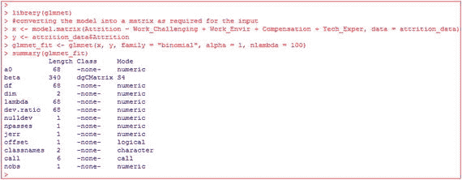

解释摘要的内容超出了本书的范围，但我们将展示如何主要使用图形来进行正则化。为此，我们使用 `plot()` 函数。由于我们使用的是二元数据和逻辑回归，我们使用 `xvar="dev"`（其中 `dev` 代表偏差）和 `label = TRUE` 来在图中识别作为 `plot()` 函数输入的参数：

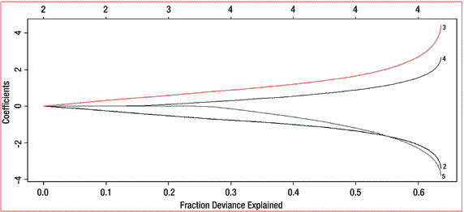

图 10-2. 显示每个变量的偏差：两个有 + 系数，两个有 – 系数

使用 `print()` 函数输出的 `glmnet_fit` 结果如下所示：

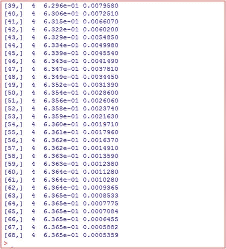

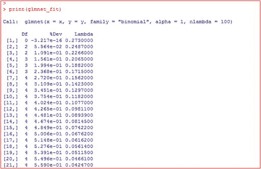

这主要显示了自由度（非零系数的数量）、模型解释的零偏差百分比以及 `lambda` 值。如您所见，`lambda` 值持续减小。随着 `lambda` 值减小，模型解释的偏差百分比增加，显著的非零系数数量也随之增加。尽管我们为函数提供了 `nlambda = 100`（这是默认值），但仅显示了 68 个 `lambda` 值。这是因为算法确保在发现模型解释的偏差百分比没有进一步显著变化时，在最佳时机停止。

# 在特定 Lambda 值处进行预测

现在，我们将在 `lambda = 0.05` 处预测类别标签。这里 `type = "class"` 指的是响应类型：

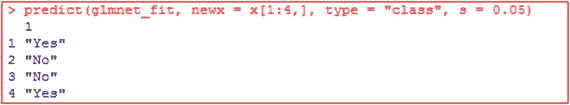

如您所见，所有四个值都被准确预测，因为它们与我们数据集的前四行匹配。

# 正则化模型的交叉验证

现在，我们将通过使用`glmnet`包中的`cv.glmnet()`函数对正则化模型进行交叉验证。该函数对`glmnet`执行 k 折交叉验证，生成一个图，并返回 lambda 的最小值。它还返回一个标准误范围内的 lambda 值。该函数默认执行 10 折交叉验证。如果需要，我们可以更改 k 折数。这里我们使用`type.measure = "class"`，因为我们使用二元数据和逻辑回归。这里，`class`给出的是误分类错误：

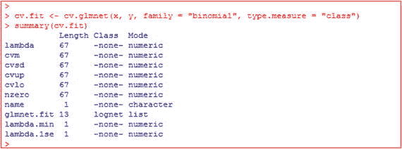

我们现在使用`plot()`函数绘制`cv.glmnet()`的输出，即`cv.fit`：


`图 10-3`显示了交叉验证曲线以及误分类错误相对于 log(lambda) 值的上限和下限值。这里的交叉验证曲线由红点描绘。

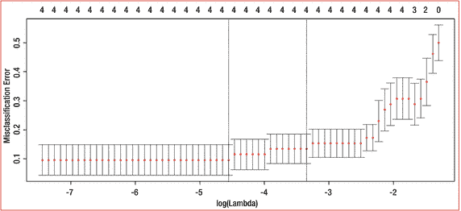

`图 10-3.` `plot(cv.fit)`的输出

以下显示了`cv.fit`模型的一些重要输出参数，包括`lambda.min`或`lambda.1se`：

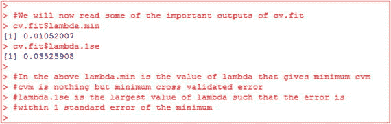

我们可以使用 R 中的`coef(cv.fit, s = "lambda.min")`命令查看`lambda.min`值处的系数值。输出是一个稀疏矩阵，其中显示了每个独立因子的第二层级：

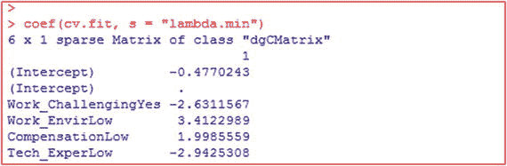

# 使用正则化模型进行预测

现在让我们看看这个正则化模型如何使用 `predict()` 函数和 `s = "lambda.min"` 选项来预测值。我们将针对数据集的前六个值进行检查。结果如下所示：

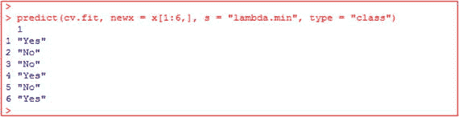

所有六个值都被 `predict()` 函数正确预测。但是，请注意，我们尚未对整个数据集验证结果。模型的准确率可能不是 100%，因为正则化的目标是为未来的预测提供一个通用模型，而无需担心对训练数据的精确拟合（过拟合）。

# 本章小结

在本章中，您了解到如果响应变量是分类或离散变量（可以是名义变量、有序变量或二元变量），则应使用一种不同的回归方法，称为逻辑回归。如果您有一个只有两个值的因变量，例如“是”或“否”，则应使用二项式逻辑回归。如果因变量取值超过两个分类值，则应使用多项逻辑回归。

# 第 11 章：大数据分析——介绍与未来趋势

你已了解了一些逻辑回归的示例。通常适用于回归分析的线性、正态性和同方差性假设并不适用于逻辑回归。你使用了`glm()`函数，并设定`"family = binomial(link="logit")"`来创建逻辑回归模型。

你还了解了相关的基础统计知识，以及逻辑回归方程中使用的是因变量的`logit`（对数几率），而非因变量的实际值。

你还导入了数据集以理解底层数据。你创建了模型，并通过 p 值验证了预测变量对模型的显著性。其中，变量`Yrs_Exp`并不显著。你移除了这个预测变量后重新运行模型，最终得到了一个所有变量均显著的模型。

你探讨了如何解释系数及其对因变量的影响。你了解了偏差作为模型拟合不足的度量指标，并学习了如何使用卡方方法，通过偏差差异的 p 值来验证模型的拟合优度。

在解释逻辑回归模型时需谨慎。你检查了多重共线性和过度离散问题。

接着，你将数据集划分为训练集和测试集。你尝试从训练数据集中得出一个逻辑回归模型。通过这一过程，你了解到基于训练集生成的优质模型可用于预测因变量。你可以使用混淆矩阵来检验准确率、特异性和灵敏度等指标。

通过`ROCR`包中的`prediction()`和`performance()`函数，你可以生成 ROC 曲线来验证模型，并使用与原始模型相同的数据集。

你学习了如何利用已开发的逻辑回归模型来预测新数据集的值。随后，你对多项逻辑回归以及可用于此方面的 R 包有了简要了解。

最后，你学习了正则化，包括其必要性以及执行方法。

