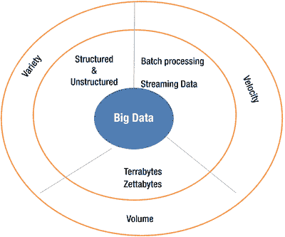
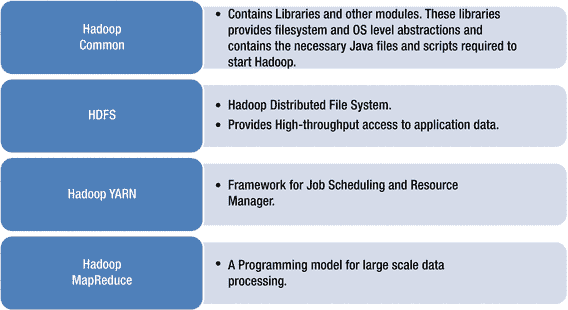
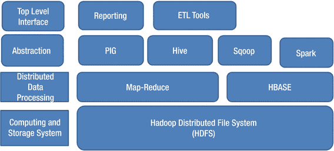

# 11. 大数据分析——介绍与未来趋势

数据就是力量。数据将成为任何企业中另一维度的价值。数据是未来决策的驱动力。所有组织机构都已意识到数据的价值，并正在尝试从各种来源整理数据并挖掘其价值。企业正试图理解消费者/市场行为，以便以最小的努力从每个消费者身上获取最大收益。幸运的是，这些组织机构得到了技术演进的支持，包括不断增长的存储能力和计算能力，以及云的能力，这些提供了基础设施和工具。这推动了数据分析领域的发展，包括描述性分析、预测性分析、机器学习、深度学习、人工智能和物联网。组织机构正在收集数据，而不必事先思考其价值，然后让数据本身来揭示其对组织的价值。数据被用来从自身中学习，从而揭示许多迄今未知、或者甚至一个逻辑思考者可能无法想到或表面上无法接受的事情。

本章不会深入探讨大数据的各种定义。许多权威人士给出了众多分歧的定义，这反而让人们更加困惑，而非厘清问题。然而，通俗地说，大数据意味着海量数据，这些数据难以通过手动方式或在有限的计算能力或计算机资源下轻松理解或分析；分析大数据需要具备处理多种性质数据（从结构化数据到非结构化数据）的能力，这些数据来自不同来源（例如社交媒体、结构化数据库、非结构化数据库和物联网）。

通常，当人们提到大数据时，他们指的是具有三个特征的数据：多样性、体量和速度，如图 11-1 所示。

**图 11-1.** 大数据的特征

多样性指的是在 Web、互联网和各种数据库等上可用的不同类型的数据。这些数据可以是结构化的或非结构化的，并可能来自各种社交媒体。体量是指可供处理的数据规模。其规模巨大——达到太字节和拍字节级别。速度是指处理和分析数据、确定其含义、构建模型并使用能够帮助商业的模型的速度。

以下因素促进了大数据的高效利用：

- 计算机集群的庞大计算能力，通过将负载分布到多台机器上，扩展了处理能力和内存能力。
- 巨大的存储能力，将数据分布到各种存储资源上。
- 机器学习算法和包的重大发展。
- 人工智能、自然语言处理等领域的发展。
- 数据可视化、数据集成和数据分析工具的发展。

## 11.1 大数据生态系统

在过去十年左右的时间里，谷歌、雅虎、IBM、SAS、SAP 和 Cloudera 等组织付出了巨大努力，设计并开发了一套庞大的工具系统，以促进从不同来源整理和集成海量数据、挖掘数据以揭示隐藏在数据中的模式或真相、可视化数据、呈现从数据中学习到的知识，并提出主动应对措施。

毫无疑问，R 语言已成为一种强大的开源语言，并被非常庞大的用户群体所采用，这尤其得益于其易用性、可用的打包且经过验证的算法以及已有的相关文档。然而，Apache Hadoop 生态系统——包括其 Hadoop 分布式文件系统以及 MapReduce、YARN、Pig、Mahout、Hive、HBase、Storm 和 Oozie 等各种工具/机制——以及 SAP 和 SAS 等商业工具，共同加强了大数据分析的驱动力。Hadoop 框架如图 11-2 所示。

**图 11-2.** Hadoop 生态系统

Hadoop 分布式文件系统（HDFS）允许数据分布在多台计算机上进行存储。此外，它还允许利用多个集群系统增强的处理能力和内存。这克服了因缺乏所需处理能力和内存而无法在单个系统中存储海量数据以及无法分析这些数据的障碍。Hadoop 生态系统由多个模块组成，使我们能够处理数据并执行分析。

用户应用程序可以向 Hadoop 提交一个作业。数据加载到系统后，会被分成多个块，通常为 64 MB 或 128 MB。然后，Hadoop 作业客户端将作业提交给 JobTracker。JobTracker 将各个任务分配并调度到分布式系统中的不同机器上；许多机器被集群在一起形成一个整体。任务分为两个阶段：Map 任务在存储数据的小数据块上执行，Reduce 任务则合并数据以产生最终输出。不同节点上的 TaskTracker 根据 MapReduce 的实现来执行任务，而 reduce 函数的结果则存储在文件系统的输出文件中。整个过程由各种较小的任务和功能控制。完整的 Hadoop 生态系统和框架如图 11-3 所示。

**图 11-3.**

# Hadoop 框架与生态系统

`Apache Hadoop YARN` 是一种用于资源调配、管理以及作业调度/监控活动的工具。

`Apache Pig` 能够分析海量数据。该平台使用一种简单的脚本语言，允许用户创建自己的程序，以补充 `Pig` 预定义函数的功能。`Pig` 的编译器会生成一系列 `MapReduce` 程序。因此，这消除了编写冗长繁琐的 `MapReduce` 程序的需求。`Pig` 还具备执行并行处理的能力。

`Apache Mahout` 提供了用于编写可扩展机器学习算法和应用程序的环境与编程能力。如今，`Mahout` 包含了 `Samsara`，一个向量数学实验环境。

`Apache Hive` 通过提供 `SQL` 能力，实现了对数据的读取、写入和管理。

`Apache HBase` 是 `Hadoop` 的分布式数据库，具有高可扩展性和巨大的存储能力。它提供对数据的实时访问。`HBase` 是 `Hadoop` 的一个 `NoSQL` 数据库。

`Apache Storm` 能够以 `Hadoop MapReduce` 处理批处理的方式，实现数据流的分布式实时处理。`Storm` 是一个计算引擎，能够执行持续计算、实时分析、在线机器学习以及许多其他相关功能，例如分布式 `RPC`。

`Apache Oozie` 实现了有效的工作流调度，以管理 `Apache Hadoop` 作业。它与 `Apache Hadoop` 生态系统中的其他工具集成得非常好。

除了这些工具之外，`NoSQL`（最初指“不仅仅是 `SQL`”）数据库，例如 `Cassandra`、`ArangoDB`、`MarkLogic`、`OrientDB`、`Apache Giraph`、`MongoDB` 和 `Dynamo`，也都极大地支持或补充了大数据生态系统。这些 `NoSQL` 数据库能够有效地存储和分析多维的、结构化或非结构化的海量数据。这极大地推动了整合来自不同来源的数据以进行分析的工作。

目前，`Apache Spark` 的使用势头正盛。`Apache Spark` 是一个用于大数据处理的快速通用引擎，内置了流处理、`SQL`、机器学习和图处理模块。`Apache Spark` 是近年来一个有趣的发展成果，它提供了一个极其快速的数据处理和分析引擎。它允许为用 `R`、`Java`、`Python` 或 `Scala` 编写的应用程序提供简单的接口。`Apache Spark` 拥有一系列库，例如 `MLib`（机器学习）、`Spark Streaming`、`Spark SQL` 和 `GraphX`。它既可以独立模式运行，也可以在 `Hadoop` 上运行。同样，它可以访问各种数据源，从 `HBase` 到 `Cassandra`，再到 `HDFS`。许多用户和组织都对这个工具表现出兴趣并开始使用它，导致它在短时间内变得非常流行。这个工具为大数据用户和组织带来了巨大的希望。

诸如 `Microsoft Business Intelligence` 和 `Tableau` 等工具提供了仪表盘和数据可视化功能。这些工具使组织能够从数据中学习，并利用这些学习成果来制定战略或改进其运营或流程的方式。

以下是使用 `Hadoop` 进行大数据处理的一些优势：

- 在任何廉价通用硬件上实现简单的并行架构
- 内置的容错系统，以及应用级别的故障检测和高可用性
- 无需中断即可动态修改集群
- 轻松向集群添加或从集群移除机器
- 基于 `Java`，平台无关

`Microsoft Azure`、`Amazon` 和 `Cloudera` 是提供用于有效大数据分析的云设施和服务的一些主要供应商。

## 11.2 大数据分析的未来趋势

大数据的应用以及使用大数据分析的领域正在逐年增加。本节介绍了一些未来几年将加速发展的趋势。

### 11.2.1 社交媒体的增长

在短时间内，社交媒体产生了极其大量的数据，并且这一趋势几乎呈指数级增长。这些与全球各地人们相关的数据，让组织了解到了迄今未知的事实和数字。这促使这些组织以不同的方式思考并制定不同的战略。

### 11.2.2 数据湖的创建

组织正从各种来源获取数据。但他们往往不知道数据的价值。他们甚至不看数据提供的价值就直接将其倾倒入数据湖。一旦数据进入数据湖，组织便会寻找模式，或者让数据“自我发现”。这种态度对于未来发展具有巨大价值。

### 11.2.3 业务用户手中的可视化工具

在竞争日益激烈的背景下，数据分析师分析数据到向业务部门呈现数据之间的延迟已不再被接受。企业需要快速采取行动，以有效利用从数据中获得的知识。诸如 `Microsoft Business Intelligence`、`Tableau` 和 `SAS Visual Analytics` 等工具为业务用户提供了巨大的实用价值。更多的可视化有助于业务用户快速理解模式和趋势，并做出有效、及时的决策。工具的能力正趋向于动态化，以描绘这些可视化图表或仪表盘所展现的数据中额外的方面。

### 11.2.4 规范性分析

数据分析不再仅仅专注于理解数据中隐藏的模式或价值。未来的趋势是基于过去和当前情况，规定应采取的行动，而无需人工干预。这在医疗保健和航空航天等领域将具有巨大价值。

### 11.2.5 物联网

物联网是未来的驱动力。它有能力从各种来源获取数据，例如家用电器、工业机器、气象设备、自动驾驶汽车的传感器，甚至人体。这有可能产生海量数据，这些数据可以被分析并用于为潜在的未来和当前问题提供主动解决方案。这也可能导致重大的创新和改进。

### 11.2.6 人工智能

神经网络可以驱动人工智能——特别是，让海量数据无需任何人工干预、特定编程或特定模型的需求即可自我学习。深度学习就是这样一种正在推动大数据领域发展的领域。这可能会揭示许多我们尚未意识到的“是什么”。我们可能无法理解其中一些的“为什么”，但它们的“是什么”可能非常有用。因此，我们可能会逐渐摆脱总是寻找因果关系的视角。机器学习领域被开发和使用的速度，极大地推动了这一领域的重视。此外，自然语言处理（`NLP`）和属性图（`PG`）也可能推动新的应用程序设计和开发，将这些技术的能力交到组织和用户手中。

### 11.2.7 全量数据处理

借助现有的基础设施和当前可用的工具支持水平（尤其是在云端），大多数情况下可以分析完整的数据集，而不是抽取数据样本进行分析。这避免了抽样的缺点。使用海量数据引导我们朝着正确的方向前进，即使这些数据可能不完整或不完美。我们不必总是寻找完美的数据。

### 11.2.8 纵向与横向应用

# 分析趋势

分析领域正朝着整合特定行业（如医疗保健、银行和汽车）的垂直应用方向发展。另一方面，横向应用则跨越多个行业领域，包括消费者购买行为、交易监控（用于预防欺诈和洗钱），以及了解客户为何离开特定品牌或组织。

## 11.2.9 实时分析

各类组织都渴望了解自身面临的机遇。他们希望实时掌握正在发生的事情——例如，某个特定的人在购买什么，或者计划购买什么——并适时利用这一机会，提供最佳的解决方案、折扣，或交叉销售相关产品或服务。组织不再满足于延迟的数据分析，因为那样会因未能实时了解情况而错失商机。

## 11.2.10 让分析工具触达业务用户

人们一直观察到，数据分析师将分析结果提交给业务用户之前存在延迟。由于这种时间上的损失，即使分析结果很出色，也可能毫无用处，无法帮助组织制定有效的策略。相反，让工具对业务用户更有用、更可直接使用，使他们能够及时做出决策，这将使业务用户处于有利地位。整个世界正朝着在很大程度上实现这一目标的方向发展。

## 11.2.11 解决方案在不同工具间的迁移

工具多样化意味着为一种工具提供的解决方案不容易迁移到其他系统。这主要是因为使用了不同的编程语言和环境。业界正致力于使来自一种工具的解决方案能够轻松地在其他工具上实现或迁移。`PMML`方面的努力已经在朝这个方向发展。`DMG`也正在这方面开展工作。

## 11.2.12 云，云，无处不在的云

云中的数据和分析工具都为大数据分析提供了显著推动。越来越多的组织和机构正在使用云设施进行数据存储和分析。组织正从私有云转向公有云或混合云进行数据存储和分析。这为组织带来了成本效益、可扩展性和高可用性。当然，安全性可能是一个问题，目前正在大力提升云的安全性。

## 11.2.13 数据库内分析

数据库内分析通过在一定程度上解决治理问题，提高了安全性并减少了隐私担忧。组织在必要时可以省去数据分析的中间环节，例如数据仓库。对治理和安全问题更加关注的组织将为数据库内分析提供重要的推动力。许多供应商组织已经在这方面崭露头角。

## 11.2.14 内存分析

内存分析的价值在于能够同时、在内存中驱动事务处理和分析处理。这对于那些需要根据分析结果立即进行干预的领域可能非常有帮助。一些组织已经采用了具有`HTAP`的系统。然而，仅仅为了使用`HTAP`而使用它可能用处不大，即使数据变化速率较慢，并且你仍然需要从各种不同系统中引入数据来进行有效分析。这反而可能造成过度设计，导致组织成本增加。

## 11.2.15 机器学习自主服务

越来越多的组织，如果找不到可靠且经验丰富、能有效提供帮助的数据科学家，可能会转向机器学习自主服务（例如`Azure 机器学习工作室`、`Amazon 机器学习`或`Google Prediction API`）。

## 11.2.16 保障安全与合规性

消费者和组织对信息安全与合规性要求的认识都在提高。这促使人们大力加强数据分析环境的安全性。这一趋势将持续下去，使工具和系统更加安全。不同国家的多样化要求可能会对数据的使用和保护方式施加某些限制。对于使用数据进行分析的组织来说，合规性很可能是一项挑战。

## 11.2.17 医疗保健

医疗保健领域的大数据可用于预测流行病、预防疾病，以及改善基于价值的医疗保健和生活质量。各种现代设备（如智能手机、Fitbit 产品和计步器）会产生大量数据，例如，它们可以测量你每天走了多远或消耗了多少卡路里。这些数据可用于制定饮食计划或开药。其他非结构化数据——例如医疗设备日志、医生笔记、化验结果、X 光报告以及临床和实验室数据——其规模可能足以进行分析，以改善患者护理，从而提高效率。可用于大数据分析生成和处理的其他数据还包括：索赔数据、`EHR`或`EMR`数据、制药研发数据、临床试验数据、基因组数据、患者行为和情感数据，以及医疗设备数据。

# 索引

## A

- 关联性分析
- `Aggregate()` 函数
- 赤池信息量准则 (AIC) 值
- 亚马逊
- Apache Hadoop 生态系统
- Apache Hadoop YARN
- Apache HBase
- Apache Hive
- Apache Mahout
- Apache Oozie
- Apache Pig
- Apache Spark
- Apache Storm
- `Apply()` 函数
- 数组，R 语言
- 人工智能
- 关联规则分析
    - 关联规则
    - 如果-则
    - 结果解读
    - 购物篮分析
    - 规则
    - 支持度
- 关联规则/亲和性分析

## B

- 条形图
- 贝叶斯定理
- 偏差-方差误差
- 大数据
    - 分析
    - 分析学，未来趋势
        - 解决安全与合规问题
        - 人工智能
        - 机器学习的自动化服务
        - 业务用户
        - 云计算
        - 数据湖
        - 社交媒体的增长
        - 医疗保健
        - 库内分析
        - 内存分析
        - 物联网
        - 解决方案迁移
        - 规范性分析
        - 实时分析
        - 垂直与水平应用
        - 面向业务用户的可视化
        - 全数据处理
    - 特征
    - 生态系统
    - 应用
- 大数据分析
- 二项分布
- 双变量数据分析
- 自助聚合/装袋法
- 箱线图
- 商业分析
    - 应用场景
        - 客户服务与支持领域
        - 人力资源
        - 市场营销与销售
        - 产品设计
        - 服务设计
    - 计算机软件包与应用
    - 整合多源数据
    - 驱动因素
    - 框架
    - 无限存储与计算能力
    - 项目生命周期
    - 编程工具与平台
    - 商业分析师所需技能
        - 数据分析技术与算法
        - 数据结构与存储/仓库技术
        - 编程知识
        - 统计与数学概念
- 商业分析与统计工具
- 商业分析过程
    - 数据收集与整合
    - 数据仓库
    - 人力资源与财务功能
    - 信息技术数据库
    - 制造与生产过程
    - 元数据
    - `NoSQL` 数据库
    - 操作型数据库
    - 主要来源
    - 抽样技术
    - 次要来源
    - 变量选择
- 定义
- 部署
- 功能
    - 收集与整合
    - 部署
    - 评估
    - 探索与可视化
    - 管理与审查报告
    - 建模技术与算法
    - 预处理
    - 问题、目标与需求
- 历史数据
- 识别并理解问题
- 生命周期
- 管理报告与审查
    - 执行的数据清洗
    - 使用的数据集
    - 部署与使用
    - 问题处理
    - 模型创建
    - 前提条件
    - 问题描述
- 模型评估
    - 混淆矩阵
    - 增益/提升图
    - 保留分区
    - `k` 折交叉验证
    - ROC 图
    - 测试数据
    - 验证
- `model evaluationt`
- 训练
- 预处理
    - 参见 数据预处理
- 实时数据
- 回归模型

## 均方根误差

# 阶段序列

# 技术与算法

# 数据类型

# 描述性分析

# 机器学习

# 预测性分析

## C

# 分类技术
- 决策树
  - 参见 `决策树结构`
- 缺点
- k-最近邻 (K-NN)
- 概率模型
- 优势与局限
- 银行信用卡审批流程
- 朴素贝叶斯

## R
- 交叉验证误差
- CSV 格式
- 函数
- 误分类误差
- 绘制偏差与规模关系图
- 学校数据集
- 模型测试
- 训练集与测试集
- `tree()` 包
- 随机森林
- 分步流程
- 类型

# 云计算

# Cloudera

# 聚类分析

- 平均连接（平均距离）
- 分类变量
- 质心距离
- 全连接（最大距离）
- 欧几里得距离
- 金融
- 层次聚类
  - 算法
  - 树状图
  - 局限性
- 层次方法
- 人力资源部门
- 曼哈顿距离
- 市场细分
- 距离度量（簇间）
- 混合数据类型
- n 条记录
- 非层次聚类
  - 参见 `K-means 算法`
- 非层次方法
- 概述
- 皮尔逊积矩相关系数
- 目的
- 单连接（最小距离）

# 决定系数

# 逗号分隔值 (CSV)

# 数据框计算

- 分析
- `EmpData` 数据
- 在 R 中
- 散点图

# 连续数据

# R 中的控制结构

- `for` 循环
- `if-else`
- 循环函数
  - `apply()` 函数
  - `cut()` 函数
  - `lapply()` 函数
  - `sapply()` 函数
  - `split()` 函数
  - `tapply()` 函数
- `while` 循环
- 编写函数

# 相关性

# 相关系数

# 相关图

# 跨行业数据挖掘标准流程 (CRISP-DM)

# `Cut()` 函数

# `Cutree()` 函数

## D

# 数据

# 数据聚合

# 数据分析，R

## 读取与写入数据
- 来自 Microsoft Excel 文件
- 来自文本文件
- 来自网络

# 数据分析工具

# 数据分析

# 数据探索与可视化

## 目录

- 描述性统计
- 目标
- 图形
  - `箱线图`
  - `相关性`
  - `密度函数`
  - `直方图`
  - `缺口图`
  - `注册用户与临时用户`
  - `散点图矩阵`
  - `散点图`
  - `栅格图`
- 类型
- 单变量分析
- 归一化技术
- 阶段
- 表格
- 变换
- `View()` 命令

# 数据框，`R`

# 数据湖

# 数据挖掘小组 (DMG)

# 数据科学

# 数据结构

- 在 R 中
  - 数组
  - 数据框
  - 因子
  - 列表
  - 矩阵

# 决策树结构

- `偏差与方差`
- `分类规则`
- `数据元组`
- `熵/期望信息`
- `泛化误差`
- `基尼指数`
- `不纯度`
- `归纳`
- `信息增益`
- `过拟合与欠拟合`
- `过拟合误差`
- `CART 方法`
- `剪枝过程`
- `回归树`
- `树生长`
- `递归分治方法`
- `根节点`

# 深度学习

# 树状图

# 密度函数

# 描述性分析

- 数据框计算
  - 参见 `数据框计算`
- 图形化
  - 参见 `数据的图形化描述`
- 河流最大深度
- 河流平均深度
- 河流深度中位数
- 通知、告示牌
- 百分位数
- 总体与样本
- 概率
- 第三四分位数
- 统计参数
  - 参见 `统计参数`

# 离散数据类型

# 德宾-沃森检验

## E

# 经济全球化

# 生态系统，大数据

# 欧几里得距离

# 可扩展标记语言 (XML)

## F

# 因子，R

# `for` 循环
## `G`

# 数据的图形化描述

- 条形图
- 箱线图
- 直方图

## R 中的绘图
- 代码
- 创建，简单绘图
- `plot()`
- 变体

# 国内生产总值 (GDP)

## H

# Hadoop 分布式文件系统 (HDFS)

# Hadoop 生态系统
- 优势

# Hadoop 框架

# 医疗保健，大数据

# 层次聚类

- 算法
- 接近度
- 树状图
- 局限性

# 直方图

# 强大的计算能力

# 强大的存储能力

# 混合事务/分析处理 (HTAP)

# 假设检验

## I

# `if-else` 结构

# 数据库内分析

# 内容分析

# 集成开发环境 (IDE)

# 物联网

# 四分位距 (IQR) 方法

# 区间数据类型

## J

# JavaScript 对象表示法 (JSON) 文件

# JobTracker

## K

# k 折交叉验证

# K-means 算法

### 案例研究
- 异常值验证
- 相关变量
- `scores()` 函数
- 标准化值
- 测试数据集

### 数据点（观测值）
- `aggregate()` 函数
- `cutree()` 函数
- 数据观测值
- 树状图
- `dist()` 函数
- `hclust()` 函数
- 层次划分方法
- `library(NbClust)` 命令
- `NbClust()` 命令
- 观测值
- `plot()` 函数
- `rect.hclust()` 函数
- 租金与距离
- 选定方法

## 目标

## k-means 算法

## 局限性

## 目的

## 划分聚类方法

### `kmeansruns()` 函数

# k-最近邻 (K-NN)

## L

# `lapply()`函数

# Lasso 回归方法

# 线性回归

## 假设

## 相关性

## 损耗

## 因果关系

## 系数

## 客户满意度

## 员工满意度指数

## 销售额

## 强/弱关联

## 数据框创建

## 自由度

## 等方差，变量

## 方程

## F 统计量

## 函数

## 自变量与因变量

## 创新性

## 截距

## 最小二乘法

## 线性关系

## 营销努力

## 多重 R 平方

## `predict()`函数

## 盈利能力

## 属性

## p 值

## 质量相关统计量

## R 命令

## 残差

## 残差标准误差

## 销售人员

## 标准误差

## 检验

### 独立性误差

### 线性

### 正态性

## 验证

## `crPlots(模型名称)`函数

## `gvlma()`函数

## 尺度-位置图

## 显著性值

## 工作环境

# 列表，R

# 逻辑回归

## 二项分布
## 数据创建
## `glm()`函数
## `lm()`函数
## 逻辑回归模型
## 模型创建
## 比较
## 结论
## 偏差
## 离散度
## `glm()`函数
## 模型拟合验证
## 多重共线性
## 残差偏差
## 摘要
## 变量
## 警告信息
## 多项逻辑回归
## `read.csv()`命令
## 正则化
## 参见正则化
## 训练与测试
## `prediction()`函数
## 响应变量
## 验证

# 循环函数
## `apply()`函数
## `cut()`函数
## `lapply()`函数
## `sapply()`函数
## `split()`函数
## `tapply()`函数

## M
## 机器学习
## 曼哈顿距离
## MapReduce
## 市场篮分析 (MBA)
### 参见关联分析
## 矩阵，R
## 可测量数据
### 参见定量数据
## Microsoft Azure
## Microsoft Business Intelligence 和 Tableau
## Microsoft Excel 文件，读取数据
## Microsoft SQL Server 数据库
## 闵可夫斯基距离
## 最小-最大归一化
## Mtcars 数据集
## 多重共线性
## 多项逻辑回归
## 多元线性回归
### 假设
### 组件
### 相关性
### 数据
### 数据框格式
### 离散变量
### 方程
### `lm()`函数
### 多重共线性
### 预测变量
### 响应变量
### R 函数`glm()`
### 逐步法
### 子集法
### 训练与测试模型
### 验证
#### `crPlots`
#### 德宾-沃森检验
#### `ncvTest(模型名称)`
#### 正态 Q-Q 图
#### `qqPlot`
#### 残差与拟合值
#### 残差与杠杆图
#### 尺度-位置图
#### 夏皮罗-威尔克正态性检验
### 多元线性回归方程
### 参见多元线性回归
## 多元回归
## `myFun()`函数

## N
## 朴素贝叶斯
## 自然语言处理 (NLP)
## `NbClust()`函数
## 名义数据类型
## 非层次聚类
### 参见 K-means 算法
## 非线性回归
## 正态分布
## 归一化技术
## NoSQL
## 零假设

## O
## 在线分析处理 (OLAP)
## 开放数据库连接 (ODBC)
## 顺序数据类型
## 过离散

## P
## 包和库，R
## 划分聚类方法
## 泊松分布
## 预测
## 预测分析
### 分类
### 回归
## 预测模型标记语言 (PMML)
## 预处理数据
### 准备
### 重复、垃圾和空字符
### 空值
### 处理缺失值

## R
### 优点
### 控制台
### 控制结构
#### for 循环
#### if-else
#### 循环函数
#### while 循环
#### 编写函数
### 数据分析
#### 读取和写入数据
### 数据分析工具
### 数据结构
#### 数组
#### 数据框
#### 因子
#### 列表
#### 矩阵
### `glm()`函数
### 安装
### RStudio 界面
### 接口
### `library(NbClust)`命令
### `lm()`函数
### 朴素贝叶斯
### 对象类型
### 包和库
### `pairs()`命令
### 编程基础
#### 赋值
#### 创建向量
### R 函数
#### `as.numeric()`函数
#### `complete.cases()`函数
#### 数据类型
#### 因子水平
#### `factor()`类型
#### `head()`命令
#### 方法
#### 缺失值
#### `names()`和`c()`函数
#### `table()`函数
#### 向量运算
### 类型

## 概率分类
### 优点与局限性
### 银行信用卡审批流程
### 朴素贝叶斯
## 概率
### 概念
### 分布
### 参见概率分布
### 事件
### 互斥事件
### 相互独立事件
### 非互斥事件
## 概率分布
### 二项分布
### 正态分布
### 泊松分布
## 概率抽样
## 属性图 (PG)

## Q
## 定性数据
## 定量数据

## 随机森林
## 随机抽样
## 比率数据类型
## `read.csv()`函数
## `read.table()`函数
## 接收者操作特征 (ROC)
## `rect.hclust()`函数
## 正则化
### `cv.fit()`模型
### `cv.glmnet()`函数
### 通用格式
### `glmnet()`函数
### `glmnet_fit`命令
### 方法
### `plot()`函数
### `plot(cv.fit)`
### `predict()`函数
### `print()`函数
### 收缩方法
### 变量
## 岭回归方法
## RODBC 包
## 均方根误差 (RMSE)
## RStudio
### 安装错误
### 安装
### 界面
### 输出
### 窗口

## S
## `sapply()`函数
## 散点图矩阵
## 散点图
### 数据分析
### 关系变化
### 编码
### 在 R 中创建
### EmpData1
### `seq_along()`函数
## 收缩方法
## 简单回归
## `split()`函数
## 标准差
## 统计参数
### 均值
#### 数据集
#### 缺点
#### 在 R 中
#### 局限性
#### 利润与效益
#### 单一参数
#### 用法
### 中位数
### 众数
### 分位数
### 范围
### 标准差
### `summary(数据集)`
### 方差
## Storm
## 分层抽样
## 监督式机器学习
## 系统抽样

## T
## `tapply()`函数
## 文本文件，读取数据
## 变换
## Trellis 图形

## U
## 单变量分析
## 非监督式机器学习
### 关联规则分析
#### 关联规则
#### if-then
#### 解释结果
#### 市场篮分析
#### 规则
#### 支持度
### 聚类
#### 参见聚类分析

## V
## 方差误差
## 方差膨胀因子 (VIF)
## 多样性
## 速度
## 可视化
### 工作流
### 可视化
### 参见数据探索与可视化

# W，X，Y

## Web，读取数据

## while 循环

## 全数据处理

## Z

## Z-score 归一化