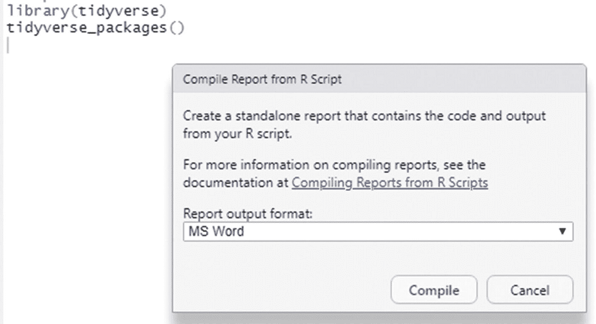

# 引言

为什么还要写另一本基础 R 语言书？答案是：为了让你在最短的时间内掌握实用的 R 语言知识。基于这个狭隘的目标，我省去了冗长的讨论、深入奇异数据科学领域的旁支，以及关于可能滥用统计的警告。本书在技术含义明确的前提下使用了常用词汇。例如，`Lubridate`中使用的“origin”一词可由英文等效词“starting date and time”替代。简短的解释，配合附带的 R 代码，让你能够将有用的代码复制粘贴到自己的应用中。早期的成功会带来动力。

我一直认为许多非虚构书籍的标题，比如“傻瓜学 X”，有点问题。问题不在于智商有限，而在于时间有限。面对商业、科学和社会中数百万个潜在的主题领域，每个人都必须缩小自己深入钻研的范围。你需要大量的工具，但只能将你的专业领域限制在少数几个方面。对于其他一切，“足够好”就是最佳平衡点。仅仅为了开车而学习汽车工程是过度的。*CRAN Recipes* 不是一本 50 磅重的统计学和 R 语言权威书籍。它旨在让你快速准确地达成目标。

本书中的所有代码均在 Windows R 版本 4.0.3 下测试过，使用 RStudio 版本 1.3.1093 作为集成开发环境（IDE）。在大多数情况下，书中显示的格式由`knitr`提供。在 Mac 或 Ubuntu Linux 等其他环境下，由于依赖项不同，少数包可能无法自动加载。这些包需要单独加载。例如，`crayon`包在 Ubuntu Linux 下不会随`tidyverse`自动加载。尽管如此，此处显示的 99%的代码在非 Windows 环境下应该可以不加修改地运行。

在某些情况下，不同的包会使用相同的函数名。例如，`dplyr`和`MASS`的`select`语句具有相同的名称。有两种方法可以解决这个问题：

*   如果你最近使用过`MASS`包，请在紧接着使用`select`语句之前加载`tidyverse`（或本例中的`dplyr`）。
*   在执行命令时指定包。例如，`dplyr::select .....` 将确保使用`dplyr`版本的`select`（通常是最佳选择）。

由于本书倾向于`tidyverse`而非其他包系统（除非另有说明），你应该在使用`MASS`或其他冲突包之后编写`library(tidyverse)`。也许最好的解决方案是像前面展示的那样，指定与命令关联的包。

## 本书示例前需运行的代码

为了执行本书中的代码，请首先执行以下代码。这段代码足够智能，会自动检查你的系统，判断你是否已安装`tidyverse`，如有需要则进行安装，并自动加载到内存中。

```r
if (!require("tidyverse")) install.packages("tidyverse")
```

`Lubridate`、`dplyr`和`stringr`等包内置于`tidyverse`中。

运行以下代码以查看`tidyverse`中包含的所有包：

```r
tidyverse_packages()
##  [1] "broom"      "cli"        "crayon"     "dbplyr"     "dplyr"
##  [6] "forcats"    "ggplot2"    "haven"      "hms"        "httr"
## [11] "jsonlite"   "lubridate"  "magrittr"   "modelr"     "pillar"
## [16] "purrr"      "readr"      "readxl"     "reprex"     "rlang"
## [21] "rstudioapi" "rvest"      "stringr"    "tibble"     "tidyr"
## [26] "xml2"       "tidyverse"
```

欢迎将本书的代码用于任何目的，当然需注意我们不提供任何担保。此代码仅用于教学目的。在某些情况下，我使用`bk.`（代表“book”）作为变量开头，以便将创建的变量与保留字清晰区分开来。对于有经验的 R 用户来说，这有点过度。然而，我看到过一些文本，例如，`keep`与名为`keeps`的临时变量或`mutate`与`Mutate`等混在一起。是的，这些细微差别在技术上确实能将它们与基础 R 或系统术语区分开来。但这对于教授新用户编码来说是不利的。在本书和代码中，当你看到`bk.`时，它将始终是一个变量，而永远不会是命令、功能说明或其他保留字。

在后面的章节中，我将引入一些专业包，以展示 R 的一些有趣的可视化和其他功能。在这些情况下，会包含包名称，并假设`tidyverse`已经加载。

在大多数情况下，本书中的示例是通过在 RStudio 中运行代码并使用`knitr`包创建的。`knitr`将执行的代码发送到 html、Microsoft Word 或 PDF。输出行在每行左侧显示`##`。如果你想了解其工作原理，可以在 RStudio 中创建一个简单的 R 脚本，保存它，然后（在 Windows 上）按`Ctrl-Shift-K`。在 Mac 上，按`Command-Shift-K`。图 1 显示了对话框的第一部分。



图 1. 使用`knitr`创建可重复输出的第一步（`Ctrl-Shift-K`）