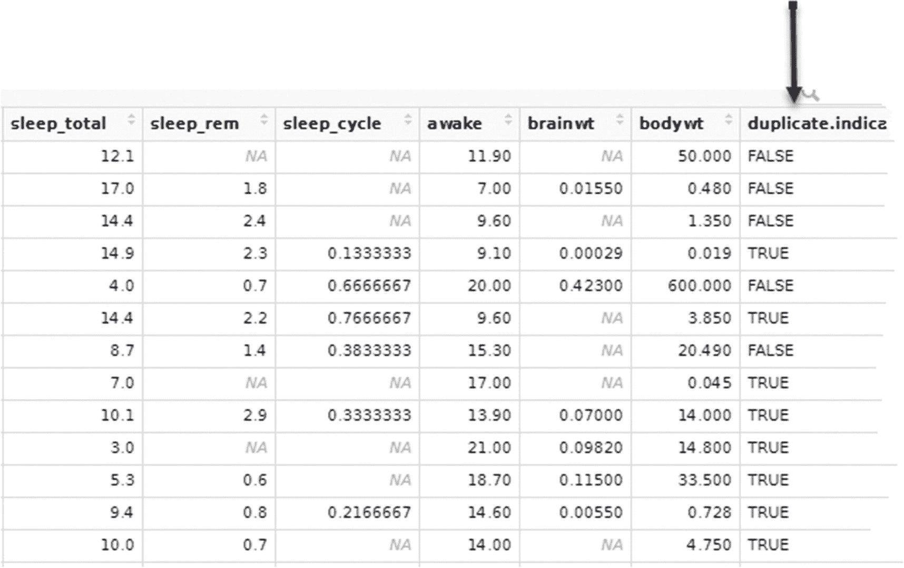

# 1. DPLYR

`dplyr`是我最喜欢的R包之一。它逻辑清晰、规则一致，取代了旧有的、由语法不一的包和函数组成的杂乱集合。它就像森林里的瑞士军刀——出门在外不可或缺。

本书中的大部分代码示例都使用了R内置数据集或硬编码在程序中的玩具数据框。为了练习，你在运行这些代码片段时应该替换成自己的数据。

## 1.1 筛选命令

筛选命令用于剔除你不想要的行（记录）。以下命令使用内置数据集作为输入数据框。下面使用了数据集 `mtcars`。输出结果仅显示六缸汽车。

**注意**：除非另有说明，以下展示的库将在所有代码中使用。`DPLYR`包含在大型包`tidyverse`中。

### 1.1.1 单一条件筛选

```
library(tidyverse)
data("mtcars")
#仅选择六缸汽车
six.cyl.only <- filter(mtcars, cyl == 6)
six.cyl.only
##                 mpg cyl  disp  hp drat    wt  qsec vs am gear carb
## Mazda RX4      21.0   6 160.0 110 3.90 2.620 16.46  0  1    4    4
## Mazda RX4 Wag  21.0   6 160.0 110 3.90 2.875 17.02  0  1    4    4
## Hornet 4 Drive 21.4   6 258.0 110 3.08 3.215 19.44  1  0    3    1
## Valiant        18.1   6 225.0 105 2.76 3.460 20.22  1  0    3    1
## Merc 280       19.2   6 167.6 123 3.92 3.440 18.30  1  0    4    4
## Merc 280C      17.8   6 167.6 123 3.92 3.440 18.90  1  0    4    4
## Ferrari Dino   19.7   6 145.0 175 3.62 2.770 15.50  0  1    5    6
```

在 `filter` 命令中，“等于”使用双等号 `==`。

### 1.1.2 多重条件筛选

筛选数据集 `mtcars`，要求同时满足六缸和110马力：

```
six.cylinders.and.110.horse.power <- filter(mtcars, cyl == 6,
hp == 110)
six.cylinders.and.110.horse.power
##                 mpg cyl disp  hp drat    wt  qsec vs am gear carb
## Mazda RX4      21.0   6  160 110 3.90 2.620 16.46  0  1    4    4
## Mazda RX4 Wag  21.0   6  160 110 3.90 2.875 17.02  0  1    4    4
## Hornet 4 Drive 21.4   6  258 110 3.08 3.215 19.44  1  0    3    1
```

### 1.1.3 使用“或”逻辑进行筛选

你可以根据需要随意使用多个“或”符号（管道符 `|`）。

基于“或”逻辑运算符进行筛选：

```
gear.eq.4.or.more.than.8 <- filter(mtcars, gear == 4 | cyl > 6)
gear.eq.4.or.more.than.8
##                      mpg cyl  disp  hp drat    wt  qsec vs am gear carb
## Mazda RX4           21.0   6 160.0 110 3.90 2.620 16.46  0  1    4    4
## Mazda RX4 Wag       21.0   6 160.0 110 3.90 2.875 17.02  0  1    4    4
## Datsun 710          22.8   4 108.0  93 3.85 2.320 18.61  1  1    4    1
## Hornet Sportabout   18.7   8 360.0 175 3.15 3.440 17.02  0  0    3    2
## Duster 360          14.3   8 360.0 245 3.21 3.570 15.84  0  0    3    4
## Merc 240D           24.4   4 146.7  62 3.69 3.190 20.00  1  0    4    2
## Merc 230            22.8   4 140.8  95 3.92 3.150 22.90  1  0    4    2
## Merc 280            19.2   6 167.6 123 3.92 3.440 18.30  1  0    4    4
## Merc 280C           17.8   6 167.6 123 3.92 3.440 18.90  1  0    4    4
## Merc 450SE          16.4   8 275.8 180 3.07 4.070 17.40  0  0    3    3
## Merc 450SL          17.3   8 275.8 180 3.07 3.730 17.60  0  0    3    3
## Merc 450SLC         15.2   8 275.8 180 3.07 3.780 18.00  0  0    3    3
## Cadillac Fleetwood  10.4   8 472.0 205 2.93 5.250 17.98  0  0    3    4
## Lincoln Continental 10.4   8 460.0 215 3.00 5.424 17.82  0  0    3    4
## Chrysler Imperial   14.7   8 440.0 230 3.23 5.345 17.42  0  0    3    4
## Fiat 128            32.4   4  78.7  66 4.08 2.200 19.47  1  1    4    1
## Honda Civic         30.4   4  75.7  52 4.93 1.615 18.52  1  1    4    2
## Toyota Corolla      33.9   4  71.1  65 4.22 1.835 19.90  1  1    4    1
## Dodge Challenger    15.5   8 318.0 150 2.76 3.520 16.87  0  0    3    2
## AMC Javelin         15.2   8 304.0 150 3.15 3.435 17.30  0  0    3    2
## Camaro Z28          13.3   8 350.0 245 3.73 3.840 15.41  0  0    3    4
## Pontiac Firebird    19.2   8 400.0 175 3.08 3.845 17.05  0  0    3    2
## Fiat X1-9           27.3   4  79.0  66 4.08 1.935 18.90  1  1    4    1
## Ford Pantera L      15.8   8 351.0 264 4.22 3.170 14.50  0  1    5    4
## Maserati Bora       15.0   8 301.0 335 3.54 3.570 14.60  0  1    5    8
## Volvo 142E          21.4   4 121.0 109 4.11 2.780 18.60  1  1    4    2
```

### 1.1.4 按最小值、最大值和其他数值标准筛选

输出结果正如预期，仅包含发动机排量最小的那一行：

```
smallest.engine.displacement <- filter(mtcars, disp ==
min(disp))
smallest.engine.displacement
##                 mpg cyl disp hp drat    wt qsec vs am gear carb
## Toyota Corolla 33.9   4 71.1 65 4.22 1.835 19.9  1  1    4    1
```

使用逗号分隔的条件进行筛选：

```
data("ChickWeight")
chick.subset <- filter(ChickWeight, Time == 2 & weight > 53)
chick.subset
##   weight Time Chick Diet
## 1     55    2    22    2
## 2     55    2    40    3
## 3     55    2    43    4
## 4     54    2    50    4
```

### 1.1.5 筛选掉特定列中的缺失值（NAs）

内置数据集 `airquality` 在第一列（`Ozone`）的第五行含有一个缺失值：

```
data("airquality")
head(airquality,10) #筛选前
##    Ozone Solar.R Wind Temp Month Day
## 1     41     190  7.4   67     5   1
## 2     36     118  8.0   72     5   2
## 3     12     149 12.6   74     5   3
## 4     18     313 11.5   62     5   4
## 5     NA      NA 14.3   56     5   5
## 6     28      NA 14.9   66     5   6
## 7     23     299  8.6   65     5   7
## 8     19      99 13.8   59     5   8
## 9      8      19 20.1   61     5   9
## 10    NA     194  8.6   69     5  10
```

移除 `Ozone` 列中含有缺失值的所有行：

```
no.missing.ozone <- filter(airquality, !is.na(Ozone))
head(no.missing.ozone,8) #筛选后
##   Ozone Solar.R Wind Temp Month Day
## 1    41     190  7.4   67     5   1
## 2    36     118  8.0   72     5   2
## 3    12     149 12.6   74     5   3
## 4    18     313 11.5   62     5   4
## 5    28      NA 14.9   66     5   6
## 6    23     299  8.6   65     5   7
## 7    19      99 13.8   59     5   8
## 8     8      19 20.1   61     5   9
```

请注意，虽然 `Ozone` 列为 `NA` 的行已被剔除，但 `Solar.R` 列为 `NA` 的行仍然存在。

### 1.1.6 筛选数据集中任何位置存在 NA 的行

使用 `complete.cases()` 来移除任何列中包含 `NA` 的行：

```
airqual.no.NA.anywhere <- filter(airquality[1:10,],
complete.cases(airquality[1:10,]))
airqual.no.NA.anywhere
##   Ozone Solar.R Wind Temp Month Day
## 1    41     190  7.4   67     5   1
## 2    36     118  8.0   72     5   2
## 3    12     149 12.6   74     5   3
## 4    18     313 11.5   62     5   4
## 5    23     299  8.6   65     5   7
## 6    19      99 13.8   59     5   8
## 7     8      19 20.1   61     5   9
```

### 1.1.7 使用 `%in%` 进行筛选

`%in%` 是一个强大的运算符，为包含/排除指定值提供了便捷的简写形式：

```
data("iris")
table(iris$Species) #数据集中各物种的数量
##
##     setosa versicolor  virginica
##         50         50         50
iris.two.species <- filter(iris,
Species %in% c("setosa", "virginica"))
table(iris.two.species$Species)
##
##     setosa versicolor  virginica
##         50          0         50
```

显示筛选前后的行数：

```
nrow(iris); nrow(iris.two.species)
## [1] 150
## [1] 100
```

### 1.1.8 筛选 `Ozone > 29` 并仅包含三列

```
data("airquality")
airqual.3.columns <- filter(airquality, Ozone > 29)[,1:3]
head(airqual.3.columns)
##   Ozone Solar.R Wind
## 1    41     190  7.4
## 2    36     118  8.0
## 3    34     307 12.0
## 4    30     322 11.5
## 5    32      92 12.0
## 6    45     252 14.9
```

### 1.1.9 按某值在所有行中的总频次过滤

此逻辑使用 `group_by` 来根据齿轮数量统计行数。统计完齿轮数量后，仅输出那些**总**计数值超过 10 的行。这里我们只想看到在汽车数据中，具有特定齿轮数量的记录至少有 11 行。过滤仅由出现频率驱动。您的问题可以表述为“只显示常见齿轮配置的记录”。5 个齿轮远不如 3 个和 4 个齿轮常见，因此在过滤后的数据框中，它们被省略了。在下方的第一个表格中，有 15 条记录是 3 个齿轮的汽车，12 条记录是 4 个齿轮的，5 条记录是 5 个齿轮的。应用过滤并创建新数据框后，就没有 5 个齿轮的记录：

```
table(mtcars$gear)
##
##  3  4  5
## 15 12  5
more.frequent.no.of.gears <- mtcars %>%
group_by(gear) %>%
filter(n() > 10)
table(more.frequent.no.of.gears$gear)
##
##  3  4
## 15 12
```

可以通过添加马力小于 105 的条件来增加过滤条件：

```
more.frequent.no.of.gears.and.low.horsepower <- mtcars %>%
group_by(gear) %>%
filter(n() > 10, hp < 105)
table(more.frequent.no.of.gears.and.low.horsepower$gear)
##
## 3 4
## 1 7
```

### 1.1.10 使用“starts with”按列名过滤

在此代码中，选择列名以 “S” 开头的记录：

```
names(iris)  #show the column names
## [1] "Sepal.Length" "Sepal.Width"  "Petal.Length" "Petal.Width"  "Species"
iris.display <- iris %>% dplyr::select(starts_with("S"))
head(iris.display)  #use head to reduce number of rows output
##   Sepal.Length Sepal.Width Species
## 1          5.1         3.5  setosa
## 2          4.9         3.0  setosa
## 3          4.7         3.2  setosa
## 4          4.6         3.1  setosa
## 5          5.0         3.6  setosa
## 6          5.4         3.9  setosa
```

### 1.1.11 过滤行：列满足条件 (`filter_at`)

使用 `filter_at` 查找满足某些条件（如最大值）的行：

```
new.mtcars <- mtcars %>% filter_at(vars(cyl, hp), all_vars(. == max(.)))
new.mtcars
##               mpg cyl disp  hp drat   wt qsec vs am gear carb
## Maserati Bora  15   8  301 335 3.54 3.57 14.6  0  1    5    8
```

请注意，只有一辆车，即玛莎拉蒂博拉，分别在每个列上既拥有最大气缸数，也拥有最大马力。

另一个示例数据集来自 Suzan Baert 的博客（`https://suzan.rbind.io/2018/02/dplyr-tutorial-3/#filter-at`），使用了睡眠研究数据。

从 `ggplot2` 包加载 `msleep` 数据框：

```
msleep
##  1 Cheetah                  Acinonyx    carni Carnivora         lc             12.1    NA       NA      11.9
##  2 Owl monkey               Aotus       omni  Primates                       17      1.8      NA      7
##  3 Mountain beaver          Aplodontia  herbi Rodentia           nt             14.4    2.4      NA      9.6
##  4 Greater short-tailed shrew Blarina   omni  Soricomorpha       lc             14.9    2.3      0.133   9.1
##  5 Cow                      Bos         herbi Artiodactyla       domesticated   4       0.7      0.667   20
##  6 Three-toed sloth         Bradypus    herbi Pilosa                          14.4    2.2      0.767   9.6
##  7 Northern fur seal        Callorhinus carni Carnivora         vu             8.7     1.4      0.383   15.3
##  8 Vesper mouse             Calomys       Rodentia                             7       NA       NA      17
##  9 Dog                      Canis       carni Carnivora         domesticated   10.1    2.9      0.333   13.9
## 10 Roe deer                 Capreolus   herbi Artiodactyla       lc             3       NA       NA      21
## # ... with 73 more rows, and 2 more variables: brainwt , bodywt
msleep.over.5 <- msleep %>%
select(name, sleep_total:sleep_rem, brainwt:bodywt) %>%
filter_at(vars(contains("sleep")), all_vars(.>5))
msleep.over.5
## # A tibble: 2 x 5
##   name                 sleep_total sleep_rem brainwt bodywt
##   <chr>                      <dbl>     <dbl>   <dbl>  <dbl>
## 1 Thick-tailed opposum        19.4     6.6      NA      0.37
## 2 Giant armadillo             18.1     6.1      0.081   60
```

对于上述代码，请暂时忽略 `select` 语句（稍后会介绍）。`filter_at` 函数表示只查看包含单词 “sleep” 的变量。在这些变量中（此例中有两个），过滤出*任何*值大于 5 的行。`.` 表示任何名称中包含 sleep 的变量。此例中只有两行满足过滤条件。

### 1.2 `Arrange` (排序)

`Arrange`，即排序函数，它像字母表一样古老。它基于定义的 ASCII 顺序，按升序或降序序列重新排列数据框或向量。排序键被定义为主键、次键等等。

从 `ggplot2` 包加载 `msleep` 数据框：

```
msleep
##  1 Cheetah                    Acinonyx    carni Carnivora
##  2 Owl monkey                 Aotus       omni  Primates
##  3 Mountain beaver            Aplodontia  herbi Rodentia
##  4 Greater short-tailed shrew Blarina     omni  Soricomorpha
##  5 Cow                        Bos         herbi Artiodactyla
##  6 Three-toed sloth           Bradypus    herbi Pilosa
##  7 Northern fur seal          Callorhinus carni Carnivora
##  8 Vesper mouse               Calomys       Rodentia
##  9 Dog                        Canis       carni Carnivora
## 10 Roe deer                   Capreolus   herbi Artiodactyla
## # ... with 73 more rows
```

#### 1.2.1 升序

```
animal.name.sequence <- arrange(msleep, name)
animal.name.sequence
##  1 Cheetah           Acinonyx     carni Carnivora
##  2 Northern fur seal Callorhinus  carni Carnivora
##  3 Dog               Canis        carni Carnivora
##  4 Domestic cat      Felis        carni Carnivora
##  5 Gray seal         Halichoerus carni Carnivora
##  6 Tiger             Panthera     carni Carnivora
##  7 Jaguar            Panthera     carni Carnivora
##  8 Lion              Panthera     carni Carnivora
##  9 Caspian seal      Phoca        carni Carnivora
## 10 Genet             Genetta      carni Carnivora
## # ... with 73 more rows
```

#### 1.2.2 降序

```
animal.name.sequence.desc <- arrange(msleep, desc(name))
animal.name.sequence.desc
## 1 Northern grasshopper mouse Onychomys     carni Rodentia
## 2 Slow loris                 Nyctibeus     carni Primates
## 3 Thick-tailed opposum       Lutreolina    carni Didelphimorphia
## 4 Long-nosed armadillo       Dasypus       carni Cingulata
## 5 Pilot whale                Globicephalus carni Cetacea
## 6 Common porpoise            Phocoena      carni Cetacea
```

在 “Mutate” 部分，您将看到如何动态创建一个变量，然后在同一语句中用于排序。

### 1.3 `Rename`

`Rename` 允许您更改一个或多个列的名称。它是一个便捷函数，不改变任何数据。

重命名数据集中的一个或多个列：

```
names(iris)
## [1] "Sepal.Length" "Sepal.Width"  "Petal.Length" "Petal.Width"  "Species"
```

显示新的列名：

```
renamed.iris <- rename(iris, width.of.petals = Petal.Width,
various.plants.and.animals = Species)
names(renamed.iris)
## [1] "Sepal.Length"               "Sepal.Width"
## [3] "Petal.Length"               "width.of.petals"
## [5] "various.plants.and.animals"
```

### 1.4 `Mutate`

`Mutate` 向数据框添加新变量。它需要原始数据框作为第一个参数，然后是需要创建新变量的其余参数。以下示例将之前创建的仅包含长度和重量变量的数据框添加了长度和重量的自然对数。

向数据框添加一个新的计算变量：

```
data("ChickWeight")
ChickWeight[1:2,]  #first two rows
##   weight Time Chick Diet
## 1     42    0     1    1
## 2     51    2     1    1
```

前两行，添加了新字段后：

```
Chickweight.with.log <- mutate(ChickWeight,
log.of.weight = log10(weight))
Chickweight.with.log[1:2,]
##   weight Time Chick Diet log.of.weight
## 1     42    0     1    1      1.623249
## 2     51    2     1    1      1.707570
```

#### 1.4.1 使用 `mutate_all` 一次性添加新字段

基于现有字段通过某些计算创建一系列新字段。这是一种简写方法，无需逐一明确定义每个新变量。在以下示例中，每个指定的列（6–11）都为平方根函数提供数值，然后创建一个带有“_square root”后缀的新列。

加载 `ggplot2` 包中的 `msleep` 数据框：

```r
msleep <- ggplot2::msleep
names(msleep)
##  [1] "name"         "genus"        "vore"         "order"        "conservation"
##  [6] "sleep_total"  "sleep_rem"    "sleep_cycle"  "awake"        "brainwt"
## [11] "bodywt"
```

现在为第 6–11 列中的数值变量添加平方根变量/列：

```r
msleep.with.square.roots <- mutate_all(msleep[,6:11], funs("square root" = sqrt( . )))
names(msleep.with.square.roots)
```

如果您在使用 `dplyr` > 0.8.0 的 R 4.0.3 上运行，可能会收到一条警告消息。

```r
##  [1] "sleep_total"             "sleep_rem"
##  [3] "sleep_cycle"             "awake"
##  [5] "brainwt"                 "bodywt"
##  [7] "sleep_total_square root" "sleep_rem_square root"
##  [9] "sleep_cycle_square root" "awake_square root"
## [11] "brainwt_square root"     "bodywt_square root"
msleep.with.square.roots
## # A tibble: 83 x 12
##  sleep_total sleep_rem sleep_cycle awake brainwt bodywt `sleep_total_sq~
##                                
##  1      12.1      NA        NA      11.9 NA        50         3.48
##  2      17         1.8      NA       7    0.0155    0.48      4.12
##  3      14.4       2.4      NA       9.6 NA         1.35      3.79
##  4      14.9       2.3       0.133   9.1  0.00029   0.019     3.86
##  5       4         0.7       0.667  20    0.423   600         2
##  6      14.4       2.2       0.767   9.6 NA         3.85      3.79
##  7       8.7       1.4       0.383  15.3 NA        20.5       2.95
##  8       7        NA        NA      17   NA         0.045     2.65
##  9      10.1       2.9       0.333  13.9  0.07     14         3.18
## 10       3        NA        NA      21    0.0982   14.8       1.73
## # ... with 73 more rows, and 5 more variables: `sleep_rem_square root` ,
## #   `sleep_cycle_square root` , `awake_square root` , `brainwt_square
## #   root` , `bodywt_square root`
```

### 1.4.2 使用 `mutate_at` 添加字段

使用泰坦尼克号幸存者数据集，如下所示创建 `Class`-rank、`Age`-rank 和 `Survived`-rank 变量。使用 `data()` 函数，`Titanic` 作为表格加载；`as.data.frame` 用于将其转换为数据框：

```r
data("Titanic")
Titanic <- as.data.frame(Titanic)
head(Titanic)
##   Class    Sex   Age Survived Freq
## 1   1st   Male Child       No    0
## 2   2nd   Male Child       No    0
## 3   3rd   Male Child       No   35
## 4  Crew   Male Child       No    0
## 5   1st Female Child       No    0
## 6   2nd Female Child       No    0
titanic.with.ranks <- mutate_at(Titanic, vars(Class,Age,Survived), funs(Rank = min_rank(desc(.))))
head(titanic.with.ranks)
##   Class    Sex   Age Survived Freq Class_Rank Age_Rank Survived_Rank
## 1   1st   Male Child       No    0         25       17            17
## 2   2nd   Male Child       No    0         17       17            17
## 3   3rd   Male Child       No   35          9       17            17
## 4  Crew   Male Child       No    0          1       17            17
## 5   1st Female Child       No    0         25       17            17
## 6   2nd Female Child       No    0         17       17            17
```

### 1.4.3 `mutate_if`

`mutate_if` 将 IF 逻辑与 `mutate()` 结合起来，用于创建新变量或更改现有变量。^(¹) 以下是两个示例。在示例一中，为了方便起见，移除了因子。示例二展示了如何将一列中的 `NA` 替换为零。

**示例 #1**

创建一个简单的函数，将一个数字除以 10：

```r
divide.by.10 <- function (a.number) (a.number / 10)
```

使用内置数据集 `CO2` 进行说明：

```r
head(CO2)
##   Plant   Type  Treatment conc uptake
## 1   Qn1 Quebec nonchilled   95   16.0
## 2   Qn1 Quebec nonchilled  175   30.4
## 3   Qn1 Quebec nonchilled  250   34.8
## 4   Qn1 Quebec nonchilled  350   37.2
## 5   Qn1 Quebec nonchilled  500   35.3
## 6   Qn1 Quebec nonchilled  675   39.2
```

现在，使用上述自定义函数，将任何数值格式的列除以 10：

```r
new.df % mutate_if(is.numeric, divide.by.10)
head(new.df)
##   Plant   Type  Treatment conc uptake
## 1   Qn1 Quebec nonchilled  9.5   1.60
## 2   Qn1 Quebec nonchilled 17.5   3.04
## 3   Qn1 Quebec nonchilled 25.0   3.48
## 4   Qn1 Quebec nonchilled 35.0   3.72
## 5   Qn1 Quebec nonchilled 50.0   3.53
## 6   Qn1 Quebec nonchilled 67.5   3.92
```

**示例 #2**

任何数值字段中的 `NA` 都被替换为零。`coalesce` 是 `dplyr` 的一个函数，用于在每个位置查找第一个非缺失值。R（以及其他语言）中的一组三个点被称为省略号（ellipsis）。这意味着一个函数可以接受任意数量的参数：

```r
df % mutate_if(is.numeric, coalesce, ... = 0)
df.fix.alpha
##   alpha almond grape apple
## 1    22      0     0     0
## 2     1      5     2     5
## 3     0     10     2    10
```

### 1.4.4 字符串检测与真/假重复指示器

将所有列名中包含"sleep"字符的列转换为字符型。

加载 `ggplot2` 包中的 `msleep` 数据框：

```r
msleep <- ggplot2::msleep
table(msleep$vore)
##   carni   herbi insecti    omni
##      19      32       5      20
msleep.no.c.or.a <- filter(msleep, !str_detect(vore,
paste(c("c","a"), collapse = "|")))
table(msleep.no.c.or.a$vore)
##
## herbi  omni
##    32    20
```

添加一个字段，用于指示某列中的特定值是否出现多次。在此示例中，列为 `conservation`：

```r
msleep.with.dup.indicator                       
## 1 Chee~ Acin~ carni Carn~ lc            12.1    NA      NA      11.9
## 2 Owl ~ Aotus omni  Prim~           17      1.8     NA      7
## 3 Moun~ Aplo~ herbi Rode~ nt            14.4    2.4     NA      9.6
## 4 Grea~ Blar~ omni  Sori~ lc            14.9    2.3     0.133   9.1
## 5 Cow   Bos   herbi Arti~ domesticated   4      0.7     0.667   20
## 6 Thre~ Brad~ herbi Pilo~           14.4    2.2     0.767   9.6
## # ... with 3 more variables: brainwt , bodywt ,
## #   duplicate.indicator 
```

请注意底部显示的新字段 `duplicate.indicator`。`mutate` 添加了一个字段，用于指示某列中的特定值是否出现多次。在此示例中，列为 `conservation`。图 1-1 展示了 `msleep.with.dup.indicator` 的部分视图，其中清晰显示了重复指示器字段。



图 1-1：右侧显示创建的字段 `duplicate.indicator`

```r
msleep.with.dup.indicator                              
## 1 Cheetah                    Acinonyx   carni FALSE
## 2 Owl monkey                 Aotus      omni  FALSE
## 3 Mountain beaver            Aplodontia herbi FALSE
## 4 Greater short-tailed shrew Blarina    omni  TRUE
## 5 Cow                        Bos        herbi FALSE
## 6 Three-toed sloth           Bradypus   herbi TRUE
```

按 `conservation` 为主键，`genus` 为次键排序：

```r
msleep.with.dup.indicator2 <- msleep.with.dup.indicator %>%
arrange(conservation,genus)
msleep.with.dup.indicator2
## # A tibble: 83 x 12
##    name  genus vore  order conservation sleep_total sleep_rem sleep_cycle awake
##                        
##  1 Gira~ Gira~ herbi Arti~ cd             1.9    0.4    NA     22.1
##  2 Pilo~ Glob~ carni Ceta~ cd             2.7    0.1    NA     21.4
##  3 Cow   Bos   herbi Arti~ domesticated   4      0.7    0.667  20
##  4 Dog   Canis carni Carn~ domesticated   10.1   2.9    0.333  13.9
##  5 Guin~ Cavis herbi Rode~ domesticated   9.4    0.8    0.217  14.6
##  6 Chin~ Chin~ herbi Rode~ domesticated   12.5   1.5    0.117  11.5
##  7 Horse Equus herbi Peri~ domesticated   2.9    0.6    1      21.1
##  8 Donk~ Equus herbi Peri~ domesticated   3.1    0.4    NA     20.9
##  9 Dome~ Felis carni Carn~ domesticated   12.5   3.2    0.417  11.5
## 10 Rabb~ Oryc~ herbi Lago~ domesticated   8.4    0.9    0.417  15.6
## # ... with 73 more rows, and 3 more variables: brainwt , bodywt ,
## #   duplicate.indicator 
```

为了使 `duplicate.indicator` 设置为 `TRUE`，`conservation` 和 `genus` 都必须重复。

创建示例数据框：

```r
fruit <- c("apple","pear","orange","grape", "orange","orange")
x <- c(1,2,4,9,4,6)
y <- c(22,3,4,55,15,9)
z <- c(3,1,4,10,12,8)
w <- c(2,2,2,4,5,6)
df <- data.frame(fruit,x,y,z,w)
df
##    fruit x  y  z w
## 1  apple 1 22  3 2
## 2   pear 2  3  1 2
## 3 orange 4  4  4 2
## 4  grape 9 55 10 4
## 5 orange 4 15 12 5
## 6 orange 6  9  8 6
df.show.single.dup <- mutate(df, duplicate.indicator = duplicated(fruit))
df.show.single.dup
##    fruit x  y  z w duplicate.indicator
## 1  apple 1 22  3 2               FALSE
## 2   pear 2  3  1 2               FALSE
## 3 orange 4  4  4 2               FALSE
## 4  grape 9 55 10 4               FALSE
## 5 orange 4 15 12 5                TRUE
## 6 orange 6  9  8 6                TRUE
```

`DPLYR` 逐行向下扫描，检查"fruit"列中的值。它无法检测到第一个重复项，因为此时尚不知道是否还有其他重复。当第二次和第三次看到"orange"时，便将包含"orange"值的行的 `duplicate.indicator` 列设为 `TRUE`。

如果要检查多个字段，请在使用重复逻辑（真/假）指示器之前，使用 `mutate` 将它们合并到一个新的单一字段中。

### 1.4.5 使用 NULL 删除变量

```r
fruit <- c("apple","pear","orange","grape", "orange","orange")
x <- c(1,2,4,9,4,6)
y <- c(22,3,4,55,15,9)
z <- c(3,1,4,10,12,8)
df <- data.frame(fruit,x,y,z)
df <- mutate(df, z = NULL)
df
##    fruit x  y
## 1  apple 1 22
## 2   pear 2  3
## 3 orange 4  4
## 4  grape 9 55
## 5 orange 4 15
## 6 orange 6  9
```

## 1.5 使用 `Select` 选择变量/列

`Select` 仅保留您在 `select` 语句中包含的变量。`rename` 函数通常被认为是 `select` 的姐妹函数，它不会删除任何变量。

请注意，其他包（例如 `Zeilig`）也使用了 `select` 命令。如果您基于 `DPLYR`/`tidyverse` 编写了语法正确的代码，但最后加载了其他使用相同命令的包，您将因试图弄清楚 R 的错误信息而抓狂。有两种方法可以解决此问题：

- 始终在加载所有其他包***之后***最后输入 `library(tidyverse)`。
- 显式地将命令与包绑定：`dplyr::select`。请记住，`DPLYR` 是 `tidyverse` 协调包集合的一部分。

### 1.4.6 推荐的编码顺序

John Mount 在其 2017 年 9 月 22 日的博客([`www.r-bloggers.com/my-advice-on-dplyrmutate/`](http://www.r-bloggers.com/my-advice-on-dplyrmutate/))中建议，使用多个`mutate`语句来创建变量，而不是将所有变量放在一个语句中。曾几何时，这在处理某些数据库文件时会产生差异，但后来已被修正。尽管如此，多`mutate`格式看起来更安全且更直观。以下展示不推荐和推荐的编码方法。

不推荐但可行的方法：

```r
if (!require("nycflights13")) install.packages("nycflights13")
mutate(flights,
gain = arr_delay - dep_delay,
hours = air_time / 60,
gain_per_hour = gain / hours,
gain_per_minute = 60 * gain_per_hour)
##  A tibble: 336,776 x 23
##  year month   day dep_time sched_dep_time dep_delay arr_time sched_arr_time
##                           
##  1  2013     1     1      517      515        2      830       819
##  2  2013     1     1      533      529        4      850       830
##  3  2013     1     1      542      540        2      923       850
##  4  2013     1     1      544      545       -1     1004      1022
##  5  2013     1     1      554      600       -6      812       837
##  6  2013     1     1      554      558       -4      740       728
##  7  2013     1     1      555      600       -5      913       854
##  8  2013     1     1      557      600       -3      709       723
##  9  2013     1     1      557      600       -3      838       846
## 10  2013     1     1      558      600       -2      753       745
##  ... with 336,766 more rows, and 15 more variables: arr_delay ,
##  carrier , flight , tailnum , origin , dest ,
##  air_time , distance , hour , minute , time_hour ,
##  gain , hours , gain_per_hour , gain_per_minute 
```

推荐方法：

```r
if (!require("nycflights13")) install.packages("nycflights13")
newfield.flights <- flights %>%
mutate(gain = arr_delay - dep_delay,
hours = air_time / 60) %>%
mutate(gain_per_hour = gain / hours) %>%
mutate(gain_per_minute = 60 * gain_per_hour)
```

展示前六行的选定列，包括新创建的列。

```r
newfield.flights[1:6,c(1:2,20:23)]
## A tibble: 6 x 6
##
year month  gain hours gain_per_hour gain_per_minute
##                          
## 1  2013     1     9  3.78          2.38            143.
## 2  2013     1    16  3.78          4.23            254.
## 3  2013     1    31  2.67         11.6             698.
## 4  2013     1   -17  3.05         -5.57           -334.
## 5  2013     1   -19  1.93         -9.83           -590.
## 6  2013     1    16  2.5           6.4             384
# A tibble: 6 x 6
# year month gain hours gain_per_hour gain_per_minute
```

### 1.4.7 数据变形：仅保留新创建的变量

`Transmute` 允许您基于现有变量的计算来创建一个全新的数据框：

```r
fruit <- c("apple","pear","orange","grape", "orange","orange")
x <- c(1,2,4,9,4,6)
y <- c(22,3,4,55,15,9)
z <- c(3,1,4,10,12,8)
df <- data.frame(fruit,x,y,z)
df #变形前
##    fruit x  y  z
## 1  apple 1 22  3
## 2   pear 2  3  1
## 3 orange 4  4  4
## 4  grape 9 55 10
## 5 orange 4 15 12
## 6 orange 6  9  8
df <- transmute(df, new.variable = x + y + z)
#行 "apple" =1 + 22 + 3 = 26
#行 "pear" = 2 + 3 + 1 = 6 以此类推
```

变形后：

```r
df
##   new.variable
## 1           26
## 2            6
## 3           12
## 4           74
## 5           31
## 6           23
```

### 1.4.8 使用 `Across` 对多列应用函数

定义一个简单的函数，使数值翻倍：

```r
double.it <- function(x) x*2
```

原始的 `iris` 数据：

```r
head(iris)
##   Sepal.Length Sepal.Width Petal.Length Petal.Width Species
## 1          5.1         3.5          1.4         0.2  setosa
## 2          4.9         3.0          1.4         0.2  setosa
## 3          4.7         3.2          1.3         0.2  setosa
## 4          4.6         3.1          1.5         0.2  setosa
## 5          5.0         3.6          1.4         0.2  setosa
## 6          5.4         3.9          1.7         0.4  setosa
```

展示一个数值列数值翻倍后的新 `iris` 数据框：

```r
iris %>%
mutate(across(where(is.numeric), double.it)) %>%
head()
##   Sepal.Length Sepal.Width Petal.Length Petal.Width Species
## 1         10.2         7.0          2.8         0.4  setosa
## 2          9.8         6.0          2.8         0.4  setosa
## 3          9.4         6.4          2.6         0.4  setosa
## 4          9.2         6.2          3.0         0.4  setosa
## 5         10.0         7.2          2.8         0.4  setosa
## 6         10.8         7.8          3.4         0.8  setosa
```

### 1.4.9 使用 `case_when` 进行条件变异

使用条件变异加 `case_when`，您可以变异一个新字段，然后根据多个条件设置值。^(³)

```r
row1 <- df %>% mutate(column.to.be.changed = case_when(a == 2 | a == 5 |
a == 7 | (a == 1 & b == 4) ~ 2, a == 0 | a == 1 | a == 4 |
a == 3 | c == 4 ~ 3, TRUE ~ NA_real_))
```

这是一系列“或”条件。如果其中任何一个为真，则最后一列（`column.to.be.changed`）将为 2 或 3。

修改后：

```r
new.df
##   a b  c d e f column.to.be.changed
## 1 1 1  1 6 6 1                    3
## 2 3 4  4 6 4 4                    3
## 3 4 6 25 5 5 2                    3
## 4 5 3  6 3 3 6                    2
```

### 1.5.1 删除列

```r
fruit <- c("apple","pear","orange","grape", "orange","orange")
x <- c(1,2,4,9,4,6)
y <- c(22,3,4,55,15,9)
z <- c(3,1,4,10,12,8)
df <- data.frame(fruit,x,y,z) #select 前
df
##    fruit x  y  z
## 1  apple 1 22  3
## 2   pear 2  3  1
## 3 orange 4  4  4
## 4  grape 9 55 10
## 5 orange 4 15 12
## 6 orange 6  9  8
```

在要删除的任何变量前面加上减号。在此例中，`fruit` 列不包含在新的数据框中：

```r
new.df.no.fruit <- dplyr::select(df, -fruit)
new.df.no.fruit #select 后
##   x  y  z
## 1 1 22  3
## 2 2  3  1
## 3 4  4  4
## 4 9 55 10
## 5 4 15 12
## 6 6  9  8
```

### 1.5.2 使用 `starts_with` 或 `ends_with` 按名称删除列

使用 `names` 命令列出数据框中的列名：

```r
data("mtcars")
names(mtcars)
##  [1] "mpg"  "cyl"  "disp" "hp"   "drat" "wt"  "qsec" "vs"  "am"  "gear"
## [11] "carb"
```

删除名称以“d”开头的任何列：

```r
mtcars.no.col.names.start.with.d <- select(mtcars, -starts_with("d"))
names(mtcars.no.col.names.start.with.d)
## [1] "mpg"  "cyl"  "hp"   "wt"   "qsec" "vs"   "am"   "gear" "carb"
```

删除名称以“t”结尾的任何列。在此例中，`drat` 和 `wt` 被移除：

```r
mtcars.no.col.names.ends.with <- select(mtcars, -ends_with("t"))
names(mtcars.no.col.names.ends.with)
## [1] "mpg"  "cyl"  "disp" "hp"   "qsec" "vs"   "am"   "gear" "carb"
```

### 1.5.3 重新排序列顺序

```r
fruit <- c("apple","pear","orange","grape", "orange","orange")
x <- c(1,2,4,9,4,6)
y <- c(22,3,4,55,15,9)
z <- c(3,1,4,10,12,8)
df <- data.frame(fruit,x,y,z)
df
##    fruit x  y  z
## 1  apple 1 22  3
## 2   pear 2  3  1
## 3 orange 4  4  4
## 4  grape 9 55 10
## 5 orange 4 15 12
## 6 orange 6  9  8
```

此操作将列 `z` 移动到所有其他列的左侧，从而成为第一列。通常，将常用列放在左侧会更方便。关键字 `everything` 表示应保留所有剩余的列。

### 1.5.4 使用 `select_all` 对所有列应用函数

使用 `select_all` 对所有列应用函数。

之前——列名未大写：

```r
#创建新数据框
state <- c("Maryland", "Alaska", "New Jersey")
income <- c(76067,74444,73702)
median.us <- c(61372,61372,61372)
life.expectancy <- c(78.8,78.3,80.3)
top.3.states <- data.frame(state, income, median.us, life.expectancy)
top.3.states #之前——列名未大写
##        state income median.us life.expectancy m.some.number
## 1   Maryland  76067     61372            78.8            33
## 2     Alaska  74444     61372            78.3            11
## 3 New Jersey  73702     62372            80.3            44
```

使用 `toupper` 函数将列名转为大写：

```r
new.top.3.states <- select_all(top.3.states, toupper)
new.top.3.states #应用函数"toupper"后
##        STATE INCOME MEDIAN.US LIFE.EXPECTANCY M.SOME.NUMBER
## 1   Maryland  76067     61372            78.8            33
## 2     Alaska  74444     61372            78.3            11
## 3 New Jersey  73702     62372            80.3            44
```

#### 1.5.5 使用 `pull` 函数选择列

`pull` 函数的作用有点像 R 中的 `dataframe$variable` 语法。它可以隔离指定的列。您可以指定从左侧开始的列（例如，第二个列通过 `2`），或者使用负数指定从右侧开始的列。

```r
top.3.states <- data.frame(state, income, median.us, life.expectancy)
top.3.states #显示数据框值
##        state income median.us life.expectancy
## 1   Maryland  76067     61372            78.8
## 2     Alaska  74444     61372            78.3
## 3 New Jersey  73702     61372            80.3
```

仅获取从左侧开始的第一列，即 `state` 列：

```r
pull.first.column <- pull(top.3.states, 1)
pull.first.column
## [1] "Maryland"   "Alaska"     "New Jersey"
```

使用负数从右侧拉取列。`-1` = 最右侧的列：

```r
pull.last.column <- pull(top.3.states, -1)
pull.last.column
## [1] 78.8 78.3 80.3
```

#### 1.5.6 选择行：任意变量满足某一条件

`dplyr` 在一些不太常用的函数中展现了其原始威力。你可能有一个数据集，想要了解其中是否存在超过某个特定值的元素。以下代码用于筛选数据集中任何列中大于 200 的值。

原始数据框的行数：

```r
nrow(mtcars)
## [1] 32
```

显示数据集中任何地方大于 200 的值：

```r
mtcars.more.than.200 <- dplyr::filter_all(mtcars, dplyr::any_vars(. > 200))
nrow(mtcars.more.than.200)
## [1] 16
```

#### 1.5.7 选择列：若列名包含特定字符则省略

选择指定的列以及任何不包含"p"的列：

```r
names(mtcars)
##  [1] "mpg"  "cyl"  "disp" "hp"   "drat" "wt"  "qsec" "vs"  "am"  "gear"
## [11] "carb"
```

`select` 语句之后数据框的列名：

```r
cars.with.no.p <- dplyr::select(mtcars, -dplyr::contains("p"))
names(cars.with.no.p)
## [1] "cyl"  "drat" "wt"   "qsec" "vs"   "am"   "gear" "carb"
```

新数据框中不包含任何列名中带有"p"的列。

#### 1.5.8 使用通配符匹配进行选择

显示内置 `mtcars` 数据框的列名：

```r
names(mtcars)
##  [1] "mpg"  "cyl"  "disp" "hp"   "drat" "wt"  "qsec" "vs"  "am"  "gear"
## [11] "carb"
```

选中的列名包含字符"pg"或"gea"。管道符号表示"或"：

```r
subset.mtcars <- dplyr::select(mtcars, dplyr::matches("pg|gea"))
names(subset.mtcars)
## [1] "mpg"  "gear"
```

函数 `matches()` 比 `contains()` 更通用，因为它使用的是正则表达式，因此更灵活。

### 1.6 连接：来自两个数据源的数据操作

根据 Wickham 和 Grolemund 的观点，在处理关系型数据时，需要一组动词来处理成对的表。这些动词分为三类：

-   可变连接，从一个表中的匹配观测值向另一个表添加新变量
-   过滤连接，根据一个数据框中的观测值是否与另一个表中的观测值匹配来过滤观测值
-   集合操作，将观测值视为集合元素

表之间的连接通过定义的键来实现。考虑两个简单的表：表 A 包含美国州缩写和该州的人口。表 B 包含美国州缩写和完整的美国州名。你想要创建一个包含美国州全名和州人口的新数据框。在表 A 中，州缩写是主键。表 B 中相应的州缩写是外键。

以下是更常用连接的示例。

#### 1.6.1 左连接（最常见）

左连接：使用键（`by = "key"`）匹配两个文件；保留左侧数据框中与右侧数据框中任何匹配记录相对应的所有记录，并将数据添加到一个新列以创建输出数据框：

```r
us.state.areas <- dplyr::left_join(us.state.abbreviation.and.name, by = "state.abb")
head(state.info.abb.area.name)
##   state.abb state.area state.name
## 1        AL      51609    Alabama
## 2        AK     589757     Alaska
## 3        AZ     113909    Arizona
## 4        AR      53104   Arkansas
## 5        CA     158693 California
## 6        CO     104247   Colorado
```

#### 1.6.2 内连接

内连接函数仅输出两个数据框中键相同的行。所有其他行都会被丢弃。在以下示例中，`team.info` 和 `school.and.team` 拥有共同的键 Sally、Tom 和 Alfonzo。Frieda 和 Bill 将从输出中删除。

创建第一个数据框：

```r
names <- c("Sally","Tom","Frieda","Alfonzo")
team.scores <- c(3,5,2,7)
team.league <- c("alpha","beta","gamma", "omicron")
team.info <- data.frame(names, team.scores, team.league)
```

创建第二个数据框：

```r
names = c("Sally","Tom", "Bill", "Alfonzo")
school.grades <- c("A","B","C","B")
school.info <- data.frame(names, school.grades)
school.and.team <- dplyr::inner_join(team.info, school.info, by = "names")
school.and.team
##     names team.scores team.league school.grades
## 1   Sally           3       alpha             A
## 2     Tom           5        beta             B
## 3 Alfonzo           7     omicron             B
```

仅当姓名完全匹配时，数据才会出现在 `school.and.team` 数据框中。

#### 1.6.3 反连接

当 x 与 y 不匹配时，反连接输出 x。在以下示例中，反连接保留 `team.info` 中所有与 `school.info` *不匹配* 的值。请注意列出两个数据框的顺序，因为交换它们会改变结果。在此例中，"Names"是键。

反连接的一个示例用法是在 ERP 系统中匹配人力资源表与工资表。例如，如果你按员工编号匹配，发现某员工存在于人力资源文件中但不存在于工资文件中，那么你可以假设该员工尚未在工资系统中设置。

创建第一个数据框：

```r
names <- c("Sally","Tom","Frieda","Alfonzo")
team.scores <- c(3,5,2,7)
team.league <- c("alpha","beta","gamma", "omicron")
team.info <- data.frame(names, team.scores, team.league)
team.info
##     names team.scores team.league
## 1   Sally           3       alpha
## 2     Tom           5        beta
## 3  Frieda           2       gamma
## 4 Alfonzo           7     omicron
```

创建第二个数据框：

```r
names <- c("Sally","Tom", "Bill", "Alfonzo")
school.grades <- c("A","B","C","B")
school.info <- data.frame(names, school.grades)
school.info
##     names school.grades
## 1   Sally             A
## 2     Tom             B
## 3    Bill             C
## 4 Alfonzo             B
```

数据来自 `team.info`，但只显示与成绩数据不匹配的姓名。Frieda 没有成绩：

```r
team.info.but.no.grades <- dplyr::anti_join(team.info, school.info, by = "names")
team.info.but.no.grades
##    names team.scores team.league
## 1 Frieda           2       gamma
```

#### 1.6.4 全连接

此匹配函数保留*两个*数据框中的所有值。请注意，数据不存在的列会显示 `NA` 行值。例如，Bill 存在于 `school.info` 中但不存在于 `team.info` 中。因此，他的姓名和成绩会显示，但他没有团队得分或团队联盟。

创建第一个数据框：

```r
names = c("Sally","Tom","Frieda","Alfonzo")
team.scores = c(3,5,2,7)
team.league = c("alpha","beta","gamma", "omicron")
team.info = data.frame(names, team.scores, team.league)
```

创建第二个数据框：

```r
names = c("Sally","Tom", "Bill", "Alfonzo")
school.grades = c("A","B","C","B")
school.info = data.frame(names, school.grades)
```

使用全连接创建新数据框（注意 Frieda 的 `school.grades` 显示为"NA"）：

```r
team.info.and.or.grades <- dplyr::full_join(team.info, school.info, by = "names")
team.info.and.or.grades
##     names team.scores team.league school.grades
## 1   Sally           3       alpha             A
## 2     Tom           5        beta             B
## 3  Frieda           2       gamma          <NA>
## 4 Alfonzo           7     omicron             B
## 5    Bill          NA        <NA>             C
```

#### 1.6.5 半连接

半连接保留数据集 1 中与数据集 2 匹配的所有观测值。同样，列出的数据框顺序决定了结果。

使用之前代码中的 `team.info` 和 `school.info`。保留有成绩的 `team.info` 行：

```r
team.info.with.grades <- dplyr::semi_join(team.info, school.info)
## Joining, by = "names"
```

请注意，在前面的代码中，`dplyr` 足够智能，能够理解"names"是公共键。Frieda 没有成绩，因此不包含在输出中：

```r
team.info.with.grades
##     names team.scores team.league
## 1   Sally           3       alpha
## 2     Tom           5        beta
## 3 Alfonzo           7     omicron
```

#### 1.6.6 右连接

右连接的格式为 `right_join(x, y, by = common_key)`。它会返回 `y` 中的所有行，以及 `x` 和 `y` 两个数据框的所有列。当 `x` 和 `y` 中没有匹配项时，`x` 中的列将显示为 `NA`。

如果 `x` 和 `y` 之间存在多个匹配项，则输出中会包含所有组合。

```r
us.state.areas <- as.data.frame(cbind(state.abb, state.area))
us.state.areas[1:3,]
##   state.abb state.area
## 1        AL      51609
## 2        AK     589757
## 3        AZ     113909
us.state.abbreviation.and.name <- as.data.frame(cbind(state.abb, state.name))
us.state.abbreviation.and.name[1:3,]
##   state.abb state.name
## 1        AL    Alabama
## 2        AK     Alaska
## 3        AZ    Arizona
```

在此示例中，Alabama 被替换为“intentional mismatch.”。因此，它在输出中丢失。然而，两个数据集的所有列都包含在内：

```r
us.state.abbreviation.and.name[1,1] <- "Intentional Mismatch"
us.state.with.abbreviation.and.name.and.area <- right_join(us.state.areas, us.state.abbreviation.and.name, by = "state.abb")
us.state.with.abbreviation.and.name.and.area[1:3,]
##   state.abb state.area state.name
## 1        AK     589757     Alaska
## 2        AZ     113909    Arizona
## 3        AR      53104   Arkansas
```

### 1.7 `Slice`

`slice` 提供了一种便捷的方式，用于在数据集中选择特定的行或行范围。可以将其视为行范围函数。

加载 `ggplot2` 包中的 `msleep` 数据框：

```r
msleep <- ggplot2::msleep
nrow(msleep) #initially 83 rows
## [1] 83
msleep.only.first.5 <- slice(msleep, -6:-n())
```

第 6 至 83 行被删除。你无需知道数据框中到底有多少行。表达式 `n()` 代表总行数。

现在只保留了前五行：

```r
nrow(msleep.only.first.5)
## [1] 5
msleep.20.rows <- msleep %>% slice(20:39)
nrow(msleep.20.rows)
## [1] 20
```

你可以像下面这样展示原始数据框与切片后的数据框（或 tibble）之间的差异：

```r
nrow(msleep) - nrow(msleep.20.rows)
## [1] 63
```

### 1.8 Summarise

`Summarise` 是我最喜欢的 `DPLYR` 函数。与 `group_by` 结合使用时，它提供了一系列方便快捷的工具，用于按一个或多个分类变量来评估数据规模（如计数、求和、标准差以及其他函数）。

使用 `MASS` 包中的内置数据集 `gehan`。`Gehan` 包含与白血病患者缓解相关的数据。不幸的是，它的函数名与 `DPLYR` 存在冲突，因此你需要确保 `DPLYR`（或者更好，`tidyverse`）是最后加载的。

务必在加载 `MASS` **之后**再加载`tidyverse`。否则，你会收到一条错误信息。

时间变量基于是否使用特定药物治疗。对于此数据，更长的缓解时间对患者来说意味着更好的结果。

下面的做法虽然有点笨拙，但能消除 `MASS` 和 `tidyverse` 之间的冲突：

```r
library(MASS)
data(gehan)
gehan2 <- gehan
library(tidyverse)
```

医学试验中有多少名患者？

```r
gehan2 %>% summarise( kount = n())
##   kount
## 1    42
```

按治疗/未治疗分组的计数是多少？

```r
gehan2 %>%
group_by(treat) %>%
summarise(kount = n())
## `summarise()` ungrouping output (override with `.groups` argument)
## # A tibble: 2 x 2
##   treat   kount
##   <chr>  <int>
## 1 6-MP       21
## 2 control    21
```

治疗/未治疗组的通用统计量是什么？

```r
gehan2 %>%
group_by(treat) %>%
summarise(average.remiss.time = mean(time),
median.remiss.time = median(time),
std.dev.remiss.time = sd(time),
median.abs.deviation = mad(time),
IQR.remiss.time = IQR(time))
## `summarise()` ungrouping output (override with `.groups` argument)
## # A tibble: 2 x 6
##   treat   average.remiss.time median.remiss.time std.dev.remiss.time median.abs.deviation
##   <chr>                <dbl>              <dbl>               <dbl>                <dbl>
## 1 6-MP                 17.1               16                  10.0                 10.4
## 2 control               8.67               8                   6.47                 5.93
## # ... with 1 more variable: IQR.remiss.time <dbl>
```

`Summarise` 可用于查找每个“分组”内的最小值/最大值。

```r
gehan2 %>%
group_by(treat) %>%
summarise(minimum.remission = min(time),
max.remission = max(time))
## `summarise()` ungrouping output (override with `.groups` argument)
## # A tibble: 2 x 3
##   treat   minimum.remission max.remission
##   <chr>               <dbl>         <dbl>
## 1 6-MP                    6            35
## 2 control                 1            23
```

#### 1.8.1 跨列 Summarise

使用内置数据集 `survey`，它展示了学生数据。获取每个数值列的平均值。注意在此语法中为所有数值列使用了“across”：

`library(MASS)`

获取前十行并复制到一个新的数据框：

```r
subset.survey <- survey[1:10,]
subset.survey
##      Sex Wr.Hnd NW.Hnd W.Hnd    Fold Pulse    Clap    Exer    Smoke    Height    M.I    Age
## 1 Female   18.5   18.0 Right    R on L   92    Left    Some    Never   173.00   Metric 18.250
## 2   Male   19.5   20.0 Left     R on L  104    Left    None    Regul   177.80   Metric 17.583
## 3   Male   18.0   18.5 Right    L on R   87   Right    None    Occas       NA   <NA>  16.917
## 4   Male   18.8   18.9 Right    R on L    NA Neither   None    Never   160.00   Metric 20.333
## 5   Male   20.0   20.0 Right Neither    35   Right    Some    Never   165.00   Metric 23.667
## 6 Female   18.0   17.7 Right    L on R   64   Right    Some    Never   172.72 Imperial 21.000
```

作为一个小技巧，注意当未指定数据框时，`head()` 会使用管道中的数据框或 tibble：

```r
subset.survey %>%
na.omit() %>%  #remove any NAs
group_by(Sex) %>%
summarise(across(where(is.numeric), mean,
.names = "mean_{col}")) %>%
head()
## `summarise()` ungrouping output (override with `.groups` argument)
## # A tibble: 2 x 6
##   Sex    mean_Wr.Hnd mean_NW.Hnd mean_Pulse mean_Height mean_Age
##   <fct>        <dbl>       <dbl>      <dbl>       <dbl>    <dbl>
## 1 Female        17.8        17.7       76.7        168\.     25.0
## 2 Male          19.1        19.2       76.8        174\.     20.3
```

`msleep` 是 `ggplot2` 包中的一个内置数据集：

```r
new.sleep <- msleep %>%
group_by(vore, order)
```

使用 `summarise` 统计 `vore`-`order` 的组合数量：

```r
s <- new.sleep %>% summarise(n())
## `summarise()` has grouped output by 'vore'. You can override using the `.groups` argument.
s
## # A tibble: 32 x 3
## # Groups:   vore [5]
##    vore  order              `n()`
##    <chr> <chr>              <int>
##  1 carni Carnivora          12
##  2 carni Cetacea             3
##  3 carni Cingulata           1
##  4 carni Didelphimorphia     1
##  5 carni Primates            1
##  6 carni Rodentia            1
##  7 herbi Artiodactyla        5
##  8 herbi Diprotodontia       1
##  9 herbi Hyracoidea          2
## 10 herbi Lagomorpha          1
## # ... with 22 more rows
```

如果你只对总数感兴趣，可以扩展管道的使用：

```r
new.sleep.totals <- msleep %>%
group_by(vore, order) %>%
summarise(n())
## `summarise()` regrouping output by 'vore' (override with `.groups` argument)
new.sleep.totals
## # A tibble: 32 x 3
## # Groups:   vore [5]
##    vore  order              `n()`
##    <chr> <chr>              <int>
##  1 carni Carnivora          12
##  2 carni Cetacea             3
##  3 carni Cingulata           1
##  4 carni Didelphimorphia     1
##  5 carni Primates            1
##  6 carni Rodentia            1
##  7 herbi Artiodactyla        5
##  8 herbi Diprotodontia       1
##  9 herbi Hyracoidea          2
## 10 herbi Lagomorpha          1
## # ... with 22 more rows
```

### 1.9 数据收集：将多列合并为一列

`Gather` 函数可将多列数据合并为一列。以下示例将三个日期相关的列合并为一列。数据来自 [`www.cdc.gov`](http://www.cdc.gov) 网站，显示每千名女性中的青少年生育率：

```r
state <- c("Maryland", "Alaska", "New Jersey")
income <- c(76067,74444,73702)
median.us <- c(61372,61372,61372)
life.expectancy <- c(78.8,78.3,80.3)
teen.birth.rate.2015 <- c(17,29.3,12.1)
teen.birth.rate.2007 <- c(34.3,42.9,24.9)
teen.birth.rate.1991 <- c(54.1, 66, 41.3)
top.3.states <- data.frame(state, income, median.us,
life.expectancy,
teen.birth.rate.2015, teen.birth.rate.2007,
teen.birth.rate.1991)
names(top.3.states) <- c("state", "income", "median.us",
"life.expectancy","2015","2007","1991")
top.3.states
##        state income median.us life.expectancy 2015 2007 1991
## 1   Maryland  76067     61372            78.8 17.0 34.3 54.1
## 2     Alaska  74444     61372            78.3 29.3 42.9 66.0
## 3 New Jersey  73702     61372            80.3 12.1 24.9 41.3
```

现在使用 `gather` 函数将所有三年的数据合并到一列：

```r
new.top.3.states <- top.3.states %>%
  gather("2015", "2007", "1991", key = "year", value = "cases")
new.top.3.states
##        state income median.us life.expectancy year cases
## 1   Maryland  76067     61372            78.8 2015  17.0
## 2     Alaska  74444     61372            78.3 2015  29.3
## 3 New Jersey  73702     61372            80.3 2015  12.1
## 4   Maryland  76067     61372            78.8 2007  34.3
## 5     Alaska  74444     61372            78.3 2007  42.9
## 6 New Jersey  73702     61372            80.3 2007  24.9
## 7   Maryland  76067     61372            78.8 1991  54.1
## 8     Alaska  74444     61372            78.3 1991  66.0
## 9 New Jersey  73702     61372            80.3 1991  41.3
```

### 1.10 数据展开：将多行合并为一行

有时同一观测值的数据分布在多行中。`Spread` 函数可将这些信息合并为一行，通常能显著简化后续计算。以下示例来自 stack overflow<sup>⁵</sup>。Stack overflow 是获取 R 语言帮助的优秀网站。我对其回答的质量和深度始终印象深刻。

```r
df_1    
## 1 TypeA Yes        1
## 2 TypeA No         2
## 3 TypeB            3
## 4 TypeB No         4
df_2 <- df_1 %>%
  filter(!is.na(Answer)) %>%
  spread(key=Answer, value=n)
```

使用 `spread` 后，"No"和"Yes"的回答被分到不同列，使汇总和其他分析更加便捷：

```r
df_2 #after
## # A tibble: 2 x 3
##   Type     No   Yes
##   <chr> <dbl> <dbl>
## 1 TypeA     2     1
## 2 TypeB     4    NA
```

### 1.11 数据拆分：将单列拆分为多列

`separate` 函数可将单列数据拆分为两列或多列：

```
state <- c("Maryland", "Alaska", "New Jersey")
income <- c(76067,74444,73702)
median.us <- c(61372,61372,61372)
life.expectancy <- c(78.8,78.3,80.3)
teen.birth <- c("17//34.3//54.1", "29.0//42.9//66.0", "12.1//24.9//41.3")
```

`teen.birth` 列中每行包含三个数据元素，由特殊字符（`//`）分隔。在执行 `separate` 函数之前，2015、2007 和 1991 年的数据都合并在这一个 `teen.birth` 列中。

```
top.3.states <- data.frame(state, income, median.us,
life.expectancy,teen.birth)
top.3.states
##        state income median.us life.expectancy       teen.birth
## 1   Maryland  76067     61372            78.8   17//34.3//54.1
## 2     Alaska  74444     61372            78.3 29.0//42.9//66.0
## 3 New Jersey  73702     61372            80.3 12.1//24.9//41.3
```

使用 `separate` 函数后，原本挤在一列中的三年数据被拆分到三列中，形成更方便的结构：

```
top.3.states.separated.years <- top.3.states %>%
  separate(teen.birth,
  into = c("2015", "2007","1991"), sep = "//")
top.3.states.separated.years
##        state income median.us life.expectancy 2015 2007 1991
## 1   Maryland  76067     61372            78.8   17 34.3 54.1
## 2     Alaska  74444     61372            78.3 29.0 42.9 66.0
## 3 New Jersey  73702     61372            80.3 12.1 24.9 41.3
```

### 1.12 便捷 `DPLYR` 函数回顾

`DPLYR` 包含大量实用函数，可将数据转换为解决分析问题所需的形式。真实数据经常包含缺失值、数值有效但错误的值、异常结构以及其他各种变化。尤其是在处理非结构化数据时，扎实掌握 `DPLYR`、`Stringr`、`Lubridate` 和正则表达式（常缩写为 `RegEx`）将极大提升你的工作效率。

以下是一个实用工具集，可与五个核心 `DPLYR` 函数配合使用，或在某些情况下独立使用。`CRAN` 上的 `DPLYR` 手册（[`https://cran.r-project.org/web/packages/dplyr/dplyr.pdf`](https://cran.r-project.org/web/packages/dplyr/dplyr.pdf)）提供了比我此处展示的更深层次的内容。

#### 1.12.1 观测值数量（`n`）在多个 `DPLYR` 函数中的应用

简单的分组计数是日常使用的工具。`n` 函数适用于 `mutate`、`summarise` 和 `filter`。以下代码改编自 `DPLYR` 包文档（截至 2018 年 11 月 10 日），在一个管道命令中组合了多个分组计数的用法。

#### 1.12.2 基础计数

```
msleep %>% 
  filter(!is.na(vore)) %>%
  group_by(vore, order) %>%
  summarise(n = n()) %>%
  ungroup() %>%
  mutate(tot = sum(n)) %>%
  filter(n > 14)
f <- msleep %>% 
  group_by(vore, order) %>%
  filter(n() > 14)
f[1:5,c(1:4,10:11)]
## # A tibble: 5 x 6
## # Groups:   vore, order [1]
##   name                      genus      vore  order    brainwt bodywt
##   <chr>                     <chr>      <chr> <chr>     <dbl>  <dbl>
## 1 Mountain beaver           Aplodontia herbi Rodentia  NA       1.35
## 2 Guinea pig                Cavis      herbi Rodentia  0.0055  0.728
## 3 Chinchilla                Chinchilla herbi Rodentia  0.0064   0.42
## 4 Western american chipmunk Eutamias   herbi Rodentia  NA      0.071
## 5 Mongolian gerbil          Meriones   herbi Rodentia  NA      0.053
```

#### 1.12.3 第 N 个元素函数

第一个元素：

```
salary.description <- c("金降落伞型","富裕型",
"平均水平型","低于平均水平型", "带枣核别带花型")
first(salary.description)
## [1] "金降落伞型"
```

最后一个元素：

```
last(salary.description)
## [1] "带枣核别带花型"
```

倒数第三个元素：

```
nth(salary.description, -3)
## [1] "平均水平型"
```

向量的第二个元素：

```
nth(salary.description,2)
## [1] "富裕型"
```

#### 1.12.4 统计不同值的数量

判断向量中有多少个唯一值非常实用。使用 `n_distinct()` 函数如下所示。

创建一个包含九个元素的向量，其中部分元素不唯一：

```
a.vector <- c(22,33,44,1,2,3,3,3,4)
original.length <- length(a.vector)
original.length
## [1] 9
```

显示唯一元素的数量（7 个）：

```
distinct.a.vector <- n_distinct(a.vector)
distinct.a.vector
## [1] 7
test1 <- if_else(original.length == distinct.a.vector, "所有值唯一","向量中存在重复值")
test1
## [1] "向量中存在重复值"
```

现在尝试两个向量都包含唯一值的情况：

```
b.vector <- c(1,2,3,4,5,6)
length(b.vector)
## [1] 6
distinct.b.vector <- n_distinct(b.vector)
distinct.b.vector #显示不同数字的数量（长度）
## [1] 6
test2 <- if_else(length(b.vector) == distinct.b.vector, "所有值唯一", "存在重复值")
test2
## [1] "所有值唯一"
```

#### 1.12.5 `na_if`

如果计算出了 `NA`，你可以将某个计算值设为指定值。例如，在以下计算中，除以零会得到“inf”：

```
test <- c(100, 0, 999)
x <- 5000/test
x
## [1] 50.000000       Inf  5.005005
```

与其让结果向量中包含无穷大值，不如告诉 R 用 `NA` 替换 `Inf`：

```
x <- 5000/na_if(test,0) # 如果 test 中出现任何零值，
x
## [1] 50.000000        NA  5.005005
class(x) # 使用 class 显示变量类型
## [1] "numeric"
```

#### 1.12.6 用 `Coalesce` 替换缺失值

使用 `coalesce` 函数将缺失值替换为零或其他值：

```
x <- c(33,4,11,NA,9)
x
## [1] 33  4 11 NA  9
x <- coalesce(x,0)
x
## [1] 33  4 11  0  9
```

### 1.13 排名函数

向量中的值可以通过多种方法进行排名。以下是 `DPLYR` 的一些变体。

#### 1.13.1 通过索引排名

此示例显示了向量中与每个元素对应的索引号。排名显示 6 为第一个元素，这意味着 `y` 的第 6 个元素（等于 3）具有最低值（升序）。`rank1` 最右侧的索引值 1 对应于向量中的最高值 100。

```
y <- c(100,4,12,6,8,3)
rank1 <-row_number(y)
rank1
## [1] 6 2 5 3 4 1
y[rank1[1]] #最低排名；在此例中，rank1[1] 指向 y[6]，即 3（最低值）
## [1] 3
y[rank1[6]] #最高排名数字，在此例中是第一个数字 100
## [1] 100
```

#### 1.13.2 最小排名

```
rank2 <- min_rank(y) # 在此特定情况（针对 y）下，与 row_number 结果相同
rank2
## [1] 6 2 5 3 4 1
```

### 1.13.3 密集排名^(⁶)

```
rank3 <- dense_rank(y)
rank3
## [1] 6 2 5 3 4 1
```

#### 1.13.4 百分比排名

`y` 的第一个元素处于第 100 百分位；第二个元素处于第 2 百分位；最后一个元素处于第 0 百分位：

```
rank4 <- percent_rank(y)
rank4
## [1] 1.0 0.2 0.8 0.4 0.6 0.0
```

#### 1.13.5 累积分布函数

此函数显示所有小于或等于当前排名的值的比例：

```
y <- c(100,4,12,6,8,3)
rank5 <- cume_dist(y)
rank5
## [1] 1.0000000 0.3333333 0.8333333 0.5000000 0.6666667 0.1666667
```

将输入向量分成 `n` 个桶：

```
rank6 = ntile(y, 3) # 在此例中，选择 3 个桶
rank6
## [1] 3 1 3 2 2 1
```

基础 R 的 `quantile` 函数也有一个易于阅读的输出：

```
test.vector <- c(2,22,33,44,77,89,99)
quantile(test.vector, prob = seq(0,1,length = 11),type = 5)
##   0%  10%  20%  30%  40%  50%  60%  70%  80%  90% 100%
##  2.0  6.0 20.0 28.6 36.3 44.0 67.1 81.8 90.0 97.0 99.0
```

### 1.14 抽样

抽样有多种用途。在某些情况下，你可能只是缺乏处理海量数据集的时间或计算机资源。使用一台标准但高性能的笔记本电脑，处理 5000 万到 2.5 亿条记录是可行的，特别是当你使用向量化函数而不是编程循环时。使用 `tibbles` 而不是 `dataframes` 是另一种加快处理速度的方法。但在某个临界点，非常大的数据集会变得难以处理，此时就需要进行抽样或中间汇总（除非你有强大的可用资源）。抽样通常可以提供准确的数据概况，并允许进行相当准确的可视化。在开发你的分析系统时，它也很有用——不要为了调试你的基础逻辑而拖动 5000 万条记录。先进行抽样。

示例：

从 `ChickWeight` 的 578 个条目中随机抽取 5 行：

```R
data("ChickWeight")
my.sample <- sample_n(ChickWeight, 5)
my.sample
##   weight Time Chick Diet
## 1     42    0     1    1
## 2     66    4    41    4
## 3     45    2    16    1
## 4    128   10    14    1
## 5     86    6    21    2
```

每次想要一个可被他人复制的样本时，请设置一个种子编号。否则，每次运行该程序，都可能会得到不同的结果：

```R
set.seed(833)
```

使用 `replace = TRUE` 进行抽样意味着你可能会多次获取到同一行或同一元素。你选择 `TRUE` 还是 `FALSE` 来替换取决于你的目的。例如，如果你正在调查制造缺陷，你可能希望使用 `replace = FALSE`，因为你不希望浪费时间再次调查同一个缺陷：

```R
my.sample <- sample_n(ChickWeight, 10, replace = TRUE)
my.sample
##    weight Time Chick Diet
## 1      98    8    45    4
## 2      42    0    17    1
## 3      98    8    36    3
## 4      51    2    11    1
## 5     198   20     3    1
## 6     237   21    49    4
## 7     205   16    50    4
## 8     170   16    39    3
## 9     332   18    35    3
## 10    144   14    33    3
```

在某些情况下，抽样需要偏向于某些影响更大的数据元素。例如，如果你正在验证发票的准确性，你可能希望赋予大金额比小金额更高的权重。因此，你更有可能抽到一张高额发票，而不是一张低额发票。在审计中，这种做法有时被称为“货币单位抽样”。

在这个例子中，汽缸数越多的汽车被选为样本的可能性越大：

```R
my.sample <- sample_n(mtcars, 12, weight = cyl)
my.sample[,1:5]
##                     mpg cyl  disp  hp drat
## AMC Javelin        15.2   8 304.0 150 3.15
## Porsche 914-2      26.0   4 120.3  91 4.43
## Merc 280           19.2   6 167.6 123 3.92
## Cadillac Fleetwood 10.4   8 472.0 205 2.93
## Merc 240D          24.4   4 146.7  62 3.69
## Datsun 710         22.8   4 108.0  93 3.85
## Merc 280C          17.8   6 167.6 123 3.92
## Mazda RX4 Wag      21.0   6 160.0 110 3.90
## Merc 450SLC        15.2   8 275.8 180 3.07
## Chrysler Imperial  14.7   8 440.0 230 3.23
## Maserati Bora      15.0   8 301.0 335 3.54
## Valiant            18.1   6 225.0 105 2.76
```

使用 `sample_frac` 来获取与数据框行数特定百分比相等的样本：

```R
test1 <- sample_frac(ChickWeight, 0.02)
test1
##    weight Time Chick Diet
## 1      48    2    13    1
## 2      62    6    12    1
## 3     197   20    45    4
## 4     234   18    42    4
## 5      58    4    28    2
## 6     163   16     3    1
## 7     103    8    41    4
## 8     103    8    42    4
## 9     120   18    19    1
## 10     48    2    36    3
## 11     80    6    48    4
## 12    137   12    33    3
```

在此示例中，`group_by` 按头发颜色组识别 `starwars` 中的角色，然后从每个组中选择 7% 的记录。当你想要从大小不一的组中获取设定的百分比时，这很方便。

```R
by_hair_color <- starwars %>% group_by(hair_color)
my.sample <- sample_frac(by_hair_color, 0.07)                
## 1 Eeth Koth     171    NA black      brown
## 2 Dormé         165    NA brown      light
## 3 Sebulba       112    40 none       grey, red
## 4 Shaak Ti      178    57 none       red, blue, white
## 5 Tion Medon    206    80 none       grey
```

`Tally` 和 `count` 提供基本计数和按组计数。

```R
row.kount.only <- ChickWeight %>% tally()
row.kount.only
##n
##1 578
diet.kount <- ChickWeight %>% count(Diet)
diet.kount
##   Diet   n
## 1    1 220
## 2    2 120
## 3    3 120
## 4    4 118
```

### 1.15 其他 DPLYR 函数

#### 1.15.1 `add_count` 用于分组过滤

这个 `starwars` 示例改编自官方 DPLYR 文档。^(⁷) 此处仅显示了只有一个成员的物种。`add_count` 在分组过滤时非常有用。

DPLYR 提供的功能并非无法用基础 R、Python 等实现。其巨大价值在于高效、清晰和省时。

```R
single.species.kount <-
  starwars %>%
  add_count(species) %>%
  filter(n == 1)
single.species.kount[,1:6]
## # A tibble: 29 x 6
##    name                  height  mass hair_color skin_color    eye_color
##                                        
##  1 Greedo                   173    74        green            black
##  2 Jabba Desilijic Tiure    175  1358        green-tan, brown orange
##  3 Yoda                      66    17 white      green            brown
##  4 Bossk                    190   113 none       green            red
##  5 Ackbar                   180    83 none       brown mottle     orange
##  6 Wicket Systri Warrick     88    20 brown      brown            brown
##  7 Nien Nunb                160    68 none       grey             black
##  8 Nute Gunray              191    90 none       mottled green    red
##  9 Watto                    137    NA black      blue, grey       yellow
## 10 Sebulba                  112    40 none       grey, red        orange
## # ... with 19 more rows
```

#### 1.15.2 `rename`

```R
mtcars <- rename(mtcars, spam_mpg = mpg)
data(mtcars)
names(mtcars)
##  [1] "mpg"  "cyl"  "disp" "hp"   "drat" "wt"  "qsec" "vs"  "am"   "gear"
## [11] "carb"
mtcars <- rename(mtcars, spam_mpg = mpg)
names(mtcars)
##  [1] "spam_mpg" "cyl"      "disp"     "hp"       "drat"     "wt"
##  [7] "qsec"     "vs"       "am"       "gear"     "carb"
```

#### 1.15.3 `case_when`

`case_when` 在 `mutate` 内部尤其有用。你可以基于现有变量的复杂组合创建新变量。^(⁸)

```R
data(starwars)
new.starwars <-
  starwars %>%
  dplyr::select(name, mass, gender, species, height) %>%
  mutate(type = case_when(height > 200 | mass > 200 ~ "large",
                          species == "Droid" ~ "robot",
                          TRUE ~ "other"))
new.starwars
## # A tibble: 87 x 6
##    name                mass gender    species height type
##                             
##  1 Luke Skywalker        77 masculine Human      172 other
##  2 C-3PO                 75 masculine Droid      167 robot
##  3 R2-D2                 32 masculine Droid       96 robot
##  4 Darth Vader          136 masculine Human      202 large
##  5 Leia Organa           49 feminine  Human      150 other
##  6 Owen Lars            120 masculine Human      178 other
##  7 Beru Whitesun lars    75 feminine  Human      165 other
##  8 R5-D4                 32 masculine Droid       97 robot
##  9 Biggs Darklighter     84 masculine Human      183 other
## 10 Obi-Wan Kenobi        77 masculine Human      182 other
## # ... with 77 more rows
```

`重要提示`

有时，R 包中会出现同名函数，导致无尽的混淆。`MASS` 和 `DPLYR` 都有一个同名函数 `select`。为确保使用 DPLYR 包，请使用 `dplyr::select` 作为函数。该语法强制 R 使用 DPLYR 版本的 `select`，而非 `MASS` 版本。

脚注 1   2   3   4   5   6   7   8