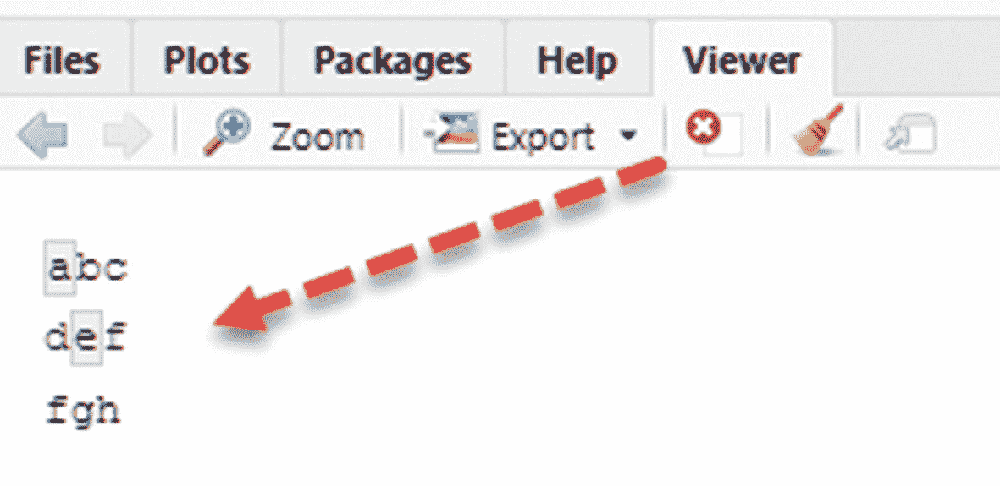

# 2. Stringr

## 2.1 引言

> *移动的手指书写；写毕，继续前行：你所有的虔诚与智慧，也无法诱它回头抹去半行，你所有的泪水，也洗不掉它一个字。*
> 
> ——《鲁拜集》奥玛·海亚姆 [时间不可逆]

接下来的两个包，Lubridate 和 Stringr，省略了许多标准手册必然包含的例外情况和棘手、古怪的情形。从技术角度来看，本书并无新意。事实上，大部分代码都是从优秀的免费在线手册中稍加修改后复制而来的。本书唯一的目的是让你尽快掌握足够的知识来使用这些包。如果你有编程经验，这里的解释和示例应该能让你在一两天内上手。

代码执行的结果在 R 输出中用 `##` 显示。文本格式由 `knitr` 包处理。在那些我觉得对初学分析师来说有点抽象的主题里，我要么自己编写代码，要么在网上搜索更简单的示例。这些包的官方手册通常不展示其包含代码的运行结果。这可能是为了鼓励读者自己运行代码。在过去，大学里有一个术语叫做 *in loco parentis*，意思是大学是父母的替代者。本质上，这个想法是让学生做对他们有益的事情，无论是吃西兰花还是逐行钻研问题。在这里，我假设读者是成年人，时间和注意力都有很多需求。选择你感兴趣的主题并复制代码开始学习吧。这是一本“入门”书。

这并非是说这些手册和许多优秀的 R 书籍没有必要。它们只是有不同的侧重点——深度而非学习速度。

Stringr 包用于处理字符数据。对于那些以一杯黑咖啡和一件苦行衣开始新的一天，然后背着会计师跑上山的人来说，也许记住传统的正则表达式是可行的。对于所有其他人来说，Stringr 是一个异常简单且一致的包。它直观、适应性强，并且涵盖了大多数人处理字符数据所需 99% 的功能。正则表达式让我想起我最初的一份编程工作，即编写大型机汇编。没有什么能比它执行得更快或歧义更少。但也几乎没有什么能比它更让其他人编写和维护起来感到乏味。使用 Stringr，你通常能清楚自己在做什么。尽管我抨击了正则表达式（通常称为 *RegEx*），但我还是在本书后面用了一整章来介绍它的使用。了解这些强大工具能做什么是值得的，以防你在处理复杂的匹配任务时需要用到它们。

接下来是 Lubridate，一个相对于基础 R 简化了日期/时间处理的包。整个主题就像围棋游戏。只有在你没玩过的时候，它才显得简单。日期/时间是复杂的。一秒就是 1000 毫秒，但一小时、一天或一年会随时间点不同而变化。Lubridate 能处理几乎所有你能想到的日期/时间计算，甚至更多。与基础 R 中所有零散的解决方案相比，学习这个包会节省时间。如果其他都不做，至少也要掌握将导入的 Excel/CSV 字符型日期转换为真正的 R 日期，这将开启一个包含大量日期/时间分析工具的宝库。

## 2.2 Stringr 函数

### 2.2.1 查找、计数和提取

查找特定字符串在更大字符串中的位置；显示行和字符位置：

```
bk.fruit <- c("apQple", "banana", "pear", "pinQeapple")
bk.where.is.Q <-  str_locate(bk.fruit,"Q")
bk.where.is.Q
##      start end
## [1,]     3   3
## [2,]    NA  NA
## [3,]    NA  NA
## [4,]     4   4
```

字符串向量的第一个元素在第三个位置有一个 Q。因此，`str_locate` 显示第一行的起始和结束位置都在位置 3（对应元素 `apQple`）。下一个 Q 在第四个元素 `pinQeapple` 中，该行起始和结束位置都在位置 4。

接下来，在 `banana` 末尾插入一个 Q。它会显示为第二行的第七个字符：

```
bk.fruit <- c("apQple", "bananaQ", "pear", "pinQeapple")
bk.where.is.Q <-  str_locate(bk.fruit,"Q")
bk.where.is.Q
##      start end
## [1,]     3   3
## [2,]     7   7
## [3,]    NA  NA
## [4,]     4   4
class(bk.where.is.Q)
## [1] "matrix" "array"
```

请注意，输出是一个矩阵。


### 2.2.2 字符串检测

修饰符通过修饰函数来控制匹配行为。它为`Stringr`提供指令，指定如何匹配字符串/字符。你是想忽略大小写，还是只使用开头或结尾字符？`Stringr`比传统的字符串函数更灵活、更一致、也更直观。

```
bk.pattern <- "a.b"
bk.strings <- c("abb", "a.b")
bk.detect.strings <- str_detect(bk.strings, bk.pattern)
bk.detect.strings
## [1] TRUE TRUE
```

该模式或结构是`a`后跟`b`。两种情况都检测为真：

```
bk.detect.strings.fixed <- str_detect(bk.strings, fixed(bk.pattern))
bk.detect.strings.fixed
## [1] FALSE  TRUE
```

这是字面匹配，因此`abb`不符合`a.b`这个模式，该模式来自 ICU 用户指南： [`http://userguide.icu-project.org/collation/customization`](http://userguide.icu-project.org/collation/customization).

排序规则。基于规则的排序器由一个规则字符串构建而成，该字符串会改变某些字符和字符串相对于默认顺序的排序次序。调整通过一个包含一组规则的字符串来指定。

使用标准排序规则比较字符串：

```
bk.detect.strings.collation.rules <-  str_detect(bk.strings, coll(bk.pattern))
bk.detect.strings.collation.rules
## [1] FALSE  TRUE
```

一些`Stringr`函数能感知区域设置（即可能应用不同大小写规则及其他规则的国家/地区）。区域设置 = `"en"`（英语）是默认值。本书附录 E 列出了大多数地点的区域设置及其代码。你也可以在[bit.​ly/​IS0639-l](http://bit.ly/IS0639-l)找到相关信息（ISO639-1 是适用的标准）。

`coll()`对于区分区域设置且不区分大小写的匹配非常有用。“区分区域设置”是“《世界在哪里：卡门·圣地亚哥》”的成熟版本。福尔摩斯提醒：我第一次看到`"\u0130"`时，并没有立刻意识到它是一个明显的编码。它实际上是拉丁字母 i 的一个编码——它是一个`i`，但在顶部附近有一条小横线。（请参见下面的第二个元素。）

```
bk.i <- c("I", "\u0130", "i")
bk.i
## [1] "I" "I" "i"
bk.detect.fixed.i <- str_detect(bk.i, fixed("i", TRUE))
bk.detect.fixed.i
## [1]  TRUE FALSE  TRUE
```

当未指定区域设置时，隐含使用`"en"`（英语）：

```
bk.detect.collation <- str_detect(bk.i, coll("i", TRUE))
bk.detect.collation
## [1]  TRUE FALSE  TRUE
```

现在将位置指定为土耳其：

```
bk.detect.using.turkey <- str_detect(bk.i, coll("i", TRUE, locale = "tr"))
bk.detect.using.turkey
## [1] FALSE  TRUE  TRUE
```

### 2.2.3 字符串计数

当用`"tr"`代替默认的`"en"`时，会得到不同的答案。计算字符串中匹配项的数量：

```
bk.fruit <- c("apple", "banana", "pear", "pineapple")
bk.fruit.count <- str_count(bk.fruit, "a")
bk.fruit.count
## [1] 1 3 1 1
bk.count.with.p <-str_count(bk.fruit, "p")
bk.count.with.p
## [1] 2 0 1 3
bk.count.with.e <- str_count(bk.fruit, "e")
bk.count.with.e
## [1] 1 0 1 2
bk.count.multiple <- str_count(bk.fruit, c("a", "b", "p", "p"))
bk.count.multiple
## [1] 1 1 1 3
bk.count <- str_count(c("a.", "...", ".a.a"), ".")
bk.count
## [1] 2 3 4
```

匹配固定字符串：

```
bk.fixed <- str_count(c("a.", "...", ".a.a"), fixed("."))
bk.fixed
## [1] 1 3 2
```

每个字符串中的句点数量。检测字符串中是否存在某个模式：

```
fruit <- c("apple", "banana", "pear", "pineapple")
str_detect(fruit, "a")
## [1] TRUE TRUE TRUE TRUE
str_detect(fruit, "^a")
## [1]  TRUE FALSE FALSE FALSE
str_detect(fruit, "a$")
## [1] FALSE  TRUE FALSE FALSE
str_detect(fruit, "b")
## [1] FALSE  TRUE FALSE FALSE
str_detect(fruit, "[aeiou]")
## [1] TRUE TRUE TRUE TRUE
```

也支持按模式进行向量化处理：

```
str_detect("aecfg", letters)
##  [1]  TRUE FALSE  TRUE FALSE  TRUE  TRUE  TRUE FALSE FALSE FALSE FALSE FALSE
## [13] FALSE FALSE FALSE FALSE FALSE FALSE FALSE FALSE FALSE FALSE FALSE FALSE
## [25] FALSE FALSE
```

如果模式不匹配，则返回`TRUE`：

```
str_detect(fruit, "^p", negate = TRUE)
## [1]  TRUE  TRUE FALSE FALSE
```

在字符串内复制或拼接字符串：

```
fruit <- c("apple", "pear", "banana")
str_dup(fruit, 2)
## [1] "appleapple"   "pearpear"     "bananabanana"
str_dup(fruit, 1:3)
## [1] "apple"              "pearpear"           "bananabananabanana"
```

找到`"na"`，然后添加它的倍数：

```
str_c("ba", str_dup("na", 0:5))
## [1] "ba"         "bana"        "banana"      "bananana"     "banananana"
## [6] "bananananana"
```

### 2.2.4 字符串移除

```
fruits <- c("one apple", "two pears", "three bananas")
str_remove(fruits, "[aeiou]")
## [1] "ne apple"     "tw pears"     "thre bananas"
```

为了摆脱一直使用水果示例的单调感，我将使用公元前 5 世纪雅典伯里克利在葬礼演说中的一段话：^(⁹) `bk.speech`是一个包含完整句子的单字符串。`bk.speech.words`是一个字符向量，包含来自同一句子的多个单词。

```
bk.speech <- "While we are thus unconstrained in our private business, a spirit of reverence pervades our public acts"
bk.speech.words <- c("While", "we", "are", "thus", "unconstrained", "in", "our", "private", "business,",
"a", "spirit", "of", "reverence", "pervades", "our", "public", "acts")
```

移除元音的第一个实例^(¹⁰)：

```
str_remove_all(fruits, "[aeiou]")
## [1] "n ppl"    "tw prs"   "thr bnns"
```

只是为了使用水果之外的例子，以下部分代码将使用新的字符串，如下所示：

```
bk.speech <- "While we are thus unconstrained in our private business, a spirit of reverence pervades our public acts"
bk.speech.words <- c("While", "we", "are", "thus", "unconstrained", "in", "our", "private", "business,",
"a", "spirit", "of", "reverence", "pervades", "our", "public", "acts")
```

移除所有元音：

```
bk.no.vowels <- str_remove_all(bk.speech, "[aeiou]")
bk.no.vowels
## [1] "Whl w r ths ncnstrnd n r prvt bsnss,  sprt f rvrnc prvds r pblc cts"
```


### 2.2.5 `String Replace`（字符串替换）

将第一次出现的元音字母替换为三个 z：

```r
bk.vowels.replaced <- str_replace(bk.speech, "[aeiou]", "zzz")
bk.vowels.replaced
## [1] "Whzzzle we are thus unconstrained in our private business, a spirit of reverence pervades our public acts"
```

将所有出现的元音字母替换为三个 z：

```r
bk.all.vowels.replaced <- str_replace_all(bk.speech, "[aeiou]", "zzz")
bk.all.vowels.replaced
## [1] "Whzzzlzzz wzzz zzzrzzz thzzzs zzznczzznstrzzzzzznzzzd zzzn zzzzzzr przzzvzzztzzz bzzzszzznzzzss, zzz spzzzrzzzt zzzf rzzzvzzzrzzznczzz pzzzrvzzzdzzzs zzzzzzr pzzzblzzzc zzzcts"
```

将所有元音字母大写：

```r
bk.all.vowels.capitalized <- str_replace_all(bk.speech, "[aeiou]", toupper)
bk.all.vowels.capitalized
## [1] "WhIlE wE ArE thUs UncOnstrAInEd In OUr prIvAtE bUsInEss, A spIrIt Of rEvErEncE pErvAdEs OUr pUblIc Acts"
```

将任何“in”替换为“NA”（使用多元素字符串 `bk.speech.words`）。注意，任何包含“in”的元素都会被替换，而不仅仅是完全匹配的“in”：

```r
bk.in.replace.with.na <- str_replace_all(bk.speech.words, "in", NA_character_)
bk.in.replace.with.na
##  [1] "While"     "we"        "are"       "thus"      NA          NA
##  [7] "our"       "private"   NA          "a"         "spirit"    "of"
## [13] "reverence" "pervades"  "our"       "public"    "acts"
```

在此示例中，我们找到第一个元音字母，然后将其重复一次。如果你觉得“\\”结构看起来像正则表达式语法，那你是对的：

```r
bk.dup.first.vowel <- str_replace(bk.speech.words,
"([aeiou])", "\\1\\1")
bk.dup.first.vowel
##  [1] "Whiile"         "wee"            "aare"           "thuus"
##  [5] "uunconstrained" "iin"            "oour"           "priivate"
##  [9] "buusiness,"     "aa"             "spiirit"        "oof"
## [13] "reeverence"     "peervades"      "oour"           "puublic"
## [17] "aacts"
```

将第一个元音字母替换为一个数字。注意，数字从 7 开始，在重复替换中循环使用：

```r
bk.replace.vowel.w.number <- str_replace(bk.speech.words, "[aeiou]", c("7", "8", "9"))
bk.replace.vowel.w.number
##  [1] "Wh7le"         "w8"            "9re"           "th7s"
##  [5] "8nconstrained" "9n"            "7ur"           "pr8vate"
##  [9] "b9siness,"     "7"             "sp8rit"        "9f"
## [13] "r7verence"     "p8rvades"      "9ur"           "p7blic"
## [17] "8cts"
```

我们在这些例子中一直使用元音字母，但任何文本都可以这样操作。当你运行这段代码时，你会收到关于对象长度的警告信息。“ou”是两个字符，但正被替换成一个数字字符。

一般来说，你应该避免像这样循环使用，尽管循环使用在实际代码中经常出现。对我来说，频繁依赖循环使用看起来就像编码错误。更糟的是，代码可能运行起来，乍一看还正确。

```r
bk.replace.ou <- str_replace(bk.speech.words, "ou",
c("7", "8", "9"))
bk.replace.ou
##  [1] "While"         "we"            "are"           "thus"
##  [5] "unconstrained" "in"            "7r"            "private"
##  [9] "business,"     "a"             "spirit"        "of"
## [13] "reverence"     "pervades"      "9r"            "public"
## [17] "acts"
```

使用 `str_c` 和管道编码结构将多个字符串“折叠”成一个，并同时替换某些字符。请注意，“thus”在此逻辑中被替换，而“while”则没有。`str_replace_all` 区分大小写。

通过 collapse 命令在字符串元素之间插入四个美元符号：

```r
bk.make.one.altered.string <- 
  bk.speech.words %>%
  str_c(collapse = "$$$$") %>%
  str_replace_all(c("while" = "____WHILE____",
                    "thus" = "____THEREFORE____"))
bk.make.one.altered.string
## [1] "While$$$$we$$$$are$$$$____THEREFORE____$$$$unconstrained$$$$in$$$$our$$$$private$$$$business,$$$$a$$$$spirit$$$$of$$$$reverence$$$$pervades$$$$our$$$$public$$$$acts"
```

### 2.2.6 `String Starts`（字符串起始）

使用 `str_starts` 来判断是否存在某个或多个字符。

```r
bk.starts.with.p <- str_starts(bk.speech.words, "p")
bk.starts.with.p  #逻辑输出
##  [1] FALSE FALSE FALSE FALSE FALSE FALSE FALSE  TRUE FALSE FALSE FALSE FALSE
## [13] FALSE  TRUE FALSE  TRUE FALSE
```

使用 `negate` 来显示不以某个或某些字符开头的字符串。

```r
bk.starts.with.no.p <- str_starts(bk.speech.words,
                                   "p", negate = TRUE)
bk.starts.with.no.p
##  [1]  TRUE  TRUE  TRUE  TRUE  TRUE  TRUE  TRUE FALSE  TRUE  TRUE  TRUE  TRUE
## [13]  TRUE FALSE  TRUE FALSE  TRUE
```

### 2.2.7 `String Ends`（字符串结尾）

要处理结尾字符，请使用 `str_ends`。

```r
bk.ends.with <- str_ends(bk.speech.words, "s")
bk.ends.with
##  [1] FALSE FALSE FALSE  TRUE FALSE FALSE FALSE FALSE FALSE FALSE FALSE FALSE
## [13] FALSE  TRUE FALSE FALSE  TRUE
```

使用 `negate` 来显示不以某个或某些字符结尾的字符串。

```r
bk.ends.with.no.s <- str_ends(bk.speech.words, "s",
                              negate = TRUE)
bk.ends.with.no.s
##  [1]  TRUE  TRUE  TRUE FALSE  TRUE  TRUE  TRUE  TRUE  TRUE  TRUE  TRUE  TRUE
## [13]  TRUE FALSE  TRUE  TRUE FALSE
```

### 2.2.8 `String Subset`（字符串子集）

`str_subset` 保留与模式匹配的字符串。在此示例中，只包含其中含有“t”的字符串：

```r
bk.subset <- str_subset(bk.speech.words, "t")
bk.subset
## [1] "thus"          "unconstrained" "private"       "spirit"
## [5] "acts"
```

返回不匹配的元素。输出中缺少“unconstrained”。

```r
bk.subset.no.match <- str_subset(bk.speech.words,
                                 "un", negate = TRUE)
bk.subset.no.match
##  [1] "While"     "we"        "are"       "thus"      "in"        "our"
##  [7] "private"   "business," "a"         "spirit"    "of"        "reverence"
## [13] "pervades"  "our"       "public"    "acts"
```

显示匹配元素的索引。只有第 11 个元素包含字符“sp”：

```r
bk.which.match <- str_which(bk.speech.words, "sp")
bk.which.match
## [1] 11
```

显示以特定字符串开头的字符串。与其他正则表达式一样，`^` 是一个锚定字符，表示起始位置。`str_subset` 在这种情况下显示的是实际字符串，而不是索引号。

```r
bk.starts.with.and.includes.entire.string <-
  str_subset(bk.speech.words, "^a")
bk.starts.with.and.includes.entire.string
## [1] "are"  "a"    "acts"
```

注意正则表达式中美元符号的用法。

```r
bk.ends.with.and.includes.entire.string <-
  str_subset(bk.speech.words, "e$")
bk.ends.with.and.includes.entire.string
## [1] "While"     "we"        "are"       "private"   "reverence"
```

**关键点**

缺失数据 `NA` 永远不会匹配任何内容。

引号中的点表示任何字符，类似通配符，但换行符除外。

```r
bk.test.na <- str_subset(c("qqq", NA, "mmm", "9999"), ".")
bk.test.na
## [1] "qqq"  "mmm"  "9999"
```

使用 `str_which` 会得到相同的结果，只不过 `str_which` 会在输出中给出索引号。

```r
bk.test.na <- str_which(c("qqq", NA, "mmm", "9999"), ".")
bk.test.na
## [1] 1 3 4
```

### 2.2.9 `String Which`（字符串定位）

以下是改编自密歇根大学统计课程的关于 `str_which` 的一个好例子^(¹¹)：

```r
bk.lorem <- c("Lorem ipsum dolor sit amet, consectetur
adipiscing elit, sed do eiusmod tempor incididunt ut labore et
dolore magna aliqua.", "Ut enim ad minim veniam, quis nostrud
exercitation ullamco laboris nisi ut aliquip ex ea commodo
consequat.", "Duis aute irure dolor in reprehenderit in
voluptate velit esse cillum dolore eu fugiat nulla pariatur.",
"Excepteur sint occaecat cupidatat non proident, sunt in culpa
qui officia deserunt mollit anim id est laborum.")
length(bk.lorem)
## [1] 4
```

该向量中有四个元素：

```r
str_which(bk.lorem, "dolor")
## [1] 1 3
```

字符串"dolor"出现在向量 `bk.lorem` 的第一个元素中，属于第一个元素内的第三个字符串。


### 2.2.10 使用正则表达式提取字符串

为了进一步演示提取操作，我将使用维基百科上关于火箭先驱罗伯特·戈达德条目中的一句话。（(12)）

```
bk.goddard.facts <- "He and his team launched 34 rockets between 1926 and 1941, achieving altitudes as high as 2.6 km (1.6 mi) and speeds as fast as 885 km/h (550 mph)."
bk.goddard.words <- c("He and his team launched ", "34 rockets ", "between
1926 and 1941", ", achieving altitudes as high as ", "2.6 km (1.6 mi) ",
"and speeds as fast as ", "885 km/h (550 mph)")
```

使用 `\\d` 正则表达式语法提取数字。

```
bk.goddard.facts.numbers <- str_extract(bk.goddard.facts, "\\d")
bk.goddard.facts.numbers  #遇到的第一个数字
## [1] "3"
bk.goddard.facts.numbers <- str_extract(bk.goddard.facts,
"\\d+")
bk.goddard.facts.numbers  #遇到的第一个完整（所有数字）数字
## [1] "34"
```

获取小写字母，每个元素的第一个实例。

```
bk.goddard.all.alphas <- str_extract(bk.goddard.words, "[a-z]")
bk.goddard.all.alphas
## [1] "e" "r" "b" "a" "k" "a" "k"
```

获取字符串中第一个单词的所有小写字母。

```
bk.goddard.all.alphas <- str_extract(bk.goddard.words, "[a-z]+")
bk.goddard.all.alphas
## [1] "e"         "rockets"   "between"   "achieving" "km"        "and"
## [7] "km"
```

提取所有数字。输出为一个列表。

```
z <- gregexpr("[0-9]+",bk.goddard.words)
bk.goddard.all.numbers <- regmatches(bk.goddard.words,z)
bk.goddard.all.numbers
## [[1]]
## character(0)
##
## [[2]]
## [1] "34"
##
## [[3]]
## [1] "1926" "1941"
##
## [[4]]
## character(0)
##
## [[5]]
## [1] "2" "6" "1" "6"
##
## [[6]]
## character(0)
##
## [[7]]
## [1] "885" "550"
class(bk.goddard.all.numbers)
## [1] "list"
```

转换为数据框（为方便起见）。

```
bk.goddard.all.numbers <- as.data.frame(matrix(unlist(bk.goddard.all.numbers), nrow=length(bk.goddard.all.numbers),byrow=TRUE))
bk.goddard.all.numbers
##     V1   V2
## 1   34 1926
## 2 1941    2
## 3    6    1
## 4    6  885
## 5  550   34
## 6 1926 1941
## 7    2    6
```

你也可以使用 `\\W` 正则表达式语法，将字符串按空格分隔成“单词”。

```
bk.split.into.words <- str_split(bk.goddard.words, "\\W")
bk.split.into.words
## [[1]]
## [1] "He"       "and"      "his"      "team"     "launched" ""
##
## [[2]]
## [1] "34"      "rockets" ""
##
## [[3]]
## [1] "between" "1926"    "and"     "1941"
##
## [[4]]
## [1] ""          ""          "achieving" "altitudes" "as"        "high"
## [7] "as"        ""
##
## [[5]]
## [1] "2"  "6"  "km" ""   "1"  "6"  "mi" ""   ""
##
## [[6]]
## [1] "and"    "speeds" "as"     "fast"   "as"     ""
##
## [[7]]
## [1] "885" "km"  "h"   ""    "550" "mph" ""
```

### 2.2.11 字符串全提取

另一种方法是使用 `str_extract_all` 来提取所有单词：

```
bk.all.words.extraction <- str_extract_all("Though it be madness, yet there is method to it", boundary("word"))
bk.all.words.extraction #列表
## [[1]]
##  [1] "Though"  "it"      "be"      "madness" "yet"     "there"   "is"
##  [8] "method"  "to"      "it"
shopping_list <- c("apples x4", "bag of flour", "bag of sugar", "milk x2")
str_extract(shopping_list, "\\d")
## [1] "4" NA  NA  "2"
str_extract(shopping_list, "[a-z]+")
## [1] "apples" "bag"    "bag"    "milk"
str_extract(shopping_list, "[a-z]{1,4}")
## [1] "apple" "bag"  "bag"  "milk"
str_extract(shopping_list, "\\b[a-z]{1,4}\\b")
## [1] NA     "bag"  "bag"  "milk"
```

提取所有匹配项：

```
str_extract_all(shopping_list, "[a-z]+")
## [[1]]
## [1] "apples" "x"
##
## [[2]]
## [1] "bag"   "of"    "flour"
##
## [[3]]
## [1] "bag"   "of"    "sugar"
##
## [[4]]
## [1] "milk" "x"
str_extract_all(shopping_list, "\\b[a-z]+\\b")
## [[1]]
## [1] "apples"
##
## [[2]]
## [1] "bag"   "of"    "flour"
##
## [[3]]
## [1] "bag"   "of"    "sugar"
##
## [[4]]
## [1] "milk"
str_extract_all(shopping_list, "\\d")
## [[1]]
## [1] "4"
##
## [[2]]
## character(0)
##
## [[3]]
## character(0)
##
## [[4]]
## [1] "2"
```

将结果简化为字符矩阵：

```
str_extract_all(shopping_list, "\\b[a-z]+\\b", simplify = TRUE)
##      [,1]     [,2] [,3]
## [1,] "apples" ""   ""
## [2,] "bag"    "of" "flour"
## [3,] "bag"    "of" "sugar"
## [4,] "milk"   ""   ""
str_extract_all(shopping_list, "\\d", simplify = TRUE)
##      [,1]
## [1,] "4"
## [2,] ""
## [3,] ""
## [4,] "2"
```

提取所有单词：

```
str_extract_all("This is, surprisingly, a sentence.", boundary("word"))
## [[1]]
## [1] "This"        "is"          "surprisingly" "a"           "sentence"
```

展平字符串——取多个字符串并将它们合并为一个：

```
letters
##  [1] "a" "b" "c" "d" "e" "f" "g" "h" "i" "j" "k" "l" "m" "n" "o" "p" "q" "r" "s"
## [20] "t" "u" "v" "w" "x" "y" "z"
str_flatten(letters)
## [1] "abcdefghijklmnopqrstuvwxyz"
str_flatten(letters, "-")
## [1] "a-b-c-d-e-f-g-h-i-j-k-l-m-n-o-p-q-r-s-t-u-v-w-x-y-z"
```

### 2.2.12 字符串粘合

`Glue` 是一个智能且高效的函数。除了其他用途外，它可以方便地将文字与计算值交替插入：

```
name <- "Fred"
age <- 50
anniversary <- as.Date("1991-10-12")
str_glue(
"My name is {name}, ",
"my age next year is {age + 1}, ",
"and my anniversary is {format(anniversary, '%A, %B %d, %Y')}."
)
## My name is Fred, my age next year is 51, and my anniversary is Saturday, October 12, 1991.
```

可以通过重复大括号来插入单个大括号：

```
str_glue("My name is {name}, not {{name}}.")
## My name is Fred, not {name}.
str_glue(
"My name is {name}, ",
"and my age next year is {age + 1}.",
name = "Joe",
age = 40
)
## My name is Joe, and my age next year is 41.
```

`str_glue_data()` 在数据管道中很有用：

```
mtcars %>% str_glue_data("{rownames(.)} has {hp} hp")
## Mazda RX4 has 110 hp
## Mazda RX4 Wag has 110 hp
## Datsun 710 has 93 hp
## Hornet 4 Drive has 110 hp
## Hornet Sportabout has 175 hp
## Valiant has 105 hp
## Duster 360 has 245 hp
## Merc 240D has 62 hp
## Merc 230 has 95 hp
## Merc 280 has 123 hp
## Merc 280C has 123 hp
## Merc 450SE has 180 hp
## Merc 450SL has 180 hp
## Merc 450SLC has 180 hp
## Cadillac Fleetwood has 205 hp
## Lincoln Continental has 215 hp
## Chrysler Imperial has 230 hp
## Fiat 128 has 66 hp
## Honda Civic has 52 hp
## Toyota Corolla has 65 hp
## Toyota Corona has 97 hp
## Dodge Challenger has 150 hp
## AMC Javelin has 150 hp
## Camaro Z28 has 245 hp
## Pontiac Firebird has 175 hp
## Fiat X1-9 has 66 hp
## Porsche 914-2 has 91 hp
## Lotus Europa has 113 hp
## Ford Pantera L has 264 hp
## Ferrari Dino has 175 hp
## Maserati Bora has 335 hp
## Volvo 142E has 109 hp
#str_order
```

排序 - 对向量排序；工作方式符合预期。

### 2.2.13 字符串顺序（排序）

```
str_order(letters)
##  [1]  1  2  3  4  5  6  7  8  9 10 11 12 13 14 15 16 17 18 19 20 21 22 23 24 25
## [26] 26
```

"a" 是第一个，"b" 是第二个，依此类推：

```
str_sort(letters)
##  [1] "a" "b" "c" "d" "e" "f" "g" "h" "i" "j" "k" "l" "m" "n" "o" "p" "q" "r" "s"
## [20] "t" "u" "v" "w" "x" "y" "z"
str_order(letters, locale = "haw")
# 区域设置 "Hawaiian (United States)" (haw_US) - LocalePlanet
##  [1]  1  5  9 15 21  2  3  4  6  7  8 10 11 12 13 14 16 17 18 19 20 22 23 24 25
## [26] 26
str_sort(letters, locale = "haw")
##  [1] "a" "e" "i" "o" "u" "b" "c" "d" "f" "g" "h" "j" "k" "l" "m" "n" "p" "q" "r"
## [20] "s" "t" "v" "w" "x" "y" "z"
bk.x <- c("100a10", "100a5", "2b", "2a")
bk.x
## [1] "100a10" "100a5"  "2b"     "2a"
sort(bk.x)
## [1] "100a10" "100a5"  "2a"     "2b"
str_sort(bk.x, numeric = TRUE)
## [1] "2a"     "2b"     "100a5"  "100a10"
```


## 2.3 获取或修改字符串信息

单词边界：

```
bk.words <- c("These are some words.")
bk.boundary.count <- str_count(bk.words, boundary("word"))
bk.boundary.count
## [1] 4
```

结果显示出四个单词，以单词实体形式呈现：

```
bk.string.split.blank <- str_split(bk.words, " ")[[1]]
bk.string.split.blank
## [1] "These"  "are"    "some"   "words."
class(bk.string.split.blank)
## [1] "character"
```

字符串分割函数的输出类型是字符型：

```
bk.string.split.words <- str_split(bk.words, boundary("word"))[[1]]
bk.string.split.words
## [1] "These" "are"   "some"  "words"
length(bk.string.split.words)
## [1] 4
```

这四个单词作为向量的四个元素输出：

- 字符串长度
- `str_length`

```
bk.length <- str_length(letters)
bk.length
##  [1] 1 1 1 1 1 1 1 1 1 1 1 1 1 1 1 1 1 1 1 1 1 1 1 1 1 1
length(bk.length)
## [1] 26
str_length(NA)
## [1] NA
bk.factor.length <- str_length(factor("abc"))
bk.factor.length
## [1] 3
str_length(c("i", "like", "programming", NA))
## [1]  1  4 11 NA
```

有两种方式表示带分音符的字母 u。带分音符的拉丁小写字母 u（U+00FC）：

```
u1 <- "\u00fc"
u2 <- stringi::stri_trans_nfd(u1)
```

它们打印结果相同：

```
u1
## [1] "ü"
u2
## [1] "u¨"
```

……但长度不同：

```
str_length(u1)
## [1] 1
str_length(u2)
## [1] 2
```

……尽管字符数量相同：

```
str_count(u1)
## [1] 1
str_count(u2)
## [1] 1
```

**注意**

上面的 `u2` 使用了 `stri_trans_nfd()` 函数。以下是来自 [`www.rdocumentation.org/packages/stringi/versions/1.4.3/topics/stri_trans_nfc`](http://www.rdocumentation.org/packages/stringi/versions/1.4.3/topics/stri_trans_nfc) 的说明。

Unicode 标准化形式是 Unicode 字符串的形式化标准规范，例如，它可以用来确定任意两个字符串是否等价。本质上，Unicode 标准化算法将所有组合符号按指定顺序排列，并使用分解和组合规则将每个字符串转换为一种 Unicode 标准化形式。

支持以下标准化形式（NF）：

- NFC（标准分解，后接标准组合）
- NFD（标准分解）
- NFKC（兼容分解，后接标准组合）
- NFKD（兼容分解）
- NFKC_Casefold（NFKC、大小写折叠和移除可忽略字符的组合，在 Unicode 5.2 中引入）

使用 `str_locate` 查找字符串中模式的位置。^((13))

```
fruit <- c("apple", "banana", "pear", "pineapple")
str_locate(fruit, "$")
##      start end
## [1,]     6   5
## [2,]     7   6
## [3,]     5   4
## [4,]    10   9
```

在以下每种情况中，结束位置都比开始位置少 1。这是 `str_locate` 告诉你在四个元素中都没有匹配项的方式。

显示每个字符元素中 "a" 首次出现的位置：

```
str_locate(fruit, "a")
##      start end
## [1,]     1   1
## [2,]     2   2
## [3,]     3   3
## [4,]     5   5
str_locate(fruit, "e")
##      start end
## [1,]     5   5
## [2,]    NA  NA
## [3,]     2   2
## [4,]     4   4
str_locate(fruit, c("a", "b", "p", "p"))
##      start end
## [1,]     1   1
## [2,]     1   1
## [3,]     1   1
## [4,]     1   1
bk.locate.a <-  str_locate_all(fruit, "a")
bk.locate.a
## [[1]]
##      start end
## [1,]     1   1
##
## [[2]]
##      start end
## [1,]     2   2
## [2,]     4   4
## [3,]     6   6
##
## [[3]]
##      start end
## [1,]     3   3
##
## [[4]]
##      start end
## [1,]     5   5
class(bk.locate.a)
## [1] "list"
```

注意输出是一个列表：

```
str_locate_all(fruit, "e")
## [[1]]
##      start end
## [1,]     5   5
##
## [[2]]
##      start end
##
## [[3]]
##      start end
## [1,]     2   2
##
## [[4]]
##      start end
## [1,]     4   4
## [2,]     9   9
str_locate_all(fruit, c("a", "b", "p", "p"))
## [[1]]
##      start end
## [1,]     1   1
##
## [[2]]
##      start end
## [1,]     1   1
##
## [[3]]
##      start end
## [1,]     1   1
##
## [[4]]
##      start end
## [1,]     1   1
## [2,]     6   6
## [3,]     7   7
```

查找每个字符的位置：

```
str_locate_all(fruit, "")
## [[1]]
##      start end
## [1,]     1   1
## [2,]     2   2
## [3,]     3   3
## [4,]     4   4
## [5,]     5   5
##
## [[2]]
##      start end
## [1,]     1   1
## [2,]     2   2
## [3,]     3   3
## [4,]     4   4
## [5,]     5   5
## [6,]     6   6
##
## [[3]]
##      start end
## [1,]     1   1
## [2,]     2   2
## [3,]     3   3
## [4,]     4   4
##
## [[4]]
##       start end
##  [1,]     1   1
##  [2,]     2   2
##  [3,]     3   3
##  [4,]     4   4
##  [5,]     5   5
##  [6,]     6   6
##  [7,]     7   7
##  [8,]     8   8
##  [9,]     9   9
```

这包含了每个字符的起始/结束位置。在列表元素 4 中，显示了九个起始/结束位置，因为该字符串（`pineapple`）中有九个字符。

从字符串中提取匹配的组。

这是一种从字符串中提取匹配组的有效方法。例如，如果你在非结构化字符数据中查找电话号码，这将节省大量的数据整理时间。以下示例来自 Stringr 手册^((14))：

```
strings <- c(" 219 733 8965", "329-293-8753 ", "banana",
"595 794 7569", "387 287 6718", "apple", "233.398.9187 ",
"482 952 3315", "239 923 8115 and 842 566 4692",
"Work: 579-499-7527", "$1000","Home: 543.355.3679")
phone <- "([2-9][0-9]{2})- .- ."
str_extract(strings, phone)
##  [1] "219 733 8965" "329-293-8753" NA             "595 794 7569" "387 287 6718"
##  [6] NA             "233.398.9187" "482 952 3315" "239 923 8115" "579-499-7527"
## [11] NA             "543.355.3679"
bk.string.match <-  str_match(strings, phone)
bk.string.match
##       [,1]           [,2]  [,3]  [,4]
##  [1,] "219 733 8965" "219" "733" "8965"
##  [2,] "329-293-8753" "329" "293" "8753"
##  [3,] NA             NA    NA    NA
##  [4,] "595 794 7569" "595" "794" "7569"
##  [5,] "387 287 6718" "387" "287" "6718"
##  [6,] NA             NA    NA    NA
##  [7,] "233.398.9187" "233" "398" "9187"
##  [8,] "482 952 3315" "482" "952" "3315"
##  [9,] "239 923 8115" "239" "923" "8115"
## [10,] "579-499-7527" "579" "499" "7527"
## [11,] NA             NA    NA    NA
## [12,] "543.355.3679" "543" "355" "3679"
```

字段被方便地分隔开来，因此你可以，例如，解析出区号。


### 2.3.1 提取/匹配所有

```
str_extract_all (strings, phone)
## [[1]]
## [1] "219 733 8965"
##
## [[2]]
## [1] "329-293-8753"
##
## [[3]]
## character(0)
##
## [[4]]
## [1] "595 794 7569"
##
## [[5]]
## [1] "387 287 6718"
##
## [[6]]
## character(0)
##
## [[7]]
## [1] "233.398.9187"
##
## [[8]]
## [1] "482 952 3315"
##
## [[9]]
## [1] "239 923 8115" "842 566 4692"
##
## [[10]]
## [1] "579-499-7527"
##
## [[11]]
## character(0)
##
## [[12]]
## [1] "543.355.3679"
```

五个模式：

```
bk.x  ", " ", "", "", NA)
```

匹配单个模式：

```
bk.x.wildcard  ")
bk.x.wildcard
##      [,1]      [,2] [,3]
## [1,] " " "a"  "b"
## [2,] " "  "a"  ""
## [3,] NA        NA   NA
## [4,] NA        NA   NA
## [5,] NA        NA   NA
```

下面是来自 `doracheng@maxchip.com.tw` 的另一个示例：

```
str_match("2PIN Yield: 0.9933,1,1,0.9933,1,1,1,1","2PIN Yield: (.+?),")[,1]
## [1] "2PIN Yield: 0.9933,"
str_match("2PIN Yield: 0.9933,1,1,0.9933,1,1,1,1","2PIN Yield: (.+?),")[,2]
## [1] "0.9933"
```

注意句点/问号通配符的用法：

```
str_match_all(bk.x, "")
## [[1]]
##      [,1]  [,2]
## [1,] "" "a"
## [2,] "" "b"
##
## [[2]]
##      [,1]  [,2]
## [1,] "" "a"
## [2,] ""  ""
##
## [[3]]
##      [,1]  [,2]
## [1,] "" "a"
##
## [[4]]
##      [,1] [,2]
##
## [[5]]
##      [,1] [,2]
## [1,] NA   NA
str_extract(bk.x, "")
## [1] "" "" "" NA    NA
str_extract_all(bk.x, "")
## [[1]]
## [1] "" ""
##
## [[2]]
## [1] "" ""
##
## [[3]]
## [1] ""
##
## [[4]]
## character(0)
##
## [[5]]
## [1] NA
```

正则表达式采用以下约定：

*   `ABC:` # 匹配字面字符 `ABC:`
*   `\([a-zA-Z]+\)` # 括号内一个或多个字母
*   `*` # 零个或多个空格
*   `(.+)` # 捕获一个或多个任意字符（不包括换行符）

### 2.3.2 大小写函数

```
bk.text <- "Athenian citizen"
bk.text.upper.case <- str_to_upper(bk.text)
bk.text.upper.case
## [1] "ATHENIAN CITIZEN"
bk.text.lower.case <- str_to_lower(bk.text)
bk.text.lower.case
## [1] "athenian citizen"
bk.text.title <- str_to_title(bk.text)
bk.text.title
## [1] "Athenian Citizen"
bk.default.english.locale <- str_to_upper(bk.text,
locale = "en")
bk.default.english.locale
## [1] "ATHENIAN CITIZEN"
```

现在使用不同的区域设置尝试相同的函数：

```
bk.using.not.English.locale <- str_to_upper(bk.text,
locale = "ky-KG")
bk.using.not.English.locale
## [1] "ATHENIAN CITIZEN"
```

在本例中，这与 `"en"` 没有区别。

### 2.3.3 地理感知（区域设置感知）函数

`coll()` 对于区域设置感知的不区分大小写的匹配非常有用。请注意，`“\u0130”` 是 Unicode 中顶部带点的拉丁大写字母 I。这不是你日常遇到的普通字母。

这里设置了三种不同的代码：

```
bk.i <- c("I", "\u0130", "i")
length(bk.i)
## [1] 3
bk.i
## [1] "I" "I" "i"
```

注意有三种类型的“I”。

是否存在 `"I"` 或 `"i"`？如果存在，在哪里？

```
str_detect(bk.i, fixed("i", TRUE))
## [1]  TRUE FALSE  TRUE
str_detect(bk.i, coll("i", TRUE))
## [1]  TRUE FALSE  TRUE
```

结果相同，因为 `"coll"` 假定区域设置为 `"en"`：

```
str_detect(bk.i, coll("i", TRUE, locale = "tr"))  #现在使用 locale = "tr"（土耳其语）测试。
## [1] FALSE  TRUE  TRUE
```

在这种情况下，土耳其区域设置将拉丁字母 I 视为有效的 i（中间元素为 TRUE）。

### 2.3.4 合并多个字符串

使用 `str_c` 函数。

```
bk.letters <- str_c("Letter: ", letters)
bk.letters.with.separator <- str_c("Letter", letters,
sep = ": ")
bk.letters.with.separator
##  [1] "Letter: a" "Letter: b" "Letter: c" "Letter: d" "Letter: e" "Letter: f"
##  [7] "Letter: g" "Letter: h" "Letter: i" "Letter: j" "Letter: k" "Letter: l"
## [13] "Letter: m" "Letter: n" "Letter: o" "Letter: p" "Letter: q" "Letter: r"
## [19] "Letter: s" "Letter: t" "Letter: u" "Letter: v" "Letter: w" "Letter: x"
## [25] "Letter: y" "Letter: z"
bk.combine.characters <- str_c(letters, " is for", "...")
bk.combine.characters
##  [1] "a is for..." "b is for..." "c is for..." "d is for..." "e is for..."
##  [6] "f is for..." "g is for..." "h is for..." "i is for..." "j is for..."
## [11] "k is for..." "l is for..." "m is for..." "n is for..." "o is for..."
## [16] "p is for..." "q is for..." "r is for..." "s is for..." "t is for..."
## [21] "u is for..." "v is for..." "w is for..." "x is for..." "y is for..."
## [26] "z is for..."
str_c(letters, " is for", "...")
##  [1] "a is for..." "b is for..." "c is for..." "d is for..." "e is for..."
##  [6] "f is for..." "g is for..." "h is for..." "i is for..." "j is for..."
## [11] "k is for..." "l is for..." "m is for..." "n is for..." "o is for..."
## [16] "p is for..." "q is for..." "r is for..." "s is for..." "t is for..."
## [21] "u is for..." "v is for..." "w is for..." "x is for..." "y is for..."
## [26] "z is for..."
bk.sequence <- str_c(letters[-26], " comes before ",
letters[-1])
```

除了 z 以外的所有字母都“在”除了 a 以外的所有字母之前：

```
bk.sequence
##  [1] "a comes before b" "b comes before c" "c comes before d" "d comes before e"
##  [5] "e comes before f" "f comes before g" "g comes before h" "h comes before i"
##  [9] "i comes before j" "j comes before k" "k comes before l" "l comes before m"
## [13] "m comes before n" "n comes before o" "o comes before p" "p comes before q"
## [17] "q comes before r" "r comes before s" "s comes before t" "t comes before u"
## [21] "u comes before v" "v comes before w" "w comes before x" "x comes before y"
## [25] "y comes before z"
bk.collapsed.letters <- str_c(letters, collapse = "")
bk.collapsed.letters
```

字母之间没有空格，以空值分隔：

```
## [1] "abcdefghijklmnopqrstuvwxyz"
bk.comma.collapsed <- str_c(letters, collapse = ", ")
bk.comma.collapsed
## [1] "a, b, c, d, e, f, g, h, i, j, k, l, m, n, o, p, q, r, s, t, u, v, w, x, y, z"
```

缺失输入给出缺失输出：

```
bk.missing <- str_c(c("a", NA, "b"), "-d")
bk.missing
## [1] "a-d" NA    "b-d"
```

使用 `str_replace_NA` 显示字面上的 NA：

```
bk.replace.na <- str_c(str_replace_na(c("a", NA, "b")), "-d")
bk.replace.na
## [1] "a-d"  "NA-d" "b-d"
```

通过使用 `str_conv` 更改字符串的编码。

这是来自编码 `stringi::stringi` 的一个示例：

```
bk.x <- rawToChar(as.raw(177))
bk.x #注意：在 Mac 上，你可能会得到不同的代码 "\xb1"
## [1] "±"
```

…带有正负号：

波兰语 `"a with ogonek"`（带反尾符的 a）：

```
bk.polish <- str_conv(bk.x, "ISO-8859-2")
bk.polish  #在 Mac 上你会得到一个 "q"
## [1] "a"
```

…看起来像一个带软尾符的 a：

```
bk.plus.minus <- str_conv(bk.x, "ISO-8859-1") # 正负号
bk.plus.minus
## [1] "±"
```

一般来说，使用不同的 ISO 标准会得到不同的结果。

## 2.4 更复杂的匹配


### 2.4.1 不匹配的内容（反向匹配）

下一个函数让我想起了高效的广告商。他们会向你展示你甚至不知道自己需要的东西。但当你需要它们时，它们就会派上用场。

```
bk.numbers <- "1 and 2 and 4 and 456"
bk.num.loc <- str_locate(bk.numbers, "[0-9]+")[[1]]
bk.num.loc   #output - integer
## [1] 1
class(bk.num.loc)
## [1] "integer"
bk.numbers <- "1 and 2 and 4 and 456"
bk.num.loc <- str_locate_all(bk.numbers, "[0-9]+")[[1]]
bk.num.loc
##      start end
## [1,]     1   1
## [2,]     7   7
## [3,]    13  13
## [4,]    19  21
bk.numbers.as.they.occur.in.the.string <- str_sub(bk.numbers,
bk.num.loc[, "start"], bk.num.loc[, "end"])
bk.numbers.as.they.occur.in.the.string
## [1] "1"   "2"   "4"   "456"
bk.text.but.no.numbers <- invert_match(bk.num.loc)
bk.show.text <- str_sub(bk.numbers,
bk.text.but.no.numbers[, "start"],
bk.text.but.no.numbers[, "end"])
```

例如，如果我要找人帮我去杂货店，我可能会说“用甜菜的反向匹配来囤货。”甜菜是正经蔬菜中令人作呕的表亲，只适合马和政客食用。

```
bk.show.text
## [1] ""      " and " " and " " and " ""
```

`^` 匹配字符串的开头；`$` 匹配字符串的结尾。

一个简单的记忆法（`https://rals.had.co.nzistrings.html`）：据哈德利·威克姆博士所说，“要记住哪个是哪个，试试我从埃文·米舒拉那里学到的记忆法：如果你以乘方（`^`）开始，你最终会得到金钱（`$`）。”

```
if (!require("htmlwidgets")) install.packages("htmlwidgets")
bk.view1 <- str_view(c("abc", "def", "fgh"), "[aeiou]")
bk.view1
```

请参见图 2-1 查看 `bk.view1` 的输出。

```
class(bk.view1)
## [1] "str_view"   "htmlwidget"
print(bk.view1)
```

图 2-1 显示了 `print` 函数的结果。可以观察到，在选中的输出字符中，有些被高亮显示。a 和 e 是仅有的元音字母。



图 2-1

`print` 函数显示在右下角的 “查看器” 窗口中。

显示字符串的开头：

```
bk.view2 <- str_view(c("abc", "def", "fgh"), "^")
print(bk.view2)
# |abc
# |def
# |fgh
```

显示前两个字符：

```
bk.view3 <- str_view(c("abc", "def", "fgh"), "..")
print(bk.view3)
# ab
# de
# fg
```

使用 `str_view_all` 显示所有匹配项：

```
bk.view4 <- str_view_all(c("abc", "def", "fgh"), "d|e")
print(bk.view4)
# de
```

使用 `match` 控制显示内容：

```
str_view(c("abc", "def", "fgh"), "d|e")
# d     -- start of def
str_view(c("abc", "def", "fgh"), "d|e", match = TRUE)
# d
```

注意，下面代码中没有内容被高亮：

```
str_view(c("abc", "def", "fgh"), "d|e", match = FALSE)
```

现在高亮的字符被显示出来：

```
str_view(c("hair", "haematic"), "ha(i|e)")
# hai
# hae
```

## 2.5 便捷的自动换行

将字符串包装成格式优美的段落。如果你需要清理从多个来源以不同格式导入或粘贴的文本，这个函数可以节省大量时间。由于篇幅限制，以下一些列表已被截断^(¹⁶)：

```
thanks_path <- file.path(R.home("doc"), "THANKS")
thanks <- str_c(readLines(thanks_path), collapse = "\n")
thanks <- word(thanks, 1, 3, fixed("\n\n"))
cat(str_wrap(thanks), "\n")
## R would not be what it is today without the invaluable help of these people
## outside of the (former and current) R Core team, who contributed by donating
## code, bug fixes and documentation: Valerio Aimale, Suharto Anggono, Thomas
## Baier, Gabe Becker, Henrik Bengtsson, Roger Bivand, Ben Bolker, David Brahm,
```

----- 截断 ----

列表已截断以节省空间：

```
cat(str_wrap(thanks, width = 40), "\n")
## R would not be what it is today without
## the invaluable help of these people
## outside of the (former and current) R
## Core team, who contributed by donating
## code, bug fixes and documentation:
```

----- 截断 ----

```
cat(str_wrap(thanks, width = 60, indent = 2), "\n")
## R would not be what it is today without the invaluable
## help of these people outside of the (former and current)
## R Core team, who contributed by donating code, bug fixes
## and documentation: Valerio Aimale, Suharto Anggono, Thomas
## Baier, Gabe Becker, Henrik Bengtsson, Roger Bivand, Ben
## Bolker, David Brahm, G"oran Brostr"om, Patrick Burns,
## Vince Carey, Saikat DebRoy, Matt Dowle, Brian D'Urso,
## Lyndon Drake, Dirk Eddelbuettel, Claus Ekstrom, Sebastian
```

----- 截断 ----

```
cat(str_wrap(thanks, width = 60, exdent = 2), "\n")
## R would not be what it is today without the invaluable help
##   of these people outside of the (former and current) R
##   Core team, who contributed by donating code, bug fixes
##   and documentation: Valerio Aimale, Suharto Anggono, Thomas
##   Baier, Gabe Becker, Henrik Bengtsson, Roger Bivand, Ben
##   Bolker, David Brahm, G"oran Brostr"om, Patrick Burns,
##   Vince Carey, Saikat DebRoy, Matt Dowle, Brian D'Urso,
```

----- 截断 ----

```
cat(str_wrap(thanks, width = 0, exdent = 2), "\n")
## R
##   would
##   not
##   be
##   what
##   it
##   is
##   today
```

----- 截断 ----

```
cat(str_wrap(thanks, width = 40), "\n")
## R would not be what it is today without
## the invaluable help of these people
## outside of the (former and current) R
## Core team, who contributed by donating
## code, bug fixes and documentation:
```

----- 截断 ----

```
cat(str_wrap(thanks, width = 60, indent = 2), "\n")
##   R would not be what it is today without the invaluable
## help of these people outside of the (former and current)
## R Core team, who contributed by donating code, bug fixes
## and documentation: Valerio Aimale, Suharto Anggono, Thomas
## Baier, Gabe Becker, Henrik Bengtsson, Roger Bivand, Ben
```

----- 截断 ----

```
cat(str_wrap(thanks, width = 0, exdent = 2), "\n")
## R
##   would
##   not
##   be
##   what
##   it
##   is
```

----- 截断 ----

## 2.6 清理与填充

### 2.6.1 填充字符串，而非你的报销账户

使用 `str_pad` 进行填充，其工作原理与你预期一致。可以按指定方式添加空格或其他字符：

```
bk.row.bind <-  rbind(
str_pad("hadley", 30, "left"),
str_pad("hadley", 30, "right"),
str_pad("hadley", 30, "both"))
bk.row.bind
##      [,1]
## [1,] "                        hadley"
## [2,] "hadley                        "
## [3,] "            hadley            "
str_pad(c("a", "abc", "abcdef"), 10)
## [1] "         a" "       abc" "    abcdef"
str_pad("a", c(5, 10, 20))
## [1] "    a"                "         a"           "                   a"
str_pad("a", 10, pad = c("-", "_", " "))
## [1] "---------a" "_________a" "         a"
```

较长的字符串将原样返回：

```
str_pad("hadley", 3)
## [1] "hadley"
```

### 2.6.2 使用 `str_trim` 修剪字符串中的空白

书中可见的匹配字符（例如 `\t` 和 `\n`）：

```
str_trim(" String with trailing and leading white space\t")
## [1] "String with trailing and leading white space"
```

输出中不可见的匹配字符：

```
str_trim("\n\nString with trailing and leading white space\n\n")
## [1] "String with trailing and leading white space"
str_squish(" String with trailing, middle, and leading white space\t")
## [1] "String with trailing, middle, and leading white space"
```

### 2.6.3 移除字符串中的所有空白

```
str_squish("\n\nString with excess, trailing and leading white   space\n\n")
## [1] "String with excess, trailing and leading white space"
```


### 2.6.4 截断字符串

使用 `str_trunc` 截断字符串。

```
bk.x <- "The stock market can remain irrational longer than you can remain solvent. Keynes"
bk.right.left.center <- rbind(
str_trunc(bk.x, 10, "right"),
str_trunc(bk.x, 10, "left"),
str_trunc(bk.x, 10, "center"))
bk.right.left.center
##      [,1]
## [1,] "The sto..."
## [2,] "... Keynes"
## [3,] "The ...nes"
nchar(bk.right.left.center)
##      [,1]
## [1,]   10
## [2,]   10
## [3,]   10
```

## 2.7 使用 Stringr 进行正则表达式

以下维基百科对正则表达式的介绍：

- *正则表达式（Regular expression），或称 RegEx 或 regexp[i]（有时也称为 rational expression）[2][:)]，是定义搜索模式的一系列字符。通常，此模式被字符串搜索算法用于对字符串执行“查找”或“查找并替换”操作，或用于输入验证。这是一种在理论计算机科学和形式语言理论中发展起来的技术。*
- *这一概念源于 20 世纪 50 年代，当时美国数学家斯蒂芬·科尔·克林（Stephen Cole Kleene）形式化了对正则语言的描述。该概念随着 Unix 文本处理实用程序而得到普遍使用。自 20 世纪 80 年代以来，存在多种编写正则表达式的语法，一种是 POSIX 标准，另一种广泛使用的是 Perl 语法。*

正则表达式用于搜索引擎、文字处理器和文本编辑器的查找和替换对话框、`sed` 和 `AWK` 等文本处理实用程序以及词法分析中。许多编程语言都提供 RegEx 功能，无论是内置的还是通过库提供的。由于许多编程语言都使用正则表达式，因此有很多人彻底理解这些相当深奥的结构，并发现它们很方便。`Stringr` 支持正则表达式。请参阅此网站以获取更深入的正则表达式解释：

[`www.rdocumentation.org/packages/base/versions/3.5.3/topics/regex`](http://www.rdocumentation.org/packages/base/versions/3.5.3/topics/regex)

RStudio 提供了 R 语言中正则表达式的速查表。^((17))

以下示例由 Ian Kopacka 提供，并列入 RStudio R 正则表达式速查表：

```
bk.string <- c("Hiphopopotamus", "Rhymenoceros", "time for bottomless lyrics")
bk.pattern <- "t.m"
bk.string.extract.first.match <- str_extract(bk.string,bk.pattern)
bk.string.extract.first.match
## [1] "tam" NA    "tim"
```

模式“t.m”表示查找一个以“t”开头并以“m”结尾的字符串。在这种情况下，“Hiphopopotamus”中的“tam”是匹配项，“time for bottomless lyrics”中的“tim”也是匹配项。中间那个词中没有匹配项，因此 `str_extract` 函数为该词输出 `NA`。

### 2.7.1 正则表达式变体

```
str_extract_all("The Cat in the Hat", "[a-z]+")
```

前面表达式中的“+”表示重复字符。

```
## [[1]]
## [1] "he"  "at"  "in"  "the" "at"
str_extract_all("The Cat in the Hat", regex("[a-z]+", TRUE))
## [[1]]
## [1] "The" "Cat" "in"  "the" "Hat"
str_extract_all("a\nb\nc", "^.")
## [[1]]
## [1] "a"
str_extract_all("a\nb\nc", regex("^.", multiline = TRUE))
## [[1]]
## [1] "a" "b" "c"
```

注意：输出中缺少行终止符 `/n`。

```
str_extract_all("a\nb\nc", "a.")
## [[1]]
## character(0)
```

`dotall` 表示匹配所有内容，并包括特殊的元字符，例如 `\n`（行终止符）：

```
str_extract_all("a\nb\nc", regex("a.", dotall = TRUE))
## [[1]]
## [1] "a\n"
```

我们查找的是“a 加某个字符”，得到的是“a\n”，表示“一个行终止符”。

以下是由 Darius Kazemi 提供的哈佛句子。^((18)) 它们被用作练习长度的句子：

```
sentences[1:5]
##[1] "The birch canoe slid on the smooth planks."  "Glue the sheet to the dark blue background."
##[3] "It's easy to tell the depth of a well."      "These days a chicken leg is a rare dish."
##[5] "Rice is often served in round bowls."
fruit[1: 5]
##[1] "apple"       "apricot"     "avocado"     "banana"      "bell pepper"
length(words)
## [1] 980
words[1:5]
## [1] "a"        "able"     "about"    "absolute" "accept"
head(sentences,10)
##[1] "The birch canoe slid on the smooth planks."  "Glue the sheet to the dark blue background."
##[3] "It's easy to tell the depth of a well."      "These days a chicken leg is a rare dish."
##[5] "Rice is often served in round bowls."        "The juice of lemons makes fine punch."
##[7] "The box was thrown beside the parked truck." "The hogs were fed chopped corn and garbage."
##[9] "Four hours of steady work faced us."         "Large size in stockings is hard to sell."
```

`Stringr` 是一个功能强大的包，它使您能够处理混乱的字符数据，并提取或识别您所需的内容。当您达到一定的复杂程度时，正则表达式（在 `Stringr` 内部）可作为压缩代码运行，以获取您正好需要的内容。它们有时看起来有点像象形文字，但一旦掌握，您就可以在余下的职业生涯里使用它们（适用于许多语言，而不仅仅是 R）。本书后面的章节将介绍正则表达式（通常称为“RegEx”）的基础知识。

脚注 1   2   3   4   5   6   7   8   9   10

