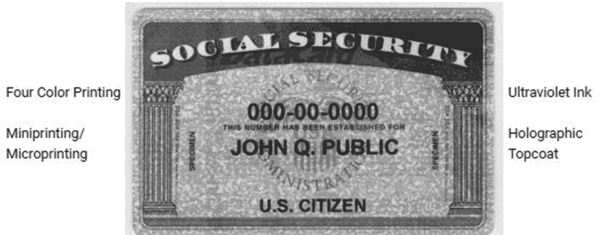

# 5. 典型用途

## 5.1 测试匹配^(³⁵)

最简单的模式用于匹配精确的字符串：

```r
x <- c("apple", "banana", "pear")
str_extract(x, "an")
## [1] NA   "an" NA
```

此语法区分大小写：

```r
bananas <- c("banana", "Banana", "BANANA")
str_detect(bananas, "banana")
## [1]  TRUE FALSE FALSE
str_detect(bananas, regex("banana", ignore_case = TRUE))
## [1] TRUE TRUE TRUE
```

接下来复杂一点的是`.`，它匹配除换行符外的任何字符：

```r
str_extract(x, ".a.")
## [1] NA    "ban" "ear"
```

你可以通过设置`dotall = TRUE`来允许`.`匹配所有字符，包括`\n`：

```r
str_detect("\nX\n", ".X.")
## [1] FALSE
str_detect("\nX\n", regex(".X.", dotall = TRUE))
## [1] TRUE
```

## 5.2 验证（例如，密码）^(³⁶)

`grepl`根据匹配结果输出`TRUE`或`FALSE`。这可用于应用程序中，以确保用户提供足够健壮的密码。

```r
is.validpw <- function(x) {
grepl('(?x)                 # 自由间距模式
^                   # 断言位置 = 字符串开头
(?=.*[[:upper:]])  # 匹配一个大写字母
(?=.*[[:lower:]])  # 匹配一个小写字母
(?=.*[[:punct:]])  # 匹配一个特殊字符
[ -~]{8,32}        # 匹配可打印的 ascii 字符
$                   # 断言位置 = 字符串结尾', x, perl = TRUE)
}
is.validpw(c('#Password', '_PASSWORD', 'Password', 'password',
'passwor', 'pAsswords', 'Pa&sword', 'Pa&s word'))
## [1]  TRUE FALSE FALSE FALSE FALSE FALSE  TRUE  TRUE
```

## 5.3 查找字符串中的所有数字和句点

```r
test <- c("desk#82", "chair weight $33.20")
my.regex <- "[⁰-9\\.]"
gsub(my.regex, "", test)
## [1] "82"    "33.20"
```

## 5.4 更改字符^(³⁷)

在“a”或一组连续的a前面添加一个“z”，在其最后一个a后面也添加一个“z”：

```r
sub("(a+)", "z\\1z", c("abc", "def", "cba a", "aa"), perl=TRUE)
## [1] "zazbc"   "def"     "cbzaz a" "zaaz"
gsub("(a+)", "z\\1z", c("abc", "def", "cba a", "aa"), perl=TRUE)
## [1] "zazbc"     "def"       "cbzaz zaz" "zaaz"
```

## 5.5 格式化字符串

使用正则表达式将千位分隔符为句点的数字改为逗号：

```r
string1 <- "234.456.100"
gsub("\\.", ",", string1)
## [1] "234,456,100"
```

## 5.6 电子邮件

电子邮件地址的正则表达式验证有多种变体。在以下示例中，`my.regex`是模式，`my.emails`包含一个包含四个字符串的向量。R函数`str_match`输出了向量中的前三个元素，因为它们有效，但最后一个元素`"not.an.email"`无效，显示为`NA`。一些比我更有耐心的人已经开发出了比这更好的验证方式。许多用于验证电子邮件的大型正则表达式可能长达十行或更多。如下所示的正则表达式对大多数人来说已经足够^(³⁸)：

```r
my.regex <- "^\\w+[\\w-\\.]*\\@\\w+((-\\w+)|(\\w*))\\.[a-z]{2,3}$"
my.emails <- c("john.smith@anything.com","___fred@x.com","123Sally@Y.net","not.an.email")
str_match (my.emails, my.regex)
##      [,1]                      [,2] [,3] [,4]
## [1,] "john.smith@anything.com" ""   NA   ""
## [2,] "___fred@x.com"           ""   NA   ""
## [3,] "123Sally@Y.net"          ""   NA   ""
## [4,] NA                        NA   NA   NA
```

以下是从左到右解读该正则表达式的方法：

* `^` – 接下来的内容指字符串的开头。
* `\\w` – 匹配任何被归类为“单词”字符（字母数字或`-`）的单个字符。
* `+` – 匹配一次或多次。
* `\\w`。
* `-` – 破折号。
* `\\.` – 点号。
* `*` – 匹配零次或多次。
* `@` – 必须有一个`@`符号。
* `\\w`。
* `+`。
* `[` – 左方括号表示“字符类”的开始，意思是“来自 a、b 或 c 的任何字符”（字符类可以使用范围，例如`[a-d]` = `[abcd]`）。
* `-` – 破折号。
* `\\w`。
* `*` – 匹配零次或多次。
* `\\.` – 点号。
* `[a-z]` – 从 a 到 z。
* `{2,3}` – 与后面的`$`符号结合，表示电子邮件地址的结尾需要是两到三个字符。

## 5.7 使用正则表达式进行验证的示例

### 5.7.1 美国运通卡号

验证美国运通信用卡卡号的配置。`test.amex.bad`字符串的第二个数字不是 4 或 7，因此测试结果为假（错误的运通卡号）：

```r
test.amex.good <-     "348282246310005"
test.amex.bad <-     "381449635398431"
grepl("³[47][0-9]{13}$",test.amex.good)
[1] TRUE
grepl("³[47][0-9]{13}$",test.amex.bad)
[1] FALSE
```

以下是运通号码掩码的解释：

* `^` – 字符串的开头（此处指运通卡号）。
* `3` – 数字必须以 3 开头。
* `[47]` – 字符串必须包含 4 *或* 7（不是范围）。
* `[0-9]` – 包含所有单个数字。
* `{13}` – 在目标搜索中需要找到多少个前面的字符。
* `$` – 字符串的结尾。

### 5.7.2 电子邮件

这是一个电子邮件验证示例（众多可能模式之一）。对于字符串`test.bad.email`，我故意输入了两个`@`，以展示假条件是如何产生的——在此例中，假意味着`test.bad.email`字符串中的模式未与正则表达式匹配：

```r
pattern1 <- "^[[:alnum:].-_]+@[[:alnum:].-]+$"
test.good.email <-  "byarberry@iccmconsulting.net"
test.bad.email  <-  "mr-got-in-a-hurry@@bargain.com"
grepl(pattern1,test.good.email)
## [1] TRUE
grepl("pattern1",test.bad.email)
## [1] FALSE
```

### 5.7.3 IP4 地址

```r
pattern1 <- "\\b(25[0-5]|2[0-4][0-9]|1[0-9][0-9]|[1-9]?[0-9])\\.(25[0-5]|2[0-4][0-9]|1[0-9][0-9]|[1-9]?[0-9])\\.(25[0-5]|2[0-4][0-9]|1[0-9][0-9]|[1-9]?[0-9])\\.(25[0-5]|2[0-4][0-9]|1[0-9][0-9]|[1-9]?[0-9])\\b"
test.ip4.address.good <- "172.16.254.1"
test.ip4.address.bad <- "1723.16.254.2"
grepl(pattern1, test.ip4.address.good)
[1] TRUE
grepl(pattern1, test.ip4.address.bad)
[1] FALSE
```

### 5.7.4 美国社会安全号码^(³⁹)

图 5-1 显示了一个美国社会安全卡的示例，该图来自 `ssa.gov`。

```r
pattern1 = "\\b(?!000)(?!666)[0-8][0-9]{2}- [0-9]{2}- [0-9]{4}\\b"
test.ssn.good <- "419-75-4971"
test.ssn.bad <- "418-833-4971"
grepl(pattern1, test.ssn.good, perl = TRUE)
## [1] TRUE
grepl(pattern1, test.ssn.bad, perl = TRUE)
## [1] FALSE
```



图 5-1

社会安全卡示例。

我最初从 R 收到一条错误消息，指出`pattern1`正则表达式无效。由于我在写这本书时已是深夜，我决定在`grepl`函数末尾加上`"perl = TRUE"`。它成功了。世界上存在多种正则表达式风格，例如 Perl、Java、POSIX 1003.2、C++、ASP.NET 等等。R 支持 POSIX 1003.2（默认）和 Perl。请注意，如果你在互联网上找到某个正则表达式示例，除非它属于 R 所支持的两种标准之一，否则它可能无法工作。

当从其他语言中寻找解决方案时，如果遇到错误消息，请尝试将`\`替换为`\\`。

## 5.8 从字符串中移除路径信息，仅显示文件名

```r
file.name <- "C:\budget\\second.quarter.xlsx"
y <- gsub(pattern = "C:\budget",replacement = "", x = file.name)
z <- sub(pattern = "^.{1}",replacement = "",x = y)
z
##[1] "second.quarter.xlsx"
```

在上述演示中，文件名中的`budget`后面需要加一个双反斜杠。

## 5.9 移除非数字字符

表达式`my.regex`意味着只有 0、1、2、3、4、5、6、7、8、9 会匹配`x`。在此示例中，圆周率值中的小数点将被移除：

```r
x <- "The corona virus is exceedingly worrisome 3.14159"
my.regex <- "[⁰-9]+"
gsub(my.regex, "",x)
## [1] "314159"
```

## 5.10 从 URL 中提取文件类型

```r
my.URL <- "http://www.retro51.com/_notes/Disney_Booklet_sm.pdf"
tools::file_ext(sub("\\?.+", "", my.URL))
## [1] "pdf"
```

### 5.10.1 将任何包含相邻相同字母的字符串替换

```r
x <- c("appleeee","corn","ccccheze", "food")
gsub("\\s*\\b(?=\\w*(\\w)\\1)\\w+\\b", x, replacement = " ", perl = TRUE)
## [1] " "    "corn" " "    " "
```

### 5.10.2 查找相邻重复但不超过三次的重复

```r
x <- "cat cat dog frog hog horse horse horse cat"
my.regex <- "\\b(\\w+)\\s+\\1\\b"
gsub(my.regex,x,replacement = " ", perl = TRUE)
## [1] "  dog frog hog   horse cat"
```

## 5.11 其他一些正则表达式用途^(⁴⁰)

*   反转字符串
*   匹配 HTML 元素（`href` 和 `img` 的锚点）
*   处理通用日志格式文件
*   计算字符数据的基本统计和分析

脚注 1 2 3 4 5 6