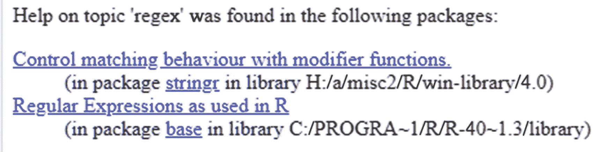

# 6. 一些简单模式

正则表达式如果用到极致，可能会让你感到不规律。对于许多 R 编程任务而言，只需用到少数几个元字符。表 6-1 源自洛约拉马利蒙特大学的一个优秀网站。^(41) 在 R 中，正则表达式将被包含在引号内，并在第 9 章“七种妙用”中列出的七个函数之一中使用。

**表 6-1** 正则表达式示例

| 示例正则表达式 | 匹配任何包含以下内容的字符串 |
| --- | --- |
| `Hello` | 包含 {hello}。 |
| `gray\|grey` | 包含 {gray, grey}。 |
| `gr(a\|e)y` | 包含 {gray, grey}。 |
| `gr[ae]y` | 包含 {gray, grey}。 |
| `b[aeiou]bble` | 包含 {babble, bebble, bibble, bobble, bubble}。 |
| `[b-chm-pP]at\|ot` | 包含 {bat, cat, hat, mat, nat, oat, pat, Pat, ot}。 |
| `colo?r` | 包含 {color, colour}。 |
| `rege(x(es)?\|xps?)` | 包含 {regex, regexes, regexp, regexps}。 |
| `go*gle` | 包含 {ggle, gogle, google, gooogle, goooogle,...}。 |
| `go+gle` | 包含 {gogle, google, gooogle, goooogle,...}。 |
| `g(oog)+le` | 包含 {google, gooogle, goooogle, gooooogle, goooooogle,...}。 |
| `z{3}` | 包含 {zzz}。 |
| `z{3,6}` | 包含 {zzz, zzzz, zzzzz, zzzzzz}。 |
| `z{3,}` | 包含 {zzz, zzzz, zzzzz,...}。 |
| `[Bb]rainf\*\*k` | 包含 {Brainf\*\*k, brainf\*\*k}。 |
| `\d` | 包含 {0,1,2,3,4,5,6,7,8,9}。 |
| `\d{5}(-\d{4})?` | 包含一个美国邮政编码。 |
| `1\d{10}` | 包含一个以 1 开头的 11 位数字字符串。 |
| `[2-9]\|[12]\d\|3[0-6]` | 包含一个在 2 到 36 之间（含）的整数。 |
| `Hello\nworld` | 包含 `Hello`，后跟换行符，再后跟 `world`。 |
| `mi…..ft` | 包含一个以 `mi` 开头、以 `ft` 结尾的九字符（子）字符串。（注意：根据上下文，点号代表“任何字符”或“除换行符外的任何字符”。每个点号允许匹配不同的字符，因此 `Microsoft` 和 `Minecraft` 都能匹配。） |
| `\d+(\.\d\d)?` | 包含一个正整数或一个小数点后恰好有两位的浮点数。 |
| `[^i*&2@]` | 包含除 `i`、星号、`&` 符号、`2` 或 `@` 符号之外的任何字符。 |
| `//[ ^\r'\n]*[\r\n]` | 包含一个 Java 或 C# 的双斜杠注释。 |
| `^dog` | 以“dog”开头。 |
| `dog$` | 以“dog”结尾。 |
| `^dog$` | 完全匹配“dog”。 |

## 6.1 从文件路径中提取最低级子目录

这个便捷的例程用来识别包含文件（一个或多个）的子目录^(42)：

```
x <- "C:/temp/budget/spreadsheet.xlsx"
gsub(".*/(.*)/[^/]+$","\\1",x)
## [1] "budget"
```

如同 R 语言一贯的风格，这个任务有多种解决方案。RHertel 建议使用以下非正则表达式的方法^(43)：

```
x <- "C:/temp/budget/spreadsheet.xlsx"
basename(dirname(x))
## [1] "budget"
```

## 6.2 在文本字符串中查找 URL^(44)

```
text1 <- c("s@1212a www.abcd.com www.cats.com",
"www.boo.com",
"asdf",
"blargwww.test.comasdf")
pattern <- "www\\..*?\\.com"
```

获取模式匹配 `text1` 的位置信息，然后进行提取：

```
m <- gregexpr(pattern, text1)
regmatches(text1, m)
## [[1]]
## [1] "www.abcd.com" "www.cats.com"
##
## [[2]]
## [1] "www.boo.com"
##
## [[3]]
## character(0)
##
## [[4]]
## [1] "www.test.com"
```

正则表达式需要一些练习。如果你在 RStudio 中输入 `?RegEx`（不含引号），你将获得以下有用的信息，如图 6-1 所示。



**图 6-1** 通过在控制台输入 `?RegEx` 获取的正则表达式帮助信息

## 6.3 在字符串（例如，完整地址）中查找邮政编码^(45)

再次注意使用 `perl = TRUE` 以确保此代码在 R 中正确运行。这并非总是必需的，但大多数情况下，加此说明是非常稳妥的做法。

```
zips <- data.frame(id = seq(1, 5),
address = c("Company, 18540 Main Ave., City, ST 12345",
"Company 18540 Main Ave. City ST 12345-0000",
"Company 18540 Main Ave. City State 12345",
"Company, 18540 Main Ave., City, ST 12345 USA",
"Company, One Main Ave Suite 18540, City, ST 12345"))
regmatches(zips$address,
gregexpr ('[0-9]{5}(-[0-9]{4})?(?!.*[0-9]{5}(-[0-9]{4})?)',
zips$address, perl = TRUE))
## [[1]]
## [1] "12345"
##
## [[2]]
## [1] "12345-0000"
##
## [[3]]
## [1] "12345"
##
## [[4]]
## [1] "12345"
##
## [[5]]
## [1] "12345"
```

## 6.4 正则表达式代码

元字符是具有特定含义的字符，例如“这是一个数字”或“这意味着字符必须位于字符串的末尾”。它们定义了搜索条件和文本操作。忠实的正则表达式粉丝们喜欢穿着印有“I never metacharacter I didn't like.”字样的 T 恤。

元字符包括：

```
( ) [ ] { } ^ $ . \ ? * + | \d
```

如果你想将某个通常作为元字符的字符视为普通字符，那么请在其前面加上一个斜杠（转义字符）。上一节展示了一些示例元字符和记法。表 6-2 和 6-3 分别显示了元字符和重复字符。^(46)

**表 6-3** 重复字符

| 表达式 | 含义 |
| --- | --- |
| `a*` | 零个或多个 a。 |
| `a+` | 一个或多个 a。 |
| `a?` | 零个或一个 a（即 a 是可选的）。 |
| `a{m}` | 恰好 m 个 a。 |
| `a {m,}` | 至少 m 个 a。 |
| `a{m,n}` | 至少 m 个但最多 n 个 a。 |
| `Repetition?` | 与重复相同，但取**最短**的匹配。 |

**表 6-2** 元字符

| 字符 | 含义 |
| --- | --- |
| `^` | 字符串开头。注意：在方括号内，例如 `[^a-k]`，表示否定或除 a 到 k 之外的所有字符。 |
| `$` | 字符串结尾。 |
| `.` | 除换行符外的任何字符。 |
| `*` | 匹配零次或多次。 |
| `+` | 匹配一次或多次。 |
| `?` | 匹配零次或一次，或最短匹配。 |
| `\|` | 或（替代）。 |
| `( )` | 分组，“存储”。 |
| `[ ]` | 字符集合。 |
| `{ }` | 重复次数修饰符。 |
| `\` | 引用或特殊字符。 |

脚注 1 2 3 4 5 6