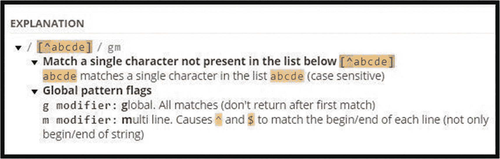
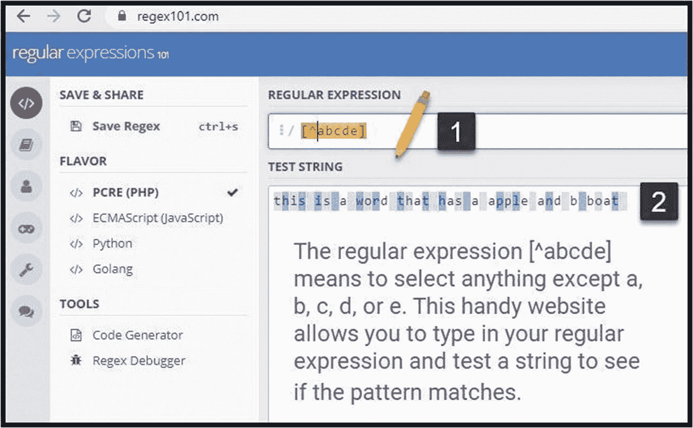
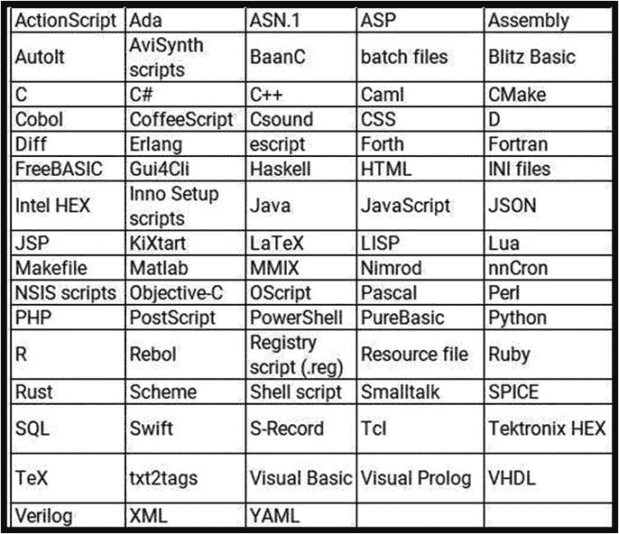
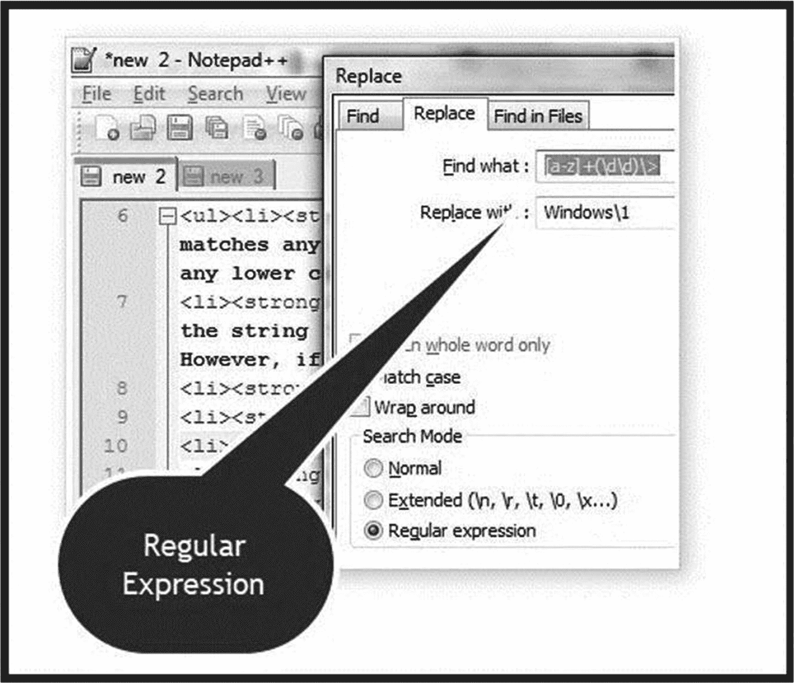
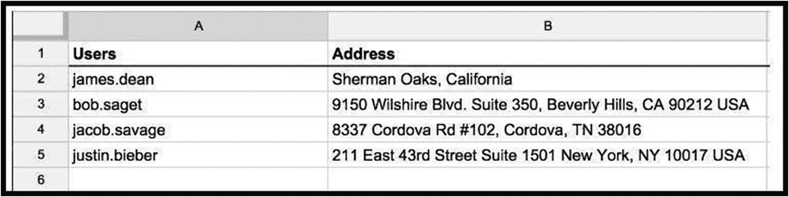
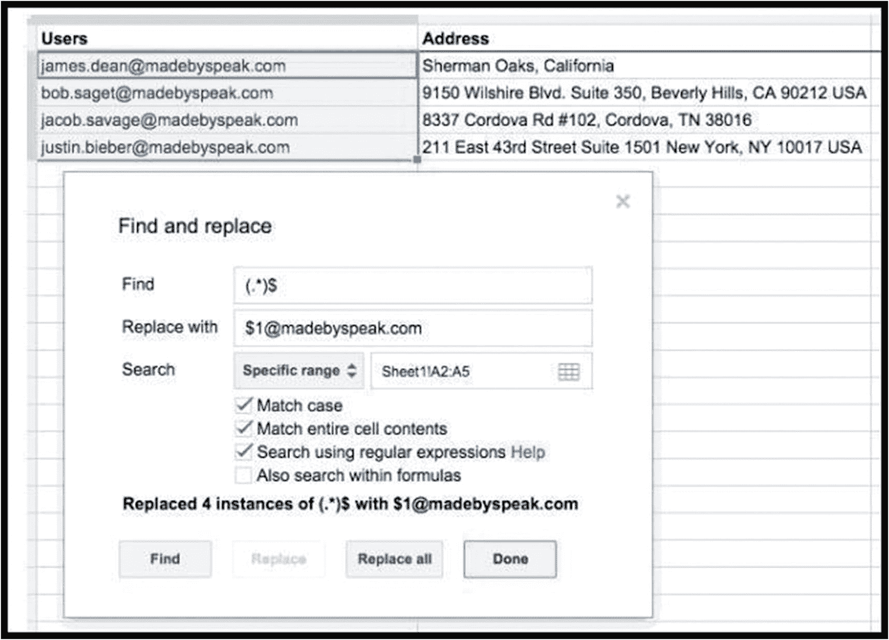
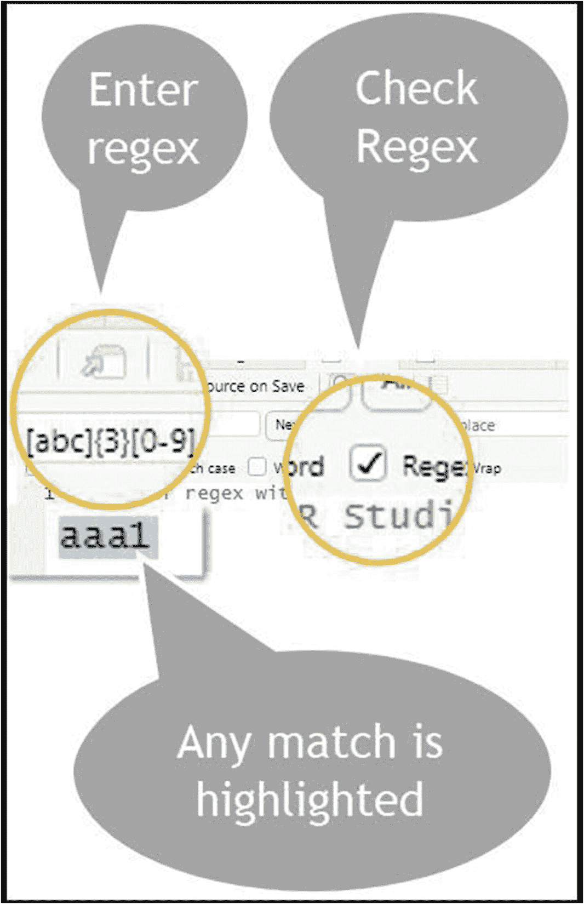

# 12. 开发工具与资源

## 12.1 实用程序

### 12.1.1 regex101.com

免费且易于使用的网站 [`www.regex101.com`](http://www.regex101.com) 是你在尝试不同方法并需要即时反馈时的首选沙盒。请参见图 12-1 和 12-2。它并非专门针对 R 进行调整，但绝大多数 R 正则表达式配置都能被正确评估。在屏幕右侧，提供了说明性注释。虽然它的功能远不如 `RegExBuddy`（稍后将讨论），但对于许多人来说，它已经足够。由于实践与学习紧密相关，在前期花几个小时使用这个工具将会加速你的学习曲线。

图 12-2 `regex101.com` 提供的有用解释

图 12-1 一个简单且方便的网站，用于验证任何针对字符串的正则表达式

### 12.1.2 RegExBuddy

`RegExBuddy` 是我所知道的唯一一个支持并追踪大量语言（精确到版本级别）的正则表达式辅助工具。截至 2020 年 3 月，其网站包含了 262 种语言/版本。毫无疑问，它是正则表达式工具中的凯迪拉克。以下是其支持的 R 版本：

- R 2.14.0–2.14.1
- R 2.14.2
- R 2.15.0–3.0.2
- R 3.0.3–3.1.2
- R 3.1.3–3.4.4
- R 3.5.0–3.6.1
- R 4.0.0

网站 [`www.regexbuddy.com/benefits.html`](http://www.regexbuddy.com/benefits.html) 列出了以下优势（作者注：我与 `RegExBuddy` 无任何财务关系）：

- 正则表达式入门。
- 学习正则表达式语法。
- 创建正则表达式。
- 理解他人创建的正则表达式。
- 比较不同风格的正则表达式。
- 在不同风格的正则表达式之间进行转换。
- 测试正则表达式。
- 调试正则表达式。
- 生成源代码片段。
- 搜索文件和文件夹（grep）。
- 与其他软件集成。
- 在 Linux 上通过 WINE 运行。

许多数据科学家、开发者和分析师都会同时使用 R 和 Python。这两种语言的正则表达式语法存在一些差异，但你在一门语言中学到的大部分内容在另一门语言中也是通用的。

### 12.1.3 其他实用程序

以下是其他用于正则表达式测试的网站。其中一些包含针对常见数据格式的预定义模式，例如社会保险号、不同国家的身份证号等。有些是免费的，但功能更全面的网站会收取一次性或月度费用。在购买前，请确保对 R 提供完全支持。

- [`http://RegexPal.com`](http://regexpal.com)
- [`www.nregex.com`](http://www.nregex.com)
- [`www.rubular.com`](http://www.rubular.com)
- [`www.myregexp.com`](http://www.myregexp.com)
- [`www.ultrapico.com/Expresso.htm`](http://www.ultrapico.com/Expresso.htm)
- [`http://sourceforge.net/projects/regulator`](http://sourceforge.net/projects/regulator)
- [`www.debuggex.com/`](http://www.debuggex.com/)

### 12.1.4 内置正则表达式功能的文本编辑器

`RegEx` 在众多软件中的广泛应用，在一定程度上弥补了其陡峭的学习曲线。例如，功能齐全的文本编辑器 `Notepad++` 就允许使用 `RegEx` 进行搜索、替换和其他操作。

表 12-1 列出了 `Notepad++` 支持的编程语言。^(⁶⁶)

**表 12-1** `Notepad++` 支持的语言

|  |

图 12-3 是一个展示在编辑器中使用 `RegEx` 的截图。

**图 12-3** 在文本编辑器 `Notepad++` 中使用正则表达式

#### 12.1.4.1 在 Notepad++ 中使用正则表达式

以下来自 `Notepad++` 网站的说明提供了在该应用程序中使用 `RegEx` 的简化指导。^(⁶⁷)

在文本编辑器中使用“查找”或“查找并替换”功能搜索字符串时，会高亮显示相关匹配项（例如，搜索“le”会高亮显示“apple”、“please”等单词中的“le”）。然而，一些像 `Notepad++` 这样的高级编辑器（我之所以在示例中提到 `Notepad++`，因为它是我目前最喜欢的！）支持使用 `RegEx`，它最近为我节省了数小时的时间，无需手动替换包含 HTML 和 JavaScript 代码的文件中的字符串和数值。

`RegEx` 字符可用于创建高级匹配条件。以下列表通过实际示例介绍了其中一些字符。在开始之前，请确保在“查找”或“查找并替换”对话框中，将搜索模式从“普通”更改为“正则表达式”。

- `[ ]` – 方括号可用于匹配多个字符中的**一个**。例如，`[abc]` 匹配字符 a、b 或 c 中的任何一个。因此，`b[eo]n` 将匹配 `ben` 和 `bon` 等单词，但不匹配 `been` 或 `beon`。还可以使用范围。`[a-z]` 匹配任何小写字符，依此类推。

- `^` – 脱字符可以在方括号内使用，以排除某些字符的匹配。例如，`hell[^o]` 表示如果字符串“hell”后面跟着字母“o”，则忽略该匹配。另一个例子是 `[^A-Za-z]`，它将排除所有字母字符。但是，如果未放置在方括号内，`^` 可用于匹配行的开头。

- `$` – 匹配行的结尾。

- `.` – 句点或点匹配任何单个字符。

- `\d` – 匹配任何单个数字。

- `\w` – 匹配任何单个字母数字字符或下划线。

- `\s` – 匹配空白字符，包括制表符和换行符。

- `*` – 星号匹配零次或多次。例如，`Ba*m` 匹配 `Bm`、`Bam`、`Baam` 等。

- `+` – 加号匹配一次或多次。例如，`lo+l` 匹配 `lol`、`lool`、`loool` 等。

- `\<` – 匹配单词的开头。例如，`\<` 后紧跟“sh”匹配“she”，但不匹配“wish”。

- `\>` – 匹配单词的结尾。例如，`sh\>` 匹配“wish”，但不匹配“she”。

- `( )` – 圆括号可用于“查找并替换”功能中，以标记一个匹配项。然后，被标记的匹配项可以在替换中使用 `\1`、`\2` 等引用。

    例如，如果你在搜索框中写入 `123xxxRRR`，在“替换为”字段中写入 `123\1HHH`，结果将是 `123xxxHHH`。

- `\` – 反斜杠可用于转义 `RegEx` 字符。例如，要匹配 `1+1=2`，正确的 `RegEx` 是 `1\+1=2\.`。否则，加号将具有特殊含义。

此外，以下两个示例可以让你更好地了解如何在编辑器中使用 `RegEx`：

- 查找：`Win([0-9]+)` 替换为：`Windows\1`

    将搜索如 `Win2000` 和 `Win2003` 这样的字符串，并将它们更改为 `Windows2000`、`Windows2003`……。

- 查找：`[a-z]+(\d\d)\>` 替换为：`Windows\1`

    将搜索所有仅以两位数字结尾的字母数字字符，例如 `Win98` 和 `Win07`，并将它们更改为 `Windows98`、`Windows07`……。

### 12.1.5 Google Sheets 中的正则表达式功能

许多工具和软件包都附加了正则表达式功能。以下是一个来自 `madebyspeak.com`^(⁶⁸) 的电子邮件格式示例：

在 Speak 公司，我们在处理大型电子表格、数据库导出、内容导入时经常使用正则表达式——凡是你能想到的场景都用了。如果内容长度超过 140 个字符的推文，我们技术团队中的某个人就会从工具箱中拿出正则表达式来帮助加快变更速度。

我们从小处着手。你正在处理一个如图 12-4 所示的电子表格。

**图 12-4** Google Sheets 示例电子表格

“用户”列的格式是 `first.last`，但我们实际上希望它们是电子邮件地址。电子邮件地址的第一部分可以保留现有内容，但我们希望在每个用户的末尾添加 `@madebyspeak.com`，以形成一个有效的电子邮件地址。如果这个电子表格超过一千行，手动进行这些更新将花费很长时间。我们无法使用传统的查找和替换操作，因为每个单元格的内容都不同。但是，由于每个单元格的格式相同（`first.last`），我们可以找到单元格中的最后一个字符，并追加 `@madebyspeak.com`。在 Google Sheets 的“查找并替换”工具中，有一个启用正则表达式的选项，如图 12-5 所示。要将所有用户更新为电子邮件地址，我们需要：

- 选择要更新的单元格
- 查找 `(.*)$`
- 替换为 `$1@madebyspeak.com`
- 勾选“使用正则表达式搜索”和“匹配整个单元格内容”
- 全部替换

**图 12-5** 查找并替换

`.*` 匹配任何字符（`.`）零次或多次（`*`）。我们也可以匹配 `.+`，这将匹配任何字符（`.`）一次或多次（`+`）。`( )` 为此匹配项创建一个组，我们可以在之后的替换表达式中使用它。在“替换为”表达式中，我们从 `$1` 开始，这是对“查找”表达式中由 `( )` 创建的组的引用。我们希望用原始“查找”结果的内容加上 `@madebyspeak.com` 来替换整个单元格，因此匹配了 `(.*)`（所有字符）的组 `$1` 将为我们提供原始内容，然后我们只需填充我们希望在原始内容之后出现的内容——结果就是 `$1@madebyspeak.com`。

### 12.1.6 RStudio 中的正则表达式

`RStudio` 包含一个在脚本中查找和/或替换文本时使用正则表达式的功能。此功能仅适用于在源代码中工作。例如，你可以使用 `RegEx` 将脚本中的 `setwd()` 从 `"c:\\alpha1"` 改为 `"f:\\beta1"`。对于简单的替换来说这可能有些小题大做，但如果你有更复杂的更改，`RegEx` 可能是个好方法。

图 12-6 展示了一个简单的正则表达式 `[abc]{3}[0-9]`，用于查找字符串 `aaa1`。`RegEx` 周围没有引号。

**图 12-6** 在 `RStudio` 中使用正则表达式进行搜索/替换

脚注 1   2   3   4