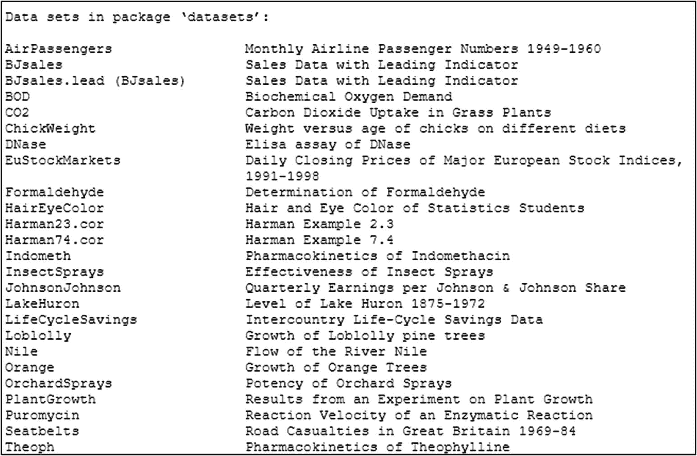

# 15\. 数据结构

## 15.1 内置数据集

`MASS` 是用于练习 `R` 代码的常用数据集来源。图 15-1 显示了可用数据集的部分列表。尽管在新项目中直接使用真实数据很诱人，但考虑先用一个简单、内置的数据集来调试你的代码，这样你一次只改变一个变量——先理清代码逻辑，然后再处理你自己的数据。



图 15-1 来自“datasets”包的内置数据集

```
library(MASS)
data() # 显示可用的基础数据集
```

有各种各样的数据集可用。例如，简单的尼罗河数据集具有时间序列格式：

```
data(Nile)
head(Nile)
## [1] 1120 1160  963 1210 1160 1160
class(Nile)
## [1] "ts"
x <- as.data.frame(Nile)
class(x)
## [1] "data.frame"
head(x) # 演示转换为数据框
##      x
## 1 1120
## 2 1160
## 3  963
## 4 1210
## 5 1160
## 6 1160
```