# 16\. 可视化

这些示例中的大部分都使用了 `R` 的主力包 `ggplot2`。`ggplot2` 包衍生出了许多后继包，并且是一个逻辑结构清晰的可视化图表的宝库。以下章节汇集了来自 `ggplot2` 和其他包的各种可视化图表。`ggplot2` 会随着 `library(tidyverse)` 命令自动加载。

虽然学习 `ggplot` 和其他可视化包的细节是件好事，但要记住，在调整文本、注释、形状等细微变化时，存在一个收益递减点。使用诸如 TechSmith 的 Snagit、Adobe Illustrator、Adobe Photoshop，甚至画笔之类的图形工具来完成最终的可视化，并不是“作弊”。当你向决策者展示结果时，他们不太可能说：“坦白说吧，Sally。我知道最后那个注释不是你用 `ggplot` 做的……。”

## 16.1 直方图

直方图示例见图 16-1。

```
ggplot(data=mtcars,aes(mpg))+geom_histogram(aes(y =..density..),
fill="red4")+geom_density()
## `stat_bin()` using `bins = 30`. Pick better value with `binwidth`.
```

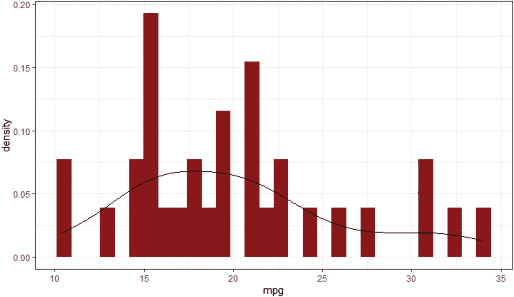

图 16-1 *来自 ggplot2 的直方图*

## 16.2 图表变体

Thomas Neitmann 的 `ggcharts` 包包含许多易于使用的变体。我改编了内置的 `R` 数据集 `txhousing`，为条形图提供数据。`DPLYR` 按城市和年份汇总销售额。分面允许将多个图表同时显示。

### 16.2.1 水平条形图（分面）

分面水平条形图示例见图 16-2。

```
library(ggcharts)
df <- txhousing %>%
group_by(city,year) %>%
summarise(sales_tot = sum(sales))
## `summarise()` regrouping output by 'city' (override with `.groups` argument)
df %>% filter(year %in% c(2012,2013,2014,2015)) %>%
bar_chart(x = city, y = sales_tot, facet = year, top_n = 10)
```

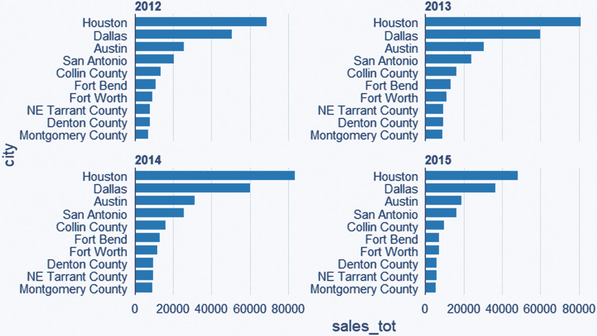

图 16-2 ggcharts：水平条形图。分面（4 合 1）是自动完成的

### 16.2.2 棒棒糖图

某些图形方法具有艺术化和非正式的风格。棒棒糖图会出现在《自然》杂志上吗？可能不会。它会出现在杂志或某家紧跟潮流、时尚的设计公司的年报中吗？有可能。随着 R 语言的发展，纯粹的创新也随之增长。R 语言的图形功能让你可以选择完全平庸、保守、中庸、创意或超凡脱俗的风格。图 16-3 使用棒棒糖类型的`ggplot`展示了可支配收入。数据框`LifeCycleSavings`来自`datasets`包。

```r
df <- LifeCycleSavings
df <- cbind(Country=rownames(df), df)
#将行名转换为列
df$disposable.income <- df$dpi
df <- df[1:10,]
# 为便于说明减少行数
ggplot(df, aes(x=Country, y=disposable.income)) +
geom_point() + geom_segment( aes(x=Country, xend=Country, y=0,
yend=disposable.income)) +
labs(title = "部分国家的可支配收入",
subtitle = "国家 vs 可支配收入",
caption = "来源：LifeCycleSavings 内置数据集") +
theme(axis.text.x = element_text(angle = 65, vjust=0.6))
```

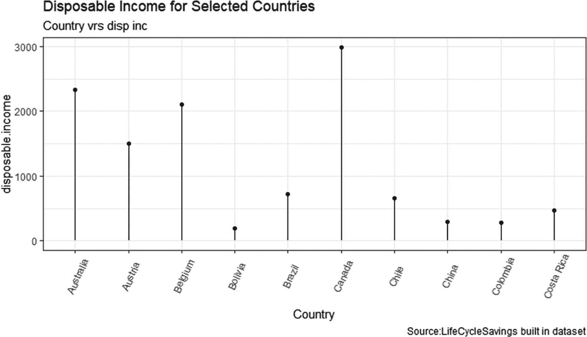

图 16-3 来自 ggplot2 的棒棒糖图

### 16.2.3 阶梯图

图 16-4 展示了邮资价格与年份关系的阶梯图。代码来自 flowingdata.com，这是一个由 Nathan Yau 运营的、专注于可视化的实用网站：

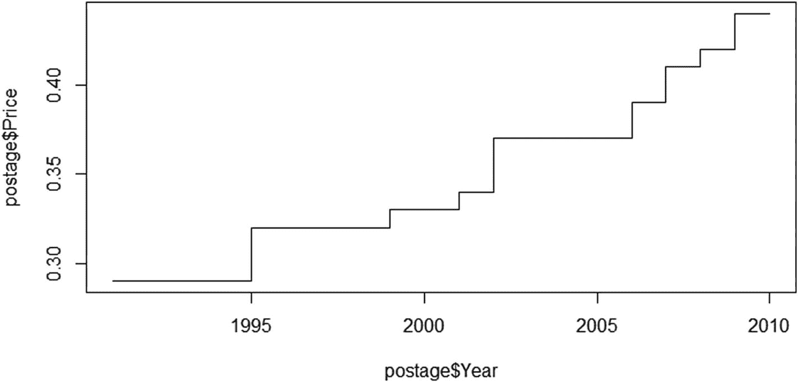

图 16-4 阶梯图

```r
postage = read.csv("http://datasets.flowingdata.com/us-postage.csv", sep = ",", header=T)
head(postage,3); plot(postage$Year, postage$Price, type = "s")
##   Year Price
## 1 1991  0.29
## 2 1995  0.32
## 3 1999  0.33
```

### 16.2.4 发散条形图

图 16-5 展示了一个发散条形图。这种基于`ggplot2`的图形非常适合展示两个项目（可以是人、业务单元、处理方式等）如何基于某个数值进行比较。在下面的例子中，瑞士法语区各省份根据教育水平进行了比较。数据来自 1888 年，使用了内置数据集`swiss`。

```r
data("swiss")
theme_set(theme_bw())
# 数据准备
data("swiss")  # 加载数据（R 内置数据集）
swiss$`Provence` <- rownames(swiss)
# 为省份创建新列
swiss$Education_z <- round((swiss$Education -
mean(swiss$Education))/sd(swiss$Education), 2)
# 计算标准化的教育水平
swiss$Education_type <- ifelse(swiss$Education_z < 0,
"below", "above")
# 高于/低于平均值的标记
swiss <- swiss[order(swiss$Education_z), ]
# 排序
swiss$`Provence` <- factor(swiss$Provence,
levels = swiss$Provence)
# 转换为因子以在图中保持排序顺序。
# 发散条形图
ggplot(swiss, aes(x=`Provence`, y=Education_z, label="教育相对评分")) +
geom_bar(stat='identity', aes(fill=Education_type), width=.5)  + scale_fill_manual(name="教育年限水平",
labels = c("高于平均值", "低于平均值"),
values = c("above"="#00ba38", "below"="#f8766d")) +
theme(text = element_text(size=08)) +
labs(subtitle="各省份教育水平",
title= "发散条形图") +
coord_flip()
```

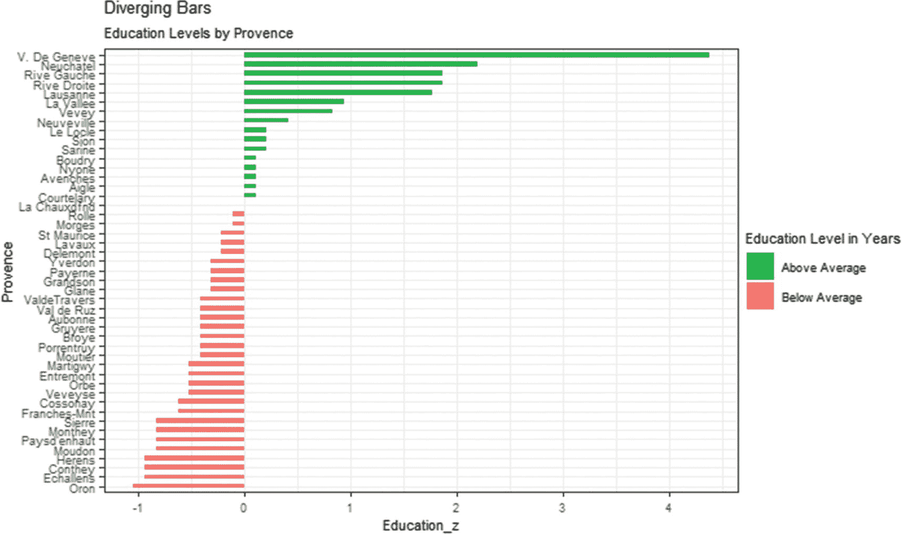

图 16-5 显示相对于零（标准化后）的差异的发散条形图

### 16.2.5 分类/字符频率的彩色展示

图 16-6 使用`inspectdf`包，快速展示了`data.frame`中分类/字符值的视图。色块的大小与该分类值出现的次数成比例。

```r
if (!require("inspectdf")) install.packages("inspectdf")
library(inspectdf)
mpg %>%
inspectdf::inspect_cat() %>%
inspectdf::show_plot(text_labels = TRUE)
```

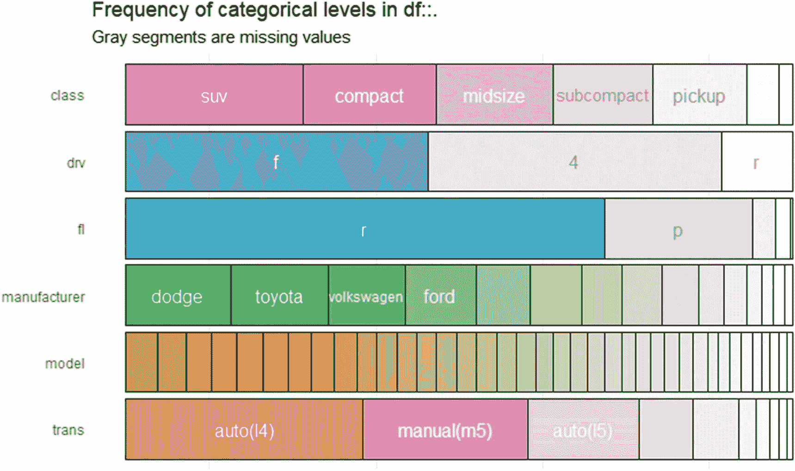

图 16-6 内置数据集 MPG 中的分类水平频率

### 16.2.6 环形图

在科学论文或技术性财务分析中，使用环形图会显得有些业余。然而，在某些场合，当精确数字并不重要时，它可用于产生特殊效果。代码很简单。图 16-7 展示了一个没有颜色的简单图表。图 16-8 是添加了颜色的改进版本。

```r
if (!require("ggpubr")) install.packages("ggpubr")
df <- data.frame(supplies = c("铅笔", "纸张", "订书钉", "埃尔默胶水"), value = c(50, 200, 122, 5))
ggdonutchart(df, "value", label = "supplies")
```

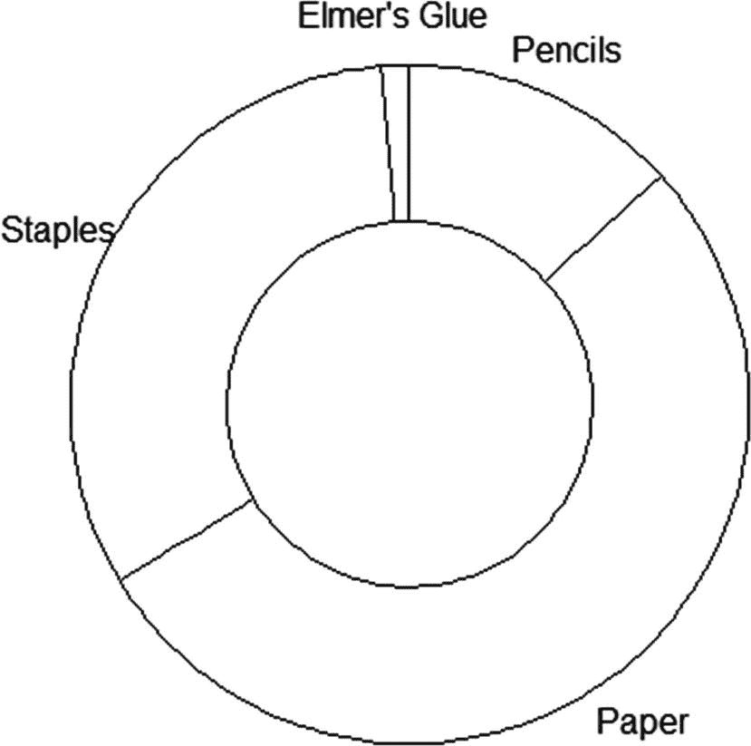

图 16-7 无颜色环形图

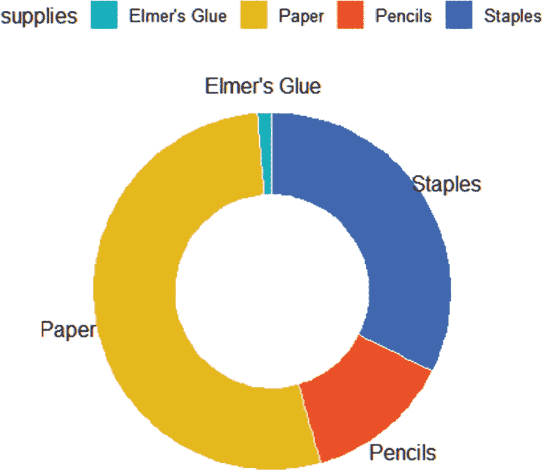

图 16-8 添加颜色的环形图

### 16.2.7 气泡图

图 16-9 使用`ggplot`展示了内置数据集`mtcars`中`mpg`与重量的关系。`qsec`（四分之一英里用时）改变了气泡的大小，而气缸数决定了颜色：

```r
data("mtcars")
df <- mtcars
df$cyl <- as.factor(df$cyl)
ggplot(df, aes(x = wt, y = mpg)) +
geom_point(aes(color = cyl, size = qsec), alpha = 0.5) +
scale_color_manual(values = c("#00bb06", "#E7B800",
"#FC4E07")) + scale_size(range = c(0.4, 12))#改变点的大小
```

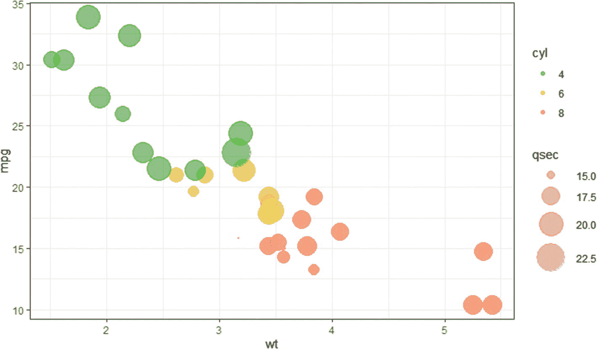

图 16-9 `mtcars` 数据集的 `mpg` vs. 重量气泡图

### 16.2.8 散点图

散点图展示两个数值向量之间的关系。图 16-10 显示了一个基本的散点图。

```r
unemployment = read.csv("http://datasets.flowingdata.com/unemployment-rate-1948-2010.csv", sep = ",")
plot(1:length(unemployment$Value), unemployment$Value)
```

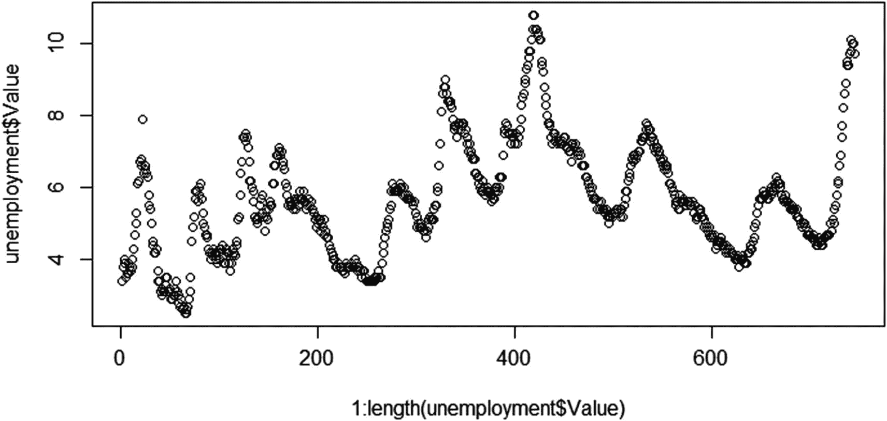

图 16-10 简单散点图

### 16.2.9 带拟合 Loess 曲线的散点图

图 16-11 将 `loess` 曲线（局部平滑）应用于散点图。

```r
scatter.smooth(x=1:length(unemployment$Value),
y = unemployment$Value)
scatter.smooth(x= 1:length(unemployment$Value),
y = unemployment$Value, ylim=c(0,11), degree=2,
col = "#CCCCCC", span = 0.5)
```

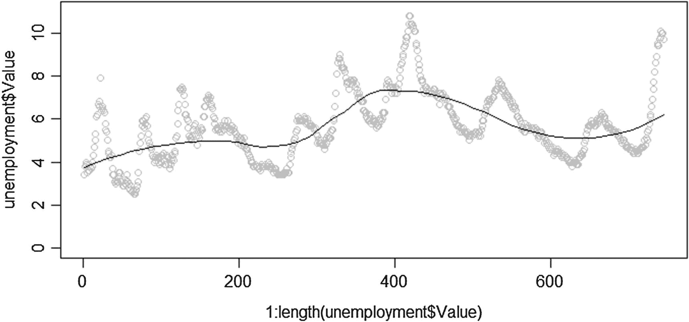

图 16-11 拟合的 Loess 曲线

### 16.2.10 使用替代主题的年度图表

`Ggthemr`^((74)) 为 `ggplots` 提供了一些有趣的主题。背景包括葡萄、草地、浅色、丁香、淡色和海洋等色彩主题。以下示例中，创建了一个简单的复利储蓄数据框，然后使用 `ggplot` 绘图，如图 16-12 所示。尽管此处的计算在财务上是精确的，但在许多情况下，你绘制的数据可能带有一定程度的误差或不确定性，因此我保留了自动误差带。

```
if (!require("devtools")) install.packages("devtools")
library(devtools)
devtools::install_github('cttobin/ggthemr')
library(ggthemr)
library(lubridate)
dollars <- rep(1:1,20)  #创建一个包含 20 个元素的向量
dollars[1] <- 100  #初始存款 100 美元
for (i in 2:20) dollars[i] <- dollars[i -1] * 1.05
#第 2 至 20 年 5%的年复利增长
dollars <- as.data.frame(dollars)
#现在在 x 轴上添加日期
dollars$date <- seq(as.Date("2020/1/1"),
as.Date("2039/1/1"), "years")
names(dollars) <- c("Value", "Interest.Date")
ggthemr("earth", type="outer", layout="scientific", spacing=2)
ggplot(dollars, aes(Interest.Date, Value)) +
geom_line() +
geom_smooth(method='lm') +
ggtitle("100 美元本金 5%年复利的投资价值")
## `geom_smooth()` 使用了公式 'y ~ x'
```

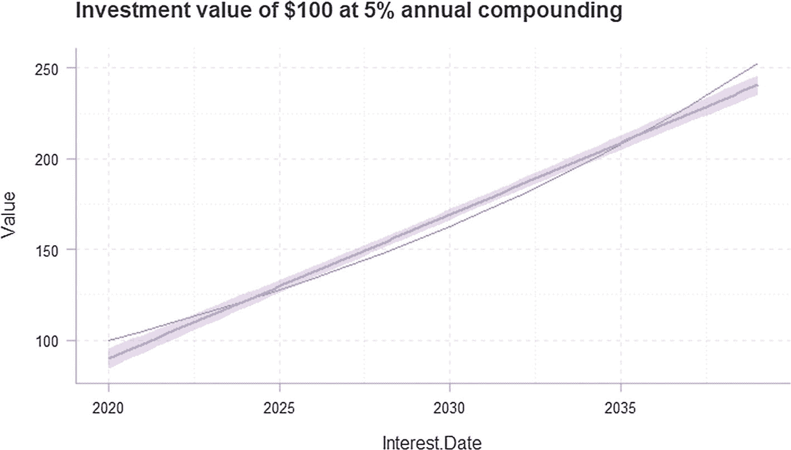

图 16-12 使用 `ggthemr` 主题的 `ggplot`

### 16.2.11 数据框中所有变量之间的绘图

`GGally` 包提供了一种便捷的分面系列图表，用于展示数据集中数值变量之间的数值关系。其中包含相关系数值。图 16-13 是一个使用内置 `iris` 数据集的示例。注意：Mac 用户可能需要在代码中单独插入 `library(GGally)` 后再使用。

```
if (!require("GGally")) install.packages("GGally")
## 加载所需包：GGally
## 已覆盖 GGally 的注册 S3 方法：
##   方法来自
##   +.gg   ggplot2
ggpairs(iris)
```

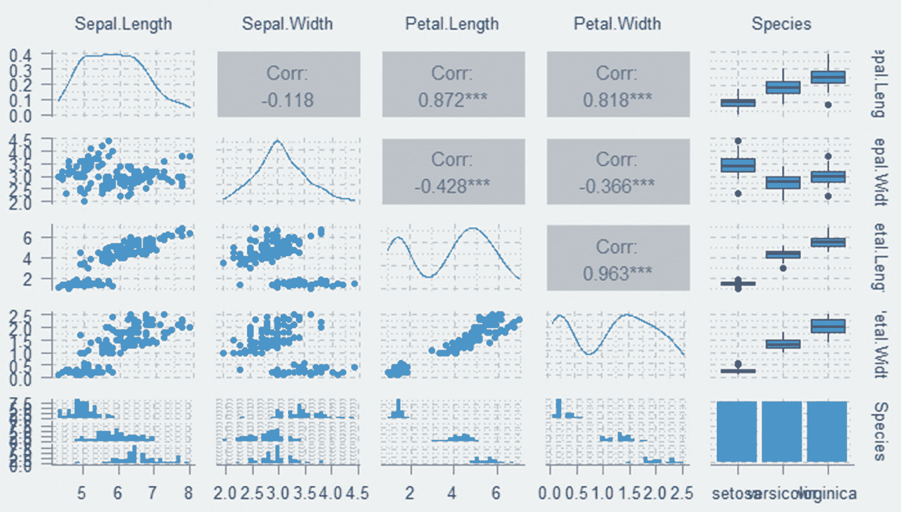

图 16-13 `GGally` 展示数值变量之间的关系

### 16.2.12 使用两个数据源的折线图

图 16-14 是一个使用两个数据源的折线图。两者不必覆盖整个 X 轴。在以下代码中，请注意 `theme_set` 函数。有时，一次 `ggplot` 运行的主题会延续到下一次。这确保了重置为普通的灰色背景。

```
n <- 20
x1 <- 1:n
y1 <- rnorm(n,0,.5)
df1 <- data.frame(x1,y1)
x2 <- (.5 * n):((1.5*n) -1)
y2 <- rnorm(n,1,.5)
df2 <- data.frame(x2,y2)
theme_set(theme_grey())
ggplot() +
geom_line(data = df1, aes(x1,y1), color = "darkblue") +
geom_line(data = df2, aes(x2, y2), linetype = "dashed",
color = "red") +
ggtitle("绘制了两个数据源")
```

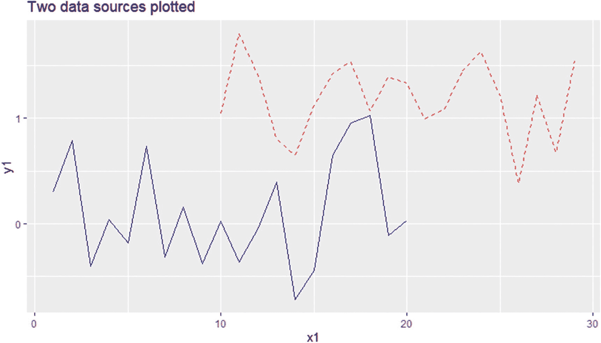

图 16-14 使用两个数据源的 `ggplot`

### 16.2.13 相关图

相关图是快速展示数据集中数值变量之间相关性的另一种方法。图 `16-15` 改编自优秀的网站 [`http://r-statistics.co/Top50-Ggplot2-Visualizations-MasterList-R-Code.html`](http://r-statistics.co/Top50-Ggplot2-Visualizations-MasterList-R-Code.html)。

```r
library(ggplot2)
library(ggcorrplot)
```

相关矩阵：

```r
data(mtcars)
corr <- round(cor(mtcars), 1)
```

绘图：

```r
ggcorrplot(corr, hc.order = TRUE,
type = "lower",
lab = TRUE,
lab_size = 3,
method="circle",
colors = c("tomato2", "white", "springgreen3"),
title="mtcars 数据集的 Correlogram",
ggtheme=theme_bw)
```

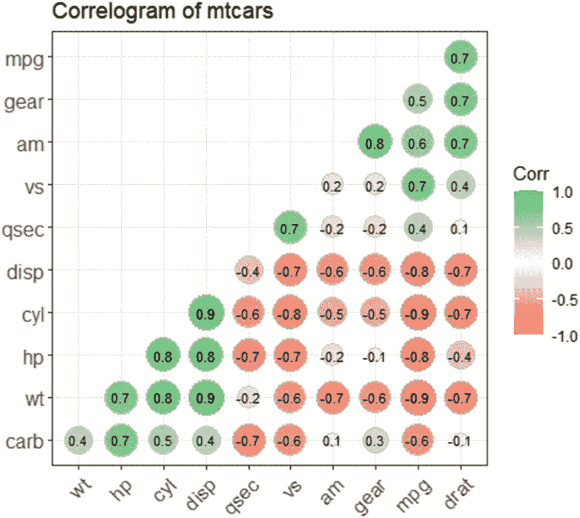

`图 16-15`

展示数值变量之间相关性的相关图

### 16.2.14 词云

词云统计一组词（“语料库”）中每个词的出现频率，并创建彩色图形，频率最高的词图形最大。输入的文本应不含引号和其他通常不在标准文本中出现的混淆符号。图 `16-16` 展示了一个使用维基百科上关于足球的文章示例文本的非常简单的例子。

```r
require(tm)
require(wordcloud)
## 加载所需包：wordcloud
## 加载所需包：RColorBrewer
wordcloud(
"足球 来自维基百科，自由的百科全书
跳转到导航跳转到搜索
本文是关于名为足球的游戏的整体概念。对于球本身，请参见足球（球）。有关该游戏的具体版本及该术语的其他用法，请参见足球（消歧义）。若干种足球规则。从上到下，从左到右：协会式、橄榄球式、澳式、联盟式橄榄球、联合会式橄榄球和盖尔式
足球是一类团队运动，涉及不同程度的用脚踢球得分。不加限定词时，足球一词通常指该词使用地区最流行的那种足球形式。通常称为足球的运动包括协会式足球（在一些国家称为英式足球）；橄榄球式足球（特指美式足球或加式足球）；澳式橄榄球；联盟式橄榄球（联合会式或联盟式橄榄球）；以及盖尔式足球。[1][2] 这些不同形式的足球在不同程度上具有共同起源，被称为足球规则。
在世界许多地方都有对传统、古代或史前球类运动的诸多记载。[3][4][5] 当代的足球规则可以追溯到 19 世纪英国公立学校对这些比赛的规范化。[6][7] 大英帝国的扩张和文化影响力使得这些足球规则传播到直接控制帝国以外的英国势力范围。[8] 到 19 世纪末，独特的地区性规则已经形成：例如，盖尔式足球有意融入了当地传统足球比赛的规则，以保持其传统。[9] 1888 年，英格兰成立了足球联盟，成为许多职业足球比赛中的第一个。在 20 世纪，几种不同类型的足球逐渐发展成为世界上最受欢迎的团队运动。[10]
目录
1   共同元素
2   词源
3   早期历史
3.1 古代游戏
3.2 中世纪和近代早期欧洲
3.3 佛罗伦萨足球
3.4 官方反对及禁止足球的尝试
4   现代规则的建立
4.1 英国公立学校
4.2 早期
4.3 剑桥规则
4.4 谢菲尔德规则
4.5 澳式橄榄球
4.6 足球协会
4.7 联盟式橄榄球
4.8 北美足球规则
4.9 盖尔式足球
]  ,
random.order=FALSE)
## 警告在 tm_map.SimpleCorpus(corpus, tm::removePunctuation) 中：
```

转换：

```r
## 丢失文档
## 警告在 tm_map.SimpleCorpus(corpus, function(x) tm::removeWords(x,
## tm::stopwords())) 中：转换丢失文档
```


`图 16-16`

使用维基百科示例文本的词云

### 16.2.15 `ggplot` 时间序列：全球航空事故历史数据

图 `16-17` 使用 `ggplot` 绘制时间序列，展示了自 `1908` 年以来全球航空事故的死亡人数。^(⁷⁵) 每个点代表一次事故。数据来源为 [`https://data.world/data-society/airplane-crashes`](https://data.world/data-society/airplane-crashes)。`Data World` 可能需要注册，但截至本文写作时，访问航空事故数据集不收取费用。下载的 `csv` 文件中，年份是字符型日期，因此我使用 `Lubridate` 包的 `mdy()` 函数将其转换为 R 日期。我还将主题改为更清晰的 `linedraw` 主题。请注意，输出结果中有 `12` 行数据缺失值。这对于该时间长度的历史数据来说很常见。

```r
setwd("h:/t")
airline.crashes <-
read_csv("Airplane_Crashes_and_Fatalities_Since_1908.csv")
date.and.fatalities.only <- select(airline.crashes, Date,
Fatalities)
date.and.fatalities.only <- mutate(date.and.fatalities.only,
crash.date = mdy(Date))
p <- ggplot(data = date.and.fatalities.only, aes(x = crash.date, y = Fatalities)) +
geom_point() +
labs(x = "Date",
y = "Airline Fatalities",
title = "Flying is safer than driving but you could still win the devil's lottery",
subtitle = "source = https://data.world/data-
society/airplane-crashes")
p + theme_linedraw()
Warning: Removed 12 rows containing missing values (geom_point).
```

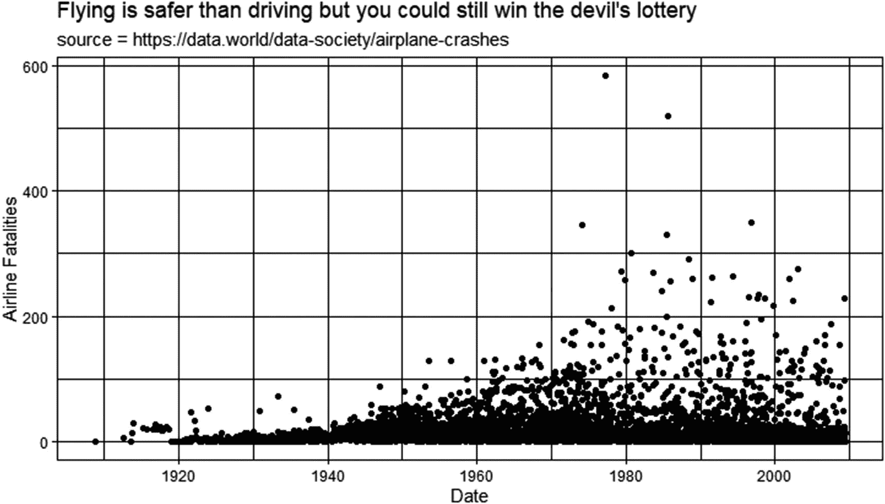

`图 16-17` 自 `1908` 年以来每次航空事故的死亡人数

### 16.2.16 `textplot`

`2020` 年，一个名为 `textplot` 的新包被添加到 `CRAN`。它提供了绘制文本值、显示相关性和频率的便捷功能：

*   文本共现
*   文本聚类（例如 `biterm` 聚类）
*   依存句法分析结果
*   文本相关性和文本频率

图 `16-18` 展示了 `textplot` 的一个柱状图输出^(⁷⁶)：

```r
if (!require("textplot")) install.packages("textplot")
if (!require("udpipe")) install.packages("udpipe")
data(brussels_listings, package = 'udpipe')
x <- table(brussels_listings$neighbourhood)
x <- sort(x)
textplot_bar(x,
panel = "Locations", col.panel = "darkgrey", xlab = "Listings",
cextext = 0.75, addpct = TRUE, cexpct = 0.5)
```

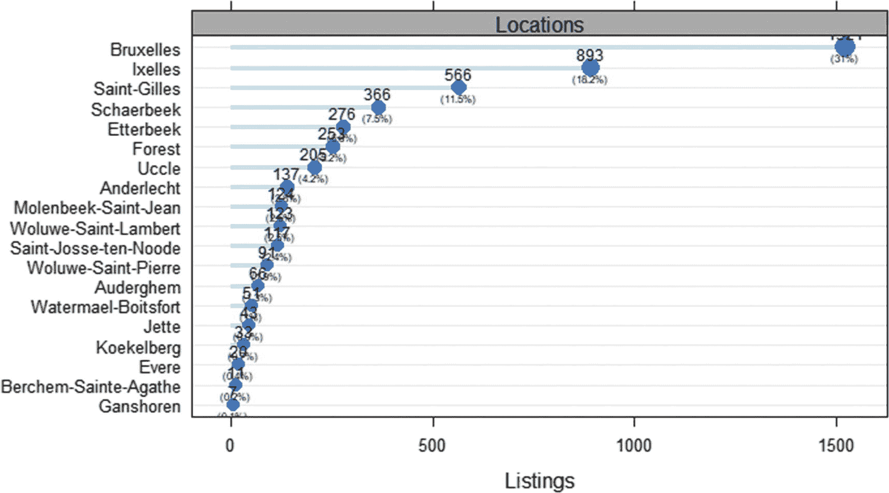

`图 16-18` 按布鲁塞尔位置列出的房源文本图

### 16.2.17 点图

点图已经存在多年。它是杂志钟爱的一种图表，且易于编码。图 `16-19` 展示了使用内置数据集 `mpg` 的示例输出。

```r
library(tidyverse)
theme_set(theme_classic())
ggplot(mpg, aes(x=manufacturer, y=cty)) + geom_point(col="tomato2", size=3) +
geom_segment(aes(x=manufacturer, xend=manufacturer,
y=min(cty), yend=max(cty)), linetype = "dashed", size=0.1) +
labs(title="Dot Plot",
subtitle="Manufacturer(Make) Vs Mileage in the City", caption="source: mpg") + coord_flip()
```

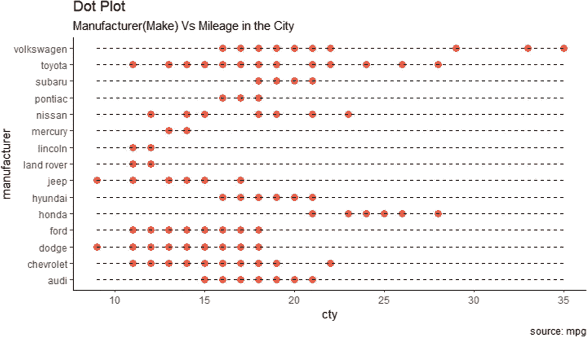

`图 16-19` 显示城市里程与汽车制造商的简单点图

### 16.2.18 生存分析

在医学研究中，一个标准问题是询问患者在针对某种疾病接受特定治疗/不治疗后能存活多久。从历史上看，生存分析一直是保险公司非常感兴趣的领域，因为他们的精算师会根据历史数据调整费率。R 提供了一些强大的工具来解决这些问题。随着时间的推移，生存分析已不仅仅涵盖医学/保险主题。一个客户流失率高的企业会希望根据客户的预计“生命周期”（即客户停止使用一家公司服务并转而注册另一家公司服务之前的时长），来决定投入多少成本来获取新客户（广告费用等）。图 `16-20` 展示了 `survival` 包的一个典型图表。

网站 `sdhta.com` 列出了生存分析的一些示例应用：^(⁷⁷)

*   *癌症研究*，用于患者生存时间分析
*   *社会学*，用于“事件史分析”
*   *工程学*，用于“失效时间分析”

在癌症研究中，典型的研究问题如下：

*   某些临床特征对患者生存期有何影响？
*   个体存活 `3` 年的概率是多少？
*   不同患者群体之间的生存率是否存在差异？

```r
if (!require("survival")) install.packages("survival")
if (!require("survminer")) install.packages("survminer")
data("lung")
head(lung)
##   inst time status age sex ph.ecog ph.karno pat.karno meal.cal wt.loss
## 1    3  306      2  74   1       1       90       100     1175      NA
## 2    3  455      2  68   1       0       90        90     1225      15
## 3    3 1010      1  56   1       0       90        90       NA      15
## 4    5  210      2  57   1       1       90        60     1150      11
## 5    1  883      2  60   1       0      100        90       NA       0
## 6   12 1022      1  74   1       1       50        80      513       0
拟合模型 (`Kaplan-Meier` 生存估计)：
fit <- survfit(Surv(time, status) ~ sex, data = lung)
ggsurvplot(fit,
pval = TRUE, conf.int = TRUE,
risk.table = TRUE, # Add risk table
risk.table.col = "strata", # Change risk table color by groups
linetype = "strata", # Change line type by groups
surv.median.line = "hv", # Specify median survival
ggtheme = theme_bw(), # Change ggplot2 theme
palette = c("#E7B800", "#2E9FDF"))
```

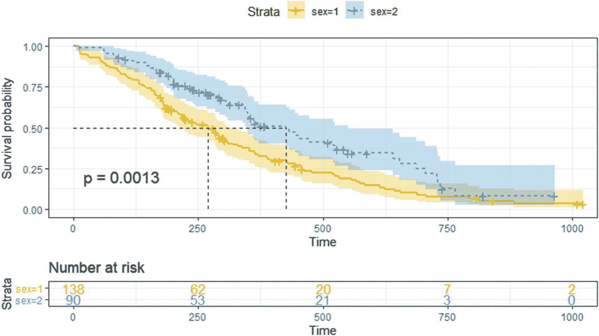

`图 16-20` 示例生存曲线 ([www.​sthda.​com/​english/​wiki/​survival-analysis-basics](http://www.sthda.com/english/wiki/survival-analysis-basics))

脚注 `1` `2` `3` `4` `5` `6` `7` `8` `9`