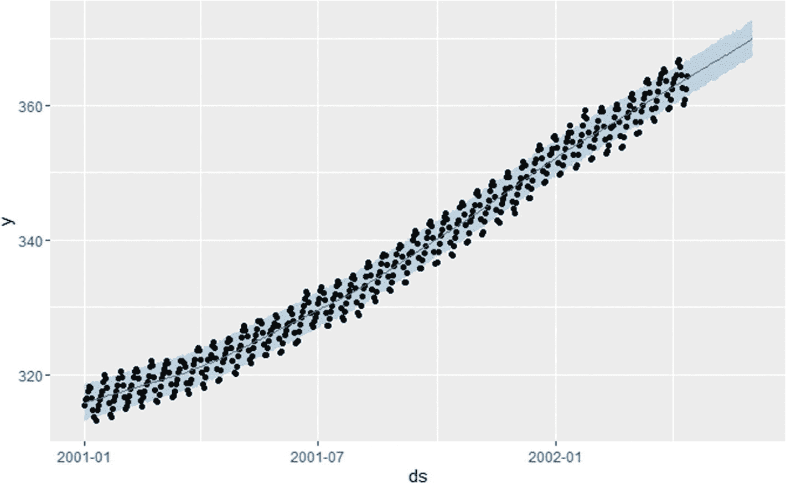
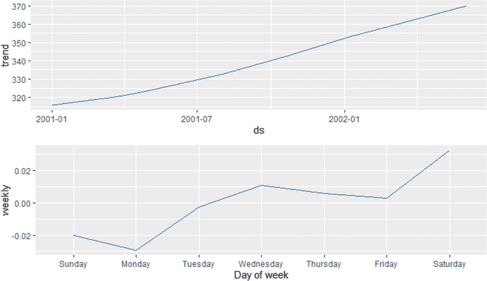
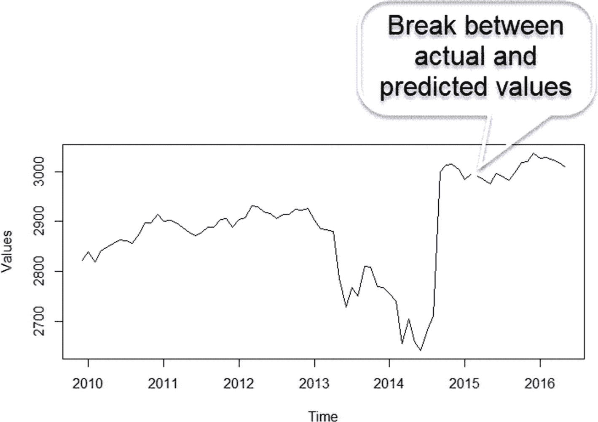

# 17. 简单预测方法

多年以来，预测建模已经变得非常复杂。它是数据科学的一个主要分支，包含了一些最为复杂的数学和统计工程方法。话虽如此，有些预测工具则非常直接了当。我们可以从 `prophet` 包开始，这是 Facebook 慷慨地献给世界的礼物。如果你将 `prophet` 与一些较老的时间序列预测方法进行比较，你会对其简洁性印象深刻。它具备旧有系统的所有趋势性、季节性和其他数学模式，但无需你“深入研究”。你只需输入一个包含一列日期和另一列某些数值（如每平方英里的鸟类数量、阿拉巴马州的囚犯数量、雨林面积等）的 `dataframe`，然后就可以预测未来的数值。最耗时的部分是让日期和列标题符合 `prophet` 要求的格式。在介绍 `prophet` 之后，我将介绍一种更古老的方法——Holt-Winters（时间序列）以及多元回归，其中使用一个或多个变量（*预测变量*）来估计某个感兴趣的变量，称为*响应变量*。


## Prophet：时间序列建模

`Prophet` 出色地隐藏了复杂性，你只需在数据框中准备两列数据：日期列和感兴趣的数值变量（即你要预测的目标）。但遗憾的是，Mac 系统上没有编译好的`prophet`版本。

```r
library(prophet)
library(lubridate)
```

首先创建一个人工时间序列数据集，从 2001 年第一天开始：

```r
start1 <- mdy("01/01/2001")
end1 <- mdy("01/01/2003")
the.days <- seq(start1, end1,"days") #daily
```

使用一个方便的內建数据集`co2`（即二氧化碳），它与植物对`co2`的吸收有关：

```r
co2.levels <- as.numeric(co2)
max.row <- length(co2.levels)
the.days <- the.days[1:max.row]
df <- data.frame(the.days = the.days, co2.levels = co2.levels)
names(df) <- c("ds", "y")
```

数据框的列名必须为`ds`和`y`，使用其他名称将无法工作。在此例中，上述数据框构建方法比`cbind`更优，因为`cbind`可能会改变日期格式。有时候 R 就是不会按照你的预期行事。

```
tail(df)
##             ds      y
## 463 2002-04-08 364.52
## 464 2002-04-09 362.57
## 465 2002-04-10 360.24
## 466 2002-04-11 360.83
## 467 2002-04-12 362.49
## 468 2002-04-13 364.34
m <- prophet(df)
```

预测未来 50 个周期（这里是天）的`co2`值：

```r
future <- make_future_dataframe(m, periods = 50)
tail(future)
##             ds
## 513 2002-05-28
## 514 2002-05-29
## 515 2002-05-30
## 516 2002-05-31
## 517 2002-06-01
## 518 2002-06-02
forecast <- predict(m, future)
tail(forecast[c('ds', 'yhat', 'yhat_lower', 'yhat_upper')])
##             ds     yhat yhat_lower yhat_upper
## 513 2002-05-28 369.3050   366.4695   371.8820
## 514 2002-05-29 369.4339   366.8909   372.0976
## 515 2002-05-30 369.5444   366.9370   372.1789
## 516 2002-05-31 369.6570   367.0379   372.3523
## 517 2002-06-01 369.8023   367.1528   372.4809
## 518 2002-06-02 369.8654   366.9304   372.5212
plot(m, forecast)
```

图 17-1 展示了来自`prophet`系统的预测图。



**图 17-1** Prophet 预测未来 50 天的图表

图 17-2 将时间序列分解为各种因子。



**图 17-2** Prophet 对时间序列因子的分解

## Holt-Winters 模型

Holt-Winters 模型已经存在多年。根据数据质量的不同，它相当准确。其巨大优势在于简单。有时，在给定的时间限制下，“足够好”就足够了。

```r
if (!require("forecast")) install.packages("forecast")
if (!require("graphics")) install.packages("graphics")
if (!require("zoo")) install.packages("zoo")
values1 <- c(2821.93,             2901.52,             2929.67,
2839.96,             2896.72,             2919.37,
2818.37,             2888.60,             2915.56,
2840.69,             2878.05,             2905.97,
2850.13,             2871.68,             2914.00,
2857.05,             2877.13,             2913.98,
2862.96,             2887.89,             2924.59,
2861.82,             2888.92,             2923.43,
2856.98,             2904.18,             2925.51,
2874.69,             2904.98,             2901.61,
2896.74,             2888.80,             2885.57,
2897.52,             2904.31,             2884.43,
2914.04,             2907.95,             2880.34,
2901.13,             2930.75,             2785.68,
2728.37,             2755.88,             2711.74,
2767.13,             2740.69,             2999.91,
2750.79,             2656.10,             3013.77,
2809.92,             2705.57,             3014.30,
2809.21,             2658.69,             3004.04,
2768.78,             2641.25,             2984.42,
2767.78,             2682.63,             2995.11)
```

创建一个从 2009 年 12 月开始的月度时间序列：

```r
values.as.time.series <- ts(values1, start = c(2009,12),
frequency = 12)
model.hw = HoltWinters(values.as.time.series)
p = predict(model.hw, 15) #look at 15 periods into the future
p
##           Jan      Feb      Mar      Apr      May      Jun      Jul      Aug
## 2015                   2991.145 2984.838 2976.383 2996.194 2991.383 2983.245
## 2016 3026.521 3027.701 3023.736 3017.429 3008.974
##           Sep      Oct      Nov      Dec
## 2015 2997.872 3018.700 3019.718 3037.716
## 2016
m = merge(a = as.zoo(values.as.time.series),
b = as.zoo(p))
m = as.ts(m)
ts.plot(m, ylab = "Values")
```

图 17-3 使用更早期的算法 Holt-Winters 来预测未来值。



**图 17-3** Holt-Winters 时间序列预测算法

## 多元回归

在多元回归中，模型读取一个或多个预测变量，然后估算出一个响应变量（即感兴趣的变量）。选择预测变量既是一门艺术，也是一门科学。如果你选了太多变量，算法就会“过拟合”特定的历史数据，从而无法泛化到未来。如果你选的太少，预测能力就会下降。以下示例是一个基于各种引擎参数预测每加仑英里数的基本模型。该“拟合”模型使用`am`、`vs`、`cyl`、`disp`、`hp`、`wt`和`drat`这些预测变量创建。这里展示的模型可以通过进一步分析得到改进。

```r
data(mtcars)
fit <- lm(mpg ~ am + vs + cyl + disp + hp + wt + drat, data = mtcars)
summary(fit) # shows how well the model fits
my.prediction <- predict(fit, car.test)
car.test[,1]
## [1] 21.0 18.7 10.4 21.5
my.prediction
##          Mazda RX4  Hornet Sportabout Cadillac Fleetwood      Toyota Corona
##          23.02141           17.44326           12.04897           23.99681
```

该模型相当接近。例如，它预测马自达 RX4 每加仑行驶 23 英里，而实际`mpg`为 21 英里。

