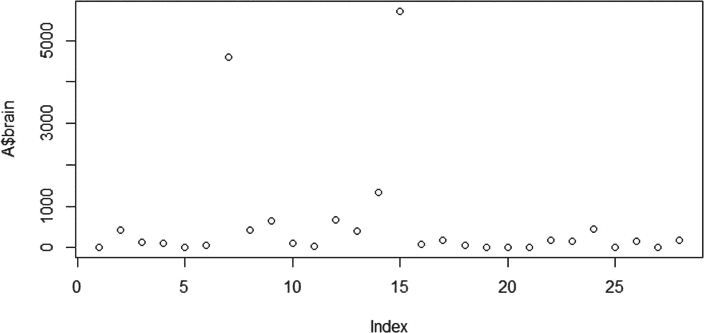
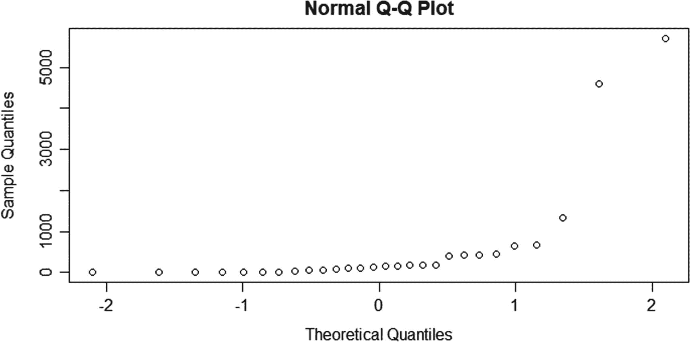
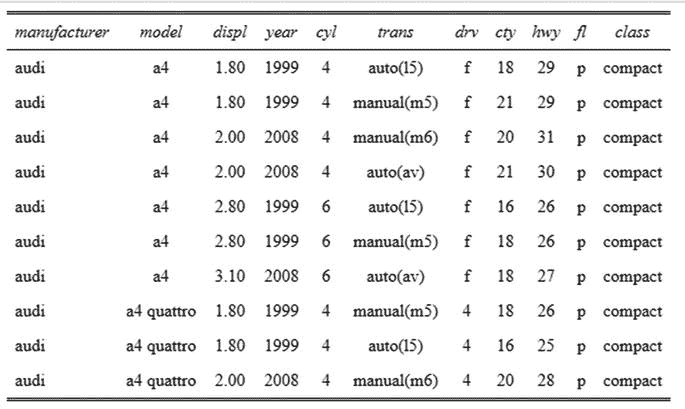
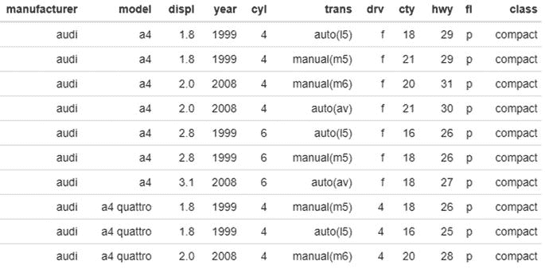
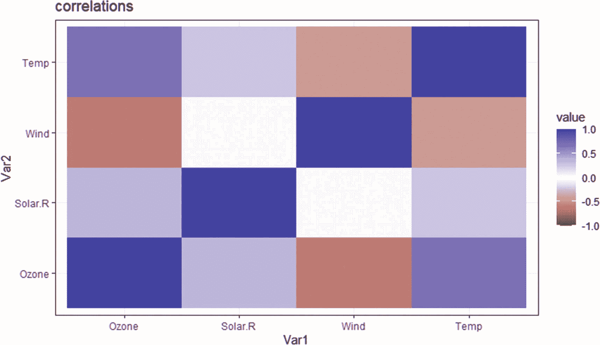
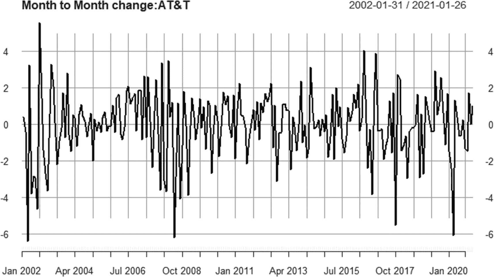
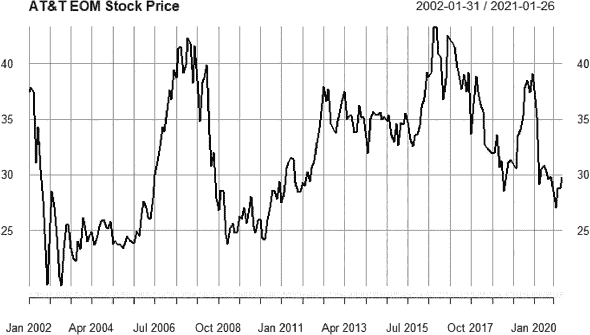

# 简单统计检验大杂烩

以下是几个单行检验的示例。它们只需少量代码就能提供关于任何数值序列/列的大量信息。如果你正在进行前期的数据探索，可以在程序开头放上这样一组代码。

## 基本数值向量检验

为简单起见，我们使用內建数据集“Animals”。以脑容量作为数值变量，以下代码提供了丰富的描述性信息。图 18-1 是脑重量的直方图，显示大部分脑重量低于 1000 cc。



**图 18-1** 图表显示仅有少数几个脑重量异常值

```r
library(datasets)
library(Hmisc)
library(MASS)
data("Animals")
A <- Animals
median(A$brain) # "in the middle"
## [1] 137
mean(A$brain)  #average
## [1] 574.5214
range(A$brain)  #min and max
## [1]    0.4 5712.0
mode(A$brain)
## [1] "numeric"
sd(A$brain) #standard deviation
## [1] 1334.929
plot(A$brain)
```

这是正态分布的总体吗？不是。图 18-2 显示了一条明显非直线的线，因此底层总体并非正态分布。



**图 18-2** 正态 Q-Q 图，在此例中表明总体非正态

```r
qqnorm(A$brain)
```

### 18.1.1 变异系数

我一直认为变异系数应该得到更多重视。它是无量纲的，因此可以比较不同群体的数据。例如，假设你要为工厂经理发放奖金。一位经理负责锤子生产，另一位负责缝纫针生产。你希望两种产品的差异都尽可能小。当然不能使用重量的标准差作为比较绩效的方式；否则，锤子经理总是会比缝纫针经理表现得更差。公平比较每位经理的方式是使用变异系数。

```r
sd(A$brain)/median(A$brain)     #变异系数
## [1] 9.744009
summary(A)
##       body              brain
##  Min.   :    0.02   Min.   :   0.40
##  1st Qu.:    3.10   1st Qu.:  22.23
##  Median :   53.83   Median : 137.00
##  Mean   : 4278.44   Mean   : 574.52
##  3rd Qu.:  479.00   3rd Qu.: 420.00
##  Max.   :87000.00   Max.   :5712.00
```

### 18.1.2 Str

`Str`是另一个便捷的汇总函数。可以将其理解为“结构”（structure）。

```r
Str(A)
## 'data.frame':    28 obs. of  2 variables:
##  $ body : num  1.35 465 36.33 27.66 1.04 ...
##  $ brain: num  8.1 423 119.5 115 5.5 ...
```

### 18.1.3 五数图基统计量

五数图基统计量总是很实用。它包含最小值、下铰链、中位数、上铰链和最大值。

```r
fivenum(A$brain)
## [1]    0.40   18.85  137.00  421.00 5712.00
describe(A$brain)
## A$brain
##        n  missing distinct     Info     Mean      Gmd      .05      .10
##       28        0       27        1    574.5    928.6    1.315    2.670
##      .25      .50      .75      .90      .95
##   22.225  137.000  420.000  872.000 3453.950
##
## lowest :    0.4    1.0    1.9    3.0    5.5, highest:  655.0  680.0 1320.0 4603.0 5712.0
##
## Value          0    10    30    50    60    70   120   150   160   180   410
## Frequency      4     3     1     1     1     1     3     1     1     3     1
## Proportion 0.143 0.107 0.036 0.036 0.036 0.036 0.107 0.036 0.036 0.107 0.036
##
## Value        420   440   660   680  1320  4600  5710
## Frequency      2     1     1     1     1     1     1
## Proportion 0.071 0.036 0.036 0.036 0.036 0.036 0.036
```

`fivenum`的关键统计量：

*   `n`, `nmiss`, `unique`, `mean`, 第 5、10、25、50、75、90、95 百分位数。
*   5 个最低分和 5 个最高分。
*   脑重为 872 时，该动物处于第 90 百分位。

## 18.2 美观的表格输出

### 18.2.1 sjPlot

`sjPlot`包提供了一种美观的表格封装形式，如表 18-1 所示。R 语言的优点之一是，几乎所有常见的展示格式都有对应的包/函数可用。

表 18-1

`sjPlot`包中的表格展示

|  |

```r
tab_df(mpg[1:10,]) #使用内置的 mpg 数据框
```

### 18.2.2 Formattable

表 18-2 展示了另一种美化选项，使用`formattable`包。

表 18-2

通过`formattable`增强外观后的`mpg`数据集部分副本

|  |

```r
if (!require("formattable")) install.packages("formattable")
## Loading required package: formattable
##
## Attaching package: 'formattable'
## The following object is masked from 'package:MASS':
##
##     area
library(formattable)
formattable (mpg[1:10,])
```

## 18.3 分布

### 18.3.1 正态分布

生成五个正态分布的随机数，作为数值向量：

```r
x <- rnorm(n=5)
x  #五个正态分布随机数（数值型向量）
## [1]  0.234  0.208  1.415 -1.218 -1.270
```

生成二十个指定均值和标准差的正态随机数：

```r
x <- rnorm(n=20, mean=1000, sd=100)
x
##  [1]  960 1056 1007 1092  958  961  797 1083 1030 1084  910 1143 1042 1012 1074
## [16]  906  992  860 1073 1021
```

在给定均值和标准差的情况下，需要多大的值才能处于第 95 百分位？

```r
x <- qnorm(0.95, mean=100, sd=15)
x
## [1] 125
```

进入门萨俱乐部（前 2%）所需的最小智商是多少？

```r
x <- qnorm(0.98, mean = 100, sd = 15)
x
## [1] 131
```

给定均值为 17.47 克，标准差为 28.1 克，一个样品小零件重量超过 19 克的概率是多少？

```r
x <- 1 - pnorm(19, mean=17.46, sd=18.1)
x
## [1] 0.466
```

### 18.3.2 二项分布

假设成功率为 30%，在十次试验中恰好成功六次的概率是多少？

```r
x <- dbinom(x = 6, size = 10, prob = .3)
x
## [1] 0.0368
```

### 18.3.3 泊松分布

泊松分布函数的使用示例：如果平均每分钟有 12 辆车通过一座桥，求某分钟内恰好有 17 辆或更多车辆通过该桥的概率。

某分钟内恰好有 16 辆或*更少*车辆通过该桥的概率由函数`ppois`给出。

```r
ppois(16, lambda=12)   # 下尾
## [1] 0.899
```

某分钟内恰好有 17 辆或*更多*车辆通过该桥的概率位于概率密度函数的上尾。

```r
ppois(16, lambda=12, lower=FALSE)   # 上尾
## [1] 0.101
```

## 18.4 快速数据探索

### 18.4.1 便捷汇总

#### 18.4.1.1 `dfSummary`

作为参考，`dfSummary`在 Mac 上可能弊大于利；例如，您必须安装 XQuartz 才能使其工作。对于 Mac，最好使用其他摘要函数。

```r
library(summarytools)
dfSummary(airquality)
## Data Frame Summary
## airquality
## Dimensions: 153 x 6
## Duplicates: 0
##
## --------------------------------------------------------------------------------------## No   Variable    Stats / Values            Freqs (% of Valid)    Graph                    Valid      Missing
## ---- ----------- ------------------------- --------------------- ------------------------ ---------- ---------
## 1    Ozone       Mean (sd) : 42.1 (33)     67 distinct values    : .                      116        37
##      [integer]   min < med < max:                                : :                      (75.8%)    (24.2%)
##                  1 < 31.5 < 168                                  : :
##                  IQR (CV) : 45.2 (0.8)                           : : : : .
##                                                                  : : : : : . .
##
## 2    Solar.R     Mean (sd) : 186 (90.1)    117 distinct values             :              146        7
##      [integer]   min < med < max:                                        : :              (95.4%)    (4.6%)
##                  7 < 205 < 334                                   . . . . : :
##                  IQR (CV) : 143 (0.5)                            : : : : : :
##                                                                  : : : : : : :
##
## 3    Wind        Mean (sd) : 10 (3.5)      31 distinct values          :                  153        0
##      [numeric]   min < med < max:                                      : :                (100.0%)   (0.0%)
##                  1.7 < 9.7 < 20.7                                    . : : : : :
##                  IQR (CV) : 4.1 (0.4)                                : : : : : :
##                                                                  . : : : : : : :   .
##
## 4    Temp        Mean (sd) : 77.9 (9.5)    40 distinct values            : :              153        0
##      [integer]   min < med < max:                                        : :              (100.0%)   (0.0%)
##                  56 < 79 < 97                                          : : : : :
##                  IQR (CV) : 13 (0.1)                               . : : : : : : :
##                                                                  : : : : : : : : .
##
## 5    Month       Mean (sd) : 7 (1.4)       5 : 31 (20.3%)        IIII                     153        0
##      [integer]   min < med < max:          6 : 30 (19.6%)        III                      (100.0%)   (0.0%)
##                  5 < 7 < 9                 7 : 31 (20.3%)        IIII
##                  IQR (CV) : 2 (0.2)        8 : 31 (20.3%)        IIII
##                                            9 : 30 (19.6%)        III
##
## 6    Day         Mean (sd) : 15.8 (8.9)    31 distinct values    : : : : : :              153        0
##      [integer]   min < med < max:                                : : : : : :              (100.0%)   (0.0%)
##                  1 < 16 < 31                                     : : : : : :
##                  IQR (CV) : 15 (0.6)                             : : : : : :
##                                                                  : : : : : : .
## ------------------------------------------------------------------------
```

尽管`dfSummary`提供了丰富的信息，但输出在格式上有些笨拙。我想如果你使用它足够久，你就会习惯它。这让我想起我大学行政组的一个程序员。他制作的报告没有标题。我问他，如果他收到的邮件只有一页数字，他会作何感想。他说：“没问题，他们会习惯的。”

### 18.4.1.2 `Skimr`

`Skimr` 是另一个格式上较为简陋但信息丰富的摘要函数：

```
library(skimr)
skim(airquality)
Data summary
Name airquality
Number of rows 153
Number of columns 6
_______________________
Column type frequency:
numeric 6
________________________
Group variables None
Variable type: numeric
skim_variable n_missing complete_rate mean     sd       p0      p25     p50 p75    p100    hist
Ozone         37        0.76          42.13    32.99     1.0    18.0    31.5    63.2    168.0    ▇▃▂▁▁
Solar.R       7         0.95         185.93    90.06     7.0   115.8    205.0   258.8   334.0    ▅▃▅▇▅
Wind          0         1.00          9.96      3.52     1.7     7.4    9.7    11.5    20.7    ▂▇▇▃▁
Temp          0         1.00         77.88      9.47    56.0     72.0    79.0    85.0    97.0    ▂▃▇▇▃
Month         0         1.00         6.99       1.42     5.0      6.0    7.0    8.0    9.0    ▇▇▇▇▇
Day           0         1.00        15.80       8.86     1.0      8.0    16.0    23.0    31.0    ▇▇▇▇▆
# Data summary
# Name
# Number of rows
# Number of columns
# _______________________
# Column type frequency:
# numeric
# ________________________
# Group variables
# Variable type: numeric
# skim_
# variable
# Ozone
# Solar.R
# Wind
# Temp
# Month
# Day
```

### 18.4.1.3 `Hmisc`

在以下代码中，我使用了 `package.name∷function` 的语法。函数 `describe` 被其他包使用，因此明确声明获取函数的包可以消除歧义。

```
Hmisc::describe(airquality)
## airquality
##
##  6  Variables      153  Observations
## ------------------------------------------------------------------------
## Ozone
##        n  missing distinct     Info     Mean      Gmd      .05      .10
##      116       37       67    0.999    42.13    35.28     7.75    11.00
##      .25      .50      .75      .90      .95
##    18.00    31.50    63.25    87.00   108.50
##
## lowest :   1   4   6   7   8, highest: 115 118 122 135 168
## ------------------------------------------------------------------------
## Solar.R
##        n  missing distinct     Info     Mean      Gmd      .05      .10
##      146        7      117        1    185.9    102.7    24.25    47.50
##      .25      .50      .75      .90      .95
##   115.75   205.00   258.75   288.50   311.50
##
## lowest :   7   8  13  14  19, highest: 320 322 323 332 334
## ------------------------------------------------------------------------
## Wind
##        n  missing distinct     Info     Mean      Gmd      .05      .10
##      153        0       31    0.997    9.958    3.964     4.60     5.82
##      .25      .50      .75      .90      .95
##     7.40     9.70    11.50    14.90    15.50
##
## lowest :  1.7  2.3  2.8  3.4  4.0, highest: 16.1 16.6 18.4 20.1 20.7
## ------------------------------------------------------------------------
## Temp
##        n  missing distinct     Info     Mean      Gmd      .05      .10
##      153        0       40    0.999    77.88    10.74     60.2     64.2
##      .25      .50      .75      .90      .95
##     72.0     79.0     85.0     90.0     92.0
##
## lowest : 56 57 58 59 61, highest: 92 93 94 96 97
## ------------------------------------------------------------------------
## Month
##        n  missing distinct     Info     Mean      Gmd
##      153        0        5     0.96    6.993    1.608
##
## lowest : 5 6 7 8 9, highest: 5 6 7 8 9
##
## Value          5     6     7     8     9
## Frequency     31    30    31    31    30
## Proportion 0.203 0.196 0.203 0.203 0.196
## ------------------------------------------------------------------------
## Day
##        n  missing distinct     Info     Mean      Gmd      .05      .10
##      153        0       31    0.999     15.8    10.26      2.0      4.0
##      .25      .50      .75      .90      .95
##      8.0     16.0     23.0     28.0     29.4
##
## lowest :  1  2  3  4  5, highest: 27 28 29 30 31
## ------------------------------------------------------------------------
```

### 18.4.1.4 概要

```
summary(airquality)
##      Ozone          Solar.R         Wind            Temp          Month
##  Min.   :  1.0   Min.   :  7   Min.   : 1.70   Min.   :56.0   Min.   :5.00
##  1st Qu.: 18.0   1st Qu.:116   1st Qu.: 7.40   1st Qu.:72.0   1st Qu.:6.00
##  Median : 31.5   Median :205   Median : 9.70   Median :79.0   Median :7.00
##  Mean   : 42.1   Mean   :186   Mean   : 9.96   Mean   :77.9   Mean   :6.99
##  3rd Qu.: 63.2   3rd Qu.:259   3rd Qu.:11.50   3rd Qu.:85.0   3rd Qu.:8.00
##  Max.   :168.0   Max.   :334   Max.   :20.70   Max.   :97.0   Max.   :9.00
##  NA's   :37      NA's   :7
##       Day
##  Min.   : 1.0
##  1st Qu.: 8.0
##  Median :16.0
##  Mean   :15.8
##  3rd Qu.:23.0
##  Max.   :31.0
##
```

### 18.5 数值向量

基础 R 的 `table` 命令显示向量中每个值的计数。

```
x <- mtcars$mpg
table(x)
## x
## 10.4 13.3 14.3 14.7   15 15.2 15.5 15.8 16.4 17.3 17.8 18.1 18.7 19.2 19.7   21
##    2    1    1    1    1    2    1    1    1    1    1    1    1    2    1    2
## 21.4 21.5 22.8 24.4   26 27.3 30.4 32.4 33.9
##    2    1    2    1    1    1    2    1    1
```

要显示向量中的重复数，请从值的总数中减去唯一值的数量。

```
length(x) - length(unique(x))
## [1] 7
```

### 18.6 相关性热力图

热力图显示数值变量之间的相关性，颜色越深表示关系越强。图 18-3 是内置数据集 `airquality` 的热力图。此可视化需要 `reshape2` 包。



**图 18-3** `airquality` 数据框中相关性的热力图

```
library(reshape2)
##
## Attaching package: 'reshape2'
## The following object is masked from 'package:tidyr':
##
##     smiths
data <- airquality[,1:4]
qplot(x=Var1, y=Var2, data=melt(cor(data, use="p")), fill=value, geom="tile",
main="correlations") +  scale_fill_gradient2(limits=c(-1, 1))
```

## 18.7 简易模型

### 18.7.1 广义线性模型

使用 `mtcars` 作为数据输入，该模型根据指定的重量和排量预测发动机为 V 型的概率。该函数是 `glm`，即广义线性模型。

```R
my.model <- glm(vs ~ wt + disp, data = mtcars, family = binomial)
summary(my.model)
```
输出为：
```
##
## Call:
## glm(formula = vs ~ wt + disp, family = binomial, data = mtcars)
##
## Deviance Residuals:
##     Min       1Q   Median       3Q      Max
## -1.6751  -0.4221  -0.1704   0.3185   1.4825
##
## Coefficients:
##             Estimate Std. Error z value Pr(>|z|)
## (Intercept)   1.6086     2.4390    0.66    0.510
## wt            1.6264     1.4907    1.09    0.275
## disp         -0.0344     0.0154   -2.24    0.025 *
## ---
## Signif. codes:  0 '***' 0.001 '**' 0.01 '*' 0.05 '.' 0.1 ' ' 1
##
## (Dispersion parameter for binomial family taken to be 1)
##
##     Null deviance: 43.86  on 31  degrees of freedom
## Residual deviance: 21.40  on 29  degrees of freedom
## AIC: 27.4
##
## Number of Fisher Scoring iterations: 6
```

在此示例中，重量为 2.1、排量为 180 时，发动机为 V 型的概率为 23.6%。

```R
newdata = data.frame(wt = 2.1, disp = 180)
predict(my.model, newdata, type="response")
```
输出为：
```
##     1
## 0.236
```

### 18.7.2 使用简单线性回归进行预测

随着机器学习和其他复杂预测算法的发展，线性回归看起来更像是昨日的工具。尽管如此，在某些情况下它仍然可以是一个有用的预测器。此外，它简单且快速。此模型使用内置的 `cars` 数据集，并根据不同速度预测作为速度函数的行驶距离。例如，如果汽车速度为 10，那么将行驶 21.7 英尺。

```R
Input_variable_speed <- data.frame(speed =
c(10,12,15,18,10,14,20,25,14,12))
linear_model = lm(dist~speed, data = cars)
my_predictions <- predict(linear_model,
newdata = Input_variable_speed)
my_predictions
```
输出为：
```
##        1        2        3        4        5        6        7        8
## 21.74499 29.60981 41.40704 53.20426 21.74499 37.47463 61.06908 80.73112
##        9       10
## 37.47463 29.60981
```

### 18.7.3 文本挖掘/分析

受商业、科学研究以及社交媒体产生的海量文字驱动，文本挖掘应用正在迅速增长。维基百科指出^(⁷⁸)：

> *文本挖掘，也称为文本数据挖掘，与文本分析类似，是从文本中获取高质量信息的过程。它涉及“通过自动从不同书面资源中提取信息，由计算机发现新的、以前未知的信息。”[1] 书面资源可能包括网站、书籍、电子邮件、评论和文章。高质量信息通常通过统计模式学习等方式设计模式和趋势来获得。根据 Hotho 等人（2005）的观点，我们可以区分文本挖掘的三个不同视角：信息提取、数据挖掘和 KDD（数据库知识发现）过程。[2] 文本挖掘通常涉及对输入文本进行结构化处理（通常是解析，同时添加一些派生的语言特征并移除其他特征，然后将其插入数据库），在结构化数据中推导模式，最后评估和解释输出。文本挖掘中的“高质量”通常指相关性、新颖性和趣味性的某种组合。典型的文本挖掘任务包括文本分类、文本聚类、概念/实体提取、精细分类法的生成、情感分析、文档摘要和实体关系建模（即学习命名实体之间的关系）。*

> *文本分析涉及信息检索、用于研究词频分布的词汇分析、模式识别、标注/注释、信息提取、包括链接和关联分析在内的数据挖掘技术、可视化和预测分析。总体目标本质上是，通过应用自然语言处理、不同类型的算法和分析方法，将文本转化为可供分析的数据。*

此示例使用 `tm` 包从字符串中删除标点符号和数字。

```R
require(tm)
x <- c("Please....don't throw me in #1 briar #### $$$$  **** patch")
y <- removePunctuation(x)
y
```
输出为：
```
## Loading required package: tm
## Loading required package: NLP
##
## Attaching package: 'NLP'
## The following object is masked from 'package:ggplot2':
##
##     annotate
## [1] "Pleasedont throw me in 1 briar     patch"
```

```R
x <- c("this has both numbers like 3,5 and letters and punctuation.....")
z <- removeNumbers(x)
z
```
输出为：
```
## [1] "this has both numbers like , and letters and punctuation....."
```

## 18.8 抽样

### 18.8.1 有放回抽样

如果你将黑色和白色弹珠放入袋子中并闭眼取出一个，这就是抽样。如果你将弹珠放回袋子并再次取出，这就是有放回抽样。R 的 `replace` 选项提供了实现任一种抽样的功能。

```R
total.quantity.of.samples <- 200
number.to.be.drawn <- 50
x <- sample(total.quantity.of.samples, number.to.be.drawn, replace = TRUE)
x
```
输出为：
```
##  [1] 185 137 199 160 137  38  19 169  88 197  93 189  41 103  64 168 156  34 167
## [20]  76 157  18   8  44  82 197 179 161  98 165 164 170  97  25 170  87 151  46
## [39] 159 184  75   5  25 100  97 196  27  62 108 152
```

### 18.8.2 拆分样本（对照组 vs. 处理组）

拆分样本的典型用途是创建处理组和对照组：

```R
my.sample <- 20
y <- split(sample(my.sample), rep(c("control","treatment"),10))
y
```
输出为：
```
## $control
##  [1]  3 18 14  2 13 19 10 16 17  4
##
## $treatment
##  [1] 11 12 15  6  8  5  9  7  1 20
```

将列表 `y` 转换为数据框通常很有帮助：

```R
z <- as.data.frame(y)
head(z,5)
```
输出为：
```
##   control treatment
## 1      11        12
## 2      10        22
## 3      28        16
## 4      29        19
## 5       2         7
```

## 18.9 财务函数

使用雅虎提供特定股票的历史价格和月度变化。图 18-4 和图 18-5 展示了使用金融工作主力包`quantmod`绘制的结果图。



图 18-5：AT&T 股票价格的月度变化图，使用 `quantmod` 绘制



图 18-4：由 `quantmod` 生成的股票价格历史

```R
require(quantmod)
price = getSymbols('T', src = 'yahoo',
from = '2002-01-01', auto.assign = F)
getOption("getSymbols.env")
price = to.monthly(price, indexAt="endof")
plot(price, main = "AT&T EOM Stock Price")
plot(diff(price), main = "Month to Month change:AT&T")
```

脚注 1