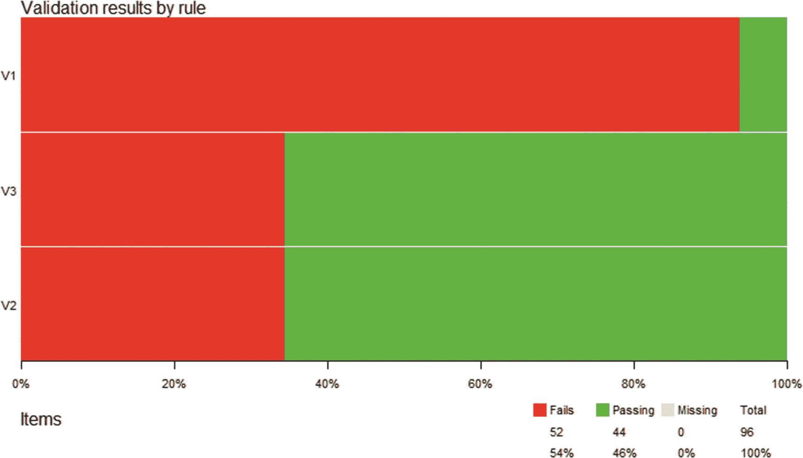

# 19. 数据验证

花五分钟做数据科学后，每个人都知道数据准备（包括验证）是任何分析中最耗时的步骤。已经开发了几个清理包，包括`janitor`和`validate`。图 19-1 来自`validate`包，展示了三个`mtcars`变量的便捷图形。它符合数据科学的黄金法则：简单、快速、方便。

在这段代码中，“大于 250”的马力标准变成了验证规则`V1`。该数据集中的大多数汽车都未通过该测试，因此`V1`图形几乎全是红色。同样的逻辑适用于`V2`和`V3`。这是一种根据通过/失败或是否标准来查看许多变量的绝佳方式。

```
if (!require("validate")) install.packages("validate")
big.engines <- validator(horsepower > 250, cyl >5, disp < 300)
big.engines
## object of class 'validator'
## Rules:
## V1: horsepower > 250
## V2: cyl > 5
## V3: disp < 300
summary(big.engines)
##   name items passes fails nNA error warning   expr
## 1   V1    32      0    32   0 FALSE    FALSE   horsepower > 250
## 2   V2    32     21    11   0 FALSE   FALSE    cyl > 5
## 3   V3    32     21    11   0 FALSE   FALSE disp < 300
plot(big.engines)
```



图 19-1  
以“通过”或“失败”的视角查看三个`mtcars`变量

下面的示例改编自`validate`的 CRAN 手册^(⁷⁹)，用于检查所列年份是否为四位数。第一个年份只有三位数，因此失败了（返回`FALSE`）。

```
df <- data.frame(id = 11001:11003, year = c("218","2019","2020"), value = 1:3)
rule <- validator(field_length(year, 4), field_length(id, 5))
out <- confront(df, rule)
out <- as.data.frame(out)
out
##   name value            expression
## 1   V1 FALSE field_length(year, 4)
## 2   V1  TRUE field_length(year, 4)
## 3   V1  TRUE field_length(year, 4)
## 4   V2  TRUE   field_length(id, 5)
## 5   V2  TRUE   field_length(id, 5)
## 6   V2  TRUE   field_length(id, 5)
```

脚注 1

