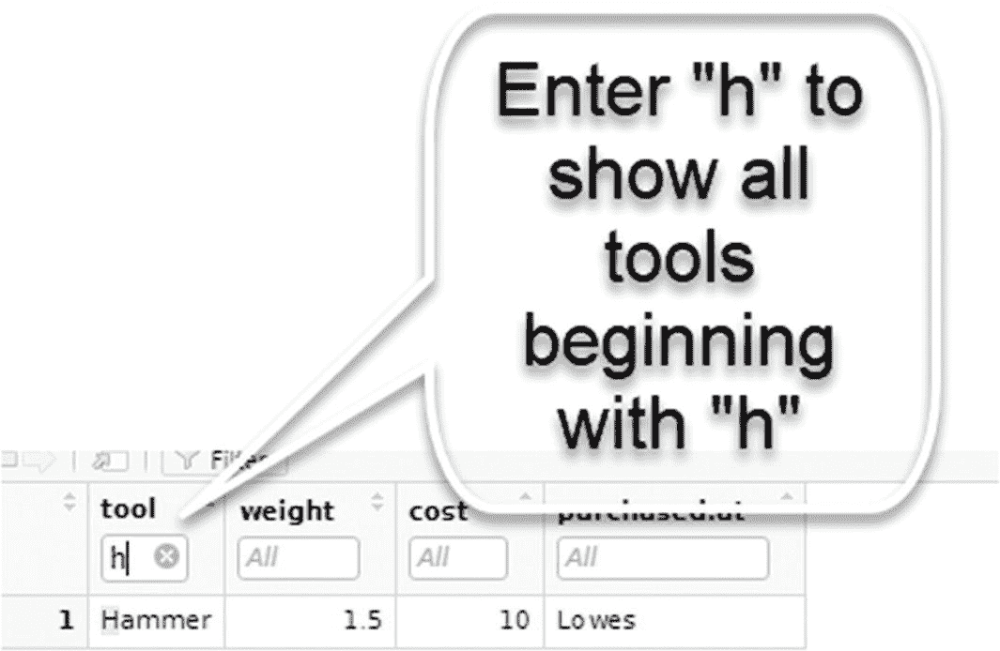
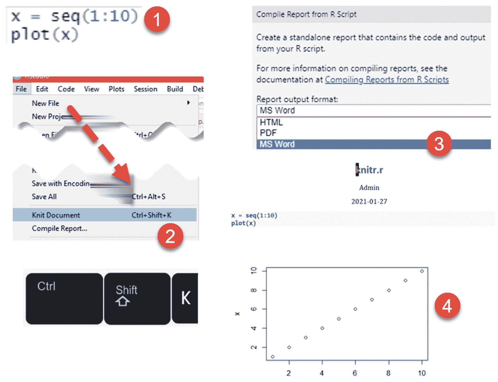
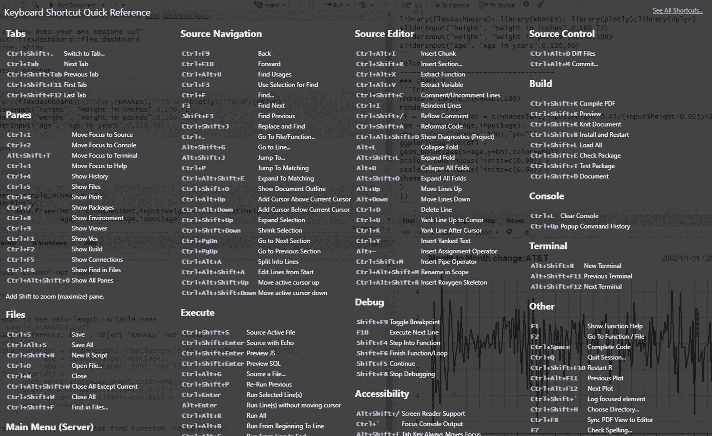
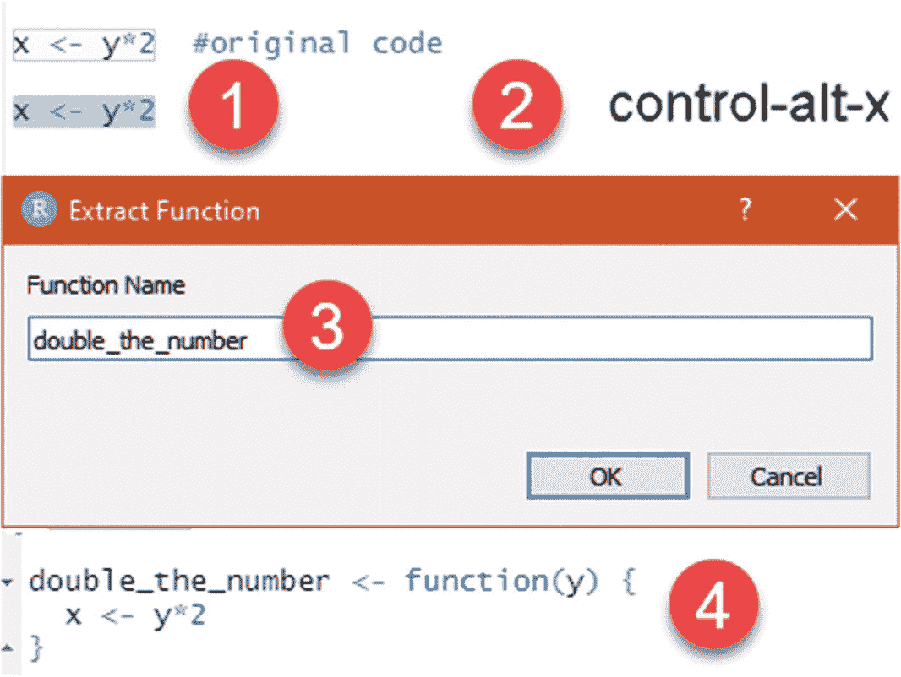

# 20. 快捷方式与杂项

## 20.1 RStudio

你当然可以用记事本或基础 R 来编写脚本，这就好比狗可以用后腿走路到达某个地方。虽然可行，但效果不佳。RStudio 正是为高效、有效且对初学者友好的脚本编码而构建的。

一些简单的快捷方式：

*   `Ctrl-Shift-R` 创建一个章节标签，这实际上只是一个格式统一的注释。除非你输入大量文字，否则注释的长度总是固定的。如果在代码中始终如一地使用它，它就能成为新代码块的熟悉路标。它没有执行功能，但确实能提高代码的可读性。示例如下：



图 20-1  
在 RStudio 中进行筛选

*   使用`View(x)`查看结构化的（类似 Excel 的）视图。虽然你不能通过`View`更改数据，但可以轻松根据需要查找、筛选和排序列。图 20-1 展示了一个`View`示例，其中在工具列筛选了“h”。

```
# 我使用 Ctrl-Shift-R 键输入了这个章节标签 ----------
```



图 20-4  
使用`knitr`创建 MS Word 文档。包含代码、运行时消息和输出

*   创建 Microsoft Word、PDF 或 html 文档，将代码、运行时消息和结果完全整合在一个文档中。R Markdown 和`knitr`包超出了本书的范围（尽管它们很酷！），但只需按`Ctrl-Shift-K`，你就能创建一个漂亮且可复现的文档。图 20-4 展示了一个简单两行脚本的处理过程。



图 20-3  
使用`Alt-Shift-K`查看大部分 RStudio 快捷方式列表

*   使用快捷方式访问众多有用的调试和导航功能。前往帮助，然后选择键盘快捷键帮助（`Alt-Shift-K`）。图 20-3 是输入快捷键后快捷方式屏幕的截图。此显示是半透明的，按`Escape`键会消失。在右上角，点击“查看所有快捷键”（See All Shortcuts）即可获得更易读的所有快捷键列表。



图 20-2  
使用`Ctrl-Alt-X`快捷键基于现有代码创建新函数

*   从现有代码创建函数。突出显示代码并按`Ctrl-Alt-X`。完成转换后，务必运行该函数（突出显示该函数并按`Ctrl-Enter`），以便将其载入内存，随时可以调用。图 20-2 展示了创建一个简单函数（将数值加倍）的过程。

动态创建用于测试的`data.frame`：

```
test.df <- data.frame( tool = c("Hammer", "Screwdriver","Saw"),
weight = c(1.5,0.5,1.2), cost = c(10,5, 12),
purchased.at = c("Lowes","ACE", "Home Depot"))
```

## 20.2 工具

### 20.2.1 移除 Windows 文件的只读属性

```
setwd("h:\\t")  #你的工作目录设置可能有所不同
system("attrib -r test.file.docx")
## [1] 0
# 返回值 0 表示操作成功
```

### 20.2.2 重命名 Windows 文件

