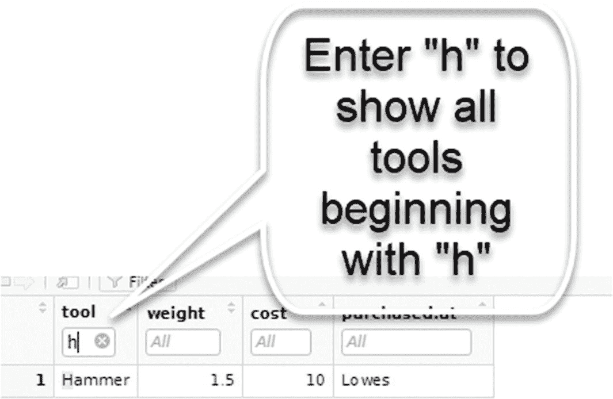
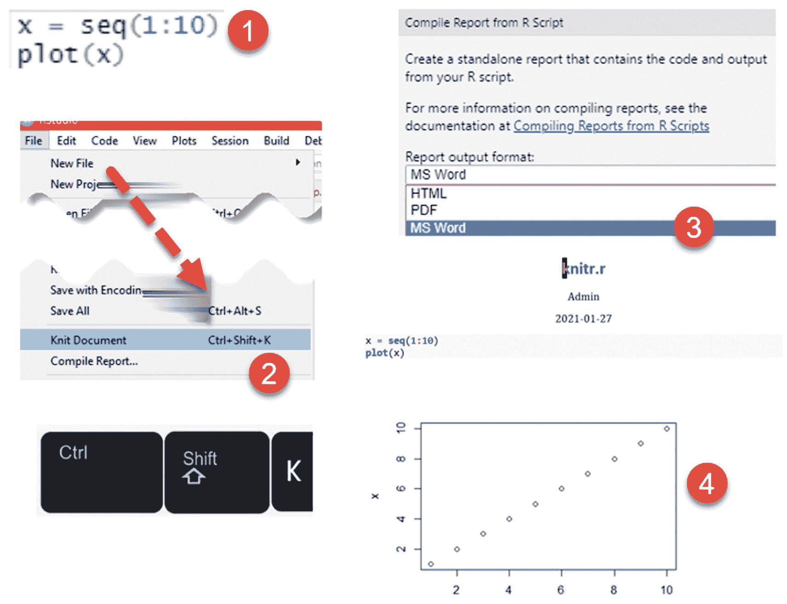
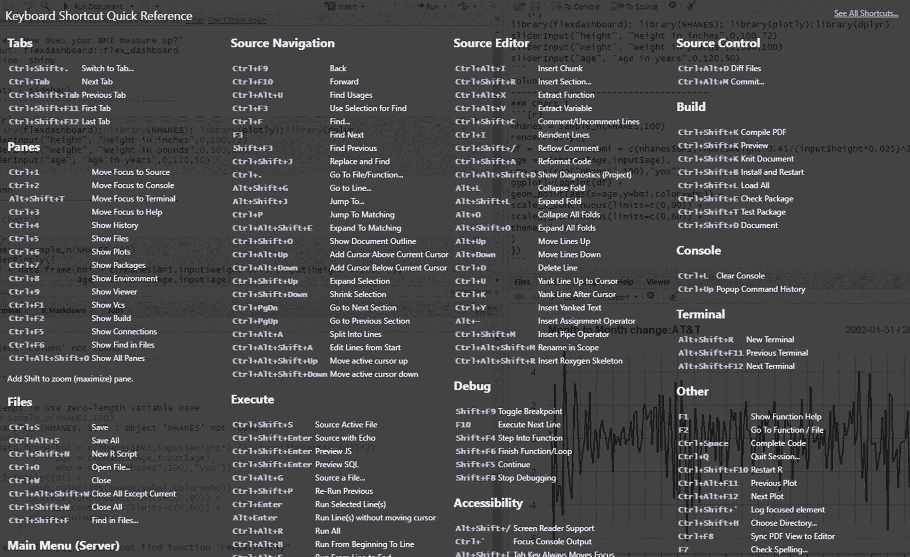
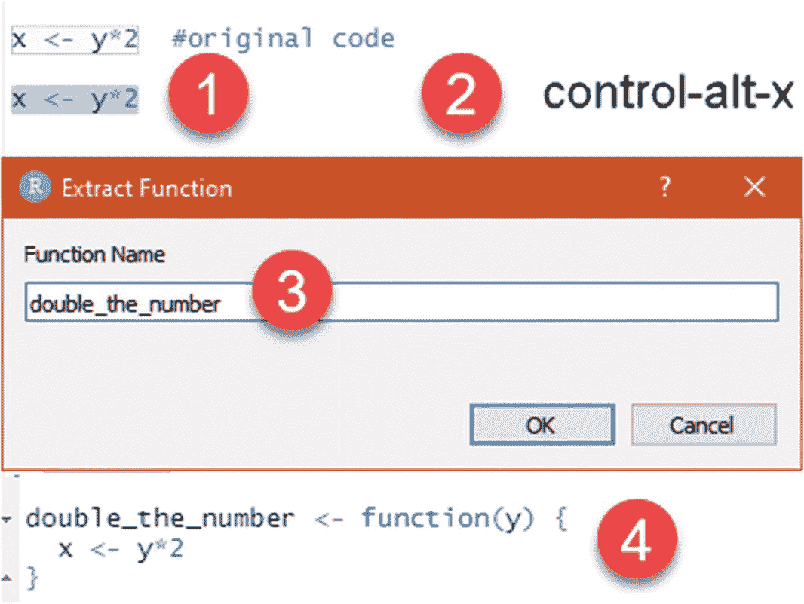

# 20. 快捷方式与杂项

## 20.1 RStudio

你当然可以用记事本或基础 R 来编写脚本，这就好比狗可以用后腿走路到达某个地方。虽然可行，但效果不佳。RStudio 正是为高效、有效且对初学者友好的脚本编码而构建的。

一些简单的快捷方式：
*   使用 `Ctrl-Shift-R` 创建一个章节标签，这实际上只是一个格式统一的注释。除非你输入大量文字，否则注释的长度总是固定的。如果在代码中始终如一地使用它，它就能成为新代码块的熟悉路标。它没有执行功能，但确实能提高代码的可读性。示例如下：

图 20-1  
在 RStudio 中进行筛选
*   使用 `View(x)` 查看结构化的（类似 Excel 的）视图。虽然你不能通过 `View` 更改数据，但可以轻松根据需要查找、筛选和排序列。图 20-1 展示了一个 `View` 示例，其中在工具列筛选了“h”。

```
# 我使用 Ctrl-Shift-R 键输入了这个章节标签 ----------
```


图 20-4  
使用 `knitr` 创建 MS Word 文档。包含代码、运行时消息和输出
*   创建 Microsoft Word、PDF 或 html 文档，将代码、运行时消息和结果完全整合在一个文档中。R Markdown 和 `knitr` 包超出了本书的范围（尽管它们很酷！），但只需按 `Ctrl-Shift-K`，你就能创建一个漂亮且可复现的文档。图 20-4 展示了一个简单两行脚本的处理过程。

图 20-3  
使用 `Alt-Shift-K` 查看大部分 RStudio 快捷方式列表
*   使用快捷方式访问众多有用的调试和导航功能。前往帮助，然后选择键盘快捷键帮助（`Alt-Shift-K`）。图 20-3 是输入快捷键后快捷方式屏幕的截图。此显示是半透明的，按 `Escape` 键会消失。在右上角，点击“查看所有快捷键”（See All Shortcuts）即可获得更易读的所有快捷键列表。

图 20-2  
使用 `Ctrl-Alt-X` 快捷键基于现有代码创建新函数
*   从现有代码创建函数。突出显示代码并按 `Ctrl-Alt-X`。完成转换后，务必运行该函数（突出显示该函数并按 `Ctrl-Enter`），以便将其载入内存，随时可以调用。图 20-2 展示了创建一个简单函数（将数值加倍）的过程。

动态创建用于测试的 `data.frame`：

```
test.df <- data.frame( tool = c("Hammer", "Screwdriver","Saw"),
weight = c(1.5,0.5,1.2), cost = c(10,5, 12),
purchased.at = c("Lowes","ACE", "Home Depot"))
```

## 20.2 工具

### 20.2.1 移除 Windows 文件的只读属性

```
setwd("h:\\t")  #你的工作目录设置可能有所不同
system("attrib -r test.file.docx")
## [1] 0
# 返回值 0 表示操作成功
```

### 20.2.2 重命名 Windows 文件

# R 脚本调试指南

假设`my.word.docx`存在于工作目录中；注意重命名的文件名中随机添加的数字：

```
from.file <- c("my.word.docx")
another.name <- sample(seq(1:99999),size = 1)
another.name <- paste("new.word.doc.name",as.character(another.name), ".docx")
to.file <- another.name; file.rename(from.file, to.file);to.file
## Warning in file.rename(from.file, to.file): cannot rename file 'my.word.docx'
## to 'new.word.doc.name 71317 .docx', reason 'The system cannot find the file
## specified'
## [1] FALSE
## [1] "new.word.doc.name 71317 .docx"
```

## 20.3 调试 R 代码

R 的错误信息有时会被取一些令人沮丧的名字，比如晦涩、迟钝、令人反感，甚至难闻。此处无意不敬，但当数小时过去问题仍未解决时，我能理解这种感受。

幸运的是，情况已有改善。`tidyverse` 包及其他一些包会提出有意义的问题，例如“您是不是指……”，并常常提供有用的建议。R 是开源软件，经过众多贡献者和大量包的长期发展，其各组件间的互操作性挑战导致了许多不易理解的错误信息。例如，如本书前面所述，如果您在加载 `tidyverse` 之后加载 `Zeilig` 包，那么 `select` 命令将使用 `Zeilig` 的版本，而非 `tidyverse` 的版本。您会收到一条令您无比沮丧的错误信息，因为您很可能已经按照 `tidyverse`/`dplyr`（而非 `Zeilig`）的要求正确地编写了 `select` 命令。

以下是您在开发 R 脚本时可能遇到的一些常见编码错误：

- 使用单引号（`'`）代替双引号（`"`）。
- 在赋值运算符的字符“`< -`”之间留有空格，而非正确的“`<-`”。
- 变量类别错误。例如，您的日期列可能是字符型而非 `POSIX` 型。
- 来自前一个会话的不需要的对象残留在内存中。为确保程序全新启动，请输入命令`rm(list = ls())`。
- 在需要数值型变量的地方使用了分类变量，反之亦然。
- 对缺失数据（`NA`）处理不当。

RStudio 提供了三种调试工具：

- RStudio 的错误检查器和`traceback()`函数，它们会列出导致错误的函数调用序列。
- RStudio 的“使用调试重新运行”工具和`options(error = browser)`选项，它们会在错误发生处打开一个交互式会话。
- RStudio 的断点和`browser()`函数，它们会在代码中的任意位置打开一个交互式会话。

如果您使用这些工具，并结合使用有意义的名称和清晰结构编写的代码，应该能够解决大多数错误。如果您的数据量庞大，请避免使用全部数据来开发代码。先使用一个子集。此外，如果您的代码用于查找一个罕见条件，请通过故意插入一个“命中”来测试，以确保它能正常工作。否则，您将无法知道是代码有错误，还是您的数据确实没有符合该条件的记录。

我经常使用的另一种技术是，从 RStudio 日志错误信息中复制粘贴到 Google 搜索（精确复制，不要改写）。令人惊讶的是，即使来自不太知名的包的错误信息也会在论坛中被讨论。大多数情况下，您能找到自己的错误或至少是某种变通方法。