# 2. 使用 D3 工作

在本章的各个部分，以及随着你在后续章节中更深入地研究该库的各个方面，你将能够体会到 D3 拥有独特且创新的结构。首先，它不使用 jQuery，但复制了数据可视化所需的所有功能。而在 jqPlot 和 Highcharts 库中，图表组件已经创建好，用户只需通过 options 对象调整其属性即可，D3 的方法则几乎完全相反。

D3 库允许你从最基本的图形元素（如圆形、线条、正方形等）开始构建任何表现形式。当然，这种方法大大增加了实现图表的复杂性，但同时也允许你开发全新的图形表现形式，无需遵循其他图形库提供的预设模式。

因此，在本章中，你将熟悉构成此库的基本概念。你还将了解如何操作各种文档对象模型（DOM）元素，特别是创建可缩放矢量图形（SVG）元素，这些元素是图形表示的基本构建块。

本章以对 SVG 元素的变换和过渡的简要介绍作为结尾。

我们将从介绍这个精彩的库开始。

## FireBug：调试 D3 代码

在开始一些实际示例之前，我想提醒你使用 FireBug 进行调试。至少，请确保获得一个良好的 JavaScript 调试工具，它允许你查看正在处理的网页的 DOM 树（请参阅第 1 章中的“FireBug 和 DevTool”部分）。

使用调试工具对于 D3 库至关重要，因为与你见过的其他库不同，它并非由预建模对象构成。使用 D3，你需要从头开始，逐个实现所有图表元素。因此，熟悉开发的人会意识到，选择一个好的调试工具对于解决出现的任何问题至关重要。

使用 FireBug，你可以编辑、调试和监控 CSS、SVG 和 HTML。你可以实时更改它们的值并查看效果。它还提供了一个控制台，你可以在其中读取日志，该日志被适当地放置在 JavaScript 代码中，以监控所用变量的内容。这可以通过调用 console 对象的 `log()` 函数并将感兴趣的变量作为参数传递来实现：

```
console.log (variable);
```

也可以添加一些参考文本：

```
console.log ("这是值：");
```

你会发现，在使用 D3 时，FireBug 对于检查 JavaScript 在 DOM 中生成的 SVG 元素的动态结构至关重要。

### 介绍 D3

D3 是一个允许直接检查和操作 DOM 的 JavaScript 库，但专门用于数据可视化。它在这方面做得非常出色。事实上，D3 这个名称源自“数据驱动文档”（Data-Driven Documents）。D3 由 Mike Bostock 开发，他是 Protovis 库的创建者，而 D3 旨在取代 Protovis。

事实证明，这个库非常通用且强大，这要归功于它所基于的技术：JavaScript、SVG 和 CSS。D3 将强大的可视化组件与数据驱动的 DOM 操作方法相结合。通过这样做，D3 充分利用了现代浏览器的能力。

D3 允许你将任意数据绑定到 DOM。它的强大之处在于能够影响文档的多种转换。例如，一组数据可以转换为交互式 SVG 图形结构，如图表。

如果你熟悉其他专注于网页图表表示的 JavaScript 框架（例如 jqPlot），你就会知道它们的优势在于提供结构化的解决方案，你可以通过设置选项来操作这些解决方案。相反，D3 的优势恰恰相反。它提供了构建块和工具来组装基于 SVG 的结构。这种方法的结果是不断开发新的结构，这些结构图形丰富，并且对各种交互和动画开放。对于那些希望为现有框架未涵盖的方面开发新的图形解决方案的人来说，D3 是完美的工具。

与其他 JavaScript 图形库不同，D3 不使用 jQuery 库来处理 DOM 元素，但它包含许多类似的概念，包括方法链范式和选择器。它提供了一个类似 jQuery 的 DOM 接口，这意味着你不需要详细了解 SVG 的所有功能。为了处理 D3 代码，你需要能够使用对象和函数，并理解 SVG 和 CSS 的基础知识，这些知识被广泛使用。掌握所有这些知识所付出的努力，将因你能创建出令人惊叹的可视化效果而得到回报。

SVG 为图形提供了构建块；它允许你绘制所有基本形状图元，例如线条、矩形和圆形，以及文本。它还允许你使用路径构建复杂的形状。

### 从一个空白 HTML 页面开始

现在是时候实践刚刚概述的概念了。首先，从一个空白页面开始，如清单 2-1 所示。这将是所有 D3 示例的起点。

**清单 2-1.** `Ch2_01a.html`

```
<!DOCTYPE html>
<html>
<head>
<meta charset="utf-8">
<script src="http://d3js.org/d3.v3.js"></script>
<style>
// CSS 样式写在这里
</style>
</head>
<body>
<!-- HTML 元素写在这里 -->
<script type="text/javascript">
// D3 代码写在这里
</script>
</body>
</html>
```

虽然乍一看，你只看到一个简单的 HTML 空白页面，但在使用 D3 时，你需要采取一些小的措施。最简单、最明显的措施是包含 D3 库：

```
<script src="../src/d3.v3.js"></script>
```

或者，如果你更喜欢使用内容分发网络（CDN）服务：

```
<script src="http://d3js.org/d3.v3.js"></script>
```

在输入远程 D3 库的 URL 时，请确保该网站始终包含最新版本。另一个不太明显的措施是在页面的 `<head>` 中添加：

```
<meta charset="utf-8">
```

如果你不指定这一行，你很快就会发现自己添加的 D3 代码无法运行。最后但同样重要的是，添加代码各个部分的位置非常重要。建议将所有 D3 的 JavaScript 代码放在 `<body>` 部分的末尾，在所有 HTML 元素之后。


### 使用选择集与操作符

要开始使用 D3，首先需要熟悉选择集（selections）的概念。处理选择集涉及三个基本对象：

* 选择集（Selections）
* 选择器（Selectors）
* 操作符（Operators）

选择集是从当前文档中提取的一组节点元素数组。为了提取特定的元素集合（选择集），你需要使用选择器。这些选择器是与文档树结构中元素匹配的模式。获得选择集后，你可能希望对其执行某些操作，这时就需要使用操作符。操作的结果会生成一个新的选择集，因此可以继续应用另一个操作符，以此类推。

选择器和操作符由 W3C（万维网联盟）API 定义，并得到所有现代浏览器的支持。通常，你会在 HTML 文档上进行操作，因此你处理的是 HTML 元素的选择集。

#### 选择集与选择器

为了从文档中提取选择集，D3 提供了两个方法：

* `select`
* `selectAll`

`d3.select("selector")` 选择与选择器匹配的第一个元素，返回一个仅包含一个元素的选择集。

`d3.selectAll("selector")` 则选择与选择器匹配的所有元素，返回包含所有这些元素的选择集。

要理解这些概念，最好的方法是通过一些简单示例循序渐进地学习。从刚才描述的 HTML 页面开始，添加两个包含文本的段落，然后用 D3 进行选择（参见清单 2-2）。

**清单 2-2.** `Ch2_01a.html`

```
<body>
<p>第一段</p>
<p>第二段</p>
<script type="text/javascript">
var selection = d3.select("p");
console.log(selection);
</script>
</body>
```

`d3.select` 是顶层操作符；`"p"` 是选择器；`selection` 是该操作符的返回值，你将其赋值给一个变量。通过这条 D3 命令，你希望选择网页中的第一个 `<p>` 元素。使用 `log` 函数，你可以在 FireBug 中看到该选择集，如图 2-1 所示。

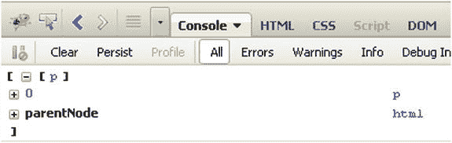

**图 2-1.** FireBug 控制台让你能够查看选择集的内容

由于你使用了 `select()` 方法，你得到的选择集只包含一个元素，尽管网页中有两个。如果你想选择两者，则使用 `selectAll()`，如清单 2-3 所示。

**清单 2-3.** `Ch2_01b.html`

```
<script type="text/javascript">
var selection = d3.selectAll("p");
console.log(selection);
</script>
```

图 2-2 显示了这两个元素。

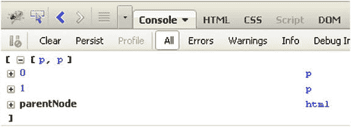

**图 2-2.** FireBug 显示网页中所有 `<p>` 元素的选择集

现在你有了一个包含两个元素的选择集。jQuery 和 D3 通过选择集概念引入的重大创新在于，不再需要 `for` 循环。你无需编写递归函数来修改元素，而是可以一次性对整个选择集进行操作。

#### 操作符

一旦学会了如何创建选择集，就该应用操作符了。

操作符是一种应用于选择集（或通常应用于一组元素）的方法，它专门“执行”某种操作。例如，它可以获取或设置选择集中元素的属性，或者以某种方式作用于它们的内容。例如，你可能想用新文本替换现有文本。为此，你可以使用 `text()` 操作符，如清单 2-4 所示。

**清单 2-4.** `Ch2_02.html`

```
<body>
<p>第一段</p>
<p>第二段</p>
<script type="text/javascript">
var selection = d3.selectAll("p");
selection.text("我们添加这段新文本");
</script>
</body>
```

现在页面中重复显示了两次相同的文本，而之前是两个不同的段落（见图 2-3）。

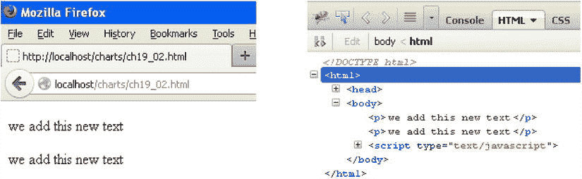

**图 2-3.** 两个 `<p>` 元素中包含的文本已在左侧的浏览器中被替换，并在右侧的 FireBug 中显示

你定义了变量 `selection`，然后将操作符应用于该变量。但还有另一种写法：你可以使用方法链功能，尤其是在对同一个选择集应用多个操作符时。

```
d3.selectAll("p").text("我们添加这段新文本");
```

你已经看到，通过向 `text()` 操作符传递一个参数，你将替换现有文本。因此，这个函数的作用类似于 `setText("新文本")`。但你并不总是想要这样。如果你不传递任何参数，函数的行为会有所不同。它将返回当前已有的文本值。这对于进一步处理，或者将该字符串值赋值给变量或数组非常有用。因此，不带参数时，它相当于 `getText()`。

```
var text = d3.select("p").text();
console.log(text);
```

`text` 变量包含字符串 `"第一段"`（见图 2-4）。

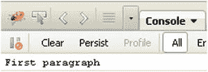

**图 2-4.** FireBug 控制台显示选择集中包含的文本

对于你想要操作的每一种对象，都有相应的操作符。这些操作符可以设置以下内容：

* 属性（Attributes）
* 样式（Styles）
* 特性（Properties）
* HTML
* 文本（Text）

你刚刚看到了 `text()` 操作符的实际应用。接下来，你将看到其他一些操作符。

> **注意**  
> 如果你想了解更多关于操作符的信息，我建议你访问 D3 库的 API 参考文档，链接如下：[`https://github.com/mbostock/d3/wiki/API-Reference`](https://github.com/mbostock/d3/wiki/API-Reference)。

例如，能够更改 CSS 样式是很有用的，你可以通过 `style()` 操作符来实现。清单 2-5 使用 `text()` 替换了现有文本，然后通过将 `style()` 操作符添加到方法链中，将其样式修改为红色字体。

**清单 2-5.** `Ch2_03.html`

```
<body>
<p>现有的黑色文本</p>
<script type="text/javascript">
d3.selectAll("p").style('color','red').text("新的红色文本");
</script>
</body>
```

图 2-5 显示了左侧的原始文本和右侧应用了新样式的文本。

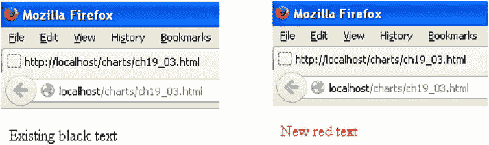

**图 2-5.** 原始文本被新的红色文本替换，这是对选择集应用链式方法的结果

另一个操作符 `attr()` 作用于元素的属性层面。这个操作符将在你创建新的 SVG 元素时使用；事实上，它允许你在创建标签时定义属性，然后再将其插入到网页中。下面你可以看到它如何修改现有属性。在清单 2-6 中，你正在更改标题的对齐方式，使其显示在页面中间（见图 2-6）。

**清单 2-6.** `ch2_04.html`

```
<body>
<h1>标题</h1>
<script type="text/javascript">
d3.select('h1').attr('align','center');
</script>
</body>
```

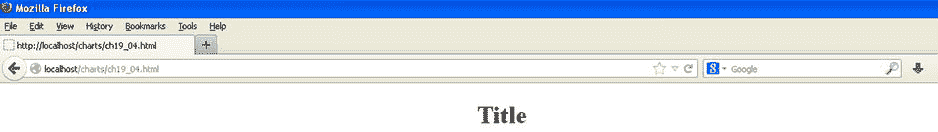

**图 2-6.** 使用 D3 库可以动态地向网页添加标题

### 创建新元素

现在你已经了解了如何在元素层面进行操作，以及如何修改属性和内容，是时候看看如何创建新元素了。为此，D3 提供了一系列操作符（[`https://github.com/mbostock/d3/wiki/API-Reference`](https://github.com/mbostock/d3/wiki/API-Reference)），其中最常用的有：

* `html()`
* `append()`
* `insert()`


#### `html()` 方法

本节展示了 `html()` 方法的运作方式。你总是从一个选择集开始，然后应用该操作符在内部添加一个元素。例如，你选择一个特定的标签作为容器，然后写入一个字符串作为参数传递。该字符串随后成为该标签的内容（参见清单 2-7）。

清单 2-7. `Ch2_05.html`

```html
<body>
<p>一个段落</p>
<script type="text/javascript">
d3.select('p').html("<h1>新段落</h1>");
</script>
</body>
```

这里，你首先使用 `select()` 选择 `<p>` 标签，然后使用 `html()` 将其内容替换为一个新元素 `<h1>`。图 2-7 左侧显示了原始文本，右侧显示了新格式化的版本。

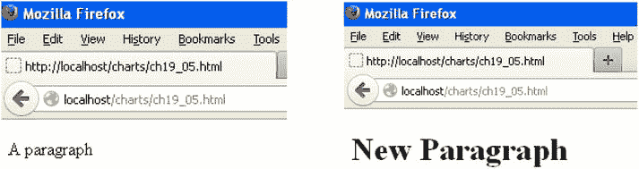

图 2-7. 段落元素 `<p>` 中的文本被替换为标题元素 `<h>`

你可以使用 FireBug 更清楚地看到这一变化（参见图 2-8）。

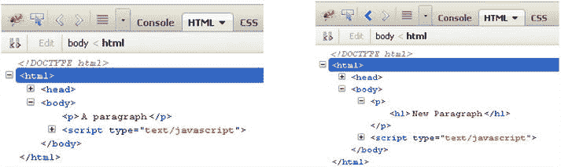

图 2-8. FireBug 清晰地显示了插入标题元素（右侧）以替换段落元素（左侧）内容的过程

实际上，`html()` 函数会将选择集的内容替换为作为参数传递的 HTML 代码。正如其名称所示，该函数允许你在选择集的元素内动态写入 HTML 代码。

#### `append()` 方法

另一种常用的添加元素的方法是 `append()`。

回想一下，当你使用 `html()` 操作符时，所选标签的内容（如果有的话）会被替换为作为参数传递的新内容。而 `append()` 操作符则是将作为参数传递的新元素添加到所选标签包含的所有现有元素的末尾。新创建元素的内容必须通过方法链添加，如果只是字符串则使用 `text()`，如果是进一步的元素则使用 `append()`、`html()` 或 `insert()`。

为了理解最后这一点，在页面中添加一个包含一些水果名称项的无序列表 `<ul>`（参见图 2-9）。

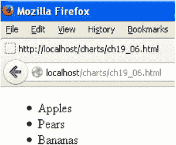

图 2-9. 包含三种水果的无序列表

假设你现在想向此列表中添加“橙子”。为此，你必须选择无序列表标签 `<ul>`，然后使用 `append()` 添加一个列表项标签 `<li>`。但 `append()` 只创建标签，因此要在其中插入字符串 `"Oranges"`，你需要将 `text()` 操作符添加到方法链中（参见清单 2-8）。

清单 2-8. `Ch2_06.html`

```html
<body>
<ul>
<li>苹果</li>
<li>梨</li>
<li>香蕉</li>
</ul>
<script type="text/javascript">
d3.select('ul').append('li').text("橙子");
</script>
</body>
```

图 2-10 显示了添加元素后的列表。

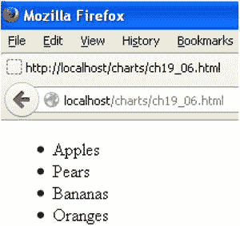

图 2-10. 使用 `append()` 操作符，你将“橙子”项添加到了列表末尾

图 2-11 在 FireBug 中显示了这一点。

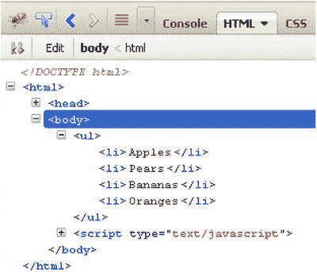

图 2-11. FireBug 显示了添加了 `<li>` 元素后的 HTML 结构

在这个例子中，你使用了简单的文本作为添加到列表中的新元素的内容，但 `append()` 操作符可以做得更多。事实上，如前所述，一个元素的内容可以是另一个元素。这允许你通过利用链式方法创建一整个 HTML 元素树。实际上，由 `append()` 操作符创建的新元素的内容，又可以通过另一个操作符（例如另一个 `append()` 操作符）来创建。请看清单 2-9。这是一个简单的示例，将帮助你更好地理解这个概念。

清单 2-9. `Ch2_06b.html`

```html
<body>
<ul>
<li>苹果</li>
<li>梨</li>
<li>香蕉</li>
</ul>
<script type="text/javascript">
d3.select('ul').append('li').text("柑橘类水果");
d3.select('ul').append('ul').append('li').text("橙子");
d3.select('ul').select('ul').append('li').text("柠檬");
d3.select('ul').select('ul').append('li').text("葡萄柚");
</script>
</body>
```

这次，你想创建一个水果子类别“柑橘类水果”，我们将把橙子、柠檬和葡萄柚项分配给它。为此，你需要添加一个新的列表项 `<li>`，其内容为字符串 `"柑橘类水果"`。这与前一个示例的工作方式相同，在 `append()` 操作符之后直接连接 `text()` 操作符。然后你需要创建一个新的列表项。这次，它的内容是一个无序列表。因此，你需要连接两个 `append()` 操作符，以创建一个嵌套在无序列表 `<ul>` 元素中的列表项 `<li>` 元素。然后，你可以再次使用 `append()` 操作符向嵌套的无序列表添加另外两个新元素。

图 2-12 在浏览器中显示了新的嵌套柑橘类水果列表，以及在 FireBug 中生成它的 HTML 结构。

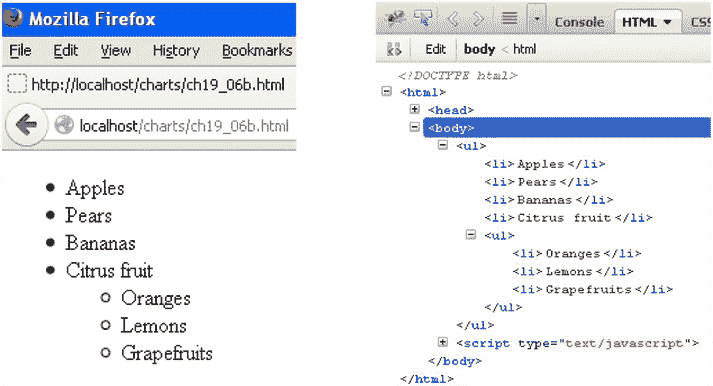

图 2-12. FireBug 在左侧浏览器和右侧 FireBug 中显示了带有嵌套无序列表的 HTML 结构


#### `insert()` 方法

最后一个操作符 `insert()` 具有特殊的行为。如果只使用一个参数，它的行为与 `append()` 相同。通常，它使用两个参数：第一个参数指定要添加的标签，第二个参数指定要插入位置的目标标签。实际上，在前面的水果列表示例中，将 `append()` 替换为 `insert()`，你会得到不同的结果，如图 2-13 所示（左侧为原始列表，右侧为添加了橙子的新列表）。

```
d3.select('ul').insert('li','li').text("Oranges");
```

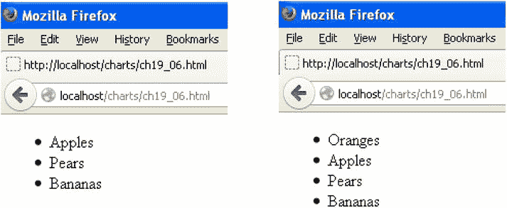

图 2-13. 使用 `insert()` 操作符，可以将橙子项插入到列表顶部

现在新元素位于无序列表的顶部。但如果你想将新项目插入到第一个位置以外的其他位置呢？你可以使用 CSS 选择器 `nth-child(i)` 来实现，其中 `i` 是元素的索引。因此，如果使用选择器 `li:nth-child(i)`，你将选中第 i 个 `<li>` 元素。所以，如果你想在第二个和第三个元素之间插入一个元素，需要在 `insert()` 操作符中调用第三个 `<li>` 元素（请记住，此操作符会将新元素插入到被调用元素之前）：

```
d3.select('ul').insert('li','li:nth-child(2)').text("Oranges");
```

这将在列表的第二个和第三个项目之间插入新的橙子项，如图 2-14 所示（左侧为浏览器视图，右侧为 FireBug 视图）。

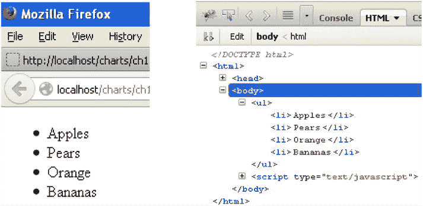

图 2-14. 使用 CSS 选择器 `nth-child`，可以将橙子项添加到列表中的任意位置

#### 深入理解 `HTML()`、`APPEND()` 和 `INSERT()` 操作符

有时，理解这三个操作符的功能并不容易。考虑以下示意性的 HTML 结构，其中包含一个通用父标签及其内部的若干子标签：

```
<parent>
<child></child>
<child></child>
<child></child>
</parent>
```

以下简单的示意图展示了每个操作符的具体作用，以便更好地理解它们的不同行为。如果你想充分利用 D3 库的全部潜力，透彻理解这三个操作符的功能至关重要。

当你需要在 HTML 结构中同一层级的其他标签列表末尾创建一个新标签元素时，请使用 `append()` 操作符。图 2-15 展示了该操作符的行为。

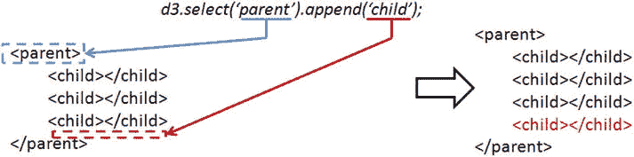

图 2-15. `append()` 操作符在列表末尾添加一个子标签

当你需要在 HTML 结构中同一层级的其他标签列表开头创建一个新标签元素时，请使用 `insert()` 操作符。图 2-16 展示了该操作符的行为。

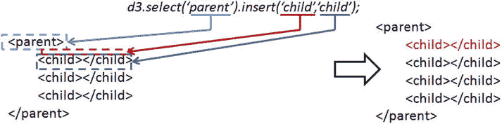

图 2-16. `insert()` 操作符在作为第二个参数传入的子标签之前添加一个子标签

当你需要在 HTML 结构中同一层级的其他标签列表中的特定位置创建一个新标签元素时，请使用 `insert()` 操作符。图 2-17 展示了该操作符的行为。

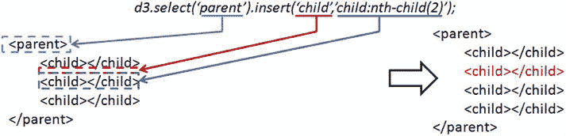

图 2-17. 你可以使用 CSS 选择器 `nth-child()` 将列表中的某个子标签作为参数传入

当你需要替换 HTML 结构中同一层级的另一个标签或一组标签来创建新标签元素时，请使用 `html()` 操作符。图 2-18 展示了该操作符的行为。

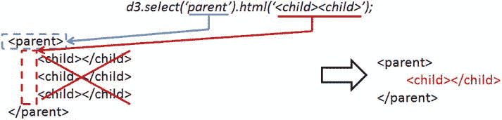

图 2-18. `html()` 操作符用传入的参数标签替换父标签的内容


### 向元素插入数据

你刚刚了解了如何在文档中创建新元素。但如何将数据放入其中呢？这就需要用到 `data()` 运算符，它通过传入一个数据数组作为参数来实现。

对于选择集中的每个元素，都会按照序列的相同顺序在数组中分配一个值。这种对应关系通过一个通用函数来指示，该函数将 `d` 和 `i` 作为参数传入。

```
function(d,i) {
  // 包含 d 和 i 的代码
  // 返回对 d 的某种处理结果；
}
```

该函数会执行与列表中元素数量相同的次数：`i` 是序列的索引，`d` 是数据数组中与该索引对应的值。很多时候，你并不关心 `i` 的值，而只使用 `d`。

对于熟悉 `for` 循环的人来说，这就像你写了以下代码：

```
for(i=0; i < selection.length; i++){
  d = input_array[i];
  // 包含 d 和 i 的代码
  //return output_array[i];
}
```

要理解整个过程，最好的方法就是提供一个示例。定义一个包含三种水果名称的数组。你将创建一个包含三个空列表项的无序列表，并使用 `selectAll()` 创建这些列表项的选择集。选择集中的项目数量必须与数组中的值数量相对应；否则，多余的值将不会被处理。你将数组与选择集关联起来，然后应用 `function(d)`，在列表内写入每个项目的值（参见清单 2-10）。

**清单 2-10.** `Ch2_07.html`

```
<body>
  <ul>
    <li></li>
    <li></li>
    <li></li>
  </ul>
  <script type="text/javascript">
    var fruits = ['Apples', 'Pears', 'Bananas'];
    d3.selectAll('li').data(fruits).text( function(d){
      return d;
    });
  </script>
</body>
```

图 2-19 左侧显示了浏览器中的结果，右侧显示了 FireBug 中的结果。在 FireBug 中，你可以看到每个列表项 `<li>` 内容所使用的 HTML 结构，这些内容在你编写清单 2-10 时是不存在的。这些添加的文本项就是 `fruits` 数组的值。

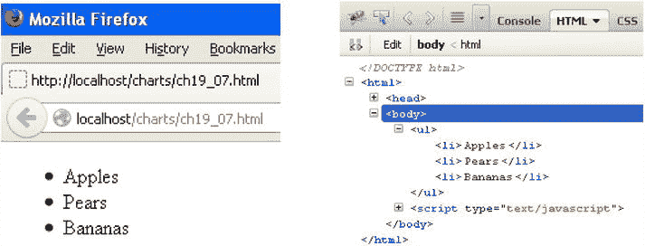

**图 2-19.** 可以用数组值填充 HTML 元素的内容

`data()` 运算符不仅将数据绑定到元素，它还计算选择集中的元素与提供的数据之间的连接。只要数组的长度等于选择集中元素的数量，一切都会顺利进行。但如果不是这样呢？如果你有一个包含三个元素的选择集，并提供了一个包含五个值的数组，那么多余的两个值将存储在一个名为“enter”的特殊选择集中。这个选择集可以通过对 `data` 调用的返回值使用 `enter()` 运算符来访问。你可以在清单 2-11 的示例中看到这一点。

**清单 2-11.** `Ch2_08.html`

```
<body>
  <ul>
    <li></li>
    <li></li>
    <li></li>
  </ul>
  <script type="text/javascript">
    var fruits = ['Apples', 'Pears', 'Bananas', 'Oranges', 'Strawberries'];
    var list = d3.select('ul');
    var fruits = list.selectAll('li').data(fruits);
    fruits.enter().append('li').text( function(d){
      return d;
    });
    fruits.text( function(d){
      return d;
    });
  </script>
</body>
```

首先，你定义了一个包含五种不同水果的数组。然后，你创建了一个包含该列表的选择集，并将其赋值给变量 `list`。从这个选择集中，你进一步创建了一个包含三个空列表项的选择集，并将 `fruits` 数组赋值给它。通过这种关联，数组的最后两个值（Oranges 和 Strawberries）将进入“enter”选择集。现在你必须特别注意这一点：通常最好先处理 `enter` 选择集。因此，你需要访问 `enter` 选择集并使用 `append()` 来创建两个新的列表项，以容纳这两个进入的水果。然后，你在三个现有列表项中写入水果选择集中的值。

你将得到一个包含所有五种水果的列表，顺序与它们被输入时相同。图 2-20 上方显示了浏览器中的变化，下方显示了 FireBug 中的变化。

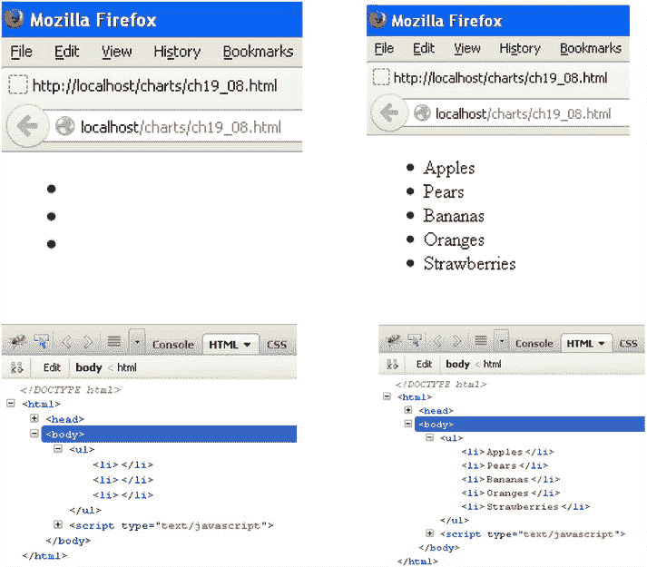

**图 2-20.** 可以用数组值填充 HTML 元素的内容，并在元素不足时用其他元素进行补充

### 应用动态属性

你已经了解了如何使用 D3 框架提供的函数来定义和修改样式、属性以及其他特性。但到目前为止，它们都被当作常量来处理。是时候向前迈进一步了。JavaScript 语言，尤其是 D3（和 jQuery）库的优势之一在于其使页面内容动态化的能力。事实上，你刚刚了解了如何删除、创建和操作网页中的元素标签。类似的方法也适用于其他类型的值，例如 CSS 样式或你通过选择集机制创建或操作的元素的属性。你甚至可以创建与事件或控件相关的不同选项。

D3 为你提供了一组用于此目的的特定函数。尽管它们看似简单，但对于那些知道如何充分利用其机制的人来说，这些函数可以成为强大的工具。

在清单 2-12 的示例中，你使用一个通用函数为段落分配随机颜色。每次加载页面时，它都会显示一组不同的颜色。

**清单 2-12.** `Ch2_09.html`

```
<body>
  <p>the first paragraph</p>
  <p>the second paragraph</p>
  <p>the third paragraph</p>
  <p>the last paragraph</p>
  <script>
    d3.selectAll("p").style("color", function() {
      r = Math.round((Math.random() * 255));
      g = Math.round((Math.random() * 255));
      b = Math.round((Math.random() * 255));
      return "rgb("+r+", "+g+", "+b+")";
    });
  </script>
</body>
```

图 2-21 左侧显示了一次加载页面的结果，右侧显示了另一次加载页面应用了不同颜色的结果。每次加载页面时，你都会得到不同的颜色组合。

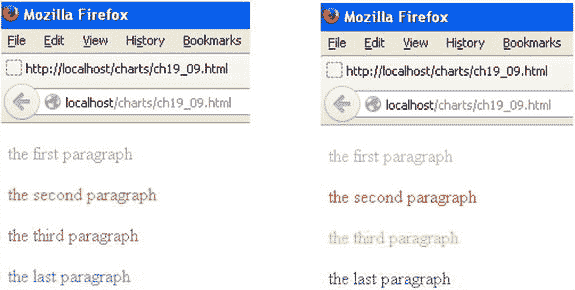

**图 2-21.** 每次页面加载时颜色都会改变

当然，这是一个非常简单的例子，但它展示了基本思想。你分配给属性、文本或样式的任何值都可以通过函数动态生成。

### 添加 SVG 元素

你终于到了可以应用所学知识来创建精美显示效果的时刻。在本节中，你将开始了解 D3 库的特性，包括创建和操作图形元素，如线条、正方形、圆形等。所有这些都将主要通过使用两个标签的嵌套结构来完成：`<svg>` 用于图形元素，`<g>` 用于应用组。

首先，你将学习如何创建一个 SVG 元素，以及如何使用 `<g>` 标签将其嵌套在一个组中。之后，你将了解什么是 SVG 变换，以及如何将它们应用于元素组。最后，通过另一个示例，你将看到如何使用 SVG 过渡来为这些元素添加动画效果，以获得漂亮的动画。


#### 创建 SVG 元素

你可以从一个 `<div>` 标签开始，它将被用作可视化的容器，类似于 jQuery 对 `<canvas>` 的处理方式。从这个 `<div>` 标签，你可以使用 `append()` 操作符创建根标签 `<svg>`。然后，你可以通过 `attr()` 操作符作用于 `height` 和 `width` 属性来设置可视化的大小（参见清单 2-13）。

**清单 2-13.** `Ch2_10.html`

```html
<body>
  <div id="circle"></div>
  <script type="text/javascript">
    var svg = d3.select('#circle')
      .append('svg')
      .attr('width', 200)
      .attr('height', 200);
  </script>
</body>
```

从 FireBug 中，你可以看到包含新 `<svg>` 元素及其属性的 `<body>` 结构（参见图 2-22）。

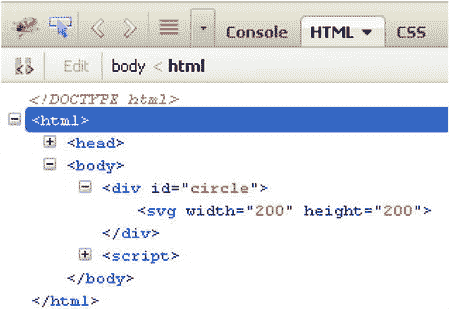

**图 2-22.** FireBug 显示了你刚刚创建的 `<svg>` 标签

你也可以向根标签 `<svg>` 添加一个基本形状。让我们添加一个黄色的圆形（参见清单 2-14）。一旦你理解了这一原理，以后随时重复操作就非常简单了。

**清单 2-14.** `ch19_10.html`

```html
<script type="text/javascript">
  var svg = d3.select('#circle')
    .append('svg')
    .attr('width', 200)
    .attr('height', 200);

  svg.append('circle')
    .style('stroke', 'black')
    .style('fill', 'yellow')
    .attr('r', 40)
    .attr('cx', 50)
    .attr('cy', 50);
</script>
```

图 2-23 展示了一个完美的黄色圆形。

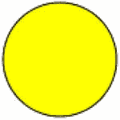

**图 2-23.** 一个完美的黄色圆形

在 FireBug 中，你可以看到标签的树形结构如何从根 `<svg>` 开始逐步成形，并指定了所有属性（参见图 2-24）。

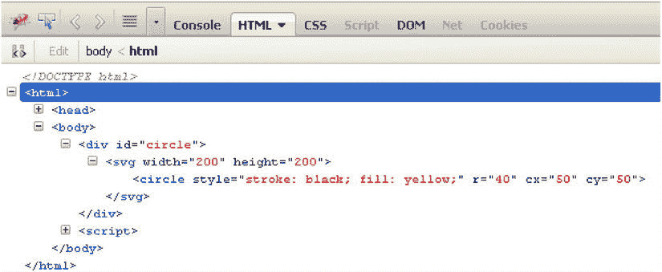

**图 2-24.** 在 FireBug 中，可以跟踪标签结构的演变过程

现在你已经了解了如何使用 SVG 标签创建图形，下一步就是对其应用变换。

#### 变换

D3 的一个关键特性是其变换能力。这扩展了 JavaScript 中 SVG 变换的概念。一旦在 SVG 中创建了一个对象，无论是简单的正方形还是更复杂的结构，都可以对其进行各种变换。最常见的变换包括：

*   缩放（Scale）
*   平移（Translate）
*   旋转（Rotate）

> **注意：** 如果你想了解更多关于变换的信息，我建议你访问这个页面：[`https://developer.mozilla.org/en-US/docs/Web/SVG/Attribute/transform`](https://developer.mozilla.org/en-US/docs/Web/SVG/Attribute/transform)。它列出了所有可用的变换，并附有简单的解释。

通常，你会使用这些基本变换的序列来获得更复杂的变换。一如既往，你将通过一系列小示例来说明变换的概念。首先，你将像绘制黄色圆形一样绘制一个红色的小正方形（参见清单 2-15）。为此，你需要使用 `<rect>` 标签。与 `<circle>` 的唯一区别是，对于矩形，你需要使用 `x` 和 `y` 指定矩形左上角的位置，而不是圆心的位置。然后，你需要指定矩形的大小，由于它是一个正方形，边长将相等。

**清单 2-15.** `Ch2_11a.html`

```html
<div id="square"></div>
<script type="text/javascript">
  var svg = d3.select('#square')
    .append('svg')
    .attr('width', 200)
    .attr('height', 200);

  svg.append('rect')
    .style('stroke', 'black')
    .style('fill', 'red')
    .attr('x', 50)
    .attr('y', 50)
    .attr('width', 50)
    .attr('height', 50);
</script>
```

现在是时候引入另一个在处理 SVG 元素时会很有用的概念了：元素分组。你经常需要将一系列操作（有时仅包括变换）应用于一组形状或一个复杂形状（由多个基本形状组成）。这可以通过将多个项目组合成一个组来实现，这在 SVG 中通过将所有元素放入一个 `<g>` 标签来体现。因此，如果你想对红色正方形应用变换，例如，你需要将其插入到一个组中（参见清单 2-16）。

**清单 2-16.** `Ch2_11a.html`

```javascript
var svg = d3.select('#square')
  .append('svg')
  .attr('width', 200)
  .attr('height', 200);

var g = svg.append("svg:g");

g.append('rect')
  .style('stroke', 'black')
  .style('fill', 'red')
  .attr('x', 50)
  .attr('y', 50)
  .attr('width', 50)
  .attr('height', 50);
```

图 2-25 显示了 SVG 结构在 FireBug 中的呈现方式。

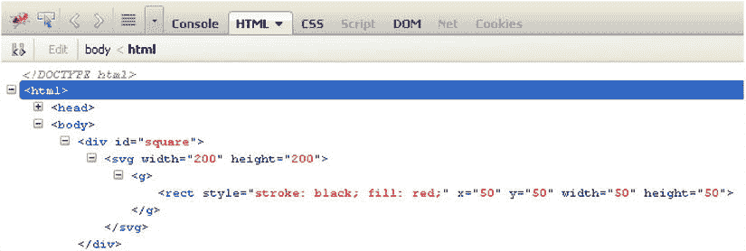

**图 2-25.** FireBug 显示了与红色正方形对应的 SVG 结构

在浏览器中，你将看到一个如图 2-26 所示的小红色正方形。

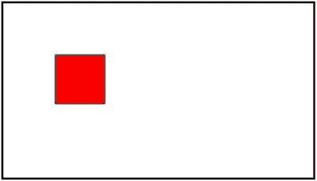

**图 2-26.** 红色正方形是应用变换的理想对象

现在，你将逐一应用所有变换。从平移开始，在 SVG 中平移由 `translate(x, y)` 函数表示，其中 `x` 和 `y` 是正方形将要移动的像素量（参见清单 2-17）。

**清单 2-17.** `Ch2_11b.html`

```javascript
var g = svg.append("svg:g")
  .attr("transform", "translate(" + 100 + ",0)");
```

这里我将值 `100` 放在作为属性传递的字符串之外，以便理解在这一点上你可以插入一个先前定义的变量。这将使变换更具动态性。通过这行代码，你将正方形向右移动了 100 像素（参见图 2-27）。

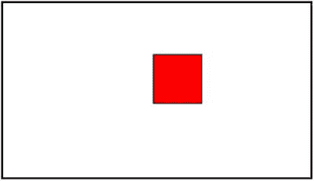

**图 2-27.** 现在红色正方形看起来向右偏移了 100 像素


你可以对正方形应用的另一种变换称为缩放。在 SVG 中，它通过函数 `scale(s)` 或 `scale(sx, sy)` 来表示。如果你在函数中传入一个参数，缩放将是均匀的；但如果传入两个参数，你可以分别对正方形在水平和垂直方向上进行不同比例的扩展。清单 2-18 将红色正方形的尺寸放大了两倍。因此，你需要应用 `scale()` 变换，并传入值 `2` 作为参数。传入的数字是正方形尺寸将被乘以的倍数。由于你只传入了一个参数，缩放是均匀的。

**清单 2-18.** `Ch2_11c.html`

```
var g = svg.append("svg:g")
.attr("transform","scale(2)");
```

图 2-28 展示了放大两倍后的正方形。该正方形的高度和宽度都增加了一倍。

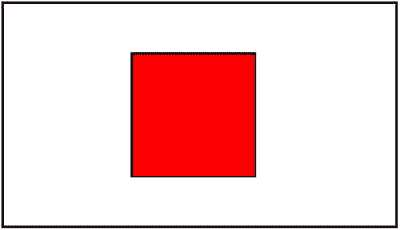

**图 2-28.** 红色正方形的尺寸扩大了一倍

如果你想要非均匀缩放，可以使用类似清单 2-19 的代码，以获得与图 2-29 相似的结果。非均匀缩放可以扭曲图形以形成另一幅图像。在这种情况下，你会从一个正方形得到一个矩形。

**清单 2-19.** `Ch2_11d.html`

```
var g = svg.append("svg:g")
.attr("transform","scale(2, 1)");
```

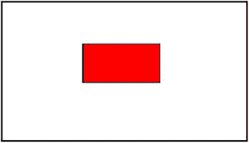

**图 2-29.** 通过对正方形应用非均匀缩放得到的矩形

最后一种变换是旋转。它在 SVG 中通过函数 `rotate(degree,x,y)` 来表示，其中第一个参数是旋转角度（顺时针方向），以度为单位，而 `x` 和 `y` 是旋转中心的坐标。

假设你希望旋转中心与正方形的中心重合，该中心位于 `x = 75` 和 `y = 75`。如果你想绘制一个菱形，你需要将正方形旋转 45 度（参见清单 2-20）。

**清单 2-20.** `Ch2_11e.html`

```
var g = svg.append("svg:g")
.attr("transform","rotate(45, 75, 75)");
```

你会得到一个菱形（见图 2-30）。

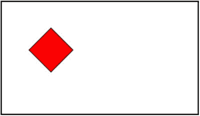

**图 2-30.** 旋转正方形得到的结果是一个菱形

但最有趣的效果是按顺序应用这些变换，从而创建一个变换链（参见清单 2-21）。

**清单 2-21.** `Ch2_11f.html`

```
var g = svg.append("svg:g")
.attr("transform", "translate(-30, 0),scale(2, 1),rotate(45, 75, 75)");
```

通过这段代码，你会得到图 2-31 中的形状。

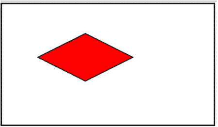

**图 2-31.** 通过对正方形应用变换链得到的菱形

#### 过渡

你已经看到，属性、样式等的值可以根据某些函数设定的定义而变得动态。但 D3 提供了更多功能——你甚至可以为你的图形添加动画效果。D3 为此提供了三个函数：

*   `transition()`
*   `delay()`
*   `duration()`

自然，你会将这些函数应用于 SVG 元素，这要归功于 D3，它能识别任何类型的值并对它们进行插值。

当一个 SVG 图形从一种状态过渡到另一种状态时，你就定义了一个过渡。起始状态和最终状态都由几个参数来表征，这些参数定义了一个对象的颜色、形状、大小和位置。我们以黄色圆形示例（参考清单 2-14）中定义的状态作为初始状态。在清单 2-22 中，你让这个圆形经历一个由三种不同变化组成的过渡：圆形将其颜色变为黑色（将 `fill` 设置为 `black`），缩小其面积（将 `r` 从 `40` 改为 `10`），并稍微向右移动（将 `cx` 从 `50` 改为 `150`）。

**清单 2-22.** `Ch2_12.html`

```
<div id="circle"></div>
<script>
var svg = d3.select('#circle')
.append('svg')
.attr('width', 200)
.attr('height', 200);

svg.append('circle')
.style('stroke', 'black')
.style('fill', 'yellow')
.attr('r', 40)
.attr('cx', 50)
.attr('cy', 50)
.transition()
.delay(100)
.duration(4000)
.attr("r", 10)
.attr("cx", 150)
.style("fill", "black");
</script>
```

所以，在这个例子中，你将 `transition()` 方法添加到了方法链中。这会将初始状态与最终状态分开，并告知 D3 将要进行一个过渡。紧接在 `transition()` 之后，还有另外两个函数：`delay()` 和 `duration()`。

`delay()` 函数接受一个参数：过渡开始前需要经过的时间。相反，`duration()` 函数被定义为过渡所花费的时间。传入的参数值越大，过渡就会越慢。

在这三个函数之后，你将所有表征图形最终状态的属性添加到方法链中。D3 会根据你设定的时间对中间值进行插值，并用这些值生成所有中间图形。呈现在你眼前的是一个动画，其中黄色圆形变成黑色，向左移动并缩小尺寸。整个过程耗时四秒。

图 2-32 展示了过渡序列，你可以看到圆形发生的变化。

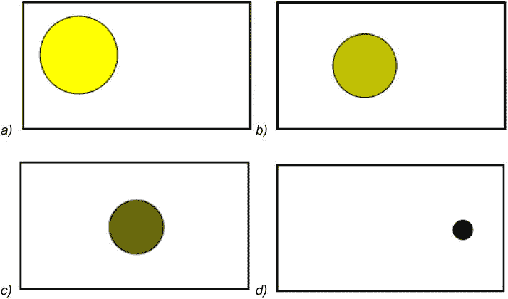

**图 2-32.** 经历过渡的圆形动画的不同实例

到目前为止，你所看到的简单示例都是每次应用于一个图形元素。下一步是将你所学到的知识应用于元素组，以便创建更复杂的图形。后续章节将提供很好的示例，在这些示例中，D3 库的这一基本概念将被付诸实践。

### 总结

本章涵盖了 D3 库的要点。D3 库可以在不使用 jQuery JavaScript 库的情况下管理选择集、选择器和操作符。通过一系列示例，你已经了解了如何通过更改 DOM 元素的属性以及在需要时创建新元素来操作它们。在本章的第二部分，你学习了 D3 库操作的主要对象是什么：SVG 元素。这些是构建图表的图形积木。最后，你快速了解了如何对这些图形元素应用 SVG 变换，以及如何利用 SVG 过渡来生成漂亮的动画。

下一章将通过实现折线图，将你目前学到的关于 D3 库的知识付诸实践。通过逐一处理 SVG 元素，你将看到如何实现吸引人的图形表示。


