# 3. 使用 D3 绘制折线图

在本章中，你将创建一个带有刻度线和标签的折线图。你将了解如何向文档中添加可缩放矢量图形（SVG）元素，并通过操作这些元素来创建任意类型的可视化效果。这种灵活性使你能够像搭积木一样，逐步构建出任何类型的图表。

首先，你将学习如何使用前一章介绍的 D3 命令来构建折线图的基本元素。具体来说，你将分析**比例尺（scale）**、**定义域（domain）**和**值域（range）** 的概念，这些概念你会频繁遇到。它们是 D3 库在处理数值集合时的一个典型特征。

一旦你理解了如何在定义域、比例尺和值域中管理数值，你就可以着手实现图表的各个组件，例如坐标轴、轴标签、标题和网格线。这些组件构成了绘制折线图的基础。与 jqPlot 不同，这些组件并非现成可用，而是需要逐步开发。这虽然会增加工作量，但也让你能够创建特殊功能。你的 D3 图表将能够满足特定需求，或者至少拥有完全原创的外观。作为示例，你将看到如何为坐标轴添加箭头。

D3 库的另一个特点是使用函数来读取文件中的数据。你将了解这些函数的工作原理以及如何根据你的需求利用它们。

一旦你掌握了实现折线图所需的基础知识，你将学习如何实现多系列折线图。你还将了解如何实现图例并将其与图表关联。

最后，作为总结，你将分析一种特殊的折线图：差值折线图。这将帮助你理解裁剪区域路径——它们是什么以及它们的用途。

### 使用 D3 开发折线图

你终于要开始使用 D3 库来实现你的图表了。在本节及后续章节中，你将发现一种与 jqPlot 和 Highcharts 等库所采用的方法截然不同的图表实现方法。这里的实现处于更底层，代码也更长、更复杂；不过，这并没有超出你的能力范围。

现在，我们将一步一步地，或者更确切地说，像搭积木一样，向你展示如何生成一个折线图及其组成元素。

#### 从第一块“积木”开始

第一块“积木”是在你的网页中引入 D3 库（更多信息请参见附录 A）：

`<script src="../src/d3.v3.min.js"></script>`

或者，如果你更喜欢使用内容分发网络（CDN）服务：

`<script src="http://d3js.org/d3.v3.min.js"></script>`

下一块“积木”是清单 3-1 中的输入数据数组。该数组包含数据系列的 y 值。

**清单 3-1.** `Ch3_01.html`

`var data = [100, 110, 140, 130, 80, 75, 120, 130, 100];`

在清单 3-2 中，你定义了一组与绘制图表的可视化区域尺寸相关的变量。`w` 和 `h` 变量是图表的宽度和高度；边距用于在图表边缘创建空间。

**清单 3-2.** `Ch3_01.html`

`w = 400;`

`h = 300;`

`margin_x = 32;`

`margin_y = 20;`

由于你正在处理基于 x 轴和 y 轴的图形，因此在 D3 中，有必要为这两个轴分别定义比例尺、定义域和值域。让我们首先澄清这些概念，并了解它们在 D3 中是如何管理的。

#### 比例尺、定义域和值域

你可能已经接触过比例尺，即使你没有意识到这一点。线性比例尺更易于理解，尽管在某些示例中，你可能使用过对数比例尺（请参见下面的边栏“对数比例尺”）。

**对数比例尺**

对数比例尺使用的间隔对应于数量级（通常为十），而不是标准的线性比例尺。这允许你在一个轴上表示大范围的值（v）。

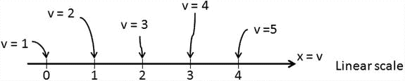

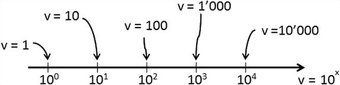

对数是书写指数的另一种方式，你可以用它来分离指数（x）并将其放在轴上。

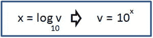

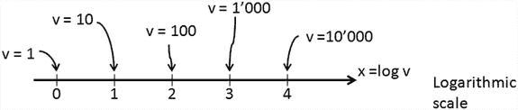

例如，在对数比例尺上增加一个点，相当于该值增加 10 倍。同样，增加两个点相当于该值增加 100 倍。以此类推。

比例尺本质上是一个函数，它将某个区间（称为**定义域**）内的一个值转换为属于另一个区间（称为**值域**）的另一个值。但这到底意味着什么？这对你有什么帮助？

实际上，每当你想要在两个属于不同区间的变量之间进行值转换，同时保持其在当前区间内的“意义”时，这都能派上用场。这与归一化的概念有关。

假设你想转换来自某个仪器的值，例如万用表报告的电压。你知道电压读数将在 0 到 5 伏之间，这就是值的区间，也称为定义域。

你想将测得的电压转换为红色比例尺上的值。使用红绿蓝（RGB）编码，这个值将在 0 到 255 之间。你现在定义了另一个颜色区间，这就是值域。

现在假设万用表上的电压读数为 2.7 伏，而红色比例尺上对应的值为 138（实际上是 137.7）。你刚刚应用了一个线性比例尺来进行值转换。图 3-1 显示了将电压值转换为 RGB 比例尺上对应 R 值的过程。此转换在线性比例尺内进行，因为值是线性转换的。

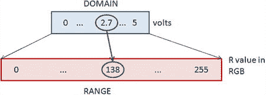

**图 3-1.** 从电压到 R 值的转换由 D3 库管理

但这有什么用呢？首先，当你想要在图表中可视化数据时，不同区间之间的转换并不罕见；其次，这种转换完全由 D3 库管理。你不需要进行任何计算；你只需要定义定义域、值域和要应用的比例尺。

将这个示例转换为 D3 代码，你可以这样写：

```
var scale = d3.scale.linear(),
    .domain([0,5]),
    .range([0,255]);

console.log(Math.round(scale(2.7)));      //在 FireBug 控制台中返回 138
```


#### 代码内部

你可以定义比例尺、定义域和值域；因此，只需将清单 3-3 添加到代码中，即可继续实现折线图。

**清单 3-3.** `Ch3_01.html`

```
y = d3.scale.linear().domain([0, d3.max(data)]).range([0 + margin_y, h - margin_y]);
```

```
x = d3.scale.linear().domain([0, data.length]).range([0 + margin_x, w - margin_x]);
```

由于输入的数据数组是一维的，并且包含了你想在 y 轴上表示的值，你可以将定义域从 0 扩展到数组的最大值。你不需要使用 `for` 循环来查找这个值。D3 提供了一个名为 `max(date)` 的特定函数，其传入的参数是你想要查找最大值的数组。

现在是时候开始添加 SVG 元素了。第一个要添加的元素是 `<svg>` 元素，它代表你将添加的所有其他元素的根节点。`<svg>` 标签的功能有点类似于 jQuery 和 jqPlot 中的画布。因此，你需要使用 `w` 和 `h` 来指定画布大小。在 `<svg>` 元素内部，你追加一个 `<g>` 元素，这样所有添加到它内部的元素都会被分组在一起。

随后，对这个 `<g>` 元素组应用一个变换。在本例中，该变换包括对坐标网格进行平移，将其向下移动 `h` 像素，如清单 3-4 所示。

**清单 3-4.** `Ch3_01.html`

```
var svg = d3.select("body")
    .append("svg:svg")
    .attr("width", w)
    .attr("height", h);
```

```
var g = svg.append("svg:g")
    .attr("transform", "translate(0," + h + ")");
```

创建折线图所需的另一个基本元素是路径元素。这个路径通过 `d` 属性填充数据。

手动输入所有这些值过于繁琐，在这方面，D3 为你提供了一个函数来完成这项工作：`d3.svg.line`。因此，在清单 3-5 中，你声明了一个名为 `line` 的变量，其中每个数据都被转换为一个点 (x, y)。

**清单 3-5.** `Ch3_01.html`

```
var line = d3.svg.line()
    .x(function(d,i) { return x(i); })
    .y(function(d) { return -1 * y(d); });
```

正如你将在所有需要扫描数组（一个 `for` 循环）的情况下看到的那样，在 D3 中，这种扫描是通过使用参数 `d` 和 `i` 以不同的方式处理的。数组当前项的索引用 `i` 表示，而当前项用 `d` 表示。回想一下，你通过变换将 y 轴向下平移了。你需要记住这一点；如果你想正确地绘制一条线，你必须使用 y 的负值。这就是为什么你将 `d` 值乘以 -1。

下一步是将一条线分配给一个 `path` 元素（参见清单 3-6）。

**清单 3-6.** `Ch3_01.html`

```
g.append("svg:path").attr("d", line(data));
```

如果你在此处停止并在网页浏览器中打开该页面，你将得到如图 3-2 所示的图像。

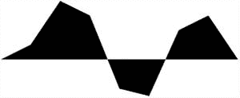

**图 3-2.** SVG 路径元素的默认行为是绘制填充区域

这似乎有些不对劲，但你必须考虑到，在使用 SVG 创建图像时，CSS 样式所扮演的角色是至关重要的。事实上，你可以简单地添加清单 3-7 中的 CSS 类来获得数据线。

**清单 3-7.** `Ch3_01.html`

```
<style>
path {
    stroke: steelblue;
    stroke-width: 3;
    fill: none;
}
line {
    stroke: black;
}
</style>
```

因此，通过适当定义的 CSS 样式类，你将得到如图 3-3 所示的一条线。

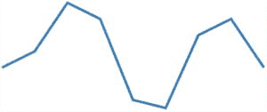

**图 3-3.** 如果 CSS 样式类定义得当，SVG 路径元素会绘制一条线

但你距离拥有一个折线图还很远。你必须添加两个坐标轴。要绘制这两个对象，你可以使用简单的 SVG 线条，如清单 3-8 所示。

**清单 3-8.** `Ch3_01.html`

```
// 绘制 x 轴
g.append("svg:line")
    .attr("x1", x(0))
    .attr("y1", -y(0))
    .attr("x2", x(w))
    .attr("y2", -y(0))
```


```  
// 绘制 y 轴  
g.append("svg:line")  
.attr("x1", x(0))  
.attr("y1", -y(0))  
.attr("x2", x(0))  
.attr("y2", -y(d3.max(data))-10)  
```  

现在是添加标签的时候了。为此，D3 提供了一个能极大简化工作的函数：`ticks()`。该函数应用于 D3 的比例尺（如 `x` 或 `y`），并返回适合用作刻度标记的舍入数值。你需要使用 `text(String)` 函数来获取当前 `d` 的字符串值（参见清单 3-9）。  

**清单 3-9.** `ch3_01.html`  

```  
// 绘制 x 轴标签  
g.selectAll(".xLabel")  
.data(x.ticks(5))  
.enter().append("svg:text")  
.attr("class", "xLabel")  
.text(String)  
.attr("x", function(d) { return x(d) })  
.attr("y", 0)  
.attr("text-anchor", "middle");  

// 绘制 y 轴标签  
g.selectAll(".yLabel")  
.data(y.ticks(5))  
.enter().append("svg:text")  
.attr("class", "yLabel")  
.text(String)  
.attr("x", 25)  
.attr("y", function(d) { return -y(d) })  
.attr("text-anchor", "end");  
```  

要对齐标签，你需要指定 `text-anchor` 属性。其可选值包括 `middle`、`start` 和 `end`，分别对应标签居中对齐、左对齐和右对齐。  

此处，你使用 D3 的 `attr()` 函数来指定该属性，但也可以在 CSS 样式中指定，如清单 3-10 所示。  

**清单 3-10.** `ch3_01.html`  

```  
.xLabel {  
text-anchor: middle;  
}  

.yLabel {  
text-anchor: end;  
}  
```  

实际上，这两种写法效果几乎相同。不过，当你计划更改这些值时，通常更倾向于在 CSS 样式中设置——它们会被视为参数。而在此例中，或者当你希望这些值成为对象的固定属性时，则更适合使用 `attr()` 函数来插入。  

现在你可以为坐标轴添加刻度标记了。这可以通过为每个刻度绘制一条短线段来实现。你之前对刻度标签所做的操作，现在对刻度标记同样适用，如清单 3-11 所示。  

**清单 3-11.** `ch3_01.html`  

```  
// 绘制 x 轴刻度  
g.selectAll(".xTicks")  
.data(x.ticks(5))  
.enter().append("svg:line")  
.attr("class", "xTicks")  
.attr("x1", function(d) { return x(d); })  
.attr("y1", -y(0))  
.attr("x2", function(d) { return x(d); })  
.attr("y2", -y(0)-5)  

// 绘制 y 轴刻度  
g.selectAll(".yTicks")  
.data(y.ticks(5))  
.enter().append("svg:line")  
.attr("class", "yTicks")  
.attr("y1", function(d) { return -y(d); })  
.attr("x1", x(0)+5)  
.attr("y2", function(d) { return -y(d); })  
.attr("x2", x(0))  
```  

图 3-4 展示了此阶段的折线图。  

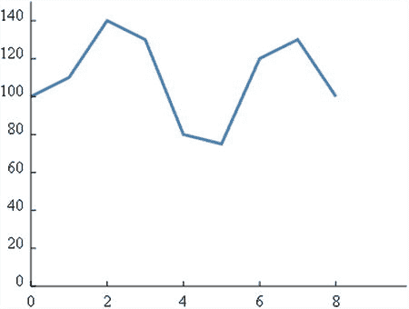  

**图 3-4.** 添加两个坐标轴及其标签后，你终于得到了一个简单的折线图  

如你所见，你已经有了一个折线图。或许通过添加网格（如清单 3-12 所示），可以让图表看起来更美观。  

**清单 3-12.** `Ch3_01.html`  

```  
// 绘制 x 轴网格  
g.selectAll(".xGrids")  
.data(x.ticks(5))  
.enter().append("svg:line")  
.attr("class", "xGrids")  
.attr("x1", function(d) { return x(d); })  
.attr("y1", -y(0))  
.attr("x2", function(d) { return x(d); })  
.attr("y2", -y(d3.max(data))-10);  

// 绘制 y 轴网格  
g.selectAll(".yGrids")  
.data(y.ticks(5))  
.enter().append("svg:line")  
.attr("class", "yGrids")  
.attr("y1", function(d) { return -y(d); })  
.attr("x1", x(w))  
.attr("y2", function(d) { return -y(d); })  
.attr("x2", x(0));  
```  

你可以对 CSS 样式做一些小补充（见清单 3-13），以便为折线图添加浅灰色网格作为背景。此外，你还可以根据需要定义文本样式，例如选择 Verdana 字体，字号为 9。  

**清单 3-13.** `Ch3_01.html`  

```  
<style>  
path {  
stroke: steelblue;  
stroke-width: 3;  
fill: none;  
}  

line {  
stroke: black;  
}  

.xGrids {  
stroke: lightgray;  
}  

.yGrids {  
stroke: lightgray;  
}  

text {  
font-family: Verdana;  
font-size: 9pt;  
}  
</style>  
```  

现在，折线图已绘制完成，并带有浅灰色网格，如图 3-5 所示。


**图 3-5.** 带有网格且网格覆盖蓝色线条的折线图

请仔细观察图 3-5。网格的灰色线条绘制在代表数据的蓝色线条之上。换句话说，更明确地说，你必须注意绘制 SVG 元素的顺序。实际上，先绘制坐标轴和网格，然后再处理输入数据的表示会更方便。因此，你需要按照正确的顺序放置所有要绘制的元素，如清单 3-14 所示。

**清单 3-14.** `ch3_01.html`

```
<script>
var data = [100,110,140,130,80,75,120,130,100];
w = 400;
h = 300;
margin_x = 32;
margin_y = 20;
y = d3.scale.linear().domain([0, d3.max(data)]).range([0 + margin_y, h - margin_y]);
x = d3.scale.linear().domain([0, data.length]).range([0 + margin_x, w - margin_x]);
var svg = d3.select("body")
  .append("svg:svg")
  .attr("width", w)
  .attr("height", h);
var g = svg.append("svg:g")
  .attr("transform", "translate(0," + h + ")");
var line = d3.svg.line()
  .x(function(d,i) { return x(i); })
  .y(function(d) { return -y(d); });
// draw the y axis
g.append("svg:line")
  .attr("x1", x(0))
  .attr("y1", -y(0))
  .attr("x2", x(w))
  .attr("y2", -y(0));
// draw the x axis
g.append("svg:line")
  .attr("x1", x(0))
  .attr("y1", -y(0))
  .attr("x2", x(0))
  .attr("y2", -y(d3.max(data))-10);
//draw the xLabels
g.selectAll(".xLabel")
  .data(x.ticks(5))
  .enter().append("svg:text")
  .attr("class", "xLabel")
  .text(String)
  .attr("x", function(d) { return x(d) })
  .attr("y", 0)
  .attr("text-anchor", "middle");
// draw the yLabels
g.selectAll(".yLabel")
  .data(y.ticks(5))
  .enter().append("svg:text")
  .attr("class", "yLabel")
  .text(String)
  .attr("x", 25)
  .attr("y", function(d) { return -y(d) })
  .attr("text-anchor", "end");
//draw the x ticks
g.selectAll(".xTicks")
  .data(x.ticks(5))
  .enter().append("svg:line")
  .attr("class", "xTicks")
  .attr("x1", function(d) { return x(d); })
  .attr("y1", -y(0))
  .attr("x2", function(d) { return x(d); })
  .attr("y2", -y(0)-5);
// draw the y ticks
g.selectAll(".yTicks")
  .data(y.ticks(5))
  .enter().append("svg:line")
  .attr("class", "yTicks")
  .attr("y1", function(d) { return -1 * y(d); })
  .attr("x1", x(0)+5)
  .attr("y2", function(d) { return -1 * y(d); })
  .attr("x2", x(0));
//draw the x grid
g.selectAll(".xGrids")
  .data(x.ticks(5))
  .enter().append("svg:line")
  .attr("class", "xGrids")
  .attr("x1", function(d) { return x(d); })
  .attr("y1", -y(0))
  .attr("x2", function(d) { return x(d); })
  .attr("y2", -y(d3.max(data))-10);
// draw the y grid
g.selectAll(".yGrids")
  .data(y.ticks(5))
  .enter().append("svg:line")
  .attr("class", "yGrids")
  .attr("y1", function(d) { return -1 * y(d); })
  .attr("x1", x(w))
  .attr("y2", function(d) { return -y(d); })
  .attr("x2", x(0));
// draw the x axis
g.append("svg:line")
  .attr("x1", x(0))
  .attr("y1", -y(0))
  .attr("x2", x(w))
  .attr("y2", -y(0));
// draw the y axis
g.append("svg:line")
  .attr("x1", x(0))
  .attr("y1", -y(0))
  .attr("x2", x(0))
  .attr("y2", -y(d3.max(data))+10);
// draw the line of data points
g.append("svg:path").attr("d", line(data));
</script>
```

图 3-6 展示了按正确顺序绘制元素后的折线图。实际上，代表输入数据的蓝色线条现在位于前景，覆盖了网格，而不是相反。

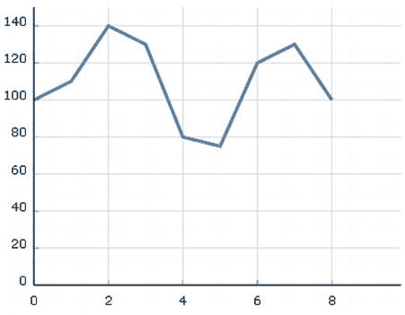

**图 3-6.** 网格绘制正确的折线图

#### 使用包含 (x,y) 值的数据

到目前为止，你使用的输入数据数组只包含 `y` 的值。通常，你会希望表示那些被赋予了 `x` 和 `y` 值的点。因此，你将通过使用清单 3-15 中的输入数据数组来扩展前面的案例。

**清单 3-15.** `Ch3_02.html`

```
var data = [{x: 0, y: 100}, {x: 10, y: 110}, {x: 20, y: 140},
  {x: 30, y: 130}, {x: 40, y: 80}, {x: 50, y: 75},
  {x: 60, y: 120}, {x: 70, y: 130}, {x: 80, y: 100}];
```

现在你可以看到数据是如何由同时包含 `x` 和 `y` 值的点来表示的。当你使用一系列数据时，通常需要立即识别出 `x` 和 `y` 的最大值（有时也需要最小值）。在前面的案例中，你使用了 `d3.max` 和 `d3.min` 函数，但这些函数只对数组有效，对对象无效。你插入的输入数据数组是一个对象数组。如何解决这个问题？有几种方法。也许最直接的方法是扫描数据，找出 `x` 和 `y` 的最大值。在清单 3-16 中，你定义了两个变量来存放这两个最大值。然后，每次扫描一个对象的 `x` 和 `y` 值，将当前的 `x` 和 `y` 值与 `xMax` 和 `yMax` 的值进行比较，以确定哪个值更大。两者中较大的那个将成为新的最大值。

**清单 3-16.** `Ch3_02.html`

```
var xMax = 0, yMax = 0;
data.forEach(function(d) {
  if(d.x > xMax)
    xMax =  d.x;
  if(d.y > yMax)
    yMax =  d.y;
});
```

有几个有用的 D3 函数可以处理数组，那么为什么不直接从输入的对象数组中创建两个数组呢？一个包含 `x` 的值，另一个包含 `y` 的值。你可以在需要时使用这两个数组，而不是使用更复杂的对象数组（见清单 3-17）。

**清单 3-17.** `Ch3_02.html`

```
var ax = [];
var ay = [];
data.forEach(function(d,i){
  ax[i] = d.x;
  ay[i] = d.y;
})
var xMax = d3.max(ax);
var yMax = d3.max(ay);
```

这次你将 `x` 和 `y` 都赋给了数据点的线条，如清单 3-18 所示。即使你正在处理一个对象数组，这个操作也非常简单。

**清单 3-18.** `Ch3_02.html`

```
var line = d3.svg.line()
  .x(function(d) { return x(d.x); })
  .y(function(d) { return -y(d.y); })
```

至于代码的其余部分，没有太多需要更改的地方——只需对 `x` 和 `y` 的边界值进行一些修正，如清单 3-19 所示。

**清单 3-19.** `Ch3_02.html`

```
y = d3.scale.linear().domain([0, yMax]).range([0 + margin_y, h - margin_y]);
x = d3.scale.linear().domain([0, xMax]).range([0 + margin_x, w - margin_x]);
...
// draw the y axis
g.append("svg:line")
  .attr("x1", x(0))
  .attr("y1", -y(0))
  .attr("x2", x(0))
  .attr("y2", -y(yMax)-20)
...
//draw the x grid
g.selectAll(".xGrids")
  .data(x.ticks(5))
  .enter().append("svg:line")
  .attr("class", "xGrids")
  .attr("x1", function(d) { return x(d); })
  .attr("y1", -y(0))
  .attr("x2", function(d) { return x(d); })
  .attr("y2", -y(yMax)-10)
// draw the y grid
g.selectAll(".yGrids")
  .data(y.ticks(5))
  .enter().append("svg:line")
  .attr("class", "yGrids")
  .attr("y1", function(d) { return -1 * y(d); })
  .attr("x1", x(xMax)+20)
  .attr("y2", function(d) { return -1 * y(d); })
  .attr("x2", x(0))
```

图 3-7 展示了为处理输入数据数组引入的 `y` 值而进行的更改所产生的结果。

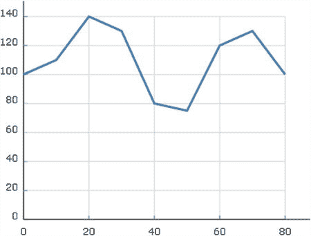

**图 3-7.** 一个带有网格和坐标轴标签的折线图，该图考虑了输入数组中的 `y` 值


#### 控制坐标轴范围

在你刚刚绘制的折线图代码中，数据线会始终位于图表顶部。如果你的数据在非常高的水平上波动，而 `y` 轴的刻度从 0 开始，那么趋势线可能会被压平。当 `y` 轴的上限等于 `y` 的最大值时，也不是最佳选择。在这里，你将添加对坐标轴范围的检查。为此，在代码清单 3-20 中，你定义了四个变量来指定 `x` 轴和 `y` 轴的下限和上限。

**代码清单 3-20.** `Ch3_03.html`

```
var xLowLim = 0;
var xUpLim = d3.max(ax);
var yUpLim = 1.2 * d3.max(ay);
var yLowLim = 0.8 * d3.min(ay);
```

因此，你将所有对极限值的引用替换为这些变量。请注意，代码变得更具可读性。以直接的方式指定这四个限制，使你能够根据需要轻松修改它们。在这种情况下，只表示了 `y` 轴上实验数据覆盖的范围，外加 20% 的边距，如代码清单 3-21 所示。

**代码清单 3-21.** `ch3_03.html`

```
y = d3.scale.linear().domain([yLowLim, yUpLim]).range([0 + margin_y, h - margin_y]);
x = d3.scale.linear().domain([xLowLim, xUpLim]).range([0 + margin_x, w - margin_x]);
...
//绘制 x 轴刻度
g.selectAll(".xTicks")
.data(x.ticks(5))
.enter().append("svg:line")
.attr("class", "xTicks")
.attr("x1", function(d) { return x(d); })
.attr("y1", -y(yLowLim))
.attr("x2", function(d) { return x(d); })
.attr("y2", -y(yLowLim)-5)

// 绘制 y 轴刻度
g.selectAll(".yTicks")
.data(y.ticks(5))
.enter().append("svg:line")
.attr("class", "yTicks")
.attr("y1", function(d) { return -y(d); })
.attr("x1", x(xLowLim))
.attr("y2", function(d) { return -y(d); })
.attr("x2", x(xLowLim)+5)

//绘制 x 轴网格
g.selectAll(".xGrids")
.data(x.ticks(5))
.enter().append("svg:line")
.attr("class", "xGrids")
.attr("x1", function(d) { return x(d); })
.attr("y1", -y(yLowLim))
.attr("x2", function(d) { return x(d); })
.attr("y2", -y(yUpLim))

// 绘制 y 轴网格
g.selectAll(".yGrids")
.data(y.ticks(5))
.enter().append("svg:line")
.attr("class", "yGrids")
.attr("y1", function(d) { return -y(d); })
.attr("x1", x(xUpLim)+20)
.attr("y2", function(d) { return -y(d); })
.attr("x2", x(xLowLim))

// 绘制 x 轴
g.append("svg:line")
.attr("x1", x(xLowLim))
.attr("y1", -y(yLowLim))
.attr("x2", 1.2*x(xUpLim))
.attr("y2", -y(yLowLim))

// 绘制 y 轴
g.append("svg:line")
.attr("x1", x(xLowLim))
.attr("y1", -y(yLowLim))
.attr("x2", x(xLowLim))
.attr("y2", -1.2*y(yUpLim))
```

图 3-8 显示了新的折线图，其 `y` 轴范围在 60 到 160 之间，能更好地展示线条。

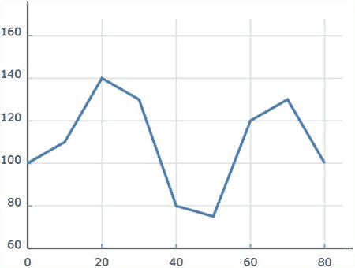

**图 3-8.** `y` 轴范围聚焦在 `y` 值附近的折线图

#### 添加坐标轴箭头

为了更好地理解 D3 的图形多样性，尤其是在实现新功能方面，你将学习为 `x` 轴和 `y` 轴添加箭头。为此，你必须添加代码清单 3-22 中的两个路径，它们将在两个轴的末端绘制箭头。

**代码清单 3-22.** `Ch3_04.html`

```
g.append("svg:path")
.attr("class", "axisArrow")
.attr("d", function() {
    var x1 = x(xUpLim)+23, x2 = x(xUpLim)+30;
    var y2 = -y(yLowLim),y1 = y2-3, y3 = y2+3
    return 'M'+x1+','+y1+','+x2+','+y2+','+x1+','+y3;
});

g.append("svg:path")
.attr("class", "axisArrow")
.attr("d", function() {
    var y1 = -y(yUpLim)-13, y2 = -y(yUpLim)-20;
    var x2 = x(xLowLim),x1 = x2-3, x3 = x2+3
    return 'M'+x1+','+y1+','+x2+','+y2+','+x3+','+y1;
});
```

在 CSS 样式中，你添加了 `axisArrow` 类，如代码清单 3-23 所示。你也可以选择启用 `fill` 属性来获得填充的箭头。

**代码清单 3-23.** `Ch3_04.html`

```
.axisArrow {
    stroke: black;
    stroke-width: 1;
    /*fill: black; */
}
```

图 3-9 显示了有无填充的结果。

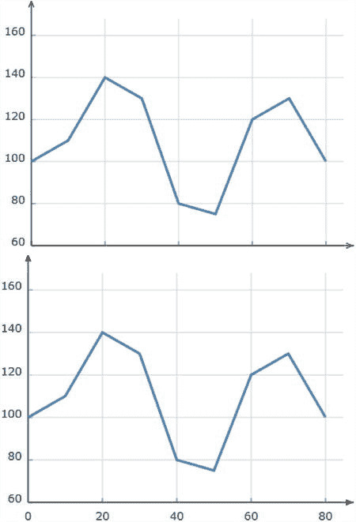

**图 3-9.** 在坐标轴上表示箭头的两种不同方式

#### 添加标题和坐标轴标签

在本节中，你将向图表添加标题。这是一件相当简单的事情，你将使用名为 `text` 的 SVG 元素，并对样式进行适当的更改，如代码清单 3-24 所示。此代码会将标题放置在顶部中央。

**代码清单 3-24.** `Ch3_05.html`

```
g.append("svg:text")
.attr("x", (w / 2))
.attr("y", -h + margin_y )
.attr("text-anchor", "middle")
.style("font-size", "22px")
.text("我的第一个 D3 折线图");
```

图 3-10 显示了添加到折线图顶部的标题。

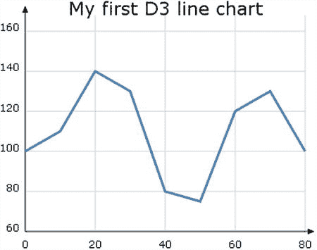

**图 3-10.** 带有标题的折线图

按照类似的过程，你也可以为坐标轴添加标签（参见代码清单 3-25）。

**代码清单 3-25.** `Ch3_05.html`

```
g.append("svg:text")
.attr("x", 25)
.attr("y", -h + margin_y)
.attr("text-anchor", "end")
.style("font-size", "11px")
.text("[#]");

g.append("svg:text")
.attr("x", w - 40)
.attr("y", -8 )
.attr("text-anchor", "end")
.style("font-size", "11px")
.text("时间 [s]");
```

图 3-11 显示了放置在相应坐标轴旁边的两个新坐标轴标签。

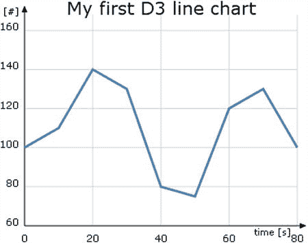

**图 3-11.** 一个更完整的折线图，包含标题和坐标轴标签

现在你已经学会了如何制作折线图，可以尝试一些更复杂的图表了。通常，你想在图表中显示的数据并不存在于网页中，而是存在于外部文件中。在接下来的部分中，你将把如何从外部文件读取数据与你目前所学的内容结合起来。

### 从 CSV 文件中的数据绘制折线图

在设计图表时，你通常会引用各种格式的数据。这些数据通常来自几个不同的来源。最常见的情况是，服务器（你的网页所指向的）上的应用程序从数据库或通过仪器提取数据，或者你甚至可能拥有收集在这些服务器上的数据文件。这里的示例使用服务器上的一个逗号分隔值（CSV）文件作为数据源。这个 CSV 文件包含数据，可以直接加载到服务器上，或者更常见的是，由其他应用程序生成。

D3 被设计用来处理这种类型的文件并非巧合。为此，D3 提供了 `d3.csv()` 函数。你将通过一个示例来了解更多关于这个主题的内容。


#### 读取与解析数据

首先，你需要定义“画布”的尺寸，或者更准确地说，定义你希望绘制图表的区域的大小和边距。这次，你需要定义四个边距。这将让你对绘图区域拥有更多控制权（参见清单 3-26）。

**清单 3-26.** `Ch3_06a.html`

```
<!DOCTYPE html>
<meta charset="utf-8">
<style>
</style>
<body>
<script src="http://d3js.org/d3.v3.js"></script>
<script>
var margin = {top: 70, right: 20, bottom: 30, left: 50},
    w = 400 - margin.left - margin.right,
    h = 400 - margin.top - margin.bottom;
```

现在来处理数据；用文本编辑器将清单 3-27 中的数据写入一个文件，并将其保存为 `data_01.csv`。

**清单 3-27.** `data_01.csv`

```
date,attendee
12-Feb-12,80
27-Feb-12,56
02-Mar-12,42
14-Mar-12,63
30-Mar-12,64
07-Apr-12,72
18-Apr-12,65
02-May-12,80
19-May-12,76
28-May-12,66
03-Jun-12,64
18-Jun-12,53
29-Jun-12,59
```

这些数据包含两组由逗号分隔的值（回想一下，CSV 代表逗号分隔值）。第一列是日期格式，列出了举办特定活动（如会议或集会）的日期。第二列列出了参会人数。请注意，日期没有用任何引号括起来。

与 jqPlot 类似，D3 拥有许多控制时间格式的工具。实际上，为了处理 CSV 文件中包含的日期，你必须指定一个解析器，如清单 3-28 所示。

**清单 3-28.** `Ch3_06a.html`

```
var parseDate = d3.time.format("%d-%b-%y").parse;
```

这里你需要指定 CSV 文件中包含的格式：`%d` 表示日期的数字格式，`%b` 表示用前三个字符表示的月份，`%y` 表示用最后两位数字表示的年份。你可以指定 x 和 y 的值，并通过比例尺和范围来赋值，如清单 3-29 所示。

**清单 3-29.** `ch3_06a.html`

```
var x = d3.time.scale().range([0, w]);
var y = d3.scale.linear().range([h, 0]);
```

现在你已经处理好了输入数据的正确解析，可以开始创建图形组件了。

#### 实现坐标轴与网格

你将首先学习如何以图形方式实现两个笛卡尔坐标轴。在这个例子中，如清单 3-30 所示，你将通过 `d3.svg.axis()` 函数采用最合适的方式来指定 x 轴和 y 轴。

**清单 3-30.** `ch3_06a.html`

```
var xAxis = d3.svg.axis()
    .scale(x)
    .orient("bottom")
    .ticks(5);

var yAxis = d3.svg.axis()
    .scale(y)
    .orient("left")
    .ticks(5);
```

这让你可以专注于数据，而所有与坐标轴相关的问题（刻度、标签等）都由坐标轴组件自动处理。因此，在创建了 `xAxis` 和 `yAxis` 之后，你将 x 和 y 的比例尺分配给他们，并设置方向。这很简单，对吧？是的；这次你不需要指定所有那些关于坐标轴的繁琐细节——它们的范围、在哪里放置刻度和标签等等。与之前的例子不同，所有这些都通过很少的代码行自动完成。我选择现在介绍这个概念，是因为在之前的例子中，我想强调你设计的每个元素都是一个可以用 D3 管理的积木，无论这个过程之后是否在 D3 库中被自动化。

现在你可以将 SVG 元素添加到页面中，如清单 3-31 所示。

**清单 3-31.** `ch3_06a.html`

```
var svg = d3.select("body").append("svg")
    .attr("width", w + margin.left + margin.right)
    .attr("height", h + margin.top + margin.bottom)
  .append("g")
    .attr("transform", "translate(" + margin.left + "," + margin.top + ")");

svg.append("g")
    .attr("class", "x axis")
    .attr("transform", "translate(0," + h + ")")
    .call(xAxis);

svg.append("g")
    .attr("class", "y axis")
    .call(yAxis);
```

请注意 x 轴是如何进行平移的。实际上，在没有指定坐标的情况下，x 轴会被绘制在绘图区域的顶部。此外，你还需要将其添加到 CSS 样式中。参见清单 3-32。

**清单 3-32.** `Ch3_06a.html`

```
<style>
body {
  font: 10px verdana;
}

.axis path,
.axis line {
  fill: none;
  stroke: #333;
}
</style>
```

图 3-12 显示了结果。

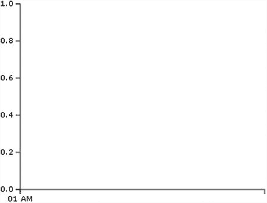

**图 3-12.** 一个准备填充数据的空白图表

使用 FireBug，你可以看到你刚刚定义的 SVG 元素的结构（参见图 3-13）。

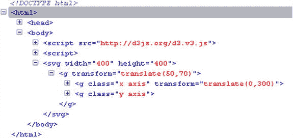

**图 3-13.** FireBug 显示了为显示坐标轴而动态创建的 SVG 元素的结构

你可以看到所有元素都自动分组在 `<g>` 标签内。这让你可以更好地控制对各个元素应用可能的变换。

如果需要，你还可以添加网格。构建网格的方式与构建坐标轴相同。实际上，以同样的方式，你使用清单 3-33 中的 `axis()` 函数定义了两个网格变量——`xGrid` 和 `yGrid`。

**清单 3-33.** `Ch3_06a.html`

```
var yAxis = d3.svg.axis()
...
var xGrid = d3.svg.axis()
    .scale(x)
    .orient("bottom")
    .ticks(5)
    .tickSize(-h, 0, 0)
    .tickFormat("");

var yGrid = d3.svg.axis()
    .scale(y)
    .orient("left")
    .ticks(5)
    .tickSize(-w, 0, 0)
    .tickFormat("");
```

在 JavaScript 代码的底部，你将这两个新的 SVG 元素添加到其他元素中，如清单 3-34 所示。

**清单 3-34.** `ch3_06a.html`

```
svg.append("g")
    .attr("class", "y axis")
    .call(yAxis)

svg.append("g")
    .attr("class", "grid")
    .attr("transform", "translate(0," + h + ")")
    .call(xGrid);

svg.append("g")
    .attr("class", "grid")
    .call(yGrid);
```

两个元素都被赋予了相同的类名：`grid`。因此，你可以将它们作为一个元素来设置样式（参见清单 3-35）。

**清单 3-35.** `Ch3_06a.html`

```
<style>
...
.grid .tick {
  stroke: lightgrey;
  opacity: 0.7;
}

.grid path {
  stroke-width: 0;
}
</style>
```

图 3-14 显示了你刚刚定义为 SVG 元素的水平网格线。

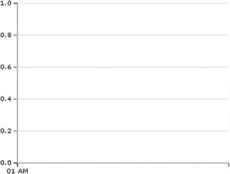

**图 3-14.** 开始绘制水平网格线

你的图表现在已准备好显示来自 CSV 文件的数据了。


#### 使用 `csv()` 函数绘制数据

现在，是时候在图表中显示数据了，你可以使用 D3 函数 `d3.csv()` 来实现，如清单 3-36 所示。

**清单 3-36.** `ch3_06a.html`

```
d3.csv("data_01.csv", function(error, data) {

// 这里我们将放置所有受数据影响的 SVG 元素

// 在文件中！！！

});
```

第一个参数是 CSV 文件的名称；第二个参数是一个函数，用于处理文件中的所有数据。所有以某种方式受这些值影响的 D3 函数都必须放在这个函数中。例如，你使用 `svg.append()` 来创建新的 SVG 元素，但其中许多函数需要知道数据的 x 和 y 值。因此，你需要将它们作为第二个参数放在 `csv()` 函数内部。

CSV 文件中的所有数据都被收集到一个名为 `data` 的对象中。CSV 文件的不同字段通过其标题来识别。你要添加的第一件事是一个迭代函数，在该函数中逐项读取 `data` 对象。在这里，日期值被解析。你必须确保所有与会者值都被读取为数值（这可以通过将每个值赋值给自身，并在其前面加上一个加号来实现）。请参见清单 3-37。

**清单 3-37.** `Ch3_06a.html`

```
d3.csv("data_01.csv", function(error, data) {

data.forEach(function(d) {

d.date = parseDate(d.date);

d.attendee = +d.attendee;

});

});
```

直到现在，才有可能在清单 3-38 中定义 x 和 y 轴的定义域，因为直到现在你才知道这些数据的值。

**清单 3-38.** `Ch3_06a.html`

```
d3.csv("data_01.csv", function(error, data) {

data.forEach(function(d) {

...

});

x.domain(d3.extent(data, function(d) { return d.date; }));

y.domain(d3.extent(data, function(d) { return d.attendee; }));

});
```

一旦文件中的数据被读取和收集，它就构成了一组必须用线条连接的点 (x, y)。你将使用 SVG 元素 `path` 来构建这条线，如清单 3-39 所示。正如你之前所见，`d3.svg.line()` 函数使这项工作变得更加容易。

**清单 3-39.** `Ch3_06a.html`

```
d3.csv("data_01.csv", function(error, data) {

data.forEach(function(d) {

...

});

...

var line = d3.svg.line()

.x(function(d) { return x(d.date); })

.y(function(d) { return y(d.attendee); });

});
```

你还可以为图表添加两个坐标轴标签和一个标题。这是一个如何手动构建 `<g>` 组的好例子。之前，组及其内部的所有元素都是由函数创建的；现在你需要显式地执行此操作。如果你想将两个坐标轴标签添加到一个组，将标题添加到另一个组，则需要指定两个不同的变量：`labels` 和 `title`（请参见清单 3-40）。

在每种情况下，你都使用 `append()` 方法创建一个 SVG 元素 `<g>`，并使用类名定义该组。随后，你使用这些变量上的 `append()` 方法将 SVG 元素分配给这两个组。

**清单 3-40.** `ch3_06a.html`

```
d3.csv("data_01.csv", function(error, data) {

data.forEach(function(d) {

...

});

...

var labels = svg.append("g")

.attr("class", "labels")

labels.append("text")

.attr("transform", "translate(0," + h + ")")

.attr("x", (w-margin.right))

.attr("dx", "-1.0em")

.attr("dy", "2.0em")

.text("[月份]");

labels.append("text")

.attr("transform", "rotate(-90)")

.attr("y", -40)

.attr("dy", ".71em")

.style("text-anchor", "end")

.text("与会者");

var title = svg.append("g")

.attr("class", "title");

title.append("text")

.attr("x", (w / 2))

.attr("y", -30 )

.attr("text-anchor", "middle")

.style("font-size", "22px")

.text("来自 CSV 文件的 D3 折线图");

});
```

最后，你可以添加 `path` 元素，该元素绘制代表数据值的线条（请参见清单 3-41）。

**清单 3-41.** `Ch3_06a.html`

```
d3.csv("data_01.csv", function(error, data) {

data.forEach(function(d) {

...

});

...

svg.append("path")

.datum(data)

.attr("class", "line")

.attr("d", line);

});
```

即使对于这个新的 SVG 元素，你也不能忘记添加其 CSS 样式设置，如清单 3-42 所示。

**清单 3-42.** `Ch3_06a.html`

```
<style>

...

.line {

fill: none;

stroke: steelblue;

stroke-width: 1.5px;

}

</style>
```

图 3-15 展示了一个漂亮的折线图，报告了 CSV 文件中的所有数据。

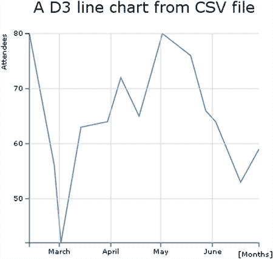

**图 3-15.** 包含所有主要组件的完整折线图

#### 在线条上添加标记

正如你在 jqPlot 的折线图中看到的，即使在这里也可以进行进一步的添加。例如，你可以在线条上放置数据标记。

在 `d3.csv()` 函数内部，所有添加的 SVG 元素之后，你可以添加标记（请参见清单 3-43）。请记住，这些元素依赖于数据，因此它们必须插入到 `csv()` 函数内部。

**清单 3-43.** `Ch3_06b.html`

```
d3.csv("data_01.csv", function(error, data) {

    data.forEach(function(d) {

    ...

    });

...

svg.selectAll(".dot")

.data(data)

.enter().append("circle")

.attr("class", "dot")

.attr("r", 3.5)

.attr("cx", function(d) { return x(d.date); })

.attr("cy", function(d) { return y(d.attendee); });

});
```

在文件的样式部分，你在清单 3-44 中添加了 `.dot` 类的 CSS 样式定义。

**清单 3-44.** `Ch3_06b.html`

```
.dot {

stroke: steelblue;

fill: lightblue;

}
```

图 3-16 展示了一个带有小圆圈作为标记的折线图；这个结果与使用 jqPlot 库获得的结果非常相似。

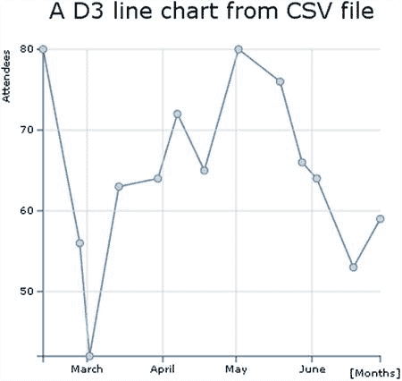

**图 3-16.** 带有标记的完整折线图

这些标记是圆形，但也可以赋予它们许多其他形状和颜色。例如，你可以使用方形标记（请参见清单 3-45）。

**清单 3-45.** `Ch3_06c.html`

```
<style>

.dot {

stroke: darkred;

fill: red;

}

</style>

...

svg.selectAll(".dot")

.data(data)

.enter().append("rect")

.attr("class", "dot")

.attr("width", 7)

.attr("height", 7)

.attr("x", function(d) { return x(d.date)-3.5; })

.attr("y", function(d) { return y(d.attendee)-3.5; });
```

图 3-17 展示了相同的折线图，但这次使用了红色小方块作为标记。

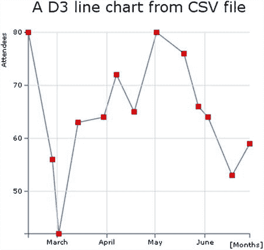

**图 3-17.** 众多标记选项之一

你也可以使用黄色菱形（通常称为钻石形）作为标记（请参见清单 3-46）。

**清单 3-46.** `Ch3_06d.html`

```
<style>

.dot {

stroke: orange;

fill: yellow;

}

</style>

...

svg.selectAll(".dot")

.data(data)

.enter().append("rect")

.attr("class", "dot")

.attr("transform", function(d) {

var str = "rotate(45," + x(d.date) + "," + y(d.attendee) + ")";

return str;

})

.attr("width", 7)

.attr("height", 7)

.attr("x", function(d) { return x(d.date)-3.5; })

.attr("y", function(d) { return y(d.attendee)-3.5; });
```

图 3-18 展示了黄色菱形标记。

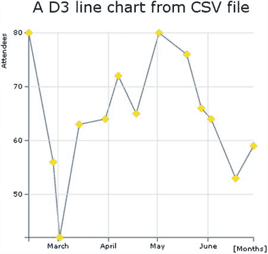

**图 3-18.** 另一种标记选项


#### 带填充区域的折线图

在本节中，我们将暂时搁置点标记，回归基础折线图。你可以为图表添加的另一个有趣功能是填充折线下方的区域。还记得 `d3.svg.line()` 函数吗？现在，你将使用 `d3.svg.area()` 函数。正如 D3 中有 `line` 对象一样，它也有 `area` 对象。因此，要定义一个 `area` 对象，你可以将代码清单 3-47 中加粗的行添加到代码中，位置就在 `line` 对象定义的下方。

**代码清单 3-47.** Ch3_07.html

```
var line = d3.svg.line()
    .x(function(d) { return x(d.date); })
    .y(function(d) { return y(d.attendee); });

var area = d3.svg.area()
    .x(function(d) { return x(d.date); })
    .y0(h)
    .y1(function(d) { return y(d.attendee); });

var labels = svg.append("g")
    ...
```

如你所见，要定义一个区域，你需要指定三个界定边缘的函数：`x`、`y0` 和 `y1`。在此例中，`y0` 是常量，对应于绘图区域的底部（x 轴）。现在，你需要在 SVG 中创建相应的元素，该元素由 `path` 元素表示，如代码清单 3-48 所示。

**代码清单 3-48.** Ch3_07.html

```
d3.csv("data_01.csv", function(error, data) {
    data.forEach(function(d) {
        d.date = parseDate(d.date);
        d.attendee = +d.attendee;
    });
    ...
    svg.append("path")
        .datum(data)
        .attr("class", "line")
        .attr("d", line);

    svg.append("path")
        .datum(data)
        .attr("class", "area")
        .attr("d", area);
});
```

如代码清单 3-49 所示，你需要在相应的 CSS 样式类中指定颜色设置。

**代码清单 3-49.** Ch3_07.html

```
.area {
    fill: lightblue;
}
```

图 3-19 展示了一个由折线图衍生而来的面积图。

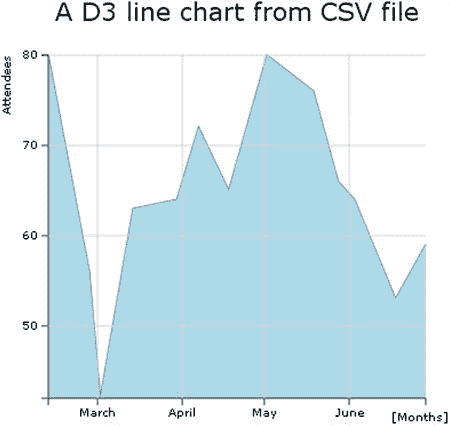

**图 3-19.** 面积图

### 多系列折线图

现在你已经熟悉了使用 SVG 元素创建折线图基本组件的方法，下一步是开始处理多个数据系列：多系列折线图。本节涵盖的最重要的元素是图例。你将学习如何利用 SVG 提供的基本图形元素来创建一个图例。

#### 处理多个数据系列

到目前为止，你一直在处理单个数据系列。现在是时候转向多系列了。在前面的例子中，你使用了 CSV 文件作为数据源。现在，你将了解另一个 D3 函数：`d3.tsv()`。它执行与 `csv()` 相同的任务，但操作的是制表符分隔值（TSV）文件。

将代码清单 3-50 复制到你的文本编辑器中，并将其保存为 `data_02.tsv`（请参阅下面的注释）。

> **注意：** TSV 文件中的值由制表符分隔，因此当你编写或复制代码清单 3-50 时，请记得检查每个值之间是否只有一个制表符。

**代码清单 3-50.** data_02.tsv

```
Date         europa    asia    america
12-Feb-12    52        40      65
27-Feb-12    56        35      70
02-Mar-12    51        45      62
14-Mar-12    63        44      82
30-Mar-12    64        54      85
07-Apr-12    70        34      72
18-Apr-12    65        36      69
02-May-12    56        40      71
19-May-12    71        55      75
28-May-12    45        32      68
03-Jun-12    64        44      75
18-Jun-12    53        36      78
29-Jun-12    59        42      79
```

代码清单 3-50 有四列，第一列是日期，其他三列是来自不同大洲的值。第一列包含 x 值；其他列是三个系列对应的 y 值。

开始编写代码清单 3-51 中的代码；这里不做解释，因为这段代码与前一个示例几乎相同。

**代码清单 3-51.** Ch3_08a.html

```
<!DOCTYPE html>
<html>
<head>
    <meta charset="utf-8">
    <script src="http://d3js.org/d3.v3.js"></script>
    <style>
        body {
            font: 10px verdana;
        }
        .axis path,
        .axis line {
            fill: none;
            stroke: #333;
        }
        .grid .tick {
            stroke: lightgrey;
            opacity: 0.7;
        }
        .grid path {
            stroke-width: 0;
        }
        .line {
            fill: none;
            stroke: steelblue;
            stroke-width: 1.5px;
        }
    </style>
</head>
<body>
    <script type="text/javascript">
        var margin = {top: 70, right: 20, bottom: 30, left: 50},
            w = 400 - margin.left - margin.right,
            h = 400 - margin.top - margin.bottom;

        var parseDate = d3.time.format("%d-%b-%y").parse;

        var x = d3.time.scale().range([0, w]);
        var y = d3.scale.linear().range([h, 0]);

        var xAxis = d3.svg.axis()
            .scale(x)
            .orient("bottom")
            .ticks(5);

        var yAxis = d3.svg.axis()
            .scale(y)
            .orient("left")
            .ticks(5);

        var xGrid = d3.svg.axis()
            .scale(x)
            .orient("bottom")
            .ticks(5)
            .tickSize(-h, 0, 0)
            .tickFormat("");

        var yGrid = d3.svg.axis()
            .scale(y)
            .orient("left")
            .ticks(5)
            .tickSize(-w, 0, 0)
            .tickFormat("");

        var svg = d3.select("body").append("svg")
            .attr("width", w + margin.left + margin.right)
            .attr("height", h + margin.top + margin.bottom)
            .append("g")
            .attr("transform", "translate(" + margin.left + "," + margin.top + ")");

        var line = d3.svg.line()
            .x(function(d) { return x(d.date); })
            .y(function(d) { return y(d.attendee); });

        // 这里我们添加 d3.tsv 函数
        // 要包含在 d3.tsv() 函数中的代码部分开始
        d3.tsv("data_02.tsv", function(error, data) {
            svg.append("g")
                .attr("class", "x axis")
                .attr("transform", "translate(0," + h + ")")
                .call(xAxis);

            svg.append("g")
                .attr("class", "y axis")
                .call(yAxis);

            svg.append("g")
                .attr("class", "grid")
                .attr("transform", "translate(0," + h + ")")
                .call(xGrid);

            svg.append("g")
                .attr("class", "grid")
                .call(yGrid);
        });
        //要包含在 d3.tsv() 函数中的代码部分结束

        var labels = svg.append("g")
            .attr("class","labels");

        labels.append("text")
            .attr("transform", "translate(0," + h + ")")
            .attr("x", (w-margin.right))
            .attr("dx", "-1.0em")
            .attr("dy", "2.0em")
            .text("[月份]");

        labels.append("text")
            .attr("transform", "rotate(-90)")
            .attr("y", -40)
            .attr("dy", ".71em")
            .style("text-anchor", "end")
            .text("参会人数");

        var title = svg.append("g")
            .attr("class", "title");

        title.append("text")
            .attr("x", (w / 2))
            .attr("y", -30 )
            .attr("text-anchor", "middle")
            .style("font-size", "22px")
    </script>
</body>
</html>
```


`.text("多系列折线图");`

`</script>`

`</body>`

`</html>`

当你在单个图表中处理多系列数据时，需要能够快速识别数据，因此需要使用不同的颜色。D3 提供了一些生成预定义颜色序列的函数。例如，`category10()` 函数提供了一个包含 10 种不同颜色的序列。只需编写清单 3-52 中的代码行，即可为多系列折线图创建一个颜色集。

**清单 3-52.** `Ch3_08a.html`

```
...
var x = d3.time.scale().range([0, w]);
var y = d3.scale.linear().range([h, 0]);
var color = d3.scale.category10();
var xAxis = d3.svg.axis()
...
```

现在需要读取 TSV 文件中的数据。与前面的示例一样，在调用 `d3.tsv()` 函数之后，添加一个解析器，如清单 3-53 所示。由于需要在 x 轴上处理日期值，因此必须解析这种类型的值。你将使用 `parseDate()` 函数。

**清单 3-53.** `Ch3_08a.html`

```
d3.tsv("data_02.tsv", function(error, data) {
  data.forEach(function(d) {
    d.date = parseDate(d.date);
  });
  ...
});
```

你已使用 `category10()` 函数与 `scale()` 函数链式调用定义了一个颜色集。这意味着 D3 将颜色序列作为一个比例尺来处理。你需要创建一个域，如清单 3-54 所示（在本例中，它将由离散值组成，而不是像 x 或 y 那样的连续值）。这个域由 TSV 文件中的列标题组成。在此示例中，你有三个大洲。因此，你将拥有一个包含三个值的域和一个包含三种颜色的颜色序列。

**清单 3-54.** `Ch3_08a.html`

```
d3.tsv("data_02.tsv", function(error, data) {
  data.forEach(function(d) {
    d.date = parseDate(d.date);
  });
  color.domain(d3.keys(data[0]).filter(function(key) {
    return key !== "date";
  }));
  ...
});
```

在清单 3-53 中，你可以看到 `data[0]` 作为参数传递给了 `d3.keys()` 函数。`data[0]` 是对应于 TSV 文件第一行的对象：

```
Object {date=Date {Sun Feb 12 2012 00:00:00 GMT+0100},
        europa="52", asia="40", america="65"}.
```

`d3.keys()` 函数从对象内部提取值的名称，这些名称与我们在 TSV 文件中作为列标题找到的名称相同。因此，使用 `d3.keys(data[0])`，你将得到字符串数组：

`["date","europa","asia","america"]`

你只对最后三个值感兴趣，因此需要过滤此数组以排除键 `"date"`。你可以使用 `filter()` 函数来实现。最后，你将把这三个大洲分配给颜色域。

`["europa","asia","america"]`

清单 3-55 中的命令将所有数据重新组织成一个结构化对象数组。这是通过 `map()` 函数及其内部函数完成的，该内部函数按照定义的结构映射值。

**清单 3-55.** `Ch3_08a.html`

```
d3.tsv("data_02.tsv", function(error, data) {
  ...
  color.domain(d3.keys(data[0]).filter(function(key) {
    return key !== "date";
  }));
  var continents = color.domain().map(function(name) {
    return {
      name: name,
      values: data.map(function(d) {
        return {date: d.date, attendee: +d[name]};
      })
    };
  });
  ...
});
```

所以，这是一个包含三个对象的数组，称为 continents。

```
[ Object { name="europa", values=[13]},
  Object { name="asia", values=[13]},
  Object { name="america", values=[13]} ]
```

每个对象都有一个洲名和一个包含 13 个对象的 values 数组：

```
[ Object { date=Date, attendee=52 },
  Object { date=Date, attendee=56 },
  Object { date=Date, attendee=51 },
  ...]
```

你已以一种便于后续处理的方式构建了数据。事实上，当需要指定图表的 y 域时，你可以通过双重迭代找到系列中所有值（而非单个值）的最大值和最小值（参见清单 3-56）。使用 `function(c)`，你迭代所有大洲，使用 `function(v)`，你迭代它们内部的所有值。最后，`d3.min` 和 `d3.max` 将只提取一个值。

**清单 3-56.** `Ch3_08a.html`

```
d3.tsv("data_02.tsv", function(error, data) {
  ...
  var continents = color.domain().map(function(name) {
    ...
  });
  x.domain(d3.extent(data, function(d) { return d.date; }));
  y.domain([
    d3.min(continents, function(c) {
      return d3.min(c.values, function(v) { return v.attendee; });
    }),
    d3.max(continents, function(c) {
      return d3.max(c.values, function(v) { return v.attendee; });
    })
  ]);
  ...
});
```

得益于新的数据结构，你可以为每个大洲添加一个包含折线路径的 SVG 元素 `<g>`，如清单 3-57 所示。

**清单 3-57.** `Ch3_08a.html`

```
d3.tsv("data_02.tsv", function(error, data) {
  ...
  svg.append("g")
    .attr("class", "grid")
    .call(yGrid);
  var continent = svg.selectAll(".continent")
    .data(continents)
    .enter().append("g")
    .attr("class", "continent");
  continent.append("path")
    .attr("class", "line")
    .attr("d", function(d) { return line(d.values); })
    .style("stroke", function(d) { return color(d.name); });
});
```

生成的多系列折线图如图 3-20 所示。

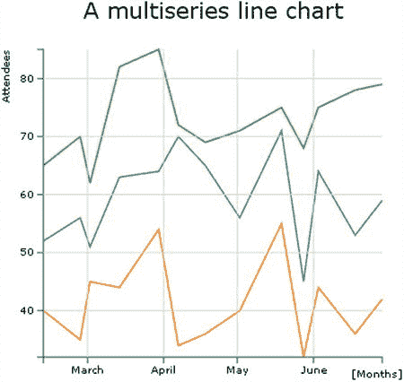

**图 3-20.** 多系列折线图

#### 图例

在处理多系列图表时，下一步逻辑是添加图例，以便用颜色和标签对系列进行分类。由于图例与其他图形对象一样，你需要添加允许在图表上绘制它的 SVG 元素（参见清单 3-58）。

**清单 3-58.** `Ch3_08a.html`

```
d3.tsv("data_02.tsv", function(error, data) {
  ...
  continent.append("path")
    .attr("class", "line")
    .attr("d", function(d) { return line(d.values); })
    .style("stroke", function(d) { return color(d.name); });
  var legend = svg.selectAll(".legend")
    .data(color.domain().slice().reverse())
    .enter().append("g")
    .attr("class", "legend")
    .attr("transform", function(d, i) { return "translate(0," + i * 20 + ")"; });
  legend.append("rect")
    .attr("x", w - 18)
    .attr("y", 4)
    .attr("width", 10)
    .attr("height", 10)
    .style("fill", color);
  legend.append("text")
    .attr("x", w - 24)
    .attr("y", 9)
    .attr("dy", ".35em")
    .style("text-anchor", "end")
    .text(function(d) { return d; });
});
```

生成的多系列折线图如图 3-21 所示，其中包含图例。

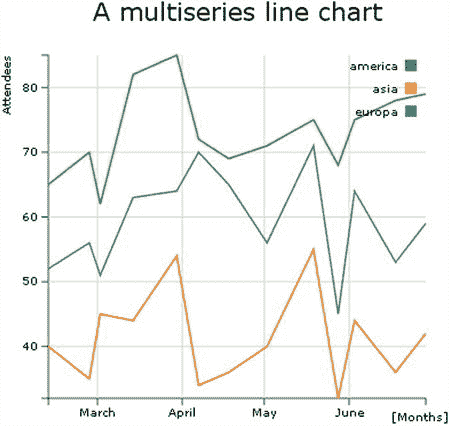

**图 3-21.** 带图例的多系列折线图


#### 插值线

在折线图中，数据点通常按顺序用直线逐一连接。有时，你会看到所有点都连接成曲线的折线图表示。实际上，这种效果是通过插值实现的。从数学角度来看，D3 库以更精确的方式涵盖了数据点的插值。因此，你需要更深入地理解这个概念。

当你有一组数值并想用折线图表示它们时，本质上是想了解这些数值所暗示的趋势。根据这个趋势，你可以评估在一个数据点与下一个数据点之间的中间点可能获得哪些值。这种估算实际上就是在进行插值。根据你想要达到的趋势和精度，你可以使用各种数学方法来控制连接数据点的曲线形状。

最常用的方法是样条插值。（如果你想深入了解该主题，请访问 [`http://paulbourke.net/miscellaneous/interpolation/`](http://paulbourke.net/miscellaneous/interpolation/) 。）表 3-1 列出了 D3 库提供的各种插值类型。

**表 3-1.** D3 库中可用的折线插值选项

| 选项 | 描述 |
| --- | --- |
| `basis` | B 样条，在端点处复制控制点。 |
| `basis-open` | 开放 B 样条；可能不与起点或终点相交。 |
| `basis-closed` | 闭合 B 样条，如同一个循环。 |
| `bundle` | 等同于 `basis`，但使用张力参数来拉直样条。 |
| `cardinal` | 基数样条，在端点处复制控制点。 |
| `cardinal-open` | 开放基数样条；可能不与起点或终点相交，但会与其他控制点相交。 |
| `cardinal-closed` | 闭合基数样条，如同一个循环。 |
| `Linear` | 分段线性线段，如同折线。 |
| `linear-closed` | 闭合线性线段以形成多边形。 |
| `monotone` | 保持 y 方向单调性的三次插值。 |
| `step-before` | 在垂直和水平线段之间交替，如同阶梯函数。 |
| `step-after` | 在水平和垂直线段之间交替，如同阶梯函数。 |

你可以通过访问 [`https://github.com/mbostock/d3/wiki/SVG-Shapes#wiki-line_interpolate`](https://github.com/mbostock/d3/wiki/SVG-Shapes#wiki-line_interpolate) 找到这些选项。

现在你更好地理解了什么是插值，可以看一个实际案例。在之前的例子中，你有三个系列，由不同颜色的线表示，并由连接数据点 (x,y) 的线段组成。但也可以绘制相应的插值线来代替。

如清单 3-59 所示，你只需向 `d3.svg.line` 添加 `interpolate()` 方法即可获得所需效果。

**清单 3-59.** Ch3_08b.html

```
var line = d3.svg.line()
  .interpolate("basis")
  .x(function(d) { return x(d.date); })
  .y(function(d) { return y(d.attendee); });
```

图 3-22 显示了应用于图表中三个系列的插值线。连接数据点的直线已被曲线取代。

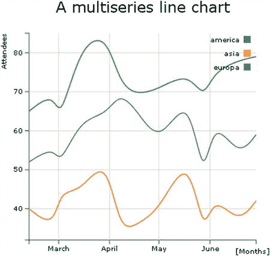

**图 3-22.** 平滑的多系列折线图

### 差异折线图

这种图表描绘了两个系列之间的区域。在第一个系列大于第二个系列的范围内，区域显示一种颜色；在小于的范围内，区域显示另一种颜色。这类图表的一个典型例子是比较收入和支出随时间变化的趋势。当收入大于支出时，区域为绿色（通常绿色代表良好），而当收入小于支出时，区域为红色（表示糟糕）。将清单 3-60 中的值写入一个 TSV（或 CSV）文件，并将其命名为 `data_03.tsv`（参见注释）。

**注意**

TSV 文件中的值由制表符分隔，因此当你编写或复制清单 3-60 时，请记得检查每个值之间是否只有一个制表符。

**清单 3-60.** data_03.tsv

```
Date        income    expense
12-Feb-12    52        40
27-Feb-12    56        35
02-Mar-12    31        45
14-Mar-12    33        44
30-Mar-12    44        54
07-Apr-12    50        34
18-Apr-12    65        36
02-May-12    56        40
19-May-12    41        56
28-May-12    45        32
03-Jun-12    54        44
18-Jun-12    43        46
29-Jun-12    39        52
```

开始编写清单 3-61 中的代码；这次不包含解释，因为该示例与前一个几乎相同。

**清单 3-61.** Ch3_09.html

```
<!DOCTYPE html>
<html>
<head>
<meta charset="utf-8">
<script src="http://d3js.org/d3.v3.js"></script>
<style>
body {
  font: 10px verdana;
}
.axis path,
.axis line {
  fill: none;
  stroke: #333;
}
.grid .tick {
  stroke: lightgrey;
  opacity: 0.7;
}
.grid path {
  stroke-width: 0;
}
</style>
</head>
<body>
<script type="text/javascript">
var margin = {top: 70, right: 20, bottom: 30, left: 50},
    w = 400 - margin.left - margin.right,
    h = 400 - margin.top - margin.bottom;

var parseDate = d3.time.format("%d-%b-%y").parse;

var x = d3.time.scale().range([0, w]);
var y = d3.scale.linear().range([h, 0]);

var xAxis = d3.svg.axis()
    .scale(x)
    .orient("bottom")
    .ticks(5);

var yAxis = d3.svg.axis()
    .scale(y)
    .orient("left")
    .ticks(5);

var xGrid = d3.svg.axis()
    .scale(x)
    .orient("bottom")
    .ticks(5)
    .tickSize(-h, 0, 0)
    .tickFormat("");

var yGrid = d3.svg.axis()
    .scale(y)
    .orient("left")
    .ticks(5)
    .tickSize(-w, 0, 0)
    .tickFormat("");

var svg = d3.select("body").append("svg")
    .attr("width", w + margin.left + margin.right)
    .attr("height", h + margin.top + margin.bottom)
  .append("g")
    .attr("transform", "translate(" + margin.left + "," + margin.top + ")");

// 这里我们添加 d3.tsv 函数
// 需要包含在 d3.tsv() 函数中的代码部分开始
d3.tsv("data_03.tsv", function(error, data) {
  svg.append("g")
      .attr("class", "x axis")
      .attr("transform", "translate(0," + h + ")")
      .call(xAxis);

  svg.append("g")
      .attr("class", "y axis")
      .call(yAxis);

  svg.append("g")
      .attr("class", "grid")
      .attr("transform", "translate(0," + h + ")")
      .call(xGrid);

  svg.append("g")
      .attr("class", "grid")
      .call(yGrid);
});
// 需要包含在 d3.tsv() 函数中的代码部分结束

var labels = svg.append("g")
    .attr("class", "labels");

labels.append("text")
    .attr("transform", "translate(0," + h + ")")
    .attr("x", (w-margin.right))
    .attr("dx", "-1.0em")
    .attr("dy", "2.0em")
    .text("[月份]");

labels.append("text")
    .attr("transform", "rotate(-90)")
    .attr("y", -40)
    .attr("dy", ".71em")
    .style("text-anchor", "end")
    .text("百万美元");

var title = svg.append("g")
    .attr("class", "title");

title.append("text")
    .attr("x", (w / 2))
    .attr("y", -30 )
    .attr("text-anchor", "middle")
    .style("font-size", "22px")
    .text("差异图表");
</script>
</body>
</html>
```

首先，你读取 TSV 文件以检查收入和支出值是否为正数。然后，你解析所有日期值（参见清单 3-62）。

**清单 3-62.** Ch3_09.html

```
d3.tsv("data_03.tsv", function(error, data) {
  data.forEach(function(d) {
    d.date = parseDate(d.date);
    d.income = +d.income;
    d.expense = +d.expense;
  });
...
});
```


此处与之前展示的示例（多系列折线图）不同，无需重构数据，因此可以直接在 `x` 和 `y` 上创建比例尺（domain），如代码清单 3-63 所示。最大值和最小值是通过每一步用 `Math.max` 和 `Math.min` 比较收入和支出值获得的，然后使用 `d3.min` 和 `d3.max` 找出每一步影响迭代的值。

**代码清单 3-63.** `Ch3_09.html`

```
d3.tsv("data_03.tsv", function(error, data) {
  data.forEach(function(d) {
    ...
  });
  x.domain(d3.extent(data, function(d) { return d.date; }));
  y.domain([
    d3.min(data, function(d) {return Math.min(d.income, d.expense); }),
    d3.max(data, function(d) {return Math.max(d.income, d.expense); })
  ]);
  ...
});
```

在添加 SVG 元素之前，需要定义一些 CSS 类。当支出大于收入时，使用红色；否则使用绿色。需要定义这些颜色，如代码清单 3-64 所示。

**代码清单 3-64.** `Ch3_09.html`

```
<style>
  ...
  .area.above {
    fill: darkred;
  }
  .area.below {
    fill: lightgreen;
  }
  .line {
    fill: none;
    stroke: #000;
    stroke-width: 1.5px;
  }
</style>
```

由于需要表示线条和区域，可以通过数据点之间的插值来定义它们（参见代码清单 3-65）。

**代码清单 3-65.** `Ch3_09.html`

```
d3.tsv("data_03.tsv", function(error, data) {
  ...
  svg.append("g")
    .attr("class", "grid")
    .call(yGrid);

  var line = d3.svg.area()
    .interpolate("basis")
    .x(function(d) { return x(d.date); })
    .y(function(d) { return y(d["income"]); });

  var area = d3.svg.area()
    .interpolate("basis")
    .x(function(d) { return x(d.date); })
    .y1(function(d) { return y(d["income"]); });
});
```

如你所见，实际上只定义了收入点的线条；没有涉及支出值。但我们需要的是收入和支出两条线之间的区域，因此在定义 `path` 元素时，为了绘制这个区域，可以将支出值作为边界，通过一个通用函数迭代 `d` 值（参见代码清单 3-66）。

**代码清单 3-66.** `Ch3_09.html`

```
d3.tsv("data_03.tsv", function(error, data) {
  ...
  var area = d3.svg.area()
    .interpolate("basis")
    .x(function(d) { return x(d.date); })
    .y1(function(d) { return y(d["income"]); });

  svg.datum(data);
  svg.append("path")
    .attr("class", "area below")
    .attr("d", area.y0(function(d) { return y(d.expense); }));

  svg.append("path")
    .attr("class", "line")
    .attr("d", line);
});
```

如果现在加载网页，应该会得到所需的区域（参见图 3-23）。

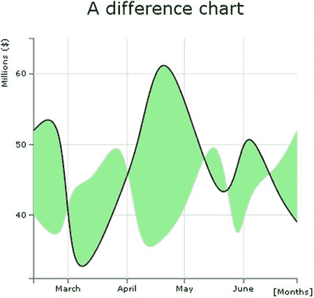

**图 3-23.** 两条趋势线之间区域的初始表示

但所有区域都是绿色的。相反，我们希望其中一些区域是红色的。需要选择由收入和支出线围成的区域，其中收入线位于支出线上方，并排除不符合此方案的区域。在处理需要添加或减去部分区域的区域时，有必要引入 SVG 裁剪路径（clip path）元素。

裁剪路径是 SVG 元素，可以附加到先前使用 `path` 元素绘制的图形上。裁剪路径描述了一个“窗口”区域，仅显示路径定义区域内的内容。图形的其他区域保持隐藏。

请看图 3-24。可以看到收入线是黑色且较粗的。该线上方的所有绿色区域（在印刷版书籍中为浅灰色）应被裁剪路径隐藏。但需要什么样的裁剪路径呢？需要由收入线上方较低区域边界路径所描述的裁剪路径。

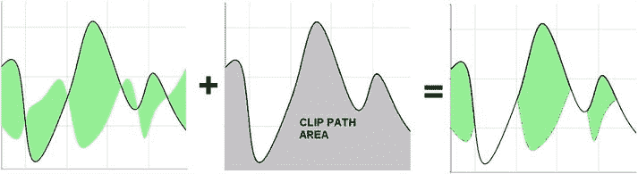

**图 3-24.** 使用裁剪路径区域选择正区域

需要对代码进行一些修改，如代码清单 3-67 所示。

**代码清单 3-67.** `ch3_09.html`

```
d3.tsv("data_03.tsv", function(error, data) {
  ...
  svg.datum(data);
  svg.append("clipPath")
    .attr("id", "clip-below")
    .append("path")
    .attr("d", area.y0(h));

  svg.append("path")
    .attr("class", "area below")
    .attr("clip-path", "url(#clip-below)")
    .attr("d", area.y0(function(d) { return y(d.expense); }));

  svg.append("path")
    .attr("class", "line")
    .attr("d", line);
});
```

现在需要对红色区域（在印刷版书籍中为深灰色）执行相同的操作。始终从收入和支出线围成的区域开始，必须消除收入线下方的区域。因此，如图 3-25 所示，可以使用描述收入线上方区域的裁剪路径作为窗口区域。

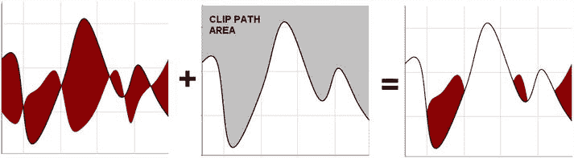

**图 3-25.** 使用裁剪路径区域选择负区域

将其转换为代码，需要在代码中添加另一个 `clipPath`，如代码清单 3-68 所示。

**代码清单 3-68.** `Ch3_09.html`

```
d3.tsv("data_03.tsv", function(error, data) {
  ...
  svg.append("path")
    .attr("class", "area below")
    .attr("clip-path", "url(#clip-below)")
    .attr("d", area.y0(function(d) { return y(d.expense); }));

  svg.append("clipPath")
    .attr("id", "clip-above")
    .append("path")
    .attr("d", area.y0(0));

  svg.append("path")
    .attr("class", "area above")
    .attr("clip-path", "url(#clip-above)")
    .attr("d", area.y0(function(d) { return y(d.expense); }));

  svg.append("path")
    .attr("class", "line")
    .attr("d", line);
});
```

最后，两个区域同时绘制，得到所需的图表（参见图 3-26）。

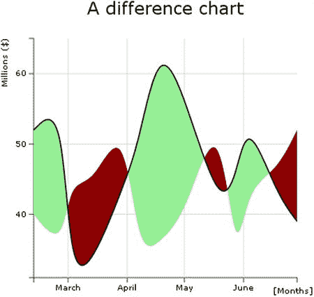

**图 3-26.** 差异面积图的最终表示

### 总结

本章展示了如何构建折线图的基本元素，包括坐标轴、轴标签、标题和网格。特别地，你了解了比例尺（scale）、定义域（domain）和值域（range）的概念。

然后，你学习了如何从外部文件（特别是 CSV 和 TSV 文件）读取数据。此外，在开始处理多系列数据时，你学习了如何实现多系列折线图，包括了解完成它们所需的所有元素，如图例。

最后，你学习了如何创建一种特殊类型的折线图：差异折线图。这有助于你理解裁剪路径区域。

在下一章中，你将处理条形图。利用到目前为止学到的关于 D3 的所有知识，你将看到如何使用仅 SVG 元素来实现构建条形图所需的所有图形组件。更具体地说，你将看到如何使用相同的技术来实现所有可能类型的多系列条形图，从堆叠条形图到分组条形图，包括水平和垂直方向。

